# 带圈友跑出来 150+YPP，关于如何抓住 YouTube+AI+出海红利的一些思考

250409 生财精华

公众号懒人搜索，懒人专属群分享

## 引言：一叶障目

大家好，我是 Gary 曹淦，生财 YouTube 深海圈总教练 & 航海教练 & 资深传术师 & 航海家，深耕 AI 内容出海。

从 1 月开始做 YouTube AI shorts 主题的私教陪跑到 3 月启动生财 YouTube 深海圈和 3 月 YouTube 航海，应该和咱们的教练团累计带圈友们开通了超过 150 个 YPP，而我们的小工作室成立一个月也开通了接近 30 个 YPP。

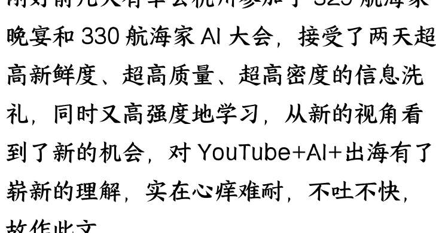

刚好前几天有幸去杭州参加了 329 航海家晚宴和 330 航海家 AI 大会，接受了两天超高新鲜度、超高质量、超高密度的信息洗礼，同时又高强度地学习，从新的视角看到了新的机会，对 YouTube+AI+出海有了崭新的理解，实在心痒难耐，不吐不快，故作此文。

几个月来，接触了很多不同背景的圈友，但大家问的问题都大差不差，像“YouTube 现在适合进场吗”“AI 赛道的 YPP 在 YouTube 变现情况如何”“在 YouTube 单人 YPP 产值天花板是多少”“在 YouTube 通过 YPP 月入千刀、万刀需要多久”等等。

从这些问题里会发现大家关注点核心还是在一件事儿上，就是“YouTube 的 YPP 收益”。确实，YPP 收益是重要的，但当下 AI 产业发展日新月异，业务出海的势头如日中天，而 YouTube 作为全球最大的视频平台，坐拥 25 亿月活的海外流量，如果只关注 YPP 收益，难免被一叶障目。相比于 YPP 的收益，倒不如说 YPP 的数量当下是更重要的资源。

所以这篇文章会结合我们这几个月以来带队实操 YouTube AI 内容的体感和近段时间在出海、AI 两个方向上的思考感悟，从以下几个话题出发，代入不同身份的视角，逐步升维，抛砖引玉，和大家聊聊在我们或许还尚显稚嫩的观点里，不同身份、不同阶段，可以如何抓住 YouTube+AI+出海的红利。

## 普通人的机会：为什么普通人做 YouTube 推荐从 AI 赛道起步
## 成为超级创作者的机会：AI 如何重构 YouTube 的内容生态
## 业务 leader 的机会：业务结合 AI+出海在 YouTube 的红利
## 结语：聊聊生财 YouTube 深海圈的生态位

## 普通人的机会：为什么普通人做 YouTube 推荐从 AI 赛道起步

### 一个被超级标改变的普通人

首先，让我们定义一下，在这个命题下，什么是普通人。

我的理解是，没有自己成型的业务、没有专业的内容生产能力、没有足以击穿内容的专业技能，如果各位不是普通人，可以跳过这部分内容。

时至今日，参加过两次 YouTube 航海或者看过航海手册的各位应该都记得，航海手册里关于赛道的推荐，绝大部分都是 AI 赛道。其实不止一次，很多对 YouTube 感兴趣但对 AI 不感兴趣的圈友都问过我，为什么这么设计？为什么要把 AI 赛道的位置摆在这么重要的位置？YouTube AI 赛道什么时候成主流了？

因为我就是这个被超级标改变的普通人。

2024 年 10 月 24 日，亦仁老大发布的超级标，主题是 YouTube AI shorts。过去没有任何视频经验的我，11 月 8 日开始发布第一条 AI shorts（AI 短视频），11 月底开通 YPP，12 月初 7000 万播放，拿到了 10 万订阅银奖牌，在 YouTube 的第一个月赚到了人生的第 1 个 1000 美金。可以说，我是生财第一批吃到 YouTube+AI 红利的人，也是第一批被生财超级标改变人生轨迹的人。

### 超级标 02

来了，今天发布第二条超级标，请坐稳扶牢，发车！

本次超级标是：通过 AI 生成的各种视频，上传到 Youtube 和 shorts，获取广告分成，空间无限大，以下我来说明理由：

- 1. 这是一个超级巨大的市场和空间。12 年我作为第一批在 Youtube 上开始赚钱的人，那个时候就已经感受到巨大的流量价值不对等，同样的播放，在国内视频平台可能一文不值，在 YouTube 上可能有几千美金的收益。

展开全部

大婶子、丁丁丁、贺先森、乐行、宗正、富贵吉祥发财小羊、洋洋、尊威、大脸猫、杨善峰 等 975 人觉得很赞

> 亦仁：真相 不要说期待，要自己去研究，然后开干。赚钱最怕等着别人喂东西，别人给个线索，剩下的钱金是自己研究。

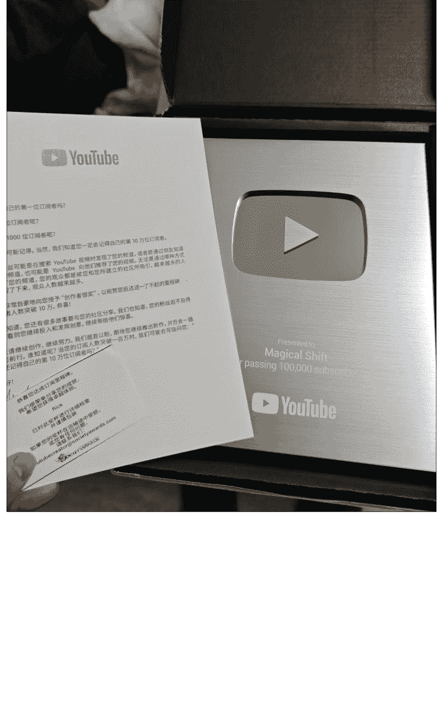

### 天时地利人和

可以坦诚地讲，AI 赛道（特指纯 AI 内容）不是 YouTube 最赚钱的赛道，也不是最简单的赛道，赚钱（RPM）比不过大家熟悉的各类解说，简单也比不过搬运洗稿。但 AI 赛道（包括 shorts 和长视频）绝对是当下最容易拿到正反馈、最蓝海、最有潜力的赛道。

为什么容易拿到正反馈？

因为只要跟着手册找到对标、复用提示词、文生图、图生视频、再加上简单的剪辑，恭喜你，一条至少 60-80 分的视频诞生了。我相信对于大部分做 AI 赛道的圈友来说，哪怕没经验，只要选对了赛道和对标，第一条视频就很有可能是万播，这在传统赛道是很难想象的；与此同时，AI 赛道也可以说是普通人开通 YPP 最简单的赛道——至少我们经手的 100+YPP，包括初审被拒的，只要是按照要求制作视频、完成申诉，即便内容本身很简单，最后开通成功的几率也是 100%，大家开通的平均时间也就是在 1-2 个月之间，而过去需要多久？这是 claude3.7 给出的答案：

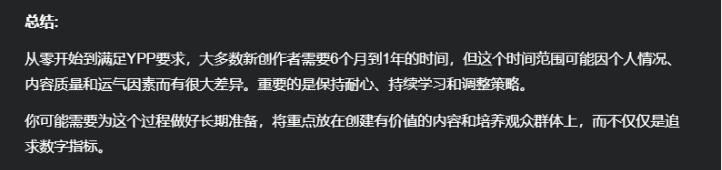

### 为什么蓝海？

因为相较于油管 20 年历史来说，AI 赛道诞生不过两年，而随着 AI 工具的飞速迭代，我们现在入局的 AI 赛道实际上可能是近半年才衍生出的新分支，而我们去看一下各个赛道的内容就会发现，同样是赛道头部，很多 AI 赛道的头部频道内容粗制滥造，让人无语；但大家耳熟能详的经典赛道，赛道头部的质量往往高的离谱。

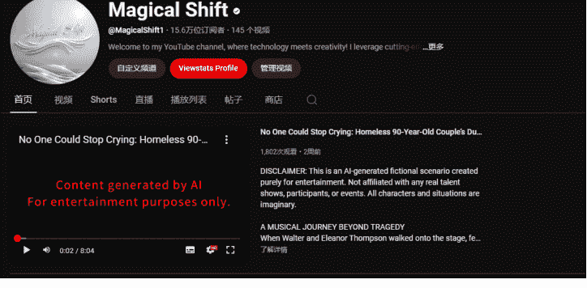

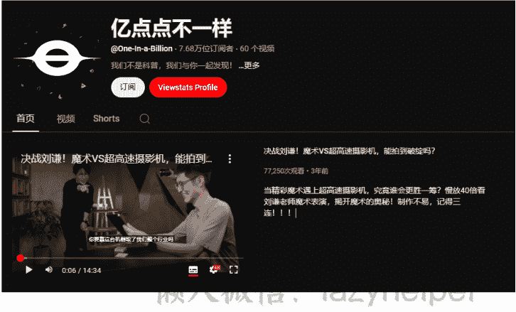

（是的，我的频道订阅 15 万+，比影视飓风做了几年的小号多一倍）

（实际我的订阅没什么用，跟人家实打实的订阅比不了一点，看个乐子就行）

这意味着什么？意味着普通人也有机会成为 YouTube AI 赛道的头部。从 12 月航海开始，光是我们生财圈友就已经出了几十个各个 AI 细分赛道的头部频道（被拿来对标）；但你能想象自己去跟影视飓风、小 lin 说、MR.Beast 这样的频道竞争吗？何况 AI 赛道还有巨大的潜力。

### 为什么有潜力？

或许很多人以为，AI 赛道就是 AI 猫猫打工、AI 动物小故事、美女变身等等看起来简单无脑的内容。但是大家有没有意识到，AI 内容是在跟着 AI 工具飞速进化的？这里放几个不同时期比较典型的 AI 达人秀短视频供大家参考。

- 2024 年 10 月 2万播放
- 2024 年 11 月 4万播放 我的首个爆款
- 2025 年 1 月初 4万播放
- 2025 年 1 月中旬 1万播放
- 2025 年 3 月初 5万播放
- 2025 年 3 月 百万播放 来自@困困圈友

可以看到，仅仅是达人秀变身这个很小的细分赛道，都已经在内容层面进行了多次迭代。从一开始生硬、呆板的人物形象和动作，逐渐开始离谱，到最后这个来自困困圈友的创新魔术达人秀，已经几乎让人难分真假，还有更多的衍生分支赛道篇幅所限无法一一展示。其实只要留心一下，我们会发现 AI 已经逐渐渗透到了很多赛道里，而 AI 赛道之所以能够被我们如此明确地定义，是因为 AI 尚且能够被明确地分辨，但是随着 AI 工具的继续迭代，我们真的能保证自己区分出什么内容是 AI 制作而成吗？AI 内容的魅力就在于，AI 能够融合到任何内容中去，AI 赛道的潜力取决于与之融合的赛道的潜力，甚至更大。

### 认知纠偏：AI 赛道没价值？收益低？

话说回来，做 AI 赛道实际上也是一个打基础的过程：通过 AI shorts 复刻爆款的过程，一方面能够提升我们对于 AI 的理解，一方面也能够提升我们对于爆款内容的理解。拆解 YouTube 任何一个赛道视频的底层逻辑，跟我们拆解 AI 赛道视频都是一样的；拆解长视频跟拆解短视频的逻辑也是一样的，无非就是时长和要素的增加。如果一个 15 秒的简单 AI 视频我们都做不好，遑论 15 分钟的非 AI 类长视频呢？

再说到收益，我们知道 AI shorts 收益低，实际上不是 AI 收益低，是泛娱乐化的 shorts 收益本来就低，而 AI 的长视频完全能够实现和非 AI 类内容无异的收益，收益跟 AI 与否无关，跟内容本身有关。再者，YPP 仅仅只是 YouTube 最基础的变现方式，后文也会提到从 AI 内容衍生出的更多变现机会。

### 内容表现

过去 28 天
- 视频
- Shorts 短视频
- 直播

估算收入: $222.94
观看次数: 3.6万
每千次展示收入 (RPM): $6.21
其他收入: $189.57

总之，从 12 月航海到现在，我的观点更加坚定：普通人做 YouTube，AI 赛道一定是首选。

## 成为超级创作者的机会：AI 如何重构 YouTube 的内容生态

### 渗透

借用小排老师的话：
做 AI 内容的本质不是做 AI、也不是做内容，是做观众的需求。

眼下，我放上几张今天（4 月 3 日）的截图让大家提提神，均为 YouTube 搜索并筛选后的视频列表页，筛选条件：按播放次数排列，近一个月内

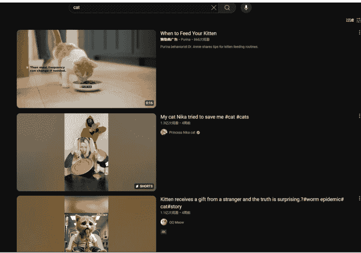

公众号懒人搜索，懒人专属群分享

- Find Your Dog, Win $10,000 · 1.4亿次观看 · 10 天前
- Smith Kennel Training: Feeding for Performance · 赞助商广告 · Purina Pro Club · 8.2 万次观看
- Keep Your Dogs Fueled & Energized Experts Talk Hunting Dog Nutrition · Golden retriever successfully rescues baby stuck in mud ! 🐾 #dog #shorts · 4697 万次观看 · 3 周前
- Wayne_Al_Animal · SALES RECORDS! Watch now · JENNIE - like JENNIE (Official Live Performance Video | NPOP LIMITED EDITION - SIDE A) · 2399 万次观看 · 3 周前
- NPOP LIMITED EDITION - SIDE A Follow JENNIE - Instagram: https://www.instagram.com/jenniepyeone T&Tok ...
- Beautiful girl's magical dance performance terrified the audience &agt #dance #magic · 2382 万次观看 · 3 周前
- Beautiful girl's magical dance performance terrified the audience.
- ToRung comedy: 🍆 squid game and pregnancy 🍌 · 9415 万次观看 · 4 周前
- ToRung comedy: squid game and pregnancy ❤️ Thank you everyone for always supporting the channel all the time.
- Join millions in the shooter · 赞助商广告 · Marvel Rivals · Download
- Doll squad game #squidgame #squidgame2 #squidgamesong #squadgame2 #shortsviral · 8941 万次观看 · 3 周前
- smierga · squidgameseason2 #squidgametflix #squidgamedealt #squidgamesexplained #ruinedbyAl #squidgame3 #flat ...
- Nobody does drama like fancy Brits in period pieces. Stream now on Peacock. · 赞助商广告 · Peacock · Mentaly I'm here. Stream Downton Abbey: A New Era & Emma on Peacock. Stream now
- Lovely baby met an earthquake , poor pug rescued him #story #cute #animals #cuteanimals #earthquake · 1亿次观看 · 4 天前
- Honest Kiki Story · 3370 万次观看 · 3 周前
- Aria KI Stories

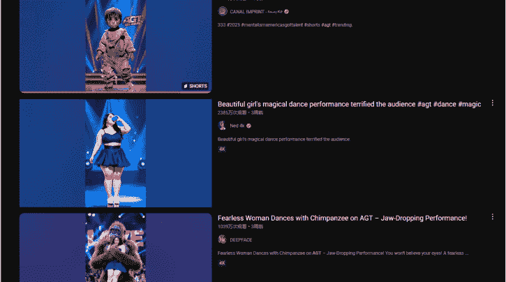

不知道屏幕前的各位有没有感到一丝寒意，虽然对这个结果有所预料，但真正看到还是大受震撼，这些大家耳熟能详的赛道，已经悄无声息地让 AI 内容创作者爬上了流量的金字塔顶端。

额外补一句，如果同样是做上面几类历史悠久的老赛道，不用 AI，各位认为新人创作者要做到前五名有可能吗？但上面有 4 个词条 (AGT、dog、story、dance)，我们圈友做的 AI 内容，都登上过当月前五名。

### 共生

所有能够斩获流量成为爆款的内容，一定是精准地击中了受众的需求点。说起来简单，但只有真正做过内容尤其是视频内容才知道这句话要落地有多难。再借用一下小排老师的观点，在进行内容创作的时候，AI 实际上是一个绝大部分能力都远强于我们但又 100% 听话的合伙人。

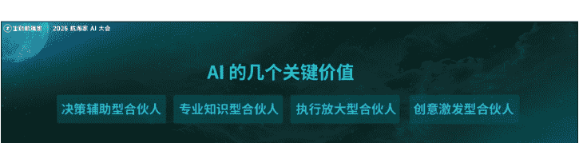

- 不熟悉油管？不知道什么赛道数据好？没关系，用 Manus、Gensparks、Cursor 之类的 agent 帮你写一个数据采集工具，再帮你分析不同赛道的数据（决策辅助）
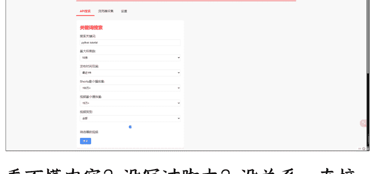

- 看不懂内容？没写过脚本？没关系，直接扔给 Gemini，让它帮你拆解故事的脚本，帮你写提示词。（专业知识）
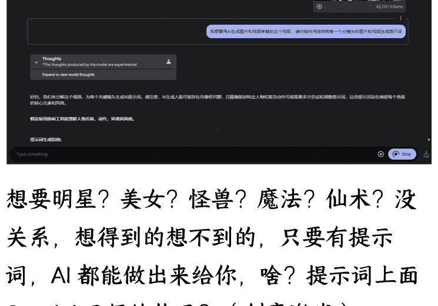

- 想要明星？美女？怪兽？魔法？仙术？没关系，想得到的想不到的，只要有提示词，AI 都能做出来给你，啥？提示词上面 Gemini 已经给你了？（创意激发）
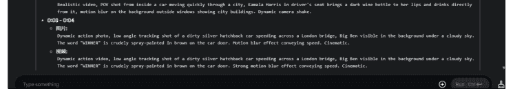

公众号懒人搜索，懒人专属群分享

- 重复工作太多浪费人力?视频制作流程繁琐?没关系,照着精华帖用 AI 搭个工作流，来体验下 AI 解放生产力一天 100 条视频的感觉。(执行放大)

AI 内容，无非就是脚本设计、文生图、图生视频、音效音乐配音、剪辑几个部分，让 AI 成为我们的合伙人，这些工作 AI 都能自己完成；而非 AI 类内容，其实也有很多部分能够通过 AI 来提效和优化。
那如果合伙人大部分工作都能帮我们完成，我们应该去做什么呢？

懒人微信:lazyhelper

13/42

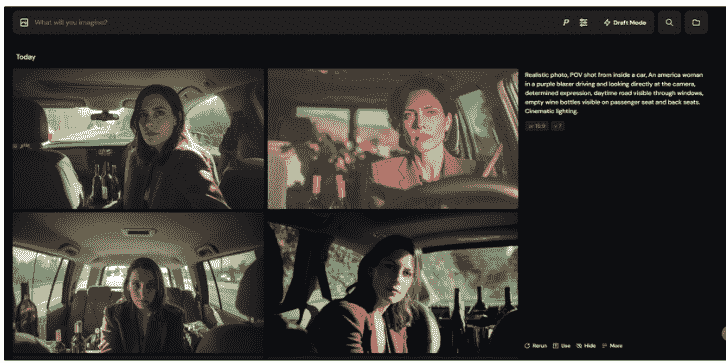

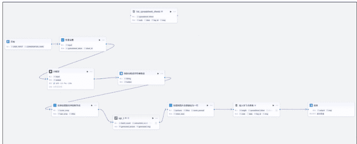

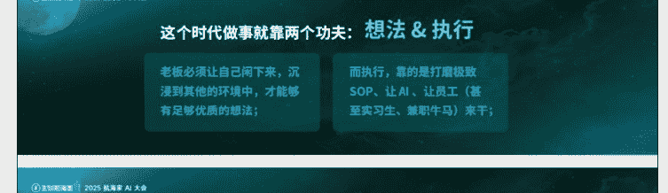

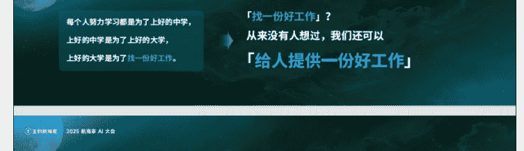

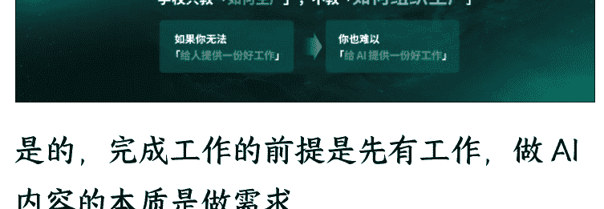

是的，完成工作的前提是先有工作，做 AI 内容的本质是做需求。

有了 AI 的帮助，做内容是很简单，但如果缺乏对观众需求的了解，缺乏对内容本身的了解，我们做出来的 AI 内容，不就是跟新白雪公主一样的赛博垃圾吗？

在 AI 能力有限的时候，要制作一个高质量的 AI 视频很困难，基本只能靠剪辑手法、构图和分镜语言来拔高制作水平。即便是像早期传播范围极广，卡兹克 23 年 8 月制作的“流浪地球”，受限于当时的图片和视频工具水平，现在看来画面已经落后时代了。（但仍然不妨碍它成为 AI 视频的里程碑）B 站视频传送门

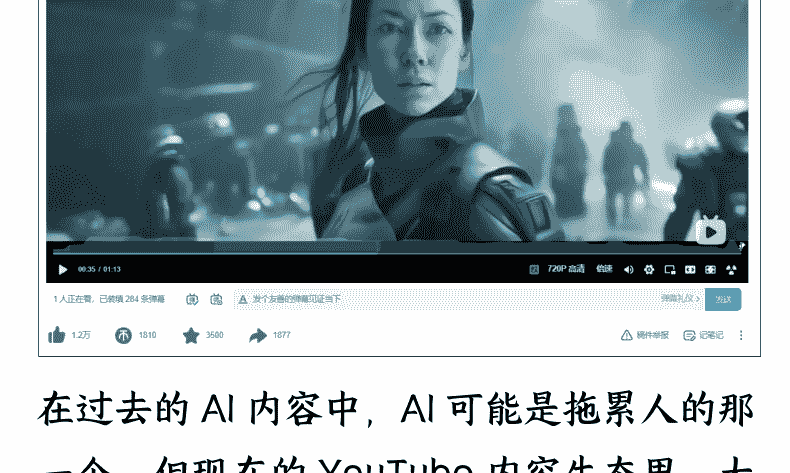

在过去的 AI 内容中，AI 可能是拖累人的那一个。但现在的 YouTube 内容生态里，大部分 AI 内容的创作者已经成为了拖累 AI 的那一个。在不断进化的 AI 面前，不管我们是不是 AI 内容的创作者，都只能不断提升自己挖需求的能力、对内容的理解能力和与 AI 的沟通协作能力，这样才能放大“人”的能力，与 AI 共生，成为超级创作者；否则要么变成 AI 的奴隶，要么变成 AI 的敌人。

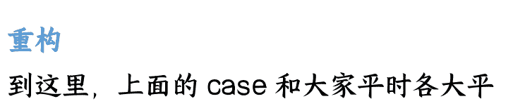

### 重构

到这里，上面的 case 和大家平时各大平台刷到的被 AI 高度渗透的赛道，绝大部分还属于简单无脑甚至是低质量的 AI 内容（卡子的流浪地球除外，求生欲很强）。那么随着 AI 的进化，在 YouTube 真正的支柱内容——长视频、精品视频的赛道里，AI 内容有一战之力了吗？

有的。可以看看下面几个 AI 视频，第一个视频甚至还是在可灵 1.6 推出之前发布的。

1500 万播放，AI 名人恶搞 MV，按照 RPM=2 计算，YPP 收益 30000 刀
原视频链接：https://www.youtube.com/watch?v=TbXZoMocpM8

600 万播放，AI 猎奇动画，按照 RPM=4 计算，YPP 收益 24000 刀
很夸张的质量、很绝的爆款要素重组，但是要看看的话请做好心理准备，恶心猎奇警告
原视频链接：https://www.youtube.com/watch?v=ygnQxbAETDk&t=22s

30 万播放，AI 游戏印象宣传片（GTA Vice City，多少人童年的回忆？），按 RPM=3 计算，900 刀
原视频链接：https://www.youtube.com/watch?v=TNG6pxfFSBQ

5 天 50 万播放，AI 恶搞电影先导片（黑雪公主，笑拉了），按 RPM=3 计算，收益 1500 刀
原视频链接：https://www.youtube.com/watch?v=x35-U9ctVwE

## 上面几个作品，大家看的时候会去在意这是不是 AI 吗？

作为一个看视频的用户，我的答案是不会，因为我的注意力已经被内容本身吸引住了，我对于内容的需求已经被满足了，至于是不是 AI？这个问题对用户来说没那么重要。

随着后续可灵 1.6 级别的模型性能更强、价格更低，再配合上 Gemini2.5 的多模态交互、GPT-4o 的精准控图以及刚发布的即梦 3.0、MT v7，AI 视频的边界和上限将在近期被拓展到一个全新的地步。

对即梦 3.0 和 MTV7 感兴趣的可以看看刚出炉的测评帖：
https://ncnmu5qLeqm9.feishu.cn/wiki/RoBkwm9LEiApDrknu04c4d49nSd

过去那些经费爆炸的大电影、MV、CG，现在可以说只要花费足够多的时间和精力和相比实拍微不足道的费用，大部分 AI 创作者都能做出来 80%的效果。所以其实这是所有个人创作者成为超级创作者的巨大机会——我们只需要聚焦在需求，只需要清楚地了解什么内容是好内容，剩下的，了解 AI、交给 AI 就好了。

## 好，现在对这个部分的标题进行回答：

AI 重构内容生态的方式是“共生”，而 AI 内容能够重构的赛道，是所有。

## 业务 leader 的机会：业务结合 AI+出海在 YouTube 的红利

前面这么长的篇幅都在讲 YouTube AI 内容对普通人和创作者的机会，这个部分再升一级，聊聊和更多圈友、航海家息息相关的，也是很多出海玩家关心的——AI+业务出海在 YouTube 的机会。

### YouTube 在国内的增量来源：内容生产端和流量需求端

每次要聊国内增量我都忍不住把微信指数放上来，从 12 月航海到现在，YouTube 的微信指数从平均 2-300 万增长到了平均 5-600 万，仍然不及 TK 的十分之一。

### 12月22日指数 日环比

| 关键词 | 指数 | 日环比 |
|---|---|---|
| 跨境电商 | 70,769,218 | 3.82% |
| tiktok | 30,018,913 | 28.41% |
| youtube | 1,479,923 | 10.34% |

+ 添加对比词

### 指数趋势

近7天 近30天 全部
跨境电商 tiktok youtube
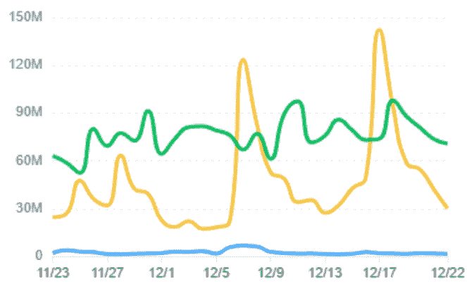

| 关键词 | 指数 | 日环比 |
|---|---|---|
| AI | 1,436,436,347 | 6.69% |
| deepseek | 388,828,280 | 5.26% |
| tiktok | 101,292,986 | 131.25% |
| 跨境电商 | 74,570,685 | 2.10% |
| 油管 | 5,066,333 | 18.13% |
| youtube | 4,510,326 | 34.59% |
| shorts | 1,747,434 | 61.63% |

懒人微信：lazyhelper

| 关键词 | 指数 | 日环比 |
|---|---|---|
| AI | 840,352,800 | 0.03% |
| 跨境电商 | 113,658,590 | 33.23% |
| deepseek | 99,905,554 | 9.81% |
| tiktok | 59,303,891 | 87.97% |
| 油管 | 6,904,562 | 18.34% |
| youtube | 3,597,495 | 13.66% |
| shorts | 1,012,493 | 7.10% |

### 这个增量到底在哪里？

YouTube 的增量空间一定不在用户端和平台端，而是在内容生产端和流量需求端。

去年刚起步的时候，把 AI 内容同步分发到视频号，3000 万播放带来了 450 人民币，同样的内容在油管 2700 万播放虽然仅有 0.02 刀的 RPM（全是印度观众，最低也就 0.01-0.02 刀），也带来了 600 刀收益。其实老马教练在很早就提到过，YouTube 的广告收益，有 45%都是分给创作者的；而国内的视频平台，我就不提了，放一张图给大家看个乐子
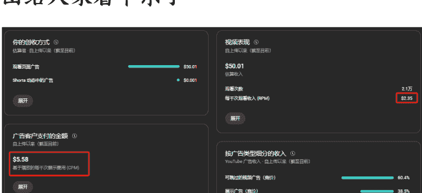

懒人微信：lazyhelper

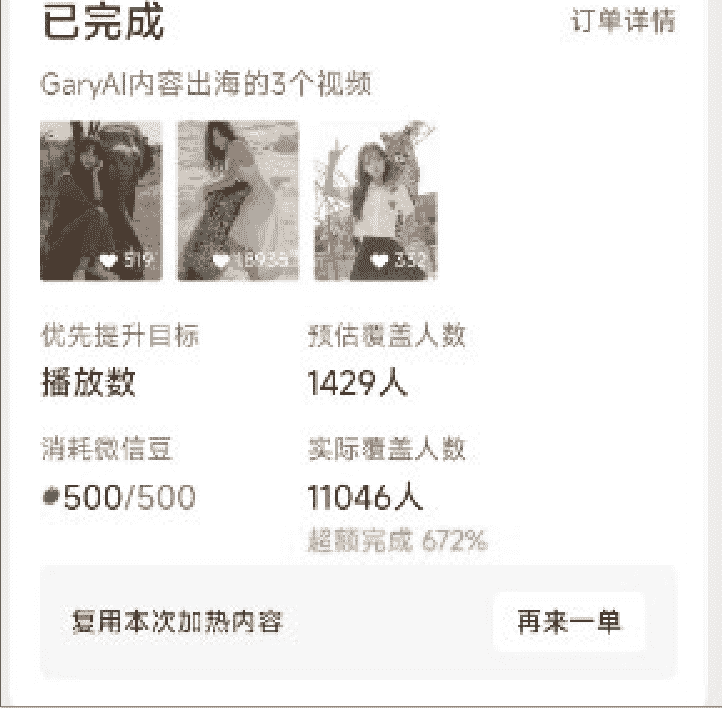
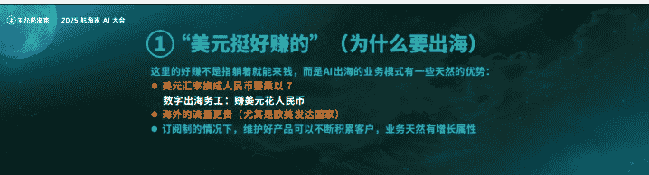

国内的创作者不傻也不懒，知道这个信息差只是早晚的事，不做专职 YouTuber 无非就是把内容分发多一个平台，但是收入可能增加 10 倍，这个买卖换你来你做不做？接触过 TK 和 YouTube 的圈友都知道，入门 YouTube 的成本比 TK 低得多，更何况除了原本的创作者以外，当下的 AI 时代还诞生了一大批的 AI 内容创作者，但由于国内 AI 内容的泛滥成灾和平台的政策管控，现在大家真的是在夹缝中求生存，动不动就限流。AI 时代来临，做 YouTube 的门槛已经被降到非常低的地步，离国内的创作者大批量出海做 YouTube，真的只差一个信息差。

### 账号被减少推荐

由于你近期部分发表存在「账号质量不符合运营规范」的问题，此账号已被减少推荐，建议优化发文，审核通过后即可恢复正常。

2025/01/02

亲们，大家最近生成的AI视频发抖音和小红书会被判违规吗？一下封了我一个月
会啊，要注意类别
我视频和小红书都进去过

与此同时，国内平台的算法不做慈善，从生产端压榨的利润并不会让利给投放端，就像火火老师分享的，只要平台算得到你的产出，就不会让你躺着赚钱，想跑自然流引到私域那更是罪大恶极，平台绝不姑息，势必重拳出击。

### 国内平台认知

| 平台 | 评价 |
|---|---|
| 抖音6 | 商业饱和，内容挤压，平台强势，直播为王 |
| 视频号5 | 持续增长，商业较弱，私域储存，体系循环 |
| 小红书1 | 导流圣地，种草很强，女主时代，电商拉垮 |
| 快手3 | 下沉天王，灰白当道，家族强势，品牌失意 |
| b站1.3 | 变现拉胯，流量尚可，年轻为主，投流正起 |
| 知乎0.5 | 小说天堂，作者优质，装逼减弱，大势已去 |
| 微博2.5 | 基本GG，明星余晖，虚假繁荣，活着就好 |

> 9.很多人的生意模式算利润，大头基本上是在平台这。

不要盲目追求纯确定性的方法论，有些人突然在平台起来了，有可能他因为某段时间幸运，或者某个玩法ok被选上了，其实他自己也不知道原理。

对于平台来说其实无所谓，人面不知何处去，桃花依旧笑春风。

如果走纯投放模式来说，要找到平台无法直接计算你产出的模式，要么在私域里翻江倒海，要么在品牌里叱咤风云。

### 两张图都来自龙共火火老师：

反观 YouTube，由于背靠庞大的谷歌生态且平台盈利方式纯粹，时至今日，都依然非常宽容地对待各种引流方式，即便是在所有的海外平台中，YouTube 也是最友好的那一档，只要你的内容本身质量高，不搞违法犯罪活动，是跳转应用市场还是跳转网站，是留微信还是留 ins，都随便你。（反正广告费留在 YouTube，同时就算去到外站也大概率在谷歌生态里）

### 与观众分享链接

创作者可以在 YouTube 上与观众分享链接，但只有某些类型的链接是可点击的。您可以通过此页面了解哪些类型的链接是可点击的，并查看其他实用资源。

注意：为了减少垃圾留言和欺诈行为，YouTube Shorts 评论和 Shorts 说明中插入的网址将无法点击。

### 可点击的链接概览

| 链接类型/位置 | 可点击 | 不可点击 |
|---|---|---|
| 频道个人资料链接 | ✓ | |
| 在长视频评论和说明中插入的网址* | ✓ | |
| 在 Shorts 评论和 Shorts 说明中插入的网址 | | ✓ |
| Shorts 短视频的相关视频的链接 | ✓ | |
| 在 YouTube 实时聊天和频道说明中插入的网址（横屏直播） | ✓ | |
| 在移动应用中查看时，YouTube 实时聊天和频道说明中插入的网址（竖屏直播推送） | | ✓ |
| Shorts 评论和 Shorts 说明中的提及和 # 标签 | ✓ | |
| YouTube Shopping 联席营销计划链接 | ✓ | |
| Shorts 绿幕和混剪归因链接 | ✓ | |
| 帖子* | | ✓ |
| 片尾画面 | ✓ | |

* 如需添加可点击的外部链接，您必须为频道启用高级功能。

### 谷歌生态系统可视化图

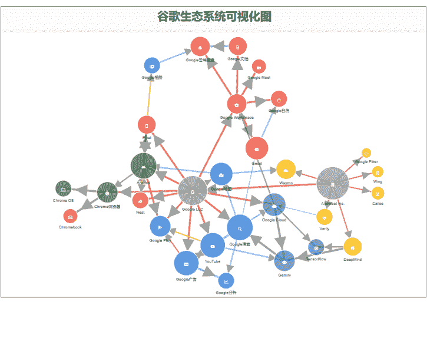

懒人微信：lazyhelper

所以我认为对于业务 leader 来说，YouTube 在国内最大的增量来自于内容生产端和流量需求端。

在这个趋势下：
- 第一波机会就是针对 YouTube 的各类知识付费和社群产品（不好意思地说，深海圈就是最直接的受益者），解决从 0 到 0.1 的问题；
- 第二波机会是针对 YouTube 内容出海需求衍生出的各类工具、服务产品（翻译插件、工具站、AI 生产工具、提效工具、代运营、MCN 等），解决从 0.1 到 1 的问题；
- 第三波机会是 YouTube 大量内容出海带来的渠道流量增量，能够为流量需求方提供大量的流量供给（电商、应用、WEB、品牌、海外私域、流量中介等等），解决从 1 到 100 的问题

太阳底下无新鲜事，这个路径相信大家都很熟悉，同样的故事已经发生过太多次。

和很多老板聊，大家总是会问，YPP 号一个月能做多少刀、单人 YPP 产值能做到多少刀、什么赛道好做、AI 赛道收益如何等等，实际上这些问题都没有跳出创作者视角——除非业务本来就是做 TK 中视频或者国内的创作者分成，有做内容的基因，那确实可以把 YPP 收益作为单独的机会来抓；但如果大家自己本来就有自己的业务，有自己的产品和项目，应该考虑如何通过 YouTube+AI 来出海放大自己的业务，而不是从零起一个没有壁垒和内容基因的盘去赚这点广告费，舍本逐末。

### 解决从0到0.1的问题：出海的前提是先出去

生财的各位一定深有感触，新机会诞生的时候，项目可能没那么快跑出来，但知识付费一定是最先行的。

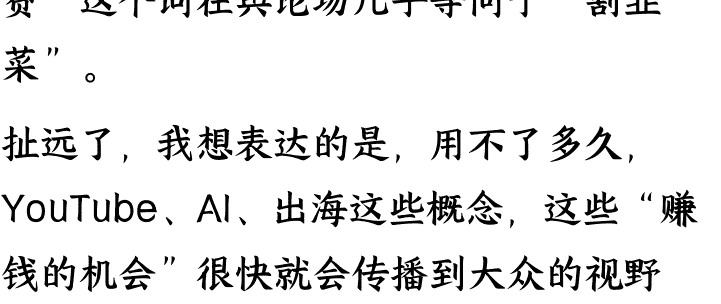

这本是一件好事——能够用钱来买认知、换时间还不好吗？只是因为太多恶意利用大众焦虑把水搅浑的劣币，让“知识付费”这个词在舆论场几乎等同于“割韭菜”。

扯远了，我想表达的是，用不了多久，YouTube、AI、出海这些概念，这些“赚钱的机会”很快就会传播到大众的视野里，相应的，YouTube在国内极低的普及度造就了YouTube在国内极低的有效信息密度——想要出海做YouTube的创作者们根本就找不到有价值的信息和资料。相信从11月开始做YouTube的各位一定深有感触，想要在国内平台找到YouTube运营相关的优质信息难如登天，什么“YouTube0播原因”、“AI赛道能不能开通YPP”、“AI赛道的收益”，别说在国内，就算在YouTube也是一博主一个说法。

在 12 月我意识到了这一点，在当时除了一个 YPP 和一篇精华帖什么都没有的我，做了一个大胆的决定——在公域引流做 YouTube 的知识付费陪跑产品。

当时我联系到做大学生和副业私域的朋友（B 站 up 主 @小挣青年林俊杰 418 会邀请加入生财）一起做了个尝试，组织 50 个小伙伴（绝大部分没有任何引流打粉经验）去公域引流测试转化链路，所有的引流资料和交付文档都是基于我自己的经验临时写的，一周引流了大概 350 人到私域，做了两场直播来转化，在第一周转化了 4 位付费 998 的陪跑，所幸当时本来就是抱着测试链路的目的进行尝试，也意识到了交付存在巨大隐患（有三位付费的客户完全是 0 基础 0 经验），所以很快给他们退款终止了这一次尝试。

虽然这次尝试只持续了一周，但通过这次尝试验证了前面的观点，针对 YouTube 的知识付费空间太大了。我们当时胡乱搭的 0 经验草台班子居然能一周引流 350 人（绝大部分来自小红书），在发帖并不频繁的情况下，12 月下半旬小红书 YouTube 关联词搜索结果下，前几屏几乎都是我们发的引流贴，图片素材就是来回用我那些并不多的收益图，我自己更新一些 YouTube 入门知识的小红书号在停更了三个月之后仍然还有人在关注收藏私信，当时做的微信群现在还在进人。

19:51
15
## 消息
发现群聊
99+
赞和收藏
15
新增关注
7
评论和@
yjijj 刚刚
你发个🌍我家你
倍培根🥓 刚刚
你发个🌍我家你
爱吃棉花糖 刚刚
你发个🌍我家你
小红薯 65D370D7 刚刚
你发个🌍我家你
吴扯扯 刚刚
你可以发个🌍我们一起交流
年年 刚刚
感兴趣就发个🌍来。我们一起交流
Mit 19:19
微信吗
Luna 18:34
[图片]
打开通知，不再错过互动消息
开启
首页
热门
消息
99+
我
懒人微信: lazyhelper

## 小红薯61B84960
深化模仿与创新：初期尽量贴近成功的模板，随着技能的增长逐渐加入原创元素。📑
优化图像生成参数：正确的设置能够显著提高AI生成图像的质量，参考特定教程调整设置可以获得更好的视觉效果。🖼️
#赚钱好项目 #自媒体创业 #海外赚钱 #AI工具 #爆款视频 #搞钱 #这个点我潜过
12-21 福建
评论 5  赞和收藏 41
爱评论的人运气都不差

小红薯25B952CF
制作视频的链接可以发一下吗？
小红薯61B84960 作者
制作视频的链接是指制作整个视频的全流程还是制作视频的工具？
小红薯61B84960 作者
感兴趣的可以思，一起共同学习
螺蛳粉
111
小红薯61B84960 作者
回复 螺蛳粉：有需要的话可以给你一篇免费资料
说点什么...

18:04:19
笔记 收藏 赞过
公开 9 私密 4 合集 0
本地草稿 有12篇笔记待发布
数据分析
观看次数 1078.4万 观看时长(小时) 29.9万 订阅人数 估算收入 US$1149
很多人 关心油管 怎么变现
未来老婆请放心元旦我也在好好搞副业
momo 121 3
油管变现方式
momo 13
海外短视频 副业，有人 来吗？
内容表现
12月 视频 短视频
289
US$1,018.10 估算收入
3756.0万 每千次展示收入(RPM) 195
月入上千美刀不是梦 为什么要做这个
收入最高的短视频
momo 5
油管这个月收益一千刀 乐就离谱
油管视频推送的三个阶段
首页 购物 + 消息 2 我
懒人微信：lazyhelper 29/42

## 聊天设置
## AI Shorts交流群
欢迎对AI shorts感兴趣的朋友一起交流，群主不…
## 群成员(152)
全部 >
Gary聊油管
Gary助理
momo
c1
不闹不闹
真缮美服饰
爪机能手
可爱喵喵
添加
删除
## 分享群邀请
## 生成评论区群链接
可直接粘贴到笔记评论区
## 群二维码
可直接分享或保存到相册
## 关联笔记
让更多人发现你的群聊
选择笔记 >
## 群公告
1.本群提倡平等礼貌的交流，积极和谐互动
2.禁止发布广告、恶意刷屏
3.不遵守规定、言论不当的成员会被踢出群…
## 我在本群的昵称
Gary聊油管 >
## 群身份标签
未设置 >

4:00
HD 5G 5G 63
## 聊天信息(411)

查看更多群成员 >
群聊名称 YTB AI Shorts交流群（三） >
群二维码 >
群公告
欢迎进群，请领取进群专属福利 群主的生财精华帖： 《24天7w粉开通YPP收益108刀，我的AI达人秀变身...
群管理 >
备注 >

所以在这个背景下不难理解，1月 YouTube AI shorts 私教陪跑其实就是验证 PMF 的 MVP 产品，验证成功才有了现在的 YouTube 深海圈（当然，深海圈的定位并不是从 0 到 0.1，航海才是），之后我们会将 YouTube 航海打造成面向生财内部免费、面向公域付费的入门级产品，一步步帮助有意向在 YouTube AI 内容出海的创作者和普通人走出去、成长起来，这是顺势而行。我有充足的理由相信，作为帮助大部分人入门的捷径，YouTube 的知识付费规模一定能够成长到和 TK 和跨境电商一个量级。

这个市场的规模太大，而我们虽然推进迅速，但现在和各位前辈比起来才刚起步、还很弱小，所以也是希望能借助大家的势能一起合作，帮助更多普通人和创作者在 YouTube 实现 AI+出海，摆脱国内卷生卷死的境地。

### 解决从 0.1 到 1 的问题：工具和服务

一旦真正开始在 YouTube 创作内容或是开展业务，工具和服务是必不可少的一环，相比于国内的生态，不同的是多出了针对出海场景的增量需求。

以我们工作室为例，需要定期采购的各项工具和服务包括了基建服务（账号、网络、指纹浏览器、设备）和工具的会员或 API（翻译工具、agent、图像生成、视频生成、音乐生成、配音工具、自动化工具、剪辑软件等），成本至少数千元，其中还不包括我们通过 AI 开发的提效工具和一些免费的工具网站（比如视频下载、数据查询、文案提取等）。即便是个人创作者，每月也至少需要数百元的固定支出；对于内容出海的大团队和企业来说，随着账号、内容生产和分发规模的增长、工具和服务成本基本都是线性增长。

光是在生财内部，12月 YouTube 航海就有 3000 人报名参加，到了这期 3 月航海，也有将近 1200 人报名，而生财在期总人数三万多人，创作者出海的需求场景其实是非常有潜力的切入点；包括企业、IP 的内容出海，我们近期也接触到很多需求。那么相应的，延伸出来的方向其实有几个：

#### 针对出海场景提供更好、更新的工具与服务
- 套壳不要停，提供一体化、场景化的解决方案
- 提供代运营服务（常见于企业和大中型 IP）

#### 针对出海场景提供更好、更新的工具与服务

这里可以举个例子，当大家刚开始做油管，像 ytlarge 的视频下载工具（https://yt.savetube.me/zh/29-youtube-video-downloader-5djdjh6）应该不少人都用过，包括我也是。但是这玩意广告真的多，一不小心就点到广告，而且也不算好用，然后大家会主动去寻找更加纯净高效的下载工具，比如 https://cobalt.tools/（无广），甚至自己开发批量下载工具。

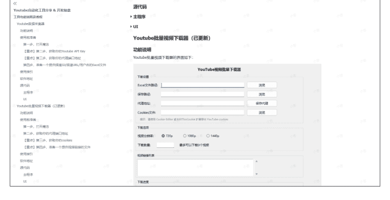

#### 来自 YouTube 航海龙教练

这只是一个非常非常小的场景，想表达就是在大家现在用 AI 做 YouTube，会产生很多新的需求是原有的工具无法很好地满足或者根本就没有这个工具的，像我就借助 Claude 陆续做了几个 Python 工具给工作室的小伙伴用，但由于专业能力所限，这其实还远远没有达到高效好用的标准，如果市场上有现成好用性价比又高的工具，我想我一定是愿意付费的，毕竟自己开发也就只能应付一些简单需求，何况会自己开发工具解决问题的人绝对是极少数。

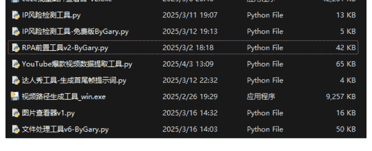

随便举几个例子：基建服务、视频下载、字幕与文案提取、数据分析（尤其是针对 AI 视频的数据分析，真的没有现成的第三方工具）、收益查询（现在的收益查询网站根本就不准）、现成的工作流和自动化工具（现在基本都要自己照着别人的模板搭，前提还得是有模版）等等...

懒人微信：lazyhelper

目前针对出海场景亟待满足的需求点真的太多了，其中不乏一些高溢价的场景，如果有一些好用的工具出来，我们在国内外第一个给各位做推广！

#### 套壳不要停，提供一体化、场景化的解决方案

就像 Damo 老师说的，现在海外 AI 站很多只是套壳应用也能够做到 top，当然套壳也分高下，针对应用出海咱不懂也不多聊，但针对内容出海，应用套壳的空间也真的蛮大的。

举个例子，我们要在 YouTube 创作一个 AI 视频的基本环节就是：
- 找对标、下载对标、提取对标脚本、文生图、图生视频、剪辑（包括配乐配音）

现在每一步基本都是独立的，这里面哪些环节能够整合？针对特定赛道，其实所有环节都能整合起来，相比一个人手动操作每个环节，效率的提升至少是 5-10 倍。

那是不是可以制作一个针对 YouTube 特定赛道的爆款制作工具，在其中嵌套上述环节需要的工具和 API，卖给那些没有太强内容制作能力的创作者？而这样的工具不仅可以面向国内出海的 AI 创作者，还可以面向所有 YouTube 的 AI 创作者。

随便再举个例子，类似的组合还可以是 YouTube 爆款元素拆解工具：adspower + playwright 自动化数据采集 + AI 数据分析提取各赛道爆款典型 + Gemini 拆解视频脚本分析爆款元素。

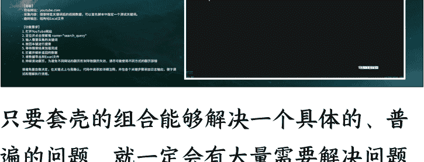

只要套壳的组合能够解决一个具体的、普遍的问题，就一定会有大量需要解决问题的人（包括企业级的需求）为之付费，因为现在市场可以说是一片空白。何况现在有了 AI 的加持，套壳的成本其实并不高。只要工具的迭代跟上时代的节奏，用户一定是有使用惯性、能产生粘性的，毕竟在内容出海的场景里，用户每解决一个问题很可能就意味着节省不少时间、多赚不少美金。

跟上面一样，如果有这样的工具出来，请务必让我们来帮忙做海内外推广！

#### 提供代运营服务

YouTube 代运营没什么特别的，跟国内的代运营一样，只不过换了个平台、国内换到海外而已，这里单独写出来主要是认为代运营的市场空间还很大。

很多企业、IP 的内容出海需求其实不仅仅是 YouTube，可能 TK、FB 都有需求，但是现在有能力做承接的后端并不多，市场也不透明，相应的其实利润空间非常大。

懒人微信：lazyhelper

像我们深海圈的圈友 @小圈 作为一个大学生，居然通过咸鱼接到了一家大健康企业出海做 YouTube 代运营的需求（已经结算了基建服务部分的费用），那么我相信各位本身就有着出海经验、代运营经验的高手们，如果做代运营，一定能够做得更大更好。

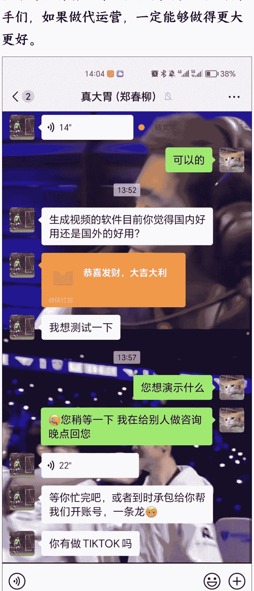

> 有人让我帮他运营海外的 YouTube 账号
> 您说多少钱合适
> 我一开始在闲鱼上，就不是昨天有那个 Maness 的嘛，我弄了一个 YouTube 频道申请还在审核，然后一个 99，然后他就找过来了。

然后就帮他申请那个账号，然后后面就聊到那个 AI 这个相关的东西，他就问我，然后我就说我我我我之前在生财做 YouTube 有 2 万粉丝，然后就就聊聊了聊了聊了，跟陪聊似的，反正聊了一段时间，就开始开始说这个。

### 解决从1到100的问题：杠杆

杠杆大家不陌生，那么针对 YouTube+AI+出海，这个杠杆指的具体是什么？

个人的理解是：大量内容在 YouTube 出海带来的渠道级流量增量。

跟阿彪老师、小波老师、朱鹤老师、Albert 老师等前辈们交流学习了解到了不少信息。现在国内 AI 类产品在 YouTube 的红人投放、内容投放还处于供不应求的状态，一是没有足够多的垂类海外红人，二是没有足够多的强转化内容，导致 YouTube 并没有成为海外产品推广的一个主要渠道——一个 25 亿月活的内容平台没有成为流量来源的主要渠道。

我们认为这里的增量空间是非常大的，所以现在我们已经在和生财的海外产品团队一起测试特定 AI 内容对于 AI 产品引流的转化率，同时也在和深海圈有意向的圈友、教练们打造 AI 类的账号（类似国内的 AI 自媒体逻辑）。之前提到过，一旦 YouTube 带货的链路跑通，多少个 YPP 账号就意味着多少倍的杠杆，这个逻辑和国内的矩阵号带货是一样的；而产品推广也是一样，一旦有一个成功的推广模式被验证，就能够通过大量的创作者和内容来快速放大规模（一个频道每天引流 10 人，100 个频道就是 1000 人，在宽阔的市场空间下基本不会存在边际效用递减），现在包括 web、app 在内的绝大部分产品形态，以及品牌势能、甚至是基于海外业务搭建的私域，都能用这样的模式来放大，这是所有出海业务潜在的杠杆。

进而言之，国内已经稀松平常的“流量中介”，在一段时间后或许也能够在 YouTube、在海外流量生态里大行其道。

在这方面有想法的各位圈友欢迎来联系我和波妮，也许大家一起努力，就能走得比时代要快一点点。

## 结语：聊聊 YouTube 深海圈的生态位

虽然在上面斗胆发表了一些观点，但是随着对 YouTube、对出海、对 AI 的了解越多，接触的专家们越多，越是深知我们的渺小。深海圈诞生到今天尚未满月，和小伍科技这样深耕 YouTube 近十年的前辈来说，还宛如襁褓中的婴儿。

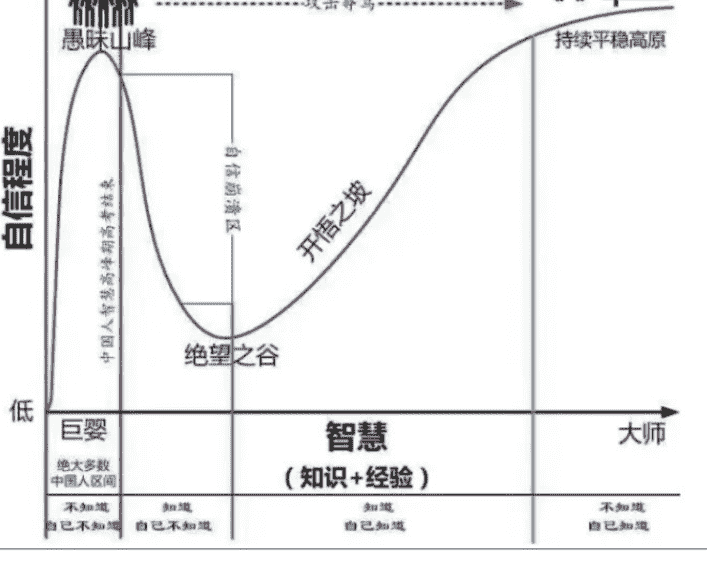

所幸，YouTube 深海圈站在了这个时代 AI+出海+YouTube 的三重风口，虽然弱小，但借着时代红利，我们也取得了一些不错的结果——通过 AI 内容基本解决了 YPP 的开通门槛、打造出了一个人均 YPP 的圈子产品、孵化出了一个战斗力极其强大的 YouTube 教练团、和圈友、教练们一起共创了当下应当是最好最全面的 YouTube+AI 运营手册（即便是免费的 3 月生财 YouTube 航海手册，应该也没有同类竞品能拼一拼质量吧）

其实，做内容、YouTube 教学，有大把 YouTube 工作室和团队强过我们；教 AI 视频、AI 提效，也有大把 AI 高手比我们专业；做资源整合、业务出海也有 MCN 机构独占鳌头。那么深海圈的生态位到底是什么？核心竞争力又是什么？

过去一个月这个问题深深地困扰着我，日思夜想，做梦都在思考。

直到参加完航海家大会，结束杭州行程，思绪纷乱，提笔（键盘）开始写这篇文章、翻找近几个月相关图片素材的时候，这个问题的答案才逐渐浮上心头。

如果说，有更好的 YouTube 教程和圈子，那么几个月前，翻遍全网的资料也找不到 AI 赛道 RPM 和 shorts 推流机制的时候，它在哪里？

如果说有更新更成熟的 YouTube 出海模式，那么当下，大家需要在 YouTube 对 AI 产品做推广的时候，它在哪里？

如果有更优质的 YouTube 相关资源，那么这些年来，基层 YouTube 创作者和企业需要合作机会的时候，它又在哪里？

是啊，此情此景，是否像极了生财诞生前的互联网搞钱环境呢——似乎有很多机会、很多人通过互联网搞了很多钱、很多牛鬼蛇神分享着或真或假的消息，但是作为小白、作为互联网人、作为互联网行业的中小企业和团队，到底该怎么开始，要怎么做，能问谁？不知道。

那么我想，生财 YouTube 深海圈生态位，就是成为 YouTube 领域的生财有术，和生财一样：
ALL IN AI，为普通人提供从 0 到 1 AI 内容出海的机会、为创作者们提供方向和资源成为 YouTube 超级创作者的机会、为海内外业务的 AI+出海提供 YouTube 生态的资源，与时代和圈友一同成长，无限进步。

历史 3000 多份各类付费文章以及年费三千多的副业社群资源，见懒人专属群内部分享！

付费群，白嫖勿扰！

懒人专属群更新记录：
https://lazybook.fun/#/blog/record2