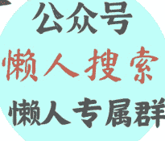

# 中美互飙关税，谁将是最后的赢家？

250411 文/卢克文工作室嘉宾 星海舰长
整理：公众号懒人搜索，懒人专属群独享
懒人微信：lazyhelper

微信:lazyhelper

不得不说，特朗普跟我老家那些脖子上挂金链子的社会大哥一个样，虽然兜里分逼没有，但出来混就讲究俩字：

面儿！

本来吧，4 月 8 日，特朗普已经放出话了，要求中国先打电话求和，无非是说，你给我一个面子，这事就能聊。

但没想到，中国 4 月 9 日先扔了个白皮书檄文，然后直接把对美关税对等加了 50%!

这让特朗普的面子往哪搁？

最终特朗普一怒之下，放出了王炸:

第一，说中国“不尊重世界市场”，给中国加 125%关税，立即生效。

第二，有 75 个国家“态度很好”，给美国打了电话而且没有报复，所以对他们的对等关税推迟 90 天，只征收 10%的关税。

消息一出，这几天被打得满头包的殖人瞬间又神气了起来:

懒人微信: lazyhelper

- 你看，明明实力不济偏要硬刚，你以为是全世界 VS 美国，现在变成中国 VS 全世界了吧？
- 特朗普本来就是要针对中国，向世界加税就是个幌子，中国选择硬刚，恰恰给特朗普送了脱钩的理由。
- 中国以为自己扛起大旗就会群起响应，最后呢？只有中国冲在前面，替别人扛了伤害。

总之，中国输了，输麻了。

那么，真的如此吗？

## 一、

首先我们要明确一点，认为中国输麻的人，无论怎么样，他都会认为中国输的。就像美国无论怎么拉垮，他们都认为美国赢麻一样。

不过，谁赢谁输，他们没有定义权。

真正的定义权，在大家的心中。

那么这次特朗普的“排中国式”关税延期，到底是谁赢谁输呢？

我们不妨从这场关税战源头来看看。

特朗普先对加拿大、墨西哥、中国加了关税，然后加拿大、墨西哥下跪求饶之后，就给两国缓了一个月，然后给中国的关税照常实施。当时很多殖人就编段子，说特朗普揪住加墨的领子，反手抽了中国一耳光。

但如果说特朗普一开始打关税战的目标是中国的，为啥后面还要再搞“对等关税”呢？

以特朗普团队的草台班子程度，大家也别指望他们是在下大棋了，殖人也别总是自觉为特朗普脑补棋术，其实特朗普的对等关税没那么复杂，就三个原因：

- 搞钱：美国 4.1 万亿美元的进口额加关税后差不多能搞到 1.5 万亿美元，加上马斯克砍掉的预算，差不多能堵住财政赤字的窟窿。
- 搞权：重建“美国霸权模式”，从“利益分享”改为“关税威逼”，这样不用付出任何东西，也能获得全球霸权。
- 搞制造业：把拜登的“利诱式”制造业回流，变成“威逼式”制造业回流，来克制资本的本能选择。

但问题在于，搞钱搞权搞制造业，这一特朗普关税战的最初的目标，全被特朗普的冲冠一怒给毁了！

- 你把其他国家的关税推迟了 90 天，只保留 10%的关税，那你能收多少钱？
4.1 万亿进口额*10%，也就 4100 亿美元嘛！考虑到市场通胀和消费萎缩的因素，大概率还到不了这个数，顶天也就 3000 亿的样子，那你的赤字窟窿怎么补？

- 本来特朗普是想用关税极限施压逼他国对美国言听计从，但现在呢？全世界都看到了两种截然不同的结果。
对美国卑躬屈膝要谈判的，特朗普说是在kissing my ass，可以说是一丁点基本的尊重都没有了。
而对美国死磕到底的呢？美国并没有什么特别好的办法，反而是美国被中国一次次的反制搞得破防，特朗普连“等待中国电话”这种话都说出来了，让全世界都看到了应对美国讹诈的最佳方案。
别忘了，下一步美国还要和几十个国家谈判呢，纸老虎的画皮一戳破，再从谈判桌上通过极限施压来谋取利益的把戏，可就玩不下去了。
除了个别跪习惯了的，对美国认怂的，会越来越少。

- 本来制造业回流的逻辑是特朗普加了高关税，税率超过了利润率，制造业不得不回流。
但现在呢？特朗普一下子给了90天的延期，关税只有10%!
这么朝令夕改，傻子才会往美国投资呢，万一我刚拿了钱租了地、买了厂房和设备，聘请了工人，关税又取消了，我上哪哭去？

所以，任何智力正常、只想赚钱的资本家，都只会先观望一阵再说，谁知道特朗普这个神经病又会发什么疯呢？

相反，特朗普这次减缓，相当于给 70 个国家送了一场泼天富贵，只要从中国进口商品，再卖到美国，就是 125% 的利润！

原来在中国境内生产的商品，都会利用现在这个 90 天的空档，通过各种手段跑到国外去“洗澡”，无论是换个标签也好，或是半成品过去组装也好，还是以中国原材料和零部件国外生产也好，都会沿着这个 10%的关税通道源源不断进入美国，中国和“洗澡国”一起享受美国人给的“暴利窗口”，大家一起吃香喝辣，让美国佬去买单。

虽然美国肯定要严查和溯源，但是吧，永远不要低估中国外贸人钻空子的技巧和灵活性，如此浩如烟海的商品，已经被裁员的美国海关，是查不过来也罚不过来的。

就算被拦了，还可以向墨西哥出口“大飞”嘛！只要有利润，已经开始卖鸡蛋的毒贩们改个行能有什么心理负担？

这样一来，制造业回流的计划不也破产了？

所以，自从特朗普宣布除中国外一律延期 90 天那一刻起，特朗普就陷入了与中国的意气之争，而把自己关税战的主要目的给忘了。

大家说，特朗普是赢了，还是输了？说实话，在这场闹剧中，有三个人最难受。

第一个是美国贸易代表杰米森·格里尔。

按道理来说，关税延期这种事情是不是应该跟幕僚们商量一下再做决定？毕竟兹事体大。

可事实上呢？杰米森·格里尔是消息发布后才知道的！

当时，格里尔正在众议院筹款委员会就特朗普激进的贸易议程作证，他正在滔滔不绝向议员们解释特朗普的激进关税是合理的，也是有效的。可是突然传来消息，关税暂缓了！

你说格里尔这老脸往哪搁？

第二个是白宫新闻秘书卡罗琳·莱维特。

4 月 7 日的时候，这个 27 岁的美女秘书刚刚辟谣了“特朗普正考虑对部分国家暂停征收 90 天关税”的说法，说这是“假新闻”。

结果仅仅过了两天时间，“推迟 90 天”的消息就被特朗普公布出来了。打不打脸？

第三个是越南工贸部副部长陈国庆。

越南是这场关税战中跪得最快的国家，不仅第一时间和特朗普通电话，而且派陈国庆带队赴美谈判，还带去了越南的条件：对美关税降为零、增加进口200亿美元美国商品、加强对中国转口商品管控。

特朗普对乖巧的越南很高兴，答应越南只要在4月30日前履行承诺，就把对越南关税暂缓90天。

陈国庆高高兴兴地回国准备请功，结果一下飞机，得知了一个天塌了的消息，特朗普对除中国外的所有国家都暂缓90天！

那越南这让步，不是白让了么？

## 二、

说实话，特朗普玩的这一手分化瓦解之术，中国也有点头疼。

当年六国为了自保搞的合纵，为啥搞不成？

六国各有各的利益，互相也尔虞我诈，根本无法团结对敌。

而秦国，选择了连横之术，诱惑他国亲秦，轻易破解了合纵。

如今特朗普的目的，就是看到现在反对声太大，所以就缓缓劲，先收拾领头的，同时用90天的时间作为诱饵，迫使各国站队美国。最后经过一番博弈，达成一个排他性、单方面的（美国对他国高关税）关税同盟，将中国彻底“开除”出世界贸易体系。

不要以为这是天方夜谭，这其实已经是就在眼前发生的现实。

最近，越南对中国钢材加征最高27.83%关税，韩国更狠，直接加税38%。如果这种势头蔓延到其他国家呢？

是中国的喘息之机（特别是对于一些“洗澡商品”来说），但也是中国真正考验的开始。

如今，无论是中国，还是美国，对彼此的关税也基本到顶了，再加毫无意义。

那么，双方的交锋，就只会向其他领域蔓延。

所以在这90天里，会有任何我们能想到或者想不到的事件发生，包括不限于：

- 中美贸易额归零。
- 中国在美留学生被审查调查和驱逐回国。
- 中国在美上市企业被强制退市。
- 中国商船禁止进入美国港口或被收取高昂服务费。
- 中国持有的美国国债被收取“获利税”。
- 中国在美资产被冻结甚至没收。
- 中国正常的海运活动遭遇美国的盘查和拦截。
- 中国周边海域面临美国及其盟友的军事施压。
……

这些都会让中国压力很大，但同样，中国也绝不会坐以待毙。从4月8日发表的那一篇洋洋洒洒2.6万字的白皮书来看，中国为这一天已经准备很久了，相关的政策工具箱，也绝不会只有关税。

比如：

- 中国停止美国大学的文科学历认证，彻底断了美国水校收割中国家长血汗钱的路。
- 中国停止中美芬太尼合作，以前受管控的成品和前体都不管了，你们各显神通，能往美国卖多少，就卖多少。
- 中国向全世界公布美国小麦矮腥黑穗病、美国禽肉滥用呋喃西林、美国玉米穗腐病等等情况。
- 中国禁止向美国出口关键性矿产。
- 中国抛售美债，运回在美黄金，处理在美资产。
- 中国禁止进口美国电影，禁止向美国缴纳电影 IP 授权费。
- 中国针对美国软件在中国滥用支配地位，开启反垄断调查。
- 中国暂停在华美企的行业资质。
- 中国拦截向台湾运送军火的货轮。
……

当这些招数都使出来，就看两方的社会谁更能熬了。大家都是人，博弈走到这一步已经没什么大棋了，只能见招拆招，看谁先受不了。

不过要说熬，过去几年的事情足以证明，美国人根本熬不过中国人。

那咋办呢？

- 第一，热战。
- 第二，谈判。

但问题在于，特朗普想不想打仗？或者说，特朗普有没有必胜的把握去打仗？

特朗普上台的最终目的是什么？并不是击败中国，而是改变美国。特朗普的真正敌人是深层政府，而不是中国。

一旦爆发战争，很多事情可能就不是特朗普说了算，深层政府在军方盘根错节的势力就会勾结国会那些议员们，打着战争的旗号，夺走特朗普的权力。

本来，特朗普就是想用关税敲诈一下全世界，最后竟然演变成热战了，是不是挺不划算的？

而且，打赢了，特朗普能得到什么利益？最大的利益显然会被深层政府吃掉。

但打输了，对不起，这就需要特朗普背锅了，特朗普将成为二战后唯一一个战败的美国总统。

想想现在中国在第一乃至第二岛链内的反介入/区域拒止能力，几百架五代机、航母、两栖舰、反舰弹道导弹、无人机、电磁炮、预警系统以及覆盖全球的核打击能力和CNMD防御系统，美国还真没一战而胜的把握。

所以，热战，风险极大，收益极小。特朗普做生意出身，赔钱的买卖肯定不愿意干，那么这时候只要有个“好朋友”，无论是普京也好，金正恩也好，还是马克龙也好，从中说和一下，特朗普没准就坡下驴了。

毕竟，做生意而已，有点分歧正常，何必走到动刀动枪那一步呢？

中国经常说，以斗争求和平，和平才是目的，而斗争只是手段。中国人，终究还是要和美国人乃至全世界做生意的。

毕竟，这些出口生意的背后，是无数冒着风险创业的小老板，是背井离乡打工的农村青年，是顶着时差熬夜和外国人谈判的业务员，是扛着风浪前行的水手，还有他们背后的爱人、孩子和老人。

他们可能是我们的朋友、亲人、伙伴，也可能是陌生人，但他们都是中国人的一员，他们不应该成为“死磕到底”的牺牲品，而是成为红利的分享者。

在各个平台，我都看到了无数外贸从业者，明明他们受的冲击最大，当他们仍然义无反顾，支持国家的决定。当国难当头，他们毫不犹豫把自己的利益押上大国博弈的牌桌，哪怕牺牲自己也要和国家共进退，那国家就有义务在公平的基础上，给这些人寻求一个最完美的结局。

捍卫人民利益，就是中国面对巨大压力，选择死扛不退死战到底的初心。毫无疑问，待到特朗普低下高傲的头颅，和中国坐在一张谈判桌上的时候，就是中国这次关税战最后胜利的一刻。

有决心死磕重要，而有信心胜利，更重要。

回顾共和国将近80年的历史，中国人为什么能战天斗地，上九天揽月下五洋捉鳖，二十年磨出两弹一星，十年干出世界工厂，五年解决产业升级，成长为现在能和美国正面掰掰手腕的角色？

追根溯源，除了中国人基因中带的不服输的韧劲，更关键的，是当初抗美援朝战争的胜利，给中国人带来的胜利信心。毕竟当时连世界第一的美军都击败了，还有什么可怕的？

此后面对什么困难，中国人都坚信自己能胜利，这才是一切奋斗源动力。

是的，关税战必然给我们带来阵痛。

但是，有全体中国人一起扛。

当深圳凌晨三点的实验室还亮着灯光，当义乌小商品城的老板们自发研究关税豁免条款，当一辈子没走出农村的老大爷熟练操控无人机喷农药，当外贸业务员宁可送外卖补贴家用也在网上留言死磕到底，这，才是真正的“人民战争”。

现在条件再艰苦，能有抗美援朝时候艰苦？现在中美差距再大，能有抗美援朝时候大？

一代人有一代人的上甘岭，既然我们赶上了，那也没什么好说的了，干吧！

等到把特朗普逼到谈判桌上，那一刻必将镌刻在人类文明的纪年柱上，成为中国复兴之路最璀璨的勋章。

到时候，请允许我们含泪高歌，让《歌唱祖国》的旋律震碎所有西方人的傲慢：

五星红旗迎风飘扬，胜利歌声多么嘹亮。

歌唱我们亲爱的祖国，从今走向繁荣富强！

历史3000多份各类付费文章以及年费三千多的副业社群资源，见懒人专属群内部分享！

付费群，白嫖勿扰！

懒人专属群更新记录：

https://lazybook.fun/#/blog/record2