# 3月单兵 AI 代写拿下 10WGMV 的经验分享

## AI 代写单兵必看系列

250411 生财精华

公众号懒人搜索，懒人专属群分享

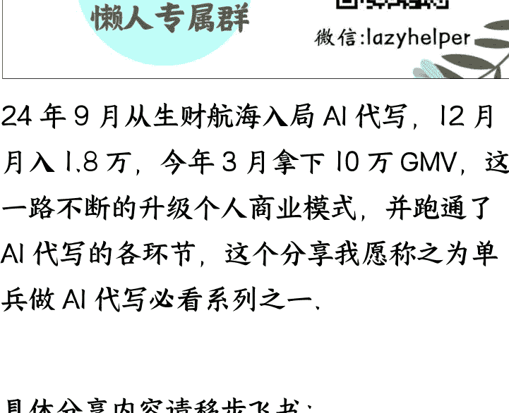

24 年 9 月从生财航海入局 AI 代写，12 月月入 1.8 万，今年 3 月拿下 10 万 GMV，这一路不断的升级个人商业模式，并跑通了 AI 代写的各环节，这个分享我愿称之为单兵做 AI 代写必看系列之一。

具体分享内容请移步飞书：

本篇分享涉及内容：
- 1、借由商业模式升级提升个人收益的路径
- 2、AI 代写流量/客服各环节关键动作
- 3、做 AI 代写中介的一些小技巧、避坑点与建议
- 4、个人项目收益突破中的思维迭代

附 1 月出的 AI 代写三端项目经验精华帖：

## 一、借由商业模式升级提升个人收益的路径

24年9月通过AI写作航海入局AI代写项目，从最开始的淘宝二手单【24年10月收益5K】，到自己搞流量/客服转化/自己写3端都做，接一手单（24年12月月收益1.8万），逐步转变成只做流量/客服转化，把手头的单子都分出去合作共赢（3月月收益4.5万）。

### 第一阶段：接淘宝二手单【24年10月收益5K】

接淘宝二手单，就如同在公司上班，总是有中间商赚差价；导致淘宝的单子都被称为黑奴单，看看你为公司创造的收益对比你拿到手上的钢镚，这个道理就很清晰了。

意识到上面的收入陷阱后，就开始着手升级个人商业模型，想着要自己做一手单，不要有中间商来赚差价。

### 第二阶段：三端都抓【24年12月月收益1.8万】

三端都做，自己完成流量、转化与交付的闭环，GMV就是利润。

收益的突破点在于：再也没有中间商赚差价。

实际的状态是三端都得顾着，搞流量的时候你得要留意顾客询单，在需要连续操作的写稿子阶段，面对流量的到来又不得不抽身去处理，这么一抽身写作的节奏就打乱了，再切换过来还得重新找思路。

这个模式下的收益天花板就是你写稿子的速度，个人实测下来一天能持续稳定的拿到1000元的利润是相当不错的了，除非是高壁垒的品类。

经历过这个阶段，就会想着要升级商业模式，去专注到一个单项中，而不是三端都做。

如同《国富论》中说的，分工导致了更加精细化，更精细化带来了在单一工种上的技能不断精进，可以带来更好的收益。

在 AI 代写项目中，要专注一个工种，演变成2条路，一条是专职做写作交付端，一个月做到2万以上的收益是可以完全可行的，还有一条就是我在做的，专做流量与客服转化，单月做到5万纯利润也是可以预见的。

### 第三阶段：专注流量与客服转化【3月收益4.5万】

半只手做流量，一只手做客服转化，最后半只手做后端交付对接，相当于搞到流量把单子谈下来，然后找到靠谱的后端写手对接做交付。

收益的突破点在于：由一人跑全流程到把耗费时间的交付端分出去，合作共赢。

这个阶段就是又要搞流量，又得顾客服转化，同时得兼顾找后端靠谱写手交付，其实也不是完全聚焦单一工种，再迭代就是做训练营，或者基于训练营演化下的商业模式升级。

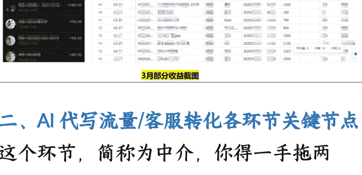

## 二、AI代写流量/客服转化各环节关键节点

这个环节，简称为中介，你得一手拖两端，前端要顾及顾客需求，后端要顾及写手的交付，关键环节有3个：流量、客服转化与后端合作交付。

### 流量环节：

（以闲鱼为例）最核心的是“在有鱼的鱼塘去钓鱼”，以及你要“选择鱼喜欢吃的鱼饵去钓”。

#### 1、在有鱼的鱼塘去钓鱼

你得找到市场的需求点去提供对应的服务，比如毕业季就是论文的需求旺盛，求职季就是简历需求旺盛，年度就是各种年终总结需求旺盛。

要在有鱼的地方去钓鱼，不要做逆市场需求的事情，否则事倍功半。

#### 2、选择鱼喜欢吃的鱼饵去钓

选定了一个特定的市场需求后，该如何去抓住这个需求呢，依然以闲鱼为例，在闲鱼上要找到这个鱼饵让顾客自己上钩，也就是你发布了帖子，顾客如何找到你。

查看帖子的流量来源就能发现，60%以上来自于搜索，按照SEO的逻辑，核心你要找到那个关键词，就是流量密码，分享我在用的3种方式：

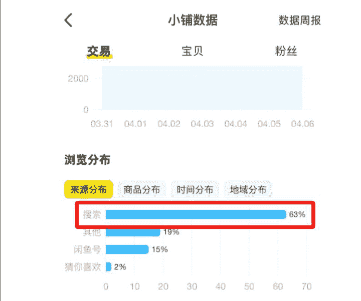

#### 方式1：留意平台推荐

当你把账号刷成你在做类目的潜在客户时，你关注闲鱼搜索栏就会发现一些你品类下的常见搜索关键词。

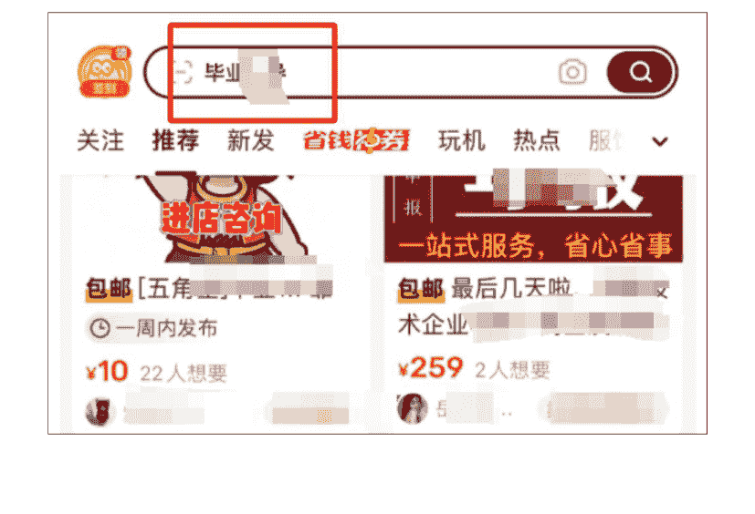

#### 方式 2：借用平台工具

当你开通鱼小铺后，在鱼小铺的后台就可以看到市场的交易风向标。

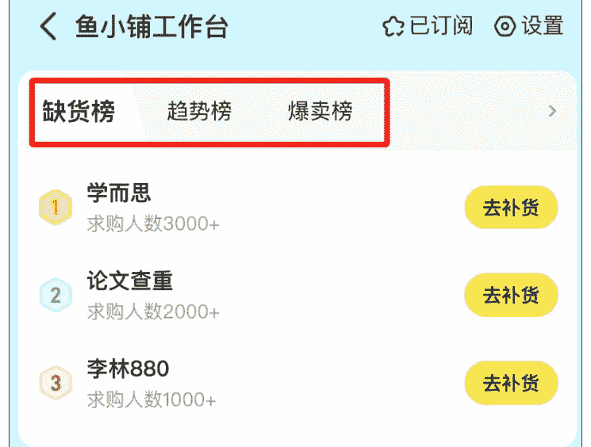

#### 方式 3：询问顾客：

可以直接询问顾客是如何在闲鱼上找到你的，也可以询问顾客为什么会选择你，找到你的购买理由，然后放大ta，试试看，会有惊喜。

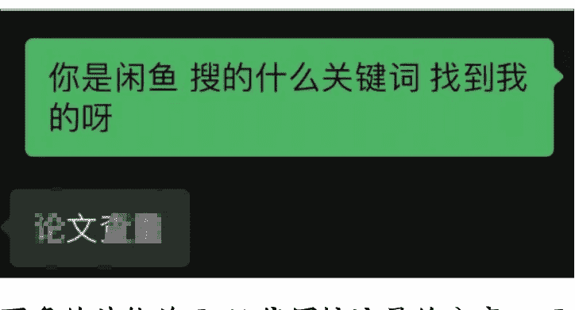

更多的其他关于 AI 代写搞流量的分享，可以看我 1 月份分享的一篇精华帖：

在流量环节，真心建议单兵状态下，专注深耕一个平台这流量你真的都吃不完了。

### 客服转化环节：

一句话总结：把流量从闲鱼引流到私域，在私域进行转化成交。

在客户转化环节，要解决的就是这几个问题：顾客为什么信任你？顾客为什么接受你的价格？顾客为什么现在下单？

合作的前提是信任，尤其是在 AI 代写当下的毕业旺季，论文是很多圈友在做的品类，而面对 AI 的出现以及同行不靠谱的交付乱象，整个行业缺乏信任度，因此信任度是在客户转化环节第一要解决之要务。

代写水很深！！宝子们慎入！
🔥以下是一些常见的代写...

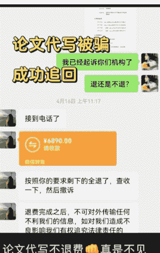

论文代写不退费💪真是不见棺材不落泪💙有姐妹找了...

我被代写骗了，宝子避雷哈！
昨天找的代写，约定今天交...

代写骗局大揭秘，宝子们别上当！宝子们，今天来给大...

#### 顾客为什么信任你？

如何取得顾客的信任，分享我在做的 2 个方法：

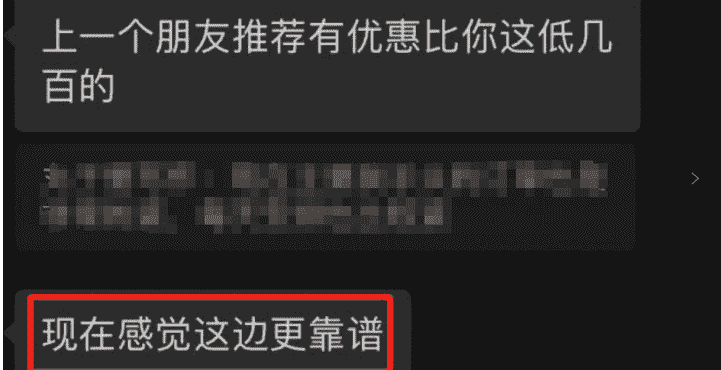

##### 1、经营好朋友圈

在朋友圈的经营上，我从最初的直接借用同行朋友圈或简单的文字转录成自己的然后发朋友圈，逐步的只发自己真实交付获得好评与自己服务的案例，因为我相信真实自有万钧之力。

当然借用同行的也是一种很好的方式，可以保持稳定的素材输出，只是务必要用点心思加入人性化的角度，不只是冷冰冰的展示与硬广，不然同行这么多，同行都这么做，为什么最终是你拿下客户呢？

##### 2、顾客沟通创造信任

#### 站在顾客角度，为顾客解决问题：

在沟通中要体现你的专业性，并把服务的明细详细的告诉顾客，不要有模糊不清的地方，也不要让顾客觉得你没有了解清楚情况就大包大揽只为成交，要站在顾客角度，为顾客着想，去解决顾客的问题，更能取得顾客信任，有一句古话说：将欲取之，必先与之，要成交顾客的很多，但真正为顾客着想的人极少。

且在私域不要把同顾客的当下交易当成唯一的一次交易机会，而是顾客都进到私域了，要站在顾客整个生命周期的角度来考虑问题，现在是毕业季找我们，后续进入职场可以年终总结/PPT 找我们。

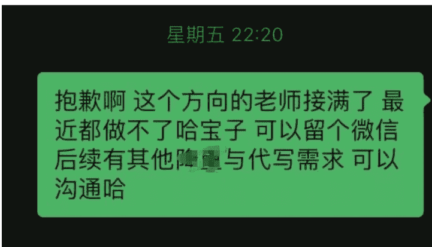

在项目前期就是成交心太重，导致顾客未下单就用力太猛，导致被一些顾客删除，就是把同顾客的成交看成了一个当下/一次性的行为，的确不可取。

#### 展示你的专业性

专业也是信任的一个层面，你得懂 ta 的需求啊，你不懂顾客又怎么放心把他交给你呢。

#### 在谈单时，可以借用 AI 来辅助谈单：

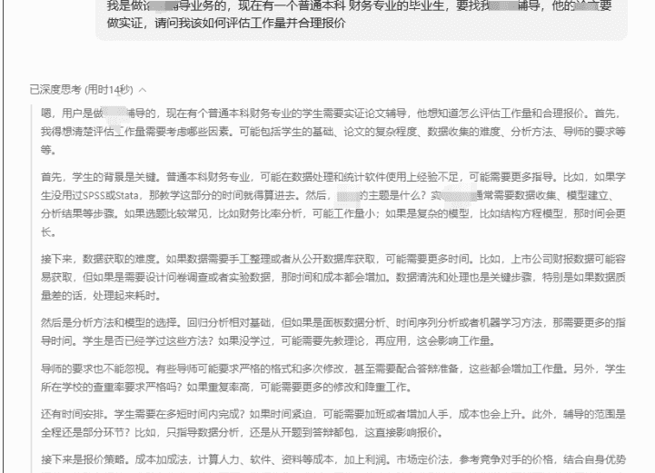

通过引入 AI 参与谈单，可以更加清晰你的谈单思路并能更好的深挖顾客需求，同时做好工作量的有效评估。

#### 多展示你的成交与交付案例

比如顾客问你靠谱吗？不会骗他吧，这时语言就显得很苍白，而是平时就多收集顾客的好评与反馈图，必要时就需要展示。

#### 顾客为什么接受你的价格？

解决了信任的问题，让顾客接受我们的价格就相对容易了，你只需在沟通中深挖顾客的痛点、工作量/难度、我们的专业性就可以。

##### 深挖顾客的痛点：

基于很多顾客在代写上都有被骗的经历，树立顾客正确的选择观：你这时应该考虑的不是能不能便宜个一百两百去盲目比价，而是找我靠谱的能专业性给你靠谱交付的。

##### 详细了解顾客需求后的工作量/难度评估：

借用教父中的一句话：你需要给他一个理由：，报价也同样道理，你为什么是这个报价，你得有你的报价逻辑，并且顾客是能够信服的。

分享我这边的报价逻辑，就是通过挖掘工作的难度与工作量，以及时间的紧急性来综合进行报价。

报价完后，咱们不能姜太公钓鱼，愿者上钩，而是要清晰的意识到，顾客得知我们的报价后一定会再去询问其他家，这时应该附一句：我们的报价是基于对您需求的详细了解，且完全知晓工作的难度并能确保我们靠谱交付下的报价，再附带一些真实的顾客好评案例。

这样顾客去找其他家时，但凡同行报价前没有详细的了解需求或者报价时没有给到具体的依据，你放在顾客心中的种子就会不断的发芽。

##### 专业性展示：

尤其在一些有一定难度的品项，如spss更加需要你的专业性，你可以通过真实的交付案例来展示说明。

#### 顾客为什么现在下单？

乱花渐入迷人眼，顾客看的多了，以及不尽快的决定下来总会受到周边朋友等的影响，那如何让顾客现在就下单呢？

分享我在用的2个方法：
- 1、当天限量
思路：我团队这边为了保证工作量，一天最多只接3单，你的单子不安排上，晚一些可能也无法安排了。
这种更适应于：对你产生信任，价格不那么敏感，但是又想再看看的。

##### 2、当日优惠
思路：今天周末/月底冲刺一波销量、月初/上午 开门红、月中复盘从业绩…
这种更适用于：有一定信任度，但是价格敏感性顾客。

#### 顾客常见问题：
- 1、你们不会拿钱不做事儿吧
答：我们做这行5年多了，面对的不是你一个顾客，到时候我真不给稿子，你投诉我微信，我微信几千个顾客都受影响，那我岂不是亏大了，放心哈. （附带很多被骗来找我们兜底的截图）
- 2、你们不是 AI 做的吧。
答：要是 AI 都能出你要的文章，那你也不必要费心找我们了，我们团队5年多了，那会儿可没有 AI，都是人工写的哈。
- 3、我确认收货后，后续修改你不会不给我改吧
答：给你看下别的顾客找我们修改时我们的回复截图吧，而且我们还指着你满意后续帮我们推荐呢，咱们几百个顾客都是这么操作的，放心哈（附带顾客提修改意见回复截图）

## 三、做 AI 代写中介的一些小技巧与避坑点与建议

分享做 AI 代写中介（专注流量与客服环节）的一些小技巧以及避坑点：

### 小技巧：

#### 每日工作流：

做 AI 代写中介，其实是有很多琐碎的事情的，你需要搞流量、谈订单、分配订单，除了这些主线任务外，你还需要安抚顾客追进度的急切心情、回复顾客的售后问题、响应后端写手需要顾客端确认的内容、追踪订单的进度、及时支付后端写手的费用等。

这些琐碎的事情，逐步的会形成你每天的日常，切记东一榔头西一棒子，要做好合理的安排和规划，建立自己的每日工作流：早上可以统一追今日/明日交付订单的进度、大块时间集中处理顾客诉求-只能尽可能的集中、除急单外晚上统一的分配订单与结算。

#### 飞书多维表格订单管理：

|  | 接单时间 | 编号 | 稿件名称 | 接单渠道 | 需求人 | DDL | AE GMV | 付款方式 | AE 佣金 | AE 写手 | 写手分佣 | 完成状态 | 写手结... |
|---|---|---|---|---|---|---|---|---|---|---|---|---|---|
|  |  |  |  |  |  |  |  |  |  |  |  |  |  |
|  |  |  |  |  |  |  |  |  |  |  |  |  |  |
|  |  |  |  |  |  |  |  |  |  |  |  |  |  |
|  |  |  |  |  |  |  |  |  |  |  |  |  |  |
|  |  |  |  |  |  |  |  |  |  |  |  |  |  |

通过建立飞书多维表格可以更好的管控订单的状态，且能筛选写手追踪订单的进度，以及利用数据仪表盘来明确订单总体情况以便总结与调整。

### 订单编号与交付/结算编号化：

把每个订单做好编号，在中介的眼里只有一个个的订单编号，而不是一个个订单的具体内容，这样方便第一时间追踪到对应订单，尤其是订单量大时，注意对任意订单补充的信息都需带上编号，方便统一检索。

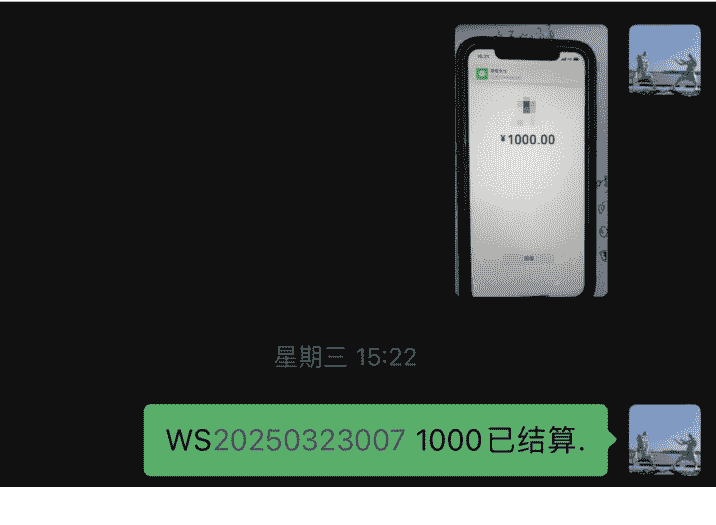

此处也需有意培养后端写手交付的订单编号化。后端写手交付是由他们完成的，他们更熟悉某个订单的内容。比如他直接丢一个标记有订单信息的文档给你，你去对应这个文档具体对应哪个订单都要花不少的时间。因此也需要培养他们订单编号化的习惯，可以为你节约不少时间。

### 形成客服转化 SOP

在闲鱼搞流量相对容易，且后端写手稳固后，能影响你赚到更多钱的只有客服转化。因此，形成一套客服转化的 SOP 尤为关键。

一个是回复的高效化，能及时响应顾客；还有一点是可以在不断与顾客交付中去迭代优化 SOP，进一步提升客服转化率。

### 微信昵称与建标签

顾客加到你微信后，当经过一轮客服 SOP 的洗礼后，不管是否成交，都需要及时的给顾客打标签并有针对性的完善微信昵称。

**修改昵称：**对确认合作的订单修改昵称，包含信息有：顾客昵称、订单金额、交付日期、后端写手。一方面你可以直接通过名称搜索是派给谁的订单，以及可以查看接下来要交付的订单，方便做好进度追踪。

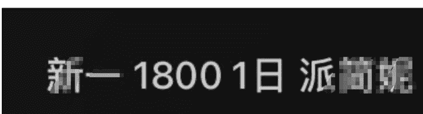

#### 建标签：

分享我建的标签有：

- 待派单 (4)
- 待结算
- 1日 (43)
- 2日 (43)
- 3日 (36)
- 4日 (27)
- 5日 (25)
- 满意度提升 (2)
- 6日 (34)
- 7日 (48)

### 待跟进：

和顾客完成一轮沟通后，一些顾客喜欢货比三家或者考虑下，这是需要给一个“待跟进”的标签。当天或者第二天做好跟进，最多完成 2 轮跟进。同时最后一轮务必留下信息你跟进的理由，一定是害怕耽误顾客时间这种为顾客着想的话术，而不是要成交他。以及请顾客留下微信并说明你能提供的服务，便于后续成交。

### 待派单：

当你订单多了后，很容易忘记哪个订单没有派，一定要及时的把订单派出去才能给后端写手争取到更多的时间。同时派出去的订单要做好飞书表格记录，否则容易有派重复的可能性，别问我是怎么知道的。

### 待结算：

给顾客完成交付后，要做好待结算的标签，便于及时结算。因为交付时你不一定在电脑旁，这就节约了反复核对的时间。

### 满意度提升：

总会遇见交付中有问题或客诉的顾客，归纳到满意度提升标签中去。把这些有疑问的顾客服务好也会变成我们的忠实顾客。不要只盯着顾客手头这一单，而是顾客和你还有后续合作的可能性。

### 日期：

每天来的询单都归纳到当天的日期标签中去，这样方便每天做项目复盘：
- 成交转化率 = 当日订单数 / 当日标签人数
- 进私域率 = 当日标签人数 / 当日想要数

### 避坑点：

#### 不要为了成交而盲目承诺

大家直接看下图，一个朋友找我聊天，自己答应顾客的包修改、包通过、包售后，结果是次数无限制的修改，最后还被投诉导致损

失一个账号，耗费大量的精力在其中还亏钱，真的引以为鉴。

投诉处理须知
①请尽快联系买家协商处理，处理完成后可申请撤销
②若认为投诉不属实可拒绝处理并申请客服介入
③若平台判定投诉属实，则处罚卖家下架所有商品并禁止至少90天发布；若不属实则关闭投诉

进度详情
● 买家发起投诉 今天 22:05
交易欺诈 | 诱导确认后收到货不对板
先前说好，后期可以无限次数的进行文章内容修改，结果

#### 不要什么单子都想接

千万不要以为小单子就比大单子好应对，真不是这样的。很多小单子，价钱低但是要求可是真的一堆。

当你和顾客聊时发现顾客的预算远低于实际的市场价时，不要在价格上一味退步或者答应更多的条件，真的可能是灾难的开始。前段时间我就被一个 550 的单子各种的追进度催进度，各种消息轰炸都麻了，回头看性价比真的太低。

### 建议：

#### 要做好中介需要懂写作交付

我是从 24 年 9 月-25 年 1 月写了快 300 篇稿子，因此能有效理解顾客需求与痛点。且在同后端写手合作时能更懂写手，这样有利于在谈单时更好得抓住顾客的痛点与需求。在同后端写手合作时也不仅仅是派单或者只是顾客声音的传声筒，而是你有自己的判断，知道问题出在哪儿，做到高效的沟通。

#### 增加风险意识：

##### 做好需求确认

要增加风险意识，避免因为前置的沟通不明确导致后期扯皮投诉的事情发生，把问题消灭在萌芽中。

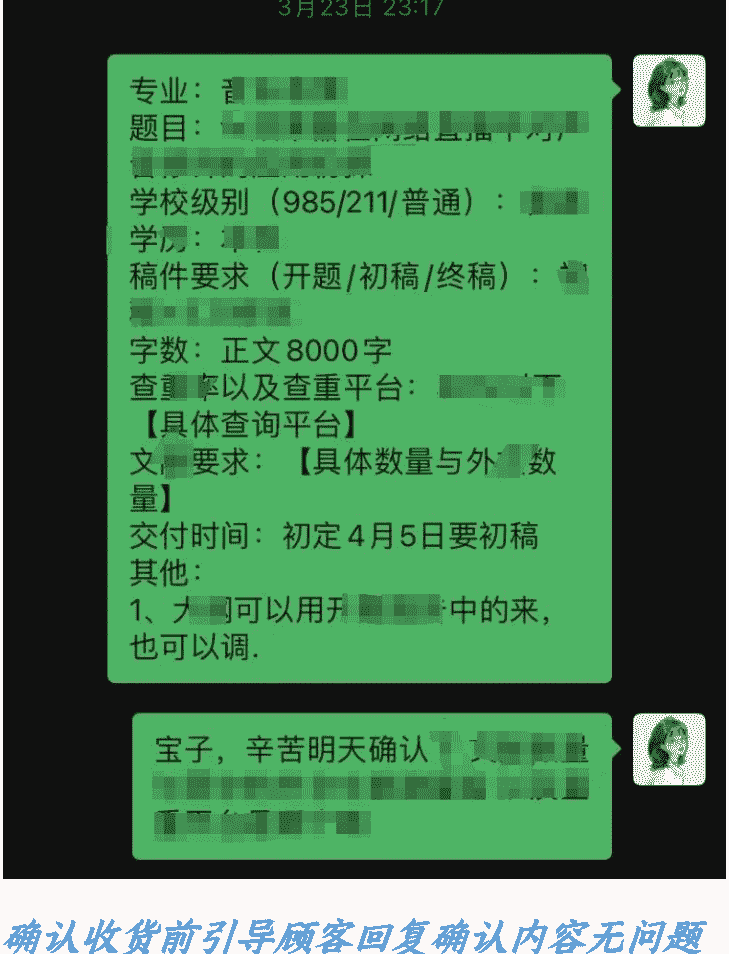

##### 确认收货前引导顾客回复确认内容无问题

闲鱼上顾客投诉很常见的一个选项是：商家诱导确认收货而后发现货不对版。因此在给顾客稿件前，就务必引导顾客确认稿件内容没有问题再闲鱼确认收货。

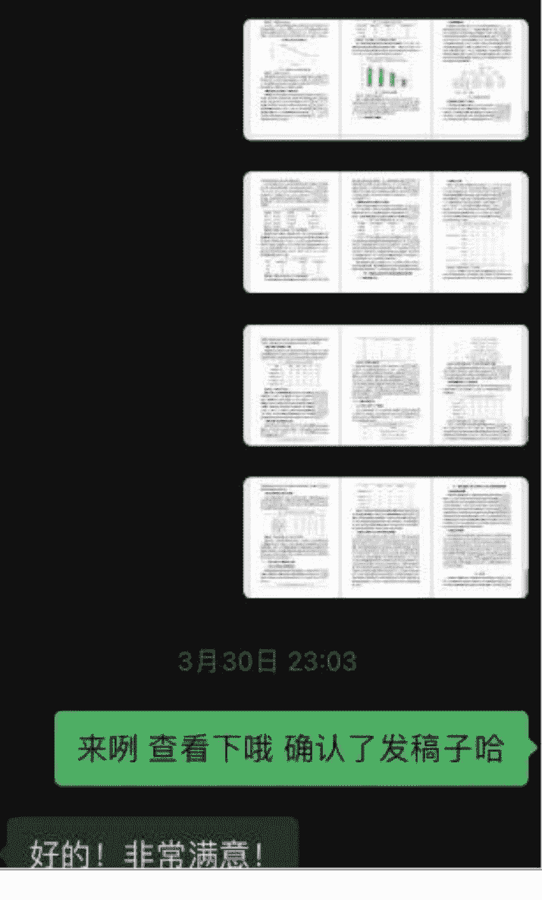

## 四、个人项目收益突破中的思维迭代

1 月我分享了一篇精华帖，里面介绍了我从 20 年至今做过的项目。过往做过的项目经验与 8 年职场用户运营的经验，在 AI 代写这个项目中有点连点成线的意思，个人的思维在做项目中不断迭代。分享我的几个思维迭代点：

- 建立与运行系统，而不是设定目标。
- 3 月项目很忙，运动也丝毫没落下，反而是近几年单月跑的最多的。
- 做项目与运动都是让自己更好运行系统的一部分，该持续协同推进。

懒人微信：lazyhelper

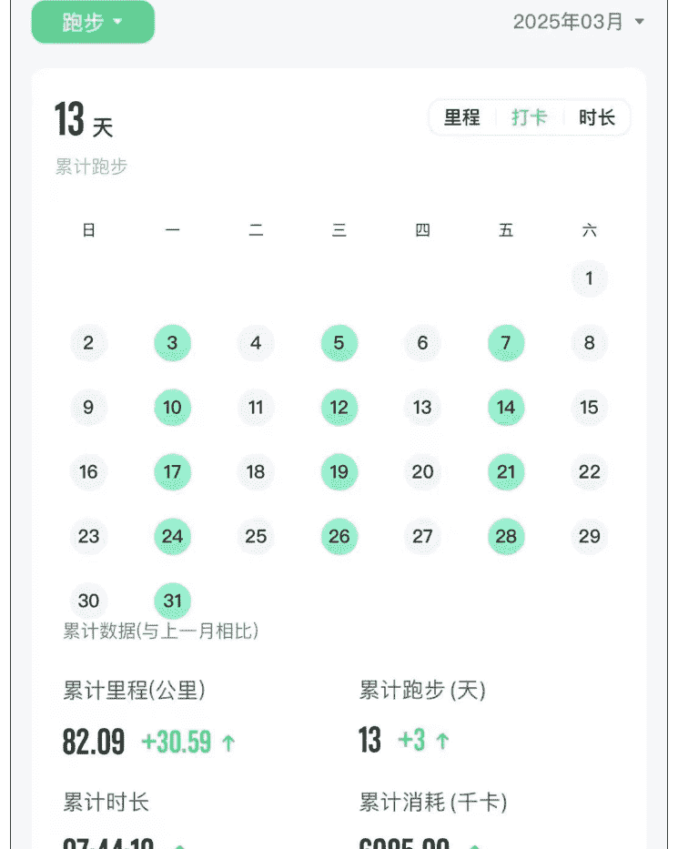

### 坚定的相信自己可以做到：

一定要相信自己可以做起来。刚开始做目前的品之前，看到别人有 100+ 想要，那会儿想着我啥时候也可以做到。当真的做到，才发现原来只需要捅破一层窗户纸就可以。

### 遇到问题解决问题，在突破中前行

去找到那个知道答案的人去问他就可以。

### 大的项目模式上:

从最初的只做后端，接二手单收益有限。升级自己 3 端都做接一手单，发现能持续一天写 1 千真不容易。又升级到做流量与转化，之后发现目前又遇到瓶颈，又到要升级模式的时候。

### 小的运营节点上:

从图中每周数据可以看出来，第一周因为切新品，其实是没摸到这个品拿流量的正确姿势的。于是遇到问题解决问题，问同行、问圈友、付费咨询…终于明白方向与姿势，去测试，迎来接下来几周的持续突破。

过往遇到问题会退缩，现在相信我这个问题一定有答案，去找到已经有答案的人去问，就可以。

## 付费的思考：

选择一个具体项目去做后，个人实践下来比较好的方式，就是在能接受的范围内，把你了解到的这个项目所有的训练营都加一遍。

不同训练营有不同的侧重点，拿代写项目来说，行业内的圈子我加入不下于 5 家，从小几百到大几千也都有。前期是要学具体的技能，项目进行得越深，就需要更全面的信息与找到可以一起协作的伙伴。

不期待加入一个圈子就能立马飞起。在具体项目中的付费逻辑就如同张磊的投赛道逻辑，上下游都投资/付费一遍就可以，不对具体的某个抱期待，而是哪怕有一个点有启发，就是赚到。

相对因为省钱少加入的训练营而耽误的时间，加入圈子的费用，真的不值一提。

#### 没有小项目，只有把项目做小的人

这话没记错的话，应该是亦仁老大说的。

从刚开始做代写项目，是把他定义为做短视频项目的一个现金流补充的，天花板不高主打来钱快。但逐步的在这个项目中升级模式后，也逐步见识到了更高阶的赚钱模式，真的是没有小项目，只有把项目做小的人。

## 五、写在最后

一路走来，做过很多项目。太多项目没有拿到结果，核心原因总是在看而缺乏执行，以及过多的关注别人的成果而没有扎进自己的项目中。

实际还是亦仁老大说的：要祛魅，要脚踏实地做自己的事情。脑海中时常会浮现出一句话：年入千万，月入几十上百万的人那么多，我们这种月入 10 万以下的项目，真的就难于登天吗？我想不会，一定有解法。

在 AI 代写这一路，遇上了很多良师益友。感谢海盐老师 赤子之心的分享，坦诚又强悍，每次在我项目卡点上的交流都能找到下一步的解法或者避坑点；感谢遇见荷包蛋 @荷包蛋糕，合作思维给了我很大的启发；感谢浩然 @浩然 对项目制放大思路的分享……

不要向往/过多关注别人的生活，要扎实的扎进项目中，回到自己的生活中找解法。去实战、去突破、去分享，坚定的相信自己能成，与你共勉！

历史 3000 多份各类付费文章以及年费三千多的副业社群资源，见懒人专属群内部分享！
付费群，白嫖勿扰！

## 懒人专属群更新记录：

https://lazybook.fun/#/blog/record2