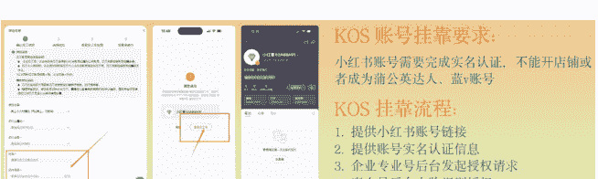
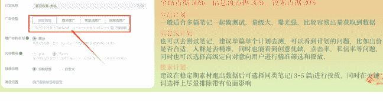

# 以纹绣行业成交率 50%+，年入 500w+为例，聊聊线索类目聚光投放怎么做？

250411 生财精华

公众号懒人搜索，懒人专属群分享

你好呀，我系阿七，目前是小红书代理商，主要做聚光投放业务，擅长高客单获客和转化，目前也是一家小红书培训机构的合伙人，主要是给美业老板培训赋能在小红书上获客~

也算是一个生财老人啦，到今年差不多 2 个年头啦，23 年 4 月份开始加入生财，但之前都仅仅是把生财当作知识库，想要了解某个领域就是上来看看，平时就是比较闲散的“自由人”。

下半年通过线下组局慢慢深入了解生财，在这里也是认识了很多很多优秀的圈友。大家都是同龄人，为啥他们都这么优秀，而自己就是摆烂呢？活生生被他们卷起来了，每到深夜就开始 emo，思考人生......（有进入生财后被其他圈友卷起来的圈友，记得在评论区扣 1，让我知道我不是一个人）

思来想去，想来思去最后才还是回归到最熟悉的领域小红书，除了平时的私教培训和企业培训外，还当了差不多 1 年生财小红书航海教练，后面感觉还不够，工作量不饱和，从西安跑到了杭州和朋友一起创业，帮助美业老板在小红书获客……

## 一、了解行业聚光投放资质

### 老板时间真的很珍贵

### 如何在短时间内用最小的成本去获取最大的利润

每天和大量的实体老板交流和沟通，我发现老板们的时间是真的真的太宝贵啦！在我们眼里今天自媒体是我们必备的流量渠道了，但让他们从旧的行业或者渠道中抽离一点点时间去线上获客真的很难很难，稍微好一些的老板知道线上获客是趋势，自己也想要去做，但奈何主业赚钱太多，你跟他们说要花时间做个人 IP，放长线钓大鱼，那是鸟都不鸟你呀！

人家的核心诉求是：我需要花多少钱？多少时间、精力还是人力物力去做这件事情？然后大概多长时间？能够给我带来多少的利润？ROI 是多少？

在此情况下，唯有花钱买流量，做聚光投放是首选，尽量在短时间内花最小的成本，尽可能获取最大的利润。

那到底怎么做投放呢？今天我以纹绣行业投放给大家拆解一下线索类目投放的三板斧！！！

懒人微信：lazyhelper

### 首先强调一下，小红书认证企业号不等同于开通聚光，这仅仅是我们投放的第一道门槛，最核心关键在于广告资质审核~

不同行业有不同的资质要求，比如医美需要机构证明和副主任以上医师职称同时还需要缴纳保证金，房产需要房地产经纪备案许可证，保险需要保险中介许可证，二奢需要鉴定师能力许可证等等...

### 各行各业资质要求：

https://ad.xiaohongshu.com/help/docs?id=3831

一些行业也可以进行擦边式投放，比如减肥产品我可以使用零食销售资质进行擦边投放，丰胸产品可以用服装销售资质进行擦边投放，纹绣行业我可以使用”美甲美睫/美容美体资质进行擦边投放，自媒体培训代运营可以用“商务服务”资质进行投放。

当然这种方式是存在封号的风险存在，想要抵抗风险就需要你自己亲自下场去做测试，找到适合自己的灰度素材进行投放，同时铺量，用数量去抵抗概率事件。

懒人微信：lazyhelper

### 擦边式投放：

但这部分是很多纹绣老板难以完成的条件，所以也是可以采取擦边式投放，利用灰度素材笔记投放，比如在笔记中不添加“纹眉、纹唇、纹发际线、半永久、纹绣”等词，而是采用“眉型设计”、“唇面色彩”等词进行代替。微信：lazyhelper

但这种会因为资质或者关键词不精准的原因造成计划拒审、封号，造成整体获客成本偏高~

所以需要具备比较强的运营+投放能力，并且需要花时间、精力、金钱去做测试出来可投放的笔记模型。

所以大家去做投放的时候，有条件还是按照官方的要求去走会更加合适，毕竟人在屋檐下哪能不低头？

### kos 投放：

除此之外还有可以尝试 kos 玩法，也就是找一家具有资质的账号进行资质挂靠，这样即使你是一个素人号，没有满足报白的条件，你也可以拥有正规的投放资质。

kos 账号不需要认证企业号，呈现还是一个素人号的形态，对于客户的来说更加有亲近感，而非企业品牌号所打造的冰冷感，适合打造 ip，增加客户对于 ip 的信任度，以便后端的成交。

这种玩法非常适用于对资质要求严格、同时客单价比较高的行业，比如医美、房产、二奢、装修、教育等行业

### 聚光+蒲公英投放：

还有一种玩法就是聚光+蒲公英，要求素人号粉丝＞1000粉，并且开通蒲公英，在蒲公英后台达成合作，然后利用聚光平台去投放合作笔记。但这种主要是做达人种草，适合品牌去做品宣种草，需要时间去做沉淀，无法在短时间内拿到客资进行成交。

## 二、计算获客成本上限和核心指标

不会算账的老板都不是好老板，聚光投放毕竟是要我们花钱出去买流量，那么势必要把账给算清楚了~

在你不清楚市场的数据下，我们可以通过原本业务的数据去计算出我们的获客成本上限和引流变现路径的核心指标数据~

以纹眉为例：

| 产品客单价 | 产品利润率 | 产品利润 | 预期成交率 | 加微率 | 广告预算 |
| :--- | :--- | :--- | :--- | :--- | :--- |
| 3000 | 80% | 2400 | 30% | 60% | 10000 |
|  |  |  |  |  |  |
| 保本ROI | 1.25 |  |  |  |  |
| 销售额（最少目标） | 3750 |  |  |  |  |
| 成交单数 | 1.25 |  |  |  |  |
| 获客收益（最少目标） | 4.2 |  |  |  |  |
| 获客成本上限 | 2380 |  |  |  |  |
| 小红书咨询收益（最少目标） | 7 |  |  |  |  |
| 小红书咨询成本上限 | 1428 |  |  |  |  |

产品平均单价在3000，利润在80%，也就是在2400元，其成交率在30%，加微率在60%，每个月预计投放1w广告费，计算出获客成本上限

保本ROI = 客单价/产品利润
销售额 = 保本ROI * 广告预算
成交单数 = 销售额/客单价
获客数量 = 成交单数/成交率
获客成本上限 = 广告预算/获客数量
客户小红书咨询数量 = 客户数量/加微率
客户咨询成本上限 = 广告预算/客户小红书咨询数量

通过层层的计算，我们可以大概明确我们投放的目标，在执行的过程中知道哪些地方可以先去优化，单点突破，然后一点点做完善整个转化链路。

## 三、明确投放策略

首先是制作投放素材，投放笔记前期主要是模仿同行进行制作，需要我们平时多收集同行投放的笔记类型或者参考聚光平台提供优秀的案例，然后一比一进行复刻，不需要思考太多，执行力拉满。

### 纹绣行业投放笔记类型:

### 门店直推和价格直推:

展示门店环境、品牌实力。

适合想要提升品牌影响力的门店

> 纹绣投放笔记类型①:
> 直推门店和价格直推
> 围绕自身门店的环境，或者服务内容等内容做推广，适合财大气粗想要提高自己团队、门店或者品牌的老板们

### 产品种草:

展示产品效果，如前后对比图、达人试用等。

适合快速获客，但需要精准的关键词和素材引导。

适合想要快速获客的老板们

> 纹绣投放笔记类型②:
> 产品种草类
> 围绕自身作品做推广，主要也是最为常见的一个素材，可做图文笔记，也可以做视频展示，客户精准高

### IP人设类:

通过眉型设计、纹绣师日常工作或者达人探店类素材去展示行业软实力

适合想要提升个人IP，增加客户信任感，降低后端成交成本的老板

但要注意后端的承接能力，客户比较认IP，这是一把双刃剑。

> 纹绣投放笔记类型③:
> 人设IP类
> 主要塑造或者利用IP的影响力去做推广，主要是增加影响力同时提高客户的信任感问题

### 搭建投放计划:

线索类目主要是以客资收集为目的，但也需要搭建种草计划去跑跑数据，账户的起量及高赞笔记的产出，及后端转化也有一定的影响，高赞笔记助力品牌声量提升的同时，可以积累「留咨」笔记的初始互动数据，针对高互动进行「线索留咨」，从而实现更低的转化成本。

计划投放也是有一个周期，分别是：测试期，起量期，稳定期，一般以 15~20 天为一个周期

| 计划测试期 | 计划起量期 | 计划稳定期 |
| :--- | :--- | :--- |
| 新号安排更新 5-10 篇笔记。以产品种草类笔记为主。日预算从 300 进行调整，投同城流量，年龄 23+ 女性群体，搭建全站或者信息流 4-5 条计划，并且设置不同的价格阶梯，测试 1-2 天的时间，主要目的在于过审，并且测试素材的稳定性问题。 | 慢慢更新新人 IP 类型笔记。但投放笔记类型主要还是在产品种草类为主。IP 人设笔记类型主要功能在于获取互动数据，增加客户的信任感。 | 开始尝试调整出价时段/人群包。关键词包等定向。尽量在低成本的情况下拿到更多精准的流量。同时为了防止笔记衰退还需要花时间去测试新的笔记模型才可以。 |

数据优化：

关注核心数据：成交率、获客成本、私信开口率。

优化方向：封面、标题、正文引导性、人群定向、关键词包、引流话术等。

通过数据分析调整投放策略，逐步降低成本。

在计划安排上可以采用 5:3:2 比例进行搭建，即：

全站计划：

占比 50%。

全站计划相当于信息流、搜索流量和视频流的综合，能够快速拿量，曝光量较大。

适合快速测试数据，筛选出效果好的笔记素材。

信息流计划：

占比 30%。

信息流计划通过不断推送笔记到用户页面，依靠点击率来优化。

适合测试笔记素材的吸引力和引导性，通过数据分析优化封面、标题、正文等内容。

可以调整人群定向、出价、投放时间段等，逐步优化投放效果。

### 搜索计划：

占比 20%。

搜索计划更精准，适合已经稳定的笔记素材。

可以通过关键词、人群包等方式进行精准定向，进一步优化投放效果。

注意排除负面影响，避免因负面评论影响笔记质量。

### 数据分析以及迭代：

投广告，一定要学会看数据，抓核心指标，知道在什么时候去做哪些操作，建立自己广告优化思维框架。

首先我们纹绣门店获客属于线索类目，那么我们更多数据顺序应该是：成交率> 导流率> 私信开口数> 私信进线数> 点击率 > 展现量

| 计划名 | 操作 | 展示次数 | 点击量 | 点击率 | 消耗 | ROI | 咨询成本 | 私信成本 | 私信开口数 | 私信进线数 | 私信开口成本 |
| :--- | :--- | :--- | :--- | :--- | :--- | :--- | :--- | :--- | :--- | :--- | :--- |
| 搜索... | ... | ... | ... | ... | ... | ... | ... | ... | ... | ... | ... |

在这个转化链路中，上一层到下一层都会流失掉一部分的用户，在做数据分析的过程中，需要层层进行拆解，看是哪些指标出现了问题，采用控制变量法，只改变其中一个核心点，其他不动，减少变量，不断的进行测试，优化各个节点，牵一发而动全身，成就系统之美。

比如：

- 成交率=成交人数/加微人数，要么优化自己客户数量，要么就是优化销售能力
- 导流率主要核心在消息回复及时性+引流钩子是否吸引人
- 私信开口数主要是回复话术问题，比如你的自动欢迎语
- 私信进线数主要是在于搭建的计划是否得当，比如你选择全站还是信息流还是搜索广告，出价，笔记，人群，评论区钩子是否合适等等
- 点击率主要在于你的封面和标题是否有足够吸引力

优化过程中，不必太过焦虑，因为这就是一个排除的问题的过程，不管是好的、还是坏的结果都是经验的积累，

依靠这种精细化的分析方式，我在短短一个月的时间，帮助一家门店业绩增长了30%~

这两年因为聚光投放接触到各行各业的老板，最经常问我的一些问题

比如：是不是我投放了，平台就会给我打上付费的标签，不给我推送自然流？？

这其实就是一个悖论，自然流量和付费流量是相辅相成的。

> 自然流量和付费流量是相辅相成
> 付费能够快速获取数据，建立基础数据，反哺于自然流量
> 自然流量创就更高影响力，有效将低付费流量成本

付费流量：快速获取精准客户，建立账号基础数据。

自然流量：通过优质内容和互动，提升账号权重，降低付费成本。

相辅相成：付费流量带动自然流量，自然流量反哺付费流量，形成良性循环。

还有一些老板上来就喜欢”砸钱“，我给你多少多少钱，你去帮我……

但说实话有时候真的无能为力，因为聚光仅仅是一个获客工具，这是需要嫁接到项目本身才有价值和意义；那么在这里过程中，也是需要我们拥有一定的基本功和好的后端承接能力才可以真正赚到钱。

> 打好运营基本功，再去做聚光投放，有利于降低获客成本
> 聚光投放是放大器，而并非救命稻草

还有最最核心的事情是”不要太贪“。站在乙方的角度去观察，其实很多老板在投放的过程中是赚钱的， 否则不可能说一直持续的投放，但在沟通的过程中就是习惯性要求投手去降低成本。虽然理解，但不赞同~

## 四、结语

流量本身就是存在波动，有时候效果好，有时候脱离范围，这都是正常状态，只要在合适的成本内就ok，过度压低的成本就会导致你的量就是无限减少，投手也会跟随着焦虑。

所以大家投放前，先要计算出自己获客成本范围，只要在范围内，就可以放量获客~

历史3000多份各类付费文章以及年费三千多的副业社群资源，见懒人专属群内部分享!

付费群，白嫖勿扰!

懒人专属群更新记录:

https://lazybook.fun/#/blog/record2

懒人微信：lazyhelper