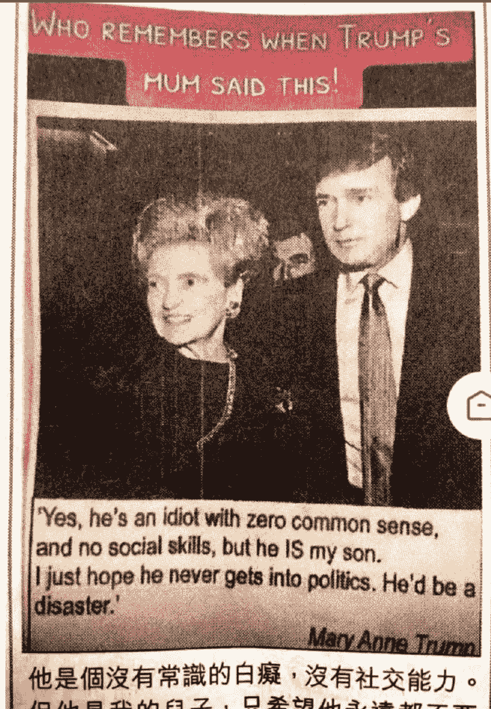
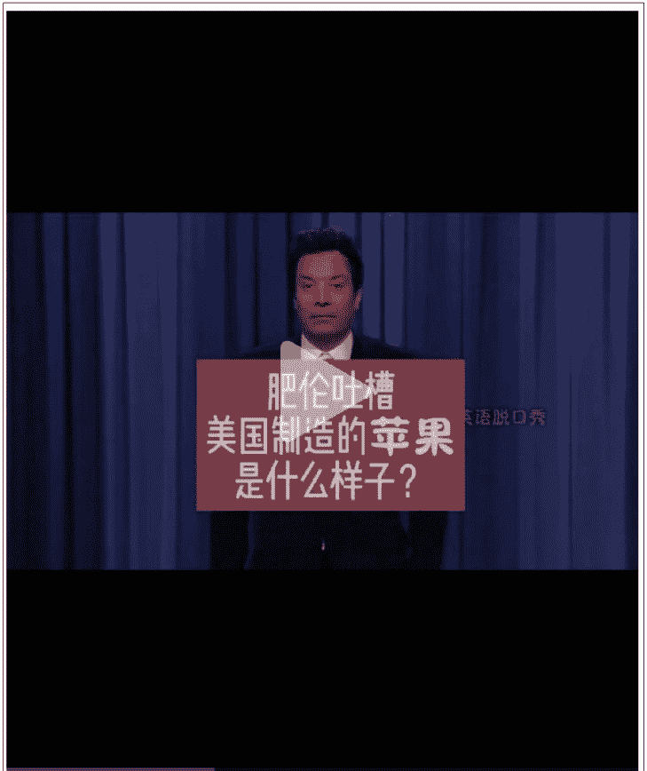

# 川普光速认怂，大盘稳了

250414 端宏斌

整理：公众号懒人搜索，懒人专属群独享

懒人微信：lazyhelper


川普二次上台才三个月，基本上干什么什么就烂尾，最新的烂尾项目就是他的无差别关税大战。由于小日本偷袭卖债，导致美国国债大跌，吓得川普立马宣布所有人（除中国）全部豁免90天，所以你永远可以相信日本人的偷袭能力。

接着美国的海关系统就崩溃了，想收关税也收不了，估计超过了系统最大处理能力，服务器直接宕机给你看，连服务器都受不了变态老板了。现在的情况非常搞笑，变成了中国是全世界唯一单方面对美国征收125%超高关税的国家，可美国反而没有能力征收你的关税，因为系统升级需要时间。

我党以前总是像老和尚念经一样说：希望美方悬崖勒马，不要搬起石头砸自己的脚。说了这么多年，总算让我们看到一次什么叫真正的搬起石头砸自己的脚了，吃瓜群众们大呼过瘾，兄弟们这几天总算开眼了。

昨天就更搞笑了，老美发现这个关税如果真的征收，他苹果手机就别卖了，于是紧急打了一个补丁，豁免了一大批高科技产品，包括：笔记本电脑、智能手机、平板电脑、智能手表等消费电子产品，还有集成电路、半导体元件、闪存、显示屏等等，以及药品和太阳能光伏产品。因为这些东西老美自己都生产不了，全靠从老中进口，如果真的收了那么多关税，国内通胀就爆表了，他没办法降息，反而要加息，那他距离财政破产就更近了。

川普才一周就光速认怂，这早就在我的预料之中，周一全市场大跌那天，我在《日间分析 0407》里是这么说的：

> 日间分析【0407】
> 由于中国的反击已经出来了，下面就看川普还能出什么牌，我感觉他已经无牌可出，如果他顶不住压力开始退缩，那么这两天就是底部，如果他继续加码，那就再等等，我个人判断川普退缩的概率较大。现在全美爆发了反川普反马斯克的大游行，所有那些支持川普的富豪，这波都损失惨重，他们都会想办法对川普施加压力，我判断川普大概率会马上认怂。

川普这波操作可以说自己啥也没捞到，赔了夫人又折兵，所以美国国内对他的质疑声越来越强。此前有 35 位精神科专家联名发表公开信，说川普有严重精神问题，确切地说是“自恋型人格障碍”，核心症状就是过分夸大自我成就、才能和重要性、沉湎于成功、权力等幻想，强烈渴望他人关注，以及对他人缺乏同情心。这种人肯定会带大家掉入坑里。关税大战爆发之后，美国 17 名联邦法官又想起这件事了，他们联合发表声明，要求对川普进行精神鉴定。

本周还有人翻出一张旧报纸，说是川普的老妈是这么评价儿子的：

> 他是个没有常识的白痴，没有社交能力。但他是我儿子，只希望他永远不要从政，他会是个灾难。——玛丽·安妮·特朗普。



川普的老妈有没有说过这番话，我们也不知道，但查理·芒格确实对川普有一番精辟的点评，在 2010 年《财富》问芒格对川普有什么看法，他的商业成就和公众形象是否被高估了？芒格是这么评价的：

川普是个很有趣的例子，他过度追求自我证明，他不断通过夸大其词和浮夸的行为来掩盖内心的不安全感。

他的所谓商业天才神话，很大程度上是建立在债务、破产和钻法律漏洞上的。如果你仔细研究他的交易，你会发现许多成功实际上是建立在牺牲合作伙伴、债权人和投资者利益上的，他最擅长的就是自我营销，而非创造持久的价值。

更令人担心的是，他成功说服了一部分公众把这种“虚张声势”视为领导力，这就像崇拜一个用油漆把烂木头刷成黄金的骗子一样。历史告诉我们，这类角色最终会给社会带来更多的分裂而不是进步。

我觉得芒格的点评非常精准，川普最大的本事就是自我吹嘘，你想忽悠聪明人当然不容易，但你别忘了，美国多数人都不聪明，美国最新的文盲率是 21%，当然不是说这些人不认字，而是说他们缺乏基本的英语读写能力。

川普的优势是，他所有演讲都喜欢用短句和最简单的词语，确保红脖子文盲都能理解，是这些傻瓜把川普又一次推上了总统的宝座，不过这对中国人来说也不是什么坏事，川建国的名号不是白叫的，他一直在努力帮助中国击败美帝。

俗话说得好，什么人玩什么鸟，你有什么样的气质，就会吸引什么样的追随者。川普这种自恋狂，吸引的全是一帮没有本事的马屁精，川普的贸易顾问叫彼得·纳瓦罗，马斯克骂他是个笨蛋蠢货，关税大战的主意就是他想出来的。他们觉得只要这么干，中国人马上就会跑来求饶，就像 2018 年一样。但你要知道 2018 年已经是 7 年前了，中国人为了脱钩已经准备了整整七年，他就等你开第一枪呢，看你动手了，中国立马加注跟，这下川普团队都傻眼了。

马斯克是川普团队里唯一的聪明人，他都看不下去了，跳出来反对，但结果是他马上就会被踢走，据说他已经离开了川普核心团队。马保国如果离开川普，川普就真的完了。

咱们跟川普已经玩了这么多年，对于他的套路应该非常熟悉了，川普最大的本事就是虚张声势吓唬傻瓜，如果你被他唬住了，那他接下来会有各种套路来让你割肉。他发动无差别关税大战的时候，日本和越南就被唬住了，傻了吧唧主动跑去求饶，结果美国佬开出来的条件如下：

- 你们的关税由美国人决定，而且你们和中国的关税，还是由美国佬决定；
- 你们持有的美国短期国债全部换成长期国债，这个长期是 100 年；
- 你们买了美国国债就不能卖出，起码在到期前不能卖；
- 你们手里的美国国债，每年的利息要交 2%给美国，这叫利息税。

以上这些可以说是丧权辱国的金融不平等条约，你让李鸿章去签，他都不敢签。现在你应该明白我上一篇文章的观点了，美国佬打关税战并不是要搞什么制造业回流，这个连川普本人都知道不现实，他们的最终目的是兜售美国国债，让你们给他的债务兜底，说到底就这么点破事。

话说回来，如果他虚张声势吓不住你，反而你把他给吓了一跳，他会怎么做呢？你可以参考朝鲜的金三胖，当年他搞出洲际导弹和原子弹之后，扬言要围射关岛，把川普吓得半死，你要知道川普只是个文疯，不是武疯，文疯子最怕武疯子，金三胖当武疯子是专业的，成功把川普唬住了，主动跑去求和，差点就喊金正恩万岁，然后就再也不敢碰朝鲜人了，一直到现在川普都不再主动招惹金将军。

芒格说川普的成功主要靠坑合伙人、债权人和投资人，所以你要当美国的盟友，那倒霉的就是你了，而如果你当美国的敌人，像普京和金将军那样，川普反而会过来讨好你，所以接下来川普对中国的态度一定会180度大转弯，主动跑来求和，你可以等着看新闻。

我今天看了一篇美国佬写的文章，感觉不错，文章说现在是美国向中国投降的最后机会了。川普如果现在以礼来降的话，尚不失封侯之位，将来弄一个北美侯当一当，岂不美哉？等到几个月之后 美债危机总爆发，美元变成擦屁股纸，他跪下纳降书递降表都没机会了。我觉得这番话不错。川普就像项羽，总共一个谋士范增都不能用，现在他总共一个靠谱的马斯克都被踢出去了，等待他的就只剩下失败了。



是什么样子？ 下面说说股市。

现在跟以前完全不一样了，以前美股跌我们必然跟跌，现在美股跌我们要逆势上涨，这样才能吸引大家把钱回流中国，中国这几年日子难过主要是因为资金跑路导致所有资产全部下跌，人都是买涨不买跌的，你买啥啥跌他就捂住钱包不花钱了，那经济必然通缩，那如果你买啥啥涨呢？人人都会把家里的钱翻出来投出去，那经济就救活了。我觉得破局点就在股市，股市涨了必然会带动楼市一起复苏，老美如果今年出大问题，中国股市最多受情绪影响调整一点，等大家明白过来这个世界要换老大了，那股市必然会创新高，你今年好好炒股赚钱就像捡钱一样，等明年你就可以换房子了。

懒人备注：股市有风险，不要梭哈


历史 3000 多份各类付费文章以及年费三千多的副业社群资源，见懒人专属群内部分享！

付费群，白嫖勿扰！

## 懒人专属群更新记录：

```
https://lazybook.fun/#/blog/record2
```