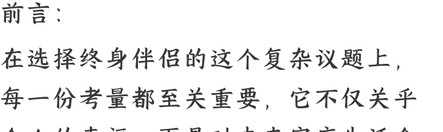

# 娶妻指南：哪些女人可以娶，哪些倒找钱也不能娶？怎么不再吃亏上当？（单身男性必读）

250415 张津铭

整理：公众号懒人搜索，懒人专属群独享

懒人微信：lazyhelper

观点仅供参考，毕竟理想化的伴侣只存在于现实中。不过如果一段感情里总是鸡飞蛋打，那么留存的意义不大。

最后，懒人劝诫，无论男女，结婚必须慎之又慎

## 前言：

在选择终身伴侣的这个复杂议题上，每一份考量都至关重要，它不仅关乎个人的幸福，更是对未来家庭生活会产生深远影响。

俗话说，娶个好女人，可以让你旺三代；而娶个坏女人，可以让你败三代。

可见，女性在婚姻当中，对一个家庭的幸福与发展，极其重要。

这里，温馨提示各位男性读者，婚姻是一辈子的大事，不论你单身多久，都不要急吼吼，遇到一个女人，为了那么一点下半身的欲望，就把对方娶回家。

这和动物有什么区别呢？

你需要的，是一个终生陪伴，让生活幸福的伴侣，让你的孩子可能感受到良好的家庭氛围和教育的女人，而不是找一个祖宗回家供着。

那么，对于单身的男性来说，哪些女性你必须要娶回家，又有哪些女性，就是倒找你钱，就是一辈子单身，你也不能娶呢？

又有哪些坑，你是一定要避免的呢？

今天的这篇文章，值得所有单身的男性和父母替孩子阅读。文章的费用，不够你打一次车的，但却会在未来，让你受益终生。

或者，可能我其中的某一句话，就可以拯救你一生的幸福。

绝对值得你深入研读。

当然，对于某些欲寻如意郎君的单身女性，亦可阅读。

如你按今天文章中的内容去打造自己，可以说，这也是你成为一个好女人，能牢牢把握美好姻缘的人生指南。

这里，我也祝你早嫁良人。

正文开始：

各位读者，下面的内容，三千多字，请你必须边读，边与你身边的那个正在接触的女性相对照。

如果不可以，你切不可全抛一片心，立刻断舍离，或者开开心就算了。你要知道，这个世界，还有一种女人，叫“蛇蝎美人”，这种女人，你绝对不可心生留恋。

如果可以，我希望你要真心对待对方，也要有所付出。

我一切所说，都是希望你万勿进入泥坑，终生遗憾。

那么，哪些女人，是你要珍惜，并要娶回家的呢？哪些女人，又是你要注意，不能相伴一生的呢？

现在正式开始分享。

首先，提及的是伴侣间在私密领域内的默契与和谐。

性生活的和谐，是维系夫妻情感的重要纽带，它不仅是生理上的满足，更是情感交流的深刻体现。

因此，若双方在恋爱阶段已展现出高度的契合度，这无疑是步入婚姻殿堂的坚实基础。

反之，若此方面存在难以调和的差异，则应慎重考虑，以免日后成为情感裂痕的源头。

在追求与被追求的过程中，若一方长期处于低姿态，通过不懈努力才赢得对方的青睐，这样的关系，往往难以维持长久的平等与尊重。

## 一、情感与生理的和谐
## 二、关系的平等与尊重

理想的伴侣关系，应是基于相互吸引与尊重的，彼此能够理解和支持对方，共同面对生活的风雨。

所以，如果你是做舔狗舔来的女人，要注意一些，以后的生活，你会很累。

如果婚姻中，你不能继续一直满足对方的要求，我相信你的苦日子，就要开始了。

## 三、家庭关系的融入

看对方是否能够与你的家人和睦相处，建立良好的家庭关系。

这样的女性，无疑为你未来的婚姻生活增添了诸多温馨与和谐。

她懂得如何在复杂的家庭结构中找到自己的位置，成为连接每个成员的桥梁。

如对方做不到，请你慎重。

## 四、共患难的伴侣

那些在你最艰难时刻不离不弃，与你共同经历风雨、共同成长的女性，你必须要娶回家好好对待。

她们的价值，远超过那些只愿享受你成功果实的人。

她们的陪伴与支持，是你人生旅途中最宝贵的财富。

对比起那些只会索取你的女人，你是不是捡到了宝呢？

而那些口口声声，只想与你同富贵，一点苦都不能吃的女人，你觉得还值得留着吗？

## 五、思想的独立与深度

拥有自己独立思考能力的女性，她们的生活态度积极向上，能够为你提供独特的见解与帮助。

这样的伴侣，不仅能够丰富你的精神世界，还能在关键时刻为你出谋划策，共同面对生活的挑战。

尤其，你是自己创业，做生意，即使是上班，对方也会为你提供真心的建议，希望你越来越好。

这样的女人，一般都具有大女主的潜质，希望你能珍惜，并好好辅助对方。

而与此相对的那些“妈宝女”，毫无自主生活能力，也没有主见的女性，你要慎重。

## 六、善良与界限的把握

善良是女性最宝贵的品质之一，但过度的善良，即所谓的“圣母”心态，可能会给婚姻带来不必要的负担。

因此，在选择伴侣时，需明确区分善良与无原则的牺牲，寻找那位既能保持善良又能坚守自我原则的女性。

千万别一不小心，把一个“圣母”娶回家，全都要听对方的。而你毫无参与和发表意见的机会。

过度的善良，就是软弱。总觉得自己是圣母，也会高高在上，质疑你、教育你，你会受得了吗？

## 七、沟通与解决问题的能力

面对矛盾与冲突时，能够冷静沟通、共同寻找解决方案的女性，是婚姻中的稳定剂。

她们懂得如何维护关系的和谐，避免将小问题扩大化。即使吵架了，也愿意与你一起解决问题，这样的女生，可以娶。

与此相反的，是那些神经质，与事逼型的女性，一点小事动不动就炸毛、就说分手的，你要慎重。

## 八、家庭条件的匹配

家庭条件相似的伴侣更容易在价值观、生活习惯等方面达成共识，减少因差异过大而产生的矛盾。

然而，这并不意味着家庭条件成为唯一标准，更重要的是双方是否愿意为彼此的未来共同努力。

但条件如果相差过大，希望你慎重考虑。因为，这可能会涉及到你们背后价值观的一系列问题。

## 九、家庭观念的考量

若女方的家庭存在重男轻女的思想，可能会对她的婚姻观念产生负面影响。选择伴侣时，应关注其家庭环境及教育观念，寻找那些能够平等对待子女的家庭。

如不能平等对待，对方父母实际上是在卖女儿，他们要想尽办法，从你身上索取利益。如果能儿女一视同仁，则无太大问题。

## 十、对婚姻的现实态度

对婚姻抱有美好幻想固然可爱，但过于理想化的态度可能导致面对现实时的巨大落差。

尤其对于那些总觉得自己是公主的女性，你要注意，如果有一天，你做不了“王子”了，对方虚幻的生活思想被打破，你觉得，你们的婚姻还会好吗？

所以，你要选择那些能够理性看待婚姻、勇于承担责任的伴侣，更有助于建立稳固的婚姻关系。

至少，这样的女性知道她在婚姻当中，在生活里，她的目标是什么，而不是做梦。

## 十一、认可与接纳

一个从一开始就欣赏并认可你的人，更有可能在婚姻中保持对你的尊重与爱护。

相反，那些总希望你变得更好的伴侣，可能会让你在婚姻中感到压力重重。

说句直接的，就是要找一个，在此刻就觉得你很好的女人，而不是现在就看不起，因为各方面原因与你在一起，这样的婚姻，相当于埋了雷，早晚都出问题。

## 十二、对婚姻的期待

对婚姻持有积极态度的女性，更有可能在婚后投入精力去经营这段关系。

而那些在勉强下步入婚姻的女性，可能更容易对婚姻产生不满与抱怨。你要注意这些。

## 十三、财务观念的契合

在金钱观上达成一致是婚姻稳定的重要因素之一。

能够共同规划未来、理性消费的女性，是理想的伴侣人选。

而与你在一起，每天总想搞你钱，大手大脚的女人，你不要娶。

还有要高价彩礼的女人，你理都不要理。

## 十四、真心与喜爱

婚姻应建立在真挚的情感基础之上。

若你并非真心喜欢对方，仅因年龄或其他外部因素而凑合过日子，这样的婚姻注定难以长久。

## 十五、独立生活的能力

能够自我照顾、独立生活的女性，在婚姻中更能展现出自己的魅力与价值。

她们不仅能为家庭带来温暖与支持，还能在必要时成为你的坚强后盾。

如果一个女人，离了你什么都做不了，哪怕一点小事都不愿意做，你要慎重。

## 十六、观念与三观的契合

在重大问题上，保持一致观念是婚姻稳定的重要保障。

选择那些与你三观相近、能够相互理解的伴侣，将大大减少因观念差异而产生的矛盾与冲突。

而观念不一致的，你说东她说西的，不能娶。

## 十七、周围环境的积极影响

一个身处幸福和谐家庭环境、对婚姻持有积极态度的女性，更有可能将这种正能量带入你们的婚姻生活中，值得你娶。

反之，若她身边充满负能量与不幸的婚姻，她本人，也总是负能量爆棚，可能会对你的婚姻观产生不良影响。这样的女人，如不能改变，也不能娶。

## 文末结语：

各位兄弟，这里我还是要直白点提示你：

别因为下半身，就把自己跟一个不值得娶的女人绑定在一起。

解决性需要的办法，有很多。而唯独想靠婚姻，只想解决这个问题，是最愚蠢的做法。

这样的婚姻，只不过是长期包养的关系，女人不过是在卖，而你只是长期的嫖客，人还不能轻易换，有什么意思呢？

爱，才是最好的春药，一定要找一个彼此相爱的人。起码，也要与上面说的 17 条大部分相符才可以。

请切记、切记。

最后，还是那句话：授人玫瑰，手有余香。

当然，我也不是你口中所说之圣人，毫无所求，我也是凡人，生活在这红尘里。

所以，亲爱的读者朋友，无论是你的赞赏，还是点一下“在看”，这些于我而言，都是莫大的鼓励。

衷心感谢我的读者朋友们。愿好运永远与你相伴！

历史 3000 多份各类付费文章以及年费三千多的副业社群资源，见懒人专属群内部分享！

付费群，白嫖勿扰！

懒人专属群更新记录：

https://lazybook.fun/#/blog/record2