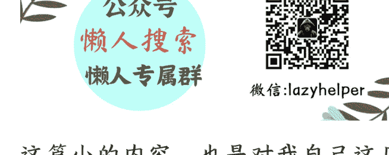
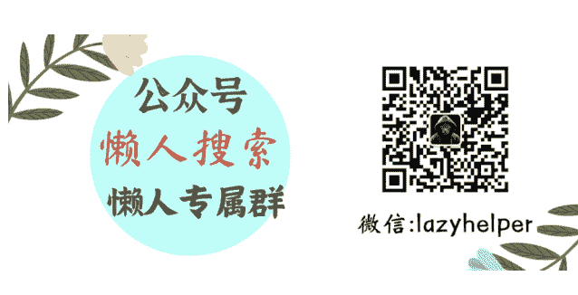

# 信息产品化：普通人赚百万的核心能力——我的实战方法论与3步转化模型

## 250415 生财精华

整理公众号懒人搜索，懒人专属群独享
懒人微信lazyhelper



这篇短的内容，也是对我自己这几年赚钱的一个核心技巧总结，希望对大家有所启发。

主题：你觉得你现在能赚钱，靠的是什么能力？这个能力你是怎么练出来的？

从2019年加入生财星球到2025年，是我人生中认知升级最快速的一个阶段。在这6年的时间里，我从职场到自由职业者，再到超级个体，再到1人公司，财富也跟着指数级别的增长。在北京全款买了自己的房子，旅行办公，基本上我想要的生活，现在全部实现了。

如果说，只能分享1个赚钱的能力，那我的答案是：信息产品化。

为什么？

想赚钱，底层逻辑就是卖产品。无论是你看到的1个信息差，还是你擅长的1个技能，或者是你的人脉关系，甚至你脑袋里的1个idea，在我眼里，这些东西都是有价值的信息。

但信息没办法直接变成钱，或者说只能让你赚点小钱。可如果你想赚到百万和千万级别的财富，就要想方设法的把他们产品化。

举例子，我开了5年的线下舞蹈室，其实每个舞蹈室每年的收益最多也就20万左右。但是我把在生财里学到的关于私域运营的方法论+线下舞蹈室的运营案例结合在一起，就变成了我的《门店私域课程》。这个课程单独购买是999元，我卖了几百份。

而且还通过知乎引流卖了6个10000元的北京线下教培咨询单子，这个就是把标准的网课变成咨询产品的过程。

再举例子，我在2023年的时候，觉得超级个体创业的最大痛苦就是非常的「孤独」。没有之前在公司里团队的支持，自己的决策成本很高，而且如果想要跑通一些项目的流程，自己一个人干不过来，需要聘请员工。可是招聘员工在创业初期是最大的成本，怎么办呢？

有没有可能找到1个灵活的关系，成本很小，但是随时可以合作的方式呢？于是我把自己的这个需求，变成了一个产品，就是我的「合伙人」产品。

这个产品也帮我赚到了很多钱，后来又有很多人模仿我的这个产品模式，他们也赚到了很多钱。

从商业角度来看，一个idea，一个信息差，一个渠道关系，一个垂直技能，甚至就是你的一个爱好，都是可以变成产品的。而信息到产品，产品到执行，也是这个时代个体最应该具备的1个能力。

那我把「产品化」简化成了3个步骤，分享给生财的圈友：

### 第一步：判断信息的价值

比如说你在生财上看到了一条风向标，然后觉得这个信息很好，给了自己的启发，想要把它做成可以赚钱的产品。但是别着急，你觉得有价值的信息，在别人那里可能一文不值，所以你需要收集用户的反馈，把这条信息+自己的想法（商业逻辑）分享到反馈容器里（星球、朋友圈、社群等）收集大家的真实反馈。

反馈要看什么？痛点程度、频率、和用户共识。如果你这个信息确实解决了用户深度痛点，并且是高频的，而且你一说，大家都很有感触（去看评论区），那这个信息就是有价值的，可以做产品。

### 第二步：包装产品的权益

想要把一个信息产品化，那首先你就要考虑，如果别人向我付费购买我这个产品，它可以得到什么具体的权益呢？

举例来说，比如@亦仁看到生财里有很多小伙伴都在做AI相关的产品，那就想如果我把这些人聚在一起是不是可以提高效率呢？

聚在一起就要有一个空间，现在线上的空间已经有了航海家和星球了，线下的空间还没有。那我是否可以做一个联合办公室？

这是一个已经被验证过的有价值的产品。那想要让用户接受这个产品最简单的一个思路，就是我要列出123456，用户购买之后可以享受到的权益是什么？

比如说有定期的培训？比如说有产品推广曝光甚至是投资的资金支持？比如说加入了联合办公之后，能够给到某种身份？

把权益罗列出来，那你这个产品的雏形就出来了。无论是线下一个空间还是说线上的一个社群，或者说一个知识付费课程，只要能罗列出权益，那他就能够跟用户交换，就算是一个产品了。

### 第三步：产品可视化

可视化，在我看来是一个非常重要的产品化步骤。你跟潜在客户去描述你的产品，那就不如有一张产品海报更直观。为什么有人光靠PPT演示就能拉到投资呢？就是这个逻辑。

当然，产品可视化，不一定体现在一张海报和PPT上面，还有可能是一个你的思想复盘，或者一次演讲等等场景。

我自己的每一个产品之所以能够赚到钱，都是因为我快速推出了1.0可视化版本。哪怕只是一张简单的手写图，用户也能够知道我现在有这么一个产品了，这个产品可以帮助他解决某一个痛点。

好啦，以上就是我自己能够赚钱的1个能力，希望能够给大家一些启发。



历史3000多份各类付费文章以及年费三千多的副业社群资源，见懒人专属群内部分享！

付费群，白嫖勿扰！

懒人专属群更新记录：
```
https://lazybook.fun/#/blog/record2
```