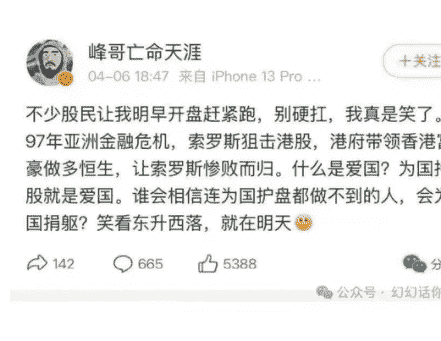
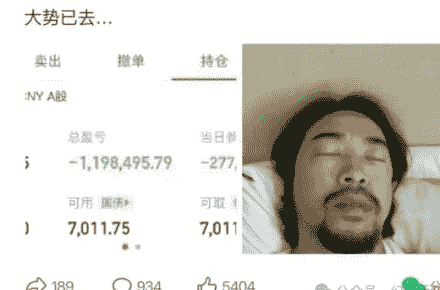

# 史诗级暴跌！要跑吗？
250416 幻幻话你知

整理：公众号懒人搜索，懒人专属群独享
懒人微信：lazyhelper
懒人备注：股市有风险，投资务必谨慎！
亏钱大V们也不会补贴 Bro~
也可以不看，都是情绪，没啥干货
AI 都说这篇文章不到60分，还好大家不是真的花50块买的

## 五、总结
此文优势在于观点鲜明、感染力强，适合吸引情绪共鸣的读者；但作为财经分析，其论证粗糙、逻辑松散、专业性不足的问题突出。若以“引发讨论”为目标，可打60分；若以“专业投资建议”为标准，则不及格。改进方向可参考搜索结果中关于深度分析、结构逻辑和语言准确性的要求 ①②③。

以下为正文：

## 前言
3800字，完了天塌了！
遇到金毛这么个王八操的，全世界股市都给他整崩了。
某些著名爱国博主，这时候也已经现出原形了。





那问题来了，这时候到底是跑还是不跑？接下来到底该怎么办？有疑惑的，往下看，不多废话。我的结论很简单：
一个字，梭。
两个字，快买。
三个字，买买买。
四个字，有钱就买、没钱睡觉。
五个字，砸锅卖铁买、倾家荡产买。
（指我自己，普通人不要效仿）

原因简单说说。首先，中国已经不是 1978 年、1990 年、1999 年、2008 年、2018 年的中国了。在上面任何时候，如果美国直接一刀斩，切断中美贸易，那是相当危险的。可惜美国人动作太慢了，已经来不及了。今天的中国，已经是 2025 年的中国了。《君主论》里面说过，如果你出其不意，把你的敌人一次性给整死，那以后就整不死了，起码很难很难整死了。就算最后整死了，也绝对要你半条命。大概就这么个意思。你让你的敌人知道你迟早要干死他，然后他在家每天磨刀霍霍、锻炼身体，等着你上门跟你拼命，那你基本上只有倒霉的份了。

为什么前两天当美国给加关税，咱们不仅没有跪，反而一巴掌抽过去？说明早准备好了，就等着你出招呢。其实从 2018 年开始，中国就已经做好全面脱钩、全面断绝中美贸易的准备。2018 年打贸易战，是出其不意，那时候效果是很好的，A 股直接腰斩了。现在再打，就相当于咱们格挡已经点满了，肌肉也练起来了。这时候再打过来，已经没什么卵用了。所以结论就是，很多人都高估了再打贸易战对中国的影响。结果表现就是今天，这些人都使劲卖，抓紧一切机会跑路。要跑跑吧，随便他们了，反正老子不跑。不仅不跑，哥哥还要加杠杆，还要背债，把自己整成负翁。哥哥最近还买了套房，首付给到最低，贷款撸了370万，借就完事了，谁怕谁？

为什么呢？简单讲讲。川普这个傻逼，在加关税之前跟媒体说的是，希望我们过来下跪，跟他谈出售 tiktok 的事情。结果咱们一巴掌过去，你算个鸡巴，凭什么跟你谈？这说明了什么？前面说了，早准备好跟你撕破脸了。没有准备好跟中国撕破脸的，反而是美国。所以这就意味着，后面会有大招陆陆续续放出来。但其实这些大招，说一千道一万，无非就是印钞票而已。不管它是什么形式，你记住了，本质上就是印钞票。当然印钞票，有时候有用，有时候没用。有些非洲国家，你越印钞票越要命，钱就越不值钱。但是中国真不一样。原因我不想说，这是哥哥的独家研究成果，付费也不解锁。总之将来你会看到一个奇妙的景象：
懒人微信：lazyhelper
公众号懒人搜索，懒人专属群分享

## 前几年的美国、上个世纪80年代的日本
都是这样的，爽得很。那时候房子、股票天天涨，工资天天涨。大家钱多得没地方花，整天就乱花钱，乱炒各种乱七八糟的东西。等着看吧，过段时间咱们这也这样。这种事情还有一个辅助条件，就是房价、股价不能太高。如果涨得太高，需要印很多很多很多钱才能维持住这个泡沫。这对于任何国家来说都是不划算的。就像现在美股跌了挺多，美联储也没有降息印钱的意思，因为你印了也白印，照样跌。而中国恰好，非常好。房子和股票都还很便宜，具备承接海量货币的能力。

其实很多人没注意到，或者说不愿意承认，房价泡沫，是 2021 年政府主动刺破的。当年故意限制房地产企业贷款，直接把恒大这些企业整死了，泡沫破灭。如果当年放任房价继续涨，搞不好今年都还在涨。

### 泡沫破灭后什么结果
房价依然很贵，大城市也就跌了百分之 30 左右，也没有腰斩，没有像日本那样直接跌百分之 90。今年还有个别城市房价微涨，回暖了。可以说房价调控非常成功了，人类经济史上的奇迹。

股价不多说了，一直都很便宜，毕竟一直都没涨。所以这时候政府想把经济搞好，其实很简单，把房价、股价搞起来，经济就恢复活力了，就是这么简单。

如果你留心观察，就会发现，这几年中国跟全世界都是反过来的。你出过国就知道，不要说发达国家了，就连东南亚这些烂国家，经济没多好，物价都还在涨。很多人去泰国找小姐姐玩，都会发现妈的泰国太贵了，还不如在国内了。其实这些物价高的国家，才是最危险的。中国这几年什么都在跌，反而是虱子多不愁，非常安全。物价涨一点上去，经济马上好起来了。这里就又要说到川普这个傻逼搞的关税了。其实对中国来说，关税最大的作用，就是促进物价上涨。这个简直就是你在想打瞌睡的时候，刚好有人给你送枕头。稍微看过点经济大 V 科普视频的都知道，中国经济这几年最大的麻烦，就是不停内卷，物价老在跌。企业整天打价格战，东西越卷越便宜。现在川普这么一通王八拳打过来，两个效果：

- 1、很多出口企业都得破产解散，大学生找不到工作，都在家玩手机了。最终减小供给、减少内卷，促进物价上涨。
- 2、咱们目前从美国进口的都是一些农产品，高科技的东西不多。咱们一巴掌过去，给美国加关税，除了坑了那些投票给川普的美国农民以外，还能促进物价上涨。

这简直是一箭双雕的好事。既能捅他一刀，又能促进国内经济问题的解决。所以说白了，现在把中国房子卖掉股票卖掉的，在我眼里跟傻逼没有任何区别，纯种的傻逼。

## 相关链接：
- 幻幻谈房事 |——房价还会涨吗？
- 幻幻聊房事2：房价什么时候涨？

当然我知道，这些人都是什么经济学家，金融精英，名头都大得很。也都是有钱人，都把股市砸得稀巴烂了。不过随便他们了。他们卖我就买，现在就是检验认知的时候了。谁最后挣钱出来了，谁认知就正确；谁亏钱出来了，谁就是傻逼。就这么简单。

为什么哥哥这么有信心跟这些有钱有势的人做对呢？因为哥哥这几年经过大量的实践以及反思，我发现了一个很要命的事：那就是西方经济学。我把它叫做白鬼经济学，也就是你们大学里学的那些经济学。不能说全错吧，也有好的部分，但是绝大多数理论，都是有致命缺陷的。用它来分析经济，只有被打脸的份；用它来分析股市，只有亏钱一条路可以走。所以这几年哥哥自己总结了一套经济分析方法，并且用这套方法来指导投资。其中最典型的例子，就是银行。

哥哥投资银行股的这几年，所有的国内经济学家都不看好，国外的高盛、摩根这些大投行，也不看好。

## 相关链接：
- 有没有收益比余额宝和银行理财高，风险又比较低的基金？
- 一年暴涨40%，我为什么能精准押中银行？银行要不要卖？
感兴趣的自己去翻前几年各种人是怎么说银行的。这里举一个例子，这是百年投行高盛。清华北大分数最高的专业，遍地都是省状元的专业里，每年只招三五个人的高盛对银行的看法：


### 按照西方经济学的分析框架
银行股瞬间就会倒闭，没有投资价值。这几年没人看好，就哥哥一个傻逼看好。但最后很显然，哥哥对了，不看好银行的所有人都错了。这就给了哥哥很大的信心，原来搞半天，这些什么经济学家、券商首席、投行精英、财经大V都是傻逼啊。这种感觉就类似于哥哥读高中那会儿，终于发现老师们都是傻逼，靠他们不如靠自己自学，非常地兴奋，非常地嗨皮。

国内目前这些经济学家，都是学西方经济学的。所以他们也只能得出结论，别的结论也给不了，也只能给信他们的有钱人洗脑，让他们快点跑。他们跑他们的，我又不信西方经济学。他们跑，哥哥就买，赚钱就是这么简单。

所以简单总结一下接下来会发生的事：

- 1、出口企业大量破产，该滚滚吧，给爷死去，大学生滚回家玩手机，从而促进物价上涨。
- 2、川普的傻逼关税，促进物价上涨。
- 3、川普发癫，要推动人民币升值，物价上涨。
- 4、政府为了救市，为了稳就业，会扩大政府开支，大量印钞票。
- 5、中国股市、中国房价，恰好很便宜，能承载印出来的海量货币。

最终导致的结果，就是：物价上涨、房价上涨、股价上涨。全面推动中国经济回升，最终全世界其他地方跟着美国一起垮。中国经济起死回生，成为最亮的那颗星星。全死光了就我没死。

### 有人说：这么多人没工作咋办？
你有没有工作，其实没有那么重要，没工作更好。咱们国家目前就是因为太多人工作了，家里有钱有势的也在卷，官二代富二代一个比一个努力。结果就整天卷，物价和经济都起不来。没工作不要紧，饿不死就行了。你没工作正好，内卷减轻了。最终呈现的结果，就是供给减少，物价上涨。

另外再说说对男大学生的影响。如果你家家徒四壁，大城市里没有房子，那将来就惨得不能再惨了。为什么呢？因为房价、股价、p价（你也可以理解为彩礼钱），到时候都会涨得吓死你。现在男大学生们还在刷知乎、刷虎扑，论证日耳曼赢学，美国衰咱们要崛起。美国衰，咱们要崛起，这些我都同意。但是你将来会买不起房子，娶不起女人，去找付费的都贵的要死。这你恐怕就不会同意了。但是不同意也没用，等着倒霉吧。

现在最好呢，就是能买多少买多少。像哥哥这种比较激进的，是能借多少借多少，借到了就买买买，等着涨就完事了。买什么？看文章：《A 股大跌，牛市结束了吗？是不是要跑路了？（内含财富密码）》、《A 股牛市来了吗？现在还能买吗？现在买什么能赚钱？还要涨多久？》

当然你们最好不要太激进。咱们性格不一样，实力也不一样，承受能力不一样。最好不要做超出自己能力范围的事。万一做了以后倒霉了，也不要怪哥哥，已经在这里提醒过你了。

所以最后一句话就是：
懒人微信：lazyhelper

> “混乱，是上升的阶梯”

现在就看敢不敢赌了，任何事情都有赌的成分。赌对了，接下来十年都不用干活了，天天吃喝嫖赌；赌错了，哥哥也有备选方案，那就是直接跑路，去美国打黑工去。如果赌输了，美国肯定超好赚钱的，这边亏完了也没事儿。所以这怎么看都是赢嘛，最起码不亏。所以咱们就干了、梭了。你们不要效仿，效仿后果自负，倒霉了活该。


微信:lazyhelper
历史 3000 多份各类付费文章以及年费三千多的副业社群资源，见懒人专属群内部分享!
付费群，白嫖勿扰!
懒人专属群更新记录:
```
https://lazybook.fun/#/blog/record2
```