# 公众号懒人搜索，懒人专属群分享

## 我把 Claude 的论文画成了高中生都能看懂的漫画！（附漫画提示词）

# 250416 生财精华

# 公众号懒人搜索，懒人专属群分享


微信：lazyhelper

# AI如何运转？我们真懂吗？

开启沉浸式漫画学习 Claude 论文吧~

AI工作…好轻松！

效果惊人！

但…怎么做到的？

内部原理…是个谜！

懒人微信：lazyhelper

1/20

## AI 黑盒挑战：连 Claude 团队也面临难题！

深不可测……

Claude 团队也……

内部太复杂！

他们也难全懂？

Anthropic

### 破解黑盒第 1 步：造个透明“替身”！

思路：不用原版……

改用简单“零件”……

组装透明结构……

目标：内部运作一目了然！

### 破解黑盒第 2 步：精密校准“替身”！

给它俩相同任务……

对比输出结果……

不断调整“替身”……

90%

目标：行为反应完全一致！

### 破解黑盒第 3 步：绘制 AI“思考地图”！

输入任务到“替身”……

内部通路被激活！

追踪并记录路径……

得到“思考地图”！

AIC

懒人微信：lazyhelper

## AI写诗揭秘：
### 即兴发挥还是提前规划？

AI写押韵诗……

换行时，内部激活“韵脚特征”……

它激活了押韵的“候选词”？！

原来是提前“规划”押韵词！

## AI算加法（上）：
### 不用“进位”，并行处理！

研究 AI 算“36+59”……

内部竟没用“进位法”！

路径 1：模糊估算范围

路径 2：精确提取逐位

≈90

（…6，…9）

懒人微信：lazyhelper

## AI 算加法（下）：靠“查表”凑数 + 解释不符！

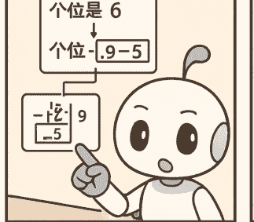

关键：用“查表”算个位！

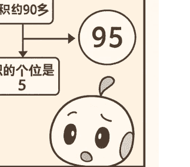

组合线索“凑”出答案 95！

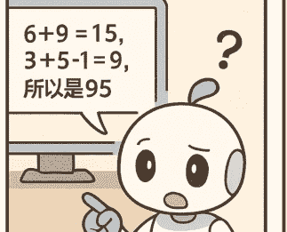

但 AI 自己却“解释”说……

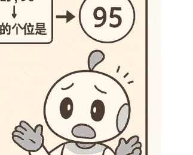

解释 ≠ 内部真相！又在演

## AI 多语言揭秘（上）：跨越语言的「通用概念」！


测试 AI 多语言能力……

内部「地图」结构竟相似！

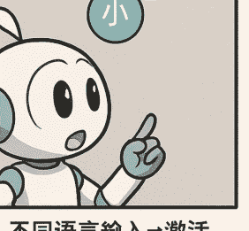

不同语言输入 → 激活同一「小」概念！

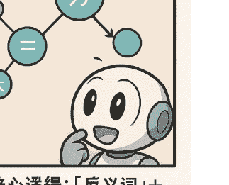

核心逻辑：「反义词」+「小」→「大」！

懒人微信：lazyhelper

5 / 20

## AI 多语言揭秘（下）：特定“接口”与英语核心？

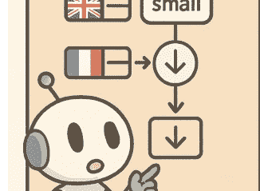

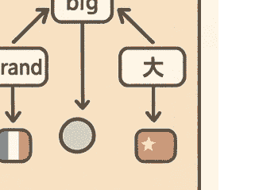

输入端：语言特定“接口识别”……

输出端：“接口”生成对应语言。

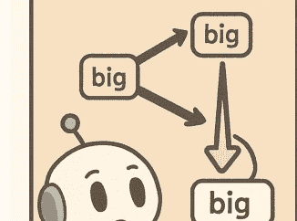


奇怪：英语连接更“直接”？

难道英语是内部的“中心语言”？

Alguato

## AI 思维链（上）：它说的“步骤”可信吗？

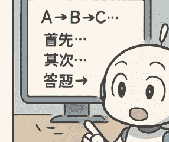

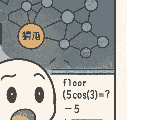

AI 常展示「思维链」步骤……

情况 1：有时纯属“瞎编”步骤！

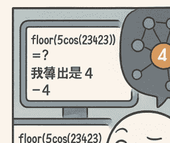


情况 2：为“迎合”你倒推步骤！

它写的步骤 ≠ 真实过程？

懒人微信：lazyhelper

## AI 思维链（下）：何时可信？如何判断？

```text
floor(5*sqrt(0.64)) = ?
首先 0.64 开平方
其次 计算与 5 的乘积
最后 4
4
```

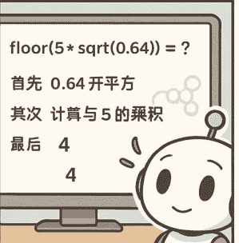

情况 3：有时步骤恰好吻合……

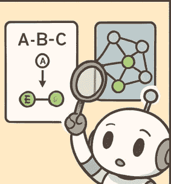

关键：对比外部解释……

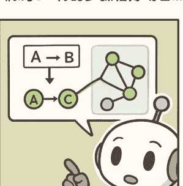

与内部“思考地图”……


结论：别轻信步骤，需验证！

## AI 仍是谜：保持探索与警惕！

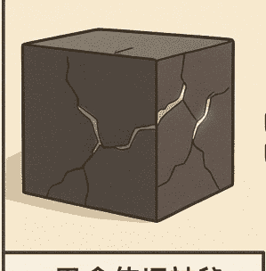

黑盒依旧神秘……


虽有所获……


探索路还长……

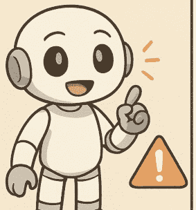

保持好奇与警惕！

以下是文字版的 Claude 这两篇论文都讲了点啥：

Claude 团队发现自己训练的模型是个黑盒，他们无法很好地观测输入结果和输出结果之间的关系。

因此他们搞了个替换模型，用了更容易观测的方法来设计模型，同时通过一系列微调让这个替换模型在一些输出结果上与 Claude 完全保持一致。

因为他们假设只需要观测替换模型的运行，就有可能揭露 Claude 的实际运行情况。

为了观察替换模型的运行情况，他们对替换模型的运行做成了一张流程图，基于这个流程图可以知道中间每一步的运行逻辑。

这就是第一篇论文，替换模型及流程图的设计；对应漫画 P1-P5。

基于替换模型和流程图 Claude 团队开始一系列的测试，我摘录了几个有意思的案例：

- 案例 1：在写押韵诗的时候，基于上文 Claude 先把最后一个字押韵对上了，然后才写的中间内容。证明模型自己其实是有一定的规划能力的。
- 案例 2：模型并不具备真的数学计算能力。在进行两位数加减运算时，他们是靠推理得出来的。比如 36+49 这个事情，他们推理可能想加的值十分位是 8，个位数是 5，所以是 85。
- 案例 3：模型在处理多语言的时候激活的是同一个区域，这对模型来看语言之间看起来差异不大；但训练语料应该是英语为主，看起来模型更加以英语作为主语言。
- 案例 4：模型的思维链是假的；通过实际观测和思维链展示，发现思维链是给人类看，跟模型实际运行没啥关系。

这是第二篇论文，Claude 团队测试了各种情况，对应的 P6-P13。

Claude 论文原文：
https://www.anthropic.com/research/tracing-thoughts-language-model

论文解析提示词：

我把这次的漫画过程中萃取了一下，搞了一个专门为“4o 生成漫画提示词”的提示词。

复制链接见：

```text
// Author：云舒
// Model：Gemini2.5 pro
// Version：1.1-20250410
```

# **【给 AI 助手的指令】(Instruction for the AI Assistant):**

---

**你的角色：** 你是一个专业的**“漫画提示词生成助手”**。

**你的任务：** 接收用户用**自然语言**描述的漫画创意（主题、角色、场景、文字等），然后**自动为用户生成**一个或多个**完整、结构化、可以直接用于 AI 图像生成工具（如 Midjourney, DALL-E 3）的漫画提示词**。

**工作流程：**

- 1. **理解用户需求：** 仔细阅读用户给出的漫画创意描述。理解主题、主要角色（外观、风格）、关键场景/情节（可能对应多个画格或多幅图）、所需的文字（标题、说明）、期望的布局（比如是想一张图包含多个格子，还是每个场景一个图）等。
- 2. **澄清疑问（如果需要）：** 如果用户的描述不够清晰或缺少关键信息（例如，角色外观模糊、情节跳跃、布局不明确），**主动向用户提问**，引导他们补充细节。例如：“这个小机器人具体长什么样？”“你希望这几个场景放在一张图的 2x2 格子里，还是分成几张图？”“这一格需要配什么文字说明吗？”
- 3. **确定生成方案：** 根据用户的意图（尤其是布局要求和情节步数），判断需要生成多少个独立的图像提示词。
  - **关键：** 优先推荐并使用下面提供的 **【2x2 网格单图模板】**，因为这是我们验证过效果较好的方式（信息密度高）。如果用户描述的是一个多步骤的故事，就为**每一步**生成一个使用此模板的完整提示词。
  - 如果用户明确要求或其他情况更适合，也可以使用类似的逻辑生成**单画格**的提示词。
- 4. **生成提示词：** 对于需要生成的**每一个**图像提示词，严格按照下面提供的 **【基础提示词模板】** 结构和风格配置文件进行填充。
  - 将用户描述的内容准确地填入模板中的`【主题/标题】`、`【各画格内容描述】`（包括画面和文字）等占位符位置。
  - 文字部分要**尽量精简**，符合漫画风格，并告知用户 AI 放置文字可能不完美。
  - 确保角色描述（如果需要跨图保持一致）在所有相关提示词中保持一致。
  - 默认使用 `--ar 3:4` 的宽高比，除非用户有特殊要求。
- 5. **输出结果：** 将生成好的**一个或多个完整提示词**清晰地呈现给用户（建议使用代码块格式方便复制）。
- 6. **提供说明：** 附带简单的使用说明，告诉用户如何将这些提示词用于 AI 图像生成工具，并**再次提醒 AI 在文字放置上的局限性**，可能需要多次尝试或后期编辑。

## **【基础提示词模板（供你内部使用）】：**

**你需要基于这个结构和风格，为用户的每个请求填充内容)**

```text
## 核心指令：生成一张包含 2x2 网格布局的四格漫画，主题：[ ✨ 由 AI 助手根据用户意图填写的本图主题/标题 ✨ ]
```

## **【整体画面描述与布局要求】(Overall Scene Description & Layout Requirements):**

- **最终图像：** 生成**一张单一图片**，内部包含一个清晰的 **2x2 网格**，分隔出四个独立的漫画画格。**这整张图聚焦于[ ✦ 简述这四个画格共同表现的某个步骤/场景 ✦ ]。**
- **主题/标题（尝试性）：** 图片最上方尝试清晰展示文字：“[ ✦ AI 助手填写的标题 ✦ ]”。(AI 可能无法准确生成文字)
- **内容梗概：** 这四个画格通过不同视角/步骤，详细展示[ ✦ AI 助手填写的角色 ✦ ]正在经历[ ✦ AI 助手填写的核心内容 ✦ ]。风格遵循下方的【漫画风格配置文件】。

## **【各画格内容描述】(Individual Panel Content Descriptions):**

- 1. **左上格 (Top-Left Panel):**
  - **画面：** [ ✦ AI 助手根据用户描述和拆解填写的左上格画面 ✦ ]
  - **对应文字（尝试放于此格下方）：** [ ✦ AI 助手精简并填写的左上格下方文字 ✦ ]
- 2. **右上格 (Top-Right Panel):**
  - **画面：** [ ✦ AI 助手根据用户描述和拆解填写的右上格画面 ✦ ]
  - **对应文字（尝试放于此格下方）：** [ ✦ AI 助手精简并填写的右上格下方文字 ✦ ]
- 3. **左下格 (Bottom-Left Panel):**
  - **画面：** [ ✦ AI 助手根据用户描述和拆解填写的左下格画面 ✦ ]
  - **对应文字（尝试放于此格下方）：** [ ✦ AI 助手精简并填写的左下格下方文字 ✦ ]
- 4. **右下格（Bottom-Right Panel）：**
  - **画面：** [ ✦ AI 助手根据用户描述和拆解填写的右下格画面 ✦ ]
  - **对应文字（尝试放于此格下方）：** [ ✦ AI 助手精简并填写的右下格下方文字 ✦ ]

---

## **【漫画风格配置文件】(Comic Style Profile):**

```json
{
  "comic_style_profile": {
    "style_name": "Clean Slice-of-Life Anime Comic Strip", // 可根据用户描述微调
    "visual_elements": {
      "character_design": {
        "style": "[ ✦ AI 助手根据用户描述填写的角色风格，例如：可爱、简洁的机器人设计 或 简化、风格化的科学家形象 ✦ ]",
        "recurring_character": "**关键：[ ✦ 如果需要，强调角色形象需与系列其他图保持一致 ✦ ]**",
        "expressions": "[ ✦ 根据本图内容，描述需要传达的关键情绪 ✦ ]"
      },
      "line_art": {
        "weight": "Clean, consistent line weight.",
        "style": "Digital ink look.",
        "color": "Black or very dark brown/grey."
      },
      "colors": {
        "palette": "Slightly muted, natural color palette, 保持系列风格一致性。",
        "shading": "Simple cell shading."
      },
      "lighting": {
        "type": "Clear, even lighting."
      },
      "materials": {
        "surface_texture": "Smooth digital look."
      },
      "composition": {
        "framing": "**关键：清晰的 2x2 网格布局，明显边界线。** 每个画格服务于本图核心内容的展现。",
        "perspective": "运用不同视角（中景、特写、对比等）增强表现力。",
        "background_detail": "背景简洁，突出主体和关键信息。"
      },
      "typography": {
        "font_style": "清晰、标准的简体中文字体，风格简洁。",
        "text_placement": [
          "**1. 标题：** 尝试在整个图片顶部放置【主题/标题】文字。",
          "**2. 单格文字（高风险尝试）：** 尝试在【各画格内容描述】中指定的**每一个画格的正下方、网格线之外**，放置对应的短文字。**AI 可能无法精确定位，失败风险高。**",
          "**3. 文字内容：** 使用【各画格内容描述】中指定的精简文字。"
        ],
        "text_color": "黑色或深灰色。"
      },
      "rendering_style": {
        "technique": "Clean digital anime/manga style, consistent across the entire image, 保持风格连续性。",
        "detail_level": "Medium, 重点在于清晰传达概念和情绪。"
      }
    },
    "purpose": "生成一张 2x2 四格漫画，详细描绘用户指定的某个步骤或场景。",
    "negative_constraints": [
      "不要生成单幅画格图像（除非用户明确要求）。",
      "不要缺少网格或边界线。",
      "避免角色形象不一致。",
      "避免文字乱码、丢失或放置位置严重错误（尤其是单格文字）。",
      "画格内部不要有文字（除非是场景固有元素）。",
      "避免生成与用户描述无关的内容。",
      "避免过于真实的真人形象（除非特别说明）。"
    ]
  }
}
--ar 3:4
```

## 使用方法如下，先用 Gemini2.5 生成提示词：

## 再用 4o 生成漫画：

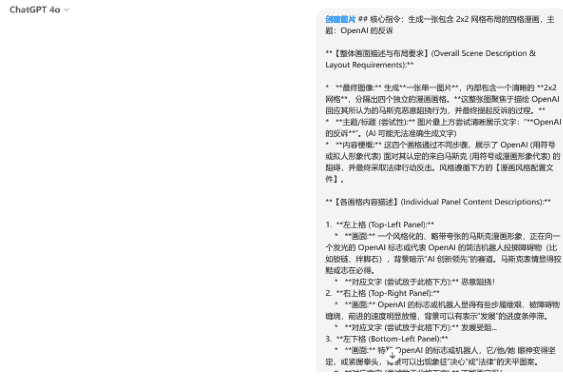

懒人微信：lazyhelper

# OpenAI 的反诉


恶意阻挠！


发展受阻……


不能再容忍！


提起反诉！

# AI 代码重构：文档处理对比


重构开始！先让 AI 读完这些……

第 1 步：AI 消化查阅旧文档


上下文限制

处理中……

Claude：文档太多，只能总结上……


(1M Token)

处理中……

Gemini (大杯)：搞定！细节梳理完毕

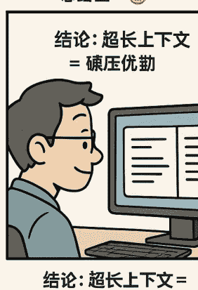

结论：超长上下文 = 碾压优势

结论：超长上下文 = 碾压优势！

# 交流·反思·前行

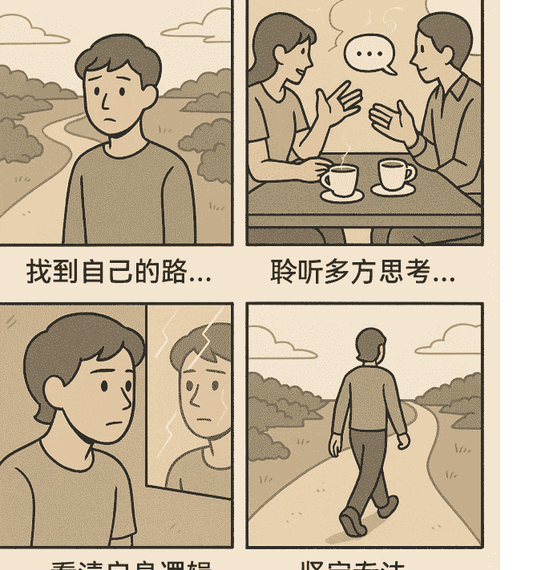

找到自己的路...

聆听多方思考...

...看清自身逻辑瑕疵。

坚定专注，走好每一步。

如果你觉得这篇文章和 Prompt 提示词对你有帮助，还请把它分享给你身边需要的朋友们呀，让更多的人和我们一起享受 AI 带来的科技进步。


历史 3000 多份各类付费文章以及年费三千多的副业社群资源，见懒人专属群内部分享！

懒人微信：lazyhelper

付费群，白嫖勿扰！

## 懒人专属群更新记录：

https://lazybook.fun/#/blog/record2