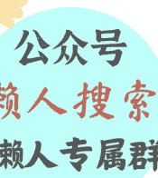

# 中越联合声明，有哪些猛料？

250418 文/卢克文工作室嘉宾 低调老弟
整理：公众号懒人搜索，懒人专属群独享
懒人微信：lazyhelper

微信:lazyhelper

访问越南后，中越发表了联合声明。

《声明》长达十一条，8097个字，有两方面值得注意。一方面是内容特别丰富，另一方面是越南的措辞小心翼翼，避免刺激到特朗普。

那么，具体有什么干货？

## 一、共同声明的重点

2025版《中越共同声明》合计十一条，重点内容是第二、四、六、八条。

共同声明第二条：双方同意要坚定不移地推进中越友好事业。

双方回顾建交75周年以来的历史，定性成了三个始终：前半截始终并肩战斗，后半截始终互学互鉴，越南始终高度评价和珍视中国给予的有力支持和巨大帮助。

通俗地说，就是哥俩好啊，始终好啊，666啊。

对于未来，又是两个始终——

“中方始终把越南视为周边外交的优先方向。越方重申始终把对华关系视为头等优先。”

很多读者可能觉得，甜言蜜语没啥用处，在利益面前还不是说翻脸就翻脸。但是吧，打个比方来说，温度计不是只需要测出来发不发烧就可以了，它还得能显示刻度。

国与国之间蜜里调油的那些个有点儿肉麻的话，起的就是这个刻度的作用。还比方说，越南方面派谁去机场接送中方领导，上上次是五把手接机，上次是三把手接机。这次是二把手+五把手接机，三把手+五把手送行。

谁接谁送显然不只是面子问题，了解了这个尺度，下次再参照接机和送机的人员安排，就能知道中越关系的进退。

共同声明第四条：双方确认，将战略互信提升至更高水平。

通俗地说就是这次咱哥俩可得好好交交心。

具体就是，“深化政治安全合作，将中越外交、国防、公安‘3+3’战略对话机制明确为部长级，并适时召开首次部长级会议。”

考虑到苏林是公安系统出来的，中越3+3会谈等于帮助越南公安系过问外交和国防，是送给苏林的一份大礼。

（后面的共同声明第五条整个都在谈和越南公安部的合作，其实是第四条的延伸）

而苏林给予的回报，光是体现在第四条里的，就有两个：
- 1. 支持越南外交官到中国接受培训；
- 2. 支持中国统一大业。

要知道，承认一个中国早已不稀罕，承认台湾是中华人民共和国不可分割的一部分，才是真正有分量的表态。

而在联合声明里明确写上支持中国统一大业，这个表态的含金量就很高了。预计 4 月 30 号，中国人民解放军代表团会参加越南统一五十周年阅兵式。

共同声明第六条：双方同意以中国发展新质生产力、越南发展新型生产力为契机，构建更加广泛深入的全方位合作格局。

我们看中越共同声明，最关心的可能就是中越两国如何联手对付特朗普的贸易战。第六条的标题是最切题的，但可能是为了对具体措施进行保密，第六条在标题谈到中国新质生产力，越南新型生产力之后，宕开一笔，谈的全是交通问题。

就在大家可能要失望的时候，干货却突然冒了出来——“双方将推动中越跨境标准轨铁路联通。”

翻译一下，就是越南同意把铁轨从米轨、窄轨换成和中国一样的标准轨。
越南人从胡志明时代就高唱越中情谊深，同志加兄弟。可铁轨的轨距不换，就难免让我们觉得，他们防兄弟如防贼。

退一万步来说，以现在中越之间的实力对比，如果中越哪天真的翻了脸，越南搞不搞这种“轨距”都不影响什么。反而是火车频繁换轨，严重耽误双方做买卖。

现在越南人终于回过味儿来愿意换轨，相当于是把小区门禁卡交给我们一份儿，可喜可贺。

### 第八条：双方同意开展更加紧密的多边战略协作。

之前中越共同声明一般来说，聊的都是两国之间的事儿。这回明显升格了，中越开始唠亚太，唠中国东盟关系的嗑了：

> “双方强调维护亚太地区和平与安全的重要性，同意践行开放的区域主义。中国支持东盟建设团结、统一、自强与发展的东盟共同体，支持东盟在不断演进的亚太地区架构中保持中心地位。”

现在的东盟轮值主席国是马来西亚，下一个轮值主席国是菲律宾。越南要等到 2029 年才能轮上。

这次我们和在越南的联合声明里畅聊中国和东盟的关系，除了捧一下越南，也是给下一站马来西亚之行吹风，最重要的是和越南一个鼻孔出气，震慑一下菲律宾，让它不要以为当了轮值主席国，就可以在南海兴风作浪。

后面的共同声明第九条，越南同意妥善管控解决分歧，其实是第八条的延伸和回报。

要知道东盟的五个初始成员国，在 1967 年就是奔着防备越南才拉了这么个群。越南在 1995 年才加入东盟，虽说体量不小，可在东盟从来都不是核心成员。

现在中方这么捧越南，拿越南当个东盟领袖一样畅谈天下大势，它还好意思在南海跟着菲律宾屁股后面转悠吗？

另外，这次联合声明还提到了两个比较重要的细节：
越南开放对中国商用飞机的进口，以及中国同意在重庆开设越南领事馆。

小结一下：2025 年中越共同声明，不仅以肉眼可见的刻度彰显了中越关系现在是哥俩好，而且把兄弟阋墙的记忆修正成了哥俩始终都很好。

中国大力支持苏林，帮助他所出身的公安系统入手国防和外交。苏林投桃报李，同意在人员培训，支持中国统一大业和铁路转轨三个方面敞开心扉。

中越这对社会主义兄弟现在已经不满足于聊两国之间的那点私事儿，而是畅谈亚太，着眼星辰大海。

## 二、越南的微操

当然，越南也不是完全倒向中国，也有自己的微操。

共同声明第八条里有这么两句话：

第一句：“双方注意到有关贸易投资限制措施，重申维护以世贸组织为核心、以规则为基础，开放、透明、包容、非歧视的多边贸易体制.....”

以规则为基础——这怎么看着都像是从美国人常说的“基于规则的秩序”转化而来。

非歧视......中方都已经搞对美搞报复性关税战了，不太可能再提出不要歧视我啊这种可怜巴巴的措辞，这就是越南人两头都不敢得罪，求放过的表述。

还有，越南表态，支持中国在符合协定标准和程序基础上加入《全面与进步跨太平洋伙伴关系协定》（CPTPP）。

越南实际上就是不支持中国加入 CPTPP，只是嘴上支持，表示你得符合标准和程序，那到时候肯定到处挑毛病。

不愧是越南，好一手竹子外交。

除了在措辞上留气口儿，方便回头和美国、日本解释；这次中越联合声明的背景，其实是中美贸易战+越南十四大（换届）即将召开。这两个背景必须结合在一起，才能明白越南现在的形势与政策。

我们知道，越南的四架马车+1体制，也就是：
- 越共中央总书记
- 国家主席
- 政府总理
- 国会主席
- 越共中央书记处常务书记

以这五个职位作为越南的领导核心。（以下简称一二三四五把手。）

五个位置里，只有一三四把手是实权在握，二把手和五把手的地位虽然高，但权力很有限。

过去，白头翁阮富仲做一把手时，由于他年事已高，所以二把手就有了候补一把手的含金量。五把手则替一把手主持党务，等于代理总书记。

现在的一把手苏林年富力强，二把手的继承人光环，以及五把手主持工作的光环，就全都没有了，意味着目前的二把手和五把手并不得志。

同样不得志的，还有越南现任国防部长潘文江和总参谋长兼国防部第一副部长阮新疆。

因为苏林很明显要提拔他的老乡，排名靠后的国防部副部长黄春战。

黄春战很有可能在明年换届之后，执掌兵权。本月底的越南统一五十周年阅兵式，就是这位黄春战出面，邀请中国老挝和柬埔寨军方代表团出席，这是明摆着把他的两位领导——国防部长和总参谋长给越了过去。

那么，这些不得志的大佬有没有联合起来呢？

当然有，而且越南国家主席梁强和国防部长潘文江是捐弃前嫌公开结盟。说捐弃前嫌，是因为四年前，他们俩公开争夺过国防部长，情况一度还有些激烈。

说公开结盟，是今年梁强主持祭祀雄王（相当于越南微缩版的黄帝）典礼时，越共中央政治局里只有潘文江一人跟随。

潘文江一个国防部长跑去祭祖，这么抽象的事情上一次发生，还是去年春节苏林作为公安部长，越俎代庖去慰问退休的国家主席们。

那一次，苏林等于向时任国家主席的武文赏宣战。

这一次，梁强和潘文江代表越南人民军两大系统双剑合璧，又是在点谁呢？

友情提示：缅甸发生大地震以后，越南人民军和公安部竟然各自派出一只救灾队伍，互不隶属……可见双方的关系有多尴尬。

苏林的基本盘是公安系，同时通过提拔南方派领袖前总理阮晋勇的儿子做胡志明市常务副书记，联合了南方派。

台面上，南方派的最高领袖是国会主席陈青敏，他在十四大之后大概率连任。

总结一下，就是苏林的阵营处于顺风局，操心的是十四大之后能不能扩大战果。

梁强的阵营逆风，能不能保住位置都很难说。

如此一来，总理范明政倒向谁，谁就会获胜，范明政将成为胜负手。理论上，应对关税是范明政的锅，毕竟总理是主管经济的。

单靠范明政，也很难应对。

就在这危难的时刻，苏林站出来，把应对贸易战的责任扛在了自己的肩膀上，亲自给特朗普打电话。即便苏林是为了拉拢范明政，咱也得佩服这份担当。

换句话说，十四大之后，苏林有可能超越胡志明、黎笋和阮富仲，成为越南第一个一言九鼎的核心。这就和苏林表示的一贯学习中国治党治国经验，无缝衔接上了。

## 三、总结

在给2025年《中越联合声明》划重点时，我们可以清晰地看到中国对苏林的高度信任与坚定支持。尤其是 3+3 会谈，变相支持越南公安系着手国防、外交布局。

结合越南当前的政治格局演变来看，中方始终秉持不干涉内政原则，没有采取传统大国惯用的“扶弱制强”策略，而是支持越南集中力量办大事。在后疫情时代全球产业链重构背景下，特别是在中美经贸关系面临硬脱钩的情况下，中国正致力于构建开放包容的国际经贸合作新格局。

中越关系也突破了历史认知的桎梏——越南方面逐渐化解了千年以来对北方“巨人”的安全焦虑，而中国也更加平等、开放的姿态，支持包括越南在内的新兴经济体在国际舞台上发挥更大作用，共同探索符合各自国情的发展道路——起来嗨！起来干！起来秀微操！

中国不是要周边国家换个方向下跪，而是不许跪。

历史 3000 多份各类付费文章以及年费三千多的副业社群资源，见懒人专属群内部分享！

付费群，白嫖勿扰！

# 懒人专属群更新记录：
https://lazybook.fun/#/blog/record2