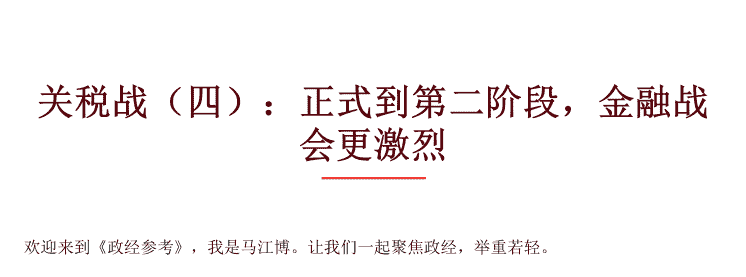

# 关税战系列解读

250421 政经参考
整理公众号懒人搜索懒人专属群独享
懒人微信lazyhelper

一共八篇，合集已整理epub和pdf电子书，左侧支持目录查看~

## 关税战（一）：巨变终究到来，看清做好准备

欢迎来到《政经参考》，我是马江博。让我们一起聚焦政经，举重若轻。

历史时刻越来越强烈，相信现在所有人都感觉到了，世界的逻辑正在发生巨大变化。而看清并应对这种大变化，正是这门《政经参考》课程的初衷。

最近最大最直接的例子，就是特朗普悍然发动的关税战。这既是大时代巨变的新焦点，也是注脚。

从今天开始，我会开启一个小专题，跟你详细谈谈，中美关税战的时代动因、国家准备和个体影响。

我们正在经历历史，在很多年后，你会发现其中深刻的历史节点意义，无数人将被时代的大潮冲刷和影响。

好，正题开始。

4月2号，特朗普宣布对全球60个国家采取“对等关税”，对中国的所有商品更是直接提高了34%的关税，根据国盛证券的测算，这一轮加税过后，美国对中国商品的平均税率将达到破天荒的65.7%。

这次加关税的计算方法极其简单粗暴，粗暴到近乎于抢，简单理解就是特朗普认为，其他国家跟美国有贸易顺差，就是赚了美国的钱，所以他要让所有跟美国存在贸易顺差的国家，把钱还回去。

全世界都被震惊了，以至于有人说按照这个逻辑，经济学家和特朗普一定要有人疯一个才对。

这期间以越南为最先，不少国家接受了。但中国作为被主要针对的大国，没法接受，或者说本质上你退缩认了也没用。所以中国的表现非常坚决，也是第一个宣布对等反制的国家，我相信这些反制措施是早就反复推演准备好了的。背后意思非常明确，就是退无可退，以牙还牙，那就先比一轮狠再说。

紧接着，4月7日（美国时间），特朗普声称，如果中国不取消反制，美国将在4月9日开始在原有基础上，进一步增加50%的关税，这就是丧心病狂了。中国回复说，奉陪到底。

到了这一步，已经超出所有人的预期，震惊已经没有意义了，美国真这么搞，是要冲着硬脱钩去了。

而两个大国之间的博弈，注定是一场激烈的持久战，比拼的是决心和后续的发动力和耐力，所以我先打个预防针，这场巨大的博弈和对产业、城市以及我们个人生活的影响，也会持续很久。

一方面，用《人民日报》评论的话说，就是“天塌不下来”，我们有准备也有韧性；而另一方面，面对巨变，影响肯定会到来，你也要有心理和决策上的准备。

而具体影响，我就挨个说一说。

### 对国内不同产业的影响

首先是对国内不同产业影响。

美国和中国相互加高额关税，必然会对中国进出口，特别是关于中美贸易的产业和企业造成显著影响。

我根据中国海关总署的权威数据，汇总了中美之间的12000多项进出口数据，制作了两张统计表格，一张是中国对美国出口的主要商品汇总图，另一张是中国从美国进口的主要商品汇总图。

接下来，我依次展开讲讲。

首先是对美出口的商品汇总图，图片我放在了文稿中。我们来看看美国对中国商品加征关税后，各个行业会受到哪些影响。

2024年，中国对美出口总额大概5247亿美元，大约37336亿人民币。

| 序号 | 主要品类 | 出口额 (亿美元) | 金额占比 |
| :--- | :--- | :--- | :--- |
| | 对美出口总额 | 5246.4 | 100% |
| 1 | 机械电子类产品 | 2119.98 | 40.41% |
| | 其中：智能手机 | 342.67 | 6.53% |
| | 笔记本电脑 | 252.75 | 4.82% |
| | 平板电脑 | 71.33 | 1.36% |
| | 蓄电池 | 159.56 | 3.04% |
| | 通讯/音像设备及零部件 | 286.52 | 5.46% |
| | 数据处理设备及零部件 | 133.71 | 2.55% |
| | 电机/变压器/稳压电源 | 72.81 | 1.39% |
| | 断路器/接插件/电控装置 | 47.04 | 0.90% |
| | 固态硬盘 | 26.03 | 0.50% |
| | 压缩机及风扇 | 41.96 | 0.80% |
| | 特种机械 (挖掘/钻机等) | 55.67 | 1.06% |
| | 阀门/轴承 | 60.67 | 1.16% |
| | 电线电缆 | 41.35 | 0.79% |
| 2 | 纺织鞋服类产品 | 641.95 | 12.24% |
| | 其中：服装 | 336.76 | 6.42% |
| | 鞋靴 | 96.32 | 1.84% |
| | 毛发制品 | 26.24 | 0.50% |
| 3 | 家具/玩具/运动杂项制品 | 629.40 | 12.00% |
| | 其中：坐具/家具 | 211.67 | 4.03% |
| | 游戏/运动用品 | 154.35 | 2.94% |
| | 玩具 | 47.78 | 0.91% |
| 4 | 金属及制品 | 294.53 | 5.61% |
| 5 | 塑料/橡胶及制品 | 258.99 | 4.94% |
| 6 | 运输设备类产品及其零部件 | 250.98 | 4.78% |
| | 其中：集装箱 | 35.74 | 0.68% |
| | 全地形车/高尔夫车 | 11.90 | 0.23% |
| | 客车/轿车/越野车 | 23.85 | 0.45% |
| | 摩托车/脚踏车 | 17.03 | 0.32% |
| | 无人机 | 1.93 | 0.04% |
| 7 | 个人电商/低值通关商品 | 223.50 | 4.26% |
| 8 | 化学品与化工品 | 175.81 | 3.35% |
| 9 | 精密仪器 | 122.49 | 2.33% |
| 10 | 石材/陶瓷/玻璃制品 | 81.12 | 1.55% |
| 11 | 皮革制品 | 62.37 | 1.19% |
| 12 | 纸/纸制品/印刷品 | 52.46 | 1.00% |
| 13 | 电子烟草 | 29.36 | 0.56% |
| 14 | 其他 | 303.44 | 5.78% |

先从图表显示的产业规模来看，

电子产业、机械产业、轻工业，占对美国出口总额的70%，受影响最大，这些产品的价格优势会大幅削减。

据国盛证券测算，电子类产品在美国的竞争力将下降40%，而这些产品在美国市场的销量萎缩，则会传导回国内的供应链，对产业造成挤压。

而从关税高低的绝对值来看，钢铁、汽车、有色金属、建筑材料的最终关税最高，分别达到了97.8%、90.8%、80.6%、78%，远超前面提到的65.7%的平均关税。相应的，这些产品的市场份额也会受到更大影响，但是金额相对没有那么大，比如中国销往美国的汽车规模只有174亿人民币，在对美出口总额占比都不到0.5%。

从产品利润率来看，服装、鞋类、毛发制品、玩具、塑料橡胶制品、皮革制品等产品的利润率较低，比如一些服装纺织品的利润还不到5%，难以承受美国的高额关税。

同时，美国对越南、柬埔寨也加征了高额关税，导致中国企业很难通过转口贸易借道销往美国，未来这些产品的对美销量可能会受到非常大的影响，这可能是首当其冲的。

此外，美国还取消了来自中国的低值包裹，就是800美元以下包裹的关税豁免，这对中国很多以性价比为主的跨境电商、低价值通关商品的平台和商家都是很大的影响。

我们进一步从对美国市场的依赖度来说，轻工制造，包括纺织鞋帽、玩具、皮革、纸类、家庭日用品，还有医药生物、家具电器、电力设备等行业对美国市场的依赖度较高，在16%-25%左右。换句话说，如果美国市场不行了，这些行业一时半会想要找到其他新增的市场销路很困难。而相比之下，电子产业对美国的依赖度是12%，食品饮料是9.8%，基础化工是11.5%，依赖度少，受的影响就少。

我们再进一步看，从产品转嫁关税的能力来分析，医药产品、医疗器械、电力设备、特种设备、运输设备等产品的转嫁能力比较好，就是相比同类产品，我们优势大，被替代的可能性低，美国人不得不买，这样关税就可以转移到产品价格上，由美国消费者买单；而电子类产品如手机、电脑、平板、路由器等也具备一定的转嫁能力，但无法全部转嫁；而毛发制品、纺织服饰等产品，几乎完全无法转嫁关税成本。

好，我接下来再分析一下中国对美国商品加征关税，受影响的行业有哪些，我把独家统计的中国从美进口的主要商品汇总图放在了文稿中。

| 序号 | 主要品类 | 对美国进口金额(亿美元) | 对外总进口金额(亿美元) | 对美进口依存度 |
| :--- | :--- | :--- | :--- | :--- |
| | 对美进口总额 | 1,636 | 25851.00 | 6.33% |
| 1 | 电气机械 | 379.25 | 8132.00 | 4.70% |
| | 其中：集成电路 | 117.31 | 3857.90 | 3.04% |
| | 发动机、航空飞行器 | 62.13 | 124.16 | 50.04% |
| | 电机、电器、音箱设备 | 181.74 | 5842.49 | 3.11% |
| 2 | 矿产及原油类产品 | 258.37 | 7665.00 | 3.40% |
| | 其中：原油及沥青提取物 | 60.19 | 3247.98 | 1.85% |
| | 铜料、铜精矿、铜类氧化物 | 50.07 | - | - |
| | 炼焦煤、无烟煤等 | 19.77 | - | - |
| 3 | 化工产品 | 207.12 | 1751.00 | 11.80% |
| | 其中：液化丙烷 | 117.72 | 186.76 | - |
| | 饱和和无环烃 | 26.05 | - | - |
| | 液化天然气 | 24.12 | 440.64 | 0.05 |
| 4 | 植物类产品 | 166.11 | 1037.00 | 16.00% |
| | 其中：大豆 | 120.4 | 527 | 22.85% |
| | 高粱 | 17.33 | 25.93 | 66.83% |
| | 玉米 | 5.6 | 37.19 | 15.06% |
| | 小麦 | 6.01 | 35.7 | 16.83% |
| 5 | 精密设备 | 152.87 | 759.00 | 20.10% |
| 6 | 仪器仪表 | 127.45 | 788.00 | 16.30% |
| 7 | 塑料橡胶 | 87.13 | 788.00 | 11.10% |
| 8 | 金属制品 | 71.34 | 1513.00 | 4.70% |
| 9 | 药品 | 56.41 | 423.52 | 13.32% |
| 10 | 动物类产品 | 44.56 | 494.00 | 8.80% |
| | 其中：牛肉 | 14.19 | 136.9 | 10.37% |
| 11 | 纺织服装 | 26.23 | 309.00 | 7.80% |
| 12 | 其他杂项 | 44.97 | - | - |
| | | | 注：部分对外总进口数据由于无公开信息，因此为估算数据 | |

2024年，中国进口的美国商品总计1636亿美元，大约11640亿人民币。总的来说，我们对美国的进口依赖主要就是“一高一低”：

高端方面，是在高端芯片、航空发动机、光学设备、医疗设备、创新药品等方面，对美国的依赖相对较大。

低端方面，则是在原油、轻化工、塑料化工、矿产矿物油、大豆农产品等方面，对美国进口较多。

这里要解释下，高端方面，从图中数据来看，依赖性不大，比如集成电路依赖度只有3.04%，这是因为我们进口了大量的中低端芯片，增大了基数，而美国又对高端芯片进行封锁，所以很多高端芯片是从第三方国家比如新加坡流入国内的，因此就没有计入对美进口中。加征关税确实会增加这些领域的进口成本，但客观说，反正大部分高端产品美国人也不想卖给我们，所以实际影响还好。

而低端方面的能源、轻化工、粮食等，相对而言替代起来则没有那么困难，国内厂家可以从别的地方买，这样实际关税成本也不会很高。当然，短期而言，这些产品换渠道的过程也会推升整个产业链的成本。

总之，就进口而言，对我们的影响没那么大，所以我们的反制很坚决。

### 对不同区域和城市的影响

接着咱们再来谈一谈关税冲击对于区域、城市的影响。

先说对省份的影响。我统计了海关总署和中国大陆主要省份对美出口的相关数据，我也在文稿中放了一张图，大家可以看下。

| 排名 | 省份 | 总出口额(亿美元) | 对美出口金额(亿美元) | 美国份额 |
| :--- | :--- | :--- | :--- | :--- |
| | 总计 | 35,772 | 5,247 | 15% |
| 1 | 广东 | 8,280 | 1,334 | 16% |
| 2 | 浙江 | 5,489 | 888 | 16% |
| 3 | 江苏 | 5,134 | 830 | 16% |
| 4 | 上海市 | 2,554 | 390 | 15% |
| 5 | 山东 | 2,924 | 369 | 13% |
| 6 | 福建 | 1,741 | 326 | 19% |
| 7 | 四川 | 868 | 171 | 20% |
| 8 | 河南 | 734 | 163 | 22% |
| 9 | 安徽 | 815 | 106 | 13% |
| 10 | 重庆市 | 713 | 100 | 14% |
| 11 | 湖北 | 683 | 83 | 12% |
| 12 | 北京市 | 853 | 58 | 7% |
| 13 | 天津市 | 550 | 57 | 10% |
| 14 | 河北 | 524 | 54 | 10% |
| 15 | 江西 | 428 | 53 | 12% |
| 16 | 辽宁 | 531 | 45 | 8% |
| 17 | 湖南 | 470 | 44 | 9% |
| 18 | 山西 | 150 | 42 | 28% |
| 19 | 广西 | 622 | 40 | 6% |
| 20 | 陕西 | 431 | 27 | 6% |
| 21 | 云南 | 130 | 15 | 12% |
| 22 | 新疆 | 520 | 14 | 3% |
| 23 | 海南 | 149 | 8 | 5% |
| 24 | 内蒙古 | 120 | 6 | 5% |
| 25 | 黑龙江 | 122 | 6 | 5% |
| 26 | 贵州 | 81 | 5 | 7% |
| 27 | 吉林 | 95 | 4 | 4% |
| 28 | 西藏 | 16 | 3 | 18% |
| 29 | 宁夏 | 21 | 3 | 13% |
| 30 | 甘肃 | 18 | 2 | 9% |
| 31 | 青海 | 6 | 0 | 2% |

这里我们同样先看影响的规模。图片显示，广东、浙江、江苏、上海、山东、福建东部六省的外贸规模最大，首当其中。其中，江浙沪鲁四省主要深耕欧美市场，在美国高额关税落地后，冲击会更快显现。广东、福建两省最近两年转战东盟，总体影响会小一些，但考虑到仍有不少企业实质上是以东南亚国家为跳板向美国转售商品，所以对部分企业的影响还是不会太小，只是显现时间可能会有所延迟。

而从对美国市场的依赖度来看，河南、四川、福建、山西的对美出口占比都较高，因为这些地方都是盛产手机、电脑、平板、蓄电池等产品的省份，国内生产组装，然后出口到美国。比如山西去年1到11月手机就出口了516.3亿元人民币，是出口的第一大类品。再比如之前富士康搬离河南，结果河南的出口下滑了很多，它已经深度嵌入国际供应链体系了。

说完省份，我们从城市的角度来进一步分析。

2024年对美出口额最多的前五名城市，分别是深圳、苏州、上海、宁波、东莞，按人民币计价，分别达到了4223亿、3400亿、2773亿、1628亿、1450亿，这些城市对美国的直接出口总额就超过了1.3万亿，而依托这些外贸而生的产业和供应链，则会更加庞大。

而从对美出口占比上看，前五大城市分别为苏州、东莞、宁波、上海、深圳，分别达到了20.5%、18.3%、17%、15.3%、15%左右。听到这里你发现没有，占比最高的五个城市和规模最大的五个城市是一样的，只是调换了顺序，这五大城市不仅对美出口值大、占比也大。换句话说，

在关税战之下，受影响最大的，就会是这五大城市。

如果你现在正在这些城市的外贸行业或者相关的供应链公司、配套企业工作，可能很快就会感受到寒气。

总之，

这次关税冲击的影响特征，从区域上来说，会从东部开始，向中部蔓延。而从产业来说，会从外贸开始，向供应链企业、配套企业传递，然后进一步传导到服务业和原材料行业，大概就是这个时间差。

### 对国内资产的影响

最后我们说说对于国内资产的影响。

除了工作以外，大家最关心的，肯定就是关税对国内各种资产的影响。

就楼市来说，关税冲击肯定会影响产业利润和居民收入，从而给楼市的复苏带来更多的不确定性，但区域之间也有差别，珠三角的城市，比如深圳、广州、东莞、珠海等，楼市压力更大。一是这些城市外贸产业占比高、规模大，受到的冲击明显；二是这些城市的年轻人占比非常高，比如深圳老龄化只有4%。年轻人多，意味着收入下降对刚需的影响更加显著。另外这一轮冲击的蔓延，也会让三四线城市的楼市，更难受。

就股市来说，外部冲击会让股市有一段时间情绪波动时期，可能会反反复复，这一点你要有心理准备，会难受一段时间。当然现在国家也在股市大力出手，央企也在纷纷增持，4月8号这一天，A股三大股指还集体收涨了。未来大概率，在二季度国家会有更大的组合拳出台，从货币政策、财政政策等各方面持续发力，来对冲关税冲击和经济下行压力。一些政策属性强的行业，比如基建、消费、科技等可能会有有一波提振来对冲，这个我会跟你一起及时观察。

就汇率来说，现在真是一脑门的不确定。一方面是关税带来的外贸下滑、收入下降等情况会刺激人民币贬值；但另一方面，有外部消息说，美国打算让人民币升值，来换取减免关税，如果这个说法是真的，人民币可能会迎来政策性升值。

所以

这段时间内，个人最稳妥的策略就是一动不如一静，这个原则，可以应用到很多方面。

总之，大国博弈进行到这个阶段，极限施压，来势汹汹，我们既不要心存侥幸，也不要过度悲观。

只有实事求是，做好自己，才是唯一的办法。

更多的，明天继续讲。

最后，欢迎你把这一讲转发给你的亲人和朋友，或者分享到你的朋友圈。更欢迎你把课程推荐给更多的人，一起找到时代的确定性。

聚焦政经，举重若轻。个人视角，仅供参考。我是马江博，下期再见。

## 公众号懒人搜索，懒人专属群分享

微信:lazyhelper

## 关税战（二）：已升级到超出想象，看懂为什么

欢迎来到《政经参考》，我是马江博。让我们一起聚焦政经，举重若轻。

这是关税战专题的第二篇，写到这一篇的时候，美国对华关税已经又加了50%，超过100%了。对，比最疯狂还疯狂。在大国之间不可能直接热战的情况下，这种经济上的激烈对抗，已经几乎类似于实际上的战争了，看不见硝烟的战争。

事情发展到这里，谁都能看得出来，特朗普针对的核心就是中国，就是要用关税和贸易战来打击中国。而中国，也只能先死磕到底，已经宣布对美同样对等再加50%关税。

按照著名的桥水基金创始人瑞·达利欧最近的说法，我们正置身于一场“一生仅见”的全球货币、政治以及地缘政治秩序的系统性崩塌进程之中。这表面是关税和背后贸易的争夺拉扯，实际是老牌霸主和后起大国之间核心利益的激烈冲突和全球规则的重新制定。

上一节课我提醒过了，这会是一场持久战。

好，正题开始。

我先说下这几天看到的关于关税战的不同声音。

第一种声音比较悲观，认为我们作为卖货的“乙方”不应该反制，而是应该顺应美国这个“大甲方”。这个说法完全站不住脚。

第二种声音则主要是担心，一旦大部分国家都选择跟美国妥协，而只有我们坚决反制，怕最后变成中国陷入孤立的境地，面临更糟糕的局面。

这背后其实是一个问题，我的观点是，上来就退让没有意义，因为中国早就明白，我们根本没办法既维护中国的核心利益，同时还能退让到美国满意，这就是对手的宿命。

之前原中央外办主任杨洁篪在2021年面对美国的时候曾说：“我们把你们想太好了。”或许从当时起，中国就已经意识到，退让本身没有意义了。而且，现在的中国已经跟八年前特朗普第一个任期时不可同日而语了，我们挺过了之前的贸易战，甚至进出口总额还增加了，我们的科技进步也有目共睹，总之，牌更多了。

而特朗普相比八年前则更急了，因为八年前他觉得自己有两个任期，有八年，但现在他只有一个任期四年，会更狠。退一步说，就算双方要谈，不先狠狠“打一仗”，彼此先打明白极限，也不可能坐下来谈。大国之间，就是这样，在核心问题上，谈的前提大概率是“打不动了”。

此外，我也看到第三种声音，则是过分乐观，认为特朗普就是个疯子，甚至丑化到认为他很蠢。这种认为特朗普蠢的看法，我觉得就不用反驳了，美国总统不是一个人，而是代表了一个系统，他可能疯，但肯定不会像一些人说的那么蠢。

还有人说，特朗普想让制造业回到美国根本不可能，美国现状不支持，他一个任期内也完不成；而且加了关税后，美国海关也没有那么多清查人员，只会造成大规模走私。

这些逻辑不是没有道理，但我提醒你，就是我们不仅要看我们自己是怎么想的，关键也要看对方的逻辑是什么。

比如关于制造业回流，有人质疑美国的人力成本高，而美国商务部部长的回答是用机器，机器比人便宜，这个说法有一定道理。实际上我们的制造业也在走这条路，美国是想找机会超车。

至于海关清查人员不够，加税会造成大规模走私，我只能说这在开始或许会如此，但是如果美国先把关税提高，把轨道焊死了，后面的墙，总可以一步步垒起来。我还是那句话，多听听对方的真实逻辑，别只看对方的情绪化表达，然后嘲笑他们。

所以面对这场关税战，我们既不要过度悲观，更不能过度乐观。**实事求是，做好自己，应对挑战，是最好的态度。**而且中国比过去更强了，中美的实力越接近，对抗的烈度也会越高，也会是一场持久战，比拼的就是双方的耐力和实力。我们要熬一段时间，要有这个认知。

有了稳定理性的心态，接下来我来讲讲，为什么全世界都觉得不可思议，而特朗普还要这么干？

因为关税显然只是工具，背后有两个更本质的目的。第一是解决美国自身的问题；第二，是解决来自中国的挑战的问题。

在美国内部，当下特朗普最着急解决的自然是财政危机问题，而这个问题本质上和关税、产业、中美博弈等议题其实是一脉相承的，所以烈度被极度放大了。

我们来仔细谈一谈。

过去三十年的全球化进程，本质上是利益的分层。

上世纪90年代之后，苏联解体国际局势缓和，加上互联网浪潮到来，全球的经济蛋糕都迎来了一波非常大的增量，美国在这个时期想要分到最大的蛋糕，因此秉持着“效率至上”的原则，开始把中低端制造业转移到发展中国家，利用这些国家更便宜的土地、人口、资源来生产廉价商品，然后再买回美国。

在这个过程中，美国放弃了制造业霸权，而是通过金融霸权和科技霸权，构建起一套“体外循环”。简单来说，就是美国的科技资本输出技术专利，拿走全球产业利润的大头；而金融财团则通过“美元-美债-美股”来回切换，拿走全球金融利润的大头。

换句话说，这套体外循环的核心就是，美国赚科技和金融的钱，而发展中国家赚工业制造的钱，另外一小部分国家，比如俄罗斯，赚资源的钱。这形成了明显的分层，一拍即合，各方都合作愉快。

但这套全球化的体外循环看似完美，却在推进中出现了内外部的“两个失衡”，导致美国认为这套体系玩不转了。

第一个失衡，是美国内部的分配失衡。我用十个字来概括，就是“利润私有化，成本社会化”。在全球化过程中，美国跨国财团可以在外面用更低的成本来生产商品，再高价卖回美国，拿走了全球化红利的最大头。而美国传统产业的中下层民众，则承受了制造业空心化导致的铁锈带和大量失业等后果，变成了一个社会化问题。

而这其中，美国政府也是“受损”的一方，很奇怪是吧？因为制造业是税收大户，制造业转移，让美国财政中的企业税源增长缓慢，再加上对科技资本和金融财团的征税力度也不尽如人意，因为这些科技资本和财团有更多的合法避税手段。结果就是投资顺差，贸易逆差，美国政府必须扩大赤字，发债借钱来解决公共福利问题，到现在已经累积了36万亿的巨额债务。所以，在美国社会认为，全球化本身就存在缺陷。

第二个失衡，是美国外部的失衡。美国转移制造业最好的方式，肯定是让众多发展中国家大体上“平均承接”，既能给美国提供大量的廉价商品，又不会出现过于集中做大的挑战者。但中国近年来凭借着自身努力和资源禀赋优势，变成了唯一的“世界工厂”，同时中国还在不断追赶美国的科技，面对这个挑战，美国认为突破了极限，从合作者，变成了对手。

正因为内外部的两个失衡，所以特朗普认为必须发动关税、贸易战来打破现有的国际秩序，既能通过加关税直接增加美国的财政收入，更要重新建立一套以美国利益、美国政府利益为核心的新体系。

那么特朗普决定怎么干呢？无外乎就是科技战、贸易战、金融战。

美国早在8年前就对中国发动了科技战，但中国挺了过来，而且还在大幅度追赶。

而现在，美国则是进一步加大了关税战或者说贸易战的力度，但美国很清楚，光靠关税是无法让中国彻底伤筋动骨的，因为最坏的结果无非是大家一起搞自己的内部小循环。

因此，美国表面上是发动贸易战，形成关税壁垒，实际上则是美国试图利用金融霸权来巩固全球控制力并深刻地打击中国，因为金融是中国相对薄弱而美国最强的环节，美国就是要利用关税和贸易战作为筹码，来掀起一场金融风暴。

具体来说，美国手里有这么两张牌可以打。

- **第一张：汇率牌。**最近特朗普搞了一个“海湖庄园协议”，目的是让美元持续贬值，同时海外有消息称，美国可能会要求中国主动升值人民币以换取关税减免，这一场景恰如当年日本的“广场协议”。

当年日本从1960年代开始就和美国打贸易战，打了20年都没有倒，但美国在1985年逼迫日本签订了广场协议，让日元持续升值，短短几年时间就导致日本制造业的崩溃，经济泡沫被刺破，走向了“失去的三十年”。我不说是100%，但至少有60%的概率，美国想要复制日本的经验，因为金融的破坏力远远超过关税打击、科技制裁，汇率对经济的冲击也远远超过大家的想象。

- **第二张：股市牌。**高额关税和贸易战的危机，会造成全球对“衰退”的预期大幅升温，同时美方也在近期下调中国评级，通过这些去影响中国股市信心，这一方面可以迫使国际资本从中国撤离；另一方面，股市的低迷又会影响企业融资和居民消费，也会打乱中国原本正常的政策节奏。所以你能看到，这两天，中国政府在以异常坚决的态度投钱，维护股市稳定，效果不错，但压力肯定也比较大。

总之，美国正在试图构建一条“关税型金融打击—资本市场恐慌—商品价格波动—制造业供需失控—汇率剧烈震荡”的闭环打击链。而中国也在不断进行维稳，比如未来可能包括降息降准、大力回购、企业救助、稳定汇率等，来在金融站上稳住脚步。

所以，这一轮关税战，真正的核心是中美博弈正式进入一场史无前例的“超限战”。就是不只是一场贸易战，还包括科技战、金融战、舆论战等。并且，这些武器是可以同时使用、互相强化的。

比如，利用“产能过剩”的舆论战，引发新一轮贸易战，而贸易战配合美元潮汐，也就是通过美元的升值贬值，又能引导外资流出，形成强大的资本做空力量。最终，舆论战、贸易战、金融战互相配合形成循环。

这一次也一样，在“对等关税”发布同一天，美国国立卫生研究院也宣布，禁止中国访问癌症数据库、人类基因组计划数据等。

你看，关税战只是开始，科技战也在同步进行。

甚至白宫经济顾问委员会新任主席米兰直接提出，发行没有利息的“世纪债券”来置换美国国债、威胁中国接受货币协议等一系列非常规的政策建议。意图很明确，美国要推翻牌桌，把美国一手创设的旧秩序，扔到垃圾桶里，然后另起炉灶。

而这也意味着全世界的市场惯例与政治传统的全面沦陷，旧的秩序正在崩塌，而新的秩序必然是中美博弈的最终结果，本质上，这是中美争夺在世界生物链上的生态位，所以上来就妥协，本质上是没有用的。

好，今天先讲这么多，更多内容包括中国的应对，我后面继续讲。

最后，欢迎你这一讲转发给你的亲人和朋友，或者分享到你的朋友圈。更欢迎你吧课程推荐给更多的人，一起找到时代的确定性。

聚焦政经，举重若轻。个人视角，仅供参考。我是马江博，下期再见。

## 关税战（三）：迎来更激烈时刻，理性推演未来

欢迎来到《政经参考》，我是马江博。让我们一起聚焦政经，举重若轻。

你能想到吗？全世界居然在横跳和狂飙，真是每天都在见证历史。关税战的形势变化得很快，但美国的意图也越来越清晰了。

最新的情况是，面对我们的反制，4月9日，特朗普再次宣布，对我们的关税提升到125%，而随后白宫的行政命令显示，目前对华关税的累计总额已经达到了145%。同时对其他大部分国家，暂缓执行对等关税90天，但保留了一个所谓10%的基础关税。此外，美国还故意释放出一个信号，说超过75个国家正在和美国谈判。

这些信号有什么内涵，后面我们会更系统地分析。

很多人说特朗普“怂”了，我只能说，怂本身是一个带有面子色彩的评价，但是对一个交易型商人政治家来说，进退只在一念间，这背后我看到的不是“怂”，而是狠厉和狡诈，我下面会解释。

正如我之前说的，美国这次就是冲着中国来的，躲无可躲，我们迎来了关税战最激烈的时刻，既然世界这么癫了，那今天我就说点更本质的判断，谈谈关税战可能的三个阶段，以及对特朗普这个人的分析，这些都是我的个人视角，供你参考。

好，正题开始。

现在看来，特朗普的关税战，可能会有三个阶段。

- **第一阶段：服从性测试。**就是我们之前看到的宣布向全球无差别加征关税，除了真要收钱，更是为了进行“服从性测试”。因为他不满意之前美国的传统盟友体系，要亲自搭建一个新的“服从圈子”，而最重要的前提，不是共同利益协作，而是听话程度。

比如，白宫表示，因为加拿大和墨西哥不屈服，所以这两个国家不享受“90天的关税暂缓期”。从公告来看，这些暂停加关税的国家，只能算是第一轮勉强过关，还要看后续的表现，这符合一个喜欢交易的商人政治家的拿捏。在这一点上，诺贝尔经济学奖得主保罗·克鲁格曼的总结很到位：他说特朗普进行的是一场“霸权表演”，目的就是震慑别人，让其他人俯首称臣。

所以第一阶段，是美国针对全世界的压力测试，从目前的结果来看，特朗普不能说是失败的，因为更多国家至少是口头上表态要顺从了，而目前以中国为代表的态度强硬的几方，其实也在预料之中。所以第一阶段的服从性测试，是从初期看似面向全世界的乱战，走向了意图明显的定向战争，而且本来定向到中国等国家就是主场，其他更多国家只是用来渲染紧张和顺便敲竹杠的陪衬。

- **第二阶段：90天博弈与秩序洗牌。**就是特朗普说的未来90天。可能会发生什么呢？首先就是继续向中国加征关税，这是为了营造对抗氛围，配合推动金融战或者更综合的对中国的“超限战”，包括科技战等等。而且无论接下来有什么眼花缭乱的动作，就是奔着中国来的，同时通过“胡萝卜加大棒”的组合，完成对国际贸易秩序的洗牌。

在这个过程中，你能看出特朗普交易型外交的逻辑，特点就是进退虚实，见风使舵，用他自我包装的话说就是“政策的灵活性”，而且对来回横跳一点心理障碍都没有。有的同学不要嘲笑鄙夷这一点啊，这是他的政治优势，甚至是大杀器，我后面会讲到。

而在这未来的90天中，如果中美之间硬碰硬之后，能找到彼此认可的新边界，达成一致，那现在这些为了营造围堵中国的态势而暂时放过的国家，可能也就没用了。特朗普90天后可以继续不放过，找借口加关税，反正最大的挑战者我都达成一致了，你们还有什么可抗衡的，翻脸不要太容易。

但如果中美在这90天内没谈拢，美国肯定会向中国继续施压，而面对开头说的暂停加关税的这些国家，要不就是对方彻底服到让特朗普心满意足，甚至当美国的工具，用来围堵中国；要不就继续吊着，可以找借口再延长90天，用来做中美关税战的加压陪衬。在这个阶段，威逼利诱肯定也少不了。之前美国财长贝森特就提到，美国的关税政策，就是为了对付中国，并且公开威胁西班牙等国家，不要和中国走得太近，不然可能招来美国的报复。

说到这，有同学可能会问，为什么是90天，不是60天、或者30天？我的看法是，因为要谈的事情重要且复杂。如果只是谈关税，其实不太难，有些国家直接就喊出了零关税；如果只是谈贸易逆差，也不算太复杂，说白了，美国直接开条件就行，无外乎就是你们要买我多少东西，中美之间也都谈过。而现在的这90天，我的判断是，美国之后还可能要求很多国家站队，比如进行“出口地审查”，不给中国转口贸易的机会。

这两天很多人提到，美国暂时“放过”其他国家，中国又能通过转口贸易恢复出口了。我的看法是，这个想法有点简单，过去拜登政府也大搞友岸制造，结果搞了半天，打开包装一看，还是中国制造。所以，特朗普这次只要想堵住漏洞，是能堵住的。注意我的措辞，只要他想，当然他也可以为了不增加这90天内美国的物价压力，而装作看不见。

除此之外，可能也是因为跟中国谈需要更久时间，一两个月肯定谈不拢，那先限定90天再说。

另外，我再插一句，就是让大家站队跟他一起对付中国想的确实很好，但特朗普会面临一个困境，就是你连过去美国的铁杆盟友都说翻脸就翻脸，大家怎么可能相信你作为大哥的保证呢？这个事情，我们先观察。

好，如果在第二阶段，中美双方没有达成一致，这场关税战就会进入到更持久的第三阶段，并且大概率会泛化到更多领域。

比如从目前来看，美国也同时在科技领域下手，包括禁止中国访问美国的科学数据库等。而中国的反制措施，除了关税反制以外，还对美国的电影、服务贸易等进行反制等，我们的文旅部、教育部也连发预警，提示中国游客和留学人员做好去美国的风险评估。

另外，很有意味的是，我们在这两天召开了首次“中央周边工作会议”，意思是中国要更加团结周边的小伙伴了。

其实说到最后，双方比的都是耐力和实力，现在先玩勇敢者游戏，看谁先忍不住。还是我之前说的，互为对手的大国之间，对于关键问题，不先打到极限，是不太容易坐下来谈的，这就是对手的宿命，尤其面对特朗普这样的总统。

而且，我们过去那么多年的历史经验反复证明了，就是“以斗争求和平则平存”，我认为现在不是中国非要“斗争”，而是不得已的选择。

好，说到这里，我必须要聊一聊特朗普这个人。

很多人会嘲笑特朗普，把他当作“疯子”、“精神病”。

我不赞同。要知道，特朗普是美国总统，是世界上最有权势的人，并且他背后还有一个庞大的团队，不可能蠢。唯一可能的解释就是，他要达到的目的和传统的国际共识不一样，所以大家不能理解。其实我越来越觉得，他不是疯，而是凶狠和狡诈。

打个不恰当的比喻，原来美国是世界警察，虽然想管别人，但是看起来还是要靠规则、找漏洞，再抓人。现在特朗普主导的美国，正在变成世界黑帮，可以上来拿大砍刀吓唬人，甚至为了比狠，砍自己也无所谓，更可以转脸就称兄称弟，但只凶狠是小黑帮的做派，大黑帮肯定是又凶狠、又狡诈。

而这一切背后，都和他的政治身份有关。我们一定要记得，他的政治底色是“白宫的外来人”，是一个政治的“门外汉”。这里有两层内涵值得分析：

- **第一层内涵：摆脱国际规则与面子束缚。**特朗普可以摆脱所有国际规则的束缚，可以不管所有的国际惯例，抛弃所有传统意义上的政治面子。很多人不喜欢特朗普，是因为他的行为、形象，不符合政治审美，甚至是一种政治审丑，常常让美国丢脸、让其他国家看笑话。但特朗普就是不断用行为告诉其他人、其他国家，我只要实现我的目的，哪怕朝令夕改，也可以美其名曰“政策的灵活性”。而且我也不服从国际规则、国际惯例，你们也不要想用过去那一套束缚我、制约我。

结果是，特朗普可以随意修改规则，甚至可以借此“大杀四方”，再通过谈判技巧和表演技巧，实现自己的目的。更早之前，连软银集团的CEO孙正义都说，特朗普是个谈判专家。其实，这一轮关税战，也完全是他个人表演的复刻和升级。

而这带来的后果，是导致全世界跟特朗普处在一场非对称战争中。全世界都还在美国一手创设的秩序里，讲合作、讲规则，转头一看，美国自己不认那一套了，而且毫不在乎，你骂他他也不在乎，更何况很多人还敢骂。并且在这个高度不确定的混乱规则下，谁也不知道未来要走向哪里，这就是当今世界最大的挑战。

不仅如此，更关键的是，特朗普所理解的大国博弈，和传统逻辑完全不一样。这就要涉及到，特朗普作为政治“门外汉”的第二层内涵，特朗普有限的政治想象力，来源于过去的娱乐界和商界经历，并内化成了选秀逻辑和交易逻辑。

在这场关税战中，特朗普也发文称，他喜欢交易，特别是“大交易”。而这个世界上最大的交易，就是中美之间的贸易往来，所以，关税战就是让特朗普特别兴奋的一件事。

作为政治的“门外汉”，特朗普最大的筹码就是选民及其背后所代表的民粹主义和民族主义情绪。所以，特朗普只能把“中国崛起导致美国社会不公”的叙事贯彻到底。

其实，特朗普的选秀逻辑和交易逻辑，不难理解，你换位思考一下，如果你是一个完全没有政治背景、政治筹码、也没有大佬支持的候选人，你要怎样才能坐上总统的位置？那就是表现得更极端、更激进，才可能引人注目，才有机会坐上那个位置。所以，特朗普不仅不蠢，反而特别会钻“制度的空子”，只不过他的逻辑过于剑走偏锋，行为实在无法恭维。

最后，我简单比较分析一下这一届的特朗普政府与美国建制派的代表拜登政府，对中美博弈的观念差异。

拜登更多把中美博弈，看做是长期搏斗的八角笼。他更关心长期、但更潜移默化的科技战。为了取得最终胜利，中美可以合作、可以竞争，也可以对抗。

而特朗普把中美博弈，看作是展示他个人影响力的大舞台。所以，他更关心短期、但极具戏剧冲突的大规模关税战和贸易战。他的政治逻辑，就变成了用“交易型外交”，来解决美国的“内政问题”。什么是交易型外交？就是强调利益交换和短期成果的外交策略。可以理解为，政治的商业化、外交的买卖化。比如，在说服民众的时候，特朗普表示，多征收关税，是为了满足美国国内减税的需要。

这也是为什么，特朗普特别期待中国打电话的原因，因为作为一个商人+网红的结合体，特朗普对自己的谈判技巧，就这么迷之自信。

是的，我们面临的就是这样一个美国总统，而旧世界秩序的崩塌，就是从他开始。

关于关税战，中国更多的应对和影响，我后面再说。

最后，欢迎你把你这一讲转发给你的亲人和朋友，或者分享到你的朋友圈。更欢迎你吧课程推荐给更多的人，一起找到时代的确定性。

聚焦政经，举重若轻。个人视角，仅供参考。我是马江博，下期再见。

## 关税战（四）：正式到第二阶段，金融战会更激烈

欢迎来到《政经参考》，我是马江博。让我们一起聚焦政经，举重若轻。

世界每天都在癫。随着特朗普对中国加征累计145%的巨额关税，然后中国反制加征到125%，中国同时宣布，美方对华轮番加征畸高关税已经沦为数字游戏，在经济上已无实际意义，如果美方继续关税数字游戏，中方将不予理会。

另外，特朗普又变了，突然又豁免了智能手机等电子产品的进口税率。很多人说是特朗普退却的一步，这当然是好事，但动机复杂。简单说，首先他是为了美国自己的科技产业和公司，比如苹果，特朗普是把砸自己脚的石头给搬开了，实际上是修正了一个自己的错误；第二是因为华尔街和背后的金融力量，这个“退却”，更主要是做给他在意的资本市场看的，不一定是面对中国。更多的分析包括关于特朗普不确定性的构成，我们之后再说。

总之，从现在开始，关税战进入了第二阶段。我们之前在关税战（二）中明确讲过，关税战、贸易战都只是手段，这些都搞不垮中国，更深层的是金融战，这是美国最有优势而中国相对薄弱的。当然“金融战”这个词之前被很多不靠谱的说法给搞的很玄，比如动不动就是犹太财团如何如何。

今天我们就理性谈谈特朗普最新决策背后的金融因素，以及中美博弈在金融层面，将会发生什么。

### 美国金融出了个意外

特朗普最近的改口对大部分国家暂停加征关税以及对电子产品的豁免等动作。从政治层面说，是服从性测试告一段落，从乱战尽快转向针对中国的定向战，这本来就是必然会做的；而从经济或者金融层面说，则是美国的金融领域打出了一个意外。

最核心的就是两个字：美债。这个话题比较复杂，我尽量说得通俗易懂一些，帮你理解其中的关键逻辑。

特朗普要对全球收高额关税，搞得市场强烈恐慌，这时候出了一个意外。关于这个意外，现在市场上比较一致的说法是，日本一家对冲基金，类似借钱来炒股、炒国债，就是大家说的“加杠杆”，本来手里只有一块钱，结果借了十几甚至几十块来炒股，当年美国的雷曼就是加杠杆爆仓，最终引爆次贷危机的。

因为关税战市场剧烈波动，导致这个基金巨额亏损，赔钱爆仓还不上借的钱了，银行催它补钱，它补不上，就被强行卖光了手里的美债来抵债，结果市场上就突然出现大批美债被抛售。其他玩家一看情况不对，也赶紧跟着卖，结果越卖越跌，形成死循环。导致30年期的美债收益率，一度从过去的4.4%，直接冲高到了5%。

我这里简单解释下，为什么美债被抛售，美债收益率就要上涨，你可以把它们想象成跷跷板的两端，一端价格跌了，另一端就要涨。总之美债价格越跌，收益率就越高，反正你记住这个结论就行。

面对这个情况，特朗普有什么反应呢？要知道，之前因为关税战美股狂跌的时候，特朗普说：“这是必要的代价”，你看他并不在意股市，甚至还有人说特朗普是故意让美股跌。但当美债狂跌，导致美债收益率强行大涨的时候，特朗普却真的慌了。这是为什么呢？

- **第一个原因：与财政危机及“借新还旧”有关。**简单理解，就是美债早就已经是必须“借新还旧”了，每次都是用新发美债借到的钱，来还到期的美债。根据我的统计，2025年美国将有7.86万亿的往年美债到期，而且其中很大一部分在6月份之前到期。

如果美债被大量抛售，那么美债收益率就会大幅飙升，带来的结果是，一方面，美国很可能不得不承担更高昂的利息来融资，鉴于美债的规模，利率加一个点可了不得了；另一方面，更糟糕的是，美债大跌卖不出去，大家就不会去买新的美债，导致美国政府根本借不到钱还旧债。比如美国财政部最新一期580亿美元的短期国债拍卖，就大幅遇冷。

没人愿意买新的美债，美国政府也就无法“借新还旧”，美债就面临十分严峻的违约风险，被视为几乎最保险投资的美债要是违约了，这是什么概念？

这会直接冲击美国政府的信用基础，这是特朗普所不愿看到，也不能承受的。

- **第二个原因：与美元体系底层信用有关。**我们常说石油美元体系是美国金融霸权的根基，但这只是表象，真正的美元体系是什么样的呢？

最简单的比喻，如果想让一个人消除愚昧，只给他发一张文凭是做不到的，因为这个人必须要脑子里有真正的知识，这张文凭才能得到别人的认可。同样的，美元只是一张纸，真正值钱的，是这张纸底层所对应的资源、商品和服务。

在2000年之前，美元体系的底层确实是石油等大宗商品，要买资源就必须用美元结算。但在2000年后，美元体系的底层很大程度上已经变成了中国等国家的商品，作为世界工厂的中国用美元做贸易，相当于为美元增加了信用，不管任何国家，只要使用美元，就能买到中国的商品。

所以在某种意义上，是中国庞大而廉价的产能，在帮着维系美国的美元地位，这是个循环，当然也有说法是不仅仅是买到商品，也是用美元买到全世界在美国上市的好公司的股权。但现在特朗普要打关税战，而且打法这么疯，大家觉得这个大循环要被破坏了，而如果这时候美债再暴跌，更多持有美债的投资者连环抛售和恐慌踩踏，这会严重冲击美元体系，这更不是特朗普愿意看到的。

这也是我为什么说，打到最后都是金融，是金融战，因为金融才是美国的命脉，才是特朗普永远不得不在意的。

### 一个非常重要的信号

说到这里，有金融知识积累的同学可能会问，之前全球出现动荡的时候，美债可是典型的“避险资产”，传统上是没有风险的，这一次为什么奇怪地大跌？

这其实是一个非常重要的信号，就是这次特朗普的极限施压，搞得所有人都担心大哥玩的太大，可能会自爆了，或者说，对美国体系的不确定性担心到了顶点。

金融的关键是什么？是信用。信用的核心是什么？是确定性和稳定性啊。

这次是全世界对美国的不确定性，都真的拿不准了。

比如我这里讲一个细节，就是日本在这次美债意外中的态度很微妙。在前面说的日本对冲基金破产后，日本央行官员进行了磋商，但最终并没有选择出手，而是任由这家基金持有的大量美债被强行平仓，造成美债市场的波动。这至少说明，日本政府虽然明面上自己不敢卖美债，不愿意和美国撕破脸，但也默许了通过这样“市场化”的方式来制造压力。

当然，面对这次美债的巨大压力，特朗普也有应对方式。就是特朗普把暂停关税的时间设定为了90天，这个90天的期限，抛开特朗普要跟这些表示顺从的国家以及中国的复杂谈判需要时间，还有金融上的因素。

一方面，刚才我说了，在6月底之前有大量的旧美债到期，这段时间特朗普必须保证能够“借新还旧”，不能发生违约。所以需要一个相对稳定的金融市场。

另一方面，未来三个月还有2次美联储的议息会议讨论利率问题，要知道特朗普和美联储很不对付，美联储不想太快降息。虽然美联储现在仍然是所谓“完全独立”的，但事实上已经被特朗普的行为“绑架”了，因为特朗普这么一搞，在面临经济衰退的强预期下，美联储不得不更快、更大力度地降息。而只要特朗普能事实上迫使美联储这么干，哪怕只是给出明确的降息时间表，都会给美债留出巨大的韧性空间，这里我不多解释了，你知道这个结论就好。那么未来几个月后，特朗普再加码关税战，美债的掣肘就小多了，特朗普的忌惮就更少。

而且这段“暂停期”，特朗普的说法是“会和其他国家开启谈判”，我猜想，其中一个可能的谈判条件就是，这些国家要认购美国国债，要给美国“送钱”，就看特朗普能不能谈成吧。

这时候有同学可能会说，那要是中国未来也卖出手里之前买的美债呢？嗯，你听懂了。但中国一般不会动这个工具，因为这就是彻底撕破脸了，在金融领域，我们还是要很慎重。总之，特朗普要逼美联储降息，要留90天时间，要让美债更有韧性。

## 未来金融战会继续升级

说实话，未来90天，肯定就是一个中美双方都在准备筹码争取各国支持的关键时期，90天后博弈包括金融博弈可能会再次升级。而金融的本质是财富的转移和再分配，通过金融战可能拿走别国积累很多年的财富，极具破坏性，我们必须要扛住。

最后我们讲讲这场金融战中，要关注的三个焦点。

第一个焦点是汇率。

我们在关税战（二）那篇说过，美国在1985年迫使日本签订了《广场协议》，日元被迫大升值，后续迎来了日本巨大的衰退，当然实际上更复杂，我们这里简单这么理解。而特朗普搞出来的《海湖庄园协议》，很有可能是复刻上次的做法，比如让人民币升值，美国财长最近就警告说，中国不要用人民币贬值来对抗加关税。

但中国肯定要问凭什么？对吧。

而对中国来说，为了国内经济，未来持续降息几乎是必选项。

所以汇率升值+持续降息这个组合，我们很难接受，这非常容易催化国外的热钱投机套利，成为收割本国财富的镰刀；但汇率贬值+持续降息也不太行，因为这会很容易引发通胀。

所以最优解就是：稳。稳住汇率，让汇率在有利于我们的有限区间内波动。这就是未来双方的博弈点。

第二个焦点是股市。

通过关税战影响股市，进而通过“中国衰退”等负面消息，影响中国内外部的信心和预期，这点我们在关税战（二）那篇也说过了。

所以现在中国的股市就变得很关键。我们也看到了，上一周中央汇金、中国国新这样的国家队坚定出手在股市维稳，第一阶段在股市上我们打得不错，当然压力肯定有，但接下来估计还要继续打下去。美国财长最近在面对是否会将中国企业股票从美国交易所退市的提问时，还表示“所有选项都摆在桌面上”。

当然相比中国大陆，其实我更担心香港地区，我大概解释下，就是香港是联系汇率制，总之就是国际资本非常有可能在香港银行大量拆借，然后做空香港地区的股市和债市，甚至去冲击香港的汇率，这些都是要警惕的。当然，这是我的担忧，这事对大部分人直接的影响不大。

第三个焦点是地缘政治。

前面说的《海湖庄园协议》比《广场协议》更深的一点，是它明确提出了“安全工具”的概念，把安全事务纳入了贸易、金融的框架里并紧密绑定。

比如美国可能会要求别的国家对中也加征高额关税，要求日韩加大对中国的技术管制，甚至威胁把“不合作”国家排除在安全体系之外。

换句话说，美国要胁迫更多的国家来顺从它在金融、贸易领域的安排，以便给中国制造麻烦。

所以你看到我们在上周召开了“中央周边工作会议”，要团结周边邻国，共同建设“周边命运共同体”，最高层本周还要访问越南等东南亚国家。

总之一句话，关税税率的数字战虽然热闹，但真正要打的，还在后面。对我们来说，就是继续实事求是，团结一致，做好准备，边打边看。

最后，欢迎你把这一讲转发给你的亲人和朋友，或者分享到你的朋友圈。更欢迎你把课程推荐给更多的人，一起找到时代的确定性。

聚焦政经，举重若轻。个人视角，仅供参考。我是马江博，下期再见。

公众号懒人搜索，懒人专属群分享

## 关税战（五）：中国硬逻辑和新机会，不浪费危机

欢迎来到《政经参考》，我是马江博。让我们一起聚焦政经，举重若轻。

世界继续横跳。上节课我们说媒体报道美国豁免了中国电子产品的关税，现在最新消息是，特朗普说这是理解错了，不会有豁免的。

这件事本身再次说明，现在特朗普的不确定性，导致的美国和未来规则的不确定性，正在成为核心，而“不确定”这个词背后更本质的关键词，是预期，这是我们理解未来格局最关键的钥匙之一。

预期的重置，正在左右全世界所有人的判断，而中美对未来各自优势预期主导的争夺，进而影响、塑造有利于自己的新的世界格局，也正成为中美博弈的关键。

如果美国还像之前拜登那样作为老政客搞长期围局，或许中国还没这么快有机会，而这一次，至少机会的可能性，正在增大。所以我上节课说，未来90天，是双方各自积累筹码，集结同盟的阶段。

我刚才讲的这段话很重要，包括核心是争夺“预期”这个关键词，你一定要重视，我后面会再继续详细分析。

上节课，我们谈到关税战正式进入第二阶段，这节课，我们抛开特朗普眼花缭乱的各种表面反复，来进一步看看关税战新阶段，中国的硬逻辑和新机会，以及未来走向。

NO. 14 / 26

好，正题开始。

### 中国的两个关键改变

我先谈一下这一轮关税战中，中国的两个关键表态和背后的改变意味。

中国在反制加征关税到125%后，国务院关税税则委员会说了一段话，是这么说的：鉴于在目前关税水平下，美国输华商品已无市场接受可能性，如果美方后续对中国输美商品继续加征关税，中方将不予理会。

而商务部新闻发言人则说：美方对华轮番加征畸形高关税已经沦为数字游戏，在经济上已无实际意义，只会更加暴露出美方将关税工具化、武器化，搞霸凌胁迫的伎俩，并沦为笑话。

这两段话可不是官方套话，信息量极大：第一，我们自己主动提到，按照我们的反制，加收美国125%的关税之后，“美国输华商品已无市场接受可能性”，就是我知道你们的商品在这么高的关税之下，是不可能再卖到中国来的，这等于主动宣布了中美之间经贸的“硬脱钩”；第二，给关税战定性为经济武器，而美国搞的关税税率数字游戏，是笑话，所以我们不和“傻子”玩了。

这两个表态为什么重要？因为这是我们对美国认知的巨大的重新校正。我说直接点，它意味着两件事：第一，关税战加码到现在，导致贸易硬脱钩，这事我们认了。更关键的是，作为关税战中被动应战的一方，“贸易脱钩”这个信号，是我们先说出来的。

要知道，之前在美国的政治叙事中，美国是全球最大的消费市场，中国不可能放弃美国。映射到之前一直说的中美“夫妻论”，就是原来强势的一方不管怎么闹，另一方都还是继续忍受他，说咱俩别离婚，对谁都不好，而现在等于是彻底看清了，中国说离就离吧，你不说我说。

第二，给美国的关税数字战定性为武器，更定性为“笑话”，我们都“不予理会”了。

在强硬表态之外，讽刺的意味更明显。而这种讽刺，背后是对美国已经没有资格继续成为“世界警察”或者“天下共主”的表态，就是我知道你还很强，但是不好意思，我瞧不上你，不尊重你了，你的权威感此刻没有了。这要是在平时，肯定引来不少争议，但在全球正在滑向黑暗森林的当下，反而能获得国际舆论的认同和新的思考。

简单说，美国可以凶狠，但你不能流氓。

总结一下，我们其实是宣布了两件事：第一，如果一定要脱钩，那就脱钩吧，别拉扯了，我接受了，就看谁能熬的下去；第二，特朗普美国变成了笑话，不值得尊重了，警察变成了流氓，所以我的反抗是有道理的，以及面对黑化的世界警察，我带个头，大家要不要跟我一起反抗？

### 中国硬刚，未来将引发什么变量？

说到这里，有的同学可能会问，为什么中国快速决定硬刚？我们的逻辑是什么？或者有人可能会问，中国不当这个“出头鸟”行不行？

不行啊，因为人家就是冲着我们来的，我们就是“出头鸟本鸟”，我们假装不是没有意义。既然注定是出头鸟，干嘛不出头得更刚一些，因为只有刚，才可能引发新的变化。

那么，我们刚了之后，可能带来哪些变化或机会呢？

主要分为三部分：

- 第一，引发美国内部的分裂，打断特朗普政策的连续性。
这里面既包括民主党与共和党的对抗、精英阶层与平民阶层的分裂、硅谷与铁锈地带州的分裂，也包括特朗普班底之间的分裂。相比拜登，作为“白宫外来人”的特朗普，他的支持者和班底本来就成分复杂，甚至大相径庭，很多人是因为利益甚至交易，期望这个疯狂的总统能帮自己实现火中取栗，而不是因为传统政治谱系和价值观聚在一起，这当然也就很容易因为利益分歧而分开。其中的一个关键节点，就是美国的中期选举。

而我们只有强硬反击而不是退让，才可能进一步影响美国明年的中期选举，迎来美国民主党建制派的反攻和特朗普班底的分裂，至少现在来看，马斯克就有明显的不满，进而可能打断特朗普政策的连续性，让他的四年在内部互相消耗中度过。而如果特朗普无法履行选举承诺，可能受到美国内部民族主义和民粹主义力量的反噬，这就像流量造神的网红，也容易受到流量反噬的道理一样。

- 第二，只有我们先做了出头鸟，带头硬刚，才可能在世界范围内带动大家一起“硬刚”。
特朗普的不确定性已经越来越被盟国所认知，面对一个只有四年任期，如此反复无常，而且又不在意盟国利益，甚至时不时羞辱的美国总统，不排除有小国想火中取栗；但真正的大国，其实都不太能接受这个方式。而中国在带头硬刚之后，期待的是很多国家哪怕不会直接硬刚，至少可以阳奉阴违，反正特朗普只有四年，容易扯皮糊弄过去。

当然，这要看中国和大家能谈到什么地步。总之，新机会在显现了，值得一试。

- 第三，是外部压力变成内部动力，国内产业再升级的机会。
关税战是双刃剑，中美双方都会付出很大代价，都要比较痛苦地熬一段时间。但既然无法躲避，我们也正好把外部压力变成内部动力，完成自己的内部改革，获得长期的改革红利。

比如过去我们长期依赖财政补贴的外贸，本来就应该改一改了，这次干脆适时纠偏；再比如我们之前一直在整治的产业内卷，在外部压力下也正好借机让落后产能出清；还比如我们之前一直希望扩大内需增加消费，以及那么多的不好推动的“改革深水区”，这次可以进一步强推，这些我在之后的课程还会再分析，你记得持续关注。

总之，既然危机不可躲避，我们一定不要浪费了这次危机。

### 巨变时代的新大国关系重塑

最后，我们来谈一下，这场关税战对未来几年大国关系的可能影响。

从现在的形势来看，全球对美国的判断是，特朗普对旧贸易体系的敌意将导致一个持久的不确定时期，而随着特朗普试图一步步放弃美国几十年来在安全、医疗、对外援助等方面的传统做法后，美国与全球关系正在面临巨大的重新定位。

我打个比喻，当美国从“天下共主”，自降身份变成“世界黑帮”，甚至一步步沦为“街头流氓”了，当美国的政治确定性不在了，大家就要重新寻找和形成确定性，包括寻找“去美化贸易体系”，就是构建不依赖美国的贸易体系。而之后，世界可能进入到新巨变时代，对我们来说，这背后是区域性联盟的重建和国际利益格局的重塑。

具体包括两大部分：

- 第一，中欧关系。最近西班牙首相来过北京，双方达成了《加强全面战略伙伴关系的行动计划》，这个态度不仅仅是对西班牙，更是我们通过西班牙进一步撬动欧盟，另外中欧之间已经就双方很关心的电动汽车价格承诺进行谈判，这也是个关键进展。而除了经济贸易之外，更多关键议题被提上议程。当然，中欧之间的利益格局是复杂的，不能指望一下子就解决全部问题，但目前来看，面对共同的不确定的美国，双方的意向是积极的。

- 第二，中亚关系。比如中国领导人本周正在出访东南亚。其实，在“对等关税”刚出台的时候，东南亚各国的经济部长就召开紧急会议，欧盟也加紧了和中东、亚太的贸易讨论。再比如，东南亚联盟和海湾国家也在进行联盟间的区域磋商，可能会很快达成新的区域性贸易协定。而中国的机会在于，更积极甚至更主导地融入到全球市场重构的大趋势中，一起完成“去美化”后的市场备份和贸易备份。

总之，中国正从“被动应对”转向“主动塑造”，未来在中亚（主要是能源通道）、东南亚（主要是产业链延伸）、南亚（可以战略平衡印度）、东亚（主要是日韩技术合作）可以积极作为，并以“一带一路”基建为纽带，形成“非美贸易圈”。

说了这么多，其实就是一句话：

当原本的“天下共主”不再具备权威性和全球治理的合法性，全球重新滑向“丛林法则”的时候，中国要主动成为这个动荡世界新的稳定锚，承担更多的责任，并获得新的空间。

这肯定不容易，但无论我们主动不主动，历史已经推着走到了这一步，而背后对中国产业格局的影响，也必将深远。

中国进一步的应对、变化和影响，我后面会再分析。

最后，欢迎你把我这一讲转发给你的亲人和朋友，或者分享到你的朋友圈。更欢迎你把课程推荐给更多的人，一起找到时代的确定性。

聚焦政经，举重若轻。个人视角，仅供参考。我是马江博，下期再见。

## 关税战（六）：四大信号，预示内部政策大转向

欢迎来到《政经参考》，我是马江博。让我们一起聚焦政经，举重若轻。

之前一直谈的是关税战的动向和趋势，今天我们谈谈中国的应对。我一直说关税战背后是金融战，今天就谈谈中国在财政金融方面的准备，实际上，这个准备在关税战开启之前，就已经开始了。这节课会有一定难度，但你一定要认真听，因为背后的关键判断很重要。

我们先来说下央行和财政部这段时间做了什么，专业名词请你先忽略一下，我下面会和你展开解释：

- 第一件事，3月24号，央行在MLF招标中宣布，把招标利率从“单一价位中标”改为了“多重价位中标”。
- 第二件事，3月30号，财政部宣布，将通过发行特别国债，来给国有四大行注资5000亿。
- 第三件事，一季度，全国政府已经发行了超过6万亿的债券，二季度还要再发行将近7万亿政府债，为即将到来的冲击“储备子弹”。
- 第四件事，在过去一周多的股市中，中央汇金、中国国新、中国诚通相继出来托底，明确表示看好中国资本市场，未来还要加大力度买入，中央汇金更是直言自己是“类平准基金”。

这些举措接连发生，到底意味着什么？

我先给到结论：它们共同暗示了一个强烈信号，就是中国的很多政策在准备进一步“转向”了。

### 之前说适度宽松，但还没宽松？

有同学可能会问，这个“转向”是不是之前老说的适度宽松？咱们不是一直在提要搞适度宽松的货币政策，要降准降息吗？

没错，这段时间中央确实有过很多这样的表态，但我们要清楚，这些是大方向上的表态，但大方向背后还要讲究时机对吧？所以我们也一直说，要择机降息。

就实际来看，今年年初以来，市场的资金面其实一直是比较偏紧的，央行并没有太宽松。

比如看央行的货币投放操作，央行在一季度连续缩减中期借贷便利（MLF）的续作规模。这个MLF，就是央行给商业银行提供的资金。央行这个举措的结果就是，投放货币的量变少了。同时，央行在一季度的后期，更倾向于通过逆回购和买断式逆回购来投放货币，这句难懂的话我同样给一个简单结论，就是央行更倾向投放“短钱”而不是“长钱”，说白了，就是一直边走边看。

而在债市方面，一季度国债净融资规模，创历史同期新高，地方债净融资额也显著增长，而不管是发行国债还是发行地方债，结果都是大家要买这些国债，市场上流动的钱就又少了。

最后，在银行自身方面，因为股市比之前好了，很多资金进入股市，但这些钱进入了专门的证券托管账户里，属于“受限资金”。因此，表面上看资金还在银行体系里，但实际上银行可以用于信贷投放的资金可能反而减少了。

但既然如此，央行为什么一直没有增加货币供应量呢？根本原因还是担忧银行的净息差和人民币汇率下滑这两大风险。

所谓净息差，简单理解主要是存贷利差，就是存款利率和贷款利率之间的差价，银行赚的就是这个差价。而一旦货币供给多了，银行对外的贷款利率会更快地下滑，但存款利率由于储户的储蓄期一般超过1年，所以很难同步下降，这就会挤压银行的利润空间，很多中小银行可能就撑不住了。

同样的，短时间内人民币供应多了，市场上的人民币多了，人民币的汇率也会快速下滑，汇率跌得太厉害，对国内经济的信心也会有非常大的影响。

### 政策实质性动手加码

但随着关税战的可能性越来越大，中国一步步开始结束观望。

然后我们再回头看文章开头提到的四件事，会发现它们正是这种转变的关键信号，也就是中国的政策要开始一步步转向了。

第一件事，3月24号，央行在MLF招标中宣布，把招标利率从“单一价位中标”改为了“多重价位中标”。

我们前面讲了，MLF，就是央行给商业银行提供的资金，这笔资金有时间期限，比如半年、或者一年，而且是有利息的。以前MLF的利率属于是政策利率，由央行来拍板决定。但现在，央行把这个规则给取消掉了，那这个变动有什么用呢？这里我直接说结论。

首先，这相当于定向的降低利率。用大白话解释一下，商业银行可能用更低的利息，向央行借钱。

其次，这拓宽了银行的净息差。因为银行从央行借钱的成本低了，银行赚的净息差，前面讲过，就是存款利率和贷款利率之间的差价也就拓宽了，这时候贷款利率再低一点，很多中小银行也能撑得住，这样一来，央行未来才能再进一步降低贷款利率。

第二件事，财政部宣布将通过发行特别国债，来给国有四大行注资5000亿。

就是给中国银行、建设银行、交通银行、邮政储蓄银行补充资本金，这个资本金简单理解就是我们做生意的本金。这个举措，就是要给这四大行补充更多的资金，好让它们未来继续去给市场放贷，让市场资金更宽松。

这个放贷，具体来说，一方面是通过贷款等方式直接放给企业和居民，另一方面也是通过同业金融市场，也就是银行间相互借钱的市场，让国有大行把资金放给其他中小银行。

我们可以把这个举措理解成中央在给整个银行系统“储备弹药”，在未来特朗普关税冲击开始显现的时候，银行就能第一个冲上去支援企业、支援市场。

第三件事，全国各级政府都在拼命发债，储备子弹。

今年政府债的发行明显加速，一季度，中央就发行了3.3万亿的一般国债，全国各省市也发行了2.84万亿的地方债，总的融资额创历史新高，接近去年的2倍了。

如果剔除置换旧债的资金，全国政府净融资也将高达4.1万亿，更是创下了历史之最。

而根据预估，二季度还要继续发行3.68万亿的国债和3.1万亿的地方债，继续创造历史。

这些动作背后的意思很明显，在外部关税冲击、内部经济压力的背景下，全国各级政府通过大量发债来储备财政资金，把钱先借来准备好，一旦关税战的影响开始显现，那么各级政府就能随时将大量的财政资金注入市场。

但财政系统这么大体量的发债规模，银行和市场估计都很难吃得下，所以另一边央行一个可能性是在二季度加大货币投放的力度，来配合财政政策，完成国债和地方债的发行，我们可以继续观察。

第四件事，国家队密集出手，类平准基金横空出世。

特朗普宣布关税后的第一个交易日，中国股市出现了大幅的恐慌抛售，这当然是大家的非理性情绪。

所以在当天，中央汇金、中国国新、中国诚通三家“国字头”央企纷纷发布通告，表示坚定看好中国资本市场发展前景，已经买入并还将买入中国资本市场相关指数基金。而中央汇金更是向全体投资者主动公开表示，自己在发挥着“类平准基金”的作用。所谓“平准基金”，就是政府通过特定机构建立的基金，用来缓解股市波动，稳定证券市场。随后几天，又有超过40家央国企及其下属企业相继宣布回购自身股票，或者增持指数基金。

而这其中有一个细节，就是大部分的央国企，都是通过股票增持回购再贷款来筹措回购资金的。我解释下，这个股票增持回购再贷款，是去年9月央行给企业创设的一个货币工具，简单理解就是央行放款给商业银行，银行再放款给企业，让企业直接去“买股票”。

这个很重要，因为这是中国首个“货币直达资本市场”的货币工具，也就是说，新创造出来的货币可以直接投放到股市中，而不需要再通过传统的转一大圈让居民投资的方式来提振股市。

而那么多家国企动作整齐划一地选择增持和回购，自然是中央的意思。简单理解，这些央国企相当于是货币的搬运工，把央行发行出来的货币，源源不断地直接搬运到股市中去，这是对股市的重大资金托底。说到这里，是不是金融战的味道就出来了？

## 进一步政策转向越来越清晰

经过上面的这一系列分析，你可能就差不多明白了，原来这么多件事的背后，都是央行和财政部在为应对关税冲击做准备：
- 改革MLF制度，是为了让银行能用更低的融资利率借钱，提升银行的净息差，减轻银行的压力，给加大货币投放的政策留出动力和空间。
- 给四大行增资，是为了补充银行手里的流动资金，让银行有加大货币投放的资本。
- 全国加快发债，是为了把钱借过来给财政，好预备更快发力，投更多的项目。
- 而央国企纷纷宣布回购或者增持，是为了把货币直接投放到股市中去。

而且为了配合加大货币投放，国家发改委在4月2日的新闻发布会上表示：将进一步完善信用修复制度，给予失信主体改过自新的机会。换句话说，光加大货币投放是不够的，还需要更多合格的企业和居民有借钱的“信用”资格，才能接到放出的钱。

最后，我说一个未来观察的关键节点：按照常规，4月底将召开关于第一季度经济运行情况的中央政治局会议，大家都在观察届时是否可能宣布新的财政、金融、产业政策。当然，这要看关税战的影响到底是否明确显现，但已经准备好随时出手。

最后，欢迎你把这一讲转发出去，或者分享到你的朋友圈。更欢迎你把课程推荐给更多的人，一起找到时代的确定性。

聚焦政经，举重若轻。个人视角，仅供参考。我是马江博，下期再见。

## 关税战（七）：未来大影响，给你五个诚恳建议

欢迎来到《政经参考》，我是马江博。让我们一起聚焦政经，举重若轻。

今天我们好好谈下关税战对你的影响。这两天我写文章、以及直播时（《关税战的影响与应对策略》）发现，很多同学很焦虑，想了解关税战会如何影响自己，以及应该怎么办？

因此，今天这一讲是大方面下的综合分析，涉及关税战对重点行业、各类资产的影响，结尾我会给出五个个人建议，都是我的肺腑之言，希望你能认真听。

后面随着关税战的影响越来越显现，我会及时针对重点领域，再具体分析。总之，关税战包括中美大博弈会影响巨大且持久，如果你有需求，未来我就努力多谈谈，跟你一起，直面巨变。

好，正题开始。

### 关税战对行业和城市的影响

目前关税战最新的进展是，美国白宫说对华部分商品的关税最高已经提高到了245%；而此前特朗普宣称要豁免手机、电脑等电子产品，但后来又说不是豁免，最终还是要征关税。

而中国说得很明白，我们关税加到125%后，美国输华商品在中国已无市场接受可能性，如果美国再加，中方将不予理会。

事情发展到这里，就像我在关税战（五）中的判断，中美贸易已经实质上硬脱钩了。这是硬仗，必须要打。既然是硬仗，肯定就会有不可避免的巨大的影响，我们要充分预估，理性认知，客观应对。我之前说过，要熬一段时间。

接下来，我们就来看看具体的影响，先讲讲关税战对重点行业的影响。

我国对美出口最大的四个行业就是：电子、机械、纺织和家具家电，总计占对美出口的60%～70%。当美国这个大市场暂时没有了之后，选择就是两条，一是出口到其他市场，二是出口转内销。

先说电子行业，它的手机、电脑、平板、耳机、固态硬盘，这些都是相对高价值的产品，如果转向国内市场，厂商大概率是进一步向各个经销商压货，减轻自己的压力；同时，降价换销量。这就是“出口转内销”，未来一段时间我们可能会买到更便宜的电子产品。

当然，这个便宜背后，其实是很多企业的痛苦。如果电子行业出口受阻，具体哪些地区受影响最大呢？山西、河南、四川受影响更大，因为这些省份的出口产业相对单一，而且对美国出口的依赖度较高，普遍超过20%，其中山西、河南依赖手机出口，四川依赖电脑和平板出口。

再说纺织业，利润率普遍偏低，比如化纤织造才2.9%，印染精加工业才3.2%，服装鞋靴行业平均是4.1%，这种情况下对美出口毫无可能，所以纺织企业会更多地“甩货”，比如甩卖到各大电商的直播间中去清库存，所以未来也会有更多便宜的纺织产品出来。

而纺织业遇冷，会连锁冲击加工环节，比如纺织机械、印染设备等行业；以及原材料及中间品行业，比如聚酯纤维、棉纱线、坯布等，因为衣服还可以出口转内销，但这些中间品本身就是内销，没法再转了。

另外，有的同学可能不知道，我国的纺织产业主要分布在东部，而不是中西部。因为纺织行业利润低、货值也低，所以对运费的敏感度超过了对人力资本的敏感度。纺织行业出口遇阻，受影响最明显的会是东部的浙江、山东、河北、广东、江苏、福建等省份，更具体的则是广东佛山、浙江绍兴和江苏南通。

继续往下说，家具家电行业，这一块我们其实更有韧性。在之前是很依赖美国市场的，但现在很多厂家已经把美国业务的比重降到10%以下，因此影响相对小一些；另一方面，近两年出现了新的增长点，比如乌兹别克斯坦等中亚地区的订单量有明显增加，大家未来会加大做美国以外的生意。

不同于上面这些行业大体都直接面对消费者，机械行业则是面向企业销售的，这就意味着机械行业比较难出口转内销，也比较难寻找替代市场。比如港口起重机行业，龙头企业振华重工，本来占据美国市场80%的份额，但现在加上巨额关税，它的竞争力就不如韩国、日本、德国的企业，份额可能会被替代。与此同时，东南亚、欧洲等地港口的利益格局又相对固定，存量搏杀，比较难。

从长期来看，东南亚、墨西哥等地的关税仍然较低，如果90天后特朗普对这些地区“手下留情”，那么未来很多的中国电子厂、家具厂、纺织厂等，会加大选择迁移到东南亚去。

说完关税战对行业的影响，接下来说说对省份和城市的影响。

先看对不同省份的影响，我们看的是“对美国出口依赖度”这个指标，具体有两种衡量方式。一个是用对美出口额/GDP来计算依赖度，按照这个标准，浙江、广东、上海、江苏、福建的依赖度最高，对美出口都占到了各自GDP的4%以上，受到的影响最大。另一个是用对美出口额/该省总出口额来看依赖度，按照这个标准，受影响的第一梯队是山西、河南、四川。总之，你心里有个数。

具体到城市层面，有12个城市受影响最大，分别是：深圳、苏州、上海、宁波、东莞、佛山、金华、广州、厦门、成都、烟台、中山。

从出口数额来看，深圳对美出口超过4000亿，苏州超过3000亿，上海、宁波超过2000亿，东莞、金华、广州、杭州对美出口超过千亿元。而从对美出口占城市总出口的比重来看，前面这12个城市都超过了15%，其中宁波和苏州，对美出口依赖度更是超过了20%。

当然，中央也在密集准备后手，通过财政、货币和产业等来对冲这些影响，我在关税战（五）和（六）中也提到了，这显然会迎来新的洗牌，是一个调整原来的补贴型外贸结构，和内部行业内卷产业出清的过程，抓住机会的好企业，会脱颖而出。

### 关税战对资产的影响

另外，关税战不可避免地会影响各种国内资产，显著放大资产的波动性。

对股市来说，未来几个月会是“风险识别期”，目前对于股市的定价，有三股逻辑在博弈：一是大家对关税带来的经济压力的担心，包括就业、消费、投资的连锁反应，这是“基本面”；二是国家队进场维稳的决心和力度，这个情况我们在关税战（六）说了，这是“资金面”；三是中央未来刺激政策的力度，包括财政、货币、产业等领域，这是“政策面”。未来几个月到一年会是基本面、资金面和政策面的三者博弈，最关键是我在关税战（五）中说的，如何稳定预期。

短期来说，对美出口规模大、占比高的企业受到的冲击显著；长期来说，国产替代、自主可控、消费高性价比赛道的企业，可能会有一波独立走势。这个大的判断供你参考，不作为具体的投资建议。

对黄金来说，美债不再是避险资产，下个季度美国的赤字数据，可能会成为市场的重点关注点。如果美国赤字再创新高，那么黄金真有可能慢慢地部分取代美债的地位，会更强势。如果美国赤字有所削减，说明特朗普的财政改革起了作用，那么黄金会比现在相对弱势些。但是基于我们61讲分析黄金框架时的世界局势影响，黄金的基本面就在这里了。

对楼市来说，短期来看，广东受影响更大，因为广州、深圳等城市外贸产业占比高，同时年轻人多，刚需下降对楼市的影响更明显，而江浙沪相对稳健。此外，新房和二手房之间的差距可能会进一步拉大，因为可能会有很多居民由于债务压力问题，抛售房产，导致二手房压力更大；而新房方面，由于政府一系列的政策托市，新房价格相对二手房会更坚挺。

对于债市来说，今年国债、超长债、地方债发行量非常大，还有额外的赤字率资金注入市场，等于增加了大量的债券供给，从而压低了债券价格，长期利率或许已经见底了。因此，当前的10年期、30年期国债的利率，很有可能是未来很长一段时间的低位。

对于人民币汇率来说，当前主导人民币汇率走势的，很大程度上是政策。汇率也是一个中美博弈的关键点，我的判断依然是，中国会保持基本维稳，让汇率在有利于自己的区间内波动。为了应对关税战，可能会倾向稍微贬值些。当然这个区间目前看会放大些，以适应更加剧烈的国际环境，同时也能让国内的政策有加码的空间。

### 对个人的五个诚恳建议

听到这里，很多同学可能会比较忧虑，因此在最后，我想分享五个个人建议，都是我的肺腑之言，供你参考。

- 第一，学习。因为时代巨变了，现在不学习不行了。比如过去是资本无国界的自由贸易，现在则是针锋相对的国家壁垒，内外需也在转换，所以我们对很多大事的决策模式也要发生变化，不能再看反光镜向前开车了。这时候，懂政策变得越来越重要，以前外需影响大的时候，国内政策的影响力可能还稍微弱一点，但当未来内需越来越主导，那么国内政策几乎就是决定性的，所以你必须要了解一切可能会对你产生影响的政策。

- 第二，行动。学习是为了拓展认知，在时代巨变时能及时看清趋势，但光看清没用，必须行动起来。比如我常跟你说，未来的房地产会是一个大分化的时代，三四五六线的相当部分城市的房产将不再有投资价值，这些城市在过去外部财富不断输入的时代都没有分到大头，你怎么能期望它们在这个外部输入财富减少的时代能更好呢？

- 第三，预防。往后的时代风高浪急，一定要做预防性动作，比如多存钱，来抵御可能到来的风险，要尽可能去置换能够抗波动的保值增值的资产。比如黄金就比钻石保值，一线城市房产就比三线保值。

- 第四，忍耐。我一直提这是一场持久战，要做好忍耐甚至苦一段时间的准备。所以一方面要努力学习，学清楚之后在防御性动作上行动要快。但是另一方面也要意识到，机会相比过去就是少了，所以在进攻性机会上，也要有更多耐心，要努力看得更清楚，多学习，更审慎。

- 第五，快乐。无论世道如何，都要让自己更快乐起来，因为人生过得是个过程，留的是个回忆。越艰难，越要努力让过程更开心些，将来才能回忆更美好。

当世界在发疯的时候，要让自己的心态有弹性，让人生有韧性，多年之后，才不后悔。

所以，写完稿子，我要去陪我儿子骑车啦。

最后，欢迎你这一讲转发给亲友或者分享到朋友圈。更欢迎你把这个课程推荐给更多的人，一起应对时代的不确定性。

聚焦政经，举重若轻。个人视角，仅供参考。我是马江博，下期再见。

## 关税战（八）：内部变革契机，中国迎来新一轮重置

欢迎来到《政经参考》，我是马江博。让我们一起聚焦政经，举重若轻。

今天这篇是关税战专题的最后一期，当然未来有新变化我还会第一时间解读，只是这次的专题先告一段落。

这一期我们谈你特别关心的，在巨大的中美硬脱钩冲击下，接下来中国总体上会有什么政策应对，会发生哪些变化。

毕竟，为了今天这一仗，我们已经准备了八年，我相信内部做了无数次推演和预备。所以冲击既然来了，就把它变成内部变革的契机。

《人民日报》已经说了，要“集中精力办好自己的事”，这也是一个内部重置和洗牌的过程，它的影响会既急促，又深远。

好，正题开始。

### “三个切换”将带来内部巨变

4月7日，《人民日报》发表的《集中精力办好自己的事》，其实是一个重大的战略性的表态，核心就是外部不确定的时候，聚焦在内部办好自己的事。

具体怎么做呢？

过去20多年，中国迅速融入全球产业链，中国外贸的高效与规模效应，曾经为经济高速增长提供了关键动力，但也导致了经济结构的不均衡，由于惯性，想调整不容易。

但现在，情况不同了。美国的关税战极限开打，这时候再过度依赖外贸，相当于把主动权交给了对方，各种供应链风险、政治审查、国际关税都是伴随的风险，而且过度依赖出口也会导致产能过剩，这点我们下面会讲到。

所以，要改。而且通过改革扛过危机，之前是有先例的。美国之前对我们搞科技战，来卡脖子，我们一开始心里也打鼓，度过了一段非常难受的时期，但最终下定决心，通过科技自立自强硬挺了过来。现在是在科技之外，我们的经济也要进一步自立自强。

而这次经济自强的核心，我认为是要解决“三大切换”问题：

第一，循环要切换。要从注重外需，转变为更重视内需，要从国际大循环，切换到注重国内大循环。

所以你能看到，为了构建内部大循环，中央发布了《全国统一大市场建设指引》，要打造统一大市场，还发布了《公平竞争审查条例》，要破除掉各个地方自己的小山头；为了循环能够畅通，所以我们要深化价格体制改革，要打造全国物流体系，所以接连发布了《关于完善价格治理机制的意见》和《有效降低全社会物流成本行动方案》；为了有循环的动力，所以中央推出了《实施就业优先战略促进高质量充分就业的意见》，为的是促进就业、增加工资收入。

我一说你就明白了，政策都是相互勾连，是一体的，是围绕着一个目标然后不断拆分成众多的小任务。

第二，驱动要切换。要从重投资、重生产，一步步变为同样要重消费、重服务，让消费和服务业成为中国经济的新引擎。

以前地方政府只要投资设厂，然后不断生产，就能产生源源不断的就业、税收和GDP，现在不行了，因为美国这个大市场可能会没有了，这就是产能过剩。现在必须要更大力度地提振国内消费和服务，所以国家最近出台了《提振消费专项行动方案》，增加消费能力，提振服务消费、优化消费供给等。

另外，这种模式的切换也会缓解当前的内卷状态，因为内卷也是过剩的一种表现。产能过剩，所以商家降价内卷；人力过剩，所以职场内卷。现在要切换发展模式，加大内部消费和服务的比重，一方面让内部需求多起来，来消费产能；另一方面，尽快通过转型升级让落后产能逐步出清。两个因素往一起碰，努力破解内卷。这些在我们之前解读两会《政府工作报告》的时候，都提到过。

### 短期用刺激政策扩大消费，稳住经济

第三，分配要切换。简单说，就是让更多面对大国博弈和未来发展，发挥更核心作用的群体有更多的财富红利。

我在课程最开始就说，以“新质生产力”为核心的科技和科技产业会是未来发展的关键，那么整个链条上负责“新质”的战略科学家，和负责“生产力”的新型工程师和高级蓝领人才就会越来越重要，分到更多的蛋糕。此外，还有低一个层级的“新型工业化”的链条，以及围绕着“新质生产力”和“新型工业化”的配套链条，各种产业集群，各个重点省份城市，都会是受益方，并一步步扩散开来，这是大的社会重置。

另外，还有一个分配切换很多人忽视了，之前我们是大力补贴外贸的，通过出口退税，让外贸企业能低价出口，但这实际上是在补贴外国消费者。但现在，原来的补贴型外贸会被改变，比如中国先后取消了很多产品的出口退税。

另外，我们还发布了《关于政府采购领域本国产品标准及实施政策有关事项的通知（征求意见稿）》，简单理解就是在政府采购中，国内企业优先，包括我提了很多次的“以旧换新”的大规模补贴，本质都是钱不补贴给国外消费者了，给国内企业和消费者，这些其实都是在切换分配模式。

我说完这三个切换你就明白了，这是国家应对冲击带来的新洗牌，是重置，所以我一直说，时代变了，必须要跟上。

除了上面说的本质改变，近期的政策还在发生什么调整呢？

首先你一定要关注4月底召开的中央政治局会议的新动向，我也一定会解读。

而短期内，就之前已经做了很多伏笔的政策走向来看，包括几个部分。

货币政策上，可能的选项，包括在合适时机更快地降准降息，加大国债购买力度，推动银行加快信用扩张，以便更加充足地向市场增加货币供应。

财政政策上，可能的选项，包括加快国债和地方债的投入使用，增发国债或者追加赤字，进一步扩大以旧换新范围等，而且还有可能加大新基建，用两重、水利、城市更新等项目的建设，来快速对冲经济压力。

资本市场上，可能会进一步增大互换便利和回购增持再贷款的规模为股市提供子弹，另外还有可能推出真正的“平准基金”，全面进入股市维稳。

而外贸方面，短期肯定会有很多的出口企业大受影响，所以大概率会有外贸救济政策出台。比如直接救济、把外贸产品纳入以旧换新，促进出口转内销、加大信贷支持力度等。

另外，很多其他政策目前也在一步步明确中，主要在民生和楼市两部分。

民生上，已经有的政策就包括，提高最低工资标准、降低社保参保门槛、建立健全涉企收费长效机制监管机制、抓紧清理拖欠企业账款工作等。而张斌、余永定、毛振华等多名专家也相继建议，比如进一步提高赤字，通过财政给留守儿童、高龄老人、失业大学生进行救济和补助。央行前副行长郭树清则建议“提高农村居民基础养老金”。

总结起来就是三个词：增收、减负、还钱。

在楼市上，包括放宽地方专项债用于收储，进一步扩大城市更新规模，以及推动好房子升级等，突出一个稳住和创造增量，但这方面还要继续观察。所以未来三个月到半年，是最重要的观察期，变动会很快，我也会及时告诉你。

### 中长期积极寻找替代

说完了短期政策走向，我们来看看中期政策的发展路径。

中期则是要积极寻找替代，替代有两个方面，一方面是科技替代，另一方面是出口替代。

科技替代我们其实一直在做，但实际上，很多国产替代产品并没有大规模普及。

比如各级企事业单位的电子设备，仍然还在大量应用着美国的硬件设备、软件程序；再比如我们的车机芯片中，仍然大量应用着美国芯片。

去年7月，工信部已经要求国内汽车制造商在2025年，把汽车相关芯片的本地采购比例提高到20%-25%。

所以当下很可能是一个契机，推动国产科技进行大范围、大规模地应用。简单理解，以前只是“有备份”，而现在要开始“上量”了。

但客观说，国产科技的性能、性价比都未必有美国产品高，普及肯定会面临难题。所以接下来要做的，一定就是继续坚定不移地支持国产创新，比如出台更多的产业扶持政策，加大科技投资力度等，把国产科技的质量给搞上去，大规模替代才会更稳健。

而要搞国产创新，必然就需要民营企业能够站出来顶上去，所以对创新型民企，包括大型科技民企的支持力度会更大，环境会进一步宽松。

另一方面，则是出口替代。美国这个大市场没了，但外贸不可能不做了，要开发新市场。

最近这段时间，中国动作频频，又是中日韩会晤，又是东盟经济合作，也在跟欧盟一起谈电动汽车等关键问题，包括之前加大开拓南美市场、深化“一带一路”等等，都是在寻求出口的替代市场。

最近还有一个信号，我提了好几次，就是中央首次召开了“中央周边工作会议”，要构建“周边命运共同体”。中国周边29个国家，命运共同体背后，首先肯定是经贸的紧密结合，扩大替代市场；然后是地缘政治，要努力保持家门口的稳定。

当然这肯定不容易，虽然大家知道美国极其不靠谱不确定了，但中国能提供什么，肯定也在观望。不过一个有意思的细节是，在关税战开始的时候，越南被认为是第一个向美国服软的国家，但越南同时在本周也跟我签订了45份合作协议，中越还发表了新的联合声明。你看，越南两边都不得罪。另一个细节是，东盟2024年对美出口是3523亿美元，而对中国出口是3958亿美元，我们买的，比美国多。所以呢，对于争取周边国家，我们未来有的谈。

而这背后更大的含义是：

面对美国关税战，我们要进一步地扩大对外开放。中国外交部发言人说：“中国要做的是握手，而不是握拳”。当美国人在向全世界开战的时候，我们要敞开大门欢迎全世界。最新的消息是，我们在4月17日邀请了美国知名芯片公司英伟达的首席执行官黄仁勋来北京，黄仁勋表态要坚定不移的服务中国市场。这是个新信号，有意思，让子弹先飞一会儿。

而且有句话我特别想说，作为这个专题的结尾：就是

特朗普不等于美国，美国也不等于全世界。这句话，也很关键。

最后，欢迎你这一讲转发给你的亲友或分享到你的朋友圈。更欢迎你把课程推荐给更多的人，一起找到时代的确定性。

聚焦政经，举重若轻。个人视角，仅供参考。我是马江博，下期再见。

## 串联学习：

《政府工作报告》探讨，参考：
- 46 | 看清《政府工作报告》大风向，为今年红利决策找坐标

《提振消费专项行动方案》解读，参考：
- 56 | 看清国家提振消费专项行动关键信号，跟你关系很大
- 57 | 国家提振消费大风口，哪些领域有新机会？
- 58 | 国家下决心：打开限制，放开机会，创造增量

## 延伸学习：
- 1、全国统一大市场建设指引（试行）
- 2、公平竞争审查条例
- 3、中共中央办公厅国务院办公厅关于完善价格治理机制的意见
- 4、中共中央办公厅 国务院办公厅印发《有效降低全社会物流成本行动方案》
- 5、中共中央 国务院关于实施就业优先战略促进高质量充分就业的意见
- 6、中共中央办公厅 国务院办公厅印发《提振消费专项行动方案》

微信:lazyhelper