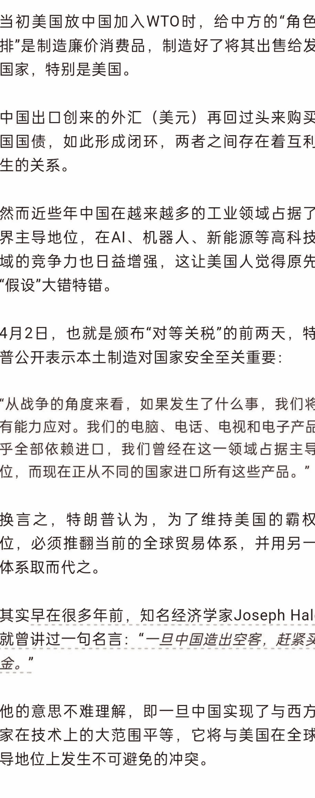

# 新世界架构初露端倪 已付费

原创 印闲生 江宁知府 2025年04月13日 09:03

山东 89人

本篇分五个小章节，仅代表个人观点。

## 1、特朗普为什么要发动关税战，并强硬重置全球经济秩序？

当初美国放中国加入WTO时，给中方的“角色安排”是制造廉价消费品，制造好了将其出售给发达国家，特别是美国。

中国出口创来的外汇（美元）再回过头来购买美国国债，如此形成闭环，两者之间存在着互利共生的关系。

然而近些年中国在越来越多的工业领域占据了世界主导地位，在AI、机器人、新能源等高科技领域的竞争力也日益增强，这让美国人觉得原先的“假设”大错特错。

4月2日，也就是颁布“对等关税”的前两天，特朗普公开表示本土制造对国家安全至关重要：

> "从战争的角度来看，如果发生了什么事，我们将没有能力应对。我们的电脑、电话、电视和电子产品几乎全部依赖进口，我们曾经在这一领域占据主导地位，而现在正从不同的国家进口所有这些产品。"

换言之，特朗普认为，为了维持美国的霸权地位，必须推翻当前的全球贸易体系，并用另一个体系取而代之。

其实早在很多年前，知名经济学家Joseph Halevi就曾讲过一句名言：“一旦中国造出空客，赶紧买黄金。”

> 他的意思不难理解，即一旦中国实现了与西方国家在技术上的大范围平等，它将与美国在全球主导地位上发生不可避免的冲突。

至少在特朗普眼中，这一天已经近在眼前，当下必须立即采取行动，不惜一切手段遏制中国。

需要注意的是，特朗普计划里的“再次伟大”需要让美国从消费驱动型经济转向生产驱动型经济。

这一过程中，随着消费被征税（通过关税）来为国内生产者提供隐性补贴，美国人的生活水平将不得不降低，并进而考验特朗普的支持率和共和党在国会中的多数地位。

白宫最大的压力在内不在外，2026年11月的中期选举将是一个关键节点。

## 2、目前美国正紧锣密鼓地启动与各方的谈判，90天后会出现一个怎样的结果呢？

WTO创始之初，为了使各成员间的经济交往有章可循，防止关税战和贸易摩擦，建立了一整套规则，其中最重要的即“最惠国待遇”。

简单来说，一个成员给予另一个成员的优惠应立即、无条件给予其他成员，如此整个贸易体系都将得到升级改善，而不会产生“三六九等”。

可随着时代变化，美国人渐渐意识到WTO模式存在的问题，尽管历届总统热衷的策略不同，但主旨其实都是求变。

奥巴马时期美方的做法是新拉一个群，打造一套更高水平的自由贸易协议，即TPP。

特朗普1.0时期彻底摒弃了TPP，但只破未立，草草收场。

拜登时期美方的做法是“小院高墙”，把一部分重要产业保护在和自己和盟友圈子里，“小院”越扩越大，“高墙”越垒越高。

特朗普2.0时期颠覆了WTO模式，力推关税等级制。

## 特朗普暂停对等关税 欧盟同意暂停反制关税

更新: 2025-04-10 1小时前

美国总统特朗普星期三（4月9日）突然宣布暂停对等关税90天，在此期间大幅降低对其他国家的高额关税至10%。（彭博社）

欧盟的“反制关税”只针对200多亿美元商品，目标是美国早已生效的25%汽车和钢铝关税，布鲁塞尔的决策总是比华盛顿和北京慢半拍。

什么是“关税等级制”呢？

美国财政部长贝森特做过这样一个比喻：

> "有一个绿色、一个黄色和一个红色的桶，我们让每个人都知道他们在哪里。"

简而言之，“绿桶”里装的是美国盟友，它们将获得关税优惠，比如10%的基础税率；“黄桶”里的是一些游离国家，它们将面临某种程度的贸易壁垒，比如25%的关税税率。“红桶”里则是被视为竞争对手的国家，将面临高额关税，形同脱钩。

某种意义讲，特朗普政府不只把关税当作可解决财政赤字、吸引制造业回流的工具，也当成了一种地缘政治工具，甚至重塑全球秩序的武器。

而在“绿桶”“黄桶”和“红桶”之外，美国至少还有一个“金桶”，负责装它自己。

对于那些高科技和战略性产业，美国将不惜一切代价抢到自己手中，即使盟友也不被信任。

比如汽车、钢铝、医药（尚未落地）等重要产业，所有国家都得加25%关税，这些产业必须留在美国。

再比如半导体产业，根据4月8日路透社的报道，特朗普称曾要求台积电赴美设厂，否则征100%关税，他还批评拜登政府给台积电亚利桑那州厂66亿美元补贴，表示自己未给钱只是以关税就实现同样目的。

从这个意义讲，特朗普和拜登的思维并没有什么不同，只不过一个用“威胁”，一个靠“怀柔”，目的都是一样的。

熟悉冷战历史的朋友想必都清楚，特朗普的“等级关税制”其实就是苏联经互会的做法，是妥妥的计划思维，只不过披上了一层贸易的外衣。

经互会是苏联打造的经贸小圈子，成员包括苏联自己、东欧的华约国家、蒙古、越南和古巴。

在经互会的产业分工里，苏联经常强行安排别的国家该生产什么、不该生产什么，刻意将军火、电脑、能源等高科技产业保留在苏联本土，而将农业、轻工业、食品等低技术含量的行业交给其他成员国。

华盛顿今天的做法与当年的莫斯科并无本质不同，只不过依靠“等级关税制”去实现罢了。

原经互会大楼，现为莫斯科市政府大楼。虽然中国没有参加经互会，但从1956年5月起，每当召开经互会会议和各种常设委员会会议时，都派观察员列席会议。1961年中苏关系破裂后，中国不再参加。

## 3、中美存在贸易逆差的情况下，脱钩是中方吃亏吗？

4月10日，美国财政部长贝森特宣布对其他国家和地区暂缓征收“对等关税”90天（期间加征10%的基准税率）、对中国加征125%关税时，曾这样宣称“胜利”：

> “中国对我们征收关税会让我们失去什么呢？我们向他们出口的产品只有他们出口给我们的五分之一，所以这对他们来说是一手亏牌。”

这个解释显然是为了附和特朗普，因为事实并非如此。

关税战中双方都会受到伤害，双方都失去了本国经济想要和需要的东西，以及本国民众和企业愿意为之付费的东西，不存在说你不买我的货，我比你更吃亏的道理。

有朋友会说，美国可以去找越南和印度买啊！

这里面有两层逻辑，一方面，原先美国买家之所以从中国采购，一定是因为中国货的综合性价比高于越南货和印度货。

另一方面，在2023年美国从中国进口的十大商品中，除了排名第二的纺织品和服装替代起来相对容易外，其他像消费电子产品、化学品、建筑机械和材料、电气设备（不包含半导体）、贱金属及制品、家用电器、运输设备、清洁能源和电池、光学和医疗设备等，短期内很难被取代，长期看其他国家的体量也很难替代中国，且即使未来能够取代也需要支付高昂成本。

实际上，早在很多年前就有人对中美贸易提出过疑问：我们每年一船船的货运向大洋彼岸，换回来一堆花花绿绿的印刷纸（美元）和美国债券，到底合算还是不合算呢？

在美国人眼里中美贸易是中方赚了美方的钱，而在中国人眼里多多少少有我们为美元霸权打工的意味。

现如今特朗普把中美关税搞到这个水平，已经没有经济学上的意义了，更像是一种各自表明原则立场和政治态度的做法，最终的结果无非有二：要么相互妥协继续维系着（部分）自由贸易，要么硬脱钩。

综合来看，妥协的概率还是大于硬脱钩，因为“真关税”往往是5%、10%加起来，需要不断试探自己的承受力，“假关税”才是30%、30%的加，核心意图是讹诈。

关税从正式实施到效果显现一般有一至俩月的“缓冲期”，期间可以先由供应链里的库存勉强支撑。

## 4、面对美国强势施压，其他国家会乖乖就范吗？

> 特朗普有句名言：“关税给了我们很大的谈判权力。”

简而言之，特朗普政府认为，美国对其他任何国家都拥有博弈论里所谓的“升级主导地位”。

事实上，美国之所以能对全世界“征税”，并不是因为它具备绝对的全球市场主导力，而是因为其他主要经济体在面对美国时陷入了一场典型的“囚徒困境”。

《金融时报》认为，在缺乏协调、团结与信任的情况下，各国难以形成有效反制，只能被迫接受白宫强加的经济安排。

仅从商品贸易来看，美国无疑是全球最大的进口国，2023年美国进口商品总额约2.98万亿美元，占全球进口总额的16%；不过欧盟的整体商品进口规模与美国相差无几，达到2.72万亿美元，占全球15%；同期中国的商品进口额为2.14万亿美元，占比12%。

当然，中欧均进口了大量的石油、天然气以及各类铁矿、铜矿等，属于刚需，而美国已基本实现能源自给，所以美方的进口货物多为消费品，更具弹性，对市场影响力更大。

可即便如此，仅凭经济和贸易力量美国也很难施压全球。

从本质上来说，美国发起关税战的底牌还是倚仗其在全球安全领域的影响力，以及过去八十年积攒的霸权遗产。

以欧盟为例，它在俄乌战争和防卫安全领域强烈依赖美国，虽然关税问题看似跟安全是两条线，但事实上大家都知道不能触碰美方底线。

再以日本、韩国、澳大利亚、加拿大等为例，尽管它们反对关税、支持自由贸易，但也不愿意因此跟中国立场靠近。

至于印度、巴西和东南亚国家，它们原本就属于“骑墙派”。

我们不妨预测一下，除非特朗普漫天要价，让各国实在无法忍受，否则90天后大概率会有多个国家同美国达成关税协议，被分别装进“绿桶”和“黄桶”。

站在中国角度，这90天里可以尝试跟这些希望同美国谈判的国家多接触，尽可能帮它们“抬价”，只要它们与美国达成的协议里没有附加过多“中国条款”，就不算坏结果。

其实拜登时期也曾想过用施压、利诱等方式让各国站队，最终形成针对俄罗斯的“统一战线”，集体实施对俄制裁，把克里姆林宫逼入绝境。

在俄方主动发起“特别军事行动”且俄罗斯实力远逊色于中国的情况下，这个“统一战线”搞了四年也没有搞成。

可以想象，特朗普成功的概率也不大。

## 亚细安经济部长：不会就美国关税采取反制措施

发布：2023-04-10 05:06:07

路透社引述马新社的报道，亚细安经济部长一名代表在吉隆坡会见了东盟经贸部长员，向他们通报美国总统特朗普最新征收全球关税的（消息）。（截图）

除非中国实力能够明显超过美国，否则其他国家即使对美不满，也不会贸然跟霸权国家翻脸，最多只能暗中帮中国一下。某种意义上讲，这次极限施压站队也为我们摸排特殊场景下各国立场提供了宝贵参考。

## 5、中国有一天会超越美国吗？

这是一个终极问题，所以请出一位大咖来回答——库尔特·坎贝尔（Kurt Campbell）。

坎贝尔是民主党的“印太沙皇”和中国政策权威，曾在奥巴马和拜登任内担任重要角色，如印太事务协调员、常务副国务卿等。

拜登政府国安团队四巨头：国防部长奥斯汀、常务副国务卿坎贝尔、国务卿布林肯、国家安全事务助理沙利文。

一篇文章，其中有几段见解非常精彩，以下内容围绕其观点展开，有删改。

与特朗普的国安团队在社交媒体群里讨论军国大事，还拉错人进群被泄露出去的情况相比，民主党看起来更像“正规军”一些。

坎贝尔认为，想在大国竞争中取得成功，需要严格和不带感情色彩的净评估，然而美国对中国的估计已经从一个极端跌落到另一个极端。

2008年金融危机之后，尤其是在COVID大流行最严重的时候，许多观察家认为（中国取代美国的）这一天已经到来。

但仅仅几年后，钟摆就转向了另一个极端——当美国加强联盟，吹嘘人工智能和其他技术的突破，享受着经济繁荣、失业率创历史新低和股市创纪录高位时，中国被人口结构、房地产和不断加深的停滞所困扰。

于是新共识得以形成：一个老龄化、发展缓慢且日益不那么灵活的中国不会超过一个崛起的美国，华盛顿迅速从悲观转向过度自信。

......

人类自进入工业化时代以来，小国是靠先发技术优势崛起的。

十八世纪到十九世纪，英国凭借工业化先发优势主导世界，但这种主导地位是短暂的，待到德国和美国崛起（部分归功于英国工业技术的传播），很快实现了比欧洲西北角一个小岛更大的规模。

1870年到1910年间，随着美国和德国赶上并超越，英国在全球制造业中的份额下降了一半，而这种变化迅速转化为军事态势的变化。

英国领导人和战略家意识到了这个问题，早在十九世纪末，英国国内就出现了担心“更大规模的高度组织化国家”的声音。

（笔者注：有观点认为英美和平移交霸权是一种对历史的误读，真实情况是英国意识到它的权力即将失去，不得不在崛起的德国、苏联和美国之间选择一个相对有利的对象移交霸权，作为谋求下个时代次一等强国的“投名状”。假如当时英国只有美国一个主要挑战者，势必也会死磕到底。）

1914年7月初，大战风雨欲来之际，为了向强势崛起的德国示威，大英帝国举行了一次超级海上阅兵。

冷战期间，苏联领导人有句名言——“数量本身就是质量”。

加微信

随着生产力的平等化，人口更多、地理范围更广、组织性更强的国家会扩大规模，最终超越体量较小的先行者，这种动态贯穿了历史上的大部分时间。

美国曾凭借体量优势在上个世纪从中受益，赶上了欧洲工业化的浪潮，然后利用其大陆规模和更多的人口击败英国、德国和日本。

今天，中国正从这种动态中受益，而美国则面临着技术上被超越、经济上去工业化以及军事上被规模和生产能力限制的风险。

在这个时代，战略优势将再次归于那些能够大规模运作的国家，中国拥有规模，而美国没有，因此美国唯一可行的道路就是与其他国家结盟。

大国的兴衰往往始于有缺陷的自我诊断（笔者注：暗示特朗普开的药方不对），如果美国不寻求与其他国家紧密合作，或者在瓦解盟友的同时撤退到西半球，那就会像之前的英国一样，重复历史的轮回……

印闲生

“感谢分享”

1552 人付费，3 人喜欢 >

## 关税 9

关税·目录 =
< 上一篇 新世界正在到来
下一篇 印度为什么兴奋？

个人观点，仅供参考