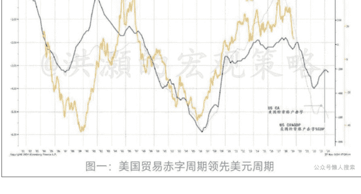
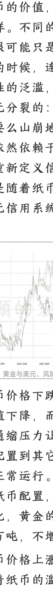

# 公众号懒人搜索，懒人专属群分享

# 黄金的康波

250422 洪灏
整理：公众号懒人搜索，懒人专属群独享
懒人微信：lazyhelper

人生发财，不仅仅依靠康波，更是依靠如何丈量看清从而穿越康波。

十多年前，当我开始对于经济周期进行深入量化研究的时候，我发现了一些经济周期变化和波动的规律，并在过去十几年的实际研究和交易中引用了这些规律成功地预测市场运行的方向。

在经济周期运行的时候，大量的宏观数据同时地、有规律地、以既定的节奏向同一个方向波动。周期的力量来自于这些宏观因子的合力，外力只能左右短期内周期波动的幅度，但周期内在运行的规律是无法被外力改变的。

在新旧周期交替之时，新的共识将产生，旧的体系将崩塌，并伴随着令人眼晕目眩的历史性事件和市场价格的史诗级别的波动。这些历史性事件的发生本身就是周期波动过程表征，而并非周期起伏的原因。否则，我们必须解释为什么这些历史性事件会周期性地发生。

看一下今年以来市场打破传统共识的表现，把周期的波动演绎得淋漓尽致。在去年十一月展望今年的时候，我预测美股将一反共识地暴跌，美元将一反共识地走软（图一；注意这个模型图右下角的更新时间2024.11.27），黄金的历史性行情将延续，而中国市场则将一反共识地跑赢美股。

在执笔之际，美股指数期货盘前又开始暴跌，即便是美股技术上已经出现了2022年以来最严重的超卖指标。与此同时，标普的技术图形已经出现了死叉——即50天均线跌落到200天均线以下——是今年表现最差的主要市场；美元跌破了98，而黄金期货站上了3400，中国A股在外盘一片利空之下反而小幅上扬。这些今年以来摧枯拉朽的、刷新共识认知的史诗级行情，打得一众在风雨中抱紧共识的交易员们措手不及。

即使美股已经正式进入了技术型熊市，加杠杆做多美股的 ETF 上周的成交量却创了历史新高，公司的管理层买入自家公司的成交量也创了近年来新高。如果美股市场情绪破纪录地持续低迷，那么其实我们在成交量数据上并没有找到支持这个情绪观察值的数据。当情绪和仓位出现矛盾的时候，那么实际仓位反映出来的情绪反而更能体现市场真实的想法。

执笔之际，特朗普再次发推，称“鲍威尔真烂，炒掉他真是时不我待”。而鲍威尔则在另一场会议上隔空喊话，“除非我做错了什么，否则白宫无权炒掉我”。当然，欲加之罪，何患无辞？我们在上一篇专属文章《洪灝：当下，美国一个更大的潜在风险》中，为读者提示了这个现在市场共识刚刚反应过来的极端风险事件。之前，美国大法官已经认同特朗普罢免其它两位私人机构负责人的权力。如是，法律上的延伸意义，就是鲍威尔的职位很可能岌岌可危了，而美联储的货币政策独立性很可能也危在旦夕。对于美元资产来说，这将是一只久违了的黑天鹅。

在当下黄金不断创出历史新高的市场环境里，作为最早最强烈看多、并反复推荐黄金的投资机会的经济学家，投资者纷纷追问我，黄金究竟能涨到哪里？我在以下的篇幅里，将尝试回答这个问题。

其实，这个问题，本身就是错的。

以下内容仅V+会员可见

众所周知，货币有三种功能：流通、衡量和储值。从这些维度看，黄金和其它货币一样，本身就是一种货币。而黄金不同的是，黄金作为整个人类社会的“硬通货”，已经有几千年历史了。据估计，在人类的历史长河里，一共挖掘出了近十九万吨黄金，再加上探明储量近六万吨，现在黄金的总量不足二十五万吨——也就是大约中国一周的钢产量。黄金的惰性，让它不腐蚀、不变色、不掉秤，而且密度高。因此，黄金凝聚的是几千年来人类对于价值的共识。只有亘古不变之物，才有衡量其它商品价格的特权。

简言之，黄金本身就是价值之源，以美元表达的每盎司的黄金数字，那是美元相对于黄金的价格。是黄金在衡量美元，而黄金价格的变化，反映的是美元汇率的贬值升值，黄金的价值则一直在那里，不增不减。因此，黄金的价值是以不变的重量为单位，而不是以美元欧元日元等一众纸币的价格为单位。一如T.P.摩根所言，“只有黄金才是硬通货，其它都是信用制度的泡影幻象”。

懒人微信：lazyhelper

黄金的价值，就是那有限的二十五万吨，和比特币的价值，就是那两千一百万个币一样。不同的是，加密货币有限的供给很可能只是一种叙事，毕竟市场疯狂的时候，连屎币都飙涨了百倍。流动性的泛滥，对于信用系统的冲击是二元分裂的：信用风险要么擦边而去，要么山崩地裂。只要一个商品的定价依然依赖于信用系统，那么它就很难重新定义信用。然而，黄金的价值却是随着纸币的贬值而飙升，随着美元信用系统的崩溃而涅槃。

在黄金的纸币价格下跌时，并不意味着黄金的价值下降，而是纸币系统里暂时出现的通缩压力让实体经济需要更多的纸币配置到其它部门，以保证实体经济的正常运行。这时，黄金不需要更多的纸币配置，因为不管纸币价格如何变化，黄金的价值就在那里，二十五万吨，不增不减。

在黄金的纸币价格上涨的时候，黄金的稀缺性随着纸币的滥发而相对于纸币增加。这个时候，对于信用系统风险的重新认知和对于经济运行中存在的通胀风险的担忧，让人们不断增加对于黄金的配置。这时，不管增加多少纸币对于黄金的配置，黄金的价值还是二十五万吨，不增不减。但黄金的价格却会扶摇直上。从这个意义上来说，黄金才是真正穿越周期、丈量一切的标尺，也已经如是数千年了。人的一生只有一次康波。人生发财，不仅仅依靠康波，更是依靠如何丈量看清从而穿越康波。

中国道家的思想，认为万物皆有周期，正所谓“天道轮回，周行不殆”。如是，则“治乱，运也；贵贱，时也”。黄金的纸币价格相对于其价值，自然也会有高低起伏，贫富贵贱。沿用我的周期理论和模型，我对于黄金的纸币价格周期进行了量化的模拟。不出意料，其结果与康波周期不偏不倚地拟合（如图）：每个七十年的康波周期孕育出两个三十五年的长周期，或十个七年的中周期、二十个三点五年的短周期；我们现在处于一个信用长周期的见顶回落阶段，这个下行阶段可以持续十年。此期间，美元信用和汇率都将震荡下行。

### 图三：黄金的康波
在信用长周期的这个下行阶段，黄金将继续大放异彩，熠熠生辉。而黄金相关的黄金股，在沉寂了多年、跑输黄金之后，也将会有所表现（如图）。
### 图四：黄金股跑输，但应很快逆转颓势
如果特朗普胆敢冒天下之大不韪而炒掉鲍威尔，令美元失信于天下人，那么……（此处作者省略十万八千字）。
注：这里讨论的是以数年为单位计量的长周期，而不是黄金纸币价格波动的日线周线。

# 历史 3000 多份各类付费文章以及年费三千多的副业社群资源，见懒人专属群内部分享！
付费群，白嫖勿扰！
# 懒人专属群更新记录：
https://lazybook.fun/#/blog/record2