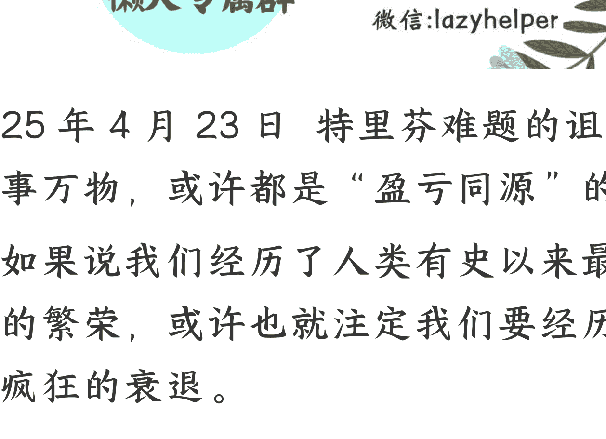

# 二战战后经济神话彻底终结，哪类资产将成为最终赢家？

250427 A 视野

整理公众号懒人搜索懒人专属群独享懒人微信 lazyhelper

2025年4月23日 特里芬难题的诅咒

万事万物，或许都是“盈亏同源”的。如果说我们经历了人类有史以来最大的繁荣，或许也就注定我们要经历最疯狂的衰退。

这一次，是全球经济的心脏，美国经济，出现了癌变。

高企的通胀，高企的债务，疯狂的关税战，崩溃的国际贸易体系，随时可能到来的地缘热战，史诗级的贫富分化，前所未有的全球人口趋势...

无一不在告诉我们：

二战后美国建立的全球经济体系行将就木。

为此，川普连用比特币还美债的损招都想得出，可谓是黔驴技穷之极了。

然而，在货币与金融端，我们所有人的财富信用之锚，长期而言，一直是押注美国经济信用。

懒人微信：lazyhelper

这也意味着，当这套体系崩溃的时候，我们所有人手里的财富，都将面临“血洗”和“重新估价”。

如果可以理解底层逻辑，前瞻性布局，自然是可以更好地应对这个二战后最疯狂的时刻。

可是，如果不能做到，那么，后果将会极为惨烈。到底哪类资产将成为最终赢家？

今日文章超长篇烧脑预警！不怕烧脑的老铁来！

免费阅读！干货满满！各位多多支持！

春花秋月何时了？往事知多少。小楼昨夜又东风，故国不堪回首月明中。雕栏玉砌应犹在，只是朱颜改。问君能有几多愁？恰似一江春水向东流。

这首《虞美人·春花秋月何时了》，或许是最能够代表很多人此时对于大环境的感怀。

今天，A森要明确提出一个很重要的观点：

大佬们玩到现在这个地步，就已经不是大国博弈的问题了，而是市场经济本身还能不能玩下去的问题了。

其实，这个问题，在1968~1982年，也曾经发生过。

长期关注我的老铁应该马上就明白，每一次创新周期尾部，都是一次“鬼门关”。

熊彼特说得好听“创造性的破坏”，然而，只要有一次“破坏”变成再无法“创新”，那就是全人类陪葬。

为何今天上来就要提如此沉重的话题？因为，今天的文章要说的话的逻辑足够底层，需要大家很认真地看完全文。

如果说一波创新周期完整的周期是60年，那么，二战后美国主导的体系至今，也不过是经历了“1.5个创新周期波段”。

二战后的爆发，本质上，那段时间，就是进入创新周期尾部。

二战结束，一直到1982年，是上一轮创新周期从繁荣期进入衰退期和萧条期的阶段。

1971年，布雷顿森林体系瓦解，看似是美元体系1.0版本的危机，实则就是当时市场经济运作即将陷入崩溃的前兆。

在这里，我们要提出一个很重要的点：

市场经济并不完美，它也是经常出大问题，甚至也会吃人。之所以如此，那是因为，市场经济的运行轨迹包含了内部难以化解的矛盾。

作为全球最牛逼的经济体，美国，在布雷顿森林体系内，遭遇了经典的两难困境。

“特里芬难题”，美元作为全球储备货币，意味着，既要维持美元的购买力信用（贸易顺差），又要让其它国家可以获得美元（贸易逆差）。然而，美国对外贸易，不可能同时做到，既顺差，又逆差。

要确保美元可以长期成为全球储备货币，美国必须接受越来越多的逆差，让其它国家手里都是美元，美国可以从中收取美元全球铸币税。

可是，美国贸易逆差，也意味着，大量产业外移，实体经济逐步空心化，国内的制造业慢慢没有竞争力，中低收入家庭找不到对应的就业岗位，国家财政赤字越来越多。

尼克松之所以是大神级的美国总统，是因为，他可以在这么有限的总统任期内，找到了一条出路。

明面上看，“石油美元体系”就是美元绑定石油，其实，是美元绑定了金融资产。

美联储可以通过美元利率的潮涨潮汐，逐步调节全球各类资产的价格，就直接将别国的财富给收割了。而不是像过去那样，需要美国自己下场参与各类实体经济制造业来确保美元信用购买力。

于是，美元的储备货币保住了，美元逆差也不是问题，美国财政的困境也可以靠金融创新来处理。

本质上，美元不再跟制造业绑定，而是跟全球金融市场绑定，这是“尼克松—里根—克林顿”路径的最大手段，来应对“特里芬难题”。

运气也好，冷战时期为了对付苏联而搞的国防互联网产业，这个时候也成功了，还在80年代成功切换为民用商业运行，引爆了互联网革命。

90年代初，苏联崩了，大量新的市场、海量劳动力也进入全球分工体系。

这几个可遇不可求的重要红利，进一步导致全球财富倍增，全球过剩储蓄越来越多，也就更加支持美元绑定金融市场。这就是为何我们已经很久没有感受到“特里芬难题”给全球经济带来的诅咒和困境。然而，一切都过去了。

美国没有在冷战后再依靠国家力量拼命搞下一代技术革命的研发，所以，互联网革命后，美国暂时掏不出新的技术变革。

全球过剩劳动力也已经没有了，新的市场也没有了。这一切的反转，都意味着，美国财政进一步扩张已经到了难以为继的瓶颈。

美国财政无法顺利扩张，使得美国根本扛不住国际贸易逆差持续扩容。因为，国际贸易逆差的本质，就是美国国内进行再融资去填这个逆差的窟窿。

拜登时期，靠各种微操手段，让美债完成这个融资。而今，美债都没有多大能力再去完成这种级别的融资，那么，贸易逆差也就无法扩大了。

问题是，美国贸易逆差无法扩大，也就意味着全球经济最大甲方没有更多购买力，全球一轮经济衰退，势在必行。那么，美元自己的币值稳定性靠不住，美元霸权要玩下去也靠不住。

从里根到拜登，足足40多年内成功应对“特里芬难题”的工具，开始失效了。

对于刚刚上台的川普2.0，要么继续硬撑美元霸权，代价是必须不管美债扩张的风险，更不要管由此带来的长期通胀压力；要么严控债务失控，可是，势必带来很多国家不再依赖美元，会重创美元霸权。

所以，川普2.0在做的，本质上，就是挑战特里芬难题。然而，这是不可能的。

里根开始的40多年，美国之所以可以挑战，那是因为，全球有海量的财富增量来填窟窿！

既要美元币值稳定的信用，又要确保美国贸易赤字。最好的办法，就是贸易赤字确保其它国家获得美元，然而其它国家又用手里的美元回流美债（美元信仰的捍卫）。只有这个超级大循环，才可以“既要又要还要”地对抗“特里芬难题”。

只不过，这个玩法的结果是，其它国家愿意接盘美债，美国也付得出美债的利息。问题是，我们都看到了，目前这两个点都出现了动摇。

因此，我们可以说：

不是川普有多疯狂，而是里根至今的美元大循环模式自己玩不下去了。川普只不过用看似胡乱折腾的方式，宣告了这一真相罢了。

没有海量储蓄回流美债，美国也就不可能向全球随意撒钱；同样，美国不能向全球随意撒钱，也就不会有海外储蓄进入美债。

现在，卡就卡在这里。

所以，所谓的关税战，如果看得再深一点，就更加有意思了。

由于美元大循环模式的失灵，美国本土的经济增长自然也就不行了。即，美国没有办法用贸易逆差的方式，给到全球更多的美元。可是，全球其它地区为了自身的经济增长，还在希望用出口方式，继续强化对美元的需求。这两股力量，构成了现在关税战的全貌。

对于其它国家而言，既然美国用如此庞大的债务利息去确保美元信用在全球畅通无阻，那么，继续赚美元，再用美元买自己要的东西来套利，绝对是有利可图。

于是，川普就要切断贸易，就是不想继续给我们美元，因为美国给不出了，再给就债务爆雷。

本质上，债务扩容对应的利息负担是要靠经济增长带来的利润提供。现在经济没有增长，利润无法提高，债务无法扩容，甚至抵押品价格也需无法稳住。资产价格内生要塌陷往下走，也就没有办法对外给出美元。

如果川普还像此前拜登那样，此时此刻拼命给我们美元（放任国际贸易和美债扩容），他们自己是要自爆的。

此外，对于美国而言，中国还是价格破坏者，意味着美国利润率加速往下行，相当于上面的负反馈机制也在全面提速。

面对这种局面，除非美国可以从海外获得海量的财富来让美债继续扩张、进而让贸易逆差可以再次扩大，否则“特里芬难题”所带来的诅咒就会让美国经济无法正常运作。

问题是，美国在战略上，出现了严重的误判。他们竟然在我们这片没有美国驻军的土地上，为了每年15%的利润率，放任全球制造业转移到我们这里，长达10年（2001~2011年）。因此，当他们想要收割我们的时候，发现根本收割不了。

于是，现在是货币体系内生机制走向终结了，随之而来的也是全球分工体系面临土崩瓦解的内生动力。

里根经济学开启的“美国财政发债——美联储对应印钞”的模式，到了重大瓶颈，美国必须面对国家发展模式的抉择点：

是追求顺差，还是放任逆差？这可是完全不同的经济模式。前者就要放弃美元霸权，后者则要付出沉重的金融利差代价。

很明显，美元体系锚定美债的玩法，已经完全走不下去了。

中国经济崛起的本质，就是把被美国人拿走的利润，想办法重新带回来，然后更为合理地分配给我们的民众。这个是未来中国经济保持可持续发展的根本来源。

中国的一带一路计划，本质上，就是阻止利润回流美国。

而现在川普的制造业回流，只会导致错误生产（成本过高），放大美国的债务风险。真正的做法，应该是美国加速前沿科技的研发，这是美国的责任和义务。

事实上，现在美国既不愿意这么做，也来不及这么做。这使得美国自80年代开始的全球统治模式，出现了土崩瓦解的困境。即，新自由主义体系崩塌的根本，就是“权责不对称+走向庞氏骗局”。

那么，如果现有的美元体系玩不下去，意味着什么？

A森提一个重要的观点，与全球经济后续的模式直接有关：

全球主要经济体，全部回归实体经济驱动。表现在货币和金融体系，则是国债美元体系没落，新版布雷顿森林体系（实物美元）体系再次回归。

当信用贸易无法玩了，为了生存，人类就会回归实物贸易，甚至是物物交换。这也意味着，地缘政治经济的博弈逻辑，都发生了系统性的改变。

原本，大家都是在本土搞个项目，搞到钱后，让自己的孩子去美国（霸权在手）。

现在，大家就是本土搞个项目，搞到钱后，继续留在本土（霸权沦丧）。

对于中国而言，现有美元体系“僵而不死”的时间周期越长，越是有利于自己完成大循环，我们可以继续套利。

但是，对于美国而言，如果不能重新启动“美元美债大循环”周期，则美国内部的社会稳定性就会出问题。届时，美国国内，需要一场真正意义上的暴力革命，一场“斯巴达克斯式的奴隶起义”。

原本美国不跟中国商品脱钩，通胀不起来，上述美元霸权的陨落是一个相对更加缓慢的过程。可是，

如今川普如此心急于脱钩，那整个进程就会提速。

处理不了“美债大循环”，美国经济也就只能重新进入国际贸易和实物生产，否则如何给美元体系增信？

我们现在再来看看川普的各种微操，是真的愚蠢，

还是真的无力？

好走的路，都被前面的人走绝了；剩下来的，只有“孤臣单影”。

某种程度上，我们又来到了1968~1982年的险境。可是，那个时候，全球还有大量市场没有进入全球化体系，还有海量人口没有成为流水线上的一员。

然而，如今，连这个红利都榨干了。这也意味着，眼下的严峻指数，远超1968~1982年，不可不察。

既然“国债美元体系”要退回到某种版本的“布雷顿森林体系”（实物美元体系），那么，比特币和黄金，谁将更加出彩？

正好，川普一直在推比特币。

懒人微信：lazyhelper

其实，美联储是很厌恶这个东西的。

我们此前说过，美元超发的核心机制，就是“美国财政发债—美联储买债”。通过两个部门做“对敲”，美元就这么产生了。

然后，各种手段，让全球其它国家相信，这种“对敲”出来的货币，比世界上绝大多数的资产都有信用和购买力。

如果不服气，就干你，确保打到你相信为止。

美联储只要通过调节基准利率（美元价格）和QE（美元数量），就可以很容易地进行闭环的流动方向的管控，甚至追查出谁在给美元使绊子。

然而，如果是比特币，那就麻烦了。

比特币和黄金一样，都是靠一次性买卖的办法，来“对冲”美债压力。一旦一次性买卖结束，它们的流向绝对不是美联储可以管控的。

由于无法进行闭环管控，而且比特币还没有实物属性，所以，这会引发大量其它国家的财富将不再锚定美元，美联储根本没有工具可以在金融市场进行来回定价、调配和收割。

所以，这就使得比特币和黄金具有瓦解美元美债体系的特点，对于“特里芬难题”的处理也不过是暂时有效、长期无效而已。

而且，由于比特币不具有实物属性和人类长期沉淀的价值信仰，它远远比不上黄金。

问题是，美债美元体系，是现在美国极为复杂的各类金融衍生品的压舱石，是提供增量资金的关键。

如果这个东西不能闭环管理，那增量资金就有了很多管道上的“破口”，就有可能面临大量储蓄流入其它国家其它资产上面。

设想一下，现在全球财富都未必撑得住美国庞大金融市场的进一步扩容；如果这种“破口”越来越多，那岂不是美国金融市场后面真的崩坏了，更是惨不忍睹？！

现在，中国坚定不移的支持全球化，实则也是为未来人民币债券被海外买家购入提供可能，即，向全球储蓄提供更多这类“破口”和替代品。

那么，接下去，我们如何观察呢？

如果 10 年期美债收益率高于美国 GDP 的增长率，说明美债对于 GDP 的拉动效果是很弱的，那么，美国金融资产后续往下的压力将会非常大。因为，1%的利率不能换来 1%的增长。

这也意味着，对于先知先觉的资金，就会提前布局。

- 加速长期布局黄金赛道
- 锚定核心资源，及堆砌之上的资产

## 锚定核心制造业产能，及堆砌之上的资产

如果说中国产能有点多，能够多得过美元的超发吗？

拜登如此虹吸全球，都不能拉爆任何一个经济体，这就是最好的证明啊。这次，如果川普 2.0 走不出“特里芬难题”的困境，那么，未来财富的定价权将逐步切换给“全球大乙方”，而不再是“最大甲方”。事实上，这才是构成未来长期财富定价的核心底层逻辑。

历史 3000 多份各类付费文章以及年费三千多的副业社群资源，见懒人专属群内部分享!

付费群，白嫖勿扰!

懒人专属群更新记录：

https://lazybook.fun/#/blog/record2