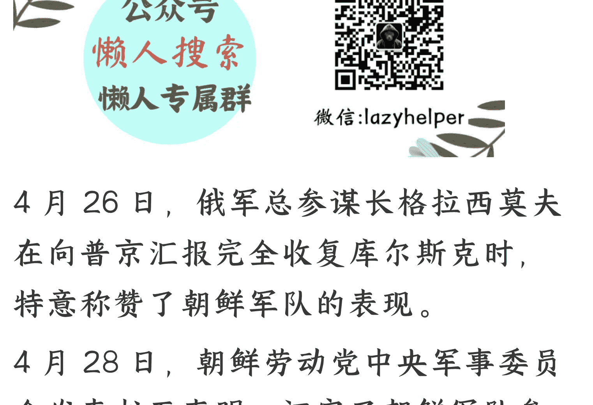

# 朝鲜承认出兵俄罗斯，怎么突然官宣了？

250431 文/卢克文工作室嘉宾 星海舰长

整理：公众号懒人搜索，懒人专属群独享

懒人微信：lazyhelper

4月26日，俄军总参谋长格拉西莫夫在向普京汇报完全收复库尔斯克时，特意称赞了朝鲜军队的表现。

4月28日，朝鲜劳动党中央军事委员会发表书面声明，证实了朝鲜军队参加库尔斯克地区收复作战，为收复俄罗斯领土作出重大贡献。

随着朝俄双方的官宣，持续了3年的朝鲜薛定谔出兵状态，终于尘埃落定了。

那么，朝鲜到底是怎么出的兵？又为什么选择现在官宣呢？

## 1

先看看朝鲜的官方声明是咋说的。

"金正恩同志分析和判定当时的战况，正适合朝鲜和俄罗斯签订的《全面战略伙伴关系条约》第四条的行使，并以此为根据，决定我国武装力量参战且通报了俄方。"

注意朝鲜的表述，朝鲜是依据《全面战略伙伴关系条约》出兵的，师出有名。

懒人微信：lazyhelper

早在苏联时期，苏朝是有共同防卫义务的，根据《苏朝友好合作互助条约》，缔约任何一方遭受任何国家或国家联盟的武装进攻而处于战争状态时，另一方应立即尽其全力给予军事及其他援助。

不过苏联解体后，俄罗斯开始推行“亲韩疏朝”的外交政策。1994 年 6 月 2 日，叶利钦更是直接宣布废止了这个条约。

此后 30 年，朝俄不再有同盟的关系。虽然 2000 年普京和朝鲜签订了《朝俄友好睦邻合作条约》，但已经没有共同防卫的条款了。

不过这一切，随着俄乌战争的爆发，而彻底改变了。

从 2022 年开始，俄朝关系开始急剧升温，普京和金正恩实现互访，中间还让绍伊古往朝鲜跑了好几趟，绍伊古还向金正恩提交了普京的亲笔信，显然是在商讨大事情。

经过充分交流，2024 年 6 月 19 日，双方签订了《俄朝全面战略伙伴关系条约》。

这份条约的核心，在第四条：如果一方因受到武装入侵而进入战争状态，另一方将根据《联合国宪章》第 51 条以及俄罗斯和朝鲜的法律，立即提供其拥有一切手段的军事和其他援助。

这就相当于同盟条约了，和美韩的关系差不多。

需要注意的是，条约签署的时候，朝鲜出兵的理由并不充分。

为啥？因为条约中写的是“如果一方因受到武装入侵而进入战争状态”，俄乌战争是啥？是俄罗斯打乌克兰啊！没有遭到“武装入侵”，朝鲜怎么能出兵呢？

但万万没想到啊，理由很快被乌克兰送来了。

2024年8月，乌克兰发动库尔斯克战役，攻入俄罗斯境内，触发了条约第四条款，朝鲜出兵就有理由了。当然了，条约这种东西只是个借口而已。如果内心不想出兵，条约写得再明确，也能找到推辞的借口。

那么，朝鲜出兵，对双方有什么好处呢？

对俄罗斯来说，朝鲜的生力军，可算是解了俄罗斯的燃眉之急。

俄乌战争爆发以来，俄军阵亡和受伤的数字，虽然不可能有乌军宣传的80万那么多，但综合各类讣告和抚恤金数字来看，20万-30万人是有的。这是很大数字了，不说抚恤金的花费，就连阵亡士兵家属的抗议活动，都让普京很难受。

所以，俄罗斯急需前线填线步兵。

巧了，朝鲜军队规模庞大，总兵力约为 132 万人，居世界第四位，还有 140 万后备兵员，无论组织性纪律性还是战斗技巧，都远远强于动员兵和零零散散的外国雇佣兵。

朝鲜还拥有世界第一规模的特种部队（20 万人），喜欢以小分队步行渗透攻击，执行奇袭攻坚等特殊任务，先天适合俄乌战场这种慢慢啃的烂仗，以朝鲜人民军悍不畏死的作风，拿来当突击部队，很可能得到奇效，一举打破战场僵局。

而对朝鲜来说，好处可就更多了。

因为长期被封锁，朝鲜可以说是什么都缺，特别是缺油、缺化肥、缺粮、缺战略军事技术、缺外汇。

没有油，朝鲜就没法使用农机。没有化肥，朝鲜农作物就没有产量。没有粮食，朝鲜社会就不可能稳定。没有战略军事技术，朝鲜就不能对美韩形成威慑。没有外汇，朝鲜就很难从他国进口需要的特殊产品（比如将军的迈巴赫）。

巧了，这些东西俄罗斯都有。

俄罗斯还有军工技术，无论是洲际导弹技术、氢弹技术以及核弹头小型化的技术，还是核潜艇的技术，俄罗斯都拥有足够雄厚的老本，如果俄罗斯愿意给，朝鲜的战略威慑能力立马能提升一大截。

至于外汇就更不用说了，卢布虽然不是什么硬通货，但中国也是认卢布的。

我们可以算一笔账。俄军征兵的价码是 20 万卢布/月，我们按朝鲜士兵也是这个价来算（俄罗斯不用出安家费/签字费，其实很划算），15000 人的朝鲜军队（一开始是一万二，后来又增加 3000 补充兵），一个月就是 30 亿卢布的外汇收入，一年就是 360 亿卢布了！

当然，这笔钱发到朝军士兵的手里，就会变成朝元。而朝鲜政府就能轻松拿到 360 亿卢布的外汇。

这是啥概念？2022 年，俄朝双边贸易额仅有 3500 万美元（29 亿卢布），现在光靠派兵打仗，就能赚来十倍于贸易额的外汇！

虽然拿国民的人命换外汇并不光彩，但想想当年朴正熙在任时，国家缺外汇，不也是派了 32 万韩军到越南，用士兵的命换来了美元么？大哥别笑二哥，只许韩国卖人命，不许朝鲜卖人命？

挣钱嘛，不寒碜。

更不要说，朝鲜借助出兵稳固了和俄罗斯的血盟关系，万一哪天遭遇美韩入侵，俄罗斯好意思不管？

这相当于给朝鲜政权提供了一个来自五常国家的安全保证，非常划算。

## 2

虽然朝鲜出兵这事看起来名正言顺，但前前后后还是被否认了很多次。

去年 10 月份，韩国炒作朝鲜士兵抵达俄罗斯时，俄朝双方都矢口否认。

朝鲜常驻联合国代表团负责人在纽约出席第 79 届联大第一委员会会议时，就韩国政府发布朝方派兵援俄消息反驳称，这是毫无根据的谣言。

克里姆林宫发言人佩斯科夫重申相关信息是“又一则谣言”，俄罗斯外交部发言人扎哈罗娃表示，所谓朝鲜向俄罗斯派遣军人的说法是“无中生有的炒作”。

你看，明明兵已经派了，但双方就是不承认，显然在不承认这件事上，双方是有沟通，且统一了对外口径的。

而这次公开呢？情况也差不多，显然也经过了协调。

4 月 24 日，朝鲜官方表示，《全面战略伙伴关系条约》已成为维护欧亚大陆和平与安全的可靠保障。

4 月 26 日，格拉西莫夫在战斗报告中披露，朝鲜士兵作战英勇。

4 月 27 日，俄罗斯官媒放出朝鲜士兵训练作战的照片和视频。

4 月 28 日，朝鲜承认，根据《全面战略伙伴关系条约》，朝鲜已经出兵参战。

前面否认那么久，为啥突然现在公开了？

因为双方此刻已经不再需要保密了，而且公开更有利。

对俄罗斯来说，引进朝鲜士兵，本身就是为了减少在库尔斯克攻坚时的伤亡，用朝鲜士兵来填线。现在库尔斯克战役结束，朝鲜士兵也就功成名就了，可以公开了。

另一个原因，就是俄罗斯即将举行纪念卫国战争胜利80周年的阅兵式，在阅兵式上，朝鲜士兵可能向全世界亮相，现在公开这件事，无非是给阅兵亮相作铺垫。

当然，还有一个关键因素，就是公开给美国看。

特朗普就任之后，雄心勃勃要调停俄乌战争，但是因为双方立场差距巨大，所以现在基本处于各说各话的状态。

对俄罗斯来说，最佳的应对手段是什么？

一边和美国谈判，讨价还价，另一边在战场上捞取更多的好处，现在捞得越多，以后和谈中的主动权越多。

根据美国官方一份最新的研究报告，俄罗斯在春夏之间，可能会对利曼、波克罗夫斯克和奥列霍夫方向加强进攻，同时在收复库尔斯克后，也会开始反推苏梅，打出一个缓冲区，来保护边境。

这就是所谓的“春夏攻势”。但问题在于，美国方面同时也认为，俄军存在兵力不足的问题，俄军很难在攻势里取得大的战果。

然后呢？俄罗斯和朝鲜就把朝军参战的消息公开了。

请注意朝鲜声明中的措辞：“将一如既往地完全支持俄罗斯军队和人民的神圣事业，始终忠实于以朝俄两国条约精神为基础的任何行动”。

这话是啥意思？打完库尔斯克还不算完，还要继续打是吗？

还真有可能。

以前朝鲜是在库尔斯克行动，现在库尔斯克战役结束了，朝鲜还可能去东乌。别忘了，朝鲜对东乌四州公投加入俄罗斯，是持承认态度的，也就是说，在朝鲜眼中，东乌四州也是俄罗斯领土，那么朝鲜就有理由根据条约，进入四州作战。

这对乌克兰来说，真有点麻烦了，因为朝鲜士兵已经在库尔斯克证明了，自己不是弱旅。

比如在库尔斯克州普列霍沃村的战斗中，朝军在没有炮火准备，没有坦克装甲车助战的情况下，利用恶劣天气掩护，悄无声息地用直列装药在雷场中开辟出一条通道，然后单行快速通过了乌军雷区，采取小组制向乌军发起了猛烈冲锋。

只用3个小时就干净利索地消灭了驻守的300乌军，而自身仅伤亡200人，这种伤亡比，在进攻作战中是非常难得的。这种“飓风”一样的作战模式和俄军、瓦格纳完全不同，不仅震撼了乌军，连俄军都震惊了。

俄军之前非常看不起外国部队，认为他们训练差、作战意志薄弱，但朝鲜人民军不愧是东亚怪物房出来的精锐，军事素养远超俄罗斯那些动员兵。

后来在苏贾战役中，朝鲜军队也快速适应了无人机时代的打法，进步非常快，给乌军带来巨大麻烦。要知道苏贾的乌军全是精锐，装备了大量北约武器，还掺杂了北约雇佣兵，现在竟然被朝鲜军队收拾掉了。

现在知道为啥格拉西莫夫要用这么长的篇幅向普京报告朝鲜士兵的勇敢和战斗技巧了吧？实在是朝军的表现太出色！

这还只是一万多朝军打出来的结果，朝军还有100多万正规军，将近200万预备役呢，如果都派到战场上去，乌克兰恐怕都要灭国了。

俄罗斯现在把事情公开，无非也就是告诉美国，我现在兵力足够，我想打多久，就打多久，如果想停战，就快点答应我的条件！

对朝鲜来说，现在公开也是个比较合适的时机。

一方面，朝鲜想要的东西，现在基本上都拿到了，朝鲜士兵的作战水平也得到检验了，所以金正恩信心陡增，也没什么顾忌了，有啥不能公开的？

另一方面，也是公开给美国和韩国看。

现在的朝鲜，要同时面对美国和韩国新政府的朝鲜政策调整，可以说正处于一种关键时期，可能决定未来几年朝鲜半岛的局势，在这个时候，朝鲜必须立威，才能在未来的博弈中占据优势。

比如朝鲜刚刚下水的驱逐舰，就是一种立威。而现在公布赴俄作战，也是一种立威。

你李在明就算当了总统，也别想着像之前的左派一样用粮食和石油来打发我，现在这些个玩意，我不缺了，相反我还拿到了更多的军事技术，你如果想安稳过日子，就要给更多的钱。

你特朗普也别像搞伊朗那样限制我的核武器，你现在已经没有什么能拿捏我的了。想解决朝鲜问题给自己脸上贴金，就要拿出更多的诚意和筹码来。

比较有意思的是，对于朝鲜的出兵行为，中国显然是很早就知道的，但并没有反对。而这次公开之后，也含糊其词表示中国立场未变，没有作出评价。

这种态度真让人浮想联翩。

要知道，朝鲜只和两个国家有共同防卫义务，一是俄罗斯，二是中国，现在俄罗斯给点石油粮食和技术就能换来朝鲜出兵，中国能给朝鲜的，可多多了。

那么，到时候那些比较消耗人命的巷战中，会不会出现朝军呢？

历史 3000 多份各类付费文章以及年费三千多的副业社群资源，见懒人专属群内分享！

付费群，白嫖勿扰！

懒人专属群更新记录：

https://lazybook.fun/#/blog/record2