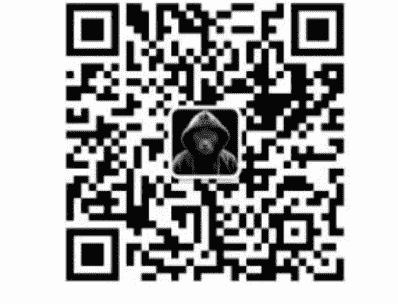

# 超级问题：理解人生“为什么”和“怎么办”

250430 商业参考 4 节选

整理：公众号懒人搜索，懒人专属群独享

懒人微信：lazyhelper

今天这一讲，我们来说说用来帮我们梳理人生脉络的超级问题。

我们对自己的人生已经无限熟悉，还有单独的必要梳理自己的人生脉络吗？直接去抓超级机会信号不就行了吗？

## 人生脉络“为什么”

非常有必要。我先给你讲一组好问题，你听完马上能意识到这件事的必要性。

这组问题，是中科院心理所的钱炜老师分享给我的。

钱炜老师前两年带世界卫生组织的一个欧洲干事游览北京、吃涮羊肉，对方对中国几十年来的社会巨变非常惊艳，于是聊天时问了钱炜老师三个问题：你们夫妻各自的祖辈都曾经是中国社会的精英阶层，等到了你们这第三代，又各自重新回到了精英阶层，你认为支持这个家族命运轮回的最大推动力量是什么？

你们夫妻考虑过到世界其他地区生活吗？是哪里？为什么？

如果要给你的孩子留下一些重要的家训，你会告诉他什么？

钱炜老师的回答，我们就不公开了。

我不知道你听到这三个问题是什么感受，我当时的第一感受是，欧洲精英在建构自己的世界认知时，很明显跟普通中国人有两个不同：一个是把更大尺度的时间周期用作比例尺，另一个是把整个世界当作自己的主场。

你看，他在理解一个中国精英的命运跃迁时，没有只盯着这一代人的努力和时代变化，而是尝试从家族三代的近百年的时间尺度里寻找逻辑。他问钱老师“家训”，更是希望借助亲历者的思考，来总结能穿越时间的“反熵增方法论”。类似的，他问移民规划，倒不是认为钱老师要移民，而是想要获知，在一个典型的中国中产精英眼中，当下全球秩序的主被动、世界格局的优劣势是怎样的。

这三个问题，也非常值得我们普通人静下心来想一想。它们其实是在要求我们，把个人命运放到时代环境和历史进程当中去理解。

前几讲我们提到的“主角如何反熵增”这个问题，其实没法孤立存在。主角是公司、企业也好，你我个人也好，都有自己的生存处境，都需要在更大的世界图景里寻找答案。我们是只关注自己这一年、这三年的生活，不感知人生脉络在更大跨度上跟世界和时代的交汇，得到的也就很可能不是最优解。

“世界怎么了”的超级图景，描绘了我们所置身的社会系统如何运行。

按照我们此前的方法梳理下来，你会发现，它只关注精英反熵增、只具有普遍意义，还不能回答“世界关我什么事”，或者“我如何从历史中来”。

如何把它跟我们的个体命运给相结合、变成能为我所用的个人知识库呢？

我们还需要继续提问，把我们的生活环境和人生动线也嵌入到整幅图景当中。

当我们的人生动线跟经济与文化趋势脉络有交织的时候，我们的人生机遇也就出现了。

所以，上面的“钱炜三问”也分享给你。它可以帮我们梳理出自己既往的人生运行脉络，感受它与时代巨浪的交融。

在习惯上，我们经常会认为，人生运行脉络是已经发生过的个人历史；而在超级图景里，我们想沿着既往脉络，继续规划和延展未来的人生，更希望能够主动驾驭它，让它尽量多多穿过超级机会信号，远离超级风险信号。它蕴含着我们的主观意志、愿望和行动，所以有时候我们也可能用另一个词来指代它，叫它“人生动线”。

## 人生脉络“怎么办”

每个人的生活处境不同、性格兴趣不同、出身背景不同，当然不能只依靠“钱炜三问”就梳理出人人适用的人生动线。

比如，对《超级图景与问题意识》这个栏中栏感兴趣的大多数同学，可能都怀揣的共同问题是，“怎样建构我自己的知识体系”。前面讲过，每个人的生活境遇不同，关注的信息侧重也不同，会导致我们各自超级图景的微观细节部分不同，也导致人生动线跟宏大脉络的交汇点不同。这要求我们在不同阶段、怀揣不同的超级问题，去搜寻和筛选各种信息，找到好答案来填充。

那么，还有哪些超级问题，可以帮我们回答“人生动线该怎么走”呢？

这事好办，只要向精英和身边人偷师就行。今天的信息世界里，我们已经能看到大量人类精英共享出来的私人超级问题，用来解决不同场景的不同困境。养生有养生的好问题，经营关系有经营关系的好问题，应对AI崛起也有应对AI崛起的好问题。

比如，马斯克的“第一性原理”，显然是他贯穿人生的超级问题。彼得·蒂尔也有一个面试人的超级问题，在全球创投圈广为流传，这个问题是：“你知道但是很少有人赞同的真理是什么？”他用这个问题来替自己筛选卓尔不群的创业者。

在彼得·蒂尔的《从0到1》这本书里，也有很多他的洞见，可以视为他本人对这个问题的答案。比如说：记住你的创始人是家人；给伟大的员工有限的工作；从小但是有野心的产品开始占领细分市场……这些答案也构建了他的超级图景。

此外，还有著名的“六顶思考帽”：一件事的事实和数据是什么？我对它的感受和直觉是什么？它有哪些风险和问题？有哪些好处和机会？还有哪些更好的处理方式？怎么评估这场思考的维度和节奏？等等，也能帮我们理清一件事在我们生命中的分量。

这些问题，也能帮我们普通人抓住重点、绕开障碍、少走弯路。

还有，物理学家费曼有一套思维训练技巧，叫“费曼12问”。他没有贡献出12个固定的经典问题，而是建议每个人要给自己准备一组属于自己的超级问题，数量在12个左右。费曼是这么说的：“你需要12个最喜欢的问题，让它们不断出现在你的脑海里。虽然它们大多时候在休眠。但当你听到一个新的技巧或新结果时，你就应该用这12个问题分别去测试它，看看是否有帮助。这样一来，每隔一段时间你就会有一个大成果，人们会说：「他是怎么做到的？他一定是个天才！」

同样的，我们也可以建构一个12个左右的专属超级问题集。如果你有常用的笔记软件，可以不断对它进行更新迭代，尤其是每半年检阅一次，看看哪些新问题被用得最多、哪些问题变得不再重要。

你要知道，就连这些不再重要的问题，都有很重要的价值，它能告诉我们，我们在哪些事情上已经完成了成长，不再被从前的障碍所困。这也是我们非常重要的人生故事。

我尤其想要请你留意巴菲特和芒格的两个超级问题。巴菲特问，人生的投资机会是一张只能打20个孔位的卡片，代表了你一生所有可以做的投资，你会怎么选？芒格问，到哪儿去可能会死？别去。

两位至交的这两个问题，恰好是一对对仗的超级问题。你可能发现了，巴菲特的问题，就是寻找值得用人生动线去穿过的超级机会信号；而芒格的问题正相反，是在极力避开生命里的超级风险信号。

所以，我们的人生脉络该怎么走？基于前人的智慧，我们在原则上应该抓重点、避障碍、少弯路，尤其要直奔超级机会信号、躲开超级风险信号。

## 超级问题的受益者

来，我再给你制造点焦虑。

今天这个时代，有一批懂得用超级问题把个人命运跟时代脉络勾连起来的进取者，已经先行受益了。

2025 年虽然已经开始几个月了，但开年几个标志性的商业事件，我还是要跟你念叨念叨。

第一件事是，中国和美国的普通网民，通过“小红书对账”，绕过媒体茧房，看到了世界的一部分真相。

1 月中旬，“洋抖音” TikTok 给自己的 1.7 亿美国用户发了个弹窗，告诉他们自己将遵循美国禁令，1 月 19 日主动关闭美区服务，不服务美国市场了。这消息一出，一群自称“TikTok 难民”的美区用户为了表达对美国政府禁令的不满，愤而转战到了另一个中国社区 App 小红书，说要“主动找中国间谍投喂数据”。

头两天，双方先是还客气地开玩笑，交交猫税、互相帮写英语和数学作业，但很快，双方的话题就转向了在线“对账”，对比各自的工作时长、日用品价格、水电房租、学费、看病费用。这一比，两边的网民携手打破了美国的灯塔幻象，迅速实现了共情。

TikTok 难民热潮很快退去，但最会搞钱的一批年轻人已经开始基于信息差赚钱。小红书上有个叫 Yami 的博主是俄语学生，半年接了 16 个俄罗斯旅行团，不但靠兼职赚了 4 万块，还跟客人练习了俄语口语、了解了莫斯科、圣彼得堡的经济、文化和生活，实现了“反向”留学。有些俄罗斯客人来华顺带想寻找商机，也跟她商量上了。

第二件事，DeepSeek 发布，展露了让全球都惊艳的推理和答题能力。更重要的是，它的开发成本极为低廉，相比 OpenAI 在 2024 年曾经放风要联合微软，融资千亿美元而言，DeepSeek 的 R1 推理模型的预训练成本只用了 550 万美元。

DeepSeek 的出现让人们越来越意识到，AI 对人类来说是范式革命，用提问能力挖掘 AI 模型的信息矿藏，可能是普通人实现命运跃迁的一次机会，但也可能是最后一次机会。如果不会提问，我们也许会把这个机会主动交还给时代。

第三件事，国产动画电影公司可可豆，调动了国内 138 家动画制作公司的资源和力量，打造出了全球动画电影史上的新票房冠军《哪吒 2》。这 138 家支援团队里，像《熊出没》的制作方方特，《深海》的制作方彩条屋、《凡人修仙传》的制作方原力等等都在其中。

我看完《哪吒 2》的纪录片，跟幼崽感叹说，饺子导演最厉害的能力，不是做动画特效的能力，而是见过好眼界的和会向顶级资源求助的能力。他这些年，看过大量优秀动画作品，清楚哪些公司手里有哪些好技术，加上善于求助和提问，这才让他得以把顶级资源串起来，用《商业参考》同学的话说，躬身组局，串出了一部更好的《哪吒 2》。

这三件事有什么共同点？

共同点是告诉我们，在 2025 年的今天，我们只要会提问，面向世界获取好答案和好解决方案的成本低到了什么程度。我们从提问能力到快速获取信息、变现巨大价值之间的距离，已经短到了什么程度。

换句话说，掌握提问能力，才能在这个答案泛滥的世界中生存，并过得更好。

## 总结

这一讲，我们讨论的是可以用哪些典型的超级问题，来帮我们梳理人生动线。

公众号
懒人搜索
懒人专属群

微信:lazyhelper

历史3000多份各类付费文章以及年费三千多的副业社群资源，见懒人专属群内部分享!

付费群，白嫖勿扰!

懒人专属群更新记录：
https://lazybook.fun/#/blog/record2

懒人微信：lazyhelper