# 财新周刊
# Caixin Weekly

## 机器人来了
软件算法工程化+制造规模化，人形机器人逼近量产时刻
P. 26
2025年 第11期 3月24日出版 总第1148期 邮发代号：32-235

定价:人民币40元 港币60元 www.caixin.com

## 财新观察|为民办高等教育蹚新路创造条件
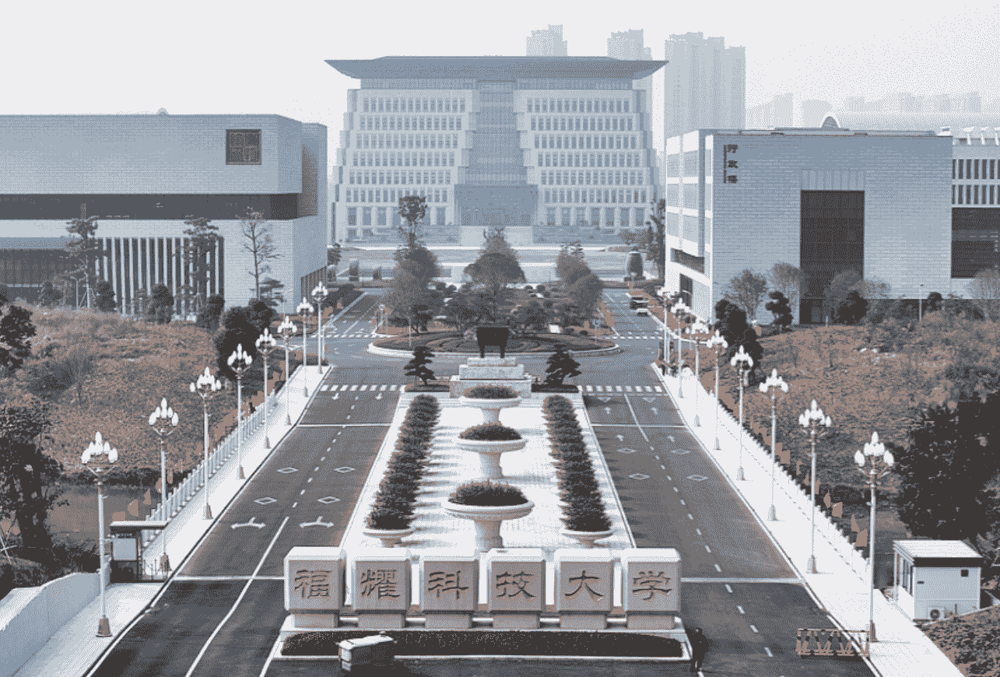
CAIXIN|听文章
近日，备受关注的福建福耀科技大学获批设立。该校由知名企业家曹德旺发起，河仁慈善基金会首期捐资100亿元筹办。首任校长为教育家王树国教授。首批设置计算机科学与技术、智能制造工程、车辆工程、材料科学与工程等4个普通本科专业，实行本硕博贯通的培养模式，招生规模暂定为8000人。福耀科技大学为民办普通本科学校，其成立是近年来民办高校发展的标杆性事件，各界乐见其成。

福耀科技大学定位为新型研究型大学，突出理工和科技，着重开展制造业科技创新研究。4年前，曹德旺接受财新传媒采访时明确表示：“我不是想让中国多一所大学，我是想探索一条教育改革之路。”此后，他又多次提及这一初衷。而首任校长王树国，亦曾多次提及福耀科技大学与众不同的教学理念。无论是治校理念、课程设置、教学方式和治理体制，校方都有志创新。它究竟新在何处？

福耀科技大学承载了一代企业家和教育家的办学之梦。中国经济社会加速发展，全球科学技术一日千里，高校怎样培养符合时代需求的人才，成为无法回避的重大紧迫的课题。曹德旺办学的缘起，一个重要方面就是要解决制造业人才短缺、新兴企业招不到人、招来的学生无法直接用等现实难题。这些问题必然影响中国的高质量发展，尤其是制造业的后劲。

应该承认，中国民办高校的质量逊于当初设想。多年来，民办高校走的是“规模优先”和“以学养学”的路径，把民办高等教育办成了产业而非事业。在营利压力下，虽然民办高校在校人数占高校总人数近三成，但是，无论是毕业生质量，还是教学科研水平，均未达到社会期望。

福耀科技大学是个充满希望的新起点，具备多种有利条件。除了曹德旺等创办者的社会影响力，教育部门和地方政府大力支持，使得该校建设可以迅速铺开。民办一流高校能否建成，说到底还是取决于供给和需求两个方面。需求自不待言，创新型国家建设、制造强国战略，无不在呼唤新型人才，关键看供给能否跟得上。从这个方面讲，福耀科技大学责任大、使命重。这也需要尽可能为一切有志于为中国高等教育蹚新路的高校创造有利条件。

以基金会形式提供的充足资金，在可预见的将来为福耀科技大学解除了后顾之忧，但是，能否实现建校的雄心，还是取决于其法人治理结构。有专家认为，民办高校理想的状态是实现党委领导、董事会决策、校长负责、教授治学、监事会监督，并保障教职工参与学校民主管理。具体而言，大到科层管理与教学科研自主灵活的融合，尤其是对教师的考核激励，小到课题申报审批程序和报销制度，无不影响办学的综合水平。在福耀科技大学，课程设置追踪科技前沿，各专业打通，本硕博可连读、亦可“中途下车”。但是，是探索，就难免遇到难题。说到底，要尊重高等教育规律，让真正懂行的人操盘。名人效应是难得的，然而，要有健全的治理体制，才可能确保基业长青。

创办一流民办大学，有助于促进中国高等教育改革。自由开放的学术氛围，充满理想与活力的教学科研，离不开外部的包容和理解。目前来看，主管部门和地方政府对福耀科技大学的创办给予了大力支持。公众期待，今后学校建设遇到种种困难，甚至不乏争议之时，各界也能一如既往地珍视这块试验田，以包容之心视之，以开明之姿待之。对福耀科技大学等民办高校，要在《民办教育促进法》等法律法规的指引下，切实保证其办学自主权和各种权益。

福耀科技大学的创办还可能为企业家提供一条回报社会的新路径。多年来，曹德旺积极捐资助款，通过各种途径从事公益。如果福耀科技大学取得突破，也会为其他有志于回报社会的企业家所效仿，毕竟，与捐赠一座高校大楼相比，办一所高校的影响和意义更为直接

和深远。与此前获批的西湖大学一道，福耀科技大学还可能为非营利性、基金会模式运作的高校的生存和发展积累可贵经验。不少企业家其实是有办学情怀的，公众号懒人搜索，懒人专属群分享。

90多年前，清华大学校长梅贻琦道出名言：“所谓大学者，非谓有大楼之谓也，有大师之谓也。”在新世纪的当下，中国高等教育亟待破局之时，我们不妨对“大师”作广义理解：它既指学术巨擘，也指有情怀、把办学看作志业的企业家，还指具有远见卓识、对其鼎力支持的干部。但愿福耀科技大学的创办会带来中国民办高等教育的新局面。■

## 相关视频：
## 【财新时间】曹德旺：不能用“寒冬”形容中国制造业
视频说明：2017年3月，财新视频专访福耀集团董事长曹德旺。
公众号懒人搜索，懒人专属群分享

## 最新封面报道|机器人来了
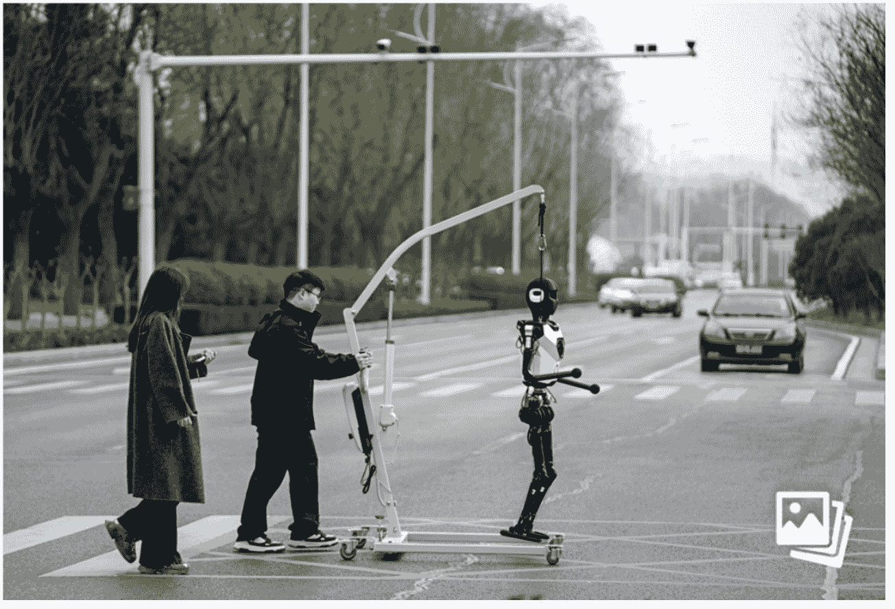
CAIXIN|听文章
文|财新周刊 杜知航 深圳，包云红 上海，刘沛林 美国圣何塞

高楼林立的深圳市南山区，聚集着中国最多、最老牌的机器人公司。这里有“人形机器人第一股”优必选（09880.HK），会做前空翻机器人的众擎，送餐机器人公司普渡和仿人脸机器人公司数字华夏，以及做触觉传感器的戴盟和帕西尼等公司。它们有的在某个写字楼占据数层，有的只是租住几间小房子，但所有公司都会有一间实验室，给机器人行走、跳跃等留够空间。

蛇年春节后，南山区组织了“企业风采嘉年华”晚会，八家机器人公司上台亮相，公司负责人积极接受媒体采访拍摄。会后，“深圳具身智能八大金刚”的说法不胫而走。

“具身智能”是过去两年人工智能（AI）和投资领域的热词。“具身”突出了人体形态，核心在于机器人基于类人的物理身体，在环境中进行适应性的感知与智能行动，以别于过去数十年应用于工业场景的机械臂等机器人。具身智能强调“小脑”的运动协调能力，以及“大脑”的视觉、语言和动作的泛化和交互能力。

2025年3月10日，数字华夏实验室，软件与服务中心总经理陈军民和机器人“交流”。图：杜知航

南山区这场机器人做主角的晚会，像是对蛇年春晚的呼应。一个多月前，杭州企业宇树科技的人形机器人登上了春晚舞台，身着花棉袄、转起红手绢，和真人舞蹈演员整齐划一地扭东北秧歌。这个节目很快科普了机器人舞蹈动作背后技术突破的深意，引起业内外、海内外的强烈关注。

2025年3月10日，众擎的机器人实验室，工作人员正在整理零部件。图：杜知航

几乎同一时间，杭州AI大模型公司DeepSeek火爆全球，掀起新一轮AI算力和应用市场的重构与竞争。很快，DeepSeek和宇树科技，此前因3A游戏《黑神话:悟空》走红的游戏科学公司,工业机器人公司云深处、脑机接口公司强脑科技,以及空间智能SaaS(软件及服务)公司群核智能,被市场冠以“杭州六小龙”之称,概括了目前科技行业较为前沿的几大技术应用方向。

2025年3月1日,浙江宁波前湾新区,数十台优必选工业人形机器人在极氪5G智慧工厂,开展全球首例多台多场景多任务工业人形机器人大规模实训。

“杭州‘出圈’之后,深圳也急于展示。”深圳一家机器人公司人士告诉财新,春节后,各级政府谈话调研、记者采访、网红拍摄,令他所在的公司应接不暇。很快,又有多家机器人公司被政府纳入扶持视野,坊间又诞生了深圳机器人公司“十三太保”的新说法。

机器人公司瞬间变得炙手可热。2024年7月成立的伯牙智能,主做机器人的“灵巧手”,这一部件是目前人形机器人的一大难点,全球范围尚未有能真正达到人类水平抓握,搬运不同轻重、软硬物体的灵巧手。这家注册在深圳的公司仅有不足10名工作人员,目前均在深圳办公。伯牙智能首席执行官(CEO)刘欣对财新提到,春节后,深圳、北京的有关部门和投资基金纷纷前来接洽,公司尚未决定下一步再布局何处。

在国际投行高盛的“人形机器人100强股票名单”中,52%的公司正在涉足人形机器人领域,其余48%的公司或将涉足,或是产业上的竞争对手。高盛调查显示,在已确认涉足人形机器人的上市公司中,有73%位于亚洲,且有56%位于中国。高盛调查者常听到投资者抱怨,除了特斯拉和英伟达，缺乏西方公司来充实他们的人形机器人投资组合。

2025年3月9日，广东省揭阳市，普宁星河明珠湾别墅项目发布会，引入宇树人形机器人、智能机器狗及COSPLAY机械姬担任“AI向导”。

2024年以来，杭州、北京、上海、深圳等地都有出台支持AI、机器人等科技产业的新政策。杭州给出额外25%、最高500万元的科研任务资金补助；北京设立总规模1000亿元、存续期15年的政府投资基金；广东省可以分别给机器人和AI创新中心最高5000万元、1000万元的资金支持；深圳则给出了具身智能的未来产业规模预期：到2027年，本地新增培育估值过百亿元企业10家以上、营收超10亿元企业20家以上，实现十亿级应用场景落地50个以上，关联产业规模达到1000亿元以上，具身智能机器人产业集群相关企业超过1200家。上海、南京、重庆等地也先后推出了扶持政策。

伴随着各地对人工智能和具身智能产业的重视提高，优势企业将更受欢迎。在2025年3月的全国两会上，具身智能作为未来产业，同生物制造、量子科技和6G并列进入政府工作报告。

政策鼎力支持、企业争先涌现，具身智能概念股已经火了一段时间的资本市场，相关热度进一步蹿升。据高工产研储能研究所不完全统计，2025年前两个月，中国具身智能机器人投融资交易达成27起，规模达44.5亿元。而据财新不完全统计，2024年这一领域的融资规模约在50亿元，这意味着刚开年，具身智能领域拿到的钱已接近去年全年。

泰合资本具身智能赛道负责人涂丹凝向财新回忆，2022年底，OpenAI推出ChatGPT，语言/多模态大模型让机器人有了通识的可能性。“人形机器人是一个足够复杂也有足够想象力的AI-Native（AI作为核心技术驱动）的硬件，符合大家对AGI（通用人工智能）的憧憬。"

不少资本市场人士认为，在AI、机器人技术上，中国和美国站在同一起跑线；但就机器人制造而言，中国具备更强大的产业化能力。诸多行业人士对财新判断，当前，机器人的硬件和小脑运动能力、软件和大脑智能程度都已出现拐点；而且部分公司的机器人整机已进入规模生产状态，2025年将会是“机器人量产元年”。

野村中国科技及电讯行业分析师段冰向财新指出，中国制造的产业优势适合于发展人形机器人这样软硬结合的产业。“美国在0到1的理论创新方面有优势，但中国擅长把软件算法工程化做到极致，并具有大规模制造的优势，人形机器人正好是这两个特点相结合的产业。"

不过，目前市场对机器人量产的定义尚无共识，诸多机器人公司认为产销百台人形机器人即可算量产。此外，机器人的大脑仍未攻破从视觉、语言到自主动作的关卡，相比语言类大模型拥有巨量可训练的数据，机器人的大脑仍需要更多动作数据参与训练。

英伟达负责Omniverse仿真平台、物理AI（Physical AI）的副总裁Rev Lebaredian告诉财新，英伟达推出的Cosmos世界模型目前还仅相当于对应大语言模型GPT-1的阶段，“直到GPT-3，ChatGPT才真正变得对大众有意义，而真实物理世界远比自然语言的规则复杂”。

但二级市场的产业链公司已经迎来一波波追捧。年初以来，和宇树科技有合作的长盛轴承（300718.SZ）、中大力德（002896.SZ）、双林股份（300100.SZ）股价分别增长超过189%、140%、79%；同期，其他“人形机器人概念股”绿的谐波（688017.SH）、三花智控（002050.SZ）、拓普集团（601689.SH）、鸣志电器（603728.SH）、兆威机电（003021.SZ）等公司的涨幅均超过30%。长盛轴承2月18日公告称，和宇树科技签订合作协议并取得订单，尽管该类产品仅为小批量生产销售，在其主营业务收入占比不足1%，但第二天股价直接20%封板。

### 吸金“大风口”
产业投行光源资本合伙人娄洋认为，机器人赛道将是市场规模“十倍于新能源汽车”的一个“大风口”。他对财新描摹：“很多家庭都会配备2—3个人形机器人，这样的未来是可预见的。”

娄洋称，春节后具身智能的投融资热度大超预期，达到了新高度。“节后，众多投资人纷纷主动与我们对接项目，还有一些投资人与企业深入交流了一次，就迅速给了投资意向书（TS）。不仅如此，一些其他行业的龙头企业掌舵人也亲自出马，与公司创始人就场景合作深入探讨。这充分显示出市场对具身智能的高度关注和强烈的投资意愿。”

近月来，具身智能领域的融资事件也十分密集。2024年11月，银河通用宣布完成5亿元融资，整体估值超5亿美元。该公司2023年5月成立，两次融资共计12亿元，是该行业之最。

12月，做具身智能系统及相关工具与平台的穹彻智能（Noematrix）宣布完成数亿元Pre-A+轮融资。穹彻智能是机器人公司非夕科技孵化的项目。2016年，四名斯坦福大学博士创立非夕科技，主攻仿人机械臂，落地在工业场景，很快获得资本青睐，2022年估值超过10亿美元，2023年11月成立穹彻智能，一年时间就融资了三次。

与此同时，2024年1月成立的魔法原子完成了1.5亿元天使轮融资，其公司的机器人小麦开始在工厂产线作业训练，包括产品检测、物料搬运、零件取放、扫码入库。

2025年1月7日，通用人形机器人公司傅利叶宣布完成新一轮融资，E系列融资合计近8亿元。3月17日，公司最新一代机器人GR-2在上海世纪公园环湖演示，并推出正在研发中的内测机。3月6日，初创公司智平方宣布完成数亿元Pre-A+轮融资；同日，成立于2023年、主要关注机器人下半身能力的逐际动力（LimX Dynamics）宣布完成A+轮融资，半年累计完成5亿元A轮系列融资。而在二级市场，激光雷达公司速腾聚创（02498.HK）于2月26日宣布配售新股募资约10亿港元，其中70%用于机器人业务研发。

诸多成立两年不到的公司，正在尽一切可能趁热吸金、增厚“资金垫”。

2025年以来，资本开始向头部公司聚集。“头部的虹吸效应很大。”云岫资本董事、智能产业组负责人季凯明告诉财新，两年内，一些初创公司估值从几亿元“三级跳”到几十亿元。“机器人产业的资本周期比较长，技术路线不确定，落地应用也还不够确定。如果周期是3年到5年甚至10年，企业手上‘囤粮’越多，未来越能接受不确定性的挑战。”

季凯明总结了近年这一领域投资风向的变化，早期投资已从宇树科技这样的机器人本体公司转向软件或系统技术方向：“去年开始，操作和运动控制能力成为技术难点，因此资本看重‘小脑’技术；今年，伴随着海外一些视觉动作语言相关大模型的研究进展，资本开始重点关注做‘大脑’的公司。”

多名私募市场投资人总结，按估值计，目前初创公司已现分化，第一梯队包括银河通用、宇树和智元，它们的估值均达10亿美元（约合70亿元人民币）以上。2016年成立的宇树科技，从四足机器人转型人形机器人，因为登上春晚舞台一炮走红，目前在私募股权市场已“有价无市”。财新获得的一份宇树科技2024年融资材料显示，公司成立两年，累计融资超过2亿美元，累计出货几千台。

目前或年内估值达到3亿至5亿美元的公司，被归入第二梯队，包括云深处、众擎和逐际动力等开始发售产品的偏硬件公司；智平方、自变量、星尘智能等公司，则重点研发视觉动作大模型等“大脑”技术。不过，市场对这些公司的“梯队”归属或未来走势的判断也不尽相同。

近两年成立的初创团队大体分为三类，一是高校实验室教授和学生；二是自动驾驶公司的从业者，因为技术上和机器人的相近性，自动驾驶热潮退却后转型进入具身智能领域，被部分投资者戏称为“自动驾驶难民”；此外还有二级市场的供应链公司，新开辟出人形机器人产线，例如主业为激光雷达的速腾聚创和生产机械臂、电子皮肤的越疆科技（02432.HK）。

云启资本合伙人陈昱并不偏好“学院派”，他担心学术研究者过于执着某一技术路线，难以在行业快速收敛到更可行的技术路线时切换方向。在他看来，现阶段具身智能软硬件的入局门槛不高，很多公司在做低水平竞争，单个企业的融资额普遍不高。

热潮之下，也有不少投资人冷静看待公司自身的营收能力，考察是否有稳定的产品落地。不过另一边，企业在呼吁耐心资本。魔法原子总裁吴长征直言，当前阶段需要资本有一定的耐心，甚至是一定的爱心。云深处销售负责人葛永乐则称，机器人行业需要长期投入，短期很难见到经济效果，云深处也希望选择有产业背景、能一起长期走下去的资本。

“今天大家还处在一个极其美好的时刻。”一名投资人对财新说，当下，虽然无法证明人形机器人的真实可用性，但也还无法证伪。另一名一级市场投资人也表示，市场是有泡沫的，但泡沫的背后是期待，投资人愿意为这样的期待给出高估值。

### 国资和“大厂”入局
伴随着地方政策扶持、产业基金竞相投资，头部机器人公司开始以各种方式多地开花。

3月12日，优必选联合北京人形机器人创新中心发布全尺寸科研教育人形机器人“天工行者”，这是优必选首次公开发售机器人。

优必选2012年成立，2016年、2018年、2019年和2021年，其研发生产的机器狗和机器人先后四次登上春晚舞台，也一度成为私募市场的热门投资标的，但其主营收入长期来自教育板块而非机器人业务，也曾引发争议。该公司于2023年12月在港股上市，北京亦庄国际投资基金是上市前的基石投资者之一。

优必选首席品牌负责人谭旻对财新介绍，优必选工业版人形机器人目前已进入富士康深圳和郑州工厂、比亚迪长沙工厂、极氪宁波工厂、东风柳汽柳州工厂、北汽北京工厂、一汽—奥迪长春工厂、一汽大众青岛工厂等场地实训。

多地部署的机器人公司并不罕见。在新一批机器人明星公司中，银河通用是北京的代表公司，其人形机器人可以扫描抓握并搬运各类大小件物品。该公司认为，北京的机器人产业基金以及相关政策布局较早且具备人才优势；深圳有硬件、供应链等优势，因此银河通用在深圳和苏州等城市都开办了分公司，这些布局往往伴随着地方融资。目前，上汽集团恒旭资本、香港投资管理公司（HKIC）、上海人工智能产业基金、北京机器人产业基金和深创投都是银河通用的股东。银河通用产品总监朱辉对财新称，该公司后续将在香港开展布局。

深圳“八大金刚”之一智平方，也在深圳和北京都有办公室，创始人频繁两头跑。数字华夏总部在深圳，但供应链更多在“长三角”，一支研发团队也在上海。众擎虽是深圳公司，但因此前融资有合肥支持，所以在合肥设立了分公司，机器人组装业务也放在了合肥。

和诸多科技产业的地理分布类似，京津冀、“长三角”和“珠三角”是机器人公司的主要聚集地。华兴资本投资银行事业部合伙人徐锟向财新分析，北京在清华、北大等优秀高校的人才基础上，在底层的大模型算法领域极具优势；上海、杭州等“长三角”地区则具有优良的先进制造环境；而“珠三角”背靠手机和汽车主机厂，聚集了强大的机器人供应链。中国机器人在地理布局上，因而拥有诸多的选择空间。

各地大力投入，积极吸引新兴产业公司入驻，带动地方经济转型升级；机器人公司则开始注重引入大型科技公司助力发展。2024年9月，华为在深圳启动全球具身智能产业创新中心，11月签约合作了自变量机器人、数字华夏深圳科技和浙江强脑科技等16家企业；同年11月，新能源造车新势力公司小鹏汽车发布了小鹏机器人Iron，现已进入工厂实训，目标在2026年量产。

2025年3月，美的集团成立了人形机器人创新中心，推出了人形机器人样机，能听懂语音指令、完成跳舞等动作。2017年，美的通过收购德国机器人公司库卡布局工业机器人。

互联网大厂中，腾讯最早入局机器人行业，此前已推出五代机器人。腾讯董事会主席马化腾在3月19日的财报会上透露，2024年腾讯的机器人实验室Robotics X调整了研究方向，主攻擅长的云、大数据等：“腾讯希望成为所有机器人厂商的合作伙伴，而不是取而代之做硬件。”

"人形机器人技术还未收敛跑通，下一步，大公司将是具身智能产业的真正变量。"首程资本总裁叶芊提到，首程控股通过其管理的北京机器人产业发展投资基金，已投资宇树科技、银河通用及星海图等公司，也在看新的公司，期待创业公司在各细分赛道跑出赢家。

小米曾在2022年发布仿人机器人CyberOne，此后一直未量产。一位长期研究机器人领域的投资人对财新提到，小米在销售渠道、品牌能力、供应链及资金上都具备优势，比如即便很晚入局汽车，仍能获得成功："不难想象，再过五年，小米的店里可能开售人形机器人。"

### 技术拐点初现

蛇年春晚上，十多个宇树机器人玩转手帕，手帕的抛起、落下或旋转，以及机器人上半身手臂旋转的同时保持下半身平衡，每一个动作细节都需要算法精准控制。

一家规模较大的具身智能公司告诉财新，做到宇树那样抛手帕，需要团队停下别的工作，专注研发三到四个月。在硬件上，转手帕需要人的手指、手腕和手臂等部位精准的力度控制和繁多自由度，这展现了宇树在电机等关键零部件上的功力。

宇树之后，越来越多的中国机器人公司开始“竞技”：众擎机器人表演前空翻、斧头舞，宇树机器人则以功夫和侧空翻迎战。机器人“小脑”公司娇界数物CEO尚阳星指出，目前机器人在运动控制方面的技术路径已比较清晰，迭代极快，“去年大家还在拼走路，今年已经开始做跳舞。”

尚阳星说，对于一台未经调试的人形机器人，娇界数物最快一周能完成模型训练，让它走起路来。该公司主要为机器人本体公司训练走路、跳舞等运动控制模型，经过数十次到上百次磨合调整参数，最终根据运动的复杂程度将源代码定价交付给机器人公司。2024年8月，世界机器人大会（WRC）共有27家人形机器人厂商参展，娇界数物服务了其中11家。

尚阳星期望，在硬件方面，随着制造者技术的提升，人形机器人从关节模组到骨骼再到外壳，越来越多零部件趋于标品化。未来，组装一个机器人就像组装一台电脑一样简单，每个人都有自己专属的机器人。娇界数物正尝试从卖源代码，转向订阅制。

走路、跳舞的机器人被市场称为“大玩具”，一般由人操控和提前植入代码。涂丹凝表示，现阶段的人形机器人手部操作能力类似三四岁的小孩，开始展现出部分泛化能力，但远未达到成年人的操作、工作能力。吴长征也提到，目前人形机器人因为泛化能力还不强，只能做单一或少量的工序，只是在很局限的范围内“有用”。

机器人要想和外界交互，AI大模型接入势在必行。2月，美国人形机器人公司Figure发布通用视觉—语言—行动（VLA）模型Helix，能够理解语言和动作，由这个模型控制的机器人号称能“拿起任何物件”。Figure展示了两台机器人的长时间交互和协同：左边的机器人面前有一袋奶酪丝，应该放在右边的冰箱，于是左边的机器人拿起奶酪丝，交给右边的机器人，由右边的机器人放到冰箱里。Helix两个模型的语言模型参数只有8000万，而负责运动的模型参数也只有70亿，通过视觉理解动作并制定接下来的动作。目前，最先进的AI大语言模型的参数已经高达上千亿。Figure称，Helix体量小、能耗低，能立即投入商用。

中国的机器人公司也在开发类似的模型。3月10日，智元机器人（AgiBot）发布通用具身基座模型——智元启元大模型（GenieOperator-1），模型基于Vision-Language-Latent-Action（视觉—语言—隐藏—动作，ViLLA）框架，由VLM（多模态大模型）和MoE（混合专家）组成。其中，VLM借助海量互联网图文数据，获得通用场景感知和语言理解能力；MoE则提供两种能力，借助大量机器人和人类操作数据获得通用的动作理解能力，再借助百万真机数据获得精细的动作执行能力。

上述两家模型在技术流派上被称为“分层”模型；另一类模型则是端到端大模型，能以一个大模型直接实现从人类指令到机械臂执行，即输入图像及文本指令，输出夹爪等末端动作。

银河通用、智平方和星尘智能等公司即是这一路线。1月9日，银河通用发布端到端具身抓取基础大模型GraspVLA，通过10亿帧“视觉—语言—动作”的数据预训练；模型具有七类泛化能力；而针对特别需求，后训练仅需小样本学习即可迁移基础能力到特定场景。

目前，训练机器人模型缺乏数据。高盛报告指出，大语言模型可以依赖互联网中大规模存在的视频、图像、文本数据，而机器人AI模型所需的重要物理数据，如力、扭矩、运动数据等仍然稀缺。中泰证券指出，为了训练Optimus（擎天柱）机器人执行类人动作，特斯拉大量招募“数据收集操作员”，要求其穿戴动作捕捉服、VR（虚拟现实）头显等设备，模拟机器人需完成的动作（如行走、搬运物品）。波士顿动力Atlas的训练过程则融合了多个数据来源，包括真实工厂部署数据、实验室测试数据以及仿真环境的模拟数据。

2024年，智元机器人在上海建设数据采集工厂，两个多月采集超百万量级真机数据集，采集任务超1000种。现在智元数据采集工厂投放了近百台机器人，日均采集3万—5万条数据。到2024年底，智元推出数据集AgiBotWorld，包含超过100万条轨迹、217个任务、五大场景数据。不过智元坦承，高质量、带动作标签的真机数据量仍然有限，远少于互联网规模的数据集，因此在最新推出的启元大模型上做数据建模推演，也用人类演示的视频作学习资料。

在优必选的模型训练中，初期80%的数据由人形机器人在实际场景中通过实训收集，另外20%的数据则在仿真环境下生成。

目前，缺少足够的真实数据仍是机器人提高智能水平的最大瓶颈。美国机器人创业公司Ambi Robotics联合创始人Ken Goldberg指出，大语言模型Qwen-2.5的训练数据量相当于真人收集12亿个小时，而具身智能模型π0一年收集的训练数据量仅为1万小时左右，这意味着具身智能模型若想达到大语言模型的智能程度，以现在的方式、速度收集数据，还需要12万年。

为了让各类机器人大模型有数据可用，上海、北京、深圳均推出创新中心，为创业公司提供数据支持。北京市经信局副局长苏国斌介绍，北京创新中心自研的“天工”全尺寸通用机器人母平台已面向企业、高校和科研院所开源；业内首个高质量数据集RoboMIND，也于2024年底开源发布，包含5类场景279项任务的10万条真机操作数据。

### 是否抵达量产拐点？

具身智能的软硬件条件处于加快成熟的“勃发”状态，一众公司开始探索产品量产和应用落地，因而2025年被一些市场人士视为“人形机器人量产元年”。

2025年1月，特斯拉CEO马斯克称，2025年的目标是制造数千台擎天柱，2026年特斯拉人形机器人产量将增加10倍，即5万—10万个人形机器人；2027年再提升10倍，至50万—100万个人形机器人。

OpenAI参投的人形机器人公司1X和Figure AI的产品也陆续取得进展。2024年12月，Figure AI宣称已向付费客户商业化交付了第一批Figure 02机器人并开始工作；2025年1月，Figure AI的CEO Brett Adcock又称计划未来4年交付10万台人形机器人；1X也宣布在其总部挪威开发人形机器人的产线。

在国内，优必选宣布获得了车厂超500台人形机器人订单，预计2025年订单将达1000—2000台；智元机器人也宣布量产超千台，计划2025年扩大销售，全年目标为3000—5000台；宇树科技的人形机器人海外市场销量已破千台。

量产和下游应用落地及需求密切相关。目前，技术成熟的机器狗即四足机器人的落地场景较多，部分已经商用，比如应用于消费、物流、科研等行业领域。

宇树和云深处创业初期都主攻机器狗，宇树是全球最早一批实现四足机器人商业化的公司之一。高工机器人产业研究所调研数据显示，宇树2023年在全球四足机器人市场销售份额69.75%。

宇树科技创始人王兴兴2024年2月接受财新采访时透露，他十多年前就制作过人形机器人，但公司成立初期并不看好人形机器人赛道，原因在于传统的机器人控制技术和算法难以满足人形机器人对超多自由度和复杂系统控制稳定性的要求。但大模型发展推动AI行业步入一轮跨越式发展，也改变了王兴兴的看法。2023年宇树切入人形机器人赛道，8月推出首款人形机器人，他当时认为，人形机器人已步入四足机器人六七年前所处的阶段，不过公司未来数年收入还要靠四足机器人。

葛永乐则指出，目前四足机器人比人形机器人落地更容易，比如在危险、恶劣、复杂场景中替代人完成工作和任务。目前云深处的机器人主要在电站、工厂、管廊巡检以及应急救援等环境中落地应用。在机器人工业巡检领域，云深处的市占率超过85%，但市场缺乏关于巡检机器人具体数量的统计。

相比四足机器人的广泛应用，人形机器人落地的形式，更多是“进厂打螺丝”这类场景，自动化程度最高的汽车工厂是各家首选的落地目标。

2024年10月，优必选发布工业人形机器人Walker S1，先后进入东风柳汽、[吉利汽车](https://www.93.cn/shareinfo/522863)、[一汽—大众青岛分公司](https://www.93.cn/shareinfo/522863)、[奥迪一汽](https://www.93.cn/shareinfo/522863)、比亚迪、北汽新能源、富士康和顺丰等多家企业实训，自称是全球进入最多工厂实训的人形机器人。优必选认为，智能化工厂是半标准化的场景，且有大量智能化数据沉淀，干扰更小，因此往往是人形机器人落地的第一站。

3月3日，优必选宣布在吉利旗下极氪汽车的5G智慧工厂开展全球首例多台、多场景、多任务的人形机器人协同实训。视频中优必选多台机器人并排分拣物品，机器人之间还有交互：两个优必选机器人协同将一个大箱子放在架子上，还有两个机器人递接贴纸等，最后还有一个机器人给另一个机器人充电。

谭旻认为，多台协作的人形机器人可以通过群脑网络互联互通，以人形机器人集群作为智能载体，探索通过机器人的群体行为与外部环境的密集交互，从而进化出高阶具身智能。工厂里，要搬运大负载、大尺寸的工件，因为负载分布不均、运动轨迹复杂及动态环境适应等问题，就需要协同控制多台机器人，“可以理解为十几个机器人共用一个大脑，信息互通，可以实现全局地图并实现‘群建群享’”。

相比汽车工厂需要机器人，机器人更需要汽车工厂。银河通用则和新能源汽车供应链企业天奇股份设立合资公司，也在和奔驰、极氪合作落地机器人进厂。朱辉指出，现阶段机器人进工厂更多是测试和POC（验证）：“工厂对机器人的稳定性要求高，因此需要工厂贡献出一定的训练空间。当然如果与工厂有投融资股权关系，会成为机器人进工厂更好的助力。”

戴盟的产品进入了深圳某上市制造企业的产线训练。戴盟创始人段江哗对财新提到，公司擅长做机器人触觉传感器，可以用在灵巧手上，能感知高精度的丰富信息，增强灵巧手的末端感知。因此，公司也在和深圳的生物实验室合作，训练灵巧手捏试管等易碎器材。

目前，机器人的手能力是各家都想通过进厂实训完善的重点。伯牙智能拿到了蔚来汽车的工厂以及菜鸟物流分拣和数字化工厂等试点的机会。“虽然还在找标杆项目落地，但是灵巧手最终仍需要真实工厂数据提供专业知识。”刘欣举例，大模型目前能识别瓶盖，但还不知道具体怎么拧瓶盖，“这些专业知识都需要进厂学习训练。”

机器人就成本而言，距离替代人类尚有很长的距离。东吴证券研报指出，在汽车工厂的场景中，人形机器人放量初期一台成本平均为40万元左右，3台人形机器人才能替代一个人类工位，回本周期长达7年；而若单台成本下降至12万元左右，1台就能替代一个工位，回本周期可大幅缩短至0.7年，人形机器人的经济性才能凸显。

进厂之外，会跳舞的机器人可以直接面向消费者售卖，但价格无疑是机器人进入消费级市场的关键。

宇树从2024年5月开始销售单价9.9万元的机器人。众擎则在2024年10月发布面向工业与家庭场景的全尺寸通用人形机器人SE01；又在12月发布面向科研教育场景的开放型人形机器人PM01，单台售价8.8万元，预计在2025年二季度首批交付。

优必选最新发布的“天工行者”售价29.9万元，已开放预订，二季度开始交付，首批订户来自企业，比如家居公司居然之家宣布在2025年底前采购部署500台优必选仿真人形机器人用在零售门店，自己使用的同时也帮助售卖，目标是1万台。很快，越疆机器人推出Dobot Atom，售价19.9万元起，自称为全球首款具备灵巧操作和直膝行走功能的机器人。

仿真人脸机器人公司数字华夏的机器人当前售价达80万元，光是带仿真人脸的一个机器人头就标价20万元，人脸背后是29个控制表情的电机。

数字华夏公共关系总监吴为对财新介绍，公司正从产业链着手快速降本，例如目前一张硅胶脸皮3万元，今年量产后期能降低至200元；伴随着定价下移，预期公司年内收入将从千万元级别跨入亿元级。

目前，机器人的主要客户是科研院所，而非普通消费者。而最终售价也远非机器人本体价格。宇树9.9万元的机器人要动起来，还需购买配套软件，最终销售给科研院校的价格可能达二三十万元。

“我只希望行业别急着打价格战。”初创灵巧手公司星际光年CEO位德浩对财新说，一个产品打价格战应是在技术收敛之时，而在具身智能领域，大家都还在探索场景，整个行业的“蛋糕”都还小，此时打价格战只能是内耗。他希望同行们能专注于技术，追求具身智能的上限，把机器人做到能用、把市场规模做大。

高盛预计，到2027/2032年，全球人形机器人出货量将达7.6万/50.2万台，会慢于市场预期。人形机器人需要满足几个条件才能达到量产拐点：首先是解决多个通用任务。通用性是具身智能机器人和传统工业机器人的关键区别，具身智能机器人至少需要在5—10个通用任务上具备熟练能力，才能推动大规模应用；其次是高成功率和持续稳健性，这对商业化至关重要；再者是快速推理，高效的推理能力和快速反应，能显著提升具身智能机器人的工作效率和用户交互体验。公众号懒人搜索，懒人专属群分享。

### 供应链加速降本

机器人量产需求带动了相关上游的研发投入和制造生产。激光雷达公司速腾就转入了机器人灵巧手研发生产。速腾聚创市场部总监谢闻指出，激光雷达产线很大程度上能复用到灵巧手上：“激光雷达跟着汽车产业走，产业形态被汽车产业重塑，灵巧手则会跟着它服务的行业演进，目前尚未定型。”

包括速腾在内，大量机器人公司的上游是成熟的制造业供应链，多为上市公司，由此形成了“虽然不造机器人，但为机器人供应零部件”的所谓具身智能概念股板块。

从2024年开始，这些公司股价几经起落，总体向上攀升。“2024上半年之前，A股主要看特斯拉人形机器人Optimus（擎天柱）；2024年下半年开始，市场看华为布局人形机器人的带动效应，宇树、智元等头部创业公司的供应商备受关注。”一名券商分析师向财新指出，此前市场关心的是巨头下场提前卡位的机会，而今年以来整机厂陆续公布量产计划，2025年是人形机器人“量产元年”的预期急剧升温。特斯拉的一举一动都被市场聚焦，2024年下半年其人形机器人量产不及预期，一度导致相关概念板块“熄火”，个股大幅回调。

整机厂量产带动的是上游数千亿元规模的市场。以目前特斯拉人形机器人价值占比较高的执行器总成环节为例，根据东吴证券计算，单个擎天柱机器人需要使用28个执行器，每个执行器价值为3000元，100万台人形机器人对应的就是840亿元的执行器市场规模，而特斯拉汽车的一级供应商拓普集团和三花智控，已配合特斯拉布局了执行器产品，拓普集团甚至在墨西哥设立了子公司生产机器人执行器。

在机器人的一些核心零件环节，更多国内供应商入局，不仅实现了国产技术突破，更是大幅降低了零部件成本。例如人形机器人传动结构的关键零件——减速器，国产减速器已开始替代日系厂商。

东方证券研报数据显示，2021年哈默纳科、新宝两家日系厂商在国内谐波减速器的市场份额为42.9%，而2024年上半年这一数字降至41.6%，下降1.3个百分点；在应用市场更大的工业机器人用的RV减速器市场，纳博特斯克、住友两家日系厂商的市场份额，从2022年的55%降至2023年的44%。

再如线性执行器中的行星滚柱丝杠，此前由于生产工艺复杂、进口磨床生产设备贵而难以量产。

“2023年业内还觉得做行星滚柱丝杠是非常难的事情，但现在也被中国供应商解决。”中信建投证券机械首席分析师吕娟称，单件行星滚柱丝杠的报价一度高达1.5万美元，但目前仅为千元左右。

类似例子在人形机器人所需的电机、谐波减速器等核心部件上比比皆是：“随着中国供应商参与，三年前很多核心环节现在已经不是壁垒了，整个供应链都在迅速成熟，供应链价格降低的速度远远超过预期。”吕娟说。

根据东吴证券测算，2022年全球和国内的滚柱丝杠市场规模分别为85亿元和4.4亿元，当中国人形机器人产量达到100万台时，国内滚柱丝杠市场规模就将达到135.6亿元。国内主营汽车零部件、机械等业务的公司，依托技术同源性，还在不断涌入像丝杠这样的细分领域。东吴证券称，2025年的人形机器人产业堪比2014年的电动车产业，随着国内量产的开始，即将开启10年的大周期。

下游的量产需求高度依赖成本控制，并传导压力至整条供应链。以特斯拉人形机器人2万美元的售价目地标来看，供应链硬件成本需控制在1万美元之内，即单个零部件均价需控制在数百元的水平，距离目前千元左右水平还有很大距离。

目前，国内供应链公司大多没有实现人形机器人的规模化收入，头部供应商也还处于向整机厂送样的阶段，收入不过百万元级别，但有些“人形机器人概念股”的市盈率已过百倍，游资炒作痕迹明显。

吕娟指出，相比机器人对精密度要求高，人形机器人供应商的技术壁垒更低，未来盈利逻辑更贴近汽车供应商，技术水平不高但市场空间大。“人形机器人零部件技术上的壁垒比工业机器人弱很多，供应商最后拼的还是改进产线、设备，在同等报价下确保利润率的能力。”她认为，即便一些汽车供应商巨头刚入局人形机器人、下场晚，但凭借规模制造的经验，更易占据一席之地。■

## 封面报道之二 | 人形机器人的科学难题

相关视频：

## 盘点跻身各行各业的智能机器人

视频说明：近年来，无所不能的机器人频繁出现在我们的视野之中，各种技能更是令我们瞠目结舌，它们不仅在服务业频繁亮相，就连弹琴、指挥、播音主持也不在话下。

相关专题：AI全景

## 封面报道之二 | 人形机器人的科学难题

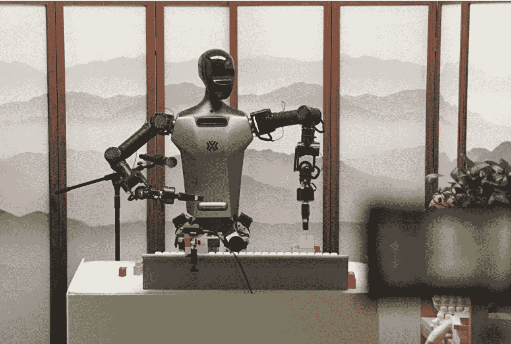

## CAIXIN | 听文章

封面报道 | 机器人来了

文 | 财新周刊 徐路易

2025年1月初，一个大箱子被推进雅格布·德莱西奥在意大利米兰的工作室，这是寄自杭州宇树科技有限公司的人形机器人G1。取出箱子里的防撞泡沫，便看到两条银黑色的腿。德莱西奥拽住两条腿拖出整个机器人——它通体坚硬，身姿却很灵活，躯干和髋部之间可以360度旋转。

这位意大利科技宅男把开箱视频上传到网络。他从快递盒里取出一块电池，电池的灰色外壳表面光滑，有多个接口和状态指示灯，一切调试完毕按下开机键，机器人从仰卧姿势做了一个标准的“鲤鱼打挺”，左右晃了晃最终站稳。这个动作被称为“动态复位”——通过模拟生物力学特性，结合关节扭矩与平衡算法得以完成。

1月28日除夕夜，16台宇树科技的人形机器人H1身着花棉袄亮相春晚，与新疆艺术学院16名舞者共同演绎节目《秧BOT》，人机协同跳着整齐划一的秧歌舞步，展示“0帧起手转手绢”等动作。

春晚之后，魔术师刘谦在春晚后台被H1莫名“碰瓷”的视频也在网络上流传：刘谦说“握一个”想去找机器人握手，没想到机器人就地躺倒“卧一个”，刘谦对着镜头摆手大喊：“不是我干的!”

与人类一样，机器人的运行方式是持续循环的过程——感知、规划，然后行动。首先感知外部环境，提取出有关信息，将这些信息传递给规划模块；根据要实现的目标，规划模块制订下一步行动计划，将其传递给控制器；最后由控制器驱动机器人执行相应的动作。

生成式人工智能（AI）的出现，极大推进了机器人对自然世界的理解，大语言模型也成为机器人规划模块的核心；深度神经网络结合其他技术，使机器人的感知和执行模块得到大幅提升，经过无数次训练和迭代，才有了机器人在春晚舞台上扭秧歌的一幕。

但与此同时，人形机器人距离真正的智能还有很长的距离。“人类预测两百万公里之外的小行星运动，远比预测机器人抓取物体时的运动要准确得多。”美国加州大学伯克利分校工业工程与运筹学讲席教授肯·戈德堡（Ken Goldberg）总结道。

人形机器人走过了怎样的发展之路，到目前为止，它在科学层面已解决了哪些问题？当下大热的具身智能已取得哪些突破，又面临着哪些亟待解决的难题？

### 运动控制的进阶

在科学层面，人形机器人的发展实则反映了人类自身的进化过程。百万年前，南方古猿“露西”将前肢扣紧岩缝，脊椎拱起，像弹簧般推直蜷缩的下肢，撬动了人类进化史上最伟大的革命。从此人能够用双足更高效地丈量世界，有了更广阔的视野，并让双手成为专门负责执行操作的器官。视觉感知和双手使用复杂工具促进大脑的发育和进化，一项颇有意义的“进化突破”便是人类可以用手势传递信息，从而发展出早期语言。

运动、处理感知信息、执行操作，同样串联起了人形机器人发展的线索——人形机器人最大的优势就是未来可以无缝衔接人类社会，进行信息感知并执行任务。

由于要与物理世界交互并执行任务，从机器人诞生之初，运动控制就是首要需解决的问题。多名学者向财新表示，目前阶段的机器人，运动控制是其发展最为成熟的部分。春晚上机器人展示的舞蹈，就体现了智能的高级运动控制。

60年前，美国通用汽车公司在新泽西工厂安装了首台Unimate机器人，负责从压铸机中取出炽热的金属部件。Unimate需抬起机械臂将焊枪精准压向车架接缝，操作员手持示教盒站在一旁，手动引导这台钢铁巨兽走完3米的焊接路径，过程中将每个关键点的坐标逐一录入控制系统，每天重复数十次这一流程。这些机器的“智能”表现为严格复现人类预先设定的动作。操作员通过物理引导，将每个动作分解为数百个坐标点，再逐帧调试速度与力度参数。当时，要稳定运行一套焊接程序往往需要耗费数周，过程中假如一个工件的位置偏离2毫米，整条生产线就可能瘫痪。

美国一家龙头科技企业的仓储机器人工程师向财新介绍，早期的工业机器人依赖刚性的程序逻辑，只有记忆和存储能力，对环境没有感知和反馈。机器人严格遵循编程轨迹，对任务的执行精度依赖于齿轮等机械结构的物理精度，误差则需要人工调试补偿，齿轮磨损后需要定期校准。生产线也必须维持高度结构化的环境，工件严格按预定角度摆放，一切必须做到有序、清晰且可预测，甚至要严格控制光照和温度波动，确保机器人可以安全作业。

到1978年，日本工程师开发出第一款“取放机器人”SCARA。它能够快速将小型电子元件插入到位，至今仍在制造业中广泛使用。“取”和“放”是运动控制中的关键环节，实现这两个动作需要依靠高精度定位、路径优化、力控技术和实时反馈。“不过，这个阶段还没有‘智能’，只是通过运动控制实现了机械自动化。”上述仓储机器人工程师说。

进入21世纪，人们对机器人的运动控制不仅需要精确，还要稳定，能够实时处理姿态、速度、地面状况等数据，并生成指令。2004年，波士顿动力公司发布机器狗“BigDog”，虽然还不是完全自主，但它有50个传感器和一个机载计算机，可以管理步态并保持稳定。这意味着机器人初步具备了一定条件的自主能力，可以利用传感器获取环境信息，自主识别、理解和反馈预设动作。

2012年，一种经典的卷积神经网络（CNN）架构AlexNet在ImageNet大规模视觉识别竞赛中，以84.6%的识别准确率，宣告深度学习技术的崛起。这项技术迅速渗透至机器人领域，使机器人的“眼睛”和“大脑”配合度大幅提升，很快就能锁定目标、调整动作几百次。从此，AI和机器人都迈入了深度学习时代。

多名学者向财新表示，深度神经网络的出现彻底改变了机器人研究的范式。斯坦福大学讲席教授、AI领域知名学者李飞飞总结道，深度神经网络算法模拟人类大脑的神经元结构，具备强大的学习和模式识别能力；专业硬件GPU能够为复杂的计算提供强大动力；海量数据则滋养了算法的成长。

2022年7月，美国哥伦比亚大学的研究团队首次实现机器人无需人类干预的全身运动建模，通过摆动实验构建神经网络驱动的动态环境响应能力。机器人能自动识别并补偿机械损伤，例如单腿故障时会自主调整平衡策略。

BigDog出现的20年后，瑞士苏黎世联邦理工学院ANYmal的研究成果被认为是运动控制层面的一个重要突破。实验中，ANYmal四足机器人在单肢完全失效的情况下，仍能通过动态调整剩余三肢的扭矩分配保持平衡。这一容错机制借鉴了人类小脑的误差补偿原理，让四足机器人能够在复杂地形中执行开门、按压按钮等精细操作，为后续人形机器人抗干扰设计提供了关键技术路径。有趣的是，这一突破又一次与生物实体进化殊途同归——狗在进行慢速移动时会采用对角交替步态，即任何时刻狗总有三只脚保持接触地面，形成稳定的三角支撑结构。

对机器人运动控制的需求始于上世纪的工厂，如今运动控制依然在工业企业中迭代。前述仓储机器人工程师介绍，这几年生成式AI出现后，能生成很多真实场景让机器人学习，不仅价格便宜，速度也快。对企业来说，环境标准化很复杂，总会遇到不可控的时候，现在机器人在工业环境中不必再像60年前那样要求温度、湿度和工件位置分毫不差，但对环境的结构化要求依然很高，每一丁点的突破背后都是无数次迭代和漫长的努力。

上海非夕机器人科技有限公司首席科学家钟书耘告诉财新，目前学术界在运动控制方面仍在积极探索如何平衡基于物理模型的传统控制方法和AI生成控制策略，未来的研究可能会集中在如何更有效地结合两者优势，解决目前在数据准确性、模型稳定性和系统效率方面的挑战。

美国一名学者提到2016年AlphaGo对机器人研究的影响。AlphaGo向大众展示了它下围棋的能力，机器人研究领域则迅速将AlphaGo背后的蒙特卡洛树搜索、强化学习训练等技术迁移到机器人研究上，让机器人能像下棋一样快速进行运动规划。

AlphaGo会在思考每一步棋时挑出“最有希望的一步”，机器人也用类似方法，在躲避障碍时先快速排除“撞墙”选项，只分析合理的移动方案。AlphaGo在自我对弈中棋力迅速提升，这种被称为“强化学习”的方式日后成为机器人训练的核心思路：机器人不再遵循“刚性逻辑”，而是像人类一样灵活调整。遇到油渍地面时会反复模拟不同走法，像在游戏里“试错存档”，找到最稳的落脚方式再进入下一步。“如今机器人能翻跟头、跑酷、跳舞，很大程度上依靠的就是这种技术升级。”该学者表示。

DeepMind总工程师、AlphaGo创始人之一大卫·席尔瓦（David Silver）显然也不认为AlphaGo只在下围棋上有所建树，他在2016年的演讲中就表示，如果算法能像人脑神经元网络一样实时重构决策路径，动态调整神经突触连接强度，机器就将突破任务专用限制，实现跨领域自主学习和推理。

席尔瓦所期待的拥有神经元网络、能够在交互中成长的机器智能，便是当下大热的具身智能。

### 具身智能的现实难题

清华大学具身智能实验室内，研究人员正在遥控机械臂拧开罐盖。工作台前方固定了一个摄像头大小的双目深度实感相机，锁定了工作台后方的机械臂，记录机械臂和末端灵巧手拧开罐盖整个过程的三维空间点数据。

这部相机集成了双目视觉、飞行时间测距、激光雷达（LiDAR）技术，支持人脸识别、物体检测及精确测距功能，可以为研究人员清晰描绘出动作的点云数据，即在一个三维坐标系统中的一组向量的集合。实验室内，支撑相机的三脚架被缠了好几圈胶带，牢牢粘在地面上，防止人走动时产生的震动或不小心碰到。

为碳基生物设计的罐子，也必须为硅基实体重新适配。研究人员将罐体内装满大米增加罐子的重量和稳定性，底部还粘贴了用在甲板上的防滑胶带，以增加与光滑地面之间的摩擦力。罐盖把手两侧新增了粘土限位器，防止灵巧手开合罐盖时出现意外松动。这些细节改良使得实验容错率大幅提升，也确保了实验的准确性和可重复性。

研究团队在工作台表面标记了6个点位。大米罐放在中间下方的点位，机械手指依照程序嵌入罐盖凹槽，握紧、旋转，成功完成开罐动作。运动轨迹数据同步传入系统，成为一段演示素材。研究团队利用自主开发的演示生成器将这段素材生成扩散策略，整个过程耗时20多分钟。之后，研究人员将罐子放在不同的点位，验证模型能否适应物体位置的变化，测试机器人的泛化能力，即机器人在面对新场景或任务时能够灵活适应。对不同点位的米罐，如果机械臂都能自主完成开罐，也就意味着实验非常成功。

随着清脆的“咔嗒”声，改良后的机械臂可以在多个偏移位置开启罐盖，不过有时候会拖动米罐。“虽然还不够稳当，但很幸运都完成了任务。”清华大学交叉信息研究院助理教授、具身智能实验室负责人许华哲评价道，这套演示生成器用很低的成本和很快的速度解决了一部分空间泛化的问题。该团队近期在预印本平台ArXiv上发表的论文显示，大量真机实验验证了这套算法在机械臂使用工具、双臂操作和柔性物体处理等任务中，成功率从11%提高到74.6%。

不过，许华哲在实验中也发现，当物体从初始位置水平移动时，现有合成数据的生成就会出现视觉偏差问题。比如，当物体向右移动时，因为摄影机只有正面视角，没有真实捕捉物体侧面应有的视角特征，而是直接将正面视角的图像数据“平移”到了新的坐标位置，就像把原本正面的图像整体搬移到右侧，然后在左侧强行生成类似侧面的视觉效果。这种利用点云编辑强行拼合视角的做法，导致算法接收到的视觉信息并不符合真实物理世界的几何特征。

许华哲展示了一张空间热力图数据。当物体移动到最右侧两个测试点时，策略成功率显著下降。这也就意味着当物体位移越多，实际侧面视角与算法接收的“平移拼合视角”就会差得更多，系统的操作可靠性急剧降低。“本质上，这个新的数据生成方法只是为现有算法框架打补丁，通过人工调整视角数据来缓解算法的感知局限，并非从根本上建立机器对三维空间连续变化的认知能力。”他说。

许华哲向财新表示，智能的发展需要依托身体这一实体。身体并不是一个简单的容器，它为智能的发展提供了方向和基础。“人类进化的过程中，身体的结构和能力使得我们的智能能够朝着特定的方向发展。我们的身体能够与世界进行各种交互，这种交互模式反过来又塑造了我们的智能。”

具身智能的种子，在1950年由著名计算机科学家艾伦·图灵播下。他在经典论文《计算机器与智能》中首次提出“智能体需要与物理世界互动”的设想。但随后20年中，AI的研究被符号主义所主导，学者们执着于用数学符号模拟人类思维，这一路径到上世纪80年代遭遇现实瓶颈。1986年，麻省理工学院团队设计出了六足机器人Genghis，它不依赖预设程序，仅凭简单传感器就能穿越复杂地形。这个划时代的实验证明，实体与环境直接对话就可以诞生智能。

以视觉为例，它是人类感知和获得信息的基础，也是机器人融入人类社会的“必备能力”。2009年，李飞飞实验室发布了包含1500万张图像的ImageNet数据集，视觉算法的速度和准确性得以迅速提升。此后图像识别引领了一段时间的AI发展，再到物体切分、动态关系预测，使用人类自然语言描述照片等。2015年扩散模型出世，可以应用于图像去噪、图像修复、超分辨率成像、图像生成等各种任务。扩散模型又推动了生成式AI的发展，可以将人类输入的句子转化为照片和视频。2024年，OpenAI发布了文生视频模型Sora，使便宜快速的机器人训练素材得以实现。

2022年问世的ChatGPT模型则展现出惊人的语言理解能力，谷歌迅速将其与机器人融合，其RT-X系统能理解“把苏打水递给沙发左侧客人”。此后OpenAI与Figure公司合作的人形机器人Figure 01登上舞台，它利用双目摄像头辨识工具，用灵巧的机械手指组装乐高积木，整个过程无需代码控制。

香港科技大学电子与计算机工程系荣休教授、戴盟机器人科技有限公司创始人王煜从上世纪80年代就开始研究机器人。他向财新表示，如今机器人研究领域最大的变化是，他们不用先建立模型再编写程序来操作模型，而是可以让系统通过自我学习建立模型。大语言模型基于深度神经网络构建，迅速成为机器人规划模块的核心。向机器人输入指令，比如输入“我饿了，给我拿吃的”，机器人就会生成一系列动作来完成任务。“过去，这样的事情是很难实现的。”他说。

许华哲表示，如今通过数据驱动，无论是机器人自己试错而获得的数据，还是人类“喂”给它的示教数据，都可以更好地让机器人学到原本做不了的事情。他认为，当下具身智能的一大核心难点就是泛化。泛化意味着要有能力去完成未学习过的任务，可能是举一反三，也可能是基于理解进行更复杂的任务。具身智能更多讨论在物理世界中的泛化，比如执行一个任务时，如果光影背景、物体种类、空间位置等发生变化，甚至有人破坏了任务过程，机器人也要能应对，这是泛化要解决的难题。

让机器人包揽家务，是很多人的“梦想”。虽然机器人已经会跳复杂的舞蹈、作优美的诗词，但厨房里的一块肉却能让它犯难——生肉摸起来既不像石头那么硬，也不像面团那么软，是一种介于弹性和塑性之间的微妙状态，机械手很难把握该用多大力气。同时它用“眼睛”观察肉的颜色、用“手指”感受质地软硬，这两处感知信息叠加才能判断肉的生熟程度。煎牛排看似简单，油温变化引发肉质收缩、油脂飞溅等物理现象，也超出了机器系统的预测能力，这使得机器人在虚拟厨房练就的“厨艺”，到了真实灶台前会大打折扣。

中国科学院院士、清华大学计算机系教授张钹2024年撰文指出，智能发展依赖模仿学习、强化学习、大模型等方法，本质上仍属于“离身智能”大语言模型，虽能生成流畅对话，但其认知建立在文本符号的抽象层面，缺乏“触觉记忆”等多感官协调能力。具身智能则强调物理身体、环境感知与反馈的重要性，通过它们实现与外部世界的交互。张钹用“维特根斯坦悖论”解释这种现象——语言界限即世界界限，机器没有感知过热水的灼烫、冰块的寒冷，对温度的理解就只能永远停留在词汇层面。

感知冷暖需要触觉。一双能感知、对握、抓取、雕刻的手，是区分人类与其他生物的关键进化特征。手，也成为当前机器人学界和业界希望攻克的最大难题。

### 真正的智能还有多远

人的手仅有身高的九分之一，却堪称生物力学的奇迹。能独立运动的维度数量被称为自由度，食指既能上下弯曲，又能左右摆动，这两个动作即对应两个自由度。解剖学研究表明，人的双手拥有21个自由度，这使得人手能够组合出超过300种基础动作模式，上到提起重物，下到捏住米粒。如果加上手腕，整个手部系统的运动维度可达27个，这种多维度协同让人类能完成系鞋带、弹钢琴等精细协调任务。

抓鱼对人类来说稍有挑战，对机器人却比登天还难。许华哲介绍，视觉系统在鱼皮这样的反光表面上容易误判，触觉传感器又不够精细，如果是活鱼这样的动态目标，抓取时要处理的信息包括但不限于极光滑的体表、不断摆动的鱼尾以及内脏的位移，要求机器人具备瞬间调整力道的灵活性。现有机器人的手指关节虽然能做精细动作，但反应速度还是比人类慢半拍，稍不留神鱼就会脱手。在现有基础上，灵巧手需要结合触觉传感和多自由度关节设计，才有可能实现精细抓取与交互。

在王煜的经历中，灵巧手的发展经过了一段缓慢的时间。上世纪80年代，他在机器人学研究“圣地”美国卡内基梅隆大学读博士时，跟随导师开始研究灵巧手操作。“和运动不一样，灵巧操作任务复杂度太高了。过去我们通过编程来实现移动和操作，这并不适用于灵巧操作，因为我们无法把所有的事情都变成程序。更重要的是灵巧手接触到物体时的反馈，可以说没有主动的反馈就没有灵巧操作，灵巧手的发展就卡在这里。”

2015年前后，伴随电动系统的大规模应用，五指灵巧手硬件已不再是难题，但这不等于实现了灵巧操作。2021年，柔性传感器成本降至2016年的五分之一左右，王煜团队自主研发了触觉反馈系统，并于2024年发布Sparky 1灵巧手，基于光学触觉传感器获得类人的操作能力和触觉反馈，并且集成AI技术和大语言模型，使机器人具备强大的自主学习能力和问题解决技巧。

在机械臂上加一个执行器比如焊枪，机械臂就可以做焊接，甚至可以取代焊接工人。这种机器人虽不叫人形机器人，但它们的工作很特殊，因为它们的操作器是专门针对某个工艺设计的。如果换成通用的操作器比如夹爪，其局限性就显现出来了。“人形机器人的目标是拥有像人一样的通用能力，比如五指灵巧手。如果能做出像人手一样灵巧的机械手并很好地利用它，机器人就具备了很强的通用能力。这是人形机器人的发展方向。”

不过，王煜也表示，研发灵巧手非常复杂，尤其是触觉传感器的相关技术。过去触觉传感器的应用点不多，研究的人也不多。这两年随着灵巧手的需求增加，大家才开始关注它。但这项技术发展还处于起步阶段，需要大量的科研和资本投入。

灵巧手精细操作的复杂也来源于物理层面的根本性困难。戈德堡介绍，算法指令的确定性，与感知、控制以及物理世界的不确定性是一对矛盾。感知方面，机器人虽拥有高分辨率的摄像头，但摄像头无法提供正在发生的事情的三维结构。激光雷达等新技术可以使用光束构建环境的三维模型，但对科研人员来说还不够好。比如，物体上有闪亮或透明的东西，光线就会以不可预测的方式发挥作用，在图像中产生噪音和空洞，机器人可能因此无法判断“活鱼”的情况。

控制方面，每个不确定性只会产生非常小的误差，但这些误差会累积起来，操作就变得非常困难。而在物理方面，让机器人推动一个桌子上的瓶子，即使每次都以完全相同的方式，瓶子也几乎不可能都落位在同一点。因为物理世界的影响因素很多，比如瓶子滑动时接触的表面是否光滑。

许华哲认为，解决精细操作的泛化难题有两个角度：一是模型，二是数据。在模型方面，要考虑能否调优网络结构、损失函数等架构上的算法；数据方面，要考虑能否采集到更多、更好、更有助于试错的数据。

就数据而言，机器人还没有真正意义上的“大模型”，因为机器人需要的数据不像文本一样“生来”在电脑里就是标准化的。

王煜特别提到，一些科研机构和企业热衷于图像和语言等数据，这当然也是一条路径，但对于物理载体，接触变形力、变形模态等非图像、非语言数据是十分重要的。“这方面的研发才刚刚开始，需要时间，也需要较大的科研和资本投入。”

硬件方面，如果机器人能够进一步具备抓取物体、获取信息的能力，那么控制能力就可以像技能一样通过学习来获得，这涉及操作控制的流程规划和底层的电子信号传输与电机响应。这种模式目前还处于尝试阶段。

如今无论大语言模型，还是机器人，通过图灵测试都已不再稀奇。所谓图灵测试是评估AI智能程度的一种方法，指的是由人类测试者根据对方的问题回答，来判断对方是真人还是机器，如果电脑能回答测试者提出的一系列问题，且超过30%的回答让测试者误认为是人类所答，则电脑通过测试。

“理论上，大型语言模型可以通过类似查找表的方式通过图灵测试，但这并不等同于真正的智能。要实现真正的机器智能，人类还需要继续探索智能的本质。”加州大学伯克利分校计算机科学教授、世界知名AI学者斯图尔特·罗素（Stuart Russell）说。

他对财新做了一个类比，小孩子玩纸飞机时，会随意扔向空中，观察它是否能飞起来、飞得多远，之后他会尝试不同扔法或折出不同的飞机形状，这是一种非常直观、基于经验和反复实验的方法，但并不是地对飞行原理的深入理解，“真正的科学是不同的，需要掌握空气动力学等科学，精确计算和设计飞机的形状、结构和性能，从而确保飞机能够飞行”。如果说AI是知其然，科学家们还需要更长的路去知其所以然。 ■

## 相关视频：

优必选科技人形机器人亮相香港，共话“科创重塑新篇章”

视频说明： 2023年6月，优必选科技首席品牌官谭旻谈人形机器人面临的机遇与挑战

相关专题： AI全景

## 最新财新周刊 | 银行AIC股权投资等待破茧

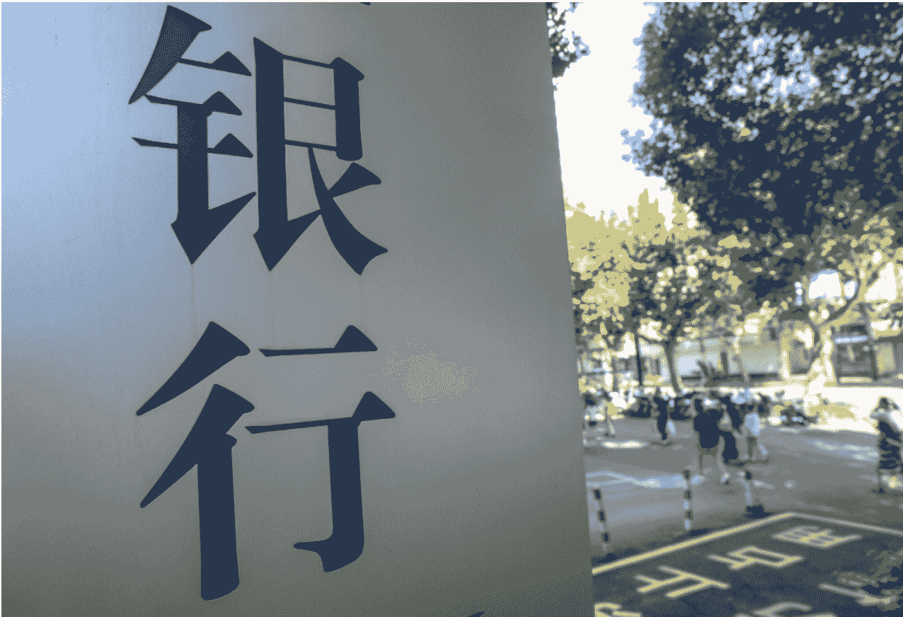

CAIXIN| 听文章

文 | 财新周刊 武晓蒙 丁锋

五大国有银行设立金融资产投资公司（AIC）七年多后，在加大对科创企业股权投资的大背景下，更多银行将拿到牌照。业内意见认为，在这条赛道上要做难而正确的事，关键不仅是AIC子公司这个“兵”，更在于母行这个“帅”。

2025年全国“两会”期间，国家金融监管总局局长李云泽在“部长通道”上指出，新质生产力的核心要素是科技创新，中国的融资结构长期以间接融资为主，需要引导银行保险资金投早、投小、投长期、投硬科技。

近日，《关于进一步扩大金融资产投资公司股权投资试点的通知》（下称《通知》）印发，在前期试点基础上进一步拓展：一是地域扩大，将AIC股权投资范围由18个试点城市扩大至所在省份；二是机构扩员，支持更多符合条件的商业银行发起设立AIC；三是资金扩面，支持险资参与AIC股权投资试点。

这是近半年多来，金融监管部门第三次扩围AIC股权投资试点政策，重视程度可见一斑。

建行、农行、工行、中行、交行于2017年相继成立的中国首批AIC，起初主要从事债转股业务，旨在帮助发展前景较好但暂时遇到困难的企业降杠杆、化风险。

从2020年2月起，监管部门批准五大AIC通过附属机构在上海试点开展“不以债转股为目的”的直接股权投资业务。四年后，试点工作驶入快车道：2024年8月29日，北京成为第二个试点城市；三周后的9月24日，试点范围扩大至包括上海、北京在内的18个城市，并对此前试点政策进行“松绑”——将AIC表内资金进行股权投资的金额占公司上季末资产的比例，由原来的4%提高到10%；投资单只私募股权投资基金的金额占该基金发行规模的比例，由原来的20%提高到30%。

据财新从业内了解，AIC的资金来源包括表内自营资金和表外募集资金两大类。2018年7月，央行为加大对“债转股”及小微企业的支持力度，下调包括国有大行在内的多类机构人民币存款准备金率0.5个百分点，这是AIC表内资金的主要来源；同时，AIC可以发行金融债募资，例如中银AIC在2020年11月发行35亿元五年期金融债；AIC还可以发行私募资管产品募集表外资金，但目前规模甚微。

截至2024年6月末，五大AIC资产合计5869.9亿元。由此推算，此次政策松绑后，五大AIC可以开展的“不以债转股为目的”的股权投资规模，由234.8亿元提升至587亿元；若以30%的基金出资额上限测算，理论上最少可撬动的整体股权投资规模由782.7亿元提升至1956.7亿元。

据2025年2月26日披露的官方数据，18个城市股权投资试点政策推出后，AIC迅速响应，已在试点城市签约金额超3500亿元。

不过，多位业内人士告诉财新，签约金额属于框架性、意向型约定，离真正落地还有距离。

清科研究中心不完全统计数据显示，2024年AIC投资活跃度达到历年峰值，全年五家AIC及附属投资机构共完成156起投资案例，披露投资金额576.04亿元。但整体看五家AIC仍以债转股业务为主，出资直接股权投资类项目金额占所有项目的比重不足1%。

“与此前相比，银行内部确实更加积极了。但由于科创企业的高风险特征，后续如果出现亏损，从业者难免担心自身受影响，如何细化并落实尽职免责是业内最关注的问题。大家会通过一些具体案例的处理来判断。”一位资深AIC人士近日对财新表示，银行开展科创企业股权投资有利于推动科技进步，但短期内要取得明显成效难度较大，面临多方博弈。

AIC做科创股权投资首先需要解决风险偏好问题。国有大行过往主要服务相对成熟的企业，对于中早期项目，比PE/VC（私募股权基金/风险投资）机构要谨慎得多。此外，AIC开展股权投资还面临母行并表风险权重高、外部募资难、基金管理权博弈、自身投研水平及人员不足等掣肘因素。

金融监管部门在推动机构主动作为的同时，亦强调加强风控，要求深入细致开展尽职调查，严格业务审批，并每年进行专项审计。地方政府对于与AIC合作设立股权投资基金整体比较积极，一方面是因地方财力紧张，需要引入外部资源，另一方面是为了响应中央促进创业投资发展的指示与要求。

随着近期试点大幅扩围，更多省份、商业银行、险资有望加入，AIC股权投资能否破茧？后续还有哪些期待？

### 从债转股到直投股权

作为国有大行旗下众多子公司之一，AIC成立时间较晚，且因对公及私募等属性，公众对其关注了解相对较少。市场此前认为，银行AIC是为实施债转股而生，但据财新从知情者处了解，开展直接股权投资才是有关部门当年谋划设立银行AIC的初衷，而债转股只是先行步骤。

"国内股权投资市场不发达的原因之一是，在中国这种以间接融资为主导的国家，资金主要掌握在商业银行手中，而银行本身受约束较大，对股权投资市场的参与度微乎其微。如果中国要发展壮大股权投资市场，商业银行的力量不可或缺。"前述资深AIC人士告诉财新，由于国内银行过去主要以存贷款业务为主，对直接融资市场缺乏经验，贸然介入或会产生不可控风险，因此在当年去杠杆的背景下，多方最终商定以债转股为突破口先行先试，待时机成熟时再开展股权直投。

值得注意的是，不同于中国在世纪之交开展的那一轮以资产管理公司(AMC)为主、为出清银行巨额不良贷款的政策性债转股，银行AIC实施的是市场化债转股，旨在防风险、降杠杆、促改革。在转股债权类别上，不再限定为不良贷款，还包括正常类、关注类贷款；在转股方式上，除了传统的“收债转股”，还包括“入股还债”这种新方式，且以后者为主。

清科研究中心报告显示，五大AIC均以正常类资产债转股项目为主，其中农行、中行、交行的AIC此类资产占比均超过了90%。AIC的项目来源主要是母行分支机构的对公客户；同时也与其他银行及其非银机构合作，从投行、基金、保险、租赁等多维度拓展业务。

观察五大AIC的经营业绩，债转股这一先行业务开局良好。横向对比，2024年上半年五大AIC净利润在母行旗下众多子公司中排名前列，普遍高于公众关注度更高的理财子公司、基金子公司；纵向对比，多家AIC设立不久便实现了盈利，并在2021年之后净利润登上新台阶。

以设立最早的建行旗下AIC——建信金融资产投资公司（下称“建信投资”）为例，该公司于2017年7月开业，2018年至2020年分别实现净利润0.62亿元、2.87亿元、8.57亿元，2021年起净利润达到36亿元以上，2023年突破40亿元，位列子公司之首。

近日，建信投资相关部门负责人对财新表示，公司成立于国家供给侧结构性改革的大背景下，一直立足于股权投资“国家队”、股债联动主抓手的战略发展定位；根据国家发改委统计口径，截至2024年末，建信投资市场化债转股业务累计落地项目超360个，累计落地金额超4700亿元，连续八年保持同业第一。

据财新从多位业内人士处了解，五大AIC经营业绩良好，除了自身努力，亦有行业周期因素。客观来说，银行AIC介入债转股业务的时间点较好，且以央企、国企为主。2017年成立AIC时，正值多个传统行业处于周期谷底，彼时多家AIC布局了钢铁、煤炭、化工、交通等传统行业的高杠杆企业；几年后，相关行业迎来上升周期，企业盈利好转，AIC债转股投资收益由此水涨船高。

在银行AIC开展债转股业务的第四年，原银保监会于2020年2月至3月陆续批准五大AIC通过附属机构在上海开展“不以债转股为目的”的股权投资业务，主要参与开展与上海自贸试验区临港新片区建设以及长三角经济结构调整、产业优化升级和协调发展相关的企业重组、股权投资、直接投资等业务。

“一直以来，囿于政策限制，银行资金难以直接参与股权投资，而AIC股权投资试点，为此打开了一扇窗。”一位了解情况的人士告诉财新，五大AIC股权投资试点之所以先由上海开始，是因为2020年正值上海国际金融中心建设驶入快车道，引入更多资金壮大直接融资市场是题中之义；而选择通过AIC附属机构开展股权投资业务，主要是为了实现风险隔离。

此前，虽然债转股亦属于股权投资范畴，但有一定限制。“比如，监管要求以债转股为目的投资企业股权，企业要将股权投资资金全部用于偿还现有债权，所以债转股业务往往对被投企业的资产负债率有要求，一些资产负债率低于40%的项目我们是不投的。但债务率高的企业一般都是大中型企业，很多发展初期的科创企业，向银行不好借款，前期主要靠股权资金，而它们资产负债率并不高，没法用债转股的方式去投。”一位AIC债转股业务人士表示。

### 试点由点到面

上海先行试点四年后的2024年初，决策层开始在不同场合提到“扩大金融资产投资公司直接股权投资试点范围”。2024年9月24日，国家金融监管总局发布通知，将AIC股权投资试点范围由上海扩大至北京、天津、上海、重庆、南京、杭州、合肥、济南、武汉、长沙、广州、成都、西安、宁波、厦门、青岛、深圳、苏州18个城市。

试点扩围以来，AIC与相关机构成立的股权投资基金在各地涌现。清科研究中心数据显示，工银AIC通过附属机构——工银资本管理有限公司，在2024年6月至2024年12月设立了9只纯股权投资基金，基金注册规模从0.7亿元到50亿元不等，涉及北京、苏州、杭州、厦门、长沙、广州、天津、上海、重庆等城市。

其他AIC亦有具体案例。比如，财新从建信投资了解到，2024年12月，该公司与合作方在杭州合作成立了建源舜达（杭州）股权投资基金合伙企业（有限合伙），20亿元规模。其中，建信投资认缴出资5.99亿元为基金有限合伙人（LP），其附属机构——建信金投私募基金管理（北京）有限公司（下称“建信金投”）为基金管理人；该基金采用“双GP”模式，由建信金投、杭州市国有资本投资运营有限公司子公司——杭州国舜股权投资有限公司担任普通合伙人。截至目前，建信投资已与18个城市达成合作意向，完成了北京、苏州、合肥、杭州等城市试点业务基金的设立，正在进一步扩大项目落地规模。

2025年3月5日，AIC直接股权投资试点进一步扩围，明确相关基金可在试点城市所在省份范围内进行股权投资，这有利于扩大基金的项目支持范围，吸引带动更多社会资金参与基金募资，降低基金运作成本，提升运作效率。

对此，一位AIC科创股权投资人士告诉财新，目前股权投资与地方政府引导基金合作较多。由于地方政府对资金通常有“返投”要求，即希望投当地项目，如果仅局限于试点城市，会导致项目集中度过高，而允许在全省域范围内投资，更有利于项目筛选，也是更加市场化的运作方式。

不过，目前政策尚未明确18个试点城市之间是否可以交叉投资，比如AIC与合作方在北京成立的基金，能否投资天津的项目。据业内人士透露，各家AIC对政策尺度的把握不同，有些公司已经开始交叉投资。

《通知》支持更多符合条件的商业银行发起设立AIC，业内人士预计将有更多银行参与进来。随着此番再度“开闸”，业内预计招商银行、兴业银行等头部股份行有望尽快拿下牌照。

设立AIC需要动用银行不少资本金。根据2018年6月印发的《金融资产投资公司管理办法（试行）》（下称《办法》），AIC注册资本应当一次性实缴货币资本，最低限额为100亿元。“注册资本金门槛决定了中小银行较难设立AIC，但对头部股份行来说问题不大。”前述资深AIC人士说。

新成立的AIC是不是可以只开展股权直投业务？该人士对财新分析，AIC展业应该符合《办法》的相关规定，主业仍应是债转股，“如果不开展债转股业务而直接开展股权投资业务，理论上与现行监管规定相悖”。另一位AIC人士提到，开展债转股业务需要大量自营资金，五大AIC此前主要用的是央行定向降准资金，如今其他银行要开展债转股，资金来源是个问题。

### 基金募资难、母行影响大

在政策鼓励下，更多机构有望参与，但股权直投这项业务真要做起来并不容易，面临一些现实挑战。

首先是基金募资难与管理权博弈。不同于债转股主要使用自有资金，自AIC在上海开展股权直投试点以来，政策一直要求以募资为主；虽然自2024年9月起这一比例有所“松绑”，但仍需从外部募集至少70%的资金。

[远东资信评估公司](https://www.zicpgroup.com/)的报告指出，AIC开展股权投资试点成立的基金（下称“AIC基金”），以政、产、金等跨界合作方式较为普遍。其中，“政”包括地方政府投资平台、国有资本投资运营公司等；“产”是产业类企业，例如江苏某股权投资基金发起方包括省内一家科技型企业；“金”包括AIC、商业银行、基金公司等。

AIC基金向合格个人投资者募资比较难。“中国的民众习惯低风险、相对安全的投资，较难接受时间长、波动大、主要靠估值的风险投资。我们之前尝试发行过债转股价管计划，主要面向高净值个人客户，但很难募资，因为难以向客户承诺每年分红。”前述资深AIC人士说。

现阶段，AIC基金募资渠道以地方国资为主，通常采取“双GP”模式。AIC在出资较少（上限30%）的情况下，即便取得基金管理人和GP地位，在与地方国资的合作中能发挥多大主动管理权，目前仍存疑。

多位业内人士向财新指出，地方政府通常对AIC基金有“返投”要求，但程度不一。整体来说，AIC在发达地区设立的基金相对更市场化，地方政府干预较少，倾向在各地寻找好项目；而中西部地区的部分基金，更像是为当地招商引资，以“返投”为主。

近期发布的《通知》试图引入保险资金，支持险资依法合规投资AIC通过附属机构发行的私募股权投资基金、AIC发行的债券，或者参股AIC。

对此，建信投资相关部门负责人对财新表示，保险资金期限长、规模大，匹配科技创新股权投资周期长的特点，此举可为AIC提供长期稳定的资金支持，为AIC设立股权投资试点业务基金提供充足“弹药”，带动社会资金更多地支持科创企业发展。

不过险资的实际参与度仍待观察。2020年9月金融监管部门发布政策明确，险资可以投资AIC设立的债转股投资计划。但多位业内人士向财新反映，险资实际上鲜少参与。

“险资往往比银行资金的风险偏好更保守。很早就明确险资可开展股权直投，但实际落地效果不佳，更别说让它们与AIC合作了。”前述资深AIC人士说。

一位险资人士对财新称，近期已有AIC前来对接业务，但合作意向不大，“AIC最早是做‘名股实债’出身，后来慢慢开始做PE投资和科创股权投资。科创投资本来就不好做，AIC拿项目能力和历史业绩一般，而且没有好的激励机制”。

有业内人士提出，是否可以参照当年推动债转股的思路，允许银行动用更多表内资金开展股权投资。

“按照国际经验，投资公司理论上是募资能力越强越好，优秀的投资机构都是主要靠募资，管理人只出少部分钱。但应充分考量中国国情，比如中国长期以间接融资为主导、商业银行掌握着大多数的金融资源、居民习惯追求收益稳健的资管产品等。”前述资深AIC人士说。

五大AIC做债转股业务主要用的是表内资金。据他回忆，开始时，债转股亦面临资金难题，真正做大规模是在2018年7月央行定向降准后，这批资金明确用于债转股且对国有大行的投放进度提出了要求，由此推动债转股业务在较短时间里取得较快进展与突破。

一位AIC人士认为，如果科创企业股权投资和债转股一样，大部分用表内自营资金，银行风险会较高，因此才拉着地方政府、产业方、险资一起出钱；但出钱方多了，各自立场不一样，利益博弈又会比较多，风险偏好更趋于保守。

除了募资难题，AIC开展股权投资业务在母行并表时的风险权重很高，也对业务发展形成制约。

根据2024年1月1日起实施的《商业银行资本管理办法》，商业银行对工商企业其他股权投资的风险权重为1250%，而对因市场化债转股持有的工商企业股权投资的风险权重仅为250%。

前述资深AIC人士告诉财新，当初之所以让商业银行开展这一业务，看重的就是银行遍布全国的网点对企业客户近乎全覆盖；但是要发挥这一资源优势，母行就要控股，否则省级分行就不可能推荐好项目给AIC，而控股后就要按1250%的风险权重计算，“未来是不是可以适当降低风险权重？”

他认为，科创企业股权投资业务虽然是由AIC来做，但是规模多大、进度多快、分行推荐项目是否积极，这些都取决于有关部门如何引导商业银行。只有当指挥棒落到母行头上时，各方力量才能真正调动起来。

但一位国有大行总行对公条线人士对财新指出，AIC子公司当前做科创股权投资的能力还需提升，现阶段不宜一味追求做大规模，“大干快上的结果往往是几年后的‘一地鸡毛’”。

值得一提的是，2025年《政府工作报告》中披露，今年首批拟发行特别国债5000亿元，支持国有大型商业银行补充资本。兴业研究此前发布研报称，为国有大行进行核心一级资本补充，不仅能够夯实银行资本基础、提升抗风险能力，还能有效支持国有大行通过AIC开展股权投资。

### 强化投研与尽职免责

除了外部支持与政策，AIC自身亟须补短板、练内功，方可在这一新赛道上有所作为。

首先要加强投研与人才队伍建设。科创企业技术领先，市场上可参考的案例相对较少，AIC应强化对传统行业之外新兴行业的调研深度，提高对先进技术的判断力，掌握细分行业的发展趋势，提高市场敏锐度。

前述AIC科创股权投资人士对财新称，AIC开展股权投资的优势在于可以依托母行广泛的渠道网络和客户资源，但不是说网点多、项目多就行了，关键是对项目有判断力，选出好项目。

“合适的项目其实比较难找。”他说，一级市场的好项目，没有明确的标准，“早期的项目，如果价格便宜，一般都有各种各样的缺陷短板；等到后期项目五脏俱全了，价格又变得很贵了。真正的好项目，主要掌握在少数保荐代表人、合伙制基金或者政府引导基金手中，但好项目的份额通常很难拿到”。

在人员方面，据财新了解，目前多数AIC的员工在200人上下，如何践行“投早、投小”存在一定难度。

“投早、投小相当于做VC。在VC领域，1000万元都算大项目了，1000个项目加起来才100亿元，如果少量人员负责很多项目，相当于没管理。”前述资深AIC人士对财新说，公众号懒人搜索，懒人专属群分享
。
。

AIC是否可以通过增员扩编来解决人手不足问题？前述人士表示，子公司人员编制受母行控制，能否扩充编制取决于行业发展前景。若预计新业务能带来大量利润，可以招人；若净利润没有较大增长空间，向母行申请编制和费用较困难。此外，以大行AIC目前的薪酬待遇和激励机制，较难招到高精尖的投研人才。

而从业者更关注的是，尽职免责如何细化并执行到位。金融监管部门在2024年9月已对机构提出要求：按照股权投资业务规律和特点，建立健全长周期、差异化的绩效考核体系；落实尽职免责要求，完善容错纠错机制。

据财新近日多方了解，银行内部的尽职免责细则尚未拟定，主要难点在于如何认定“尽职”。

有从业者给财新列举了若干场景：“比如，投了100个项目，1个成功了，99个亏损了，但是那1个的盈利覆盖了99个的亏损，这算不算尽职？”“再如，科创企业前期没有分红，只要有现金流，这笔股权投资就不算坏账，但问题在于估值是变动的，如果估值下跌到一定程度，要不要启动相应的风控程序，此时对从业人员如何考核？”

上述从业者认为，要落实尽职免责涉及很多细节，如果没有细则，后续审计时会比较麻烦。“AIC每年至少对股权投资业务开展一次专项审计，审计很严格，任何说不明白的地方都可能是问题。”

此外他提到，债转股项目通常以传统行业为主，商业银行对传统行业比较了解，内部比较容易达成一致判断；而要看清科创企业并不容易，投资观点因人而异，这也是判定尽职免责时的难点之一。

目前，业内机构对尽职免责有一个参考思路，即AIC基金整体考核，而不是单个项目考核。“比如，只要基金整体实现盈利、最后成功退出就算尽职。即便其中大部分项目亏了，只要有少数项目盈利并能够覆盖亏损就行了；或者整体亏损比例较小也不追责，因为大家都知道，科创企业风险本来就已经很高，在前期业务探索阶段应给予一定的容错率。”该从业者对财新说。■

## 专栏 | 资产重估与新周期

# CAIXIN| 听文章

文 | 徐小庆

敦和资产管理有限公司宏观策略总监

2025年初以来港股成为全球表现最好的市场，而过去两年年涨幅保持在20%以上的美股未能再现“开门红”。

回顾历史上港股跑赢美股持续一年以上的阶段，几乎从未有过港股涨、美股跌同时发生的例子，多为两者同涨，但港股向上的弹性更大，并伴随美债收益率上行和美元回落。本次港股跑赢美股，不仅两者方向背离，而且美债收益率也呈下行趋势，说明此次强弱转换的背景是美国经济进入下行周期。如果美国经济真的衰退，港股还能独善其身吗？

与美股走势分化，不仅仅是港股市场的特有现象，2025年欧洲市场和美国市场也表现不一。欧洲50指数上涨10%左右，成为发达经济体中表现最好的股指，而且这种背离也体现在债券上。过去欧洲和美国的资产相关性很高，股票及债券的走势在绝大多数年份是同向的；尤其在美股下跌的年份，欧股的下跌幅度普遍大于美股。2025年欧美股指和国债的走势均出现背离，这种现象在历史上很少见。似乎美股、美债在交易美国经济衰退的担忧，但没有对其他经济体产生明显的溢出效应。如果说港股体现出的独立走势是中美经济逐步“脱钩”的结果，那么为什么美国经济对欧洲经济的影响也在减弱？

笔者认为，逆全球化趋势是导致美国经济对非美地区影响力下降的主要原因。各国股市表现更多取决于本国财政政策和货币政策，而非贸易往来建立起的经济纽带。过去几年美国经济的发展表现并未体现在全球贸易增长中。美国过去几年的经济繁荣离不开财政扩张的支撑，但财政政策的效果更多体现在刺激本国的服务消费。2025年以来美国经济相较其他地区的优势收窄，下行风险主要来自财政收缩，相应地受负面影响最大的也会是服务相关的需求，因而对其他经济体的边际拖累有限。公众号懒人搜索，懒人专属群分享

美国的孤立主义以及挥舞的关税大棒，也促使欧洲通过积极的财政政策刺激内需，应对外需的不确定性；股市走出独立向上的行情，体现了政策转变带来的经济改善预期。德国新政府已经宣布未来会放宽财政政策，市场预期德国赤字率会从当前的2.6%走高至4%以上，回到欧债危机前的历史高位。这一政策态度的转变，无疑有助于驱散欧洲经济的长期阴霾。

尽管过去几年中国广义预算赤字率维持在6%至8%，但在私人部门信用持续收缩的背景下，中国需要进一步加大财政扩张力度，才能有效对冲通缩风险。2025年中国的财政政策取向变得更加积极，全国“两会”公布的狭义预算赤字率上升至4%，创历史新高；加上专项债、特别国债的广义预算赤字率接近10%，比2020年多出2个百分点左右。

上世纪80年代里根政府时期，美国对外向日本发起贸易争端，对内推行小政府模式，持续削减赤字规模。整个80年代日股持续跑赢美股，日经与标普的比值增加了1倍多。分析这一历史现象，对理解当前市场港股强、美股弱的特征有一定启示作用。

从产业角度看，当时日本在制造业技术迭代创新，汽车和半导体产品实现全球化扩张，在高科技领域如个人计算机方面的产品突破也冲击美国在该领域的地位，这使得日本工业企业利润增速在20世纪80年代持续回升。

从政策角度看，当时美国收缩财政缓解了高通胀压力，也美联储开启降息周期，也打开日本基准利率的下行空间；日本央行持续降息对冲了货币升值带来的紧缩效应，同时低利率环境也大力刺激国内的投资和消费。日元升值叠加低利率环境，使得日本资产价格的吸引力显著上升，海外资金大量涌入，股价和房价大幅攀升。

可以看出，产业升级、流动性宽松是当时日股资产受追捧的必要条件。对比当下，中国目前的产业竞争力及利率环境似乎具备了和20世纪80年代日本相似的特征，因此2025年中国资产的重估或许代表了一个新周期的开始。■

## 专栏 | 特朗普酝酿干预金融组织

# CAIXIN| 听文章

文 | 巴里·艾肯格林

美国加州大学伯克利分校政治经济学教授

特朗普在第一个总统任期内，对美联储、国际货币基金组织（IMF）和世界银行采取了相对温和的态度。他曾向美联储施压，要求其降低利率，但没有要求美联储的决策事先要得到白宫批准，也没有通过其他方式来挑战美联储的独立性。除了力推马尔帕斯（David Malpass）出任世界银行行长，特朗普并未干涉世界银行的其他事务。他还让民主党顾问利普顿继续担任IMF第一副总裁，这一任命传统上属于美国总统的特权。

特朗普不愿干预美联储，是因为他意识到金融市场会对总统干预货币政策的做法做出负面反应。他显然十分在意金融市场的表现，曾公开以股市涨跌来衡量政策成败。不干预IMF也有用意。解决新兴市场的问题成本高昂，很可能由特朗普政府的财政部埋单，但维持原状可将这一问题“外包”给IMF。世界银行对特朗普而言则过于庞大和复杂，难以理解，更别提控制了，这让马尔帕斯深感沮丧。

但是，特朗普第二任期情况不同。他似乎不再关心金融市场，提及市场的次数减少。近期美国股市大幅下跌，也未能阻止他削减重要政府职能。他显然准备采取更为激进的方式拆解这些金融组织职能。

特朗普已经关闭了美国国际开发署（USAID），让美国继续参与世界银行这个更庞大的援助机构似乎不合逻辑。如果美国决定退出世界银行但又不退出IMF，将是一种古怪的折中路线，第二任期内还未采用过。IMF和世界银行一样，也在贷款项目中强调气候适应能力。

IMF可以将给阿根廷的大额贷款作为筹码，毕竟阿根廷总统米莱是特朗普的朋友。但特朗普政府在执政蓝图《2025计划》已经明确表示，美国应退出这两个诞生于布雷顿森林体系的国际组织。特朗普甚至已签署行政命令，让国务卿和美国驻联合国大使审查所有“国际政府间组织”，以决定美国应退出哪些组织。

如果没有美国的参与，世界银行和IMF仍可以勉力运作。和USAID不同，特朗普政府不能直接更换世界银行的门锁或切断员工电子邮件的访问权限。初出茅庐的马斯克追随者们也无法闯过这两个机构的安保系统。

美国对世界银行的现金认缴金额较小，2024年仅为28亿美元。世界银行主要通过发行由成员国信用担保的债券来融资。如果美国退出，欧洲国家可能会介入，它们的担保可以帮助世界银行继续在国际资本市场上融资。

相比之下，美国对IMF影响更大。美国通过配额和新借贷安排等方式贡献了IMF约五分之一的资金。如果美国退出，这一缺口将不得不由其他国家填补。美国的退出可能为重新分配IMF配额和投票权改革铺平道路，这正是中国长期寻求但屡遭美国阻挠的目标。公众号懒人搜索，懒人专属群分享

无论退出哪个组织，最大输家都是美国——美国如果退出世界银行，将被视为拒绝向发展中国家提供关键的金融援助；如果退出IMF，美国将失去一个影响其他国家经济金融政策的重要渠道，削弱自身的软实力。

相比之下，美联储的处境可能更加严峻。特朗普加征关税和拟推出的减税计划已经让通胀初现回升迹象。总有一天，他不再能把通胀问题归咎于前任拜登政府，届时矛头很可能指向美联储。特朗普混乱的政策已经开始削弱消费者信心，增加了衰退风险。一旦经济衰退成为现实，特朗普就会指责美联储没有及时降息。

特朗普政府的代理总检察长曾宣称，总统对“各种独立机构”拥有行政权。如果特朗普试图罢免美联储主席鲍威尔及其他董事会成员，鲍威尔可以诉诸法院。然而，特朗普并没有服从法院裁决的倾向。他可以任命一位听命于白宫的新主席，甚至可以派马斯克的手下在美国法警的支持下，接管美联储的计算机系统。在两个月前，这样的情景可能显得荒诞不经，如今已然不同，金融市场势必对此做出激烈的负面反应。到那时，我们才能知道特朗普是否真的不再在意金融市场的看法。■

## 更多报道详见：【专题】特朗普新政、特朗普2.0时代：影响与变局

## 最新财新周刊|运动损伤医疗缺口待补

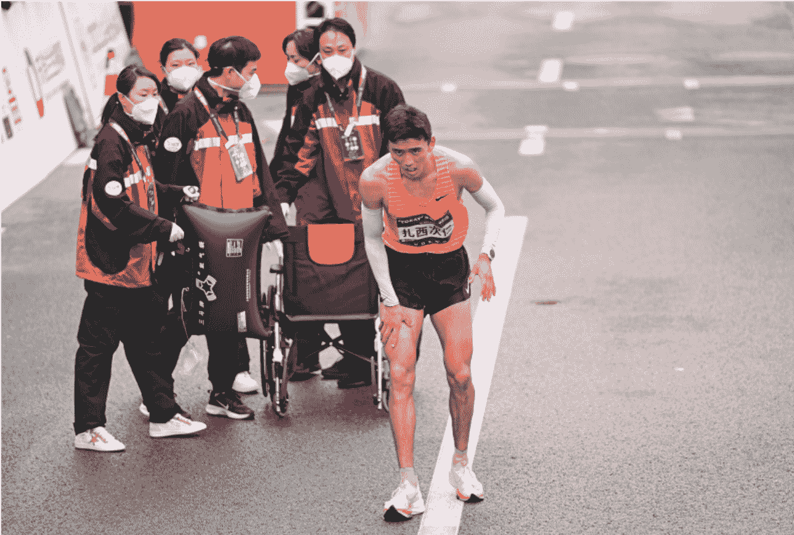

# CAIXIN|听文章

文|财新周刊 杨玉琪 许雯

一次骑行中摔倒，从急诊到骨科再到运动医学科，吴旭（化名）确诊右膝前交叉韧带断裂时已过去一个月。伤腿因为废用性萎缩细了一圈，医生建议尽快手术。

她那时不知道术后还有漫长的康复训练。这意味着，从受伤到恢复膝盖功能，几乎需要十个月时间。但医生们清楚，也越来越频繁地告知患者——运动损伤人群正在增加。

据运动康复产业联盟、复旦大学运动医学研究所等机构发布的《2023—2024年版中国运动康复产业白皮书》统计，全国近4.3亿有长期运动习惯的人群中，约1亿是运动损伤人群。

中国运动医学凭借2008年北京奥运会和2022年冬奥会契机迎来快速发展，逐渐在医院中脱离骨科，成为独立科室。但目前全国3000家公立医院中，单独设有运动医学科的仍不足百家。国内也尚未进行运动损伤发生率、发生类型等流行病学统计。

2025年春节前夕，北京国安俱乐部18岁足球小将郭嘉璇作为北京男子U20足球队一员赴西班牙马德里冬训，在与西班牙阿尔科文达斯队的一场教学比赛中，防守铲球时与对方球员碰撞后昏迷，在当地抢救后被诊断为脑死亡。回国治疗后，3月19日不幸去世。2023年6月，郭嘉璇成为该届惟一入选拜仁世界队的中国球员。图：德甲拜仁慕尼黑足球俱乐部社交媒体

医生们体感明显：近年来，普通人运动损伤就诊越来越多，类型也越来越多样。大众对运动损伤认识有限，开设相应科室的医院相对较少，常常贻误了最佳治疗时间。

诊疗过程中，即便是同一个患者，医生经验、影像质量、手术水准都直接影响诊断和恢复效果。多位受访医生提到，受限于信息不对等和地区医疗水平差距，运动损伤漏诊、误诊较为常见，过度医疗也时有发生。走到康复环节，优质医疗服务供给落后于社会需求，患者被挤压向资质模糊的机构，康复效果面临更大不确定性。

患者数量急速扩张，医卫系统有待调整。当现实矛盾不幸由个人承受，往往意味着运动能力甚至生活质量的永久缺陷。

### 患者暴增

文言（化名）在北京工作，去年夏天在健身房找了一对一私教拳击。她学习新的挥拳动作时，右肩关节弹响，肩膀始终隐隐作痛。起初文言并未重视，但肩膀越来越疼，延宕数月。到了冬天，胳膊完全抬不起来，方决定就医，此时医生告知，必须做手术。

在医院，她见到了很多同病相怜的病友。刘琦（化名）是南方一所体育高校的大二学生，在一场羽毛球比赛中一记大力扣杀后肩受伤，趁着放寒假，从老家内蒙古来到北京做手术。他担心术后“可能就退役了”。

此类运动损伤患者，中华医学会运动医疗分会副主任委员、南京鼓楼医院运动医学与成人重建外科主任蒋青在诊室也见过很多。运动损伤即运动中发生的损伤。蒋青介绍，它既包括运动中受到外力发生的急性损伤，也包括由于运动反复磨损造成的慢性损伤。其中，剧烈对抗性运动容易出现急性损伤，导致四肢关节、肌肉、肌腱、韧带受损，以膝关节为例，最常见的是前交叉韧带、内侧副韧带、半月板损伤。

慢性损伤表现出典型的职业病性质，往往与患者从事的运动有关。“大家经常听到有足球踝、篮球膝、网球肘。”蒋青说。他根据国外数据梳理出，交叉韧带和半月板损伤在下肢运动中最常见，肩袖损伤在上肢运动中易发生。其中半月板损伤在全球范围内发生率约12%——每十个人当中就有一例。

“实际在运动医学领域，运动损伤不仅仅包含这些。”蒋青强调，广义上的运动损伤，实则涵盖范围非常广，例如颅脑外伤、眼部外伤、胸部外伤，甚至泌尿生殖系统如尿道损伤，都属于运动损伤范畴。

国家体育总局运动医学研究所体育医院康复医学科主任娄志堃补充道，失温、脱水、电解质紊乱，也都是运动中常见的问题。据她观察，部分运动损伤还有明显的季节性变化。每年春节过后，由滑雪造成的膝关节、踝关节损伤特别多；3月春暖花开，户外运动增多，踝扭伤、跟腱受伤的患者变多；到7、8月，不少在体育课或平时运动中受伤的学生，会选择暑期开始接受治疗或做手术。

“过去运动损伤群体主要是专业运动员，现在发生损伤的非专业运动员越来越多。”在蒋青接诊的患者中，仅有10%是专业运动员。蒋青称，业余爱好者运动保护意识不强，大多在非专业场所运动，没有医务监督人员，而且平时缺乏锻炼，肌肉力量不足或关节韧带柔韧性不高，面临更高运动风险。当运动前热身不足、运动时姿势不正确，又突然从事较大强度运动时就容易受伤。

娄志堃举例，比如网球肘，学名肱骨外上髁炎，表现为手肘外侧酸胀疼痛，这在专业运动员群体并不常见，多数是业余网球爱好者因运动技术不合理或自身身体条件不好，造成损伤。她还发现，近年来运动损伤类型愈加专业化，过去很多小磕小碰，现在前交叉韧带、半月板等损伤变多，患者术后追求恢复运动能力，“越来越倾向高水平运动员的损伤”。

近年国内运动损伤发生率增加趋势显著。“今年一开始基本就满床了。”蒋青所在的南京鼓楼医院每年运动损伤手术量已达到3000台，通常门诊患者中10%需要收住院手术，以此推算，运动损伤患者数量接近3万人。

“患者暴增。”娄志堃感受也很明显。她记得，2013年她负责组建科室时住院患者只有十几个，现在门诊患者就诊数量翻倍、床位基本满员。新冠疫情后运动损伤患者更出现井喷，她半天要接诊30个患者。

运动损伤患者激增背后，是全民健身的热潮涌动。2019年《体育强国建设纲要》要求，到2035年，经常参加体育锻炼人数比例达到45%以上。以14亿人口推算，约为6.3亿。可以预见，运动损伤患者的激增不会是短期现象，但无论社会抑或个人，还没有为这种转变做好准备，从治疗到康复皆有短板待补。

### 治疗常被延误

摔倒后，吴旭接连跑了三家医院。第一次的三甲医院急诊医生安排她照X光，诊断骨头无碍，让她回家消肿。不见好转，吴旭排上了同家医院一周后的骨科号，就诊时医生看着CT结果打下“胫骨平台后缘骨挫伤、骨折？”诊断。又等了一周，吴旭再次来到骨科，医生替她约上了核磁。

### 康复之痛

术后手术取出固定螺钉。效果不佳的手术，还会有膝关节不稳定、韧带松弛等后遗症，甚至二次断裂可能。

现实情形中，保守治疗也存在误区，许多人将其等同于“放养在家待着”，反而导致病情恶化。娄志堃指出，不少医生一旦判断病人没有结构上的大问题，不需要动手术，就让他们回家养着。实际上这不仅对恢复伤处功能无益，邻近部位还会因为肢体不活动出现废用性萎缩。

对运动损伤患者来说，手术成功只是第一步，能否在之后漫长而疼痛的康复中坚持，才最终决定多大程度上重返日常生活。

出院时，文言拿到写满两张A4纸的术后康复计划。康复师制定了个性化计划，包含20多个康复动作，她要分阶段用不同动作锻炼，康复周期在1到3个月。

“我们常说‘三分治疗、七分康复’，一点都不为过。”余家阔强调，康复效果不佳可能导致患者手术失败甚至死亡。他进一步解释，比如肩袖手术后，患者肩膀活动不到位，角度受限，很多事情做不了，对手术效果影响很大。更严重的情况是康复过程中血栓预防不到位，导致患者死亡。

专业的康复指导不可或缺。“不能因为想快速康复动早了，该长的韧带没长好，也不能因为害怕长不牢又不动。”蒋青认为，过去医生对康复重视不足，经常仅仅口头叮嘱患者，未给出科学指导。

实际上，康复从术前就应介入，贯穿治疗全周期。有些损伤情形中，术前康复水平越高，术后康复所需时间越短。余家阔告诉财新，手术前，康复医生要对病人做术前培训，指导病人熟悉康复要求、术后如何使用支具、如何锻炼肌肉；手术后，康复和护理要指导病人预防血栓；病人出院后，要提供康复计划。

“康复计划必须与时俱进、有科学性，我们每年都会根据最新研究成果更新康复方案。我们统计，95%的患者可以按照康复计划顺利完成康复，剩下5%患者需要在康复医生指导下做康复训练。”余家阔遗憾表示，还有医院不给患者康复计划。

社会对运动康复的需求水涨船高。“整体来说，国内专业运动康复供给还不充分。”蒋青认为，原因一方面在于运动损伤患者人群庞大，社会需求较大；另一方面是专业康复机构和医生不足。

蒋青认为，在大型综合医院内部，康复服务资源往往集中于脑血管意外后的神经康复，运动康复获得的资源相对较少。余家阔看到，专科特点使有些医院运动损伤患者较少，康复医生对这类康复经验不足、专业性也不够强。

娄志堃更担心手术与康复之间的割裂。理想情况下，医生和康复师应团队协作，互相配合，但现实中除了少数运动医学水平顶尖的医院运动医学科拥有自己的康复团队，多数医院内部运动医学与康复分属不同科室，手术医生只管手术，不会从康复角度考虑，康复医生也不会从手术角度考虑，衔接出现“断层”，“康复和运动医学虽然有交叉，但医生和康复师教育、从业背景不同，医疗思维和治疗手段存在区别”。

康复治疗价格体系不完善，也影响服务可及性。吴旭在手术医院的运动医学科康复团队做康复，虽然已经省去了康复科抢号的麻烦，但只有复查时才能约上后续几次的康复疗程，让她不得不“省着用”。医院康复250元一次，每次复查约上三至五次，医保个人账户可支付相当比例。但几次核磁已让吴旭个账“见底”，她头三次康复的750元里，基金和个账分别支付33.31元和333.37元。出于恢复进度焦虑，她也考虑过到私人机构提高康复频率，但动辄每次八百、千元的费用让她望而却步。

2011年起，康复项目开始纳入医保报销范围。“这是康复行业的春天。”但娄志堃也告诉财新，虽然医保政策在2024年11月优化调整，从术后负担康复治疗3个月延长到6个月，仍难覆盖一些患者术后恢复期，例如前交叉韧带重建恢复一般需要8个月甚至1年。此外，一些新的康复治疗项目没有收费标准，尤其是康复新技术和康复评估测试项目，医院无法向患者收费，成本考虑下很难有动力新添十几万乃至数十万元一台的康复设备，更新康复技术。

康复医生短缺问题同样棘手。“我们对康复医生的要求是要有四到五年以上经验，并且要经过长时间的专科培训。高水平的专科康复师至少要有几千例的专科康复经验，患者的康复才有保障。”余家阔说。

符合要求者少之又少。“招康复医生太难了，我好几年才招了一个。”面对越来越多的患者，一名公立医院康复科主任想增加团队人手，但遭遇用人难题。她坦言，科室对医生没有吸引力，因为康复治疗付出和收入不成正比。

以物理治疗中的关节松动训练为例，包含专业康复医师的诊断、制定个性化治疗方案，及每次治疗时的精准操作，需要耗费大量时间、精力，但目前每次收费仅20-55元，远低于人力、设备损耗、场地等成本之和。“半小时到一小时的康复训练，收费还不到100元，有哪个医院愿意开这样一个赔钱的科室？又有谁愿意从事这个行业？”前述康复科主任连连发问。

公立医疗机构之外，私立运动康复机构近年如雨后春笋。据《2023—2024年版中国运动康复产业白皮书》，2018年全国运动康复机构门店数量约为100家，2020年底增长至370家，2023年数量翻倍，达到750家。

文言的朋友在腰部损伤后选择了一家私立运动医学康复诊所。单次康复项目收费在800至1200元之间，北京普惠健康保可以报销前三次康复费用。经过几次康复训练，她的腰部疼痛症状减轻。

多名业内人士受访时表示，康复机构对尚不充足的康复服务资源提供了补充，但也要看到，现有康复机构水平参差不齐，“这是一个社会问题，也是我们这个行业的痛”。

供职于社会机构的康复师普遍欠缺医疗经验。娄志堃认为，康复医生应当起到“风险把控”作用，首先应对患者病情做初步诊断和识别，判断患者身体是存在结构问题还是功能问题，是否需要手术治疗，或者其他治疗手段。康复师若对诊疗知识掌握不足，对治疗风险把控不够，容易出现误诊和漏诊。

余家阔提醒，康复师经验或积累不足容易出现两个极端：一种是康复师没有经验、不敢练，追求保险，导致患者锻炼角度不到位，最终出现功能障碍；另一种是过于激进，例如韧带重建早期过度康复，导致韧带和骨头无法愈合。“过度康复”也不鲜见，康复时长过长、项目过多，“不必要的体操球、CPM机(持续被动运动机)......每天都上好几个项目，病人的腿肿得一塌糊涂”。

“目前康复机构可能更适合面向亚健康人群，而非患者。”娄志堃希望康复行业可以在政策引导下走向规范化管理，让医院与康复机构互相补充，惠益患者。

### 快车道发展呼唤顶层设计

当运动健身越来越多地融入人们的日常生活，如何系统性预防运动损伤、医疗服务能否满足运动损伤的治疗和康复需求？

答案尚未可知。中国尚未有全国性运动损伤流行病学权威数据。余家阔称，学界现有参考数据多来自美国，但中美两国人群运动情况相差悬殊。美国人运动频率高、强度也更大，“3亿多人口每年有90多万台交叉韧带手术，按比例计算中国应达360万例，扣除两国人群运动特征的差异，实际我国每年手术例数要大打折扣，但没有具体数据”。

娄志堃曾为中国高尔夫球队做过小范围损伤统计，意识到这项工作面临项目分布广、专业要求高、就医机构多等困难。“我跟球队合作了10多年，尚且要查阅大量国内外文献，结合运动队长期工作经验才做出问卷。面向群体的选择和对问卷的重视程度、理解、认知、认真程度、心态等，都会影响问卷的真实性和有效性。”此外，综合性医院、专业性医院、社区医院等医疗机构均可接诊运动损伤，公众锻炼短期内参与多项运动以至归因困难等因素，都增加了统计难度。

难度或许只是一方面原因。余家阔认为，没有数据，医疗资源的相应布局也无从谈起。他提出，全国运动损伤数据可以仿照美国、瑞典由国家出资的专门机构直接统计，也可通过医疗保险全国联网的方式间接获取。掌握数据，意味着明确了不同项目的损伤风险，有助于针对性预防损伤、精进体育水平。

保险也被娄志堃视为损伤统计的可行方案。她称，医疗机构可以与保险公司合作，利用保险公司数据梳理出运动损伤人群特征、损伤类型、发生地区、损伤特点、损伤原因等维度，从后端做损伤问卷调查。

娄志堃认为，数据分析将为体育赛事、活动甚至校园课程提供现实指导。“看这部分人群是在哪个环节受伤，伤及什么部位？是由于自身竞技水平不够，还是赛事组织方筹备不足，或是医疗设备配备不够？”

在与日俱增的运动损伤诊疗和康复需求面前，中国运动医学已开始加速跑。中国运动医学发展始于20世纪50年代，2008年北京奥运会后驶入快车道。1955年，运动医学在国内萌芽，初期仅面向竞技体育中专业运动员的赛事保障和伤病救治。2008年奥运会后，国内运动人群渐增，运动医学从竞技体育走向服务公众。

多位受访者认为，这种转变带来大量临床实践，提高了医生的诊疗水准，尤其培养他们处理复杂手术的能力，也为专业运动员运动损伤的治疗积累经验。两者互相促进，成为运动医学发展的总趋势。

近年来，更多医院将运动医学从骨科剥离，“自立门户”。此前仅有少数大型综合医院或以运动医学见长的医院拥有单独的运动医学科，绝大部分运动损伤诊疗都归于骨科下关节外科业务。蒋青回忆，2007年中华医学会运动医学分会设立时，全国各大医院尚未建制运动医学科，分会委员基本是骨科医生，或是康复科、运动营养和兴奋剂研究人员。

2022年，连续14年发布的“复旦版”中国医院排行榜将运动医学单列排名，被视为学科发展的又一契机。这份由复旦大学医院管理研究所发布的榜单是不少患者求医问诊的指南，也在医疗界内部有重要参考意义。多位业内人士指出，为提高排名，许多医院将运动医学独立建制单独设立运动医学科室，增强专业性的同时也遇到局限。在余家阔看来，骨科与运动医学在治疗理念、治疗目的和治疗方法方面仍有差别，骨科更关注疾病本身，而运动医学更关注如何让患者重返运动。二者互为补充，才是保证治疗效果的最优解，这也是国际趋势。他举例，比如美国宾夕法尼亚大学的运动医学专业，就没有独立在骨科之外。

但在国内，原本交叉融合的两个学科，已有分庭抗礼之势。多位业内人士提到，许多运动损伤处于二者交叉地带，但囿于医院内部竞争等原因，骨科将运动医学视为抢患者的竞争对手，更有不少医院为求内部平衡，限定骨折、关节置换的手术只能放在骨科，运动医学只做关节镜手术，而这显然无助于两个学科的发展，更无益于患者健康权益。

余家阔认为，在这种情况下单独设立运动医学科反而会限制整个骨科和运动医学的发展，限制运动医学保障运动员的能力，“更长远来说，中国将有6亿多人参加体育锻炼，如何保证全民健身过程中普通运动爱好者运动损伤后得到多学科、全方位协同处理？”

从根本上，多位受访者提醒，减轻运动损伤医疗服务供需矛盾，还应当从源头减少患者。娄志堃常年面向公众做运动损伤科普，她的不少听众是运动“小白”，经过科普可以初步掌握急性运动损伤现场如何处理，“但再进一步就需要更专业的知识和人员”。实际上，不同运动项目对应不同损伤预防和处理方法，需要分层级、分类别对特定运动群体普及防护知识、科普宣教，甚至培养更多不同方向的专业从业人员，以满足越来越多运动群体的多样性需求。

在余家阔看来，还需改善前端的运动场地、器材设备、培训服务等配套措施，从顶层设计着手，同时推进体育工程、体育产业、体育科学、体育训练等系统性工作。

## 最新财新周刊 | 中国家电加速全球布局

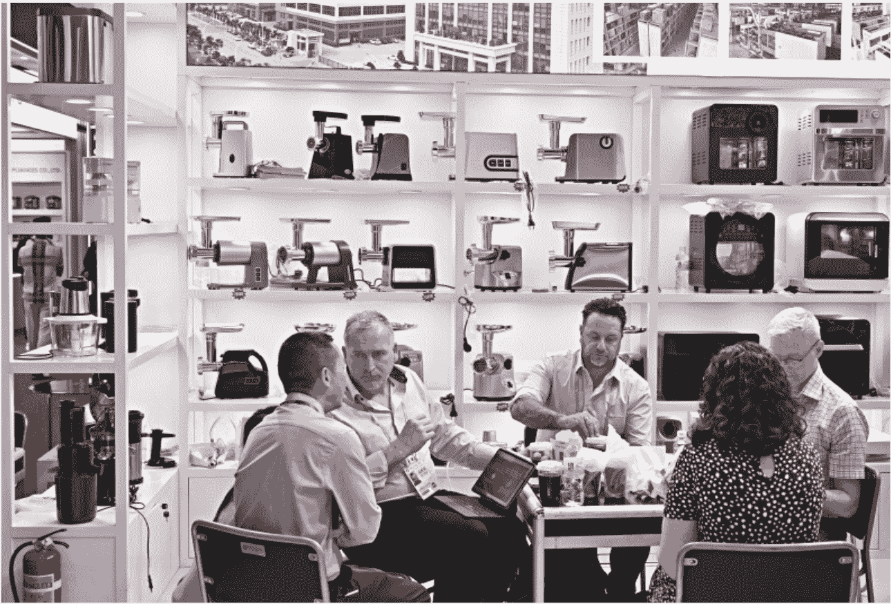

## CAIXIN | 听文章

文 | 财新周刊 覃敏

“领导们目前都在国外出差，去拜访客户、抢订单，为广交会(中国进出口商品交易会)打前站了。”一家老牌家电厂商的员工告诉财新。春季广交会4月开展，历来是外商云集、签约下订的窗口期，家电厂商往往在广交会前后密集拜访客户、争取新订单。

一名广东中山的家电企业高管对财新感慨：“近年明显感觉到业内都在谈‘出海’。以前可能是大家电品牌才会‘出海’，如今二、三线厂商都在‘出海’，不仅通过代工方式，还敢去尝试输出自有品牌。比如九阳、荣事达等公司，都开始在海外打自有品牌。”

小米家电也开始瞄向海外。3月，在巴塞罗那举行的世界移动通信大会期间，小米集团总裁卢伟冰表示，2025年晚些时候，小米计划将空调、冰箱、洗衣机等大型家用电器推向国际市场。山海图产业研究院研究员李建材常去海外调研家电市场，他对财新称，东南亚已经可以看到小米家电的身影，比如泰国、越南的小米商城官网上线了吸尘器、净化器等小家电；线下渠道也在发力，有一些门店展示小米家电产品。

中国家用电器协会副理事长徐东生对财新分析，近年来，贸易环境发生变化，越来越多的中国家电企业寻求多元化“出海”。一方面，2024年国内家电市场零售额9071亿元，出口额8205亿元，出口和内销同等重要；另一方面，国内家电市场进入存量竞争阶段，近几年基本维持在八九千亿元的规模，几乎横盘，竞争异常激烈。但海外特别是新兴市场仍有较大潜力，中国家电出口额从2019年的700多亿美元增长到2024年的1124亿美元，短短五年增长了60%。

“现在国内家电市场实在是太‘卷’了。”中国机电产品进出口商会家用电器分会秘书长周南感慨，以前家电企业做国内的利润要比做出口多，但近年已经不如出口了，所以家电企业大规模“出海”寻找增量。

周南观察到，随着技术升级、产品创新，近年中国家电厂商在海外声量日益壮大，尤以海信、海尔、TCL等为代表，其优势产品已冲进高端市场，可与三星、LG、大金等日韩品牌叫板。比如，滚筒洗衣机原为日韩品牌的天下，近两年中国品牌出口量明显提升，带动2024年中国洗衣机整体出口金额达到64亿美元。

中国许多家电厂商不再满足于只为国外客户代工，近年来着力发展自有品牌。美的是一家拥有40年“出海”经验的企业，在海外以代工业务起步，之后虽打出了美的自有品牌，并通过收购东芝等外资品牌拓展了市场，但代工业务仍是美的海外市场的营收大头。2023年，美的提出“OBM优先战略”，即在业务发生冲突的时候优先发展自有品牌，并由此进行了一系列内部机制变革，预计2025年内基本完成相应的全球布局。

市场调研机构Counterpoint Research资深分析师Ivan Lam对财新指出，中国产品在价格、高端技术平民化等方面的优势，会带来更多的增长空间；但挑战也非常大，主要是消费者品牌认知、产品零部件价格攀升、营销成本等，这都需要后续去克服。

值得注意的是，美国新任总统唐纳德·特朗普上台后，对中国商品加征10%关税的措施在2月4日生效，不到一个月后又追加10%关税，今年以来累计加征关税税率达20%，这给中国家电出口蒙上了阴影。上述业内人士指出，2019年美国就通过“301条款”对中国商品加征关税，但涉及不同家电品类税率不同，最高达到25%，2025年则是无差别加征关税，两者叠加关税最高达到45%。目前，空调、冷柜、冰箱等品类出口到美国税率约为45%—48%。

“我们内部测算过，如果不考虑关税冲击，中国国内制造成本比国外要低15%—20%。在逆全球化、贸易战等错综复杂的国际环境下，中国家电企业加速全球布局，不少企业选择在东南亚、中东、拉美投资建厂。”上述熟悉家电“出海”的人士说。

徐东生预计，2025年将是中国家电出口面临较大挑战的一年，预期偏谨慎。一方面是2024年高基数带来增长挑战，1124亿美元出口额、14.0%的增速均创历史新高。另一方面需求环境也在变化，虽然海外通胀预期有所下降，但特朗普的关税政策实施和美联储政策的不确定性，以及补库存周期转换或将带来的需求收缩；同时，企业海外产能的加快布局、2024年美国大选带来的“抢出口”现象消退、以价换量特征减弱等因素，都会对出口带来抑制。

### 深入中高端市场

“中国企业、中国品牌在海外业务的增长，更多是与国际巨头、跨国公司抢份额。”TCL创始人、董事长李东生在2025年全国两会期间表示。

周南亦称，中国的家电企业整体实力增强，除了继续深耕中低端市场，也在一步步深入中高端市场——这曾经是三星、LG等韩国品牌的核心腹地。“中国家电企业在全球竞争中具备‘夺金牌’能力，但目前仍需从品牌、技术创新等方面再接力。”他强调。

TCL实业副总裁江彪对财新表示，在全球电视行业，前四名品牌吃掉了七八成份额；若要进入前四，仅靠性价比市场是不太可能做到的，必须冲刺中高端市场。

要做中高端，首先得有产品。江彪称，海外主流电视尺寸原来是55寸，一些高端品牌会做到65寸。而TCL全面发力大屏战略，通过QD-miniLED技术及屏幕技术创新，将电视拉到75寸、85寸甚至115寸的规格。“OLED面板技术路线成本高、晶体管相对容易损坏，而且很难做到超大屏，大概65寸、75寸就是极限了。全球来看，OLED电视出货量约600万台，miniLED2025年的出货量预计达到800万—1000万台。”

渠道方面，TCL也需要从大众渠道向中高端渠道拓展，比如在美国，TCL与Bestbuy、Costco等高端零售渠道合作；在瑞士最大连锁渠道Migros，TCL的产品和三星同价且同等位置摆放。

“有了高端产品和渠道，还需要消费者认可。”江彪说，过去几年，TCL加大了在体育赛事领域的投入，比如在北美赞助NFL(美国职业橄榄球大联盟)，近期成为奥林匹克全球合作伙伴。截至目前，TCL已与40多个体育IP(知识产权)合作，提升了知名度和美誉度。

海信被业内视为家电行业海外品牌化的“鼻祖”。2016年，海信成为第一家赞助欧洲杯的中国家电品牌，2018年又成为首家赞助世界杯的中国家电品牌。海信国际营销公司副总裁Jerry Liu对财新表示，海信整体的思路是高举高打、走高质量路线，从品牌、产品力、渠道、供应链等方面发力。“赞助欧洲杯之后，海信的打法、段位、能力都不一样了，我们现在敢于参与最高端的竞争。”

上述熟悉家电“出海”的人士直言，韩国三星每年的品牌投入远超中国家电厂商，且多年积累下来的品牌影响力不容小觑，在许多国外展会上，三星都是包下整个展馆，布展也极有品位。“中国家电品牌迎头赶上，更多要靠产品力。”

欧美向来被视为家电消费高地，在全球家电品牌深耕之下，如今市场几乎饱和，当前一大产品趋势是向高端化、智能化升级。

海尔方面对财新介绍，海尔从欧洲本土用户调研中了解到用户对节能、绿色产品的需求，经过6个月、30多个项目的100多次测试，于2024年在欧洲推出了海尔X11系列洗衣机，不仅比A级能耗还节能60%，还能最长持续进行12小时的换风，有效防止因忘记取衣而产生霉味。该产品在法国、波兰、意大利、西班牙等多国上市之后，迅速拿下当地10%的高端市场份额，带动海尔整体价格指数提升。

除了老牌中国家电企业“向上走”，一些小家电创业公司也在新兴品类上崭露头角。以扫地机器人为例，在美国最大社区网站Reddit上，Roborock和Dreame是用户推荐最多的两个品牌，分别来自中国的石头科技和追觅科技。市场调研机构IDC的数据显示，2024年三季度以出货量计，石头科技、iRobot、科沃斯、小米、追觅科技是全球前五大扫地机器人厂商，市占率分别为16.4%、13.5%、13.1%、10.3%和7.6%，中国品牌占据四席。

徐东生称，欧美对高科技、好创意接受度高，而中国公司在新品类上极具产品力，且迭代迅速，应用场景丰富，很有潜力在欧美打开局面。

海尔集团CEO周云杰直言，一个企业要走向世界，必须锚定“科技创新”这个基点，不断地去“寻尖”“拔尖”，才能真正地成为“顶尖”。他举例称，2014年在国际电工委员会上，海尔首次提出了冰箱保鲜国际标准，但遭到很多国家代表的反对，理由是中国企业不可能“从0到1”地制定一个国际标准。“为什么中国企业不能？我们不相信，所以海尔坚持自主创新，提出控氧保鲜、磁控保鲜等原创技术，最终在2020年成功发布为国际标准。目前，该标准已被英国、欧盟等20多个国家和地区采用。”他说。

深圳创维RGB电子有限公司执行副总裁兼海外营销总部总经理张洪君对财新表示，中国已具备定义全球标准的能力，以创维为例，就有五项国际标准获国际电信联盟（ITU）批准发布。

“2019年时遭遇美国加税，大家认为家电行业比较难，后来又有疫情。如今看来，中国家电品牌的全球竞争力并未因疫情削减，近年来品牌张力反而在不断提升，我们的目标是下一个五年，中国家电企业能够引领全球家电产业的发展。”周南表示。

### 加码自主品牌

“我们在一些市场抢了部分欧美、日韩品牌的份额，而它们也转变策略，比如飞利浦就进行品牌授权，在中国贴牌再卖到海外。”一名头部中国家电企业高管对财新称，目前公司主要竞争对手瞄准三星、LG。“它们自己生产的中低端产品成本高、功能迭代慢，很难与我们竞争。而这些年中国代工能力显著提升，它们把部分中低端产品给到中国厂商来代工，以此降低成本、提升产品力。我们的应对策略就是在夯实中低端市场的基础上，在高端市场持续推出有竞争力的产品。”

从上世纪90年代开始，多数中国家电企业以贴牌代工方式“出海”，这种方式见效快，只要把控好质量、成本和交货期，就能赚到钱。近年来，越来越多的中国代工厂商开始加码自有品牌。

2025年1月，美的集团董事长兼总裁方洪波在公司经营管理年会上表示，2024年，美的在全球业务上有所突破，但相对于很多优秀的企业，美的海外发展的速度、深度和广度仍然差距明显。OBM优先、全面走出去，是美的当下的第一要务。

“美的代工业务一直保持增长，之所以提出自主品牌优先，是因为美的希望触达更多的家电品类、获取更大的市场空间。”美的国际总裁付鉴向财新解释，在全球市场尤其是欧美市场，冰箱、洗衣机等大家电品类更多还是品牌厂商占据主要份额，它们通常会自己生产核心产品，给到中国厂商代工的要么是非主流小品牌，要么是非核心产品，比如大型空调、四门法式冰箱、大烤箱就很少会找中国厂商代工，这意味着代工业务是有发展瓶颈的，美的要通过自有品牌进入这类市场寻增长。

美的在研发、供应链、销售网络、品牌等层面，为“出海”作相应调整。“代工只需达到客户要求就可以，现在发力自主品牌，需要依托海外17个研发中心，更深入洞察全球消费市场的用户需求、开发产品；同时我们提出了‘区域供区域’策略，充分利用22个海外制造基地，缩短物流时间、保证自有品牌及时交付。”付鉴介绍。

在销售网络层面，目前美的在全球30多个国家建立了分公司，预计2025年底增至50个分公司。“不同国家的销售渠道差异很大，通过本地子公司能更好触达当地渠道。”付鉴还提及，此前一些渠道商也是美的代工业务的客户，美的打自主品牌时，这类渠道资源很容易切换过来。“渠道商通常代工的是一些基础款产品，美的做的自主品牌和它们打出差异化，它们也乐意合作。”

美的专门成立了30亿元的OBM基金，主要用于海外自有品牌推广、体育赛事赞助和门店建设。付鉴称，2025年美的在海外的自主品牌投入将翻番。

美的近年陆续收购了日本东芝家电（东芝生活电器株式会社）、意大利中央空调品牌Clivet、瑞士建筑商Arbonia旗下供暖业务、西班牙厨电品牌Teka。“这是我们品牌战略的一部分，在一些市场能够收购到当地的强势品牌，比如东芝家电，我们就充分利用该品牌提供本土化服务；在主要市场，我们就发力美的自有品牌。”付鉴介绍，2024年，在海外市场，美的自有品牌业务的增速远高于代工业务，取得了诸多突破，比如冰箱产品在马来西亚、沙特、智利等国家取得市场份额第一，在越南、泰国等国家提升至市场份额第二；洗衣机产品在马来西亚、沙特的市场份额分别达到第一和第二。

张洪君对财新直言，早期代工是“借船出海”，解决生存问题；而当下中国头部企业更追求“造船远航”，通过品牌溢价、用户数据沉淀、技术迭代闭环，实现可持续发展。目前，创维自有品牌营收占比持续扩大，形成“双轨并行”的良性格局。

头部代工企业之外，许多二、三线代工企业也在用自有品牌“出海”。荣事达是合肥国资荣电集团旗下家电品牌，2019年开始为海外客户代工，并为跨境电商客户供货。2024年，荣电集团开始以自有品牌荣事达“出海”。目前，荣电外贸事业部有200多人，目标在未来五年内，海外收入占集团营收的60%。

> “我们从美国第三大渠道商的代工业务起步，一直都在为欧美客户代工。但是，特朗普对中国商品加征关税，欧美市场可能存在不确定性，同时公司也需要新的增长点，做品牌比做代工利润也高。”荣电集团外贸事业部执行总经理刘谋东对财新介绍，荣事达自有品牌“出海”主要是两条路径：一条是通过跨境电商，2024年4月与京东合作“出海”欧洲，如今每个月销售额大约三四千万元，2025年也在考虑接入Temu、TikTok等；一条是瞄准东南亚市场，通过与当地渠道商合作，出口小家电产品，之后再陆续拓展到大家电品类。

中国跨境电商的快速发展，为中小型家电品牌“出海”提供了大通道。一名熟悉跨境电商的家电业人士称，以前中小型家电品牌主要通过参加广交会或海外展会“出海”，囿于规模，许多创意很难被海外客户看见。四五年前，随着物流、运营等体系不断完善，中小型家电企业涌入跨境电商平台，如今在广东就有成千上万家厂商每天都在研究爆款。一般来说，大家电很少走跨境电商，主要是物流成本太高，小家电则可选跨境电商平台的全托管模式、半托管模式，根据入驻方式、品牌强度、月销量等综合考量佣金，比如一般亚马逊佣金率为8%—15%，Temu佣金率为6%—10%。

徐东生分析，欧美家电市场渠道商比较强势，比如美国的渠道商对产品的定义、售价具备很强的控制力，且品牌壁垒也高，在主流家电品类上对头部品牌或本土品牌忠诚度也很高，中小型家电企业想以自有品牌打开市场并不容易，从东南亚、中东等“一带一路”市场切入反而更有机会。

上述头部中国家电企业高管提醒，“出海”的家电厂商越来越多，也将中国市场的一些打法复制到了海外，“卷”产品、杀低价。“实际上在海外并非价格越低越好，还是要尊重当地的行业生态，为各个环节的合作伙伴留下利益空间。”

### 布局本土制造

中国家电“出海”高歌猛进之际，风险已然袭来。徐东生认为，美国加征关税是一个风向标，后续存在继续加征关税的可能性，或进一步带动全球关税战，未来中国家电企业势必“补链强链”，加强在海外的本土制造布局。

新一轮关税威胁之下，中国家电厂商不得不重新考虑全球产能的布局。2018年之前，头部中国家电厂商出于品牌“出海”需要，主动在海外建厂，就近服务海外用户；2019年前后，中美贸易战摩擦、印度及欧洲地区对本土制造要求提升，加速中国家电企业产能外迁，东南亚、中东、拉美等地承接了大部分产能。

考虑到人力成本低、距离北美近，且具有美加墨协定优惠政策，墨西哥一度吸引诸多家电厂商，比如海信于2021年斥资2.6亿美元在墨西哥蒙特雷投建家电产业园。被问及美国对墨西哥加征关税的影响时，海信回应称，墨西哥工厂收入占比小、影响可控，后续将持续完善在东南亚的工厂建设，满足未来北美全品类白电潜在需求，并将持续多元化布局海外供应链和制造平台，从而应对各种可能的突发关税政策。

近年来，中国家电厂商最多的产能输出地还是在东南亚。以美的为例，2005年，美的在越南开设了第一个海外生产基地，主要生产吸尘器、风扇、电饭煲等小家电，供应东南亚本地市场之外，也出口至北美、欧洲等。此后，美的向泰国、印尼延展布局，并于2021年之后步伐加快，目前在泰国共有七大制造基地，涵盖家用空调、洗衣机、冰箱、微波炉及清洁电器等多个领域，员工总数超过1万人。“随着产能和业务版图扩展，我们计划进一步增加员工数量并提升生产能力。”美的集团亚太区总裁蒋轩表示。

在组织架构层面，2024年，美的在泰国设立了区域总部，与新加坡总部形成双枢纽运营模式，进一步巩固泰国作为亚太区制造和分销核心的战略地位。

为提升物流水平，美的于2024年四季度在曼谷启用泰国区域备件中心，该中心仓储面积为1000平方米，将东南亚市场的平均交付周期从60天缩短至45天。

徐东生分析称，一般家电企业“出海”考虑当地产业基础、与中国关系的稳定性、转出口以及港口等因素，当前中国家电厂商“出海”第一热点是东南亚，尤其是泰国、越南、印尼等地。泰国、越南本身就是东南亚的制造业中心，而且与中国关系较稳定。

“东南亚市场虽有潜力，但近期很难消化那么多的产能，许多中国家电厂商在布局东南亚之后，另一个目标是做出口基地，在当地生产达到40%—50%的比例，以满足转出口的原产地要求，因此也在培育当地的供应链。”徐东生介绍，短期内，一些材料、零部件还需要从中国运过去；但长期来看，当地供应链生态会慢慢成长起来，就像中国20年前走过的历程一样。

Ivan Lam则指出，大家电整体运输成本偏高，而很多家电的产业链都在中国南方，相对来说去越南、泰国建厂会更加便利，且两国大力扶持外资本地建厂，免税、减税方面政策较为稳定；而菲律宾、印尼是岛国，当地建厂的成本就会高出不少。

泰国、越南各有侧重。李建材介绍，如果是大家电尤其是白电，建厂优先选择泰国。泰国现在是东南亚第一大白电制造中心，日系、欧美系厂商都在泰国投资建厂，中资的美的、海尔等厂商也在泰国多有布局，相关的生态配套比较完善。如果是小家电建厂，选择越南更合适，主要考虑越南的产业聚集、地理位置等，比如吸尘器厂商德昌在越南拥有380万台的吸尘器产能，其他品类的小家电产能也达300万台。

李建材提醒，如今进入东南亚市场面临的隐性成本要比预期高。首先是外资踊跃在东南亚投资设厂，劳动力需求大，抬高人力成本，如今许多地区普工工资已经涨到三千元左右，尽管相对中国工人仍较低，但面临不少隐性成本，比如当地工人重视假期、福利等，工作效率偏低、管理难度大。“我曾在那边落地一个项目，按照国内流程三四天就可以做完，那边用了一个月。”

东南亚国家的一些工业园区的租金也水涨船高，一些热门工业园区租金年涨幅超过50%。此外，维护政府关系也需要不菲成本。李建材还提及，一些东南亚国家基础设施不完备，水、电不稳定，一旦断电对生产造成的损失也不容忽视。

李东生直言，过去几年最大的变化是企业要适应全球贸易规则的变化、全球经济格局的重构，把产业和供应链能力更深地扎根到全球主要区域市场。

他介绍，原来TCL是以中国为中心的全球化，在国内设立全球业务管理总部；而现在，TCL把全球业务管理总部拆成五个BG（区域），这些BG的总部都设到所在区域，由此TCL全球业务从一个中心变成多中心管理。组织结构改变，能力建设也要跟上。李东生强调，全球化就要做到本土化，每个区域的经营都由本地管理团队、经营团队来做，总部更多是在中后台提供支持，围绕当地建立起高效率、强竞争力的组织，以支持未来的持续增长。

相关专题：中企“出海”之路

## 最新财新周刊 | 蔚来汽车闯关

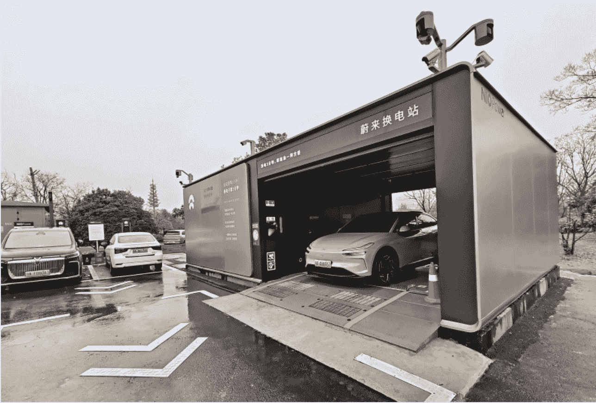

### CAIXIN | 听文章

文 | 财新周刊 余聪

冲刺大众市场初战失利、销售疲软、财务吃紧，从高端产品定位出发的造车新势力代表——蔚来汽车（NYSE: NIO/09866.HK）在其年满十周岁之际，走到了变革图存的十字路口。

3月14日，蔚来汽车创始人兼CEO李斌在公司内部称，自己曾经拍板过一些看上去正确的事情，但最后发现投资回报很低，且整个决策链路没有机制避免这类浪费。他反思：“我本人确实需要提高经营意识，需要检讨。以后即使是我说要干，算不过来账也不要干。”他还称，公司要在有效的资源边界内，把钱花在刀刃上，把时间花在刀刃上，才有可能走出困境。

成立于2014年11月的蔚来汽车是造车明星公司，在2021年的风口阶段市值一度超过千亿美元，也是BBA（奔驰、宝马、奥迪）等传统豪华汽车品牌的重要竞品，在高端纯电市场占据一席之地。但随着新能源汽车市场走向规模化竞争，近年的蔚来没能跟上同梯队竞争对手的发展节奏。

“市场无法再像对待一个创业公司一样给予蔚来更多的包容；竞对也步步紧逼，不给蔚来喘息机会。”一名接近蔚来的人士称。被市场概括为“蔚小理”造车新势力之一的理想汽车（NASDAQ：LI/02015.HK）已连续九个季度实现盈利；小鹏汽车则计划在2025年实现季度盈利；长期被视为“第四家新势力”的零跑汽车，也在2024年四季度首次实现盈利；而蔚来2024年全年净亏损超过220亿元，原计划2026年实现盈利，迫于竞争形势，李斌宣布将通过一系列变革，争取让蔚来在2025年四季度实现单季盈利。

“月销量2万辆”是目前市场公认的“走量”门槛，2024年蔚来新车总交付22.1万辆，尚未越过这一门槛；2025年1—2月，月交付量继续萎靡，均未达到1.5万辆。

比较新势力品牌阵营，2024年3月底才发售首款量产车的新入局汽车公司——小米汽车，仅凭一款车型当年交付超过13万辆，2024年10月以来月销量均超2万辆，近日宣布将2025年销量目标从30万辆上调至35万辆。2024年上半年陷入低谷、月销量徘徊在1万辆上下的小鹏汽车（NYSE：XPEV/09868.HK），当年三季度开始显著复苏，11月开始月销量连续超过3万辆，2025年目标是总销量翻番至38万辆。定位大众市场的零跑汽车（09863.HK），2024年销量接近30万辆，2025年冲击的目标定在50万—60万辆。而比亚迪（002594.SZ/01211.HK）这类头部厂商如今月销量就超过30万辆，2025年可能要冲刺断层式领先的500万辆目标。

自2018年以来，蔚来累计研发投入超过500亿元，同期理想的这一数据约为347亿元，小鹏则为258亿元；而蔚来在2022—2024年的年研发投入均超过100亿元，远高于其他对手。

“花钱大手大脚”的蔚来汽车，终于开始强调“降本增效”，启动经营调整。手机项目即是一例。该项目从2022年开始筹备，2023年9月推出首款NIO phone，主要服务于蔚来车主。李斌曾坚定认为“车手互联”是车企竞争的关键，实际收获寥寥。两名受访者告诉财新，蔚来手机项目于2024年底大幅收缩，人员大多调整到了其他部门。

研发端成本控制，也是调整重点，近期蔚来开始在研发端推进工时填报模式，这样的做法在华为、理想汽车等公司都很常见。一名蔚来汽车前管理层人士称，按工时算项目成本，这样才能有内部成本中心、利润中心的概念，而之前蔚来在研发上花了太多钱却收效甚微，这是大问题。

不同于理想、小米等新势力车企的爆款策略，蔚来的产品逻辑是多车型精品路线，以差异化支撑其高端调性，目前有蔚来、萤火虫、乐道三个品牌，前两者对应高端市场，乐道对应大众市场。主品牌蔚来在售的车型就多达九款，其中ES8、ES7等车型月销量都不足500辆。前述蔚来前管理层人士坦承，蔚来应该砍掉一些不走量的车型，这样可以节省大量资源，也利于供应链管理。

蔚来汽车联合创始人秦力洪曾公开表示，高端汽车市场不适用爆款策略。但同样定位高端市场的理想却强调爆款。以2024年全年数据观察，蔚来和理想的平均单车售价相当，均在27万元上下，但理想的销量是蔚来的2倍多。

蔚来的产品服务体系包含整车、换电模式以及NIO House、车主服务、用户社区等要素，初期突出的品牌标签是“用户型企业”“极致用户体验”，李斌就经常参与全国各地的车主聚会。这样的定位在早期帮蔚来赢得了一批铁杆用户，但随着用户规模扩大，这一模式带来的成本压力也越来越大。例如，早期承诺的“车主终身免费换电权益”，现已成长期“应付账款”；另外，如今蔚来品牌车型保有量超过60万辆，意味着“对用户好”的成本也越来越高，拖累其盈利表现。

而蔚来的产品力与价格之间的落差也在扩大。市场调研机构杰兰路研究指出，超过40%的潜在用户因价格因素放弃购买蔚来汽车。

换电模式是蔚来重要的“护城河”，但现在超快充等技术受到热捧，换电和充电两种模式孰优孰劣也备受市场关注。3月17日，比亚迪发布新一代电动产品平台，称新平台可实现“充电5分钟续航400公里”。市场认为这对换电模式是一记猛击。

3月18日，蔚来宣布与上游供应商动力电池巨头宁德时代（300750.SZ）牵手，计划共同打造全球最大的换电网络。蔚来称，宁德时代正在推进对蔚来能源投资（湖北）有限公司（下称“蔚来能源”）不超过25亿元的战略投资。蔚来能源成立于2017年，是蔚来换电站网络的运营主体。

2025年3月21日美股盘前，蔚来发布2024年四季度及全年业绩。四季度公司净亏损达到71.1亿元，创下历史新高；当季研发费用同比下跌8.5%至36.3亿元，销售费用同比增长22%至48.7亿元。当日，蔚来汽车港股收报35.9港元/股，大跌8.77%。

### “走量”失利

第二品牌乐道曾被寄予厚望，成为蔚来走向大众市场、冲刺销量的突破口。首款车型L60于2024年9月上市，起售价约20万元，但该车型销量在当年12月过万辆后就逐渐疲软，打击了市场信心。乐道自身将销售不顺归因于品牌力和营销不足，但实际上其产品力、交付能力也没有获得市场验证。

蔚来第三品牌萤火虫定位为精品小车，延续主品牌蔚来的高端调性，对标宝马电动MINI、奔驰smart，但这两个品牌目前月销量均不足2000辆。萤火虫首款车型将在2025年4月上市。

乐道L60定位家庭用车，大空间、舒适、换电模式是主要卖点，蔚来宣称这款车是“精装版Model Y”“能换电的Model Y”。Model Y是特斯拉（NASDAQ：TSLA）最受欢迎的车型，2024年中国市场销量达到48万辆，月均销量4万辆。

乐道L60刚上市时，李斌称“爆单了，服务器扩容了5倍”。但看后续数据，L60交付量并没有爆：10月至12月分别交付4319辆、5082辆、10528辆。

作为对比，小鹏2024年凭借Mona M03和P7+两款车型走出低谷，Mona M03从第一个完整交付月——9月开始一直到年底12月，月销量都连续破万辆。理想主销车型L6同年4月上市，5月交付量即超过1.5万辆，至年底共交付近20万辆，为理想贡献了近四成销量。

蔚来当时称，乐道L60的交付量主要受产能限制。L60交付前期在供应链方面遇到瓶颈，初期动力电池供应商只有比亚迪旗下的弗迪电池，电池供应不足导致产能受限，直到12月加入了宁德时代，电池供应问题才得到解决。

知情人士对财新透露，时值年末各家车企都在冲量，比亚迪电池供应紧张，优先供应自身及小米汽车等出货量大的客户，加上蔚来向供应商付款的周期较长，因而不在比亚迪的供货优先级。

财报显示，截至2024年三季度末，蔚来汽车应付贸易款项和应付票据总额为301.9亿元，高于2023年的总额。一家蔚来的智能驾驶供应商向财新透露，蔚来还拖欠该公司数千万元，账期已超过两年。

一名乐道内部人士称，L60交付前期对于销量的预估、产能的规划都过于保守，一些用户因为排产赶不上2024年国家置换补贴的截止时间而退车。

蔚来公司内外都有声音质疑乐道L60定价过高。近两年来，汽车市场价格战不断，各家都不得不自我加压、追求产品的极致性价比，小鹏Mona M03车型即以仅约12万元的起售价引发市场震动。一名蔚来汽车前研发部门人士称，L60上市前内部分析时，"我和同事认为定价14万至15万元肯定能走量，结果定价超过20万元了，实在缺乏吸引力。"

乐道2024年5月发布的L60预售价为21.99万元起，四个月后正式上市时降价1.3万元、至20.69万元，但这个价格还是难以打动消费者。

前述知情人士称，一开始乐道的供应链、智能驾驶开发和蔚来品牌区隔，后来才合并到一起；而理想L6是其L系列的第四款车型，就是靠平台化、规模化控制成本。乐道撇开蔚来另起一摊，在成本控制上就失去了优势。

另外，换电模式既是卖点，也是软肋。蔚来目前共推出四代换电站，第四代换电站可以兼容蔚来品牌、乐道品牌和外部合作品牌，第三代换电站在改造后可以兼容乐道品牌车型。乐道品牌目前拥有两种电池规格，分别是60和85千瓦时；蔚来品牌则主要为75和100千瓦时，两者电池无法互通。

乐道品牌可使用的换电站数量还在爬坡中，可用换电站中，乐道电池数量暂时也有限。官网显示，截至2025年3月20日，蔚来汽车可用的换电站为3182座，乐道为1830座。社交媒体上有不少乐道车主称，许多换电站只有一两块乐道电池。一名蔚来内部人士称，L60交付初期阶段曾有这个情况，后来可用电池数量逐步增加，部分站点增加到五块以上。

即将上市的萤火虫首款车型，因为电池包较小，公司计划先期建设专门的集装箱式换电站，后续接入蔚来第五代换电站。还在研发中的萤火虫后续车型，计划导入宁德时代换电网络。

蔚来已与长安汽车（000625.SZ）、吉利控股等七家车企达成换电合作，希望未来能共用换电站。但目前蔚来自身各子品牌就存在多种电池包规格，兼容不佳。一名了解蔚来换电业务的人士称，蔚来内部存在各种力量在博弈，难以在精简电池品类、提高效率上取得共识。

及至2025年初，乐道L60产能问题不再，但已陷入订单疲软困境。乐道L60目前主要在蔚来合肥新桥工厂（即第二工厂）生产，该工厂共线生产乐道和蔚来品牌车型。据财新了解，由于订单量减少，该工厂2月底由双班生产改为单班，部分员工分流至还在筹备中的合肥第三工厂。第三工厂计划生产乐道后续车型，单班年产能10万辆，预计2025年三季度投产。

近期乐道开始对外释放第二款车型L90的信息。一名蔚来内部人士称，当前的市场环境下，一款车型在上市前两个月都没有起势，基本就被宣告了“死刑”，只能再推新车型。

### 高端市场难“破圈”

主品牌蔚来当前压力同样不小。蔚来主打“产品+用户服务”，以区别于其他汽车品牌。发展早期，蔚来展示出“不计成本对用户好”的姿态，很快吸引了一批“发烧友”车主。这些早期车主愿意陪伴企业成长、包容产品瑕疵，也能与公司共患难。比如2019年8月，一名蔚来车主自费在青岛街头为蔚来投放LED大屏广告——而彼时正是蔚来接近破产的艰难时刻。

秦力洪曾对外称，蔚来从一开始就着力构建一套体系以保证品牌溢价。“如果蔚来不做直销也不做用户运营，单纯模仿传统主机厂的分销体系，个人直觉是车价可以减掉20%。”言下之意是，蔚来汽车产品之外的服务体系价值就有如此之高。

2024年12月，蔚来汽车在广州海心沙举办一年一度的NIO Day活动，邀请了超过2万名车友参加。前述蔚来前管理层人士称，这么一场活动耗资不菲，而公司当年前三个季度累计亏损已超过150亿元。“举办这么大的活动，李斌是要展示给外界看，也是在给自己鼓气。”

事实上，蔚来汽车原有模式已遇到挑战，销售低于市场平均增速即是最大表征。一名汽车业人士分析，现阶段很多新用户已与蔚来品牌没有过深的情感联结，考虑的就是配置、价格等常规要素，“账算不过来转头就走”。

凭借高举高打的定位、积极的资本市场运作，蔚来汽车在“蔚小理”三家中率先登陆美股，抢占了发展先机。但2020年至今，新能源汽车消费者快速由尝鲜群体扩大至大众群体，对应新能源汽车渗透率也从2020年的5%增长至2024年的40%。市场竞争环境急剧变化，2020年，国内新能源汽车市场上只有特斯拉、“蔚小理”、比亚迪和极少数传统车企。如今，传统车企、合资车企悉数下场，且不断加大新能源产品投放力度和市场营销强度。

部分车企抓住大众市场机遇实现规模化增长，新势力中的“后起之秀”零跑汽车即是如此。事实上，零跑汽车成立时间只比蔚来晚一年，长期默默无闻、融资艰难，直到2022年9月才在港股上市。零跑汽车以性价比为卖点贴合大众市场需求，从2023年下半年开始，逐渐以黑马姿态被外界看到——当年10月，跨国车企Stellantis向零跑汽车投资约15亿欧元；2024年零跑销量近30万辆，在新势力车企中仅次于理想。

支撑蔚来高端调性的相关服务也显示了局限性。例如，NIO House被视为蔚来汽车品牌展示、车主互动的关键场所，往往开设在核心商圈，其第一家门店就设立在北京长安街的东方广场，年租金数千万元。NIO House投资大，但不强调销售导向、注重品牌调性。蔚来汽车目前拥有超过100家NIO House，集中在北上广深和新一线城市，而下沉市场消费者即使为此支付了溢价，却很难获得相关服务。

据财新了解，蔚来目前已经暂停开设新的NIO House，倾向于开设体量更小、更注重销售的NIO Space以及快闪店等。

前述蔚来内部人士称，蔚来也想学习小米创始人雷军的粉丝经济玩法，但其实走的还是所谓的“高端圈层”，破不了圈还禁锢了自己。

反观小米汽车，最近推出的SU7 Ultra尽管定位为性能车，实际希望覆盖更主流的消费群体，对标BBA经典大中型轿车，在舒适配置、智能驾驶方面均没有明显短板。该车型原定年销量目标1万辆，上市三天即官宣锁单量超过1万辆，完成全年目标。

换电是支撑蔚来价格体系的重要一极。蔚来曾认为换电网络建设对销量提升有显著作用。2024年8月，李斌举例称，蔚来汽车在长三角地区有800—900座换电站，在江浙沪的销量总和也占全国的一半。

但由于竞争车型充电效率快速提升等原因，新建换电站对拉动销量的作用开始衰减。杰兰路研究称，参考“车桩比”的思路，粗略估算，2022年蔚来每座换电站大约服务94辆车，而到2024年这一比例降至66辆车。

换电站是重资产投资，蔚来原计划2024年新建1000座换电站，实际新增约700座；2025年再度给出“换电站建设大年”的目标，计划到年底在全国27个省份完成换电县县通，新增换电站约1900座。李斌在2024年末称，150亿元可以建设1万个换电站。参考这一数据，2025年蔚来新增换电站投资规模约30亿元。

但有两位采访对象对财新称，现在换电的优势不断受到冲击，蔚来是否还要大力建设换电站值得商榷。

在产品方面，蔚来也显露了短板。目前主流20万元以上纯电车型大多搭载800V高压充电平台，蔚来品牌只有即将交付的豪华行政轿车ET9为900V平台，在售车型均为400V平台。蔚来在售车型在续航上亦不及竞品，例如ET5车型入门版续航为560公里，而目前同价格带（20万至30万元）车型的平均续航为638公里，ET5续航落后约12%。

蔚来汽车希望在2025年实现销量翻番，即达到44万辆。前述蔚来内部人士称，主品牌如果表现不佳，第二、第三品牌也很难获得认可；蔚来品牌即将推出2025年改款车型，承载公司极大的销量期待，或许会采用更积极的市场策略。

### 转向降本收缩

近期，工商信息显示，蔚来控股有限公司获得来自合肥建翔投资有限公司、安徽高新舆文蔚来源科技合伙企业（有限合伙）的约28亿元投资，两家出资人背后实控人分别是合肥市国资委、安徽省国资委。

据财新了解，蔚来公司管理层目前还在募集新的资金，以支撑持续的投入。截至目前，蔚来汽车是新势力车企中亏损最严重的一家。

2024年，小鹏汽车和零跑汽车的净亏损分别为57.9亿、28.2亿元，蔚来汽车则高达224亿元。理想汽车在2023年实现全年盈利，2024年公司净利润同比下滑31.9%至80.5亿元。

一名2017年就加入蔚来汽车的人士称，蔚来这家公司很难定性，某种程度上是外企、互联网公司、科技公司的混合体，但绝对不是一家典型的汽车制造业企业——汽车制造业的特质在于规模驱动、市场驱动。尤其蔚来品牌不追求爆款概念，希望实现中等规模、高毛利，几乎是向法拉利等超豪华品牌看齐，在当下产能供给充沛、价格战烽烟迭起的中国新能源汽车市场，这样的定位很难长期坚持。

此前小鹏汽车CEO何小鹏在接受采访时称：“过去小鹏是中规模、高研发、高成本——精而美，我2022年就意识到这个路线很难走通，最终还是要靠规模。”近期何小鹏又公开称，公司需要确保有足够的收入和毛利，才能投入足够多的资源用于研发，建立正向循环。“去年我们总结出一个结论，单纯依靠融资无法实现这一目标，必须依靠利润，而且是巨大的利润。”

李斌一直被业界视为融资能手。上市前蔚来即斩获腾讯、百度、淡马锡、红杉资本等知名公司、机构投资，又于2018年率先上市，但2019年就经历了ES8自燃、电池召回、高管出走等连续打击，当年10月公司股价逼近1美元的纳斯达克退市红线。当时蔚来走在生死边缘——2020年3月李斌在财报会上称，公司现金余额不足以提供未来12个月持续经营所需的营运资金和流动资金。蔚来此前接洽的北京亦庄国投、浙江湖州吴兴区政府等融资均未能顺利落地。

危机时刻，“安徽、合肥把蔚来从重症监护室抢救回来”。2020年4月，安徽、合肥国资决定分批向蔚来注资70亿元，蔚来也确定在合肥建立总部管理、研发、销售服务、供应链制造一体化基地。

2020年至2021年，特斯拉销量起飞，中国新势力车企也群起直追，新能源汽车产业链加快成熟，“蔚小理”销量、股价均迎来一轮高涨。2021年1月，蔚来汽车股价最高攀升至66.99美元/ADS，市值冲破千亿美元。

从低谷中走出的蔚来汽车奋起狂奔、横向扩张。乐道项目正是发端于2021年初，同年还组建了自动驾驶芯片自研团队；2022年初，又组建了电池自研团队，同年5月启动高端智能电动小车项目即萤火虫，三季度开始推进手机业务，10月还宣布全面进入欧洲市场。

正是在2022年，蔚来汽车研发和销售费用均首次突破百亿元；净亏损则达到144.3亿元，较上年大增约100亿元。

前述蔚来内部人士评价称，蔚来最大的问题不在于缺钱，反而是某些时点拥有了太多的钱。快速扩张后，蔚来又开始外部融资寻求“输血”。2023年6月、12月，中东资本CYVN Holdings分别向蔚来战略投资约11亿美元、22亿美元，成为蔚来第一大股东。

截至2024年3月末，蔚来汽车主要股东包括创始人公司（李斌控制的三家公司）、CYVN Holdings以及腾讯实体，三者对应股权占比分别为7.9%、20.1%、5.9%，但三者对应投票权占比分别为38.5%、13.4%、3.9%。股权被大幅稀释的李斌，仍拥有公司的实际控制权。

李斌曾将2019年的经历称为“一个创业公司跑得太快后的减肥计划”，如今蔚来再次走到“减肥”时刻。

以自研电池为例，2022年6月，李斌曾称蔚来汽车长期的电池供应策略是自制结合外采，这对于增加公司竞争力、产品竞争力和盈利能力非常重要。彼时，蔚来野心勃勃，希望模仿比亚迪的垂直整合模式，提升盈利能力。

然而横向扩张没有达到预期效果。李斌坦承，2018年至2021年，公司每年销量翻番；2022年至2024年，由于内部战略和执行等因素，公司经营没有达到预期。

过度扩张之后，蔚来转向收缩，2024年初将自研电池调整为自研电芯、电池包等，其他环节外包生产。

小鹏、理想也都曾遭受挫折。小鹏汽车2022年9月G9车型发布失利后陷入低谷，一直到2024年Mona M03上市才得以翻身；理想汽车2024年初首款纯电车型MEGA上市不利，后通过L6车型、追赶智驾能力，逐渐摆脱困境。

一名知情人士向财新评价称，理想汽车创始人李想“杀伐果断”，公司内部文化是“不行就下”，和他们接触几年下来，相关人员已换了好几批；何小鹏也曾在2023年对高管进行洗牌，并从长城汽车“挖来”原总经理王凤英委以重任，整饬内部管理和生产；但蔚来这边经常是出了错却没人出来承担责任。例如蔚来在研发上投入了很多资金但没有看到效果，应该尽快整合团队，该换人就换。

蔚来近期已开始人员调整，总部、门店、工厂均在进行人员“优化”。一名近期进入裁员名单的蔚来汽车上海办公室人士告诉财新，其所在部门本次裁员比例为15%—20%，补偿为N+1。据他介绍，公司已经以不续约的方式精简人员，另外他带队的外包员工团队也已悉数解约。

但有多名受访人士认为，蔚来汽车如果不从高层动刀，无法改变公司局面，动一线执行人员只是短期降本续命。

### 市场竞争升级

何小鹏判断，2025年是中国汽车市场淘汰赛的开端，未来三年的战事将更加激烈。国内车市开年即陷入激战之中，各家车企围绕价格、智能驾驶、营销等展开全方位竞争。

蔚来品牌在2月1日推出五年零息金融方案，原本这一政策在2月28日结束，如今延长到3月31日。3月1日，乐道将三年零息金融方案也升级为五年零息。此前，特斯拉、小鹏都推出了五年零息金融方案。

对于一款售价约25万元的车型，若首付8万元，五年零息意味着厂家需要贴息2万元左右。一家车企战略部门人士告诉财新，现在大部分车企都推出了三年零息或五年零息政策，跟进金融策略不一定能实现销量增长，但是不跟进就会陷入被动，“大家都在贴钱抢市场”。

蔚来ES6是其迄今为止最受欢迎的车型，在售价25万—30万元的纯电SUV市场少有对手；但这一细分市场2025年将会出现一个杀手级车型——小米YU7，该车型已出现在工信部新车目录。小米YU7预计在2025年年中正式上市，市场预测定价在25万元左右。

SU7的成功足以说明小米的野心与能力。一名资深汽车市场分析人士称，小米从来不打算做小众车型，汽车制造业的逻辑就是规模化，小米SU7现在每周订单超过1万辆，对每家车企都有竞争压力。

蔚来手里的产品牌不算牢靠。2025年4月上海车展期间，蔚来将推出ET5、ET5T、ES6和EC6的年度改款车型。但据财新了解，这些车型仍旧基于400V平台，蔚来其他800V换代车型预计要到下半年上市。

2月以来，以比亚迪为首的一众车企掀起智驾大战。比亚迪董事长王传福称，2025年将是智驾普及元年，没有智驾系统的产品将失去市场竞争力。

传统车企主要在中低阶智驾上展开竞争，造车新势力则围绕基于“端到端”大模型的智驾方案展开角逐。端到端是指从感知端输入信息，再从执行端直接输出结果，不同于以往需要包含感知、决策、规划多个部分，这一方法更接近于人类决策机制，目前在业界受到追捧。

特斯拉是这一方向的引领者，小鹏、理想均已上车端到端智能驾驶，近期小米也称开始推送相关功能，蔚来还没有正式披露这些功能的上车时间。

也有行业人士认为，智能驾驶领域头部供应商包揽多家方案，不会形成明显差异化。例如智能驾驶供应商Momenta获得的量产定点车型的数量超过100个，华为智驾也与多家车企牵手。他认为，车市竞争最后的胜负手还在于着产品和成本。成本控制能力意味着在价格竞争中能否占优，目前极致定价成为车企间的关键竞争手段。

零跑汽车近日发布新车型B10，该车型激光雷达版在预售阶段的起售价为12.98万元，成为目前市面上最便宜的搭载激光雷达的车型。这还仅仅是则预售价，正式上市时，其价格还有望下探。

合资车企也毫不手软，近期丰田、大众等燃油车企纷纷推出“一口价”，其中一汽大众以纯电SUV车型ID.4一口价13.99万元，官方直降4.5万元。

成本控制是蔚来汽车的弱项。一名汽车市场分析师称，理想汽车以“抠厂”闻名业内，从成立之初就在投资上非常克制；而蔚来几乎没有推行过深度降本，现在需要抓紧补课。

销量领先的车企也不敢放松。近日何小鹏称，公司尚未走出创业生死存亡期，还“坐在ICU门口”。“今天没有任何一家车企敢说‘稳坐钓鱼台’，大家都面临挑战，只是挑地战大小而已。”他说。

许多人将蔚来当前面临的危机与2019年时相比，普遍认为不会比那时更糟糕。但如今汽车市场已走到淘汰赛中局，许多竞争力不强的车企开始出清，例如高合汽车、极越汽车等。

李斌也已认识到这一点，他在2024年末称：“接下来两三年则是整个行业竞争最激烈的时候，如果能够留在牌桌上，基本能往下走；如果不能，基本上就没有机会了。说生死攸关不为过。”

## 最新财新周刊|沙漠中的“风光”生意

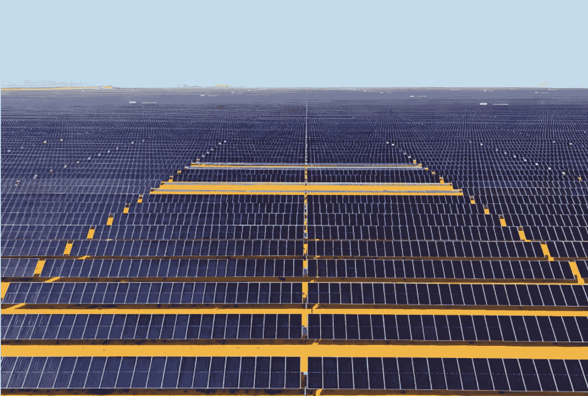

## CAIXIN|听文章

文|财新周刊 赵煊 发自沙特阿拉伯

在沙特阿拉伯西南部麦加省吉达市南80公里之外的荒漠里，当地时间2月下旬，中国能建集团总承包建设的中东最大光伏项目——沙特阿尔舒巴赫2.6吉瓦（GW，1GW=1000MW）光伏电站开始投入商业运营。该项目占地面积52.54平方公里，约等于7500个标准足球场。

2024年，沙特是中东地区进口中国光伏组件最多的国家，总计16.55吉瓦，同比上升115%，占中东市场进口量的六成；而从全球来看，这一年，沙特也攀升至中国光伏组件出口额第四大国家。

据中国可再生能源学会风能专业委员会最新数据，中国风电机组新增出口容量创历史新高，其中沙特成为最大的出口市场。中国风机2023年才首次出口沙特，共计273兆瓦（MW），但这一数字在2024年就增加了185%、达780兆瓦。长期位居中国石油进口最大来源国的沙特，转身变成中国新能源设备的大买家。

沙特是中东第一大经济体、欧佩克（OPEC，石油输出国组织）“老大”，近年为降低对石油的依赖、促进经济多元化，全力布局可再生能源，力求在全球能源转型浪潮中占领潮头。

沙特设定了“2060年净零排放”目标。“我们计划每年减少2.78亿吨排放量，并优化国内能源结构，到2030年实现50%的发电量来自可再生能源。”沙特环境、水利和农业部副部长乌萨马·法姬哈对财新表示。

沙特被北回归线贯穿中部地区，终年受副热带高气压带控制，是全球阳光最充足的国家之一，年日照时间超过3000小时，与中国光照条件最好的省份新疆不相上下。但长期以来，沙特可再生能源发电占比都不到1%，“2020年才拥有第一个可再生能源项目。”一名沙特能源部人士向财新介绍。

这意味着，沙特要在五年内把近半发电量从化石能源切换成可再生能源，如此挑战的目标需要快速且大规模的投资，这无疑为技术与成本优势兼具的中国企业提供了商机。具体而言，沙特目前已建成、在建和刚处于招标阶段的可再生能源项目总计44吉瓦；为实现2030年130吉瓦的装机量目标，每年还需增加20吉瓦项目——这接近德国2024年可再生能源的新增装机量。

沙特在新能源领域布局全面，涵盖光伏、风电、储能、氢能、碳捕集以及关键矿产资源等。敏锐的中国企业迅速响应，纷纷赴沙寻找商机。“以沙特为代表的中东地区，是海外光伏市场的新‘蓝海’。“光伏龙头晶科能源（688223.SH）回应财新称，随着更多本土产能落地，沙特还可能成为地区性的电力供给中心，为其他绿色工业发展提供契机。

“当下沙特如同上世纪90年代的中国，充满机遇与挑战。”多名在沙特“再创业”的中企人士指出，虽然面临巨大机遇，但想在沙特真正扎根发展，仍需充分识别风险，深刻理解当地法律、文化与商业环境。“这片‘蓝海’正在迅速变成‘红海’，竞争已经很激烈，赚钱不易。”一名中国光伏企业人士说。

### 多极平衡之地

沙特正在加快推进“自上而下”的经济多元化改革。2016年推出的“2030愿景”国家战略规划，意在把沙特打造为三大中心——亚非欧三大洲交通枢纽、全球性投资中心、阿拉伯与伊斯兰世界的核心国家，争取进入“世界前15大经济体”。

沙特拥有全球已探明石油储量的近五分之一，可谓“家底雄厚”。尽管石油长期支撑沙特的经济繁荣，但近年来油价低迷以及全球能源转型的压力，迫使沙特必须寻找新的经济增长点。据国际能源署（IEA）预测，全球石油需求将在2029年达峰，并从2030年开始下降。中东海湾地区国家面对来自新能源的冲击，均具有强烈的危机感。

自2024年7月以来，国际油价下跌了约20%。2025年3月13日，布伦特原油期货价格收于69.88美元/桶——这一油价不足以覆盖沙特的政府开支。据国际货币基金组织（IMF）2024年测算，沙特在油价96.2美元/桶时，才能平衡政府支出预算。

沙特经济与规划大臣费萨尔·易卜拉欣2025年1月对财新表示，非石油经济部门目前已占沙特整体GDP的52%左右，且增速在逐年加快。要推动经济多元化转型，沙特必须积极拥抱新能源。2023年，沙特宣布投资1万亿里亚尔（约合1.9万亿元人民币）生产可再生能源。沙特“2030愿景”的重点项目包括NEOM（沙特新未来城）、红海项目等，每个项目都至少耗资数百亿美元。

THE LINE是NEOM的核心项目，100%使用包括太阳能、风能、氢能和储能在内的清洁能源，以实现零碳排放；红海项目的亮点是电力供应将100%来自清洁能源，已建成全球最大的离网储能项目，由华为公司为其供应储能系统。

专注于中东北非区域投资的易达资本董事总经理、投资部负责人 Alice Cai向财新介绍，沙特能源类项目主要由国家能源公司和主权基金主导，单个项目规模即高达数吉瓦，集中的大型订单对企业极具吸引力。沙特国际电力和水务公司（ACWA Power）CEO Marco Arcelli近日也对财新表示，该公司在全球范围内与中国公司的合作金额已超过500亿美元。

除了可再生能源，沙特也在推动化石能源的低碳化利用，一大举措是新建和升级现有天然气发电厂。到2030年，沙特的气电比例将达到50%左右，届时，新建气电厂将具备CCS（Carbon Capture and Storage，碳捕获和储存）能力。沙特国有石油公司沙特阿美正在推动全球最大的碳捕集与封存项目。到2035年，沙特全国的年碳捕集总量将达到4400万吨。碳捕集是海湾地区石油国家减少碳排放的关键技术，阿联酋的目标是到2030年碳捕集能力超过1000万吨/年，卡塔尔的目标是到2035年碳捕获能力超过1100万吨/年。

沙特还利用成本低廉的可再生能源和化石能源生产绿氢和蓝氢（通过化石燃料生产，但碳被捕捉封存），目标是到2030年实现400万吨氢气年产量和出口量的目标，成为全球最大氢气出口国。Alice Cai介绍称，沙特正积极建设氢能基础设施，绿氢目标市场包括欧洲、日本、新加坡等因土地和风光发电资源有限、难以自行大规模生产绿氢的国家和地区。

强力的政策吸引、便利的区位、丰富的自然资源、低廉的土地成本以及灵活的外交政策，使沙特成为对中国企业颇具吸引力的目标市场。“沙特位于亚洲、非洲和欧洲的十字路口，在物流和市场覆盖面上具有优势。”中国光伏支架企业中信博（688408.SH）中东非大区经理王沛告诉财新。

为维护经济发展环境，沙特在地缘博弈中也极力平衡。2月18日，美、俄两国代表团在沙特举行双边高层会晤即是一例。“中资企业‘出海’非常关注投资所在地的政治经济环境。”多名中企人士认为，沙特实施多元平衡的灵活外交政策，目前与东、西方国家都尽力保持良好关系，具有沟通纽带作用。

在吸引外国企业投资上，沙特近年通过推出新的投资法、设立经济特区、改革政策等措施，改善营商环境。多名中企人士告诉财新，其感受最深的是沙特废除了实施近70年的“保人”制度，提升了外国企业在当地开展业务的便利度。此前，外国投资者或劳工欲在沙特开展业务，需要沙特籍合伙人即“保人”。“该制度在2021年后基本停止。”一名沙特中企管理人士说。

2024年10月，沙特交通与物流服务大臣萨利赫宣布，在首都利雅得正在扩建的萨勒曼国王国际机场内，建设一个面积为4平方公里的沙特——中国特别经济区，重点发展制造、物流和贸易产业，旨在为入驻企业提供一站式服务，预计于2025年启动建设。

### 新一轮合资浪潮

“现在的沙特像20多年前的中国，增长空间很大。”多名沙特当地中国企业管理者如此表示。

随着中国国内市场的逐渐饱和与沙特的“改革开放”，投资者纷纷涌向沙特。

当前，在光伏、风电、储能、EPC（工程总承包）等不同赛道上，已有晶科能源、中信博、阳光电源（300274.SZ）、TCL中环（002129.SZ）、远景集团、华为、比亚迪（002594.SZ）、中创新航（03931.HK）、中国能建、中国电建等中国企业入驻。

其中，光伏支架领域龙头企业中信博，2024年在沙特的市场占有率已达70%以上。王沛介绍，沙特是中信博在中东布局的重要战略支点。中信博从2018年开始布局中东和北非市场，但光伏项目规模一直较小，多在兆瓦级规模，直到2021年中国光伏产业链成本大幅下降，中东市场才迎来突破，吉瓦级大型项目开始涌现。

2022年，中信博参与中国能建集团承建的前述沙特阿尔舒巴赫项目，开始在沙特市场快速增长。该项目业主为ACWA Power，由沙特主权投资基金（下称PIF）投资。PIF隶属于沙特财政部的前身，主要任务是投资非传统能源行业，目前资产管理规模近万亿美元，是全球最活跃的主权投资者之一。

据王沛介绍，截至目前，中信博在沙特累计承接了超过10吉瓦的项目订单量；其投建的吉达生产基地，预计2025年底投产，届时在沙特的本土交付能力将达15吉瓦。与中国光伏主产业链公司2024年以来业绩普降不同，在海外市场支撑下，中信博预计2024年净利润6.47亿元，同比增约九成。

其他中国企业中，2024年组件出货量全球第一的晶科能源，此前与PIF及沙特本土公司Vision Industries（下称VI）签订协议，拟共同投资近10亿美元建设10吉瓦高效电池及组件项目。这是晶科能源迄今最大的海外投资项目。晶科能源向财新介绍，该公司早在2011年就进入中东市场，目前占沙特光伏组件市场70%的市场份额。

“新工厂项目位于沙特未来城NEOM所规划的工业区。”晶科能源介绍，项目投产后，或将成为中国光伏企业在海外建成的最大的N型电池和组件制造基地，可满足沙特及其他中东地区的光伏设备市场供应，并辐射欧美等市场。

即便投资体量与经验如晶科，对工厂落子沙特仍备感压力。“在中东做生意，都是市场化主体，商业交易非常成熟，特别是在合同谈判签署时要注重各种细节。”晶科能源董事长李仙德在央视《对话》节目中说，企业进入中东市场不仅要注意商业上的违约、索赔风险，同时也要警惕地缘政治上美国潜在的“长臂管辖”风险。

不过，当下中国光伏市场价格逐级下跌、“内卷”加剧，欧美贸易壁垒重重，东南亚中转路径受阻，中国光伏企业对包括沙特在内的中东市场仍然抱持极大的期待。晶科能源对财新指出，沙特工厂代表着晶科“全球化2.0时代”开启，公司将加速从“全球营销”“全球制造”向“全球投资”转型。

“2025年晶科的重要目标是沙特工厂模式得以成功，进而复制到全球。”晶科能源副总钱晶在行业会议上称。

与晶科同步，上游硅片企业TCL中环也与PIF、VI签署了三方合资协议，计划投资硅片的本土化生产，总投资额约20.8亿美元。TCL中环高管对财新称：“欧美发达经济体是高价值市场，但进入壁垒较高。沙特工厂有产出后，不排除卖到欧美的可能性。”

不过，“具体的投产规模、补贴与合同签订过程，都经历了艰苦谈判。”另一名接近TCL中环人士透露，即便下定决心进入中东市场，过程中的沟通协调也极具挑战。

中国风电制造龙头远景集团也于2024年7月宣布，与PIF、VI成立合资公司，到2030年实现风电产品75%本地化生产。远景集团向财新介绍，远景深度参与目前全球最大的绿氢项目——沙特NEOM项目，为该项目供应1.67吉瓦、257台风电机组。项目建成后，将通过专用输电网络直接为绿氢工厂实现供电。

另一储能企业阳光电源，同时宣布与沙特ALGIHAZ签约全球最大储能项目，容量达7.8吉瓦时，预计2025年全容量并网运行，以提高沙特电网的稳定性和可靠性。公众号懒人搜索，懒人专属群分享。

### 标准高、价格低

沙特是充满吸引力的新市场，但“暗礁”潜藏、赚钱不易。

“中资企业刚来沙特时都很兴奋，但其实真正能深耕的不多，反而亏钱的有不少。”一名赴沙多年的中资新能源企业管理层人士指出，要想在“沙漠中淘金”，须过重重难关。

“2020年这里还是‘蓝海’市场，现在已变为‘红海’。”王沛也认为，现在投资沙特的门槛并不低。

“沙特光伏市场现在跟中国市场一样，相互价格踩踏。”一名中国光伏公司人士认为，在国内，企业都说“不出海便出局”；但到了沙特，中国企业依然照搬国内“内卷”模式，又陷入了新的迷茫。

沙特可再生能源的新建项目，在不断打破全球最低成本纪录。例如，据沙特能源部数据，Sakaka（塞卡卡）是沙特在2020年并网的第一可再生能源项目，LCOE（levelized cost of energy，平准化能源成本）2.34美分/千瓦时（约合人民币0.17元/千瓦时）；最新投运的阿尔舒巴赫项目的LCOE已低至1.04美分/千瓦时（约合人民币0.075元/千瓦时），号称“全球最低价光伏”。

“沙特虽然光照资源丰富、土地价格低廉，但阿尔舒巴赫这样度电成本不足人民币一毛钱的光伏项目，给建设方的挑战极大。”前述中资企业管理层人士认为，即便中国光伏行业经历了快速降本，国内的光伏度电成本也多在0.2元以上，部分资源丰富地区可低至0.1元/千瓦时左右，但未低至沙特的成本水平。

沙特当前的电力结构特点，加剧了低电价难题。“沙特电力结构中，六七成电力由居民消费，工业和商业用电的比例不高。”另一名在沙特工作十余年的中国电力行业人士说，沙特居民电价低，每千瓦时只有3至5美分（约合人民币0.22元至0.36元）左右，与中国西部省份的电价相近；即便是工商业电价，也只有5至8美分左右（约合人民币0.36元至约0.58元）。

低电价意味着既要控制成本又要保证质量，限制了项目投资回报。前述长期在沙特工作的电力行业人士指出，尤其在光伏和储能领域，很多项目的投资在短期内难以回收。

EPC（工程总承包）公司同样面临激烈的竞争。前述电力人士解释：“不少中国EPC公司赚不到钱，靠压低光伏组件等设备供应商价格维持利润。”沙特项目合同条款要求严格，还需缴纳高额“保函”，若中途退出，“保函”将被充抵罚款。“保函”通常占项目金额的10%—15%，对中小公司是个巨大的压力。”他进一步表示，沙特银行信用条件也十分苛刻，企业若没有足够的资金能力和抗风险能力，很难完成项目、收回投资。

随着越来越多企业进入，沙特市场竞争还在加剧。“沙特市场标准高、价格低，二者十分矛盾。”前述电力人士认为，主因还是中国厂商也将低价竞争发挥到了极致，但过低的价格导致项目公司抗风险能力极低，也可能损失质量保障。“建议在沙特做项目‘做足功课’，控制好利润点，避免过度竞争埋下风险。”他说。

### 克服“水土不服”

沙特社会曾长时间处于封闭状态，如今商业环境仍具有鲜明的本土特色，对刚进入这一市场的中国企业也构成挑战。

作为吸引外资的条件和促进经济多元化的举措，沙特要求外资企业在当地合资建厂，达到相应本地化比例，即所谓“沙化率”，除了本地生产，还包括原材料供应、本地员工雇佣比例等多个方面。

拥有约3500万总人口的沙特，超过三分之二是30岁以下的年轻人，急需就业机会。前述沙特能源部人士介绍，沙特政府设定了到2030年实现可再生能源行业75%本土化的目标，而当前这一比例仅为21%。

据财新了解，目前进入沙特市场的中国新能源企业本地化要求在三到四成不等。企业须严格遵守，否则可能面临巨额罚款。

这给中国企业带来了不小压力。沙特的薪资水平相对较高，尤其技术性岗位，平均月薪在2万至5万沙特里亚尔（约合人民币3.9万至9.7万元）。中国企业不仅需要在生产环节投入大量资金，还需为本地员工提供有竞争力的薪资待遇。

文化上，沙特是“熟人社会”，开展业务的前提是“找对人”。如何建立互信的人际关系，是初来乍到的中国企业面对的另一难题。“可能你三个月都没有音信的事情，找对人半个小时就解决了。”一名中企高管如是说，一些机会主义者也容易利用信息差和中国企业急于抢占先机的心理从中牟利，令人难辨真伪。

但在法律与谈判风格上，沙特人较缜密严苛。“企业需要仔细了解沙特法律体系并慎重选择合作伙伴。”Alice Cai建议，沙特法律体系不同于大陆法系和英美法系，是以伊斯兰教法为基础的沙里亚法，企业须仔细了解其在商业、劳动力、税务和外商投资方面的法律规定。由于商业文化的不同，许多企业选择通过合作伙伴来推动项目落地，须特别注重对合作伙伴的尽职调查。

同时，一名长期从事中东法律与营商环境研究的律师告诉财新，中国企业在沙特市场的法律合规问题，是不容忽视的挑战。与早年响应“一带一路”沿线国家倡议“出海”到中东的央国企不同，如今越来越多的民营中小企业自发来到沙特寻找机会。“一些企业缺乏足够的法律支持，如果单枪匹马‘野蛮生长’其实很容易‘踩坑’。”

另据王沛介绍，沙特客户对新能源项目要求着也很高，要求技术有先进性、产品和服务具备稳定性和持续性。Alice Cai也指出，中东市场主导玩家集中，有来自全球各个发展阶段的企业参与竞争，只有具备显著优势的企业才有机会获得合作。

习惯在国内“拎包入住”工业园区的中国企业，到沙特建厂则需要面临基础设施从头开始的局面，建设条件也是个挑战。“沙特荒漠区地质复杂，既有松软沙地，也有坚硬岩地。同时，施工团队还面临着高温、干旱、风沙等严峻考验，必须提前充分落实地质勘探。”一名中国电建沙特代表处人士介绍，这要求项目团队具备丰富的沙漠工作经验。同时，由于荒漠区物流运输条件较差，大型光伏组件、变压器等设备需要特殊运输，施工前也需提前做好运输规划，以免延误进度。

前述电力人士指出，许多新进入沙特的中国企业，对现场条件和项目细节都缺乏了解，有些急于求成，“经常在实施过程中遇到很大的困难”。

企业进入一个新市场难免“交学费”，前期风险控制凸显重要。“大部分企业适应沙特市场，都需要两年左右的爬坡期。”Alice Cai总结。一名中国能源企业人士补充称，阿拉伯人自古从事贸易，善于做生意，要以商人思维与其打交道，互惠互利，不要只想“赚快钱”或“一头扎进来就干”。

胡暄、张而弛、包云红、罗国平对此文亦有贡献

## 显影 | 中国宠物数量超4岁以下婴幼儿人数 “它经济”消费规模已达3000亿

宠物相关行业增长迅疾，收割情感溢价的同时也面临着细分化、精致化和智能化的挑战

2025年2月28日，Abby驾驶着满载狗粮猫砂的车辆，从顺义国际展览中心驶回通州的家。当她把宠物用品在地面铺开时，她的家庭成员——马犬“张初五”和田园猫“张福来”早已蹲坐在战利品旁。这位“90后”宠物家庭寄养师在朋友圈写道：“给我的胖宝们打猎归来。”

Abby参加的是2025北京国际宠物用品展览会（下称“京宠展”）。四天展期里，展会共吸引近23万人次宠物爱好者，68%是“90后”与“00后”。12万平方米的展区内集聚了全球宠物行业顶尖品牌，《宠物诊疗机构诊疗服务指南》和《宠物经营场所环境清洁与消毒指南》两项宠物国家标准的同步宣贯也为行业立下新规。

派读宠物行业大数据平台发布的《2025年中国宠物行业白皮书》显示，2024年城镇（犬猫）消费市场规模增长7.5%，达到3002亿元，已超过2023年中国保健品消费市场规模。当宠物从“喂养对象”跃升为“家庭成员”，越来越高的情感诉求也推动了宠物经济的快速发展和产业的创新升级。

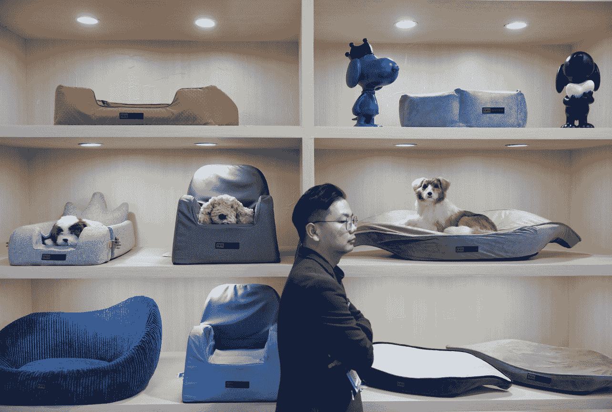
2月28日，京宠展进行时，一名男士从宠物沙发展墙前走过。

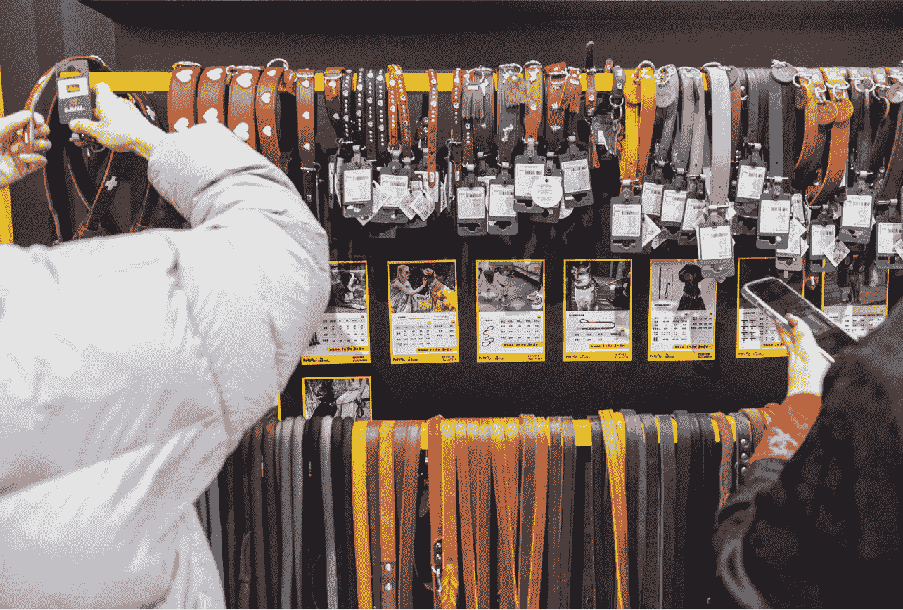
2月28日，中国国际展览中心（顺义馆）第12届北京国际宠物用品展（下称“京宠展”），观众正在挑选牵引绳和项圈。

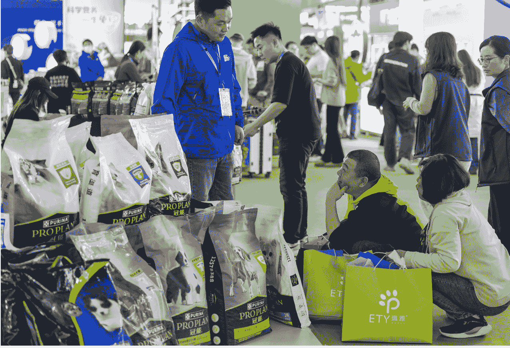
2月28日，京宠展上，观众在宠物粮展位前咨询。

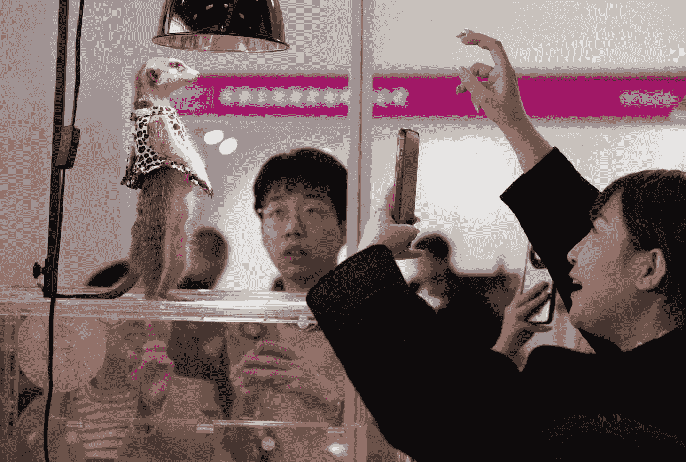
2月28日，京宠展上，一只狐獴吸引了观众的关注。

“京宠展”某展位的“野生实验室”里，烘焙乳鸽猫粮的香气吸引了众多宠物主驻足；“疯狂小狗城”的“冻干夹心粮”前，年轻宠物主们争相扫码下单。宠物旅行包、宠物衣装等实用产品琳琅满目，甚至连宠物零食也做成了红米肠、萝卜糕、佛跳墙的样子来吸引宠物主的关注。

“育儿式养宠”已经成为目前养宠大趋势。根据艾瑞数智所发布的《2023年中国宠物健康消费白皮书》，宠物主在单只宠物上的年均花费高达5200元左右，其中宠物食品是最主要支出。

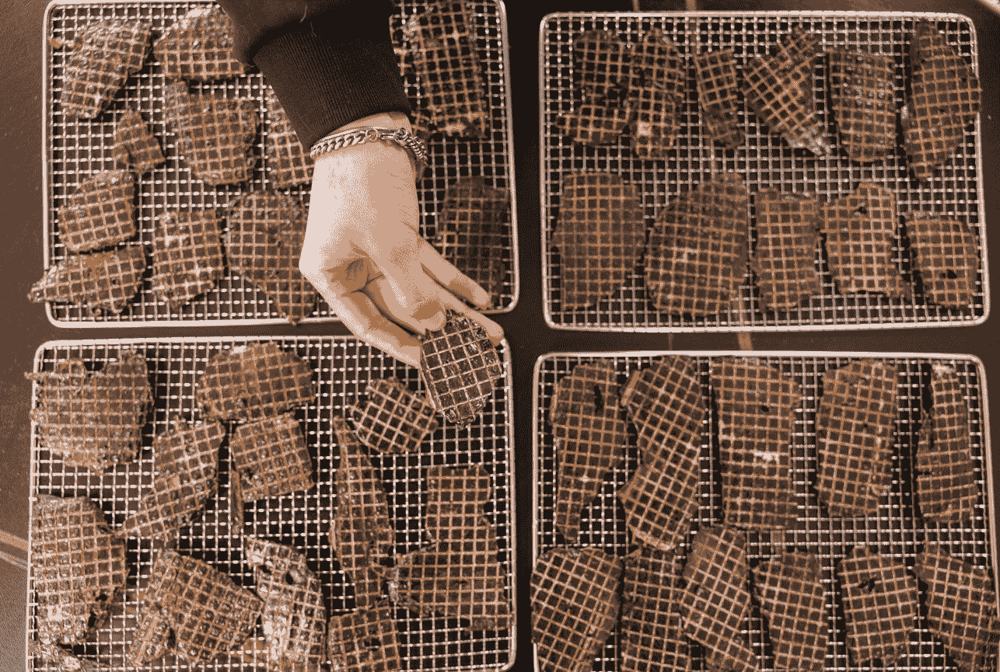
北京通州，友它宠物寄养度假村，主理人Abby正在制作宠物零食。

“展会上我能清晰感知到宠物养育方式的精细化趋势。”Abby说，“正如那句‘爱是拼尽全力给予却仍觉亏欠’。”

除了宠物主人，Abby还有另一个身份——“友它宠物寄养度假村”的主理人。2023年，从事汽车行业管理的Abby转型投身宠物家庭寄养领域。这一决定的契机源于家里那只因分离焦虑而频繁引发投诉的马犬“张初五”。“它从小在我怀中长大，一天笼养生活也没经历过。家里一旦无人，它就持续不安吠叫，甚至学会开锁越狱。”Abby说。

Abby尝试将“张初五”寄养在专业的园区，但是两三分钟后狗就能从笼子里跑出来，爪子上都是血。尝试让别的小狗和“张初五”一起玩也收效甚微。在和其他狗主人交谈的过程中，Abby发现了新的商机。她决定借鉴国外模式，将自家住宅改造为“宠物家庭驿站”，提供散养式寄养服务。

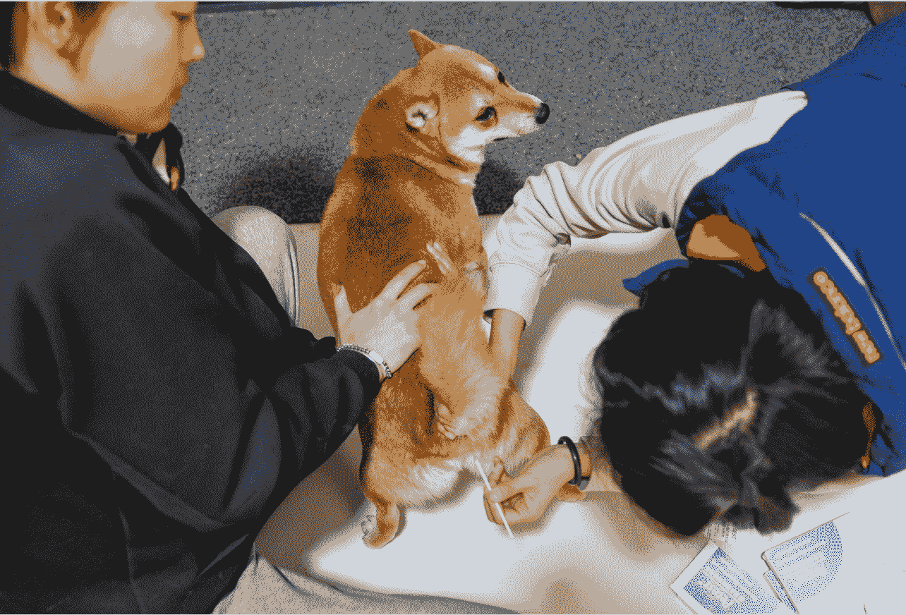
北京，友它宠物寄养度假村，工作人员正在对初次到访的犬只进行检测。

所有狗进门后，Abby都会给它们做犬瘟、细小等传染病检测，单独观察12小时，遛弯也采取分时分区。针对柯基、柴犬等易发生冲突的犬种，设置独立房间隔离管理；若主人坚持散养，则通过“试玩测试”筛选性格相投的宠物组成“好友小组”。

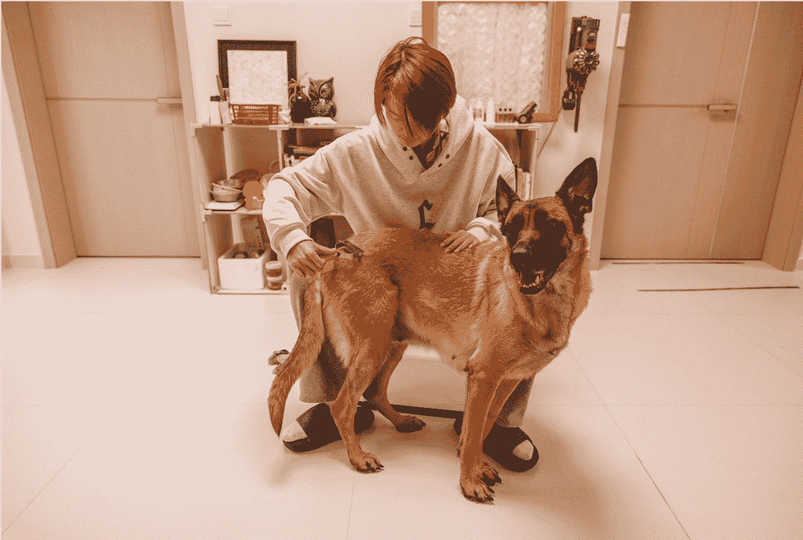
3月3日，北京通州友它宠物寄养度假村，工作人员正在打理犬只的毛发。

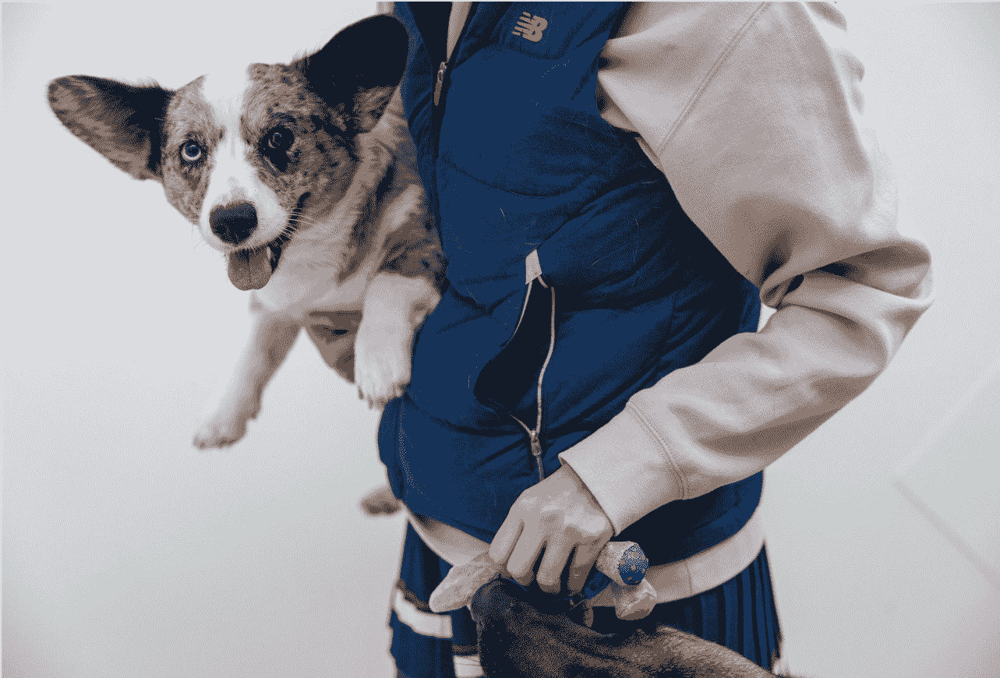
3月3日，北京通州友它宠物寄养度假村，工作人员和宠物。

而Abby的转型，也预示着宠物正在越来越多地影响着人们生活方式和重大决策。《小红书2024宠物行业洞察报告》显示，56%宠物主会为宠物改变生活方式。

随着宠物从劳动动物转变为家庭成员，宠物主的需求也在逐步升级。

与人们越来越重视“情绪”的趋势一致，让宠物快乐也越来越是宠物主消费的重要目标，2024年TGM全球宠物护理调查发现，在全球范围内，玩具是宠物主人最常购买的物品，超过一半的宠物主人会定期购买玩具，从偏重互动性的逗猫棒，到宠物“自嗨玩具”、宠物定制窗边看台……随着需求层次的升级，在资本与社交媒体的共同作用下，越来越多的需求被制造、被发现。

与之相应的巨大供给缺口令中国宠物经济迎来爆发式增长，多个权威数据印证了这一趋势。高盛最新研究报告显示，2024年中国宠物总量首次超过4岁以下婴幼儿数量，且预计到2030年宠物规模将达到婴幼儿群体的2倍。目前全国养宠家庭已突破1亿户，形成庞大的消费基础支撑。

而从消费层面来看，《2025年宠物行业消费趋势洞察》披露，2024年犬类消费市场同比增长4.6%，猫的市场增速更为显著，达到10.7%。值得注意的是，单只猫狗年均消费均接近6000元，显示出明显消费升级态势。

众多资本加速涌入宠物服务行业。企查查发布的《宠物服务行业发展报告》指出，近十年中国宠物服务相关企业存量规模迎来大幅攀升。在2015年底，只有0.82万家宠物服务相关企业，但到了2025年初，这个数字增长到了25.91万家，且近三年成立的企业占到74.47%。

企业数量与市场规模的双向跃升，共同勾勒出中国宠物经济的黄金发展曲线。在这片“蓝海”里，Abby辞掉了工作，开始创业，更多和她一样的“外行人”也开始选择走进宠物行业。

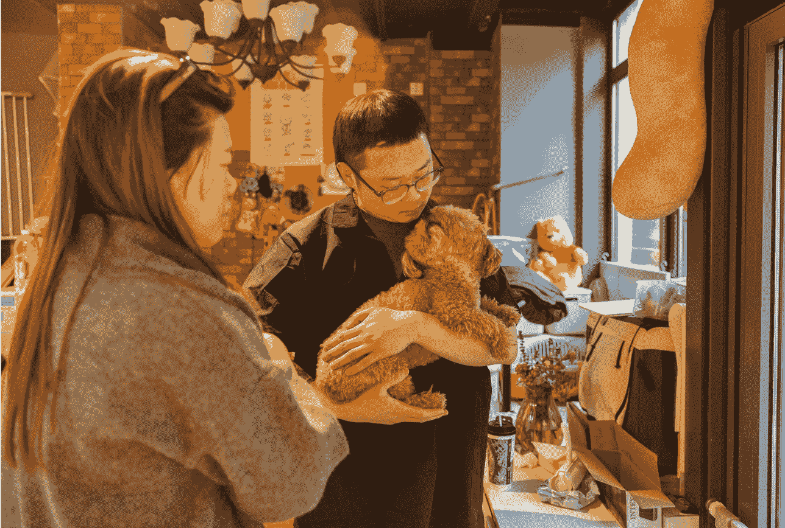
3月5日，北京顺义，兜吉宠屋，主理人薛鹏和曹莉正在安抚有些紧张的泰迪，让它在洗澡前放松下来。

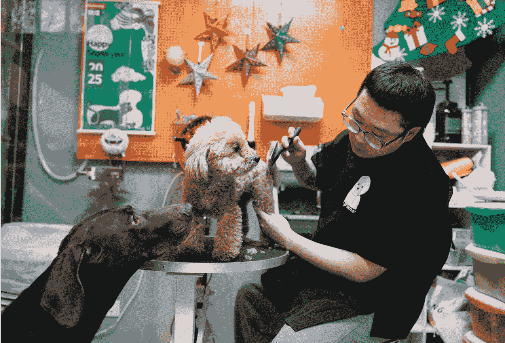
兜吉宠屋，薛鹏正在为一只宠物犬进行美容。

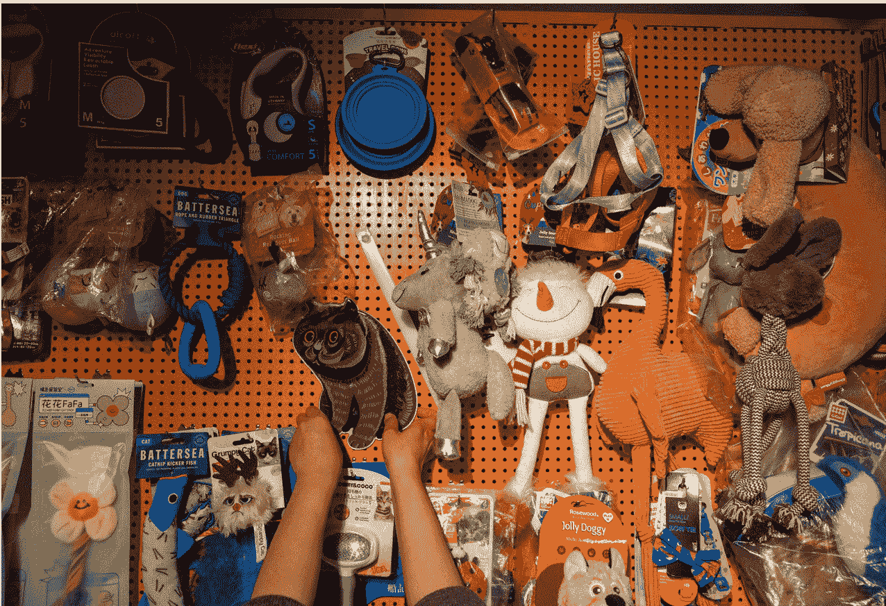
3月5日，北京顺义，兜吉宠屋，主理人曹莉展示店内的装饰。

2017年，薛鹏和妻子曹莉辞掉工作后进入宠物行业。薛鹏去学校进修了宠物美容师的技术，随后开办了一家宠物美容院。他们有自己的原则：不给宠物烫染毛发，因为会伤害到皮肤；不轻易做药浴，需要分析宠物的角质层后再判断。“我们会给宠物先洗浴通顺毛发，再根据身体结构设计美容方案。”曹莉介绍道。

七年服务实践中，他们不仅积累稳定客源，更建立起健康预警机制：针对每月固定洗护的猫咪出现牙龈发炎、断齿等情况，会即时提醒主人进行健康检测。“我们希望通过日常护理及早发现潜在问题，避免发展为严重疾病”。

随着宠物洗护美容、宠物寄养等传统服务不断升级，人们对于宠物心理健康的关注度也在不断提升，动物社交需求逐渐进入公众视野。宠物行为矫正、临终关怀等服务也出现在人们眼前。

在“京宠展”的宠物训练分论坛上，够朋友联萌创始人、国家高级宠物训练师王波的演讲引发共鸣。大屏幕上对比着传统训犬与现代正向训练的差异。“过去宠物训练往往聚焦于服从指令。通过暴力压制、强制驯化，然后期待返还一只完美宠物。这种模式忽视了一个关键事实，问题根源常在主人而非宠物”。

如今，行业正转向“70%育人，30%训狗”的新理念，例如停止过度拟人化互动、尊重动物天性，近九成宠物行为问题即可自然消解。

王波曾经遇到一只出门就狂吠的西高地白梗犬，在认真了解后，他发现问题的核心在于狗的身体一直处于很难受的状态——这条狗患有很严重的皮肤病，平时只能戴着伊丽莎白圈。王波给主人推荐擅长宠物皮肤治疗的医生，在治好狗身体的疾病后，逐步训练介入。狗狗进步很快，三四个月就停止了无缘由的狂吠行为。

宠物的生老病死也深深牵动主人的情感。大牛是燃后宠物火化殡葬店的主理人，2017年他进入这个行业时，宠物殡葬在中国尚处于萌芽阶段，他专程前往日本学习宠物殡葬的规范礼仪以及火化炉设备的操作技术。

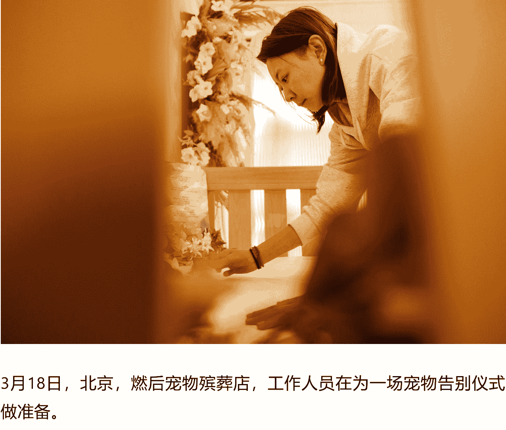
3月18日，北京，燃后宠物殡葬店，工作人员在为一场宠物告别仪式做准备。

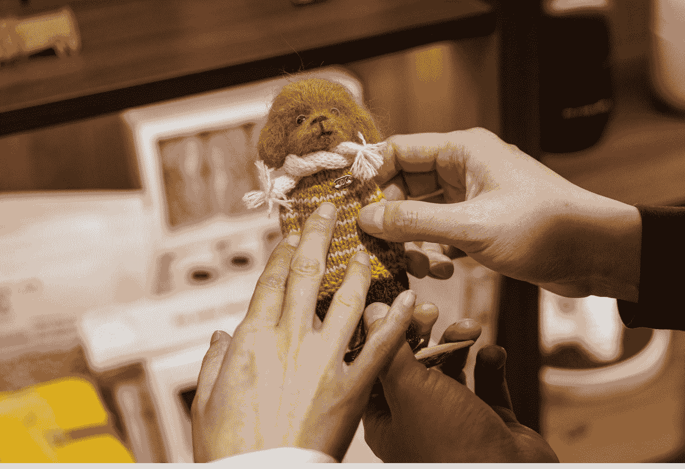
3月18日，北京，燃后宠物殡葬店，主理人大牛向顾客介绍用宠物毛发制作的纪念品。

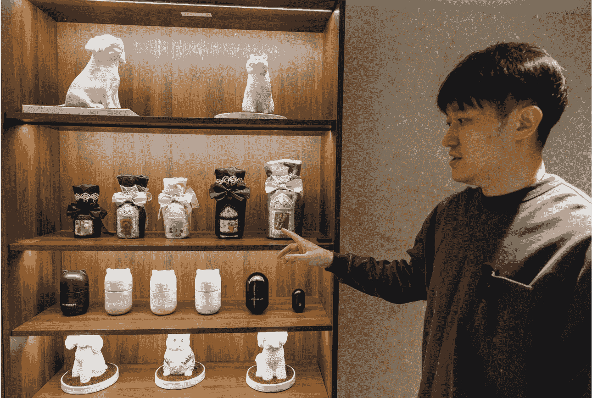
3月18日，北京，燃后宠物殡葬店，主理人大牛介绍不同类型的骨灰盒。

如今，因入门门槛相对较低，越来越多的年轻人投身于这一行业。目前的宠物殡葬服务主要包括清洁、火化和纪念品制作等环节，然而在大牛看来，要将宠物殡葬行业做到精益求精并非易事。“大多数人难以独立应对失去宠物所带来的痛苦情感，而且宠物离世与亲人去世不同，往往难以获得外界的理解与安慰。”大牛认为，宠物殡葬师最重要的职责，就是帮助这些宠主疏解悲伤，提供情绪价值。

随着从业时间增长，高龄宠物越来越多，王波发现宠物主人们的心态也在变化。“以前大家只是觉得把狗的行为纠正就行了，现在还要学习营养学、疼痛学，从全身考虑狗的福利和健康。”宠物的需求更加精细，像王波一样的宠物训练师需要掌握更多的技能。

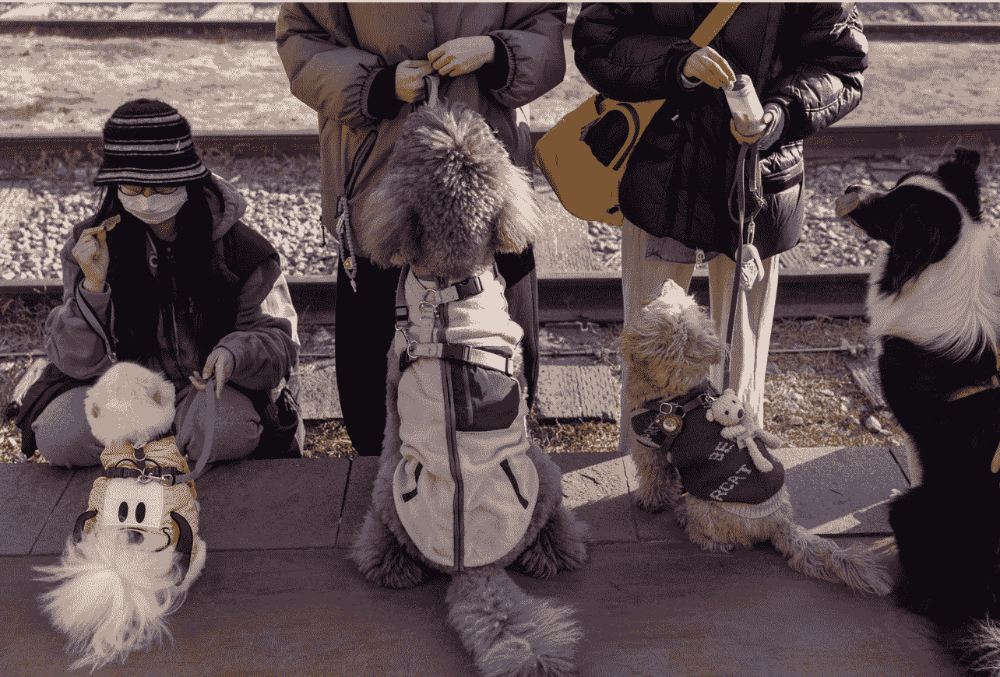
2月20日，北京，首创·郎园Station，宠物社交课上，宠物狗坐成一排等待奖励。

她带着团队里的宠物训练师，线上学习兽医的课程，有一段时间每周会有一个训练师去宠物医院跟诊，学习一些基本诊疗方法。

在王波看来，国内宠物训练师和理想的情况相比还有一定距离。欧洲宠物饲养率排名前三的德国，国内的狗与训练师数量的比率为8000比1；而据《2025年中国宠物行业白皮书》显示，2024年中国宠物犬数量已达5258万只，训练师却不及千人。

> "宠物的亲子教育类似于人类的儿童教育行业。专业亲子训练能有效降低宠物行为问题发生率，从源头减少后续医疗支出和弃养风险。"
王波觉得这块宠物服务行业中存在感较低的部分，将会慢慢走到人们眼前。她也盼望着，有资本能注意到宠物教育这个冉冉升起的板块。

3月5日，北京顺义，够朋友联萌的社交课上，王波与柴犬互动。

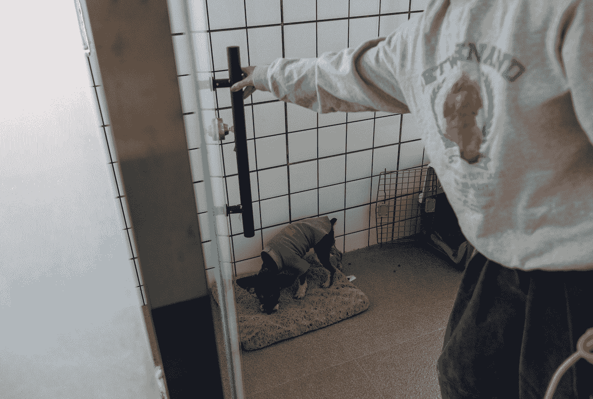
3月5日，北京顺义的宠物酒店，工作人员将遛完的犬送回房间。

值得欣慰的是，国内宠物友好环境持续改善：从九年前北京无一宠物友好商场，到如今核心商圈普遍开放，叠加宠主认知提升与正向训练理念传播，行业正迎来良性发展契机。

“疫情后越来越多人将情感寄托于宠物。”当宠物从“喂养对象”跃升为“家庭成员”，越来越高的情感诉求也推动了宠物消费市场的快速发展和地产业的创新升级。Abby观察到，北京养宠家庭数量激增催生出更多的细分市场：宠物尿不湿、智能陪伴设备、骨灰纪念品等创新产品不断涌现。

而她也在成为“全能服务者”，团队拓展至3人，业务涵盖寄养、零食定制、医疗咨询等全链条服务。“这不仅是商业赛道，更是关于责任与陪伴的社会实践。”Abby如此定义自己深耕的领域。

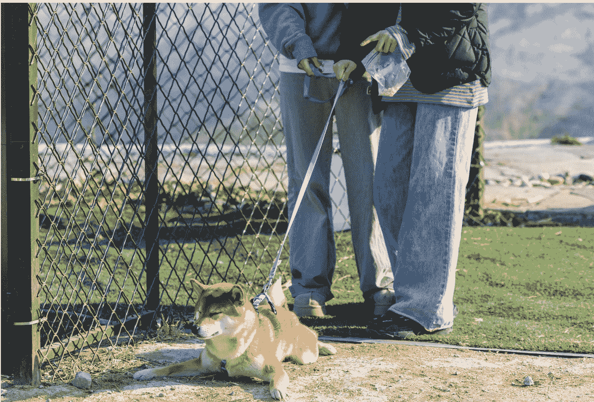
3月5日，北京顺义，够朋友联盟的社交课上，在柴犬和主人沟通发生障碍时，王波迅速接管牵引绳示范。

首创·郎园Station，宠物社交课后，主人给自己的宠物犬奖励。

在她看来，这是由年轻消费群体推起来的朝阳行业。在年轻的人群中，建立亲密关系越来越困难。相比之下，养宠所需的精力更低，但能够获得的情绪价值和陪伴感却更即时、更确定。某种程度上，“它经济”是情感经济的一环，在饲养和照顾宠物的过程中，年轻人不仅获得了情绪价值，养育宠物的过程，也成为重新“自我养育”的过程。但这个行业，也面临着更加细分化、精致化和智能化的挑战。

图片编辑 | 翁倩

### 育儿式养宠与3000亿规模“它经济”

宠物相关行业增长迅速，收割情感溢价的同时也面临着精细化、精致化和智能化的...

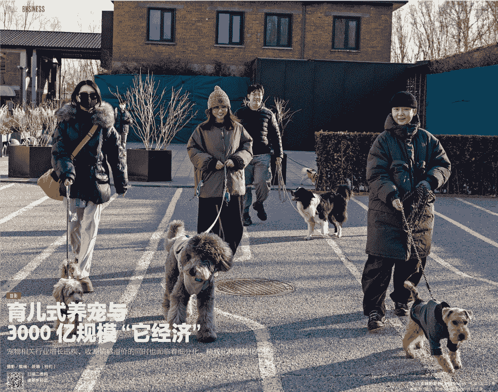
2023年2月28日，Abby驾驶着满载狗粮猫砂的车辆，从顺义国际展览中心驶回通州的家。当她把宠物用品在地面铺陈时，她的家庭成员——“马犬”张初五和“田园猫”张福来早已蹲坐在战利品旁，这位“90后”宠物家庭寄养师在朋友圈写道：“给我的胖爷们打霜归来。”
Abby参加的是2023北京国际宠物用品展览会(下称“京宠展”)。四天展期里，展会共吸引近23万人次宠物爱好者，68%是“90后”与“00后”。12万平方米的展区内集聚了全球宠物行业顶尖品牌。《宠物诊疗机构诊疗服务指南》和《宠物经营场所环境清洁与消毒指南》两项宠物国家标准的同步宣贯也为行业立下新规。
派读宠物行业大数据平台发布的《2023年中国宠物行业白皮书》显示，2022年城镇(犬猫)消费市场规模增长7.5%，达到2706亿元，已超过2022年中国保健品消费市场规模。当宠物从“喂养对象”跃升为“家庭成员”，越来越高的情感诉求也推动了宠物经济的快速发展和产业的创新升级。

“爱是拼尽全力给予却仍觉亏欠”
“京宠展”某展位的“野生实验室”里，烘焙乳鸽猫粮的香气吸引了众多宠物主驻足，“疯狂小狗城”的“冻干夹心粮”前，年轻宠物主们争相扫码下单。宠物旅行包、宠物衣装等实用品琳琅满目，甚至连宠物零食都做成了红米肠、萝卜糕、佛跳墙的样子来吸引宠物主的关注。
“育儿式养宠”已经成为目前养宠大趋势。根据艾瑞数据所发布的《2023年中国宠物健康消费白皮书》，宠物主在单只宠物上的年均花费高达5200元左右，其中宠物食品是最主要支出。
“展会上我能清晰感知到宠物养育方式的精细化趋势。”Abby说，“正如那句‘爱是拼尽全力给予却仍觉亏欠’。”
除了宠物主人，Abby还有另一个身份——“友它宠物寄养度假村”的主理人。2023年，从事汽车行业管理的Abby转型投身宠物家庭寄养领域，这一决定的契机源于家里那只因分离焦虑而频繁引发投诉的马犬“张初五”。“它从小在我怀中长大，一天没在外面生活也没经历过。家里一旦无人，它就持续不安吠叫，甚至学会开锁越狱。”Abby说。

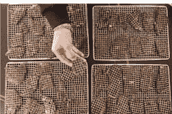
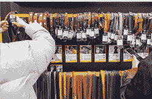
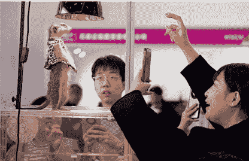
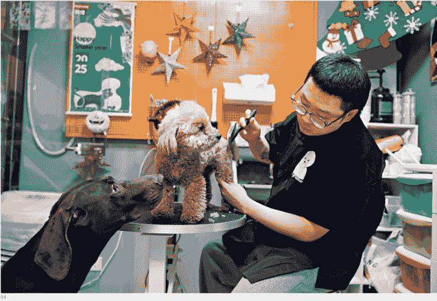
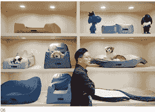
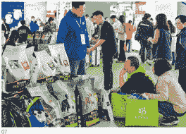

Abby尝试将“张初五”寄养在专业的园区，但是两三分钟后狗就能从笼子里跑出来，爪子上都是血。尝试让别的小狗和“张初五”一起玩也收效甚微。在和其他狗主人交流的过程中，Abby发现了新的商机。她决定借鉴国外模式，将自家住宅改造为“宠物家庭驿站”，提供散养式寄养服务。
所有狗进门后，Abby都会给它做犬瘟、细小等传染病检测，单独观察12小时，遛弯也采取分时分区。针对树基、柴犬等易发生冲突的犬种，设置独立房间隔离管理；若主人坚持散养，则通过“试玩测试”筛选性格相投的宠物组成“好友小组”。
而Abby的转型，也预示着宠物正在越来越多地影响着人们生活方式和重大决策。《小红书2024宠物行业洞察报告》显示，56%宠物主会为宠物改变生活方式。

### 巨大需求催生宠物经济

随着宠物从劳动动物转变为家庭成员，宠物主的需求也在逐步升级。
与人们越来越重视“情绪”的趋势一致，让宠物快乐也越来越多是宠物主消费的重要目标。2024年TGM全球宠物护理调查发现，在全球范围内，玩具是宠物主人最常购买的物品，超过一半的宠物主人会定期购买玩具，从偏重互动性的逗猫棒，到宠物“自嗨玩具”、宠物定制窗边看台……随着需求层次的升级，在资本与社交媒体的共同作用下，越来越多的需求被制造、被发现。
与之相应的巨大供给缺口令中国宠物经济迎来爆发式增长。多个权威数据印证了这一趋势。高盛最新研究报告显示，2024年中国宠物总量首次超过4岁以下婴幼儿数量，且预计到2030年宠物规模将达到婴幼儿群体的2倍。目前全国养宠家庭已突破1亿户，形成庞大的消费基础支撑。
而从消费层面来看，《2023年宠物行业消费趋势洞察》披露，2023年犬类消费市场同比增长4.6%，猫的市场增速更为显著，达到10.7%。值得注意的是，单只猫狗年均消费均接近6000元，显示出明显消费升级态势。
众多资本加速涌入宠物服务行业。企查查发布的《宠物服务行业发展报告》指出，近十年中国宠物服务相关企业存量规模迎来大幅攀升。在2015年底，只有0.82万家宠物服务相关企业，但到了2025年初，这个数字增长到了25.91万家，且近三年成立的企业占到74.47%。

02. 北京通州，友它宠物寄养度假村，主理人Abby正在制作宠物零食。
03. 2月28日，中国国际展览中心（顺义馆）第12届北京国际宠物用品展（下称“京宠展”），观众正在挑选牵引绳和项圈。
04. 萌宠宠服，薛颖正在为一只宠物犬进行美容。
05. 2月28日，京宠展上，一只狐狸吸引了观众的关注。
06. 2月28日，京宠展进行时，一名男士从宠物沙发墙前走过。
07. 2月28日，京宠展上，观众在宠物粮展位前咨询。

## 商业 | BUSINESS

企业数量与市场规模的双向跃升，共同勾勒出中国宠物经济的黄金发展曲线。在这片“蓝海”里，Abby辞掉了工作，开始创业，更多和她一样的“外行人”也开始选择走进宠物行业。

2017年，薛鹏和妻子曹莉辞掉工作后进入宠物行业。薛鹏去学校进修了宠物美容师的技术，随后开办了一家宠物美容院。他们有自己的原则：不给宠物烫染毛发，因为会伤害到皮肤；不轻易做药浴，需要分析宠物的角质层后再判断。“我们会给宠物先洗浴通顺毛发，再根据身体结构设计美容方案。”曹莉介绍道。

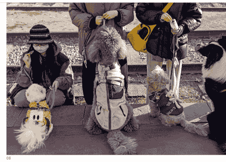

七年服务实践中，他们不仅积累稳定客源，更建立起健康预警机制：针对每月固定洗护的猫咪出现牙龈发炎、断齿等情况，会即时提醒主人进行健康检测。“我们希望通过日常护理及早发现潜在问题，避免发展为严重疾病”。

随着宠物洗护美容、宠物寄养等传统服务不断升级，人们对于宠物心理健康的关注度也在不断提升，动物社交需求逐渐进入公众视野。宠物行为矫正、临终关怀等服务也出现在人们眼前。

在“京宠展”的宠物训练分论坛上，够朋友联萌创始人、国家高级宠物训练师王波的演讲引发共鸣。大屏幕上对比着传统训犬与现代正向训练的差异。“过去宠物训练往往聚焦于服从指令，通过暴力压制、强制驯化，然后期待返还一只完美宠物。这种模式忽视了一个关键事实，问题根源常在主人而非宠物”。

如今，行业正转向“70%育人，30%训狗”的新理念，例如停止过度拟人化互动、尊重动物天性，近九成宠物行为问题即可自然消解。

王波曾经遇到一只出门就狂吠的西高地白梗犬，在认真了解后，他发现问题的核心在于狗的身体一直处于很难受的状态——这条狗患有很严重的皮肤病，平时只能戴着伊丽莎白圈。王波给主人推荐擅长宠物皮肤治疗的医生，在治好狗身体的疾病后，逐步训练介入。狗狗进步很快，三四个月就停止了无缘由的狂吠行为。

宠物的生老病死也深深牵动主人的情感。大牛是燃后宠物火化殡葬店的主理人，2017年他进入这个行业时，宠物殡葬在中国尚处于萌芽阶段，他专程前往日本学习宠物殡葬的规范礼仪以及火化炉设备的操作技术。

如今，因入门门槛相对较低，越来越多的年轻人投身于这一行业。目前的宠物殡葬服务主要包括清洁、火化和纪念品制作等环节，然而在大牛看来，要将宠物殡葬行业做到精益求精并非易事。“大多数人难以独立应对失去宠物所带来的痛苦情感，而且宠物离世与亲人去世不同，往往难以获得外界的理解与安慰。”大牛认为，宠物殡葬师最重要的职责，就是帮助这些宠主疏解悲伤，提供情绪价值。

### 宠物行业需要“全能服务者”

随着从业时间增长，高龄宠物越来越多，王波发现宠物主人们的心态也在变化。“以前大家只是觉得把狗的行为纠正就行了，现在还要学习营养学、疼痛学，从全身考虑狗的福利和健康。”宠物的需求更加精细，像王波一样的宠物训练师需要掌握更多的技能。

她带着团队里的宠物训练师，线上学习兽医的课程，有一段时间每周会有一个训练师去宠物医院跟诊，学习一些基本诊疗方法。

在王波看来，国内宠物训练师和理想的情况相比还有一定距离。欧洲宠物饲养率排名前三的德国，国内的狗与训练师数量的比率为8000比1；而据《2025年中国宠物行业白皮书》显示，2024年中国宠物犬数量已达5258万只，训练师却不及千人。

> "宠物的亲子教育类似于人类的儿童教育行业。

专业亲子训练能有效降低宠物行为问题发生率，从源头减少后续医疗支出和弃养风险。"
王波觉得这块宠物服务行业中存在感较低的部分，将会慢慢走到人们眼前。她也盼望着，有资本能注意到宠物教育这个冉冉升起的板块。

值得欣慰的是，国内宠物友好环境持续改善：从九年前北京无一家宠物友好商场，到如今核心商圈普遍开放，叠加宠主认知提升与正向训练理念传播，行业正迎来良性发展契机。

“疫情后越来越多人将情感寄托于宠物。”当宠物从“喂养对象”跃升为“家庭成员”，越来越高的情感诉求也推动了宠物消费市场的快速发展和产业的创新升级。Abby观察到，北京养宠家庭数量激增衍生出更多的细分市场：宠物尿不湿、智能陪伴设备、骨灰纪念品等创新产品不断涌现。

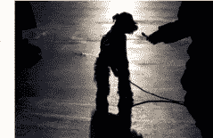

而她也成为一个“全能服务者”，团队拓展至3人，业务涵盖寄养、零食定制、医疗咨询等全链条服务。“这不仅是商业赛道，更是关于责任与陪伴的社会实践。”Abby如此定义自己深耕的领域。

08. 2月20日，北京，首创·郎园Station，宠物社交课上，宠物狗坐成一排等待奖励。
09. 3月18日，北京，燃后宠物殡葬店，工作人员在为一场宠物告别仪式做准备。
10. 北京，友它宠物康养度假村，工作人员正在对初次到访的犬只进行体检。
11. 首创·郎园Station，宠物社交课后，主人给自己的宠物奖励。

在她看来，这是由年轻消费群体推起来的朝阳行业。在年轻的人群中，建立亲密关系越来越困难。相比之下，养宠所需的精力更低，但能够获得的情绪价值和陪伴感却更即时、更确定。某种程度上，“它经济”是情感经济的一环，在饲养和照顾宠物的过程中，年轻人不仅获得了情绪价值，养育宠物的过程，也成为重新“自我养育”的过程。但这个行业，也面临着更加细分化、精致化和智能化的挑战。

## 随笔 | 忽明忽暗的迷惘

## CAIXIN | 听文章

文 | 鸣镝

电视制片人

——

汗水渗进了眼睛里，有些刺痛。他揉了揉眼睛，摇晃了下脖子，这才发现阴云不知什么时候笼罩了天际。中午还燥热得不得了，天变脸也是快。风也变凉了，吹着还没干透的工作服有些阴冷阴冷的。

“要下雨了吗？现在几点了？”老陈这样想着。疲惫感开始在身体里扩散开来，脖子跟肩膀好像是突然就僵硬了，手里的扳手也变沉了。

眼见光线越来越阴暗，乌云滚动着，像个怪兽的模样在空中挣扎。他又拧了两颗螺丝。“哎，我说，收工吗？要下雨了。”他冲着工头喊。“活儿没完呢，再坚持一会儿，刚5点。”两分钟后他才得到答复。真的感觉累了，一旦从干活儿的专注中苏醒，身体不可遏制地开始乏力。他强撑着。但是，一想到过两天就要结工资了，他没有了什么怨言。

风越来越如冰冷的刀片，高塔晃动得越来越厉害，觉得随时会有掉下去的危险。雨也开始下了，敲打着安全帽乒乓作响。老陈的动作越来越迟缓，雨水让扳手打滑，像是故意跟他作对。他看着阴云，俯瞰被雨丝淹没的昏暗的大地，叮叮当当砸螺丝的声音，在100米的高空空洞地回响着，他像一具永动木偶，灵魂似乎离开了身体——我为什么要悬在这半空中，在这摇晃的高塔上，在这大雨里，不但一边要保命，还要一边拧这个该死的螺丝呢？

当然，并不是所有时候他都是这种心情，有时老陈甚至喜欢高空作业这个活计，空间上让他脱离了地面上的生活，不必去想那些烦心事。在100多米的高空看着脚下变小的人、道路、土地，也会生出诗人般的超脱。他时常用“这工作还有些浪漫”来宽慰自己，重要的是，这个工种挣钱还多。

雨越来越大。过了一小时才收工，他浑身湿透已经麻木了，没有“终于等到了”的满足感，怒气和厌恶都让大雨浇灭了。

一步一步从高塔上下来时，他惟一的感觉是肌肉在发抖，觉得自己踩不实铁架，心慌，有种随时坠落下去的恐惧。“我是不是老了？是不是干不了这个工作了？”他被这个念头给咬住了，摆脱不开。

他一边小心翼翼地向向下挪动一边想，“那还能干些啥呢？什么工作还能挣到这些钱呢？”他继续想，“不能拼命，死了就什么都没有了，我还有老婆孩子。”大雨哗哗哗地给他伴奏着。

双脚终于踩在了泥泞的土地上。“很好，我撑过来了。”他心中暗自庆幸和骄傲。“这么危险的工作我完成了。”此时的铁塔屹立着刺向云霄，像是他伟大的作品。

开始他想吃一碗热汤面，也想喝上两口烈酒，辣辣嗓子。走了半个多小时，他才走回破旧的工棚。那天晚上他睡得很香，睡梦里甚至露出了微笑。因为他知道工程阶段性结束，他可以领到工钱了，老婆、女儿和小儿子会热烈地迎接他回家。

老陈是忧郁的，也是坚韧的。

一天200块，一个月刨去3天的休息，共5200块。厚厚的一沓——第二天下午工资如期下发。老陈用信封装好，满意地塞进了上衣内兜，扣上暗扣。那些钱好像立刻变暖了，有了他的体温，“是自己的了。”他偷偷地露出了微笑。还有的工友在抱怨钱少，“发得很及时，已经可以了。”他附和了两句。

被大雨淋得发烧后，他喝了一暖壶开水，症状还没有缓解，脑袋还是昏昏沉沉的。他担心自己路上会虚脱，于是决定再在工棚睡上一天。他和衣躺在木板床上，那个念头又来了：还不到40岁呢，力气怎么就不行了？他在半梦半醒的昏沉里有些恐慌。

一天的路程，到家时天已经黑了。他远远就看见了老婆在村口等着他，“回家真好。”他是真的想老婆了，迎上去情不自禁抱了抱她。媳妇有股清新的香气，应该是特意换上了干净的衣服。他就赶紧又松开，自己满是铁锈和汗渍的工作服太脏了，又落了一路的灰尘。

“干吗还出来迎呢，又不是找不着家。”

“饭早做好了，心里悬得慌。怎么这么晚？”

“路上那车坏了一会儿。闺女儿子呢？”

“在家写作业呢。”

“学习好，学习好！”

“累了不？”

"车太颠，散架了都。"

回到家，姐姐带着弟弟正在家门口等着。闺女变样了，大姑娘了，儿子也长高了。老陈眼眶湿润。

闺女不是老陈亲生的。老婆原来是个寡妇，相亲时他有点抵触，说出去不好听。但是看见当时还只有3岁的小姑娘在妈妈的怀里，眼睛一闪一闪，可怜巴巴地有种讨好他的神情，他的心就软了。可能是注定的，他们就进了一家门，生活有了根。

后来无数次回顾起那个决定时，老陈都会觉得那个决定是对的。

老婆给他换上了干净的衣服，斟好了老白干。他检查了闺女的作业，从包里给孩子掏出了礼物——一套看起来很高级的文具，一个玩具枪。孩子们很高兴。

昨天他还是个工地上的小工，现在却是一家之主，有种魔幻之感。他很感慨，也很欣慰：“哎，没白受累，没白受累！”

老陈不自觉喝了很多，他想屏蔽掉那个对自己的担忧。但是老婆无意中碰到了他摔断过的一根肋骨，他不自觉地疼得呻吟。

"怎么了这是，怎么了？"

"没事没事。干活伤到过。"

老婆知道老陈是个能忍的人。她担忧地看着他，心疼得难受，其实从丈夫难掩的疲惫里，她早已经读出了他的艰辛。

"要不行，咱换个活儿？"

"那怎么养家呀！"

"原来和你一起干的现在都不干了，就你还死挨。"

"没事，这个活儿给钱多。我又没什么别的本事。”夫妻俩沉默着。

"那也还是身体要紧，不能不要命呀！"

"我这个命还不是你们的吗？"

"所以呀，你换换吧，你老师不是在县城里当县长吗？还有你同学也能帮忙吧。”

"怎么能麻烦老师呢？我这样她老人家想帮也帮不上呀，我没能给老师长脸已经很丢人了。人都有自己的命。”

"万一老人家能帮上你呢？"

"没有万一！"

老陈沉默着。老婆说进了他的心里，他确实在盘算换一份工作的可能性了。提心吊胆的经验太多了，从高空坠落下来的情形已在他脑海中闪过无数次。他不敢想，如果那成为现实，老婆孩子将面临怎样的境遇？

### 三

他知道自己又要面临人生的选择了。如同高考失利那年，他面对着还要不要复读的选择——你必须作出选择，而选择即命运。

他永远记得老父亲垂头丧气、六神无主不敢作出决定的样子。

“万一再考不上呢？咱们家这情况？”那年老头已经70岁了。他是家里惟一的男孩儿，也是最小的。老头叼着烟袋在堂屋里打着转，怕伤害触怒他，又不停掂量着家庭实际经济情况，想让他自己打退堂鼓。姐姐姐夫们都静默着，没有一个人出声，全是凝重的表情。

“大大，我不复读了。你们都别为难了。”

那天，他带着羞愧轻声说出了生命中最沉重的话，推门而出。晚上，他漫无目的走到了河边，脸上挂着干涸的泪痕，在草地里睡了一夜。

谁让我没有考好呢？谁让我出生在这样的家庭呢？谁让我自己不争气呢？

月光下的河水微波粼粼，神秘而动人，似有命运的隐喻，他觉得蛙声里充满了绝望。也是在那天，他失去了追求心目中女神的勇气。

顺势而为吧，他琢磨着，命运是被推着走的。他谋划新工作的惟一原则是：不会有在高塔上随时掉下去的恐惧，他不想再感受身体在高空中无法自控的那种摇晃了。要踏实，还要有性价比，挣的钱要足够供养两个孩子上大学。

“看见了吧，就干这个，一个月4000，管吃住，休两天。行不行？”

老板吼叫着，因为车间噪音太大。这是一个粉尘弥漫的车间，大腿粗的通红的钢柱从炉子的屁股里拉出来，然后由一根胳膊粗柱子给钢柱穿一个眼，就成为钢管了。后面的工人等距离给截断。

“行，我干。”这种单纯操作机器的活儿看起来没什么危险，只是扑面的热风、湿气、高分贝的噪音、呛人的粉尘……能拿这些钱不就是因为这条件嘛，老陈没有经过太多的掂量就接受了新的工作。

“那好，明天就过来上班吧！”老板急不可耐地离开了。

他又观察了一会儿，看着车间里那些来回移动的身影，仿佛是看着以后的自己。

那确实就是明天后的自己。他将很快体会到身体被湿热蒸发至虚无的失魂，还有烟尘穿过口罩直抵内脏的侵占性。有那么一刻，他想象自己的脑袋和通红的铁柱撞在了一起——头发会最先燃烧起来，然后脑袋就会被铁水一点一点地销熔，一阵烟，渣子都不会留，然后就是永远的解脱了。他一边切割着铁管一边那样想象着。在满地泥泞的车间里，他用忙碌、用劳动的惯性，尽自己的最大努力保持着理性。

### 四

“老陈！”他像是在梦里听见有人在呼喊他的名字。

他回过头看见大王，也像是在梦里一样站在他的身后。那是他最要好的同学。他揉了揉眼睛，车间里的噪音恢复了真实性，铁炉轰隆隆的鸣响，压倒性地又占据了现实。他们吼叫着，让声音能够穿透烟尘飘进耳朵。

“这里脏，赶紧出去！”他对大王吼。

“走，出去说。”

“不行，我干活呢！”

老陈一边喊叫一边用手指着该死的钢管摇着头。大王一把拉住了他，把他向车间外拽，老陈踉踉跄跄差点摔倒。

“你怎么来了？”

“你们厂长请我来的。你们厂要弄电路。”大王是县电业局的干部。

“你在这个车间干多久了？”

“两年多了。”

“这种环境怎么行，你每年体检不体检？”

“体检？体什么检！查出来还得治。这不是好好的嘛。”

“好个屁！”

大王看着脏兮兮狼狈不堪的老陈，有些心酸，但是又不能过于表现出来，那就类似高高在上的同情了。长久以来他们建立的不是那样的关系，也无法变成那样的关系。他从内心里尊重老陈。

“老师都好吧？”大王就是他最尊敬的当县长的老师的儿子。

“她好着呢，退休了，天天打乒乓球。”

“我中秋节去看看她老人家去。去年就没去。”

“待会儿跟我去喝酒吧。”

“那我得请个假。”

“请个屁假，我跟你们厂长说。然后你考虑一下去哪儿，给你换个车间，你自己选。你们厂长这点面子还得给我。”

最终老陈还是没有调换车间，不是因为大王做不到，而是他自己没答应。

那天酒桌上，他被大王让在上座。可能是酒店有些豪华了，菜也都太贵了，他觉得他在一个不属于自己的生活里。话题不可避免地会回到学生时代。他第一次喝果珍就是在老师家里，感冒生病是老师给他拿药，像是妈妈。

大王说到对他的嫉妒，因为老陈学习好，所以妈妈好像更疼爱老陈，甚至有一天他跟妈妈顶嘴，“你把他当儿子完了，别要我了。”然后被妈妈打了一记大耳光。他们谈起那几个考上大学的同学后来各自的处境，那时候他们学习并没有他好。

毕业前的那个冬天，连着下了三天大雪，他们三个，老陈、大王还有大王的弟弟，他们窝在一起聊着理想、未来，和对世界懵懂的认知。

操场上的雪被他们踩出咯吱咯吱响声，像是急于拥抱未来的心动的声音。也可能就是在那几天他们第一次抽烟喝酒。

但是老陈没有勇气谈起他作出不再复读决定的那个夜晚。他也不想聊在冬天的宿舍因为过于寒冷他把宿舍的灯泡放进被窝里取暖，早上醒来被子被烤煳了，差点着火。

那天老陈喝多了。

“大王，你别跟我们厂长打招呼了。别麻烦了。”

“我跟他一句话的事，你别死要面子。”

“不值当的。而且这里挣得多，比别的车间要多出来1000呢！孩子们上学需要钱。”

老陈一口口闷着酒，急于把自己灌醉。在醉酒带来的极端敏感里，他发现自己似乎是个老头了：我和大王同龄，我怎么却像是比他大了十多岁呢？怎么就活成了这个样儿了？

老陈突然觉得自己没有为自己活过，所有付出好像都是在完成一个自己也不明就里的任务。但是，为家庭、为孩子不是应有的责任吗？如果没有这些负重，活着的意义又在哪里？

老陈似乎突然发现并认可了自己是个失败者。“可是我为生活已尽了自己的全力。我已经尽力了呀！”

老陈的迷惘就如同街灯般忽明忽暗。

### 五

以上有的场景的确不是我所见的，但它不是虚构的小说，老陈和他的经历是真实的。我就是以老陈老师的亲儿子，大王的亲弟弟，也是老陈的同学，老陈对我来说就像个亲哥哥。

后来，老陈50岁了。但是他已然落下了醉酒以后的毛病，除了上班就是喝酒。酒瘾对他来说就像是个逃避意义追问的游戏。“都在酒里。”他喃喃自语。孩子们都大了，不再需要他的支持，而他却无法卸下身上的负重。

以后的岁月里，老陈还将到60岁，还将70岁，也还将继续着酒瘾。那些像老陈一样的男人都是这样活的，在风吹日晒的建筑工地，在烟熏火燎的餐馆后厨……可老陈为什么会把喝酒当成他的逃遁之地呢？

不知道，当初，如果他不是被老师寄予厚望的好学生，如果他不是在高考时考砸了，如果他不是“懂事”地放弃了复读，甚至，如果他不是而是我和我哥最好的朋友，而我们兄弟俩又恰好都过得比他强，高空作业和铁炉的热浪或许不会成为他摆脱不掉的噩梦吧？

## 专栏·暮年絮语 | 是辅助，而不是管控

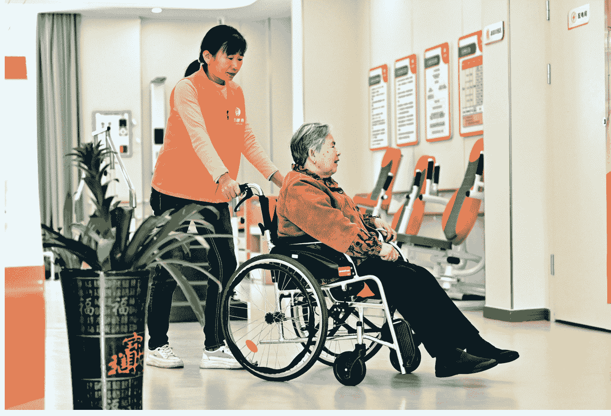

## CAIXIN | 听文章

钱理群

学者

变老之人能够自如应对衰老与死亡的困境，除了发挥自主力，还有一个关键，就是仰仗养老机构的高质量扶助。

根据《最好的告别》作者阿图·葛文德医生的分析，以及我的观察与思考，随着时代变化，人的养老方式处在不断变动之中，大体可分为五个阶段——

按传统的养老模式，人一旦面对衰老与死亡，就由家族中几代人共同扶助，即所谓“四世同堂共养”。这是传统社会结构决定的——老人扮演着传统、知识与历史维护者的角色，崇老文化由此产生。大家族养老，子孙侍奉，天经地义。

但随着经济和社会的演变，家族结构以及祖辈、父辈与子孙的关系也逐渐变化。家族文化逐渐淡化，家庭成为主体。这就进入了第二阶段——“家庭养老”。

随着现代社会的发展，在家庭内部，老人的地位与作用逐渐降低削弱。随着子女经济、社会独立性的强化，对家庭控制权、财产分配权的利益需求也愈加强烈迫切；子女独立成家，父母与子女分居成为必然趋势。养老模式也就由子女赡养演变为独居养老——老人独立支撑，子女辅助。

现在，中国社会进入了“长寿时代”。生育率的下降，老人的长寿，使得养老由家庭、个人的事变成了社会事业。“社区（康复院）养老”模式就这样应运而生。同之前的家族养老、家庭养老以及个人独居养老模式相比，其最大变化，就是一切都纳入机构管理：老人生活的各方面，都在同一个中心领导下进行；成员日常生活各方面，都是一大群人一起完成，且由相关服务部门周密有序安排。这样的组织化、计划化、科学化管理，大大提高了老人的生活质量和安全感，人与人的关系也更加密切。

但新问题也随之产生，特别是在“后疫情时代”，回归家庭成了新需求和新趋势。养老院的老人发出了“我要回家”的呼声，这给机构管理的养老模式提出了变革的要求——养老院要像“家”一样——这就是第五个养老模式，也是我们要探讨的养老管理的根本问题。

这里的关键，是要确立基本的管理理念和指导思想：对老人的照顾，不能仅限于日常生活与身体的安全健康，更要有精神照顾和家庭文化；不能只有管理目标，更要有价值关怀；不能只强调群体，更要重视个体。

由此提出一个基本概念——辅助生活。养老院管理的基本权限是“辅助”老人的生活，而不是“管控”老人的生活。二者之间的矛盾在于，老人已经没有能力照顾管理自己，一切都要仰赖照料自己的人。如何使老人仍有做主的自由，使照料限于辅助，这确实是两难。

这就要求老人与照料者的关系发生根本变化：由功利性的护理，转化为类似亲人的照料，满怀爱心地、心甘情愿地、单纯地做着看似简单然而深刻的扶持。这样，老人与照护人之间，才能够自然而然地达到彼此的妥协与平衡。照护人作为管理者，要强调“人比任务重要”；要关心老人希望怎样生活，而不是子女希望老人怎样生活，或者管理规则要求老人怎样生活。老人也不能把自己的希望和要求绝对化，必须换位思考，替照护人和管理者考虑。双方用协商的方式共同处理难题，应该是养老管理的一项基本原则。

如果说老人处在能够自理的阶段，管理的重心应落在发挥老人的生命潜力，为其提供再学习、再创造的条件与机遇；如果到了衰老期和临终前，重心就要转向《最好的告别》里强调的，抗击老人心理上的“三大瘟疫”——厌倦感、孤独感、无力感。葛文德医生显然把注意力集中在老人内心的滋养上，改善养老人生的新途径，便是重建生命的热情、温暖与力量，为走到生命尽头的老人，展现一片新天地。这才是实实在在的“最好的告别”。

葛文德医生在书中，以极大篇幅不厌其烦地介绍各地养老院管理者的各种尝试和实验。例如引进动物、植物与儿童，让宁静的养老院热闹起来；打破固定化的生活，故意把养老院的生活搞得“乱七八糟”；有意识地扩大视野，为独居老人创造同世界沟通的机会，以达到对庸常存在的超越；等等。

他还郑重提出，“使老年生活有意义是一种新思想，比仅仅使老人安全需要更多的想象力和创见。”我读到这里，眼前为之一亮。这才是要害：养老事业，需要好奇心、想象力和创造力——养老管理的开创者、实践者，以及日渐衰老、直面死亡的老人都需要。我们现在所缺的，就是这样的好奇、想象与创造。■

## 逝者|刘鸿儒：引领人与拓荒者

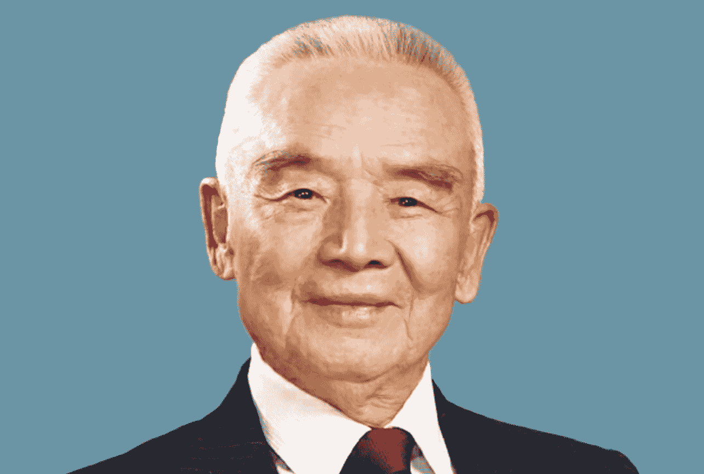

## CAIXIN|听文章

文|财新周刊 李箐

从48岁出任农业银行副行长，到49岁调任中国人民银行副行长，再到61岁成为中国证监会首任主席并给外界留下深刻印象，其实，刘鸿儒的一生是中国金融改革与资本市场从无到有的一个缩影，他见证并参与了国家从计划经济向社会主义市场经济转型的重要历程。

刘鸿儒1930年出生于吉林省榆树县，少时曾被迫到日本劳工营当电焊工。17岁进入哈尔滨东北行政学院（后更名东北人民大学，现吉林大学），从事教学辅导和行政管理。新中国成立后，他进入中国人民大学进修，师从苏联专家学习银行专业；之后回到东北人民大学任经济系副主任，教授货币银行学等。1955年，25岁的刘鸿儒赴莫斯科大学经济系攻读研究生，四年后获经济学副博士学位；归国后，在中国人民银行任处长、局长等职。

改革开放初期，金融改革提上议事日程，刘鸿儒是引领人。中共十一届三中全会确定把发展农业放在战略位置，金融领域首先要恢复农业银行。当时社会上对此有各种疑虑，包括如何与人民银行划分边界。刘鸿儒组织起草了恢复农业银行的文件，并于1979年3月出任该行副行长。

伴随商品经济发展，金融改革进一步铺开，中国银行、建设银行、人民保险公司相继从人民银行独立。1980年8月，刘鸿儒调回人民银行任副行长，主管金融改革，重点研究中国是否成立中央银行以及成立什么样的中央银行。1982年，人民银行成立银行机构改革小组，刘鸿儒担任召集人，进行中央银行的方案设计。

1983年9月，国务院正式发文，决定中国人民银行专门行使央行职能，剥离城市工商信贷业务成立工商银行。到1984年，除了中、农、工、建四大专业银行，金融机构也大量发展，成立了一批信托投资公司和信用社。同年，国务院成立金融体制改革研究小组，推动金融领域全方位改革，刘鸿儒为组长。

自上世纪80年代中期开始，各地金融市场举措接踵涌现。武汉首先开办了银行间同业拆借的货币市场；沈阳市信托投资公司开始发行股票；上海工商银行静安寺办事处开办了买卖股票的窗口市场；国库券交易市场在全国铺开；上海、深圳先后开辟了有形的外汇调剂市场。1988年，一批小型商业银行和股份制保险公司获批。这一系列进程中，刘鸿儒因在银行改革、中央银行宏观调控、金融市场建设等方面的持续探索，被看作“中国转轨金融学的启蒙人”。他于1981年创办人民银行研究生部，俗称“五道口”，成为金融业黄埔军校，在业内桃李满天下。

1990年，刘鸿儒南下深圳调查股市。面对“姓资姓社”的激烈争论，他坚定支持股市试点，向中央提交了翔实的调查报告，认为股票市场能成为公有制的另一种实现形式。1992年，在初生的股市动荡之际，刘鸿儒临危受命，担当证监会首任主席，主持证券市场的初步规范化建设。他说：“我们在做社会主义国家前人没有做过的事，现在是开荒、修路、铺轨道。”

刘鸿儒上任之后，强调提升上市公司质量，发展机构投资者，规范市场运作。他提出“上市公司的质量是资本市场稳定发展的基石”的“基石论”。他提出“专家为主，廉政为本”，推动证券市场立法与监管体系建设。他主导设计了H股和N股的发行机制，使中国企业得以在海外资本市场融资，为中国资本市场的国际化铺路。1995年，65岁的刘鸿儒从证监会卸任。

2000年6月，嘉实基金内部震荡，管理层公开反对大股东为了利益而内幕交易、损害基金投资者等行为。10月，《财经》杂志刊发《基《基金黑幕——关于基金行为的研究报告解析》，以翔实数据与分析揭示了公募基金业存在的各类违规违法操作。

这一度引发了发展与监管的关系之辩。时任全国政协经济委员会副主任的刘鸿儒比喻“基金只有两岁，可能会尿裤子”，将中国股市比作“十岁的孩子”，认为在早期发展阶段，市场难免出现问题，但不可因此否定其存在价值。他呼吁市场参与者和管理者既要正视风险，也不能过度夸大风险；问题的暴露是市场进步的表现，关键是完善法律法规、加强监管和技术创新，推动市场健康发展。

此后，时任国务院总理朱镕基决定，将嘉实基金原总经理调入证监会任基金部副主任。证监会也公开表态欢迎媒体监督。之后，公募基金行业脱胎换骨，至今在治理机制与信息披露等方面总体保持了较高的规范性。而中国的金融改革也进入了更加迈向市场化、加强宏观调控与精细化监管的深水区。

2025年3月14日，刘鸿儒在北京逝世，享年95岁。■

## 逝者 | 李兆基：首富其财聚散有道
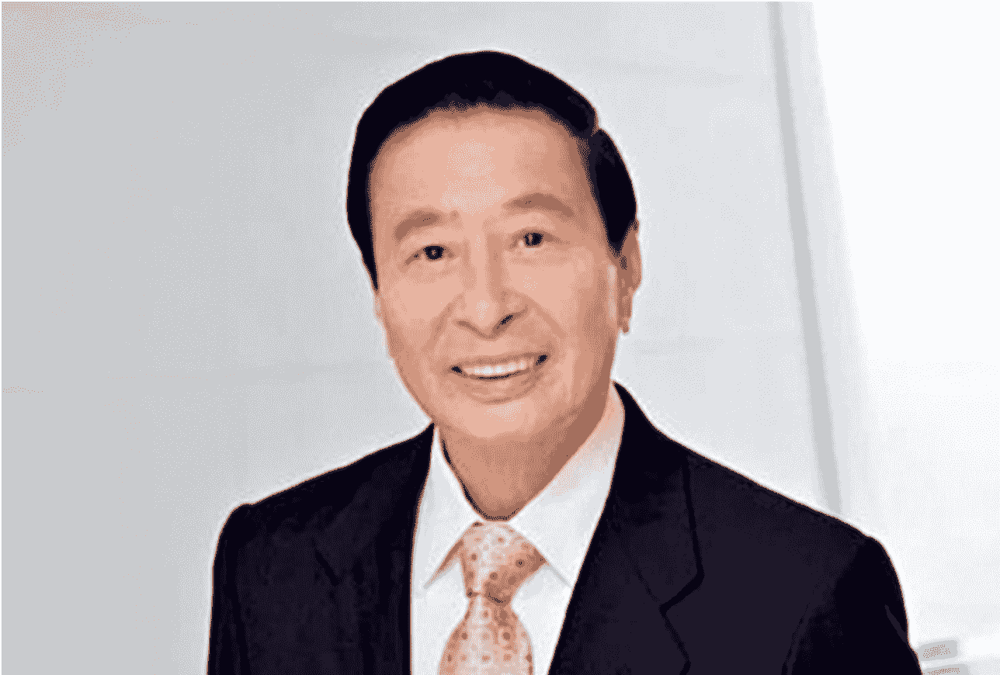

### CAIXIN | 听文章
文 | 财新周刊 文思敏

2025年3月17日，香港豪门恒基兆业地产创办人李兆基辞世，享年97岁。

李兆基在家中排行第四，被尊称为“四叔”。凭借上世纪70年代后香港数十年的房地产繁荣，他与李嘉诚、郭得胜、郑裕彤等四大家族，共同参与了香港经济腾飞的黄金时期。据福布斯2025年3月公布的《中国香港富豪榜》，李兆基以292亿美元的身家稳坐第二把交椅，仅次于身家373亿美元的长和系李嘉诚。1996年，李兆基还曾荣登华人首富、亚洲首富宝座，并在世界富豪榜中位列第四。

1928年，李兆基出生于广东顺德一个金铺世家，家境优渥。他自幼亦显露出商业天赋，在父辈引领下，耳濡目染，6岁时即学习黄金、汇兑以及外币买卖等家族生意。“二战”结束后，货币一度大幅贬值，年仅20岁的李兆基怀揣1000港元，独自前往香港寻求发展机会，最初涉足制造业和进出口行业。

战后香港经济蓬勃发展，人口激增，港府开始兴建保障性房屋，以满足市民庞大的住房需求。李兆基敏锐捕捉到地产行业的巨大商机。1958年，他与郭得胜、冯景禧等八位股东共同创立永业有限公司，购入沙田酒店，并开始兴建各类楼宇。1963年，三人又合作创立新鸿基企业有限公司，1972年新鸿基地产成功上市后分家。1973年，李兆基自立门户，创立了恒基兆业有限公司，并在1975年与长江实业、新鸿基地产、新世界地产合作，开发了沙田第一城项目，规模超1万套住宅，至今仍是区内最大规模的住宅项目。

1981年，李兆基将恒基兆业地产上市，成为李氏家族的上市旗舰，如今旗下拥有七间在香港联合交易所独立上市的公司，包括美丽华酒店、中华煤气、香港小轮等。恒地通过积极购入换地权益书、收购旧楼农地、吸纳土地，逐步发展为香港四大房地产开发商之一，在香港各处拥有多所购物商场和住宅项目。

上世纪80年代，李兆基进军内地地产市场。1980年在广州兴建中国大酒店和花园酒店，后与霍英东、广东省政府和番禺市政府合资发展番禺洛溪新城，亦在北京、上海、深圳等地有地产项目投资。

进入21世纪，在地产行业叱咤风云的李兆基又进军股市。2004年，他以个人名义成立投资旗舰兆基财经，亲自掌舵投资方向。2006年他接受访问时透露，兆基财经高峰期资产值高达2000亿港元。他也因此一度被坊间称为“亚洲股神”。

然而，在2008年全球金融危机中，兆基财经的资产蒸发近半。此后，李兆基也极少再对股市发表评论，表示不希望连累股民，并解释说，自己不是股神，“只是股民，最多是冒牌股神”。

2019年，时年91岁的李兆基宣布辞去恒地主席兼总经理职务，由长子李家杰、次子李家诚接班，分别任恒地联席主席及总经理，共同打理家族生意。李家杰主要负责中国内地业务发展，李家诚则管理集团在香港的业务。李兆基多次在公开场合称赞两人“表现都是100分”。

李兆基性格十分豪爽，每当家族有新婚或生子的喜讯时，他都会大派利是，多次向全体员工派出每人1万港元的红包。2010年他还曾放出豪言，若恒生指数重返30000点，将每年捐出10亿港元，以每人资助1万元计，每年将有10万人受惠。2017年11月，恒指冲上30000点后，李兆基兑现了承诺。此后他还许诺，当恒指达到40000点时，他会每年捐出20亿港元，但至今恒指仍在30000点以下徘徊。

从白手起家到华人首富，李兆基为人亲和，曾多次公开分享自己的致富经验。他向年轻人拆解四大致富之道：一是“吃苦耐劳，勤奋努力才可成功”；二是“不要太早背负家庭压力，待事业有成才考虑成家立室”；三是“先赚到第一桶金，之后再以钱生钱，只靠劳动打工赚钱难以致富”；四是“男最怕入错行，女最怕嫁错郎，要选择前景更好的行业”。

对于财富之道，李兆基认为：“聚而不散是暴殄天物，识得聚财，也都要识得散财。”尽管他身家颇丰，但自称连1%的财富都用不完。股市起伏、全球经济危机等都会让他“患得患失，像成为金钱奴隶”。后来他领悟到，多出力做慈善做公益，才能发挥财富最大价值，又能减少烦恼。

他名下设有李兆基基金会，多次向香港、内地以及海外高校捐款用于科研。2008年四川汶川大地震发生，他更是慷慨捐出5.6亿港元援助灾区。他还曾提出许多创新的慈善构思，例如，从2013年起提出一系列捐地计划，兴建香港最大的养老院、护理中心和青年宿舍，以减轻香港民众迫切的居住需求。■

## 前瞻 | 欧盟如何应对美国加征关税
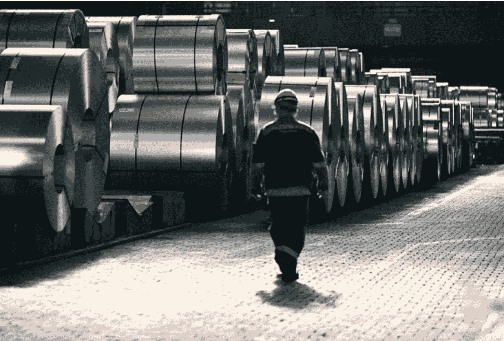

### CAIXIN | 听文章
文 | 财新周刊 王晶

从4月中旬起，为反击美国对进口钢铁和铝全面征收的25%关税，欧盟将恢复其2018年和2020年曾经出台过的对美反制措施，以应对美国征收关税对价值80亿欧元（约87亿美元）的欧洲钢铁和铝出口造成的损害。同时，由于美国新关税给欧盟价值180亿欧元（约196亿美元）的出口产品造成影响，欧盟还将对美国向欧盟出口的等值商品加征新关税。

欧盟委员会在3月12日发布的声明中原本宣布，其第一轮措施将在4月1日生效，第二轮措施将在与成员国和利益相关方协商后，于4月13日生效。但在3月20日，欧盟委员会表示，为留出协商时间，将推迟第一轮措施的生效时间，而将全部措施的生效时间定于4月13日。

欧盟的反制措施整体可能波及金额共计260亿欧元（约283亿美元）的美国出口商品，与美国关税的经济范围相当。预计落入反制关税范围的商品品类将包括美国的钢铁和铝产品、纺织品、皮革制品、家用电器、家用工具、塑料和木材。农产品也将受到影响，包括家禽、牛肉、威士忌、部分海产品、坚果、鸡蛋、糖和蔬菜。

此前在2月，美国总统特朗普签署了行政令，将对输美的钢铁、铝和相关衍生品征收25%的关税。这一关税措施在3月12日正式生效。根据该举措，包括欧盟国家在内的多个贸易伙伴的现有豁免全部取消，铝关税从10%提高至25%。当时欧盟谴责了这一举动，表示如果美国继续征收新关税，欧盟将毫不犹豫地进行报复。

欧盟曾于2018年和2020年分别出台过应对美国向欧盟钢铝产品征收关税的反制措施。双方于2021年达成协议，美国允许欧盟国家在一定数量内的钢铝产品可以免税进入美国；欧盟则决定暂停相应反制措施至2025年3月31日。

由于特朗普频繁发布关税威胁，近期美欧贸易战初见端倪。2月26日，特朗普曾称将“很快”宣布对欧盟的汽车及所有其他商品加征25%的关税。3月13日，特朗普又威胁称，如果欧盟不立即取消对美加征的威士忌产品关税，美国将很快对所有来自法国和其他欧盟成员国的葡萄酒、香槟等酒类产品征收200%关税。

法国、意大利和爱尔兰几个主要酒类出产国家已因欧盟升级对美贸易战的举动表示不满。

美国还将在4月2日宣布其全球“对等关税”措施，预计欧盟仍将受到相关关税的较强烈影响。

作为一个整体，欧盟对美货物贸易逆差额仅次于中国。欧盟统计局当地时间3月11日发布数据显示，2024年，欧盟向美国出口了5316亿欧元的商品，进口了3334亿欧元，贸易顺差为1982亿欧元。与2023年相比，出口增长了5.5%，而进口下降了4.0%。■

## 相关视频：
【华尔街原声】分析人士：相较于其他市场，中国市场相对稳定
视频说明：2025年3月17日，桥水前首席策略师Rebecca Patterson认为，特朗普政府的新关税政策促使外国投资者撤离美国市场，这不仅削弱了美元，也使得资金不断流出美国市场。
相关专题：特朗普新政、特朗普2.0时代：影响与变局

## 国风 | 文科班缩减下的历史老师

### CAIXIN | 听文章
文 | 财新周刊 蔡依佳（实习），范俏佳

在山西省某县城重点中学的走廊里，历史老师王琳夹着教案匆匆走向理科班教室。这是她今天惟一的一节课，却要面对一群“头也不抬”的学生——他们正埋头刷着物理题，偶尔有人勾画课本，也只是机械地回应她的提醒。40分钟的课堂，她需要用“翻书”般的速度讲完一个单元。“一节课哗啦啦翻十几页，和上自习没有区别。”她苦笑着摇头。

自2022年山西推行“3+1+2”新高考政策（即语文、数学、英语必考，物理或历史必选其一，再从政治、地理、化学、生物中任选两科）以来，王琳所在的这所曾跻身“全国百强”的县中倒向理科。以前每个年级20个班级中有3到4个文科班，如今仅有一个“纯文科班”和一个拼凑的“物化政/地混编班”。

历史教师的处境尴尬。王琳所在的学校共有7名历史老师，其中6人只能教理科班“应付会考”，每人每周仅2—3节课，远低于满工作量的10节。

同时，历史课堂急剧浓缩。“一本教材20个单元，就算一周一个单元，一学期也不可能讲完。”王琳翻开课本，密密麻麻的勾画痕迹下是仓促的课堂节奏。她观察到，理科班的历史课成为“背景音”，学生心知肚明，“反正会考合格就行，不如多刷几道理科题”。

广西某县中的历史老师余杰正在带高一年级物理班的历史课，他表示该年级一共有9位历史老师，但只有2个历史班。9位老师里只有3位能达到学校规定的每周8课时的工作量。

孙青在陕西某县中任教，学校目前选历史的只占人数的四分之一，相比文理分科前大幅下降，“历史老师明显过剩”。

历史老师周怡已经工作了四年，此时正在贵州一所县中教书。她目前所在的县中存在与前述相似的状况，而她之前工作的贵州一所一类示范性高中，“历史老师很饱和，存在有老师完全没课上的情况”。

在一些学校中，历史老师招聘开始停摆。王琳能在学校里见到新面孔的同事，但学校上一次招聘历史老师还是四年前。天津某重点中学历史老师胡磊也称，自己是教研组里“最晚入职的老师”，尽管他已经任教17年了。

工作量锐减影响到教师的晋升通道和待遇。胡磊说，评职称时课时量是考核因素之一，未达到学校规定的课时量就会相应扣分。如今历史老师因为课时不够，晋升十分困难。而且按照学校规定，未达满课时者按比例扣工资，因此不少历史组在全校收入垫底。

正在四川某高中任教的历史老师邱兰也面临同样的晋升难困扰。以前她带三个高考班，现在只带一个，加上日常的教研也不够每周10课时的基础工作量，“老师们不得不去各科室干杂活来凑够课时量，否则就要被扣工资”。王琳表示，自己工作7年，最终到手的月薪仅3400元，跟其他科目新入职老师相近甚至更低。

### 文中受访教师均为化名

## 天眼 | 战火又燃

### CAIXIN | 听文章
图 | Ali Jadallah/IC photo

当地时间2025年3月18日，以色列再次对加沙地带发动大规模空袭，一名男子抱着受伤的孩子前往医院抢救。据加沙卫生部门统计，新一轮空袭已累计造成436人死亡，678人受伤，遇难者中至少包括174名儿童、89名妇女和32名老人。这是2025年1月19日以巴签署停火协议后加沙地带伤亡最惨重的一天，哈马斯组织至少有6名高级官员在此次空袭中丧生。以色列与哈马斯达成的临时停火协议到3月1日即告结束，原定第二阶段停火谈判应于2月3日启动，但未取得实质性进展，双方分歧严重。3月18日，以色列总理内塔尼亚胡宣布恢复对加沙的军事打击，并宣称“和平谈判只会在炮火下进行”，这一袭击“只是开端”，以色列将继续推进军事行动，直至实现所有战争目标，即摧毁哈马斯并解救所有被扣押的人质。

**相关专题：** [巴以冲突全解读](巴以冲突全解读)

## 心智 | 打破家庭焦虑三角

### CAIXIN | 听文章
文 | 蓝玲

你是否注意到，家庭中一个人的情绪失控，往往会让整个家庭陷入紧张和混乱？

家庭治疗创始人之一的默里·鲍文在家庭系统理论中提出了“三角关系”的概念，揭示了家庭内部的情绪动态。当压力或冲突出现时，情绪会通过三角化的方式在家庭成员之间传递和调节，将每个人紧紧相连。

在三角关系中，焦虑起着主要作用。当两人之间的焦虑水平较低时，关系可以保持稳定和舒适。但两人关系很难长期保持平静，内部（如沟通问题）或外部（如压力事件）的情绪干扰很容易导致焦虑水平上升，打破两人关系的平衡。

当两人关系中的焦虑增加时，往往会将第三个人卷入，形成三角关系。第三个人的介入可以将焦虑从两人系统中分散，使焦虑在三人之间传播和转移。这种转移避免了某一种情绪在两人关系中过度集中，从而降低了情绪过热的可能性。

例如，A和B是夫妻，最近因为工作压力和沟通问题，争吵增多。这时，他们的孩子C可能会被卷入，比如A向C倾诉，或C试图调解A和B的矛盾。C的介入，使A和B之间的焦虑被分散到三人之间，A和B的关系因此缓解。然而，三角关系本身可能成为新的问题来源，因为冲突并未真正解决，只是缓解或转移。

三角关系是维持稳定关系的最小单元。当一个人无法在某个三角关系中妥善处理焦虑，这种焦虑会蔓延到其他三角关系，形成连锁反应。例如，母亲希望父亲管教惹事的儿子，但父亲回避，导致母子冲突升级。这时，母亲可能将焦虑转移到另一个孩子身上，引发孩子间的冲突，而自己则从冲突中抽离。

为什么会这样？默里·鲍文认为，家庭成员的情绪功能高度相互依赖，因此可以将整个家庭视为一个情绪单元，而自我分化水平则会影响情绪共生。

自我分化是指家庭系统中，个体在情绪上逐渐独立的过程，表现为能够独立思考、感受和行动，同时保持与家庭的情感联结。

家庭的分化水平越低，越容易依赖三角关系来维持情绪平衡。相反，在高度分化的家庭中，即使面对巨大压力，每个人也能保持情绪上的独立。

如何让家庭成员从三角关系中独立出来，减少对第三方的依赖，增进家庭和谐？去三角化的第一步是觉察到三角关系的存在，包括被他人三角化和试图三角化他人的方式。例如，夫妻发生冲突时，母亲对孩子说：“你爸对我不好，你不要理他。”这就是试图三角化，将孩子卷入冲突。通过识别这些模式，家庭成员可以更清楚地认识到三角关系的影响。

默里·鲍文提出了情绪中立的态度：在三角关系中，不偏袒任何一方，并基于这种中立态度行动。情绪中立不等于冷漠或优柔寡断，而是不试图改变他人或强迫他人接受自己的观点，它强调在不评判他人行为的情况下，清晰地界定自己的立场。

要实现去三角化，首先需要从三角关系的情绪反应中解脱，不被情绪所控制。接下来，需要有效传达自己的立场，展示情绪自主性。通过这种方式，人们可以界定自我，而不必在特定问题上明确表达立场。有时候，保持沉默或什么都不做反而更有力量，这种“不说不做”的方式也能很好地展示独立性。

去三角化的方法多种多样，具体操作取决于家庭具体情况和个体性格特点。关键是通过语言和行为传达中立性，避免卷入三角关系。

然而，保持清醒和中立并非易事。这需要超越表面现象，深入理解关系的动态和背后的情绪过程。但人们往往倾向于将问题简单化，比如将一方视为“受害者”、另一方视为“加害者”，或将问题归咎于某个人。这种简单化的视角会阻碍我们看到问题的复杂性，也让我们更容易被情绪所控制。一个人尝试去三角化时，也可能会陷入“不支持即反对”的陷阱，被指责不支持某一方，从而被视为反对或背叛。这种指责往往会让试图去三角化的人重新回到三角关系中。

在去三角化的过程中，行动比言语更重要。举个例子：

父母经常发生冲突，各自向儿子抱怨对方，希望得到他的支持或调解。儿子想从这种三角关系中抽身，试图通过语言表达自己的立场，对父母说：“你们的问题自己解决，不要总是把我牵扯进去。”然而，父母仍然向他抱怨，甚至指责他不关心家庭。意识到仅靠言语无法改变现状，他采取了以下行动：

- 设定明确界限：当父母向他抱怨对方时，他礼貌但坚定地说道：“这是你们之间的事，我不参与讨论。”
- 减少卷入程度：不再充当父母之间的传声筒或调解人。父母试图通过他传达信息，他以明确拒绝：“你直接跟我爸/妈沟通。”
- 专注于自己的生活：将更多精力投入到事业和社交生活中，减少对家庭冲突的关注。

起初，父母可能感到不适应，甚至试图用更强烈的方法将儿子拉回三角关系。但随着时间推移，他们会逐渐意识到儿子不愿卷入他们的冲突，不得不重新调整互动模式，不再依赖儿子作为中间人。他们可能开始直接沟通，或寻找其他方式解决问题。

通过行动，儿子不仅实现了去三角化，还促使父母重新审视他们的关系，推动家庭向更健康的方向发展。如果你也被类似问题所困扰，不妨也尝试用积极的行动，改变家庭系统的固有模式，让关系更和谐、家庭更美好。

## 更多精彩请阅读：【专题】心智