# 财新周刊
Caixin Weekly

# 美国经济：风暴的起点
美国是暂时从其传统角色撤退，还是开启了波诡云谲的全球贸易新常态？
P.46
“都在寻找安全感”
P.54
定价:人民币40元 港币60元 www.caixin.com

## 最新封面报道 | 美国经济：风暴的起点

## CAIXIN | 听文章
文 | 财新周刊 曾佳 发自美国首都华盛顿，王晶 发自北京

美国总统特朗普上任满两月，美股非但没迎来期盼中的“美国例外论”，反而出现重挫。相比特朗普初就任时创出的高点位，标普500指数一度下跌10.5%，进入回调区间，以科技股为主的纳斯达克综合指数一度下跌14.3%。美国白宫顾问马斯克创办的特斯拉，股价一度较近期高点下跌超50%。

临近3月底，美股终于呈现企稳趋势，但特朗普政策不确定性带来的阴云，依然笼罩在美国资本市场和美国经济上空。

许多工薪阶层的美国民众已经勾画出了一幅相当晦暗的前景图：特朗普加关税之后，物价会上涨，但工资不会一起涨。如果再削减社保支出，结果会怎样？

民众的负面预期，已经在两个消费者信心调查的数据上得到反映。3月美国密歇根大学消费者信心指数录得57.9，环比下降11%，同比下降27%，且所有党派的消费者信心均大幅下滑，包括此前在调查中对美国经济信心满满的共和党选民，民主党和独立选民的信心指数跌幅更深。

来自美国大型企业联合会调查的消费者信心指数也表现出同样的趋势，该数据3月录得92.9，连续四个月下滑。尤其是反映短期收入前景、商业和就业市场环境的消费者预期指数降至65.2，为12年来最低水平。消费者预期指数降至80以下，通常是经济将出现衰退的信号。

除了消费者预期受到影响，特朗普政策的不确定性也影响了企业的生产预期。

2025年3月27日，位于加利福尼亚州圣地亚哥的美墨边境奥泰梅萨入境口岸，一辆运载新款丰田塔科马的半挂卡车驶入美国。

标普全球公布的数据显示，美国3月制造业采购经理指数（PMI）重新陷入萎缩区间，特朗普关税导致相关材料成本上涨。服务业PMI虽然大幅改善，但是服务生产商对未来一年前景的信心下滑至2022年以来的第二低点。

惠誉评级首席经济师布莱恩·库尔顿（Brian Coulton）对财新表示，一些调查类的指标，如消费者信心、消费者通胀预期都急剧恶化，制造业PMI也比较疲弱，但是这些指标更多是一种情绪的暗示。目前还没有看到申请失业救济人数激增、失业率大幅上升等现象，2025年1月消费者支出虽然环比下滑，但是受到2024年购物季异常强劲的影响，用3个月移动平均处理后，消费者支出仍然强劲。

他认为，短期内，由于就业市场仍然强劲，消费者支出将保持稳健，要到2025年下半年，才能看到政策是否对美国经济活动产生负面影响的更多证据。

在美联储主席鲍威尔看来，调查类数据为“软数据”，他更关注官方公布的诸如非农、PCE物价指数等“硬数据”，它们显示美国经济仍在稳固增长。

然而，3月美联储经济展望没有鲍威尔这么乐观。19名公开市场委员会（FOMC）成员对2025年四季度的国内生产总值（GDP）同比增速预测中位数为1.7%，较2024年12月预测的2.1%大幅下调，核心PCE物价指数的预测值则从2024年12月的2.5%上调至2.8%。这样的组合将给美联储制定货币政策带来更多的困难，导致美联储进一步推迟降息。

特朗普2.0经济政策组合给增长带来的负面影响仍在积聚，尽管特朗普可能会推出减税政策，但在多重不确定性压力下，其对经济的提振效应预计仍然有限。

3月10日，因特朗普拒绝排除美国经济的衰退可能，美股上演“黑色星期一”，此后衰退阴影成为各方热议话题。尽管数据和研究结果均指向美国经济暂时尚不至于陷入衰退，但在“特朗普2.0”时代，美国经济增长放缓已渐成共识。

> ※财新数据专题《特朗普“新政”掀起全球贸易风暴》，结合本篇封面报道和详尽深度的宏观经济数据，数据通Pro会员专享。

## 衰退虚惊一场
2024年感恩节之后，位于瑞士南部的一家黄金精炼厂Argor-Heraeus就在日夜赶工，将符合伦敦金银市场协会（LBMA）标准400盎司（约合12.4千克）的金条加工成符合纽约商品交易所（COMEX）规定的1千克金条（相当于一部智能手机大小）。这家精炼厂的联合首席执行官（CEO）Robin Kolvenbach对《金融时报》表示：“从来没那么忙过。”

Argor-Heraeus激增的业务量是故事的其中一面。在另一面，2025年3月6日，美国人口调查局发布的今年1月数据显示，1月美国包括货物和服务在内贸易逆差为1314亿美元，环比增长34%。由于贸易逆差扩大对GDP增长来说是负贡献，因而这一数据公布之后，亚特兰大联储的GDPNow模型显示美国经济在一季度将下降2.4%。一个月前，该预测值还为增长3.9%。

高盛首席经济学家哈哲思在报告中指出，尽管高盛预计2025年美国GDP增长将放缓，但最新的数据并不是看上去那么糟糕。首先，自2024年11月以来的贸易赤字增加部分是因为黄金进口的增加，而这类黄金通常不被用于消费或生产，因此不计入GDP。其次，1月美国消费者支出疲软的原因可能是天气寒冷、季节性因素残留等因素。

Argor-Heraeus精炼厂的产品，正是美国增加的进口黄金中的一部分。美国的投资者对实物黄金的需求激增。美国经济分析局公布的数据显示，1月美国货物进口大幅增长，环比增加362亿美元，其中工业品项下的成品金属增加205亿美元。虽然特朗普一直未宣布要对贵金属征收关税，但是投资者已提前行动。

针对美国贸易战的抢出口交易，最突出地反映在黄金之上，而这一未雨绸缪的避险措施，又反过来拖累了特朗普誓言扭转的贸易数据和誓言提振的经济表现。

2025年3月27日，墨西哥下加利福尼亚州蒂华纳的奥塔伊商业口岸，货车驶向美国。图：Guillermo Arias/视觉中国

尽管业内解读保持积极，GDPNow模型的预测结果还是引起了包括马斯克在内的特朗普政府要员的警觉，马斯克甚至在X上公开表示，美国GDP核算不应该包括政府开支。负责GDP核算的美国商务部长卢特尼克也附议：“要知道，历任政府都曾干预GDP。”

库尔顿对财新称，未来几年，预计美国经济的增长速度将从过去两三年的近3%下降至1.5%左右，“这是一个很大幅度的放缓”。

但库尔顿也对财新分析称，过去几周美国政府在释放“好转之前会先变得更糟……但结束之后美国就会变得强大”的信息，因此美国政府不会因为股市出现波动、经济增长放缓等征兆而大幅撤回关税政策。

3月14日，美国财政部长贝森特（Scott Bessent）在CNBC节目中表示，美国经济正处于“戒毒期”。

他表示，这不是经济衰退的委婉说法，而是政府正处于寻求控制开支、改革税收的阶段，这样才能使经济可持续发展。若美国政府继续维持大规模赤字，最终可能引发金融危机。特朗普政府正试图通过减税等措施改变经济发展轨迹，这将会使居民收入增加、经济持续增长、政府开支可控。

他补充道，这有些像上世纪90年代的情况：利率下降，就业从政府向私营部门转移。

对于市场上目前流行的特朗普可能“故意”让美国经济陷入衰退的说法，渣打银行全球研究部主管兼首席策略师Eric Robertsen对财新表示，他并不认为特朗普政府有这样的计划，相反他们相信的是自己的计划不会引发衰退。

“他们（特朗普政府）的目标是经济增长3%，他们希望油价和汽油价格下降会导致通胀下降，进而使利率下降。利率下降会减少美国政府的利息支出。”Robertsen对财新表示，“特朗普政府做了很多乐观的假设。”

“特朗普将会面临更多增加财政刺激的压力，他无法容忍美国出现衰退。”Robertsen说，但在政府裁员、减支、大规模驱逐移民和箭在弦上的关税战之余，减税已成为特朗普政策备选项中为数不多可能刺激短期增长的工具，而新一轮减税对经济的净刺激效果仍不确定。

瑞银投资银行美国经济学家Abigail Watt亦持有类似的观点。她对财新表示，特朗普政府除了延长2017年的减税，只有较少减税空间，而延长减税本身没有新增财政刺激，"只是保持同样的税率"。

她表示，与特朗普第一任期将企业所得税税率从35%下调至21%、个税标准扣除额提高1倍等减税措施相比，特朗普第二任期减税空间不大。

她认为，目前由参议院来修改已在众议院通过的预算决议，若参众两院通过相同版本预算决议，这最终将导致国会启动"和解程序"，但目前还处于非常早期的阶段。

## 马斯克减支
在特朗普的经济组合拳中，大致可以辨别出几条主线：减支裁员和减税、驱逐非法移民、提高关税，以及促进制造业回流美国。

从实际经济效果来看，高调削减政府开支、裁撤联邦机构和雇员，以及遣返非法移民等举措，虽然博人眼球，但推进过程艰难，最终收效有限，更类似于特朗普第一任期的关税议程。

在减支方面，据马斯克牵头的“政府效率部”社交媒体账号、DOGE实时追踪网站、美国国务卿鲁比奥等特朗普政府官员的声明，特朗普政府上台两个多月来，据称已经为美国纳税人节省了1150亿美元，这一进度相当于完成了马斯克削减2万亿美元联邦开支目标的6%；美国国务院叫停了83%的对外援助项目，并取缔了消费者金融保护局、国家劳工关系委员会、教育部等联邦机构；十余个联邦部门的2万多名雇员被解职。

前所未有大刀阔斧削减美国赤字的行动，迅速激发了全球舆论瞩目和层出不穷的法律挑战，不过平衡美国联邦收支这一目标的前景并不乐观。

美国联邦政府2024年的支出规模约为7万亿美元，马斯克需要砍掉2万亿美元才能抹去联邦财政赤字。特朗普政府已经采取的裁撤就业岗位、关闭政府资助项目的举措只涉及联邦预算的一小部分。

司法分支的介入，也对马斯克的裁员产生了一定制衡。有法官裁定美国政府应当重新雇佣那些被违法解雇的联邦公务员，特朗普政府也将继续上诉，被裁掉的联邦雇员何去何从，依然悬而未决。

2025年2月19日，美国纽约，人们在雅各布·贾维茨联邦大楼外举行集会，举着标语高呼口号，抗议政府效率部（DOGE）解雇数千名联邦员工。

一名就职于联邦住房金融局（FHFA）的美国公务员对财新表示，他的上司在3月中旬说，整个FHFA可能都会被砍掉，个别雇员也许能“存活下来”，但不知道究竟是谁，所以FHFA的所有雇员都已经“打包好了，准备随时走人”。FHFA是美国2008年次贷危机之后，为了完善房地产市场监管而新设的机构，共有700多名职员。

落入马斯克裁员风暴中的都是联邦政府层面的公务员，然而在美国政府雇员中，地方政府雇员的规模最大，约为1500万人，州政府约500万人，相比之下，联邦政府仅有300万人左右。2月非农就业中，除了联邦政府雇员减少了1万人，另外两类政府雇员人数均增加，总体来看，政府雇员2月反而增加了1.1万人。

库尔顿认为，马斯克的裁员计划很难扩展到州和地方政府层面，因为他无权裁撤州政府和地方政府的公务员。

另一个马斯克无法触及的，是州和地方政府的支出。Robertsen对财新表示，政府效率部重点削减的是联邦支出，是中央政府而不是州和地方政府，但是很多低效支出、低效招聘都是在州一级进行的。“目前还不清楚特朗普和马斯克是否会对减少州和地方政府开支产生影响。”Robertsen解释称，因为美国联邦政府无权削减州政府的花销，“联邦政府可以决定停止给州政府送钱，但他们不能叫停州政府花钱，而各州很难在政治上停止花钱。”

由于就业是滞后指标，未来数月的非农就业可能会进一步显露裁员的负面影响。再加上政府削减开支具有溢出效应，联邦雇员的减少可能会冲击非政府部门就业。尽管如此，马斯克的裁员减支行动很难够得上财政收缩的效果。

与此同时，这些引起各方哗然的行动对民众心理又造成明显冲击，从政府部门被裁撤的人员有“再就业”需求，这已经使得华盛顿的求职竞争骤然激化，一时间线上线下似乎每个人都在分享招聘信息。

另一个雷声大雨点小的行动，是美国驱赶非法移民。

3月初，特朗普政府罕见吊销了哥伦比亚大学亲巴勒斯坦派学生示威者的美国永居绿卡和学生签证，副总统万斯等官员宣称“绿卡持有人也不一定有无限期留美资格”等强势姿态，在移民社群中引发深度恐慌不安。

不过，特朗普打击移民的手段虽然在不断翻新，现阶段美国每天平均驱逐的移民人数大约是1000人，依然低于拜登政府末期的水平。

经济学家此前担忧大规模驱逐移民会造成劳动力市场紧张，但根据迄今为止的节奏，特朗普政府遣返移民在短期内不会带来显著的经济影响。还有人指出，美国执法部门为了遣返更多移民，正在寻求增派人手，这会扩大政府的角色，而非特朗普追求的缩小政府部门。

正如大部分经济学家所言，能够有效缩减赤字的唯一办法，就是瞄准特朗普政府拒绝撼动的医疗保险、医疗补助和社会保障。这些共和党支持者基本盘最看重的社会民生支出，占美国联邦预算的八到九成。政府效率部针对美国联邦机构采取的种种拉足舆论关注的非常规动作，比如3月底宣布的“将30万张政府信用卡作废”，只触碰到了美国政府庞大债务海洋中的点滴而已。美国公债规模已经达到36万亿美元，每天仅利息支出就达到30亿美元，远远超过马斯克每天能为美国政府节省下来的零头支出。

美国财政部的支出记录显示，在特朗普重新上任的首月，也即1月21日至2月20日期间，美国联邦政府的支出约为7100亿美元，高于2024年同期的6300亿美元。医疗、养老和社保支出以及利息支出的增加，抵消了所有节省下来的花销。在美国人口老龄化加速和债务负担膨胀带来的重压下，特朗普政府的成本削减举措杯水车薪，难以减轻美国沉重的财政负担，而其一刀切式的粗暴裁员还可能造成更多长远损失。

美国智库“负责任联邦预算委员会”主席Maya MacGuineas指出，美国不论在顺境还是逆境中都喜欢借钱，所以达到了创纪录的债务水平，在赤字膨胀以至于酿成一场危机之前开始削减是合理的。

但她同时指出，政府效率部从公务员制度和监管机构下手，强行清退试用期员工、强迫提前退休，降低社会保障局、国税局、森林管理局和国家公园管理局等机构的工作效率，一刀切地破坏系统性的监管体制，长此以往，美国联邦政府的退化会拉低美国经济表现，美国公众对联邦政府的失望会不断加深。一些老旧、不安全的技术和竞争力较差的市场参与者无法通过健康的机制退出市场。原本属于联邦政府的关键职能也要不充分地转嫁到州和地方政府身上，或者任由其衰败和消失，这会引发一场“逐底竞争”，即各地将竞相降低政府服务水平以减轻负担。

## 开启对全球的贸易战
特朗普经济政策的不同因素，在过去几周连番占据全球媒体头条，但其中最具社会经济影响辐射力的还是关税。这和特朗普第一任期时不同，当时的第一轮关税政策虽然也很吸睛，但实际影响远远不及现在。

日本央行的一名驻美国华盛顿代表对财新表示，特朗普在贸易和关税、扶持本土制造业等方面的理念“明显停留在上世纪80年代，甚至回到了一个世纪以前”。

库尔顿的观点更加悲观。他认为，美国针对全球的贸易战已经开始。美国作为全球最大的经济体，关税税率以1929年以来最大幅度、最快速度提高，而被美国征税的贸易伙伴，如加拿大、欧盟和中国都已经或者准备采取反制措施。

2025年3月11日，加拿大安大略省哈密尔顿，阿塞洛米塔尔多法斯科工厂。特朗普当天宣布，将对加拿大钢铝产品加征25%关税，总税率提升至50%。

根据税收基金会（Tax Foundation）的预测，2025年，美国平均关税税率将从2024年的2.5%大幅上升至8.4%，是1946年以来的最高关税水平。

在此前80年中，美国乃至世界各国不断谋求降低关税，缘于对历史教训达成的共识。由于贸易保护主义被认为是上世纪30年代全球经济大萧条的导火索，而大萧条又进一步导致第二次世界大战，战后在布雷顿森林体系下，23个国家在1947年10月签署了《关税与贸易总协定》（GATT）。该协定在次年正式生效，此后又经过多轮磋商和成员扩容，最终在1994年升格为世界贸易组织（WTO）。

根据税收基金会的数据，在这一过程中，美国平均关税税率从1946年的10.3%持续回落，到1999年降至1.8%，并在21世纪前十几年一直保持在1.5%左右的低水平，直到2017年特朗普开启第一任期为止。

2025年，随着特朗普再度宣布退出WTO并迅速提高关税，建立在低关税基础上的贸易全球化时代再次摇摇欲坠。

库尔顿认为，全球贸易战将对美国以外的国家造成负增长冲击，最严重的冲击将发生在墨西哥、加拿大和其他一些国家。越南是惠誉评级一直在关注的对美国贸易风险敞口非常大的国家之一；另外，中国和欧洲也很重要。

> “这些国家将不得不考虑如何应对。它们将看到出口对经济增长的支持减少。这在一定程度上取决于它们是否会采取报复措施，提高从美国进口的商品的关税。如果它们不采取报复措施，那么我认为货币政策有相当大的空间来抵消冲击。”库尔顿称。

库尔顿认为，虽然降低利率会导致本币贬值，但这也将抵消关税对其出口的一些影响，目前一些经济体已经采取这样的策略，比如欧洲央行将继续大幅降息至中性利率水平以下。

> “但如果一个国家采取报复行为，比如加拿大，他们可能会看到更高的通货膨胀，这是他们报复的结果。”库尔顿表示，“这还会使得货币政策的制定更加复杂。”

日本央行前行长白川方明对财新表示，相比对通胀的影响，特朗普关税对全球经济增长的影响更加负面，“特朗普正在做的事对全球经济非常不好”。

经济合作与发展组织（OECD）最新报告预计，由于一些二十国集团（G20）国家的贸易壁垒将会更高，以及地缘政治和政策不确定性对投资和家庭支出的影响，全球经济的增长速度将从2024年的3.2%下降至2025年的3.1%，2026年进一步下降至3%；美国经济的增长速度将从2024年的2.8%回落至2.2%，到2026年进一步下滑至1.6%。

目前，美国已经对中国加征了20%的关税，对加拿大和墨西哥部分产品加征了25%的关税，对加拿大能源加征10%关税，另外美国还对钢铝征收了25%关税。3月26日，特朗普签署行政令，对进口整车和特定零部件加征25%关税，其中整车关税4月3日生效，特定零部件关税不晚于5月3日生效。接下来，4月2日的对等关税即将官宣。3月26日，似乎作为一种软化姿态，特朗普预告称，4月2日的对等关税将“出人意料地宽松”。

对外经济贸易大学中国WTO研究院院长屠新泉对财新表示，4月2日美国怎么收对等关税，现在依然是未知。他认为，从技术角度讲，每个国家定一个关税水平是很难操作的，这会大量增加海关的工作量。

他认为，美国大概率可能做一个分组，对几个主要的、对美国有贸易顺差的国家征一个税率；对与美国没有贸易顺差的国家就维持现状；对于不发达国家，特朗普也不关心，可能也不会加关税。此外，特朗特朗普可能会重点产品，比如钢、铝、汽车、半导体，单独设一个税率。

Watt对财新表示，特朗普1月20日就职当天签署的行政令《美国优先贸易政策》中提到，各部门要在4月1日之前提交对美国贸易政策的梳理和建议。第二天，4月2日，就是美国宣布对等关税的日子。“问题是，美国是发布声明后晚一点执行，还是特朗普签署行政令立即执行，现在并不明确。”

库尔顿对财新表示，美国现在的贸易政策采取的是进口替代策略，希望把制造业的工作岗位带回美国。但他认为，通过提高关税无法实现美国制造业回流。他分析称，关税将给美国企业带来额外成本，比如更昂贵的资本货物和中间产品。

## 全球应对

特朗普关税等美国经济政策不确定性的陡升，让各国即将面对一个滞胀风险上升、更加碎片化的世界。

全球决策者必须权衡的难题是：美国从其传统角色中的撤退是暂时性的，还是说各国需要认清形势，尽快适应全球贸易新常态？各国政府和企业应当在多大程度上主动加快全球价值链的重组？

美国是世界上最大的进口国，但并非世界贸易的全部。据世界银行数据，2017年特朗普首次就任美国总统时，美国进出口分别占全球的13%和9%。也就是说，全球80%以上的贸易都是不通过美国开展。过去十年，除科技和化石燃料两大领域外，美国在全球贸易中的存在感在几乎所有领域都持续下滑。

但另一方面，美国经济对贸易的依赖程度降低，会使特朗普政府更有动力使用贸易武器来迫使贸易伙伴国谈判。

各国第一时间对特朗普关税施压的反应不一。

欧盟、中国和加拿大均以关税进行反制。日本和印度承诺加大对美投资、改善美企的市场准入来安抚特朗普。越南一方面对美国提议购买更多波音飞机，另一方面也表示不会放弃和中国的合作，希望以低调稳妥的方式对冲风险。和美国关系更密切的英国、澳大利亚和墨西哥除了口头表达不满，在实际层面尚未采取任何回击行动，以免和特朗普政府陷入一对一的报复循环之中。

随着特朗普不断加码对贸易伙伴的压力，当这些压力带来的成本越来越逼近美国市场准入带来的裨益时，美国贸易伙伴最终可能会主动选择“去美国化”和美国之外的多元化。

许多美国经济学家警告，特朗普祭出的关税威胁从根本上倚仗美元作为全球主要储备和贸易货币的地位，但特朗普正在迅速消耗美国在过去80年积累的政治资本和全球主导地位，而且很有可能加速美国全球影响力的式微。

从拜登政府执政时期起就已经愈发明显的趋势是：美国政府的经济武器更容易迫使美国的盟国迅速作出让步，对非盟友国家动用制裁或关税施压往往效果匮乏。拜登政府和欧洲等西方国家协调了对俄罗斯的金融和能源制裁，但未能将制裁代价提高到克里姆林宫无法克服的水平，既无法迫使俄罗斯从乌克兰战场上撤退，也没有说服俄罗斯总统普京放弃他的停战条件。特朗普似乎也在试图推动美国的友好国家更加依赖美国市场和美元，以此来巩固美国的实力和地位。然而关税对特朗普重振美国制造业的“回旋镖”作用，再次彰显了特朗普多个经济政策目标之间的自相矛盾性。

为了吸引投资和制造业回流美国，特朗普政府希望美元贬值，但关税往往让美元走强。近来，一些美国经济学家开始讨论缔结第二个《广场协议》，或称之为《海湖庄园协议》的可能性。上世纪80年代前半程，美元在五年间大约升值了50%，对美国出口造成一定阻碍，激化了美国和主要贸易伙伴的经贸摩擦。1985年，美国、英国、德国、法国和日本五国的财长和央行行长在美国纽约的广场饭店举行会晤后，签署了《广场协议》，旨在联合干预外汇市场，使美元对日元和德国马克等主要货币汇率有序地贬值，解决美国巨额贸易赤字问题。

有观察人士设想，在特朗普对各国施加一系列惩罚性关税后，欧洲、日本等美国盟友可能会再次接受类似《广场协议》的货币协定，用支持美元走弱来换取美国下调关税。

对于潜在的《海湖庄园协议》，日本央行驻美国华盛顿代表对财新分析，特朗普政府不会主动提出签订《海湖庄园协议》，因为特朗普偏好一对一的谈判方式，而不是多国共同协商和行动，但新的《广场协议》要求美国和其他国家进行多边合作。

根据经济学家的研究，特朗普上一任期的钢铝关税导致美国贸易政策不确定性增强，仅仅这些不确定性就导致美国年度外国直接投资减少了400亿美元。在当前升级版特朗普关税的阴影下，无论是美国国内投资者还是外国投资者，都不愿投资回流美国，因为根本无法确知每种商品和每个国家的具体关税是多少。特朗普宣称的将全面施加的“对等关税”，可能会让成本高出数倍。

根据一些经济学家的估算，除了对美国市场依存度高达七八成的加拿大和墨西哥，如果德国、日本等出口导向型的欧亚主要经济体在一夜之间全部停止对美出口，这些国家的GDP将损失3%到4%，但这种程度的冲击对它们来说并非全然难以承受。如果在未来几年内逐步摆脱对美国市场的依赖，这种循序渐进的调整就更加容易消化，部分放弃美国市场不会对它们构成经济存续的威胁。同时，加强区域间交流、进一步融入替代供应链等应对方案的吸引力在直线上升。

澳大利亚昆士兰科技大学主攻中国经济的学者Warwick Powell主张，金砖国家有望在四年内吸收全球失去美国市场的影响。为了开掘世界其他国家之间贸易扩张的广阔潜力，各国应当扩大市场准入，磋商更多的自贸协定来巩固多边贸易体系，用统一的应对策略来抵御特朗普的单边主义，而不是建立保护主义壁垒、采取以邻为壑的政策。各国也应当将国内改革提上日程。例如，加拿大学者提议，将加拿大各省份之间的技术标准和监管办法更好地整合和流程化，让跨省份的货物流通更加顺畅。但截至目前，所有这些“放弃美国”的设想都仍仅是学者推演中的极端情况，全世界尚没有任何国家放弃与美国谈判的可能性。WTO总干事伊维拉亦在3月初对美国的贸易伙伴提议，各国不应当恐慌，也应当避免和美国陷入针锋相对的报复漩涡之中，各方应该和特朗普对话，听取美方对贸易和关税的关切。“我们可以告诉美国，我们能帮忙一起解决他们关切的问题。”

## 相关报道：封面报道之二 | “都在寻找安全感”

## 李忆对此文亦有贡献

## 相关视频：【华尔街原声】穆迪：美国没有衰退 但风险在上升

**视频说明：** 2025年3月26日，穆迪分析公司（Moody's Analytics）的首席经济学家Mark Zandi认为，尽管消费者认为美国经济现状尚可，但仍旧高企的利率、即将实施的新关税政策和近期大幅波动的股市，都让其对经济前景充满忧虑。

## 更多报道详见：【专题】特朗普新政、特朗普2.0时代：影响与变局

## 最新封面报道之二 | “都在寻找安全感”

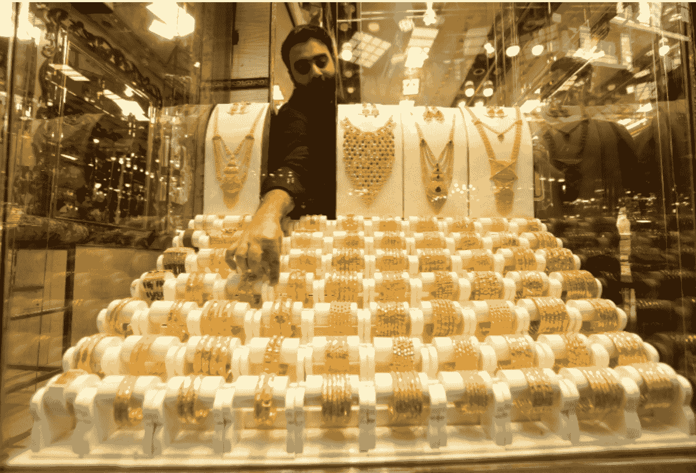

## CAIXIN | 听文章

## 相关报道：封面报道 | 美国经济：风暴的起点

文 | 财新周刊 罗国平 卢羽桐

> “乱世买黄金”的古人经验有了现代版本。

“我不会在钢铁、铝等方面作出任何让步。”在钢铝关税实施第二天的3月13日，美国总统特朗普对原材料的关税态度依然强硬：他无意放松25%的全球钢铝关税，也不打算给任何国家豁免。

在距离特朗普1月20日宣誓就职不到两个月时，美国纽约商品交易所（COMEX）黄金主力合约价格成功闯关3000美元/盎司，3月28日最高冲到3124.4美元/盎司的历史高点，较1月初上涨了约18%——2025年一开年，特朗普上台前夕，关税政策的市场预期就日益浓厚，自此拉开了本轮金属市场的飙涨序幕。

市场预期，除了钢铝及相关衍生品，金、银、铜等贵金属与工业金属或无一幸免于“特朗普关税大棒”。“这次美国是全面地、不分行业和国家地开征关税，且叠加现有税率，呈现战略收缩状态。”国投期货研究院有色金属组组长肖静对财新分析称。

3月4日，特朗普在美国国会参众两院联席会议上宣称将对铜加征25%关税。另一个巨大变化将发生在4月2日，当天将实施对加拿大、墨西哥加征关税，其中包括对加拿大能源产品征收10%关税；同一天还将对全球征收“对等关税”，不过，近日特朗普又称会在“对等关税”上给很多国家“喘息机会”。

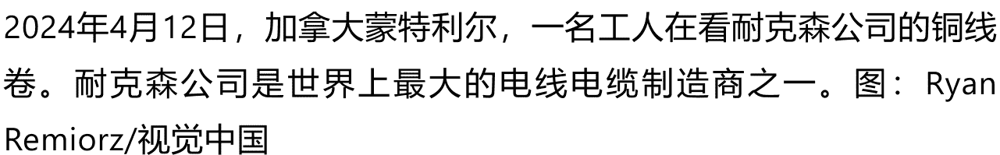

在钢联能化总经理廖娜看来，美国关税分为三类，对应不同策略：第一类针对中国，明确以打击态度为主，叠加上轮关税，钢铝关税最高至70%；第二类针对加拿大、墨西哥，以威慑、谈判为主，反复不断；第三类针对其他国家，尚未给出具体措施。

这些被视为“孤立主义”的做法，剧烈冲击全球金属市场，显然也给美国带来了更高的进口成本：3月26日，COMEX铜主力合约（简称美铜）与伦敦金属交易所（LME）的铜主力合约（简称伦铜，类推以下其他金属主力合约的简称）的价差连创历史新高，当天每吨接近1650美元，较1月初狂涨了16倍；美国中西部地区铝价相较伦铝的溢价，也自年初上涨近八成，创下920美元/吨的新高；美国与欧盟热轧卷板的市场价差也来到359美元/吨，较年初上涨75%。正常情况下，不同区域市场的价差主要源自运费、税费、保险等费用差异，不至于受到如此巨大的地缘政治因素干扰。

目前，金属期货市场的区域价差推动进口商抬升避险预期、增加库存，越来越多的实物资产涌入美国，同步挤出其他区域的供应。而贸易流向之变，循环拉动全球市场的金属价格跟涨。3月25日，伦铜时隔半年再度突破1万美元/吨的节点。整体而言，多种工业金属呈现了几乎一致的趋势：美市价格大于伦市，而伦市价格大于中国。如在铜市，伦铜自年初上涨13%，沪铜价格上涨11%，都低于美铜30%的涨幅。

3月25日，市场传出特朗普或在数周内就对铜征收关税，这比预期提前了数月。特朗普在2月25日签署行政命令，对进口铜产品启动涉及国家安全的“232调查”。肖静指出，这一调查耗时较长，市场原本预计到年底才会有结果；而关税预期的紊乱，推动资金入市交易这种“不确定性”。3月26日，美铜12月合约价格涨至历史高位的5.37美元/磅（约合1.18万美元/吨）。

工业金属价格亦有来自供需两侧的因素支撑。肖静介绍，当前正处在北半球的消费旺季，美国高溢价吸引物流变动，再加上作为铜与锡增量供应大国的刚果（金）战乱升级，共同刺激了本轮金属走强。

当前，中国铜需求处在旺季。肖静分析，特朗普尚未对中国、加拿大、墨西哥以外的地区加征关税，环中国一带的制造业都在开足马力生产，以抢抓美国4月关税之前的“窗口期”。国内则积极推出促消费政策，刺激家电板块走高；国家电网与南方电网稳投资给出的年内投资计划，也达到历史新高的8250亿元，第一批春季招标已竞标完成并下达；此外，地产负面拖累的边际影响在降低，基建也在去年的低基数之上体现出较高增速。

在德邦证券研究所董事总经理、副所长何晓看来，美国将贫富差距过大归咎于全球化分工造成的本土制造业空心化，社会进入不平衡状态，当下强调聚焦“内部建设”，削减本土以外（比如北约）等支出，并倒逼欧盟等区域也重建产能。

特朗普竞选总统的口号就是所谓实现MAGA（让美国再次伟大），多位人士认为，到目前为止，美国建构区域市场的目标乃至打法都在逐渐清晰。

肖静认为，美国通过开征关税，帮助政府缓解债务问题的同时，拉升国内价格以吸引产能与贸易回流，进而逐渐重建本土能力，最终实现制造业内循环，打造出自我造血功能。其中，冶金是制造业的骨骼，钢、铝、铜是必不可缺的基础原材料，因此成为关税的重点打击标的。

“美国与欧洲两个地区产能的‘一进一出’比较明显，中东等区域也想抓住机会成为制造中心。”长期研究工业化的罗兰贝格高级合伙人许季刚接受财新采访时表示，多极化的世界讲求多供应圈层，美国自有优势与要素，也具备形成单独供应链圈层的能力；这一趋势下，未来势必出现多个制造中心，进而也会刺激对基础金属的需求。

欧洲天然资源基金Commodity Discovery特约分析师李冈峰进一步指出，美国孤立主义瞄准贸易赤字，其中一大要义是减少赤字，对应也要减少美国在国际市场的影响，“全球越混乱，黄金就越受欢迎”。

全球货币市场亦不明朗。江苏富实数据研究院院长蔡拥政认为，美国缩减贸易赤字的目标，是要化解高达36万亿美元的国债，对内让货币贬值，同时通过重新定价黄金化解债务。对特朗普而言，提高关税与降低利率是组合牌，而在降息预期之下，作为全球底层货币的美元贬值，各国央行只有通过增持黄金等资产来锚定货币价值，“都在寻找安全感”。

“现在世界政治经济秩序进入重构阶段，一切都在动态变化当中，自由贸易时代渐行渐远。无论对企业还是国家，都要保持应对，动态调整策略。”廖娜认为。

## 美国虹吸全球库存

美墨关税调整在即，因为存在铜、金乃至航运领域的潜在关税预期，企业与贸易商都想抢占提税前的窗口期。

廖娜指出，在从全球大市场转向区域小市场的过程中，企业需要“备粮备荒”，市场短期备货需求明显，以应对供应链中断的风险。

在黄金市场，长期研究贵金属的李冈峰认为，待美国从瑞士进口足够的黄金，可能也会针对瑞士或英国开征关税。“市场有这方面的担心，所以都抢先进口。”他介绍，国际金价从特朗普2024年11月当选时的约2600美元/盎司，叠加25%关税预期，预计上涨到约3250美元/盎司。这期间，不少黄金从LME运抵美国，COMEX黄金库存也自2024年11月开始增加，到2025年1月份提速。

“这样的状态像是美国在虹吸全球库存。”中粮期货有色金属研究员徐婉秋描述称，关税扰动全球贸易物流，伦铜将产品拉到美国仓库，南美铜也在改道涌入美国；COMEX市场的交割品牌、仓库有限，最大铜生产国——中国所产的电解铜无法在此交割，但也在积极交货到LME的亚洲仓库。

在铜市场，全球显性与隐性库存都在明显流动。据高盛预计，到2025年三季度，COMEX铜显性库存或从目前不到10万吨，猛增到20万—30万吨量级。而算上市场反应时间、船期等，肖静预计，3月后美国铜进口量会走高。

在3月21日召开的2025（第四届）中国国际矿业投资与发展高峰会议上，蒙特利尔银行（BMO）资本市场大宗商品分析师George Heppel指出，美国消费者正赶在关税实施之前囤积原材料。1月份，美国铜的半成品进口量大幅增长，包括铜棒、电缆、管材、板材、粉末和薄膜等铜制品，2月和3月仍延续这一趋势。“美国每月铜进口量可能比实际需求多出1万—2万吨，无论原材料还是成品。”

而在钢、铝市场，与特朗普首个任期实施关税后给多国豁免的情况不同，美国钢铁和铝的客户这次几乎无法规避关税。“这一次，与其他国家的谈判空间更小，公司也没有机会申请豁免。”波士顿咨询公司（BCG）负责贸易与投资的副董事Jacob Koch-Weser在2月下旬表示，“美国企业的主要选择是从本土采购，或支付更高的进口成本。”

而在航运市场，美国贸易代表办公室（USTR）2月21日发布制裁提案，要求对停靠在美国港口的中国航运公司以及中国建造的船只征收最高150万美元的巨额挂港费，并在3月24日就此提案举行公开听证会。受此影响，美国进出口海运成本或将大幅上涨，并进一步重构全球贸易物流。（详见本刊2025年第10期《全球航运市场的“美国阴影”》）

目前，美铜较伦铜溢价约15%。徐婉秋认为，美铜、伦铜价差或会继续扩大，最高抬升至25%；而现货市场的铜价也会波动上涨，进一步影响全球贸易流向。“现在关税政策仍未落定，后续仍有反复的可能，铜市的波动将加剧。”她说。

2025年3月14日，俄罗斯克拉斯诺亚尔斯克，俄铝克拉斯诺亚尔斯克铝冶炼厂的1号铸造车间内，一台叉车正在搬运包装好的铸锭。图：Kirill Kukhmar/视觉中国

在铝市场，阿拉丁联合创始人史夫良认为，接下来，美俄关系将是决定国际铝市乃至油气等更多大宗商品流向的关键。俄罗斯是全球第三大原铝生产国，目前一年有110多万吨电解铝进入中国；如果美俄关系缓和，去往美国的产品预计会增多。

标普全球（S&P Global）数据显示，中国造船业已成为全球海运业的主导力量，2024年底占到全球60%以上的市场份额，美国这一举措如落地，对能源贸易与大宗商品市场将极具破坏性。2024年，美国煤炭、钢铁、农产品等在内的干散货海运中，有45%左右的吨位依赖中国制造的船舶。

不过，肖静强调，美国的虹吸效应只是全球物流转移，难以改变全球铜的整体供需情况，对其他市场带来的影响只是短期阶段性偏紧。若待关税调整到位，美国的高库存也还需要时间逐渐消化。从中长期来看，美国关税对需要进口铜精矿且没有关税的中国其实是个利好因素。

George Heppel也表示，新增采购并不代表新增需求，只是消费者为规避关税，在提前累积库存。到2025年底，美国或进入大规模去库存周期，届时提前囤积的库存将涌向市场，对美铜价格施加压力。

不过，由于关税预期反复无常，市场情绪与溢价在逐渐趋于谨慎。“关税刺激只是短期的，等到真正落地，（铜等大宗产品）就不会再疯狂涌入美国了。”一位铜分析师指出。

## 全力下注制造业

在全球经济多极化、多货币化的新形势下，廖娜认为，美国经济发展此前靠金融与服务业驱动，但现在需要在石油与军事保护之外，找到新的可以支撑金融市场的增长题材——因而，人工智能（AI）落地依托的制造业成其选择。

她进一步分析，特朗普治国采用的是商业思维，即给企业降本增效，以实现制造业回流；而在人力、材料、物流、赋税、资金等诸多成本中，劳工是票仓基础，工资成本不能挤压；但可以通过降低利率、减费降税以及裁员等手段，最终降低制造业的建设与运营成本。

先看美国在制造业的比较优势。实际上，美国拥有大量的油气、煤炭、铁矿、铜矿等资源；作为规模最大的发达国家，美国还是全球主要的废钢、废铜、废铝出口国。“美国有矿，以前出于经济性考虑没怎么开采，现在特朗普执意要开，要在本土形成制造业闭环。”前述铜业分析师指出。

美国在19世纪就成为制造业大国；在20世纪上半叶的“一战”与“二战”期间，从大国转向强国，钢铁、汽车、铁路进入大发展阶段；到上世纪50年代，美国制造业产值在全球的份额以及本土国内生产总值（GDP）的比重都在约40%；此后随着西欧、日本、韩国、中国等经济体崛起，美国经济转向金融与服务业，制造业产值在全球的比重逐步跌落至目前的15%—20%，占GDP的比重跌至约10%。

多位分析人士认为，关税有望刺激美国市场的金属价格上涨，加大原材料进口继而提振终端产量；但考虑到本土劳动力、电力等制约，加上本土生产与需求并不完全匹配，国内生产难以完全取代进口；但不应低估其实现“内循环”的决心与可能性。

在铜领域，肖静介绍，2000年以前，美国长期是全球第一大铜消费国，在1993—1997年间能通过冶炼自产的矿产铜，再加上废铜供应，涉铜产量（新产生与再生精炼铜）与消费的自循环率在90%以上的高位。目前，中国在铜消费规模上已经超过了美国，而美国的铜对外依存度也逐步上升，到2024年已接近50%，净进口量75万吨，主要来自智利、加拿大与墨西哥。

美国地质调查局（USGS）数据显示，2023年，美国矿产铜储量与产量在全球占比均在约5%，但精炼铜产量占比在约3.3%，可见冶炼环节是美国的短板所在。

肖静进一步分析，从供给侧看，美国每年六成以上的矿产铜向周边的加拿大、墨西哥出口，还有40万吨左右废铜流向中国，加上自有约110万吨的矿产铜产量，如果以后美国不再对外输出铜精矿、阳极铜与废铜，且加大铜资源利用，按照现有消费量计算，美国大致能实现九成的自给。“如果美国硬走这条道路，本土铜的内生循环是可以走通的，但要看决心和市场接受度。”她称。

她还指出，美国现有在运营的铜炼厂均由矿业头部企业投建，具有技术实力。目前有三家铜冶炼厂在运营，包括美国自由港（NYSE：FCX）的Miami冶炼厂、力拓集团（NYSE：RIO）的Kennecott冶炼厂，以及墨西哥集团在2024年重启的Hayden铜冶炼厂。不过，美国在下游高端铜加工环节的能力不足，建构起来的难度较高。

金属市场的短期高价是由于美国强烈的进口需求，增加的成本最终会穿透到消费者。但肖静认为，如形成内循环，美国不再进口铜，也就不再计价关税，美铜价格在中长期或逐渐降低。届时，美铜将独立成为一个区域市场，与伦铜等其他市场也将脱钩。

美国钢铁对外依存度相较铜更低，自身粗钢产量在8000万吨上下。不同机构的数据显示，美国钢铁对外依存度在15%—25%，是全球第一大钢铁进口国。另据美国钢铁协会数据，2024年美国钢铁产品（轧制品和半成品）共2885.8万吨，主要进口国为加拿大、巴西、墨西哥；其中进口轧制品2250万吨，进口份额占消费总量的23%。

“许多公司已经开始调价，优化库存和供应链；另一些公司则在讨论潜在的产能扩张。”BCG全球金属业务联合负责人Janice Lee表示。蔡拥政认为，美国本土钢材价格自年初上涨了30%，价格突涨导致美国本土供应链混乱，会削弱下游企业的盈利能力，公众号懒人搜索，懒人专属群分享

不过，蔡拥政认为，虽然美国钢铁行业短期显得混乱，中长期仍有可能实现制造业回流。

他解释，美国是个移民国家，人口在增长，市场需求存在，并在降低制造业成本，而本土价格上涨，当地企业利润扩张，更有潜力提升产能产量；近期，美国钢铁股票价格有上涨态势，又扩张了投融资优势。

实际上，美国钢铁业产能高于需求。标普全球指出，树立贸易壁垒之后，美国钢厂可以将产能利用率从低迷的75%提高到可盈利的85%，替代一半的进口；与此同时，美国也在新建小型的轧钢厂，以从进口中获利。

但蔡拥政也强调，与美国地理位置相近的巴西有铁矿，后者能源价格较低，从巴西进口钢材比在本土生产更划算，因此美国会否在钢材领域内循环，也要看当地企业会否引入外资，或是利用AI或无人工厂等新技术提升效率。

在铝行业，安泰科数据显示，美国是全球最大的铝产品进口国，2024年进口原铝及铝材542.96万吨，占美国本土铝消费一半以上，以加拿大、中国、墨西哥、阿联酋等为主要来源国。其中，据美国铝业协会数据，美国大约有三分之二的原铝来自加拿大，这部分进口都将面临关税风险。

工业品类中，以铝业最为耗电，而电力正是美国的短板，当地电力价格整体不低，还有数据中心的大量新增电力需求。标普全球认为，要在美国进一步增加铝产量的希望不大，需要廉价电力以及长期资本投资才能取代进口。

标普全球进一步解释，美国几乎没有可以替代进口的闲置铝产能，尽管高价提高了美国铝业公司（Alcoa）与世纪铝业公司（Century Aluminum）在美国运营的四家铝冶炼厂的盈利能力，但其余只有一家或两家小型工厂可以很快重启，即使开足马力，也只能替代约20%的进口，成本也可能处在全球最高位。

“与钢铁相比，增加美国的铝产量既困难又昂贵。”标普全球计算称，以每吨5000美元投资计算，如果新建产能替代400万吨的进口原铝，仅冶炼厂的成本就超过200亿美元。近年来，美国每年出口铝废料超过200万吨，取代部分铝进口的最低成本途径可能是国内废料，下游企业在继续投资轧制能力，并以废料为主要原材料。

美国在2018年3月对钢铝加征关税之后，钢材与铝产量当年一度创下六七年内的最大增幅。但此后，由于美国豁免了诸多国家，加上难以获得具有竞争力的长期电力合同，多家铝冶炼厂不得不停产。到2024年，美国铝冶炼厂产能利用率仅有52%。

此外，长期研究油气领域的廖娜指出，美国在制造端虽有技术和能力，但炼厂等已多年未升级迭代。

为了给制造业降低成本，特朗普大力推动开发本土油气资源等一次能源。页岩油气革命之后，美国已是全球第一大原油生产国与天然气生产国，并是油气的净出口国。但美国本土主要生产轻质原油，需要进口重质原油掺炼。2024年，美国进口原油及成品油为842万桶/日，其中从加拿大进口占比55%，其次是墨西哥，占比7.4%。

廖娜介绍，加拿大是美国最大的资源供应来源国，其70%经济依赖美国市场。

她认为，美国向加拿大征收关税的目的，一方面是要促进国内能源的生产，让这部分GDP在国内流转；另一方面是要加拿大成为美国低成本的能源供应国，希望通过关税极限施压换取加拿大提高油气基础设施投资，尤其是两国之间几度被否决、再启又延期的Keystone XL输油管道。

在这一逻辑之下，美国希望油价处在合理水平：不要太高，因为油气是制造业的重要能源基础，且会影响消费与CPI（消费者物价指数）；但也不要太低，否则无法发展本土油气产业。

油气市场的另一大变量要关注俄罗斯。廖娜指出，俄乌和谈虽在加速推进，但要解除对俄制裁还需较长时间。即便最终放开制裁，考虑到俄罗斯油气已有稳定市场，因此对流通量的影响有限，但周转会变快；在出口流向上，管道端的变化不易恢复，但通过黑海出口部分的流向或有调整。其中，俄罗斯油气要重回欧洲并不容易，这不止取决于欧洲选择以及其政党变化，也因北溪管道等基础设施遭到破坏，美国亦不会轻易退出已经占据的欧洲市场份额。

在美国缺乏的一次资源上，廖娜指出，特朗普也在尝试全球收割矿产，如试图以“矿产换援助”方式与乌克兰签署矿产协议，还扬言要收购格陵兰岛。

特朗普的“交易式”外交，也在非洲矿业大国刚果（金）平息战乱的谈判中出现。

1月下旬，刚果（金）政府就尝试向美国政府寻求帮助，希望共同对抗日益强大的M23反政府军。“特朗普政府对一项涉及战略矿产的交易表现出了兴趣。”刚果（金）总统菲利克斯·齐塞克迪（Félix Tshisekedi）在2月向《纽约时报》透露了这一消息。

刚果（金）东部局势自2025年初恶化，随着反政府军西进，全球最大增量、位于该国中东部北基伍省瓦利卡莱区Bisie锡矿的采矿作业3月中旬被迫暂停，直接刺激伦锡价格较年初上涨超过两成。而为应对供应过剩、稳定钴价，并促进矿石本地加工，作为全球最大钴生产国的刚果（金）2月11日宣布暂停钴产品出口4个月。这一出口禁令推动钴价从近十年低位直线反弹，伦钴在过去1个月涨幅超过60%。

## 欧洲与中国因素

特朗普治下的美国此轮孤立主义浪潮也波及盟国，这些国家也在消化、应对当中，对金属产业链供需叠加了影响。

在何晓看来，铜价的部分涨幅，是给欧洲与美国脱钩预期的定价。随着美国对欧洲态度转向，加上德国新党派的保守派联盟执政，带动欧盟出现制度性转向，也促成欧洲加大开支，尤以德国财政政策从十年审慎转向“不惜一切”的180度大转弯为代表。

3月22日，德国总统施泰因迈尔（Frank-Walter Steinmeier）签署《基本法》修正案，同意设立5000亿欧元特别基金，放宽债务限制，增加在基础设施建设、国防开支、能源、数字化等关键领域的投资。而欧盟也在3月初提出“重新武装欧洲”，计划调动8000亿欧元打造“一个安全而有韧性的欧洲”。

考虑到欧元区采用统一的财政与货币政策，何晓认为，德国财政转向或将倒逼其他欧洲国家跟进，将财政支出从非法移民转向经济刺激，基建与军工需求最终推动制造业需求抬头。欧洲的财政扩张预期，正是全球铜需求的最大变量，且是一个新增的需求。可以看到，作为欧洲制造业标志的德国大众汽车（VWAGY：PKC）的股价走势与铜走势高度吻合，较年初上涨了约18%。

蔡拥政进一步指出，今年欧洲的防御计划提升了军备需求，加上中东、乌克兰未来的战后重建，预期会刺激钢材需求，相对利好中国及周边一带的钢材市场。

不过，欧洲财政扩张整体属于中长期需求。肖静就认为，德国新政府上台虽对铜需求是个利好因素，但新政府需要一个过渡期；而在美国关税大棒之下，今年欧洲的经济增长预期仍显悲观。

廖娜也认为，欧洲仍要看选举，领导人确定之后的政策才具备确定性，但“现在还在掐架，处在摇摆与纠结期”，还缺乏可以凝聚欧洲力量的灵魂人物。

在全球另一大市场中国，特朗普政府年初对华加征关税遭到回击，关键矿产成为反制措施的焦点，这改变了小金属的物流走向，也提高了美国企业采购的成本和难度。

为反击美国不断将中国企业列入所谓“实体清单”，2024年12月3日，中国商务部宣布原则上不予许可镓、锗、锑、超硬材料相关两用物项对美国出口；对石墨两用物项对美国出口，实施更严格的最终用户和最终用途审查。

这是中国首次明确针对美国在关键矿产出口层面进行限制，不允许任何形式的转出口至美国；相较以往相关政策给出一个月的缓冲期，此次政策亦是即日生效。（参见本刊2025年第3期《中国出口管制大反击》）

中国是金属生产大国，对外反制措施亦推动了市场价格的上涨。2025年2月4日，中国商务部、海关总署又宣布即日起对钨、碲、铋、钼、铟相关物项实施出口管制，此后金属锗、锑的价格冲至历史最高水平。

亚洲金属网数据显示，2025年以来，欧洲鹿特丹港仓库的锑锭、铋锭、金属碲价格涨势明显，分别上涨15.9%、66%、9.2%；该港口的金属锗、仲钨酸铵（APT）价格也分别上涨2.8%、5%。

实际上，这些稀有金属、小金属市场规模小，价格向来较为平稳，如此涨幅已属罕见。一名熟悉海外金属贸易的人士告诉财新，由于中国禁止对美出口镓、锗、锑三类金属，美国市场的现货交易寥寥，因此当地价格未有明显变动；但是，欧洲这三类金属价格暴涨的背后一部分是美国的采购需求。

欧美企业的贸易运输流向因此生变。“镓、锗等主要用于军工、半导体等高端技术，所以买家多是欧美、日韩公司。由于中国明确强调违反上述规定将追究法律责任，而海外企业的合同和法规监管普遍较严，因此目前对终端为美国市场的订单持谨慎态度。”一名海外贸易商人士在年初告诉财新。

美国智库“战略与国际研究中心”（CSIS）2024年末指出，美国国内没有锑生产，库存极其有限；2024年8月中国实施锑出口管制以来，美国从中国进口的锑品量下降了97%，价格则上涨了200%。

一家欧美半导体企业人士对财新透露，其公司已大量囤积镓化合物，至少可以撑到2025年夏天之后，生产暂时不会受太大影响。“只能如此。”该人士无奈地说。还有更多的海外企业在观察中国出口管制的形式和具体执行力度、流程，以做采购决策。

出口管制并非禁止性措施，合规贸易仍能拿到出口许可证，但采购时间将拉长。根据《中华人民共和国出口管制法》，对于实行出口管制的两用物项，出口企业须通过省级商务主管部门向商务部提出申请，并提交最终用户和最终用途证明等信息，经审查准予许可后，由商务部颁发出口许可证。

> “产业链条很长，终端用户往往不会自己来采购，而是通过贸易商、合作伙伴采购。采购交易做不成的原因，一是贸易商可能拿不准终端客户用途；二是海外商业合同严防泄密，不敢提供相关内容。”一名熟悉采购流程的人士此前告诉财新，很多意向采购最终失败，要么是没有通过官方审批，要么是国外一些买家不愿提供相关证明。

## 美国经济“滞、胀”未明

在特朗普的诸多激进措施之后，李冈峰介绍，美国的经济数据疲软，市场担心今年美国经济会陷入衰退，且不排除拖累欧洲、中国等其他区域的消费与工业需求。不明朗因素仍然较多，因此黄金等作为避险资产涨幅凶猛。

整体来看，美国经济呈现增长放缓、物价上涨的“滞胀”特点。在肖静看来，目前的金属价格飙涨，是市场在充分交易其中“胀”的因素。资金对“胀”的反应速度更快，因此会先买涨、推高各类资产价格；美股回调之后，盘面财富减少，也会联动流入大宗商品等其他资产避险。

> “最后要看美国在滞和胀之间的博弈。”肖静认为，如果美国更深的经济衰退指标信号出来，资金或转向交易“滞”的预期。“现在还没有到这个时候，一旦预期经济增长停滞，铜大概率从避险资产变成风险资产。”肖静称。

因此，她建议，对铜市的观察需耐心等到2025年年中前后，届时全球宏观经济、需求等脉络都会更加清晰，市场情绪与交易题材亦有可能发生变化。“后面变数很多。”她说，美国股市进入熊市的威力将波及全球，而中国需求会阶段性波动，高关税也将影响中国出口。

经济合作与发展组织（OECD）在3月17日发布的《中期经济展望》报告中，下调了2025年全球增长预期，全球GDP增长均调至3.1%，美国GDP增长率调至2.2%，均较2024年12月的报告下调0.2个百分点。同在3月，高盛将2025年美国GDP增长预期从2.4%下调至1.7%。

多位人士提及，“特朗普这套打法”过于不确定，降低了企业投资信心和盈利前景，也在损害美元的信用。美元指数自1月13日一路下跌，最多跌去超6.5%至近五个近月的低点，近日有所恢复。

何晓指出，特朗普是低利率的支持者，制造业回流之后也要把产品卖向全球，因此他并不希望美元走强。不过，美元虽有走弱空间，但利率下降最快的阶段已经过去，后续或将震荡下降。

“美国加征关税，最终埋单的还是消费者。”史夫良认为。加征关税之后，原本从中国、墨西哥、加拿大等国家进口的机电、农产品、电力等诸多产品价格均要上涨。

据BCG预计，加征关税之后，美国进口的钢铁和铝产品成本将增加224亿美元，衍生产品成本增加最高290亿美元。在油气市场，高盛测算，如对进口的所有石油产品征收10%的关税，美国消费者每年将承担约220亿美元的关税成本，最终使每个美国家庭每年的成品油成本增加170美元。■

相关视频：【华尔街原声】分析人士：各国央行外储多元化策略配置助推金价走高

视频说明：2025年2月7日，投资公司Merk Investments总裁 Axel Merk表示，各国央行的多元化策略推动了近期的购金潮出现。

更多报道详见：【专题】特朗普新政、特朗普2.0时代：影响与变局

# 财新观察 | 由清单入手加强涉企收费监管

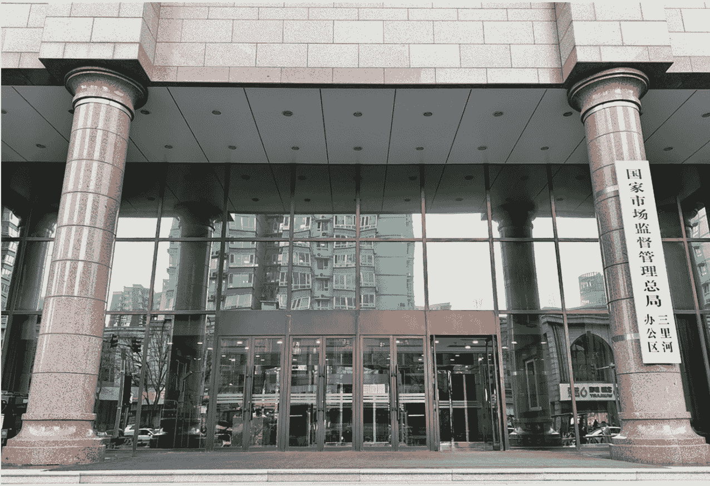

## CAIXIN | 听文章

近日，国务院常务会议研究建立健全涉企收费长效监管机制有关举措。会议提出，聚焦政府部门及下属单位、行政审批中介服务机构、行业协会商会、经营自然垄断环节业务企业等涉企收费主体，强化全过程监管，着力构建协同高效的长效监管机制。相关举措有的放矢，“清单之外一律不得收费”等要求简洁明了。

加强涉企收费监管是降低企业经营成本、优化营商环境的重要举措。近年来，一些地方罚没收入激增，人们自然会猜测有多大部分来自违规涉企收费。此次会议强调全过程监管，着力构建协同高效的长效监管机制：哪些可以收，哪些属于违规收费，如何收费，收费多少，收费的程序等等，都应该依据法律法规和政策而行。

近期，国家市场监督管理总局负责人表示，2024年涉企违规收费专项整治工作共查处各类主体涉企违规收费案件3042件，责令收费主体退还企业13.6亿元。在2024年2月国新办的新闻发布会上，市场监管总局负责人介绍，连续五年开展涉企违规收费专项整治，通过监管执法清费、治乱，共检查收费单位32万家，退还企业超过180亿元。这些实实在在的退还数额，体现了专项整治成绩显著，公众号懒人搜索，懒人专属群分享

梳理历年来的整治行动不难发现，重点领域和重点环节监管会根据每年面临的不同形势予以动态调整。比如，2022年多部委发布《涉企违规收费专项整治行动方案》，除了严禁有关单位以疫情防控为名向交通物流企业实行强制摊派，还包括地方财经领域和金融领域涉企违规收费问题专项整治。对于行政审批中介服务机构、行业协会商会、经营自然垄断环节业务企业，也是监管长抓不懈的环节。

规范涉企收费的实质就是规范用权。应把涉企收费纳入全过程监管。国务院常务会议明确要求，要健全涉企收费目录清单制度，将所有收费项目均纳入清单并对社会公开，明确服务内容、服务标准、收费额度，清单之外一律不得收费，依法依规对存量涉企收费政策加以清理。“清单之外一律不得收费”，既是赋权收费的正面清单，也是约束收费的“负面清单”。这就需要认真厘定目录清单，据此严格规范收费行为，违规行为立即纠正。

社会主义市场经济本质上是法治经济。国务院常务会议明确，要加大违规收费治理力度，对没有法律法规和政策依据、越权设立的涉企收费项目，一律予以取消；对擅自提高征收标准、扩大征收范围的行为，坚决予以纠正；对确有必要新出台的涉企收费政策，要加强合法性、公平性以及社会预期影响等方面的审查。要遵循这些要求，做到谁越权设立谁负责、谁违规收费谁担责。此外，相关法律法规也应抓紧完善。

会议还提出，要健全涉企收费监测评估制度，优化问题线索收集和处理机制，营造全社会共同参与、协同治理的良好氛围，进一步稳定各类经营主体预期、提升发展信心。这是极其必要的。实际上，规范涉企收费，将提升包括消费者在内的所有市场参与者的信心。协同治理，需要构建更加畅通的企业申诉渠道，还需要充分发挥媒体等社会各界的作用。

治理涉企收费，核心问题是政府与市场的关系。前不久召开的民营企业座谈会要求，坚决破除依法平等使用生产要素、公平参与市场竞争的各种障碍，持续推进基础设施竞争性领域向各类经营主体公平开放，继续下大气力解决民营企业融资难融资贵问题。这次座谈会还提出，要强化执法监督，集中整治乱收费、乱罚款、乱检查、乱查封，切实依法保护民营企业和民营企业家合法权益。可以说，如何认识和对待企业尤其是民营企业，检验着治理涉企违规收费的成效。

规范涉企收费，建立健全长效监管机制不是短期任务，不可能毕其功于一两次专项行动，须涓流成海、积尘为山，为各类企业带来真切的获得感，做到“清单之外一律不得收费”。■

## 最新财新周刊 | 陆家嘴黄金地段 局中有局 律师会计师公证员均领刑

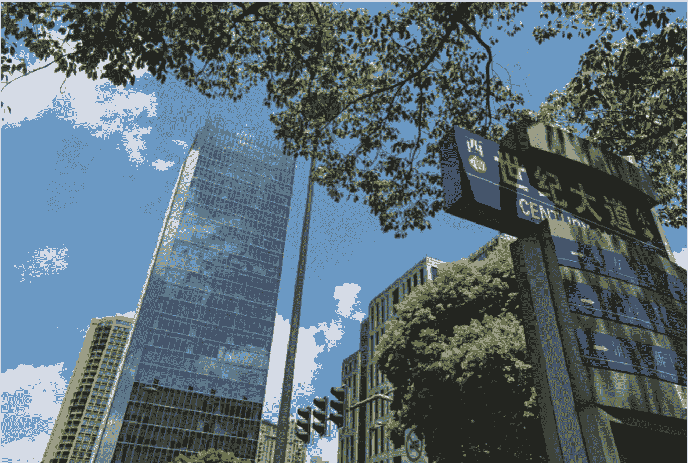

## CAIXIN | 听文章

文 | 财新周刊 张一川

国华人寿金融大厦是一栋高近百米，地上24层、地下4层的5A甲级写字楼。它坐落在寸土寸金的上海陆家嘴世纪大道旁，东南毗邻上海期货交易所，西北不远即是著名的东方明珠广播电视塔。

这栋写字楼的产权已几易其手。最早在2002年，深圳商人刘建设拿到了相关地块的土地使用权，计划兴建一座“国际证券大厦”。因为资金问题，项目公司上海瑞证投资有限公司（下称“瑞证公司”）先后引入上海澳怡企业发展有限公司（下称“澳怡公司”）和本地开发商上海龙仓置业有限公司（下称“龙仓置业”）作为股东。此后，事情的走向一步步脱离了刘建设掌控。

司法材料显示，龙仓置业逐渐获得了瑞证公司的控制权，并通过倒签仲裁协议制造瑞证公司违约等手段将土地过户到自己名下，自行开发。为此，三家公司从2004年开启一系列法律商战，至今打了近百场官司。

在刘建设与龙仓置业大股东王士明互相控告并且都被刑事立案后，商战两度迎来高潮。先是刘建设在2006年被刑拘，而后办理取保候审，数年后撤案。自2018年7月至2019年1月，包括王士明及其商业伙伴、下属，相关律师、会计师、公证员在内，至少有23人以犯罪嫌疑人的身份被警方传唤讯问，后来其中8人获刑、1人定罪免罚、4人被检方决定不起诉。

2018年7月至2019年1月，上海地产商人王士明及其商业伙伴、下属，以及相关律师、会计师、公证员，至少有23人被警方传唤讯问，后其中8人获刑。图为王士明。图：受访者提供

案件陆续宣判，所有获刑被告人均不服上诉。因提供虚假证明文件罪获刑的会计师王燕、公证员赵铭宇，在2021年4月被二审法院裁定维持原判。同年5月，因职务侵占罪获刑的王士明等6人，二审后被上海市高级法院裁定撤销原判、发回重审。

2024年7月，上海市高院主要领导对该案公开表态：“我们认为，14年间两家公司之间有这么多纠纷，权属争议也没有搞清楚，行为人某一个单一行为是否构成犯罪，根本说不清楚。在权属争议尚无定论时，用民事途径解决更为适宜，以刑事手段介入务必十分审慎。”

检方并未撤诉，而是对6人变更罪名起诉，还增加了龙仓置业作为被告单位。2024年“十一”长假前后该案重审一审开庭，至今未宣判。

围绕这块土地的商战风云，宛若一场牌桌上的三家博弈。事情何以至此？

# 三方入局

知情人士介绍，刘建设是北京人，1955年6月生。工商资料显示，他长期担任深圳市即达行国际投资有限公司（下称“即达行公司”）法定代表人、董事长、总经理，直到2024年1月卸下这些职务，目前仍持有该公司超过35%的股份。

2002年5月16日，即达行公司以2.19亿元的价格，取得上海期货大厦旁面积9.45亩的2—13—3A地块（下称“3A地块”）50年土地使用权，土地规划用途为商办用地。土地使用权转让合同还约定，本合同乃即达行公司代表其未来在上海投资组建的项目公司所签署，项目公司应为即达行公司全资组建。

刘建设说，由于在上海没有公司，临时成立项目公司也来不及，经朋友介绍相中了2003年11月成立的瑞证公司。当时，深圳市德易投资有限公司（下称“德易公司”）和广州一家公司向瑞证公司注资5000万元完成验资。刘建设以500万元的价格受让瑞证公司全部股权，但因当时有不能成立一人公司的规定，德易公司名义上还保留了10%股权。在瑞证公司办理工商登记次日，德易公司和广州那家公司即将5000万元注册资本转出，刘建设称对此知情，但他认为后续将会把3A地块注入公司，不会存在注册资金不足、违反法律的情况。

2003年12月26日，瑞证公司与土地转让方——上海陆家嘴金融贸易区联合发展有限公司重新签订了土地使用权转让合同，仍以2.19亿元价格受让3A地块50年土地使用权。新合同还约定，在2003年12月31日前，瑞证公司需支付土地出让金的20%，剩余80%在2004年3月31日前支付。

当时一个背景是，2003年6月5日中国人民银行发布《关于进一步加强房地产信贷业务管理的通知》，规定商业银行发放的房地产贷款只能用于本地区的项目，严禁跨地区使用。刘建设自述，在该通知公布前即从银行内部听到了消息，此后他在深圳的贷款无法在上海使用，于是找到了同学创办的澳怡公司。2003年12月31日，澳怡公司和即达行公司签订股权转让合同，约定澳怡公司以1000万元受让瑞证公司20%股权，并在合同签订当日再投入1190万余元。

同期需缴纳的剩下2190万余元仍没有着落，刘建设又通过朋友，找上了有过一面之缘的王士明。生于1951年12月的王士明是土生土长的上海崇明人，历任崇明县鳌山乡副乡长、乡长，新河镇党委书记。

1999年6月，王士明出资600万元创业，找上了比他更早下海的前下属、新河镇原副镇长陈宇，通过陈宇父亲出资400万元合伙，成立龙仓置业。龙仓置业后多次增资至1.1亿元，并在2007年引入王士明名下的上海王狮实业有限公司（下称“王狮公司”）和陈宇的上海易端投资有限公司作为新股东，王、陈双方持股比例未变。

龙仓置业在上海开发了多个房地产项目，“第一桶金”是与上海期货交易所隔着松林路相望、建筑面积11万平方米的豪宅香榭丽花园，曾轰动上海滩。王士明自述，他后续还开发了康健丽都、虹桥华庭、九溪十八岛、地杰国际城等项目，共计上百万平方米建筑面积。

2004年1月2日，王士明通过其女儿的账户向即达行公司转账2100万元。之后，筹资无果的刘建设再次找到王士明借款。刘、王双方及陈宇同意由龙仓置业再借给瑞证公司1.75亿余元并支付3A地块项目的其他前期费用，按照龙仓置业两股东股权比例出资。为了规避当时央行“企业之间不得违反国家规定办理借贷或者变相借贷融资业务”的要求，相关协议以王士明女儿及陈宇父亲名义签订。

2004年3月30日签订的合作框架协议约定，即达行公司转让瑞证公司合计55%股权给王士明、陈宇二人，并对1.75亿余元另行签订借款协议，借款协议在股权变更工商登记手续办理完毕后失效。上述股权作价2750万元，从龙仓置业将要支付的款项中扣除。项目开发所需资金与注册资本差额部分，各股东按照股权比例承担，龙仓置业实际投入资金超出应承担金额部分，作为代即达行公司、德易公司支付的款项，即代支款。代支款年息为6%，可从瑞证公司银行贷款、营业收入中优先偿还。在确保项目工程进度情况下，龙仓置业有权优先从银行贷款或营业收入中收回注册资本外的其他投资。若瑞证公司未能在40个日历天内取得3A地块土地证，系刘建设方面原因造成的，刘建设方面需按龙仓置业实际投入资金支付日息3‰的违约金。

这场联姻并不顺利。综合多人笔录，澳怡公司实控人首先得知瑞证公司股权再次被转让之事，随后找到王士明告知，此前双方均不知道瑞证公司有部分股权被转让给他人。加之刘建设方面未能在约定期限内办出土地证，经谈判，双方在2004年8月又签订了补充协议：将瑞证公司的55%股权股东由两个自然人改为龙仓置业，并约定即达行公司需在土地证办出后30个日历天内，以及在土地证和建设用地规划许可证、建设工程规划许可证、建设工程开工许可证办出后一个月内，分别向银行借款1亿元、2.5亿元，用于龙仓置业收回投资；代支款利息改为年息10%。双方还约定，如果即达行公司违约，将向龙仓置业转让瑞证公司25%股权，且因澳怡公司还有1000万元未支付，即达行公司还需再向瑞证公司投入1000万元。

多年以后，当王士明被警方带走后他在供述中坦言，签补充协议时已经有将刘建设“请出局”的想法，“如果刘建设的股份一天还在瑞证公司，那么这个土地的开发就一天不会安宁”。

2004年8月26日，瑞证公司办好了土地证。据刘建设和他的下属说，王士明自称在有关部门有熟人，故派时任龙仓置业行政部经理陈铁钢代为领取土地证并将原件保存。

与此同时，刘建设赶回了深圳，处理即达行公司一笔1600万元的“债务”。其于2004年8月17日与深圳市商业银行（现为深圳平安银行）皇岗支行达成1600万元的委托贷款协议。深商行皇岗支行通过商人辛安以个人名义借款给即达行公司，即达行公司以瑞证公司90%股权作为担保——但事实上，瑞证公司75%的股权已转让给了澳怡公司和龙仓置业。

刘建设和王士明的种种操作，一步步点燃了20多年讼争的引线。

## 讼争纠缠

讼争第一枪——协议违约之诉，由龙仓置业在2004年9月9日打响。龙仓置业以瑞证公司违反框架协议未按时取得土地证为由，诉请判令即达行公司、德易公司和瑞证公司三公司承担违约赔偿责任，同时申请财产保全。上海市第一中级法院次日即查封了3A地块。

2004年10月22日，龙仓置业追加诉讼请求，以违反补充协议未按时办妥银行贷款为由，诉请即达行公司、德易公司将所持瑞证公司剩余25%股份转让给龙仓置业。

刘建设方面在本案中一审二审皆败诉，上海市高院于2006年2月23日判决即达行公司、德易公司向龙仓置业赔付654万元违约金、转让瑞证公司25%股权，瑞证公司承担连带清偿责任。四个月后相关股权被执行过户，但654万元违约金赔偿一直未执行。

深商行皇岗支行得知龙仓置业发起协议违约之诉，为保证资金安全，于2005年1月起诉辛安、即达行公司和瑞证公司。随后深圳市中级法院裁定查封3A地块。据相关判决书，2005年11月26日，在三被告均未答辩的情况下，深圳中院缺席判决辛安偿还1600万元及利息，即达行公司、瑞证公司承担连带责任。2006年2月23日，深圳中院执行法官到瑞证公司执行前述1600万元及利息，并查封3A地块。

这一次3A地块用于担保贷款并被查封，成为日后王士明方面种种举动的“道义”所在。然而王士明是否事先知晓且同意担保，在双方口中成了罗生门。

刘建设坚称，曾口头知会王士明担保及使用公章之事，因不方便告诉员工而没有履行登记手续，直接拿到保险柜备用钥匙后取走了公章。此后，他还让王士明将土地证传真给他用于担保。陈铁钢也表示，确曾传真土地证给在深圳的刘建设，还将一份复印件交给刘建设下属。

但王士明本人和他身边多人，以及当时澳怡公司实控人都称不知情。王士明方面称，是刘建设在担保合同上偷盖瑞证公司公章并侵吞了贷款。关于瑞证公司在深圳被起诉并缺席判决一事，王士明和龙仓置业也称“一无所知，既没有收到起诉状，也没有收到判决书”，直到深圳法官赶到上海来执行才得知消息。王士明及身边多人在笔录中均提到，王士明对此事又惊又怒，担心刘建设私下用3A地块作了更多担保，导致龙仓置业前期投入的1亿余元“打了水漂”。

在刘建设对外担保三天后与王士明方面签订的补充协议中，未体现相关担保情况。实际上，在与深商行皇岗支行的担保合同中，瑞证公司填写的注册地址是变更前的旧地址。龙仓置业代理律师单梁回忆说，当时传票和诉讼材料无人收取被退回，于是法院采用了公告送达。

协议违约之诉启动后不久，瑞证公司股东会决议将原公章登报作废并启用新公章。尽管框架协议中约定在项目施工完毕验收前，各方不得处置其在瑞证公司的股权，但并未约定违约责任。经历了一系列事端，手握瑞证公司80%股权和新公章的龙仓置业决定一劳永逸，将3A地块过户到自己名下。

王士明及单梁都表示，大约在2006年3月，瑞证公司与龙仓置业倒签了一份仲裁协议，落款时间为2005年9月9日，即瑞证公司被深圳中院判决承担担保责任之前。

仲裁协议约定，瑞证公司向龙仓置业保证，至协议签署时未为第三方提供担保，3A地块未被抵押或作其他处分，不存在第三方查封或其他权利限制。如违约需向龙仓置业支付等同于3A地块土地款的2.19亿余元违约金，并将3A地块无条件过户至龙仓置业名下。因本协议产生的纠纷，双方同意交由上海仲裁委员会适用简易程序予以仲裁解决。

2006年3月13日，龙仓置业的法定代表人由王士明变更为其女儿，避免了仲裁时“自己告自己”的情况。两日后，龙仓置业对瑞证公司提起仲裁，理由是瑞证公司隐瞒担保事实，还因不能履责导致财产被查封。刘建设称之为王士明为夺取3A地块而谋划的一出“双簧”。

龙仓置业、瑞证公司从上海仲裁委提供的名册上选定了曾任上海市高院刑庭庭长的退休法官吴开明独任仲裁。据仲裁庭开庭记录，龙仓置业、瑞证公司分别由单梁和陈铁钢作为代理人出庭，后者对龙仓置业的仲裁请求全部同意，表示“仲裁协议真实无异议”，还特别说明“协议约定事项是在我们不知情的情况下，今年2月份收到深圳中院的文书才知道瑞证公司由原股东刘建设进行了抵押”。

经过仲裁，双方顺利达成调解：瑞证公司向龙仓置业返还拖欠投资款1.69亿余元，赔偿损失2.19亿余元，总计3.89亿余元，这笔款项以3A地块过户折抵。

2006年5月底到6月初，瑞证公司累计向深圳中院账户汇款超过1900万元，用以清偿担保款。银行流水显示，其间龙仓置业向瑞证公司累计转入1914万元。清偿完毕当日，上海一中院裁定，将3A地块过户到龙仓置业名下，后于同年8月执行。

除了发起协议违约之诉和仲裁，王士明方面还寻求警方介入。2006年3月15日申请仲裁当日，龙仓置业就以刘建设偷盗公章、侵占资金为由向警方报案。相关法律文书显示，2006年6月9日刘建设被刑事拘留，7月13日被取保候审。到2007年7月12日，上海市公安局对刘建设解除取保候审。不过刘建设称，警方一直未撤案，直到2013年初才撤案。王士明也佐证，报案后几年，警方询问他是否同意撤案，他同意了——王士明不会想到，数年后局面将完全翻转，在刘建设持续控告下，最终自己会被采取刑事强制措施。

2007年，闲置三年的3A地块正式动工，定名“嘉瑞国际广场”。2011年8月，在项目竣工之前，SOHO中国有限公司（00410.HK）以18.9亿余元收购整栋大楼绝大部分产权并更名为SOHO世纪大道。2016年7月，这栋写字楼又以32.2亿余元的价格转售给国华人寿保险股份有限公司，再次更名为国华人寿金融大厦。

仲裁之事引起澳怡公司、即达行公司回击。2006年5月31日，澳怡公司以小股东身份起诉瑞证公司，要求返还投资款，瑞证公司和龙仓置业赔偿经济损失，即达行公司承担连带责任。经过一审、二审，龙仓置业被判赔共计5663万余元。双方均不服，申请再审。澳怡公司认为土地评估报告不准确，龙仓置业认为澳怡公司投入资金仅占土地款约8%，按20%股权赔偿违反了权利义务对等原则。

这场耗时六年多的诉讼，最终调解了事。上海一中院2012年7月17日出具的民事调解书显示，龙仓置业以1000万元收购澳怡公司所持瑞证公司20%股权，并补偿澳怡公司6000万元，澳怡公司向龙仓置业转让其收益权并全面退出瑞证公司。

2008年4月，即达行公司也向最高法院申请再审协议违约之诉。2010年12月，最高法院作出再审判决，即达行公司延迟办理土地证应承担违约责任，维持上海市高院654万元违约金的判决项；但因龙仓置业申请查封3A地块，致使即达行公司以3A地块进行抵押贷款之事成为不可能，故撤销即达行公司、德易公司股权转让的相关判决项。由此，涉案的瑞证公司25%股权被返还给即达行公司。

恢复了股东身份的即达行公司，在2012年7月仿照澳怡公司提起了股东代表之诉，诉请龙仓置业、王士明等承担侵占3A地块的赔偿责任。

龙仓置业则瞄准了即达行公司的股东资格进行狙击。龙仓置业以大股东身份通知召开瑞证公司股东会，以75%股权同意对25%股权未到场按弃权处理的表决结果作出决议，解除即达行公司股东资格，理由是抽逃出资。即达行公司就此向瑞证公司发起股权解除之诉。经两审法院审理认定，即达行公司将收取的3750万元股权转让款用于支付瑞证公司对外应付的土地出让金，应当视为补足其转让的75%股权对应的出资，此后即达行公司还向瑞证公司至少出资共计189万余元，不满足《公司法》相关司法解释的可以对股东进行除名的情形，故该股东会决议不具法律效力。

股东代表之诉中，上海一中院在2015年10月一审判决龙仓置业按照3A地块过户时的土地价值评估，赔偿瑞证公司4亿余元及利息。相关材料显示，王士明对龙仓置业当时的代理律师郁斌在一审中的表现极为不满，经由王狮公司常年法律顾问朱蕾介绍了律师刘潇江代理此案二审。2016年12月19日，龙仓置业二审也告败诉，该案随后进入执行阶段。

## “抵销”

在龙仓置业看来，即达行公司在3A地块项目中几乎没有投入，还造成了担保损失。股东代表之诉的侵权赔偿款减去龙仓置业的投入，即以达行公司、德易公司25%股权计算所得，再扣除此前龙仓置业代付的担保款及利息、协议违约之诉赔偿款654万元及利息，能到刘建设手上的钱实际上所剩无几。因此，龙仓置业在判决执行阶段提出给予刘建设一方5000万元。

刘建设则提出：免除其协议违约之诉赔偿责任，其承担担保款责任，25%股权转给龙仓置业，龙仓置业补偿其8000万元；同时，股东代表之诉中龙仓置业被判赔偿的4亿余元本金和2亿余元利息照付。

王士明说，他认为刘建设要价太高，是不想通过调解来解决问题，于是也不打算按照判决支付。另一方面，陈铁钢表示，龙仓置业预估，若按判决支付，涉及的营业税、土地增值税等也不是一笔小数目。

双方开出的条件差距巨大。围绕股东代表之诉判决的执行，新一轮争斗开始了。龙仓置业三路出击：
- 其一，对即达行公司申请执行人身份提出异议。由于瑞证公司表示其并未要求即达行公司代为申请执行，上海一中院一度裁定驳回即达行公司申请人身份，后又于2017年5月恢复，执行异议的阻击失败。
- 其二，重启即达行公司协议违约之诉中654万元违约金和龙仓置业代付担保款的执行，申请查封即达行公司在瑞证公司15%股权并拍卖，一旦即达行公司丧失股东身份则万事皆休。在案证据显示，2017年6月，上海一中院决定拍卖即达行公司股权，甚至一度进入委托网络拍卖的程序，后又因故中止。
- 其三，着手实施律师郁斌和刘潇江皆提过的“合同之债”抵销“侵权之债”的方案。两名律师都认为，龙仓置业被判向瑞证公司赔偿土地侵权款也即“侵权之债”4亿余元，那也就意味着当初仲裁的“土地抵债”之事中抵债未作处理。龙仓置业因此可重新向瑞证公司主张追偿所投入的资金，亦即“合同之债”。两律师的首选方案均是通过一场债权债务诉讼确定“合同之债”金额，并与“侵权之债”相抵。

按照王士明要求，龙仓置业会计严文燕在股东代表之诉一审期间计算了对瑞证公司权益总额，合计2.29亿元。

股东代表之诉二审期间，陈宇通过上海申威资产评估有限公司（下称“申威评估公司”）牵线，打算委托上海申威联合会计师事务所（下称“申威会计所”）对龙仓置业和瑞证公司之间债权债务进行审计。据介绍，申威评估公司与申威会计所各自独立，2005年申威会计所创办时打算借用名气比较响的“申威”招牌，申威评估公司答应了请求。此后，双方也会互相介绍业务并从中提成。

申威会计所的会计师王燕入场审计后，于2015年11月25日出具了审计报告（下称“申威审计报告”），确认截至2015年9月30日，龙仓置业应收瑞证公司2.29亿元。审计之后，严文燕和另一名财务人员郭云娟根据申威审计报告重新制作了瑞证公司账册。

刘潇江将申威审计报告以及他制作的委托付款协议书（下称“代付协议”）、资金占款协议书（下称“占款协议”）作为新证据提交给二审法院上海市高院，构造了瑞证公司委托龙仓置业付款的关系，由此确认龙仓置业垫付总额达2.3亿余元，利息以同期银行贷款利率4倍计；两公司约定若生效判决认定此前仲裁侵权，龙仓置业可要求将赔偿责任与资金占款债务相互抵销，并因此将财务记载恢复到原有状态，重新确认双方的债权债务关系。上海市高院认为，龙仓置业在二审期间提出抵销权主张，超出本案审理范围，不予处理，所提供证据亦不予审查。

龙仓置业在股东代表之诉两审均败诉后，仍希望能快速解决问题。这时，刘潇江提出具有强制执行效力的债权债务公证的方案，被龙仓置业采纳。此事最终交由王狮公司法务人员刘雪涛和律师朱蕾团队操作。

按照《公证法》第37条，对经公证的以给付为内容并载明债务人愿意接受强制执行承诺的债权文书，债务人不履行或者履行不适当的，债权人可以依法向有管辖权的法院申请执行。《民事诉讼法》也有相关规定。

相比重新打一场债权债务官司，这种做法时间短、费用少。用卷入此案的北京公证员赵铭宇的说法就是：“跳过法院一审、二审，直接进入执行阶段，快速实现债权。”

瑞证公司和大股东龙仓置业于是再次配合。朱蕾说，当时上海对非金融机构之间的资金融通合同一律不予公证，朱蕾的校友于是推荐了在北京“数一数二”的北京市方正公证处。经介绍，龙仓置业方面联系上了赵铭宇，并告知她将要办理公证书及相关执行证书。1983年1月生于北京的赵铭宇曾做过律师，2010年至2014年在中国公证协会工作，2014年进入方正公证处担任公证员。

2017年7月6日，陈铁钢、刘雪涛、何建树、郁永军和严文燕、郭云娟分两批抵达北京，对资金垫付还款协议（下称“还款协议”）办理公证。何建树原是龙仓置业行政部职员，2014年成为龙仓置业法定代表人；郁永军是王士明外甥、司机，2006年成为瑞证公司法定代表人。

还款协议认可龙仓置业向瑞证公司垫支2.29亿元，在协议签署十日内归还所有款项，资金占用补偿费以年利率24%计算。还款协议还约定了强制执行效力条款，龙仓置业可在公证后直接申请法院执行而无需经过诉讼程序，同时瑞证公司放弃抗辩权。何建树、郁永军在还款协议上签字并加盖两公司公章。经过方正公证处审批，当日赵铭宇为两公司出具了具有强制执行效力的债权文书公证书。

还款协议中2.29亿元本金的依据，表面上看是另一份审计报告。此前重启654万元违约金执行时，法院通过电脑配对确定申威评估公司，委托其对瑞证公司进行资产评估，但并未直接摇号和委托司法审计。评估师的证言表示，他向法官表示案情复杂，需要会计师事务所进行审计，法官同意，提出会计师事务所由申威评估公司自行去找，但需入选上海市高院的司法审计资质名单。

综合多人笔录，申威评估公司总经理将此事告知时任王狮公司总经理时品仁，后者建议继续委托熟悉瑞证公司的申威会计所，前者同意了。因申威会计所不在资质名单内，其负责人薛爱琼联系了宏大东亚会计师事务所（下称“宏大东亚会计所”）尝试“挂靠”，对方考虑后同意了。最终由王燕编制、宏大东亚会计所审核并于2017年3月11日出具了审计报告（下称“宏大东亚审计报告”），再次确认瑞证公司应付龙仓置业2.29亿元本金。利息方面，由于刘潇江介绍当时司法裁判最高支持年利率24%，龙仓置业最终选定了24%。

2017年7月19日，经龙仓置业申请，赵铭宇依据还款协议标的出具了执行证书。次日，龙仓置业向上海市高院申请执行，请求依据执行证书强制执行瑞证公司9.13亿余元。

鉴于双方存在其他债权债务正在上海一中院执行，本案移送至上海一中院。上海一中院组织开庭谈话，听取龙仓置业、瑞证公司、即达行三公司意见，同年12月20日作出裁定书，对执行证书中执行标的与股东代表之诉判决履行债务的执行标的进行抵销。

## 刑事案件还是民事纠纷

在案证据显示，早在2010年，刘建设就向上海市检察院控告王士明及仲裁员吴开明等人。2011年、2017年和2018年，刘建设方面三次向上海市公安局报案，举报王士明、吴开明等人涉嫌职务侵占罪。2018年6月，警方刑事立案。

自2018年7月至2019年1月，包括王士明及其商业伙伴、下属，相关律师、会计师、公证员在内，至少有23人以犯罪嫌疑人的身份被警方传唤讯问。他们所涉罪名在司法程序各阶段几经变更，后部分人被移送检方审查起诉。其中王士明、郁斌、刘潇江、朱蕾、时品仁、陈铁钢、刘雪涛等7人分成多个案件，以涉嫌职务侵占罪被分别提起公诉；王燕、赵铭宇以涉嫌提供虚假证明文件罪被分别提起公诉。因犯罪情节轻微、具有自首或坦白情节，检方对陈宇、单梁、严文燕、郭云娟作出不起诉决定。

2020年12月，被起诉的9人先后一审宣判。上海二中院认定王士明、郁斌、刘潇江、朱蕾、时品仁、陈铁钢、刘雪涛构成职务侵占罪，对朱蕾免予刑事处罚，其余6人判处有期徒刑2年至1年5个月不等；上海市杨浦区法院认定王燕、赵铭宇构成提供虚假证明文件罪，分别判刑1年11个月、1年1个月。他们的刑期都与各自被先行羁押的时间基本相同，等于是“实报实销”。

据原审一审判决书及相关不起诉决定书，法院审理查明：2004年9月，王士明指使律师郁斌、单梁发起协议违约之诉，经法院判决，龙仓置业无偿获得瑞证公司25%股权。2006年3月，王士明经与郁斌、单梁共谋，利用王士明实际控制龙仓置业和瑞证公司的便利，签订伪造的仲裁协议，之后以仲裁调解的方式将瑞证公司名下3A地块过户到龙仓置业名下。王士明将此事告知陈宇，陈宇表示同意。

龙仓置业在股东代表之诉中一审败诉后，为达到不支付侵权赔偿款的目的，王士明多次组织律师刘潇江、朱蕾及公司员工时品仁、陈铁钢、刘雪涛、严文燕等人开会，商讨应对策略。刘潇江提出，二审阶段可以用龙仓置业对瑞证公司的合同之债来抵销侵权之债。为达到抵销目的，刘潇江伪造了代付协议、占款协议，虚增龙仓置业对瑞证公司的债权本息，王士明等人通过申威会计所的薛爱琼和王燕出具专项审计，并让严文燕、郭云娟对瑞证公司账目违规调整。

股东代表之诉二审败诉后，王士明等人为对抗执行，通过时品仁安排薛爱琼和王燕以宏大东亚会计所的名义出具审计报告，贬损瑞证公司的股权价值，试图通过低价拍卖即达行公司所持有的瑞证公司股权来剥夺即达行公司申请执行资格。后因即达行公司多方投诉等原因，该拍卖中止。

此后王士明采纳刘潇江提议，安排朱蕾以宏大东亚审计报告内容为基础拟制还款协议，并将龙仓置业对瑞证公司债权的年利率定为24%，由两公司签订该协议，并安排人至北京，对还款协议进行公证。赵铭宇违规出具了公证书及执行证书，上海一中院根据执行证书将龙仓置业和瑞证公司的债权债务抵销，造成瑞证公司本应从龙仓置业获取的7亿余元侵权赔偿款本息被抵销。王士明将此事告知了陈宇，陈宇未表示反对。

法院认为，王士明控制60%股权的龙仓置业，系瑞证公司大股东，瑞证公司受让3A地块土地使用权所需资金绝大部分系龙仓置业投入，但王士明伙同他人，利用其实际控制瑞证公司的职务便利，将瑞证公司资产非法占为龙仓置业所有，数额巨大。郁斌、刘潇江、朱蕾以及时品仁、陈铁钢、刘雪涛明知王士明利用其实际控制瑞证公司的职务便利，将瑞证公司资产非法占为龙仓置业所有，仍对王士明给予协助，系从犯。法院认为7人行为已构成职务侵占罪。

除被免予刑罚的朱蕾，另6人均不服一审判决，提出上诉。2023年5月19日，因事实不清、证据不足，上海市高院对6人作出撤销原判、发回重审的裁定。

2024年7月20日，中国反腐败法治论坛在吉林大学举行。据中国刑法学研究会官方微信公众号，论坛上，上海市高院有关领导表示：“前一段我们办理了这样一起案件，甲乙两公司之间出现一系列出资、签约、诉讼、仲裁、委托审计、公证等争议，在长达14年的时间里，经历90余起民事诉讼，直至刑案案发时仍未就权属争议形成最终定论。后乙公司以刑事犯罪报案，检察院指控甲公司实际控制人王某犯职务侵占罪。起诉指控的事实中，对犯罪数额都未作精准表述。一审法院以职务侵占罪判处被告人有期徒刑二年。高院二审裁定撤销原判，发回重审，并商请检察机关撤回起诉。我们认为，14年间两家公司之间有这么纠纷，权属争议也没有搞清楚，行为人某一个单一行为是否构成犯罪，根本说不清楚。在权属争议尚无定论时，用民事途径解决更为适宜，以刑事手段介入务必十分审慎。”

2024年6月21日，上海市检察院第二分院对王士明等人变更起诉，在认定事实和适用法律上都作了调整。

上海市检察院第二分院增加了指控的事实细节，如认为仲裁协议系在明知瑞证公司已存在对外担保的情况下所伪造，陈铁钢明知仲裁协议系伪造，仍在上加盖两公司公章；在王士明安排下，单梁和陈铁钢在仲裁庭虚假陈述；王士明操纵龙仓置业和瑞证公司签订了刘潇江伪造的代付协议和占款协议，等等。检方认为，王士明应当以妨害作证罪追究刑事责任；时品仁、陈铁钢、刘雪涛、郁斌、刘潇江应当以帮助伪造证据罪追究刑事责任。

检方还增加了龙仓置业作为被告单位，认为龙仓置业对法院判决有能力执行而拒不执行，情节严重；王士明系直接负责的主管人员，陈铁钢作为其他直接责任人员，时品仁、刘雪涛、刘潇江作为龙仓置业的共犯，应当以拒不执行判决罪追究刑事责任。

2024年“十一”长假前后，王士明等6人的案件陆续重审开庭。

据财新了解，本案是民事纠纷还是刑事犯罪，仍然是法庭辩论的焦点。

王士明的辩护律师王飞认为，本案是民事纠纷。从动机上说，王士明是因刘建设对外私自担保、给龙仓置业带来了资金危机而过户了3A地块，类似民法、刑法上都允许的“紧急避险”；澳怡公司在其发起的股东代表之诉和解之后也出具了感谢信，对当时王士明的处置表示肯定，所以这些行为不具有应受刑事处罚的社会危害性。从实质上说，2006年仲裁时，龙仓置业是持有瑞证公司80%股权的控股股东；2017年债权抵销时，龙仓置业是瑞证公司75%股权的控股股东。即达行公司、德易公司虽是瑞证公司名义上的股东，但因出资问题没有股东权利。在享有绝对控股地位的情况下，龙仓置业完全可以通过公司决议程序实现仲裁裁决以及债权抵销所达到的效果。“一个本来就可以通过公司决议程序实现的行为，怎么能认定为犯罪呢？至于公司决议行为是否合法有效，则完全是民事法律调整的范围。”王飞表示，从整件事的走向看，澳怡公司、即达行公司确已通过民事诉讼解决了仲裁所导致的争议。代理了相关案件的刘潇江也称，就公证所导致的争议，即达行公司、德易公司也提起了民事诉讼，本已完成开庭等待宣判，但因龙仓置业管理人员及代理律师相继被刑拘，上海市高院立案后以同一事实已被刑事立案为由裁定驳回起诉。

财新获悉，该案重审一审开庭后，至今未宣判。2025年1月，上海二中院发出通知，经报请最高法院批准，延长审理期限三个月至2025年4月29日。

## 专业人员的角色

这场绵延20余年的法律商战里，王士明方面在律师帮助下，使用了诉讼、仲裁、公证、审计与评估等各路手段。涉案律师、仲裁员、公证员、会计师和评估师等专业人员扮演的角色，相关程序、文书的法律效力是否存在问题，也成为刑事调查的重点。

首先受到怀疑的是2006年的仲裁程序。按照当年上海仲裁委规则，争议标的在50万元以上案件应组成三人仲裁庭，但双方当事人也可以选定简易程序，由一名仲裁员组成仲裁庭。刘建设认为，王士明等人之所以约定简易仲裁，就是利用吴开明担任仲裁员的职务便利一人仲裁。龙仓置业代理律师郁斌承认，他与吴开明早在1983年就相识。

其实仲裁裁决出炉后，即达行公司和澳怡公司曾于当年6月起诉至法院，要求撤销仲裁裁决。上海一中院审理认为，根据法律规定，申请撤裁的当事人应限于仲裁案件当事人，两公司不符合主体资格，故驳回起诉。

案外人如果认为仲裁影响了自己的合法权益，该如何寻求救济？这是仲裁领域老生常谈的话题。现行《仲裁法》中并没有相关规定，2018年2月最高法院发布关于仲裁裁决执行案件的司法解释，其中有九个条文规定了案外人权利救济的内容。直到2024年11月，酝酿多年的《仲裁法（修订草案）》首次提请全国人大常委会审议，其中规定，仲裁庭发现当事人之间恶意串通，企图通过仲裁方式侵害国家利益、社会公共利益或者他人合法权益的，应当驳回当事人的仲裁请求。目前《仲裁法》修订尚未完成。

其次被调查的是审计的过程，主要问题在于债务本金如何构成。综合多人说法，王燕和薛爱琼受刘潇江在审计前介绍情况的影响，误认为仲裁裁决已被推翻，故对债务本金进行了重新调整。王燕表示，股东代表之诉一审判决书中说仲裁裁决显失公平，因此她对“土地抵债”的财务进行了冲回处理。实际上，该判决书指的是仲裁协议对于违约不仅转让土地使用权还要赔偿等值违约金，“这一约定显失公平”。

并且，申威审计报告的截止日期按照客户要求，定在了2015年9月30日。其时即达行公司提起的股东代表之诉一审判决未出，而澳怡公司提起的诉讼先是被最高法院发回重审，接着双方和解，亦没有生效判决。直至2017年3月宏大东亚审计报告出具时，股东代表之诉判决才生效，但两份审计报告内容除了利息计提，在债务本金计算上没有明显差别。对此，王燕解释说，资产负债表日后获得的审计证据对之前发生的情况产生重大影响属于需要调整的事项，当时她法律知识不足，以为一审判决已经生效。

不过，王燕始终坚持认为关于“土地抵债”的处理是一个审计观点问题，且当时自己的认识正确。申威会计所另一名合伙人也认为王燕对于2.29亿元的认定是正确的，申威审计报告的问题比较小，是会计调整上的问题。

另一方面，关于伪造的代付协议和占款协议，王燕也承认自己有过怀疑，但在客户和律师多次要求下，她最终选择在申威审计报告的特别事项说明中披露存在这两份协议，“因为这是一份客户委托的社会审计，客户让我披露我也没办法”。王燕认为，审计证据的真假由企业负责，且自己也没有计提利息，这两份协议在审计报告没有起到作用。

审计需要三级复核，宏大东亚审计报告由宏大东亚会计所负责二审、三审并最终以该所名义出具。所有接受警方调查的会计师、评估师均表示，会计业内普遍存在“挂靠”资质的潜规则，两家同行会按比例分成。宏大东亚会计所负责人称之为“合作审计项目”，并表示与申威会计所已合作十余年，与其他所也有合作。

龙仓置业和瑞证公司2017年7月在北京办公证一事也被调查。知情人士介绍，当年办公证时龙仓置业提出，为使两家上海公司千里迢迢赶到北京来公证看上去具有合理性，龙仓置业在还款协议上将落款时间倒签为6月26日，瑞证公司落款时间则为7月6日，签字时间错开，形成适逢瑞证公司法定代表人在北京出差、故龙仓置业特来签协议和办公证的假象。赵铭宇对此无异议。

综合包括赵铭宇在内的多人说法，赵铭宇事先帮助两公司修改了还款协议，加入“强制执行公证条款”。公证笔录是提前制作好的，公证时仅象征性地问了几个问题，财务凭证也只抽查了几张，参与者并未仔细阅读笔录便签字了。

赵铭宇供述说，这些操作是为了方便当事人考虑，大部分公证尤其是法定代表人比较忙碌的大公司之间的公证都是如此操作。她还表示，一开始只是将这次公证视为一个熟人介绍的“比较好的”业务，两公司本身达成合意，还有审计报告作为依据，她也未考虑太多。方正公证处作为自收自支的事业单位，对于公证员业绩也有考核，“公证收费也是重要的考核指标之一”。而作为公证员，她可以获得公证收费25%的提成，此笔业务共计21.25万元。

2017年8月，就在赵铭宇为龙仓置业、瑞证公司出具公证书后不久，方正公证处因卷入多起“以房养老”骗局遭停业整顿。彼时司法部还发出通知，要求在有关管理办法出台之前，公证机构不准办理非金融机构融资合同公证及赋予强制执行效力公证。到2021年11月19日，方正公证处公告注销。其清算组联络人2025年3月告诉财新，目前方正公证处正在清算中。

刘建设对这次公证进行了全方位反击——向方正公证处申请复查；向北京市司法局投诉，要求撤销公证书，处罚公证处及公证员；向上海市高院提出执行异议申请。刘建设称，此后上海市高院电话告知他申请被驳回，决定执行，但未给予书面裁定。

北京市司法局于2018年3月10日出具投诉答复意见表示，司法行政机关对法院已经作出的生效裁定，不宜再进行审查认定，并且撤销公证书不属于司法局法定职权。但是，方正公证处及公证员对相关证明材料未做到充分审查核实，对此，北京市公证协会对赵铭宇作出公开谴责的纪律处分。

赵铭宇承认，在了解到两公司存在多起诉讼的情况下未充分审查是她的失职。“公开谴责在公证业内算是一个很重的处分了，虽然不罚款，但是几乎等于砸了一个公证员的招牌。”赵铭宇还说，得知她被处罚，王士明派时品仁、刘雪涛于2018年3月底赴京，送给她20万元作为补偿。案发后，赵铭宇供述已将这笔钱“退赔”，检方未对该行为进行指控。

随着王士明等人被刑事立案，加之2018年最高检察院部署在全国开展民事非诉执行监督专项活动，这次公证受到检方重点关注。

北京市检察院第二分院先是在2019年1月向方正公证处发出检察建议，建议撤销对两公司还款协议的公证书和执行证书，四个月后又组织召开联席会议，督促落实。2019年5月24日，方正公证处决定撤销公证书和执行证书。方正公证处称，其启动重新复查程序，与上海警方进行核实，就警方称经司法审计，确认上述涉案公证办理时所依据的宏大东亚审计报告中认定的债务数额不真实。因此，经公证的还款协议基本内容与事实不符。之后，该案作为民事非诉执行监督典型案例之一，在2020年4月由最高检第六检察厅向全国检察系统通报。

在审计报告、公证书等文件被撤销的背景下，会计师王燕、公证员赵铭宇被认定构成提供虚假证明文件罪，分别也获刑1年1个月、1年11个月。二人不服上诉，上海二中院于2021年4月23日分别驳回上诉，维持原判。

法院认为，王燕作为承担审计服务职责的中介组织人员，故意提供虚假证明文件，情节严重，最终导致王士明等人将瑞证公司本应从龙仓置业获取的7亿余元侵权赔偿款本息被抵销；赵铭宇作为承担法律服务职责的中介组织人员，明知公证的内容存在虚假情况而出具相关公证文书，情节严重。法院认为检方指控的罪名成立。

注：本文刊发于《财新周刊》2025年第12期，原题为：财新周刊 | 陆家嘴黄金地法律商战

## 最新财新周刊 | 衡阳养老公寓爆雷牵出民政官员 骗局为何十余年未被查处

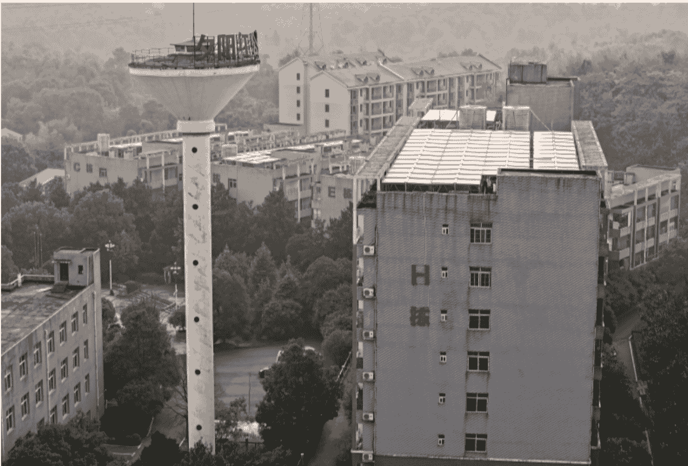

## CAIXIN | 听文章

文 | 财新周刊 黄雨馨

3月的湖南春暖花开，南岳衡山游人如织。在衡阳市雁峰区岳屏镇文昌村，夕阳红养老公寓门庭冷落，铁栅栏锈迹斑斑，墙角的宣传海报早已褪色。

五年多以前的爆雷事件带来诸多后遗症，短时间内尚难以治愈。作为当地一家标志性民办养老机构，高峰时这里入住了四五百人，如今只留下少数生活不能自理的老人。雁峰区民政局人士说，整个夕阳红公寓目前依靠财政拨款勉强维持生存。

以投资养老为名，商人李新辉、全君夫妇用15年编织了一张温情的巨网。直到2019年11月25日，众多老人赶到衡阳市和雁峰区有关单位门前，哭诉夕阳红公寓无法兑付他们预存的投资本金和利息，养老钱全部打了水漂。

李新辉、全君后来被判处无期徒刑。判决书披露，二人以夕阳红公寓、湖南孝德天下养老产业管理有限公司（下称“孝德天下公司”）名义集资诈骗、非法吸收公众存款，涉案金额达28亿余元。该案被湖南官方选入2022年打击养老诈骗犯罪的典型案例。

2025年2月6日，江苏省宿迁市，宿城分局洋北派出所民警在社区向居民宣传防诈骗知识。图：王力/视觉中国

事情到此并未结束。包括曾任雁峰区副区长兼民政局局长的卢雅琴在内，当地四名民政系统官员遭到问责，追究刑事责任。

据财新了解，早在多年前，李新辉等人公开吸收资金的举动就引起了官方注意，但十余年间未被查处，反而野蛮生长直至爆雷。该案背后的灰色生态引人深思。

## 野蛮生长

夕阳红公寓又称岳屏敬老院，创始人李新辉1958年生，衡阳本地人，毕业于华南理工大学。相关材料显示，夕阳红公寓2004年通过衡阳市发改委立项，在当时是少有的社会资本参与养老行业的项目。夕阳红公寓属于民办非企业单位，业务范围涵盖五保老人集中供养、公寓康复保健、医疗救护和其他福利事业。其选址在雁峰区岳屏镇文昌村，使用的63.4亩土地系划拨用地。整个项目分两期建设。2006年3月底动工，一期工程2007年7月1日正式开业，共建16栋楼房，2.35万平方米，能容纳约1000人入住。

李新辉供述，从2005年夕阳红公寓创办之初，就开始非法集资。项目动工前的2005年11月，他请人策划公众集资营销，向银监、民政等部门报告以收取入住保证金模式集资未获批准，但自认为民政部门默许。夕阳红公寓专门设置营销部，以吸资额确定提成，业务员在公共场所宣传，强调不入住也可享受投资补贴。

对于入住人员，集资的形式为夕阳红公寓与他们签订合同并收取预交定金，发售多种级别的“客户入住权益卡”。根据预交的不同金额，客户可获得不同档次的住房折扣和数额不等的消费券。

李新辉说，宣传目的除了吸引老年人到夕阳红公寓入住，更是为了吸引以老年人为主的人群以交纳入住保证金的方式来投资。入住保证金一开始设为2万元起步，后来改为3万元起步，上不封顶。合同约定福利补贴为年利率最低8%，依据投资金额和年限，逐步提高年利率，最高14%，合同期五年，但满三年之后亦可以取出入住保证金。如未入住，投资到期可返回保证金及利息，如入住则扣除实际费用，退还剩余金额。

## 2025年1月12日，安徽省阜阳市，老年人在林带路公园休息。

司法材料显示，2007年，夕阳红公寓新招聘了业务员，不到一年半时间就向老人收取了3亿多元入住保证金。2010年6月，夕阳红公寓二期工程建成投入使用，规模进一步扩大，所收保证金越来越多。

到2015年下半年，李新辉购买夕阳红公寓周边土地进行开发的想法失败，“当时已意识到不能通过投资等正常经营兑付保证金本息”。为延缓案发，弥补资金不足，自2016年始，夕阳红公寓大幅度扩大集资，借新还旧；同时运作夕阳红公寓上市以融资。

夕阳红公寓不是企业，并不符合上市条件。李新辉因此在2017年成立了孝德天下公司，将夕阳红公寓装入资产包。他说，运作公司上市的目的有二：一是让夕阳红公寓进入资本市场，二是解决无法兑付集资款本息问题。

李新辉说，首先想运作夕阳红公寓到马来西亚上市，为此支付了3000万元，但上市没有成功，亦未退款。之后他又运作夕阳红公寓到美国上市，后来孝德天下公司在美国场外交易市场板块（OTC）上市，但没有流通价值。李新辉希望通过OTC转板纳斯达克达到募集资金的目的。于是，李新辉等人指令员工加大力度进行虚假宣传、募集资金，并将公司各部门吸收资金的月任务予以加倍，同时引入“感恩金”模式，即集资人交款时便予以返现，更加疯狂地吸收资金。

在此背景下，2017年有许多老人投资夕阳红公寓。多名老人告诉财新，当时身边有不少人通过投资拿回了本金和利息，“很相信夕阳红公寓，根本没想过会爆雷”。

现年73岁的退休干部文桂（化名），就是在那时候成为夕阳红公寓的客户。据文桂讲，有一天在公园散步，夕阳红公寓业务员向她介绍，交钱投资既可以住进去养老，也可以获取福利，“投资越多，福利越高”。文桂问了熟识的退休干部，得知许多人都通过投资夕阳红公寓赚得了利息。2017年6月文桂与夕阳红公寓首次签订合同，投资10万元，四个月后投资12万元，夕阳红公寓按年利率10%返给福利。2018年6月，文桂收到了第一笔约1万元福利，2018年10月收到了第二笔1.2万元，到2019年6月收到了约1.1万元，此后再未收到分文。文桂告诉财新，至今约有18万元本金没收回，她估计这笔钱很可能再也要不回来了。“因为之前的资金使用成本高，每年集资过亿就是为了借新还旧以保证不会崩盘。”李新辉供述，2019年6月，因本息无法兑付，他开始用白条应付投资人，先是承诺三个月内还本付息，后又说两年之内还本付息。

老人们没有等来兑付。2019年11月25日，夕阳红公寓彻底爆雷，大批老人集中前往夕阳红公寓讨要钱款，并赶到衡阳市、雁峰区有关部门哭诉。20多天后，警方以涉嫌非法吸收公众存款罪对李新辉采取刑事拘留强制措施，李新辉妻子、夕阳红公寓财务总监全君也被带走。在此前后，夕阳红公寓和孝德天下公司共计30余人被抓捕。

2022年5月22日，衡阳市中级法院一审认定，李新辉、全君犯集资诈骗罪、非法吸收公众存款罪，决定对二人执行无期徒刑，剥夺政治权利终身，并处没收个人全部财产。其余30人因犯罪情节不同，被判处无期徒刑至有期徒刑两年不等。后李新辉等人上诉，湖南省高级法院二审维持原判。

衡阳中院经审理查明，夕阳红公寓设立后至2019年11月案发，李新辉为实施吸收公众资金供个人投资使用的违法犯罪行为，与他人谋划，以夕阳红公寓名义设立营销部，招聘、组织人员通过召开推介会，在菜场、超市、广场等公共场所散发传单宣传等方式，以老年人群体为主要目标，用到夕阳红公寓来养老、投资等为幌子，并诱之以高利或高额回报，吸引公众签订入住合同，收取入住保证金，从而变相吸收公众存款，非法集资。

2015年8月，李新辉、全君投资的开发项目失败，其意识到已无法通过投资等正常经营兑付投资人本息时，为弥补资金不足，延缓案发，指令夕阳红公寓营销部、养老院以孝德天下公司准备在美国股市上市可售卖股份，及对夕阳红公寓的发展前景、李新辉的实力以及相关产业的盈利能力进行虚假宣传的方式向社会公众募集资金，并对各部门吸收资金的月任务予以加倍，同时加入“感恩金”模式吸收资金。

经司法鉴定，2005年至2019年11月，李新辉、全君以夕阳红公寓、孝德天下公司为名，集资诈骗8.76亿元，非法吸收公众存款19.28亿元，合计28.04亿元。其中超过70%用于还本付息，3.78亿元用于支付营销人员工资及提成、运营费用和购置资产，1.37亿元用于对外投资，另有1.65亿元去向无法核实。

## 监管缘何不力

夕阳红公寓的集资行为早就引起了监管部门关注。

在案证据显示，早在2007年9月，衡阳市民政局就下发《关于立即遏止“夕阳红公寓”向社会融资行为的通知》。雁峰区民政局也向夕阳红公寓发出通知，要求撤销筹备处、营销部，停止以“预订入住”为名的集资行为。2008年10月20日，雁峰区委、区政府召开专题会议，成立夕阳红公寓社会集资行为处理工作领导小组，责令夕阳红公寓停止集资，不得转移资金，做好应急预案和社会维稳工作。

到2009年3月中旬，雁峰区民政局将情况逐级上报至衡阳市、湖南省。雁峰区民政局称，截至2009年3月11日，夕阳红公寓二期预订款总金额达2570万元，融资一事已定性为涉嫌非法集资，并已提出整改建议。

一系列动作并未阻止夕阳红公寓向老人们集资。2011年，衡阳市打击和处置非法集资工作领导小组办公室（现为防范和处置非法集资工作领导小组办公室，下称“处非办”）再次向雁峰区民政局发函核查，雁峰区民政局也再次上报情况。

2011年6月30日的资产负债表显示，夕阳红公寓资产总额1.1亿元，其中固定资产占9441万元，入住1580人的7497万元“预订房费”绝大部分用于固定资产建设，缺乏立即变现的能力。2011年10月，雁峰区民政局向夕阳红公寓下发监管意见，责令其停止相关宣传行为，排查风险、退还预订房费。

2012年8月2日，衡阳市处非办向雁峰区处非办发出风险提示，表示夕阳红公寓可能引发集资风险，要求加强监测预警，制定风险处置预案和做好应急准备，督促退还入住定金方案等工作，防止引发群体性事件。十多天后，雁峰区民政局做出处置预案。同年10月，夕阳红公寓回复称，自身经营模式与非法集资有别。

2017年至2019年，雁峰区政府、处非办连续三年向区民政局发去有关夕阳红公寓涉嫌非法集资的领导批示或督办线索，但民政局均认定其不涉嫌非法集资。

公开资料显示，2015年至2019年间，多名衡阳市及湖南省领导到夕阳红公寓调研、考察。其中2018年9月，民政部规划财务司一名副司长带队到夕阳红公寓调研，衡阳市民政局局长、雁峰区政府区长时任区民政局局长卢雅琴等人陪同。

夕阳红公寓爆雷前半年的2019年6月，衡阳市政府呈报民政部、财政部的《关于将我市列入全国第四批居家和社区养老服务改革试点城市的函》中，还将孝德天下公司列入“旅居、度假候鸟式养老服务项目”的典型。

为了对雁峰区民政系统进行渗透、拉拢，李新辉可谓精心布局。除了在日常检查、逢年过节时送上红包、礼品，另一个做法是让民政局退休领导或者他们的亲属去夕阳红公寓、孝德天下公司任职。

多名知情人士告诉财新，曾任夕阳红公寓养老院院长的周玲是雁峰区民政局原局长周年生的晚辈亲戚。周玲只有职高学历，2007年到夕阳红公寓养老院任客房部部长，三年后任养老院院长，后来出任孝德天下公司运营总裁。判决书记载，生于1982年的周玲与李新辉是情人关系，二人生有一女。夕阳红公寓案发后，周玲被判有期徒刑14年。

多名在夕阳红公寓投资的老人对财新表示，之所以投资是因为知道民政局退休干部和亲属在此任职，“相信夕阳红的实力”。

## 追责

夕阳红公寓2019年11月25日彻底爆雷，雁峰区区委、区政府随后成立了“11·25”事件处置领导小组。时任雁峰区副区长兼民政局局长卢雅琴、民政局副局长李湘蓉等人参与善后，卢雅琴还是处置领导小组成员。雁峰区民政局2023年2月出具的一份证明写道：“卢雅琴和李湘蓉在处理夕阳红公寓爆雷后续事宜中做出了贡献，防止了引发次生灾难。”

卢雅琴1976年生，湖北黄冈人，曾在雁峰区多个街道任职，2008年任雁峰区人口计生局局长，2015年转任民政局局长，2019年5月升任副区长并继续兼任民政局局长至同年7月，2021年7月进一步担任雁峰区委常委、宣传部部长。李湘蓉比卢雅琴年长八岁，湖南祁东人，其长期在民政系统工作，2006年任雁峰区民政局党组成员、纪检组长，2009年任副局长，2021年1月任二级主任科员。

处置善后事宜有功的卢雅琴和李湘蓉，后来遭到查处。2022年3月16日，卢雅琴在雁峰区委常委、宣传部部长任上被衡阳市监察委员会留置。次日李湘蓉也被带走，一同被带走的还有时任雁峰区民政局民间组织服务中心主任王润生和时任雁峰区民政局慈福股股长邓桂兰。王润生是衡阳本地人，1963年生，在四人中年纪最大。

被查处的四名官员分成两个案件处理。其中卢雅琴、李湘蓉和王润生2022年8月被刑拘、逮捕，随后移送衡阳市蒸湘区检察院提起公诉。因为新冠疫情影响及案情复杂等原因，该案多次延期审理。直到2024年1月，蒸湘区法院一审宣判：以滥用职权罪判处卢雅琴、王润生有期徒刑各五年，以滥用职权罪、受贿罪，判处李湘蓉有期徒刑七年。分案处理的邓桂兰也因玩忽职守罪一审被判处有期徒刑三年、缓刑三年。

法院审理查明，2015年11月至2019年5月，卢雅琴任衡阳市雁峰区民政局党组书记、局长及雁峰区副区长兼区民政局局长，负责雁峰区民政局全面工作。2009年7月，李湘蓉任雁峰区民政局党组成员、副局长，2014年至2019年分管福慈股、养老服务股，负责社会福利单位的日常监督、年检初审、非法集资等专项风险排查等工作。2009年7月至2021年1月，王润生任雁峰区民间组织管理局局长、衡阳市雁峰区民政局民间组织服务中心主任，负责辖区内民间组织的登记审批、年检终审以及查处违法违纪行为等工作。

从2005年开始，李新辉伙同其妻全君等人以夕阳红公寓的名义变相吸收公众存款，非法集资，该行为一直持续至2019年11月。雁峰区民政局作为行业主管部门，该局局长卢雅琴、副局长李湘蓉及下属王润生明知夕阳红公寓存在非法集资行为，不依法正确履行行业主管及自身职责，在雁峰区政府及区处非办等部门多次要求调查、处置的情况下，仍违反法律法规及相关制度规定，徇私舞弊，未进行有效管理、监督和检查，未加强对夕阳红公寓非法集资行为的防范、监测和预警工作，对非法集资行为不予定性、处置、上报，致使李新辉等人持续进行非法集资。经鉴定，2015年11月至2019年11月，夕阳红公寓非法集资15.38亿余元，经济损失1.85亿余元，造成恶劣社会影响。

此外，王润生明知夕阳红公寓存在违反国家有关规定收取费用、筹集资金等行为，不符合民办非企业单位年检合格条件，在每年的年检终审中仍违规认定为合格。卢雅琴、李湘蓉明知夕阳红公寓涉嫌非法集资，不符合申领养老服务财政补助资金的条件，且明知其存在虚报补贴人数的情况，在履行受理、审核、审批申领补助资金过程中违反规定，予以审查通过并上报拨付，导致夕阳红公寓多次违规领取补助资金，造成国家损失321.12万元。2014年至2019年，李湘蓉先后八次收受李新辉安排夕阳红公寓养老院时任院长周玲给予的人民币现金共计71万元。

法院认为，李湘蓉、卢雅琴、王润生身为国家机关工作人员，未正确履行职权，严重损害了国家机关的正常管理活动和国家机关声誉，情节特别严重，其行为构成滥用职权罪，且有徇私舞弊情节；李湘蓉利用职务上的便利，非法收受他人给予的71万元，为他人谋取利益，其行为构成受贿罪。

前文提到，2017年至2019年，雁峰区政府、处非办连续三年要求区民政局对夕阳红公寓涉嫌非法集资问题进行调查。这三次调查，都发生在卢雅琴担任民政局局长期间。据判决书，2017年6月，卢雅琴收到区政府领导的批示，要求民政、金融等部门一起调查处理夕阳红公寓涉嫌非法集资情况。卢雅琴安排李湘蓉和王润生去现场核查。

李湘蓉、王润生在供述中表示，对夕阳红公寓涉嫌非法集资行为的定性、调查处理，不是民政局一家能解决的问题，且夕阳红公寓一直运营不错，没有直接接到过举报，所以既没有去实地调查，也没有正式回复雁峰区处非办。“我不想夕阳红公寓的事情在我手里揭开盖子，不想成为那个捅破‘脓包’的人。”李湘蓉坦言。

时任雁峰区金融办主任周慧君作证说，2017年6月区处非办收到反映夕阳红公寓涉嫌非法集资线索，并转交民政局。卢雅琴约了李新辉到办公室了解情况并当面提醒，还邀请包括她在内的其他部门领导参加。

周慧君回忆，那天在卢雅琴办公室门口，“听到李新辉拍桌子在大声宣扬自己的贡献，态度很嚣张”，就没有进门，直接离开。其后周慧君将此事向区政府报告，区民政局转交了夕阳红公寓写的情况说明。“民政局也是敷衍我们，不开展核查工作，不对夕阳红涉嫌非法集资定性，也不给我们回复。卢雅琴、李湘蓉等人对夕阳红公寓涉嫌非法集资有包庇行为，没有及时捅破这个毒窟窿。”

第二次调查是在2018年9月，雁峰区处非办向民政局发出督办函，要求对夕阳红公寓涉嫌非法集资情况进行摸底，并会同区金融办对李新辉及其他高管集中约谈，提出整改意见。判决书记载，这次卢雅琴也安排调查，李湘蓉汇报称夕阳红公寓账面上看不出非法集资情况。卢雅琴虽有疑虑，但仍同意调查组结论，最后民政局以红头文件回复区处非办，未认定涉嫌非法集资。

夕阳红公寓爆雷前半年的2019年5月，雁峰区民政局第三次收到督办函。此次督办级别更高，源于有市民向衡阳市长举报夕阳红公寓涉嫌非法集资。卢雅琴说，此时其已被提名为副区长，具体事务安排李湘蓉处理。李湘蓉汇报称没问题，准备的回复材料与2018年相似，卢雅琴让其完善，李湘蓉不太高兴地离开。

如果仔细对比雁峰区民政局2018年与2019年两次向区处非办的回复，能发现二者内容大体相同，甚至首段的“人情非法集资的社会危害性”中的错别字“人情”（应为“认清”）都一样。

关于年检，《民办非企业单位年度检查办法》规定，检查重点包括收费标准、服务范围、财务状况、资金来源和使用情况等。李湘蓉供述，她负责的民间组织年检初审工作“只是走形式，盖个公章而已，后面还有民管局把关”。2019年之前，对民办养老机构的年检没有出现什么麻烦，局领导也没有主动过问过这个事情，她也从未汇报过，一直就这么过来了。只要有人拿年检报告书来跟她报告，她都是让他们直接去办公室盖章。王润生则表示，年检终审是依据民间组织提供会计师事务所的报告，经业务主管单位盖章同意，他们都是按照规定审核的。

司法材料显示，李湘蓉在被调查期间阅看了夕阳红公寓多年的年检报告材料。这时她才发现，夕阳红公寓早已显现出资金问题，比如收取的上亿元入住保证金没有存入专门账户，而是大部分存入李新辉个人名下。

领取养老补助资金方面，按照衡阳市有关规定，养老机构年检不合格不能申领。李湘蓉供述说，自己明知夕阳红公寓有涉嫌非法集资行为不符合申领补助的条件，但未制止其申报和拨付资金；明知其存在虚增补贴人数、金额等情形，也审核通过。

“我觉得夕阳红公寓向国家申领专项扶持资金，对我们雁峰区是一件好事，反正钱不是雁峰区财政支出，多申请一些也没关系。内心里不愿意多事，去监管夕阳红公寓使用国家扶持资金的情况。”李湘蓉提到，在日常检查中周玲等人会给他们塞红包，“拿人家的手短，自然也就不会再去认真负责全面地进行检查、监管”。

曾在雁峰区处非办工作的蒋雷在证言中表示，作为一线把关部门，区民政局不仅不报送夕阳红公寓涉嫌非法集资，而且区处非办将线索移送给他们，他们也是敷衍了事，进行包庇。“夕阳红公寓非法集资时间之长，集资面向地域之广、金额之大，都反映了民政局的监测预警、风险排查等防范措施就是一个笑话。”

## 职权职责争议

滥用职权案一审宣判后，卢雅琴等三人均不服上诉。衡阳市中级法院2024年6月14日二审开庭审理，至同年9月26日作出裁定：撤销原判、发回重审。理由是原判部分事实不清，可能影响到罪名的认定，需进一步查清。

贯穿原审一审、二审的重大争议在于，民政部门是否有监管、查处非法集资行为的职权职责，能否认定三人构成滥用职权罪？

职权职责是滥用职权罪成立的前提。根据《刑法》第397条及司法解释规定，滥用职权罪是指国家机关工作人员超越职权，违法决定、处理其无权决定、处理的事项，或者违反规定处理公务，致使公共财产、国家和人民利益遭受重大损失的行为，处三年以下有期徒刑或者拘役；情节特别严重的，处三年以上七年以下有期徒刑。

原审一审开庭时，卢雅琴、李湘蓉、王润生三人均表示，民政部门没有对非法集资进行监管、查处的职责。在他们看来，夕阳红公寓爆雷案发是多因一果，自己的履职行为与公诉机关指控的危害结果之间缺乏必然因果联系。

卢雅琴提到，按照2005年中央编办发布的《关于明确认定、查处、取缔非法集资部门职责分工的通知》规定，原银监会负责非法集资的认定、查处和取缔，其他部门如人民银行、公安部、原工商总局及地方政府密切配合开展有关工作。而且2013年民政部出台《养老机构管理办法》时，也没有关于民政部门防范、监测非法集资的相关规定。直到2020年进行修订，这部规章才增加了相关内容。她还提到，2015年至2019年对养老领域的融资是放开还是严管的尺度较难把握，夕阳红公寓作为当地政府重点支持单位，运营环境复杂。

“在复杂利益链和长期违法却正常运行的表象中，我作为一个在民政局工作仅三年多的人应担负多大的罪责？”卢雅琴说。

李湘蓉的辩护律师表示，李湘蓉不构成滥用职权罪。首先李湘蓉对非法集资没有认定、查处和取缔的职责。其次夕阳红公寓申领财政补助资金是行业性普惠政策，由衡阳市民政局等部门决定是否发放及金额大小，雁峰区民政局只能按程序执行，没有批准权和决定权。

辩护律师还表示，爆雷事件发生的具体原因复杂，比如，“政出多门”造成监管职能不清、监管职责紊乱，政策界定模糊、定性把握不准，等等。

王润生辩解说，其主观上不知道夕阳红公寓的行为是违法的。早在2011年衡阳市处非办来函要求雁峰区民政局对夕阳红公寓进行彻底调查，调查结果是该公寓收取上亿元资金，雁峰区民政局于是以红头文件形式向区政府和市民政局进行汇报，但区政府和市民政局没有以文件告知夕阳红公寓是否违法，导致区民政局不能定性。直至2019年，民政局也没有权限认定夕阳红公寓涉嫌集资行为是否违法，应该由公安机关认定。至于民间组织年检终审，王润生称都是按照规定审核的。他认为自己不构成犯罪，行为应当按违纪处理。

这些意见均未获采纳。蒸湘区法院在原审一审判决中回应说，2015年国务院印发《关于进一步做好防范和处置非法集资工作的意见》，要求落实部门监督管理职责，各行业主管、监管部门要将防控本行业领域非法集资作为履行监督管理职责的重要内容，加强日常监管。法院还援引2020年修订的《养老机构管理办法》《民办非企业单位登记管理暂行条例》以及《湖南省处置非法集资工作规范（试行）》等法律规章文件，认为结合本案事实，可以认定卢雅琴、李湘蓉、王润生不依法正确履行行业主管职责以及自身职责，任由夕阳红公寓非法集资行为持续，造成公共财产、国家和人民利益遭受重大损失。

蒸湘区法院强调，滥用职权犯罪属于渎职犯罪的一种，渎职犯罪造成的损失往往都是多因一果。不能因为有其他原因，就否定渎职行为与危害结果的因果关系。因此，三被告人的行为与损失后果之间具有《刑法》意义上的因果关系，构成滥用职权罪。

财新了解到，原审二审过程中，卢雅琴、李湘蓉、王润生仍坚持不构成滥用职权罪。他们表示不认同原审一审判决认定的“对非法集资行为不予定性、处置、上报”，导致多方有重大损失这一逻辑链条。三人称，是否处置夕阳红公寓的非法集资行为与民政局是否定性、上报无关，即便雁峰区民政局十几年前就已经对涉嫌非法集资进行了定性并上报，但夕阳红公寓多年未被查处，“这说明问题不出在民政”。

此外，李湘蓉八次收受李新辉安排周玲给予的现金共计71万元的情节，在调查审理期间也曾出现反复。证据显示，李湘蓉对受贿的供述多次反复，先是在案件调查阶段表示承认，庭审中又予以否认，称“没有收过这么多钱，口供是违心瞎编”。蒸湘区法院评判，李湘蓉在监察机关的供述自然流畅，条理清晰，且与李新辉、周玲、全君的证言相互印证，能够相互吻合，因此对其没有受贿的意见不予采纳。原审二审期间，李湘蓉也坚称没有受贿。

据湖南省民政厅官网，2019年至2021年5月，全省共立案打击养老领域非法集资案件70余起，涉及约9万名老年人，涉案金额累计超80亿元。进入2020年，与衡阳相距不远的益阳也有多家民办养老机构密集爆雷，甚至有陷入绝境的老人跳河自尽。（参见《财新周刊》2021年第10期报道《养老机构缘何爆雷》）

随着中国社会老龄化程度日益加深，20多年来养老行业迅速发展。2013年被称为“养老产业发展元年”，这一年国务院出台《关于加快发《关于加快发展养老服务业的若干意见》，提出要逐步使社会力量成为发展养老服务业的主体，进一步降低社会力量举办养老机构的门槛。2015年3月民政部发出通知，再次强调要积极引入社会资本，进一步放宽市场准入，创新投融资机制，切实让社会资本在养老服务工程建设中“唱主角”“挑大梁”。利好政策密集出台，大量社会资本迅速涌入养老市场，但也有部分机构违规吸收资金。据新华社报道，2015年全国非法集资发案达到历年最高峰值。随后各地养老公寓爆雷频频。

政策重心逐渐转向高质量发展与风险防控并重。2021年5月1日《防范和处置非法集资条例》开始实施，其中明确规定：行业主管部门、监管部门应当按照职责分工，负责本行业、领域非法集资的防范和配合处置工作。行业主管部门、监管部门应当强化日常监督管理，负责本行业、领域非法集资的风险排查和监测预警。

2023年民政部监测数据显示，以“会员制”“旅居养老”为名的违规吸存占比超65%，涉案金额从数千万元至上百亿元不等。最高检察院2024年8月表示，养老领域非法集资风险呈现新特征：
- 一是手法多样且迷惑性强，“乡村振兴”“区块链”“股权投资”等概念被用来包装非法集资，以旅游、养生、家政等贴近老年生活的服务为噱头；
- 二是将高风险理财项目伪装成安全高息的投资，如诱骗老年人抵押房产获取资金投入，待项目爆雷后，抵押房产被处置，导致老年人血本无归且背负债务；
- 三是追赃难度大，有的资金被挥霍一空，有的资金通过多个账户层层划转到第三方支付平台形成“黑箱”。

民政部社会福利中心任娜等人2024年4月在《中国民政》杂志发文表示，养老服务领域非法集资案件频发，反映出老年人对养老服务的迫切需求和优质养老服务供给不足的现实矛盾，也在一定程度上暴露了行业发展中的乱象和监管的短板。

任娜建议，在“放管服”改革背景下，防范养老服务领域非法集资，应强化民政部门对养老服务的督促指导和监督管理职能。
- 一是强化监管职能，规范市场秩序；
- 二是定期开展摸排检查，将养老机构的收费方式、预付费使用情况等列为重点摸排和检查事项，将采用预付费方式的机构纳入重点检查范围；
- 三是推行商业银行第三方存管，加强对养老服务机构预收资金的管理。

## 更多报道详见：【专题】养老算账

注：本文刊发于《财新周刊》2025年第12期，原题为：财新周刊 | 衡阳养老公寓诈骗案中案

## 最新财新周刊 | 银行代销再规范

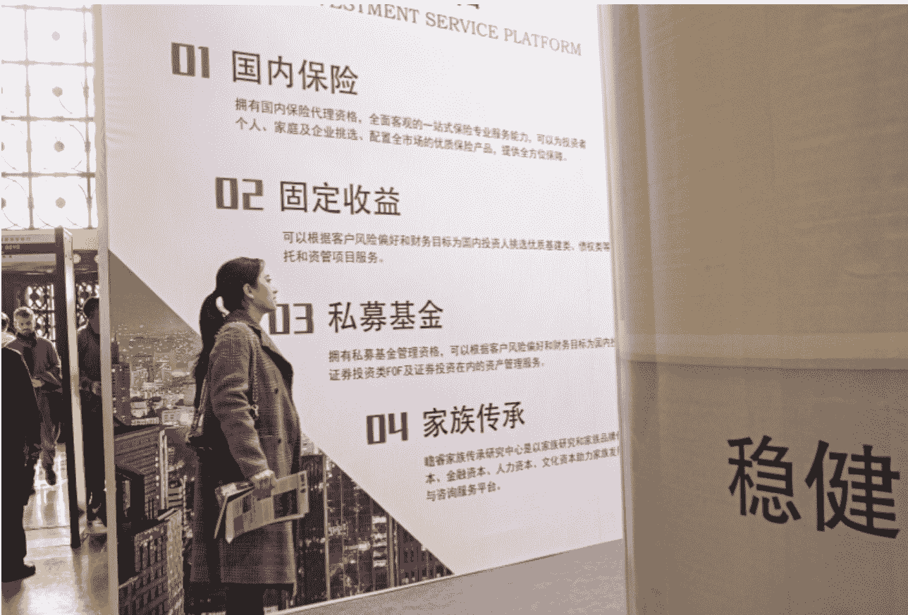

CAIXIN | 听文章

文 | 财新周刊 武晓蒙

酝酿许久的商业银行代销新规终于祭出。对个人来说，消费者权益有望得到更好的保护，部分高净值私行客户的产品货架或将减量提质；对机构而言，一些小私募基金或难以再从银行渠道分一杯羹。

2025年3月21日，国家金融监督管理总局印发《商业银行代理销售业务管理办法》（下称《办法》），从代销产品准入、合作机构管理、销售流程合规、存续期义务等方面，首次对银行代销业务作出全面而细致的规范。

代销是商业银行传统业务之一，在为客户提供丰富金融产品的同时，也为银行带来中间业务收入。近年来，随着净息差收窄，多家银行将财富管理提升到战略高度，以提高非利息收入，代销业务的重要性不言而喻。

“商业银行代销产品数量和类型日益丰富，客户覆盖面日益广泛。在相关监管制度不断压实金融产品发行人、管理人责任的基础上，有必要进一步明确商业银行作为代销机构的义务。”国家金融监督管理总局相关负责人表示。

此前，原银监会创新部于2016年5月印发《关于规范商业银行代理销售业务的通知》（下称《通知》）；此次《办法》在《通知》的基础上进一步完善修订，由国家金融监督管理总局金融消费者权益保护局拟定，更加强调消费者权益保护。

《办法》新增要求，银行对代销业务不得仅考核销售业绩指标，考核标准应当包括但不限于销售行为和程序的合规性、客户投诉情况、内外部检查结果等。同时，银行应加强投诉统计分析，及时发现和处理侵害金融消费者合法权益的问题；对于投诉处理中发现的违规行为，要追究直接责任人员和管理人员责任，发现涉嫌违法犯罪的，应当及时移送司法。

在具体业务层面，《办法》新增较多涉及私募投资基金的规定，包括产品准入、销售及存续期管理等。

京华世家家族办公室董事长聂俊峰近日对财新表示，《办法》明确商业银行代销产品可投向私募投资基金，或者聘请私募基金管理人作为投资顾问，并对相关私募基金管理人提出底线要求，维持了此前“阳光私募”在银行的代销通路，并加以规范。监管政策通过“开正门、堵偏门”方式，逐步拉平商业银行私人银行与证券、期货、独立第三方销售机构的竞争起点。

也有市场人士分析认为，银行未来对此类复杂产品的准入决策会更加谨慎，或将加速财富管理市场的“阵地化”，银行、券商、第三方财富管理机构越来越泾渭分明。

对于合作机构，《办法》从准入要求、退出机制、代销协议签订程序和内容、关联交易管理、责任归属等方面强化银行的管理责任。对于已经准入的合作机构，银行应定期审查评估；同时，建立合作机构退出机制，及时对存在严重违规行为、重大风险或者其他不符合持续合作标准的机构实施退出，并有序做好存量产品的客户服务。

此外，《办法》对销售流程进行再规范，并新增多项银行在产品存续期内的义务，这意味着银行不能“一卖了之”。不过需要指出的是，这不等于银行对代销产品的投资和兑付负责，产品的投资运作、风险管理、信息披露、收益分配等仍由产品发行管理机构负责。

《办法》将于2025年10月1日起执行。

一位国有大行总行相关业务人士告诉财新，与《办法》同时下发到银行的，还有一份监管部门在代销业务检查中发现的问题清单，近期内部正在逐项对标，梳理需要整改的地方。

另一家大行省分行个金部相关负责人对财新表示，《办法》新增的多个条款，在此前的监管检查中已有所体现，这次是将实践中的一些要求、做法加以梳理和归纳。

“对部分较依赖代销高风险产品而获得收入的中小银行来说，《办法》的颁布或会带来短期的阵痛，例如严格的尽职调查和合规管理要求将增加其运营成本，但是从长远来看，这有利于促进代销业务的良性发展。”上海金融与发展实验室首席专家、主任曾刚对财新说。

## 阳光私募何以维持

监管部门当前对商业银行代销涉私募基金产品高度关注，《办法》全文提及“私募”14次。

私募投资基金以非公开方式发行、向特定高净值客户募资，在中国证券投资基金业协会备案登记。其中，部分私募基金管理人与信托公司合作发行集合资金计划，信息披露更透明、运作相对规范，被业内称为“阳光私募”。

商业银行涉及私募产品的业务，主要是为高净值人群提供的私人银行服务。聂俊峰告诉财新，2008年左右，商业银行私行部代销私募证券投资基金兴起，主要通过信托公司集合资金计划来做。

2016年原银监会下发《通知》，明确银行仅可代销持牌金融机构产品；由于私募基金管理人为非持牌机构，因此私募证券投资基金、私募股权及创业投资基金均不在银行直接代销范围内。

其中，私募股权及创业投资基金由于还存在其他制度层面的障碍，慢慢退出了银行视野。而基于高净值人群大类资产配置需求以及银行的创收动力，部分银行私人银行部近年来仍销售与信托、券商等持牌金融机构资管“通道”合作的私募证券投资基金。

“一般来说，可以借此进入银行代销范围的多为市场知名度高、管理规模大、历史业绩和品牌较突出的头部私募基金管理人。”聂俊峰告诉财新，银行通过代销信托计划或者券商资管计划与私募机构开展合作，通常有两种模式：
- 一是聘请私募基金管理人为投资顾问；
- 二是底层嵌套投资私募基金，以证券投资基金为主。

据财新从业内了解，一些银行乐于通过上述方式“绕道”销售私募基金的原因之一是中间业务收入较高，通常包括认购费、部分固定管理费和收益分成；银行渠道端有“牛市卖私募、熊市卖保险”的说法。

由于商业银行不公开披露与私募机构的合作情况，外界较难获知整体概况。但据财新了解，目前业内的共识是，商业银行是私募基金产品销售的主渠道之一，在以零售业务见长的头部大中型银行中，私募证券投资基金的保有规模应在千亿元以上。

近年来，宏观经济下行压力较大、地产行业震荡调整，私募基金“爆雷”“跑路”现象频发。由于责任划分不清，投资者通常会将矛头指向代销银行和监管部门，引发纠纷和投诉。因此，有些此类业务规模不大的银行曾认为不如“一禁了之”，但此举引发了其他银行及私募机构的反对。

从《办法》看，监管政策依然坚持银行只能代销“由国务院金融监督管理机构依法实施监督管理并持有金融牌照的金融机构”“依法发行的金融产品”，这意味着私募基金管理人发行的产品仍不可由银行直接代销；但明确银行代销的资管产品，可以投向私募投资基金或聘请私募基金管理人担任投资顾问。同时，《办法》强调，商业银行应当加强甄别，防范合作机构让渡主动管理职责，为其他机构、个人或者资管产品规避监管要求提供便利，即禁止“通道”业务。

“现实情况是，银行私人银行服务对私募投资基金产品有一定配置需要，否则难以与大众财富管理、贵宾理财形成差异化定位。近年来，一些成长起来的券商、独立第三方财富机构比如中金财富、嘉实财富等，对银行高净值客户产生了较大的‘脱媒’效应，其主要抓手之一正是私募代销。”聂俊峰认为，《办法》有助于商业银行财富管理与私人银行业务逐步建立私募机构合作名单，提高服务效率；同时，从宏观角度而言，有助于通过银行私人银行渠道为资本市场输入长期资金、耐心资本等。

## 提高门槛

阳光私募的销售通路虽然得以维持，但为了防范风险，监管政策在这条通路上设置了一些“关卡”，提高了门槛。

首先是在产品准入环节。《办法》要求商业银行在对资管产品进行准入审查时，如该产品投向非标资产、未上市企业股权、私募投资基金，或者聘请私募基金管理人担任投资顾问，银行应当由代销业务管理、风险管理、法律合规、金融消费者保护等部门进行综合评估，并获得本行高管层批准。

曾刚对财新表示，短期来说，该规定或将导致商业银行减少复杂产品的代销，因为评估成本上升会使得部分银行对引入这些产品更加谨慎；同时，为提高评估效率并降低时间成本，银行或需要引入更多专业人才和金融科技手段，从而增加运营和技术投入。长期来说，该规定旨在提升代销质量和消费者权益保护，银行未来会更加关注风险低、合规度高的产品，有助于优化产品结构，推动代销业务从规模扩展向质量管理转型。

部分大行已开始实践。前述大行总行人士告诉财新，该行以前的产品准入权限主要由个金部、私行部自行掌控，随着一些案件的发生，近年来准入权限已有所收紧。目前，复杂产品大部分都要经过总行代销准入委员会集体决策，多部门意见汇总后再上报高管批准。“一般每个月开一两次会，少的时候每次审议几十只产品，多的时候审议上百只产品，通常只要有一个部门提出保留意见，该产品的准入便会暂缓，整体比较严格。”他说。

其次是对私募基金管理人设置门槛，《办法》要求：管理的私募股权投资基金规模合计不低于5亿元、管理的私募证券投资基金规模合计不低于3亿元，在中国证券投资基金业协会登记不少于三年，近三年内未受到行政处罚和基金业协会纪律处分，符合法律、行政法规和监管关于私募基金管理人的其他要求；政府出资产业投资基金可不受登记年限的限制。

“规模门槛并不高，但‘近三年内未受处罚处分’这条会刷掉不少私募基金管理人。”一位业内人士说。

北京观韬（深圳）律师事务所邢颖近日撰文称，上述须持续符合准入标准的潜在影响包括：
- 一是公募明星基金经理“奔私”新设的私募基金管理人，在满足上述标准前，难以凭借既往在公募基金的历史业绩在银行渠道获得准入；
- 二是持牌金融机构的资管产品，如果配置了不符合上述标准的私募基金将不能在银行渠道获得准入，例如私募FOF资产管理计划配置了成立时间不足三年、但业绩表现较好的私募基金。

此外，邢颖认为，“近三年内未受到行政处罚和基金业协会纪律处分”的标准，给所有私募基金管理人的合规管理水平提出了更高要求。因为私募基金管理人一旦违规被行政处罚或纪律处分，不仅三年内不能和银行新增合作，甚至既往涉及的银行合作业务亦会被要求不得新增来自银行的资金和投资者。

“对持牌金融机构而言，一方面须视情况更新私募基金及管理人准入标准；另一方面，对于存量产品有持仓的私募基金及管理人，应当加强舆情、合规风险监控，若底层私募管理人存在被行政处罚或被纪律处分的情况，应采取暂停新增投资、视情况赎回等管控措施。
- 对私募基金管理人而言，应完善募、投、管、退等各业务流程的合规管理。”邢颖称。

前述大行省分行个金业务负责人对财新坦言，银行原本就会根据自身情况制定代销产品准入标准，存量产品中不满足上述门槛的不是很多。

展望未来，有业内人士预计，除了少数将此业务作为战略性创收来源的银行，大多数银行会尽量减少参与，包括过去热度较高的私人银行渠道，私募基金代销将更多流向券商渠道。

国信证券经济研究所金融团队近日报告分析，银行未来或主打“现金管理类产品+传统公募首发+保险”代销，通过县域下沉和私人银行投顾获得增量发展空间；券商主打“被动指数+券结基金+私募基金”；互联网第三方机构主打流量变现模式，凭借流量优势和投顾能力加强对长尾客户的覆盖，在“类固收”公募基金和股票指数基金代销方面有望延续良好的发展趋势。

## 强化销售流程合规

针对银行销售行为的管理，《办法》对此前规定做了多处修订。例如，商业银行仅限于在本行营业网点、官网及互联网应用程序（App）等本行自主运营且不依赖于其他机构的渠道设专区销售产品，新增“不得通过外包业务流程、让渡业务管理权限、将全部或者部分销售环节嵌入其他机构应用场景等方式违规开展代销业务”。

曾刚告诉财新，如果银行将代销产品的销售、推广、资金结算等环节嵌入外部第三方互联网平台（如某电商平台或非持牌金融科技公司），这一模式可能违规。因为这会导致银行失去对核心业务流程的掌控，导致监管难度加大，且增加消费者被虚假宣传误导的概率，存在潜在的资金安全问题。

银行官方微信小程序算不算嵌入外部场景？前述大行总行人士及曾刚都认为，这应不属于“嵌入其他机构应用场景”。因为微信小程序本质上是银行自有平台，未外包或让渡核心管理权限，仍由银行负责运营和风控。因此，如果银行微信小程序未来用于代销产品，只要信息披露充分、风险管理到位、符合相应监管要求，应不属于违规。

据财新了解，2024年末业内关于拓展理财公司产品销售渠道的讨论声起，能否在互联网平台销售是主要关注点之一。其中，中小银行理财公司有较强诉求，大型银行因自身渠道丰富及其他方面的因素而相对谨慎，相关政策尚待监管部门综合考量评估。

近期财新了解到，理财公司产品或将有望允许在银行官方微信小程序上先行试水。

此外，《办法》新增要求，商业银行通过官网及App等互联网渠道向个人客户销售产品的，银行应当采取有效措施和技术手段完整客观地记录宣传推介、风险和关键信息提示、客户反馈和确认等重点销售环节，实现关键环节可回溯、重要信息可查询、问题责任可确认。

“这一要求旨在防范销售误导行为，并在发生纠纷时明确责任。”曾刚指出，在实践中要实现这一目标可以结合以下技术手段：
- 一是通过自动化工具对客户购买过程进行录屏或者录音，特别是在宣传推介及风险提示环节，以确保银行履行了告知义务；
- 二是在客户确认购买产品前，通过电子签名等方式，确保客户已经充分了解产品信息及风险，并主动选择产品；
- 三是通过大数据技术，实时分析和记录用户的点击路径、操作步骤及产品选择行为，确保全过程留痕；
- 四是利用区块链的防篡改特性，将销售过程中的关键节点数据记录在区块链上，确保数据的真实性和可验证性。

但他亦提到，尽管上述措施在技术上可行，但会增加银行的成本和系统复杂性；同时，银行需保护客户隐私数据，避免二次风险。在具体执行中，需要权衡“客户体验”和“合规管理”之间的关系，科学设计流程。

前述大行总行人士对财新表示，现阶段客户在互联网渠道购买产品时，银行后台主要以“日志”的形式记录包括操作时间、使用设备等关键信息；“录屏”这种方式目前争议较大，他所在银行暂未考量采取这种方式。

此外，《办法》新增要求，商业银行应当针对同类产品制定一致的代销产品展示规则。对于资管产品，应当综合考虑产品业绩比较基准（如有）过往达成情况、风险状况、信息披露、市场反馈等因素，不得简单依据业绩比较基准或者过往业绩高低进行展示排序，不得宣传预期收益率，不得使用合作机构未说明选择原因、测算依据或者计算方法的业绩比较基准。展示成立以来年化收益率的，应当明示产品成立时间。

据财新了解，上述规定是监管部门近年来一贯坚持的导向，旨在规范部分银行通过“打榜”成立时间较短的明星产品来博眼球、带流量的行为。

银行向客户宣传推介代销产品时，还应该审慎评估客户购买产品的适当性，并评估客户的风险承受能力。《办法》新增要求，确定并合理管控评估频次，对同一客户进行评估单日不得超过二次，年度累计不得超过八次；风险承受能力评估结果有效期原则上为一年。

一位大行理财经理对财新表示，此举主要是为了防止机构人员为谋取不当利益，诱导客户进行频繁赎回、退保、购买的操作，人为调高风险承受能力。“比如先给客户介绍产品，等购买时发现客户风险承受能力太低买不了，就引导客户调整问卷测评答案，使其风险评级符合购买要求。”

对于65周岁以上的老年人、限制民事行为能力人等特殊客群，《办法》新增要求，商业银行应当制定更为审慎的销售流程，加强宣传推介和销售行为管理，强化风险提示。

前述大行总行人士告诉财新，其所在银行已对65周岁以上人群制定了特殊要求，比如在线上渠道购买产品时，此类客户的风险评估等级限定为稳健型，若要购买高风险产品，必须本人到银行网点操作，并进行“双录”。

## 关注资金流向和存续期风险

《办法》对合作机构的准入要求大体维持此前规定，但要求商业银行与合作机构建立定期对账机制，新增“明确代销资金结算账户，不得委托其他机构或者通过其他账户存放和管理代销结算资金”。

曾刚告诉财新，这条规定的背景源于过去部分商业银行在代销产品过程中，对资金结算账户管理未严格执行透明化、专用化原则，甚至委托合作机构或使用第三方账户结算代销资金。

这种做法容易引发资金挪用或者管理不规范等问题，损害消费者权益。特别是在代销涉及高风险产品（如非标资产、未上市企业股权）时，这类资金管理漏洞可能导致客户资金不能及时兑付，或发生违约、欺诈等。

曾刚指出，有些机构会利用资金结算账户模糊化来掩盖资金流向，从而规避监管或进行非法操作。

前述大行总行人士对财新表示，一般国有大行在代销业务中具有较强的话语权，代销前会与产品发行人约定，由本行托管代销结算资金，以确保资金合规使用；但是一些中小银行代销资金划款后便难以追踪，存在风险问题。

此外，《办法》新增了多项银行在产品存续期内督促合作机构进行信息披露的义务。

对于公募资管产品，商业银行应当督促合作机构在官网或者通过便于客户获取的方式披露产品评级结果、产品净值或者投资收益情况，并定期披露其他重要信息；开放式产品按照开放频率披露，封闭式产品和处于封闭期的定期开放式产品至少每周披露一次。对于私募资管产品，商业银行应当督促合作机构按照监管规定和合同约定，及时披露必要信息，至少每季度向客户披露产品净值和其他重要信息。

此外，在代销产品存续期内，出现可能对客户权益或者投资收益有重大影响的风险事件，产品资料概要等信息发生变更等情形时，银行应当督促合作机构按照监管要求及时向客户进行披露；客户要求了解代销产品相关信息时，银行应当向客户告知合作机构提供的产品相关信息，或者协助客户向合作机构查询相关信息。

前述大行总行人士表示，目前银行在这方面做得比较欠缺。但他亦坦言，强化产品信息披露仅靠机构自觉或代销机构督促是不够的，还应完善行业统一标准和相应的监管制度。

“《办法》从全生命周期的视角，将银行义务从前期销售延伸到了存续期。短期内会增加银行运营压力，但是长期有利于提高代销业务透明度以及客户的信任度，减少因为信息不对称而产生的售后纠纷。”曾刚说。

## 最新财新周刊 | 加密货币的反击
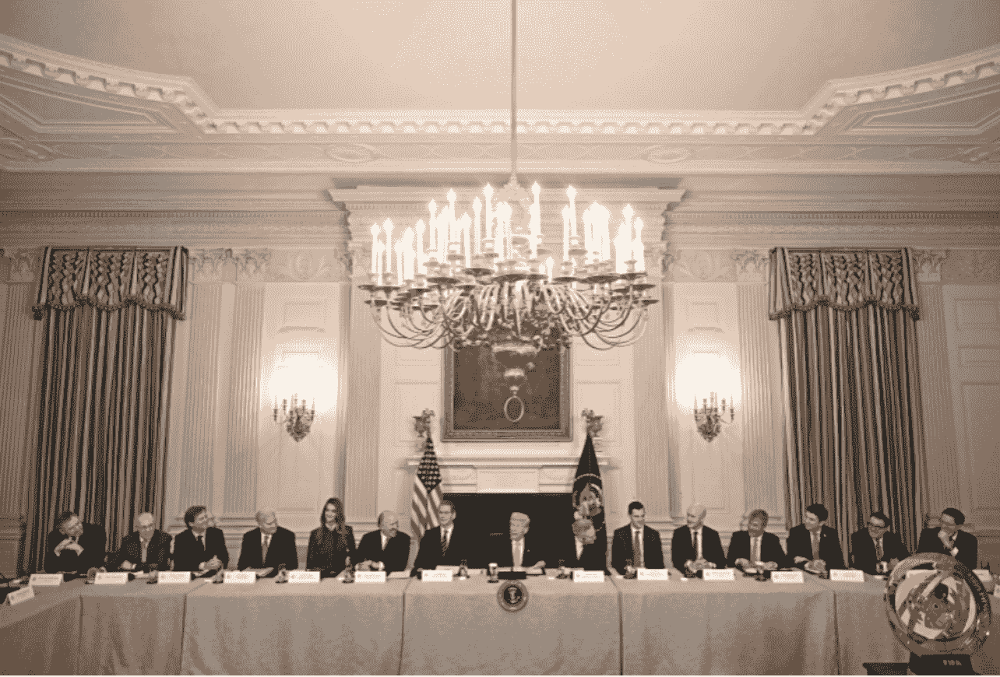
## CAIXIN | 听文章
## 文 | 财新周刊 岳跃 刘冉
竞选期间获大量币圈资金支持、就职前本人和家族集体发行加密货币、上任后选择加密货币的倡导者担任监管官员、签署战略比特币（BTC）储备计划行政命令、数起币圈诉讼案件被撤销、首届加密货币峰会在白宫举行，近期又传出家人入股加密货币交易所的消息……

时隔四年后二度入主白宫的美国总统唐纳德·特朗普（Donald Trump），与币圈的关系越绑越深。

2025年3月20日，特朗普以视频形式在纽约数字资产峰会（Digital Asset Summit）上致辞。这是首位在任美国总统出席此类活动。他在致辞的最后说道：“我们将共同努力，使美国成为无可争议的BTC超级大国和世界加密货币之都。”

而在四五年前，特朗普还是加密货币旗帜鲜明的反对者。他称，“我不喜欢BTC和其他加密货币，它们不是钱，其价值极不稳定且毫无根据”，甚至在2021年说“投资加密货币或是一场即将发生的灾难”。

2021年卸任后，特朗普意外踏入了数字淘金热，开始倒腾NFT（Non-Fungible Token，非同质化通证）数字收藏卡。这种基于区块链技术的虚拟艺术品，本质上就是加密世界的限量版球星卡。财务申报文件显示，自2022年底推出首套“特朗普英雄”系列NFT后，这位前总统凭此18个月狂揽700万美元。有分析师用“毒品交易”比喻这场资本游戏：“NFT就像入门级大麻，让特朗普尝到了数字资产的甜头。”

如今180度的态度大转弯，被认为既与其个人经济利益密不可分，也是竞选策略使然。“从这次大选开始以来，我们可以很清晰地看到一个‘政策承诺—行业献金—监管放松’的闭环。”一位长期关注美国市场的PE人士对财新总结道，“加密货币行业在美国拥有大量投资者和支持者，可以争取到这些选票。”

“就像开了一个魔盒，政客喊口号拉拢币圈，金主立马砸钱表忠心，转头监管就给加密货币松绑，整个链条转得比BTC矿机还快。”前述PE人士说，“在理想状态下，这种操作或许能增强美国在全球金融体系中的影响力；但照现在这种玩法，怕是要演变成豪门家族左手捞钱、右手抓权的加密游戏。”

2025年3月27日，胡润财富榜宣布特朗普以525亿元人民币（约合72.3亿美元）的个人财富入榜，其中包括了特朗普家族发行加密货币约30亿美元的收入。这比特朗普2016年第一次入主白宫前福布斯杂志统计的个人财富37亿美元大为膨胀。

## 利益冲突不断
与以往美国总统在任职期间避免从事任何可能被视为利益冲突的活动不同，特朗普从未完全脱离自己的私人商业帝国。

根据美国《政府道德法》（Ethics in Government Act）和联邦道德办公室（OGE）的规定，总统应采取一定的财务隔离措施，如保密信托、资产剥离等。前任总统拜登（Joe Biden）和奥巴马（Barack Obama）等均采取了类似做法。

2017年首次就任总统时，特朗普拒绝设立保密信托，而是将资产交由儿子管理的“非盲信托”（Non-Blind Trust）；因特朗普可随时获知资产动向，被OGE认定为“不符合道德标准”，但未强制要求他改正。

第二次就任总统后，特朗普的做法不仅与前次相同，还引发更大争议。2025年1月，特朗普夫妇分别发行了Meme币“TRUMP”和“MELANIA”。区块链数据公司Arkham Intelligence的追踪数据显示，在特朗普就职典礼前几个小时，WLFI公司购买了价值数百万美元的加密货币。批评者称，这都是利用公职来牟取私利的自私行为。

不仅如此，2024年9月，特朗普家族还成立了去中心化金融（DeFi）项目——World Liberty Financial（WLFI）；特朗普家族控制着WLFI公司60%的股权，特朗普和他三个儿子的名字都出现在支持团队名单上，被称为“首席加密货币倡导者”。值得注意的是，波场（TRON）区块链创始人、加密货币交易所HTX顾问孙宇晨也向WLFI项目投资7500万美元。

2025年3月，《华尔街日报》称，特朗普家族的代表已就收购加密货币交易所币安（Binance）美国分公司的财务股份进行了谈判；与此同时，币安的创始人赵长鹏（别名“CZ”）一直在敦促特朗普政府赦免他。

赵长鹏和币安此前受到美国监管机构的多次调查和指控。2024年4月24日，赵长鹏因洗钱指控被美国司法部（DOJ）判处四个月有期徒刑。尽管该报道遭到赵长鹏本人否认，但仍被市场广泛流传。

“我认为，美国总统从事商业活动或让其家人和同事从事商业活动是史无前例的，而且是完全错误的，因为这些活动会直接受到他作为总统采取的政策或他对这些政策发表的言论的影响。”美国商品期货交易委员会前主席蒂姆·马萨德（Tim Massad）公开表示。

虽然总统不在联邦利益冲突相关法规的约束范围之内，但是美国有要求在任总统避免个人商业利益影响国家政策的传统。如果特朗普在任期内积极推动有利于加密货币的政策，而其家族直接参与相关商业活动，可能构成“道德上的利益冲突”，但不一定违法。例如，特朗普推动美国联邦政府购买BTC或者放宽加密货币的监管，并且间接提升其家族加密资产的价值，就有可能被指控利用职权谋私。

还有分析认为，若有确凿证据表明特朗普滥用职权，利用总统身份为家族加密资产谋利，美国国会可依据宪法第2条第4节（Article II，Section 4）发起弹劾。但考虑到他在参议院或有足够支持，即便调查发现他存在道德或法律问题，实际弹劾成功的概率仍然较低。

据彭博社估计，截至2025年3月中旬，特朗普的净资产约为48亿美元，这还不包括他从加密货币项目中获得的据称有数十亿美元收益。《财富》杂志估算这部分收益高达29亿美元。

“关于特朗普的财务状况，要记住的是，他与我们见过的任何政客都不同。”华盛顿监督机构公民责任与道德组织（Citizens for Responsibility and Ethics）副总裁乔丹·利博维茨（Jordan Libowitz）公开评论道，“一切都由一系列‘俄罗斯套娃有限责任公司’所有。”

上任之后，特朗普签署行政命令建立战略性的BTC储备，并且任命支持加密货币的官员，也被认为可能直接或间接地提升了其家族相关项目的价值。这种公私利益的交织可能影响政策决策的公正性，引发伦理和法律层面的讨论。

更值得警惕的是，特朗普政府推出的加密货币行业支持政策，被认为实质上为特定企业创设了法律豁免特区。“这种将公共监管权转化为私人特许经营权的做法，正在消解现代金融监管体系的基石，国家公器正在沦为加密资本扩张的工具。”一位处理过多起加密货币案件的国际律师事务所律师表示。

南非央行行长莱西塔·卡尼亚戈（Lesetja Kganyago）在2025年世界经济论坛年会的一场讨论中表示，不应该利用政治的影响力来影响金融监管的方向。“监管绝不能被金融权力或政治操纵所左右，因为这会破坏信任和公平。我们已在全球金融危机期间看到了这种做法的后果，这是一个不能忽视的教训。”

“加密货币的支持者，通过赢得政治选举而推动有利于加密货币行业的监管，这是一个危险的先例。同样可以想象，加密货币的反对者也可能会使用类似策略来压制它。监管不应这样发展。政府必须制定清晰、透明和统一适用的规则，而不是允许强大的政党利用他们的资源来破坏他们反对的某些政客或者政策。这种行为会导致监管俘获，即操纵系统来服务于特定利益而不是公共利益。”莱西塔·卡尼亚戈如此表示。

莱西塔·卡尼亚戈还表示：“无论是针对加密货币、银行、贸易，还是针对消费者保护的监管规则，都必须清晰、直接，并让所有利益相关者都能轻松理解。透明的监管和简单的想法是根本。然而，仅陈述这一原则是不够的，它必须在所有监管领域得到一致应用。”

## 币圈大佬“花钱消灾”
拜登时期被美国证券交易委员会（SEC）立案调查和起诉的多起币圈案件，在特朗普上台后被陆续撤销，而这些涉案当事人都曾以不同方式向特朗普捐款。

美国最大的加密货币交易所Coinbase，于2023年6月被SEC起诉，被指控违反规定为至少13种加密代币的交易提供便利。SEC称，一些加密资产属于现有证券法的管辖范围，但这些代币并没有注册为证券；Coinbase自2019年以来通过此类交易获利“数十亿美元”。而Coinbase抗辩认为，现有证券法不适用于加密货币，SEC越权监管。

2025年2月21日，SEC正式同意撤销诉讼，Coinbase无需缴纳罚款或调整业务。Coinbase的CEO布莱恩·阿姆斯特朗（Brian Armstrong）曾长期批评SEC的监管方式。他在撤案后表示：“我认为这是一个非常重要的信号，上届政府中有一小群激进人士试图非法攻击这个行业，我们将翻过这一页，并最终在美国获得一些监管明确性。”

值得一提的是，Coinbase曾向特朗普—万斯就职委员会（Trump-Vance Inaugural Committee）捐款100万美元，是首批捐款的加密货币公司之一。该委员会是总统就职典礼的筹备组织，属于非营利性实体，可以接受“无限捐款”。

自2024年美国大选以来，Coinbase一直努力与特朗普拉近关系。无党派竞选财务监督机构OpenSecrets的分析称，Coinbase花费了逾4600万美元试图影响2024年的美国大选。

布莱恩·阿姆斯特朗的妹妹凯瑟琳·阿姆斯特朗·洛文（Kathryn Armstrong Loving），目前是埃隆·马斯克（Elon Musk）领导的政府效率部（DOGE）成员。Coinbase还聘请了特朗普的竞选团队联合经理担任其全球顾问委员会成员。

就在布拉德·加林豪斯（Brad Garlinghouse）参加完3月7日的白宫加密货币峰会后不到两周，SEC对其创立并担任首席执行官的区块链技术公司Ripple Labs结案。SEC此前指控Ripple公司通过XRP代币销售进行未注册的证券发行，最初要求罚款20亿美元，后降至1.25亿美元，最后于2025年3月撤销此案。

布拉德·加林豪斯在社交媒体上表示，这是“巨大胜利”，SEC“早就应该投降”。Ripple公司曾向特朗普的就职委员会捐款500万美元。Ripple的外部游说团队Michael Best Strategies的董事会主席，曾是特朗普的幕僚长。特朗普当选后，Ripple还聘请了特朗普2016年以来的主要筹款人布莱恩·巴勒德（Brian Ballard）当说客。

布莱恩·巴勒德游说的客户还包括美国知名互联网券商Robinhood。Robinhood曾向就职委员会捐赠200万美元。该公司的一起案件于2025年3月被SEC撤销调查。SEC此前认为，Robinhood提供的加密货币交易，未正确注册加密交易服务（类似Coinbase案）。

向就职委员会捐款100万美元的全球最大加密货币交易所之一Kraken，于2025年3月初被SEC撤回一项“未注册证券交易所非法运营”的民事诉讼。Kraken在一份声明中称，此次撤回是加密货币的转折点，结束了拜登政府时期开始的一场“浪费的、出于政治动机的运动”。

此外，加密货币交易所Gemini的“未注册证券发行”案件，于2025年3月被SEC撤销诉讼。2024年7月，Gemini的创始人兄弟共向埃隆·马斯克成立的、旨在支持特朗普竞选的超级政治行动委员会（Super PAC）捐赠50万美元。他们原打算捐赠价值100万美元的BTC，但因超过联邦法律允许的个人捐款上限，部分资金被特朗普竞选团队退回。

不仅如此，这些自认为“蒙冤”的币圈大佬还要发起反击。包括Coinbase的CEO、Ripple的首席法律官、Gemini的创始人兄弟在内，都呼吁要求追究参与其案件的调查人员的责任，是否“过度”执法，并公开SEC在前主席加里·盖斯勒（Gary Gensler）领导下调查加密货币公司花费了多少经费。

SEC的在职和离职工作人员都表示担心，在充满政治色彩的环境中，公职人员会受到不公平的对待。SEC官网发布的一份声明称：“尽管工作人员在法庭上代表委员会，他们的名字也出现在委员会的文件上，但最终是否启动或解决执法行动的决定权在于委员会。”换句话说，调查人员的工作是按照SEC领导层的指示进行的。

加里·盖斯勒对加密货币行业持强硬态度，认为“充斥着欺诈与滥用行为”。自2021年上任以来，他推动超过2700项针对加密货币行业的执法行动，罚没金额超210亿美元。

加里·盖斯勒在特朗普上任当天辞职；而接任的保罗·阿特金斯（Paul S. Atkins）与其前任立场截然不同，他一直为数字资产领域积极发声，主张自由市场，反对过度监管。自2017年起，保罗·阿特金斯一直担任加密货币倡导组织Token Alliance的联合主席。

3月21日，SEC的加密货币工作组举行了专家会议，重点讨论了在特朗普政府寻求改革加密货币监管的情况下，证券法如何适用于数字资产的问题，还讨论了加密货币是否需要一个新的、独立的监管框架，一种不同于SEC对股票等证券的监管方式。

## 建立BTC战略储备争议
2025年3月6日特朗普正式签署行政令，设立BTC战略储备。该储备将由联邦政府拥有的BTC注资，这些BTC是在刑事或民事资产没收程序中获得的。

据估计，美国政府拥有约20万枚BTC，但从未进行过全面审计。行政令要求对联邦政府持有的数字资产进行全面核算，政府不会出售任何存入储备的BTC。财政部长和商务部长被授权制定保持预算中立的策略，以获取更多BTC。

但由于特朗普签署的总统行政令明确，“除了通过资产没收程序所获取的资产，政府不会为该储备再额外购置其他资产”，未达市场预期，BTC价格经历了快速下跌。

最终的行政令也与特朗普四天前在其社交媒体上宣布的政策存在巨大偏差。3月2日，特朗普在社交媒体上称：“美国加密货币战略储备将以BTC和以太坊(ETH)为核心,同时还将包括XRP、SOL和ADA等规模较小且风险较高的代币。”

其中，XRP就是前述由布拉德·加林豪斯创立并担任首席执行官的区块链技术公司Ripple创立的公链发行的代币。Ripple成立于2012年,总部位于美国加州旧金山,与美国银行、渣打银行、西太平洋银行等全球多家银行建立了合作;这些银行利用Ripple的技术进行跨境支付。如前所述,Ripple公司与特朗普的竞选团队有千丝万缕的关系。

SOL是Solana公链发行的代币。Solana于2017年诞生在美国加州旧金山,三位主要创始人都曾就职于高通公司。2025年1月特朗普和夫人梅拉尼娅发行的Meme币“TRUMP”和“MELANIA”就是在Solana公链上发行的。

ADA 是 Cardano公链发行的代币。Cardano由 IOHK公司(Input Output Hong Kong)于2015年在瑞士创立,创始人曾是以太坊的核心成员。Cardano认为自己是以太坊的更新版本,并将自己定位为以太坊的替代品。

自2009年BTC创建以来,依靠区块链技术发展的加密货币以其去中心化、安全、全球化、透明等优点备受关注;总量为2100万枚的BTC更因其首创性、保值性、创新性在整个加密货币市场处于主导地位,被誉为“数字黄金”,其他后期开发的数字货币都被统称为“山寨币”。

此前,一些拉丁美洲国家和非洲国家会通过BTC买卖与国际金融市场合作投资。萨尔瓦多共和国是第一个正式将BTC作为法定货币的国家;该国政府自2021年开始购买BTC,并纳入国家储备。中非共和国在2022年宣布BTC为法定货币，是非洲首个采取这一举措的国家。巴拿马共和国在2021年通过了一项法案，允许使用加密货币支付。巴西联邦共和国作为拉丁美洲最大的经济体，近年来BTC和加密货币的使用正逐步增加，政府目前没有明确表示会建立BTC储备。

对于建立BTC战略储备，各方观点大相径庭。支持者认为，加密资产储备可增强美国财政韧性。美国参议员辛西娅·鲁米斯（Cynthia Lummis）表示，BTC可以作为对抗通货膨胀和国债膨胀的对冲工具，当价格上涨的时候，政府可以出售部分资产用于偿还债务。历史上，高通货膨胀和财政赤字往往推动投资者转向黄金等硬资产，推高其价格。辛西娅·鲁米斯在2024年向国会提交了一项法案，提议最多购买100万枚BTC（约占BTC总供应量的5%），但这一法案并没有获得通过。

而蒂姆·马萨德公开表示：“我认为没有理由创建它（指建立BTC战略储备）。政府确实拥有一些在执法行动中扣押的数字资产。我们应该继续像处理政府扣押的所有资产一样处置这些资产，这意味着政府会在适当的时候出售这些资产，或者在某些情况下将资产返还给受害者。这里没有理由例外，也就是说，没有理由继续持有这些数字资产。”

“拥有这些储备（BTC战略储备）没有任何战略目的。它不像石油，因为拥有石油储备是有目的的。坦白说，拥有这样的储备，当然还有政府购买更多的储备，主要受益的是那些已经拥有这些资产的人，或者在政府购买之前就已经购买这些资产的人。我不认为这符合国家利益。”蒂姆·马萨德说，公众号懒人搜索，懒人专属群分享

BTC的长期批评者Peter Schiff则表示，他能够理解美国建立BTC储备的理由，但无法理解将“山寨币”加入其中的想法。将ADA等投机性加密货币纳入储备，削弱了战略性的色彩。

与黄金、石油等战略储备相比，BTC还具有一个显著特征，即价格的巨大波动性。黄金价格长期稳定，年度价格波动通常在10%至20%之间，而加密资产的价格波动幅度可能在一天内就达到10%至20%。BTC在2020年的价格约为每枚1万美元，至今已经经历过突破每枚10万美元、又跌回每枚8万美元的巨震。作为国家战略储备，价格的巨大波动显然会增加政府资产负债表的波动。

加密货币从一开始的技术创新逐渐演变成一个高度投机性的市场。这个市场的波动性非常大，短短几天内可能上涨或下跌几倍甚至几十倍，这种波动性吸引了很多投机者和短期交易者。以TRUMP币为例，2025年1月18日以0.1824美元的开盘价交易，在短短12个小时内，涨幅超过15000%，达到30美元附近，盘中一度创下75.35美元（累计涨幅逾41200%）的高点，市值一度逼近800亿美元，此后一路下跌，最低跌至9美元附近。

同时，由于监管不健全，一些投资者和机构可能通过“鲸鱼”操作（大规模买入或卖出）来操控市场价格，也有不少项目存在欺诈行为，比如“跑路”项目或“空气币”。很多人看到他人通过加密货币赚了钱，就产生跟风投资的情绪，形成了“害怕错过”（FOMO）的心理，导致大量资金进入市场，加剧泡沫。很多国家对加密货币的监管尚不完善，导致投资者在遇到问题时很难寻求法律保护，这也增加了市场的不稳定性。

## 相关视频：【华尔街原声】个人虚拟币发布了后特朗普净资产大幅飙升

视频说明：2025年1月17日，美国总统特朗普在其Truth Social 社交账号上发文宣布，推出个人 Meme币“TRUMP”。就在特朗普发币的第二天，其夫人梅拉尼娅也发行了以自己名字命名的Meme币“MELANIA”。CNBC记者Robert Frank报道称，这是政治权力第一次如此迅速地转化为加密财富。

“其实，加密货币市场进入美国战略储备就是个炒币的噱头，更多是投机客的故事。现在金融体系真到了需要加密货币来重建的时刻了吗？加密货币自身的安全性、流动性等基本问题解决了吗？”一位币圈投资人问。

# 专栏 | 美元的泡沫化机制与轮回

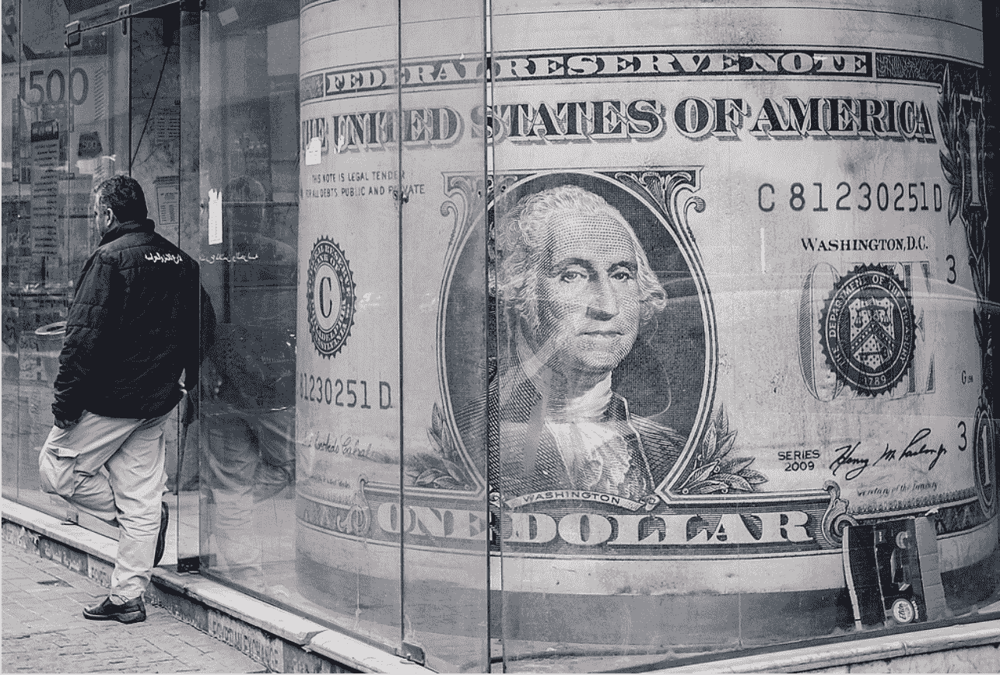

CAIXIN| 听文章
文 | 石磊
吸引子科技董事长

2025年初，美元对主要贸易伙伴的加权实际汇率接近历史高位，自2014年初以来升值50%，也意味着美元对其贸易伙伴货币的购买力近十年大幅升值。

美元购买力的增加，伴随着美国国际收支中经常项目赤字快速扩张，近几年达到年度GDP的4%，仅次于2005年至2010年5%—6%的历史最高水平。

美国国际收支中经常项目的赤字需要向其他经济体融资补足。为何美国从其他经济体融资越多，美元的购买力却越强？这是因为美元承担着国际储备货币的功能，其他经济体会把外汇中赚到的很大一部分买入美元资产；只要美国金融资产有足够吸引力，就会有大量海外资金涌入美元资产。近十年美股相对全球其他股指超额回报达50%，2022年后美债也成为发达经济体中最高收益的债券，极高的金融资产回报率令全球资金流入美元资产，推动美元大幅升值。

表面看，美国资产回报率高吸引资金流入，实则暗含一个正反馈信用扩张机制：融资人信用好、投资收益高，吸引大量投资人；融资人开的“白条”升值了，获得更多购买力；融资人的收支越不平衡，投资人拿到的“白条”越多，继续把“白条”投向融资人，继续抬高资产回报率。

从系统的角度看，该机制是一个逐级放大的正反馈循环，直到投资人开始怀疑融资人的信用，或是怀疑融资人的资产回报能否维持，或融资人自己打破该循环。

“融资人自己打破循环”在历史上发生过。上世纪80年代前半期，美国一面以紧缩货币政策治理国内顽固的高通胀，一面大规模减税、放松管制，推动产业结构转型，“里根经济学”取得成效，美元资产回报率大幅升，美元对贸易伙伴实际有效汇率升值40%，美元汇率达到历史峰值。

1985年，美国决心改变巨额贸易赤字问题。在其主导的《广场协议》下，G5央行联合干预外汇市场，推动美元贬值，美元汇率在此后十年贬值35%，美国经常项目赤字一度归零，公众号懒人搜索，懒人专属群分享

“投资人怀疑融资人的信用”也发生过。上世纪60年代，美国因越南战争等支出加大，逆差扩大，黄金储备从1945年的2万吨降至1971年的8133吨，而海外美元债务激增至678亿美元；其他央行开始怀疑美国能否维持美元与黄金的挂钩，于是陆续将外汇兑成黄金运回本国。1971年8月15日，美国宣布停止美元兑换黄金，布雷顿森林体系崩塌；此后五年，国际外汇市场陷入混乱，黄金相对美元在之后的十年中上涨15倍。

如今，美元汇率再度达到历史高位，而正反馈循环逆转的三个因素陆续出现：投资人开始怀疑美元信用，全球央行的外汇储备正在多元化；投资人开始怀疑美国资产的高回报率能否持续，美股投资者情绪从2024年四季度的乐观转为2025年初的焦虑，直至3月的悲观；美国政府四处挥舞关税大棒、寻求降低贸易赤字，紧缩政府开支、寻求控制财政赤字。

以往这些因素并不同时发生，而这次形成共振。如果美国财政开支显著下降、科技股的垄断被打破，将会降低美元资产收益率。2月以来上调的关税已造成美国国内通胀加速，企业对未来的预期信心降至低水平。这些均会体现在美元汇率中。

以人民币站在美元的对面。中国拥有最大规模的货物贸易顺差，经常项目盈余规模达到GDP的2.2%。但自2022年起，人民币经历多轮贬值压力，特别是自2023年下半年起，银行代客结售汇持续出现逆差。这一时期，人们将人民币资产转换为外汇资产，还有大量中国主体拥有的资金沉淀在境外，主因是人民币金融资产收益率大幅下降。

中国央行在货币政策执行报告中强调“增强外汇市场韧性，坚决对市场顺周期行为进行纠偏，坚决防范汇率超调风险”。2024年4月至2025年2月，人民银行外汇占款下降4000亿元，可见央行维稳人民币汇率的动作。

形势正在转变。自2025年3月起，随着市场对人民币资产信心回升，掉期后的人民币跨境利差不再“倒挂”，人民币贬值压力大幅下降。如果未来中国国内物价水平能止跌企稳，结合美元所处的压力处境，人民币将迎来有利环境。■

## 最新财新周刊|谁还在做广告?

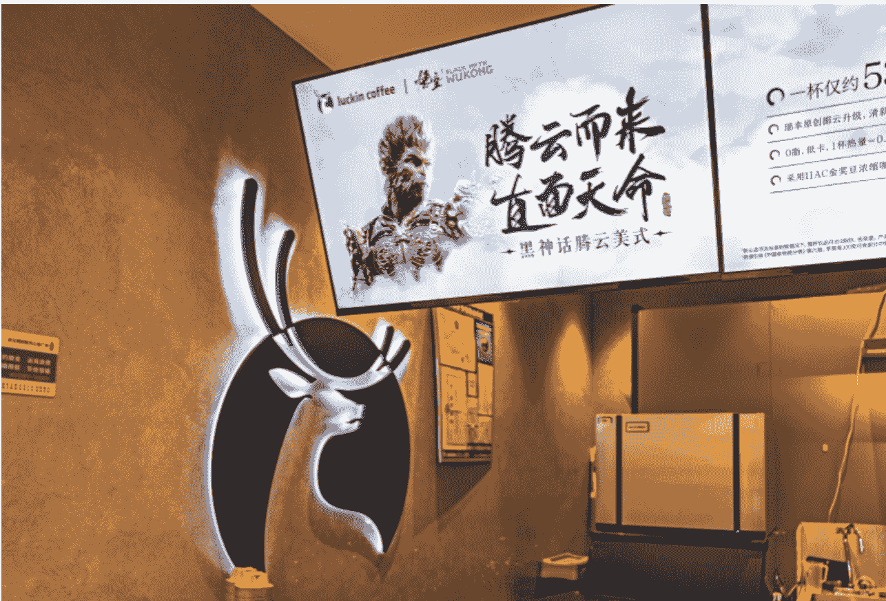

CAIXIN| 听文章
文 | 财新周刊关聪

阿里巴巴一名广告业务人士将过去一年的广告行业形容为“冰点”：商家全面缩减预算，现在还能有品牌广告预算的行业大致只有汽车、文旅、快消品、白酒；剩下的行业基本不看好品牌广告，企业经营压力大，都在降本增效。

品牌广告收缩，意味着企业不再确信单纯曝光的价值，更多广告预算被腾挪到追求直接产出交易的效果广告上；而与产品销量挂钩的效果广告，努力迎合商家对精准投放的需求，意图通过更精准的数据化分析快速提升销量。效果广告的主要“抢食者”，纷纷发力人工智能（AI）大模型，以提升广告业务增量。（详见本刊2024年第42期封面报道《AIGC改变互联网营销》）

据WPP旗下群邑（GroupM）媒介花费数据库，2024年，线下户外广告份额稳健，但线上品牌广告份额下降1.6%，长视频和电视媒介都出现下滑；分别反映转化效果和实际销售的竞价信息流广告的市场份额提升0.6%，电商广告提升0.5%。

广告行业增长承压，据移动数据机构Quest Mobile测算，2024年中国互联网广告市场规模为7583.6亿元，同比增长6%，增速较2023年的7.6%进一步放缓。而据CTR媒介智讯统计，2024年广告市场同比微涨1.6%，较2023年6%的增速大幅下滑。该统计主要涵盖电梯、电视、影院、纸媒等传统投放渠道。

谁还有广告预算？真金白银的广告费用投向了哪里？穿透广告业的生态现状，可以看到背后不同行业的此消彼长，看到社会消费形势与走向。CTR给出了一幅广告投放的行业“地图”：药品、饮料、IT及自动化服务刊例花费同比下滑；而娱乐及休闲、酒类、美妆日化和服装刊例花费增长都超过20%。在投放媒介方面，电梯、火车高铁站和影院刊例花费增长；但电视、广播等传统媒体则在不同程度地缩减。

今年的政府工作报告指出，从国内看，经济回升向好基础还不稳固，有效需求不足，特别是消费不振。国务院总理李强提出，要大力提振消费、提高投资效益，全方位扩大国内需求；促进消费和投资更好结合，加快补上内需特别是消费短板，使内需成为拉动经济增长的主动力和稳定锚。

广告是互联网公司的主要营收来源之一，曾以高速增长的广告业务提振业绩的B站、知乎等中长尾内容平台，乃至广告收入大户腾讯、快手、百度2024年都呈现增速下滑的趋势。极度依赖流量效应的互联网广告，头部效应进一步加剧——流量最充沛、用户使用时长领先的字节跳动，持续占据中国广告市场的四分之一份额，其旗下海外短视频平台TikTok的广告收入增长势头也好于国内。

在社交媒体流量同样充沛的美国，受益于体育赛事、总统大选以及线上品牌广告需求增长等因素，移动数据机构Sensor Tower统计，美国数字广告花费在2024年达到1214亿美元，同比增长22%；四季度增速在假日购物刺激下达到9%。Facebook、Instagram、TikTok、Reddit等社交媒体上的数字广告，占美国数字广告总支出的比例达77%。两家美国互联网广告巨头业绩也反映了这一情况，Meta和谷歌母公司Alphabet的全年广告营收分别同比增长22%、11%。

群邑在2024年底预测，美国和中国全年整体广告收入分别为3790亿美元和2045亿美元，在2025年仍会是全球最大的两个广告市场。但其下调了两国广告收入增速的预期，预计中国广告收入增速将从13.5%降至10.3%；美国则从9%降至7%。

## 谁还有广告预算？

不同行业的广告预算、投放积极性，反映出了市场供需两端正在发生的变化。

“消费者手里没有那么多钱，借贷需求比较大，小额借贷行业在字节跳动和腾讯上的投放一直在增长，腾讯为这个行业给出了2025年投放增长20%的乐观预期。”一名互联网消费金融公司投放人士告诉财新，受近年股市、债市等投资市场波动较大的影响，理财产品方面的广告投放也增长乏力，消费者普遍求稳。

2024年的文旅热提升了旅游行业的投放意愿。OTA（在线旅游平台）龙头公司携程、同程在出境游需求恢复后抓紧投放，全年营销费用分别同比增加了29%、25.7%。

一名小红书人士告诉财新，每逢节假日都是旅游内容流量的上升节点，旅游属于线索类目，旅游行业的中小商家十分看重平台内容转化成交易的效果，会把在小红书站内获得有效客户信息作为一项考核指标；此外，教育行业的投放也很突出，小红书用户在留学、升学、专升本方面的搜索量都很大。

重视品牌和产品推广的美妆行业广告预算相对充裕。Quest Mobile测算，美妆行业占非互联网行业硬广投放整体费用的34.6%，比2023年提升了11个百分点；而无论硬广还是软广，欧莱雅、宝洁和雅诗兰黛都是投放费用最多的三家美妆品牌。一名腾讯广告销售人士告诉财新，类似这样只有头部几个品牌的广告预算充足的情况，其实反映行业生态并不健康，会导致媒介为了争取它们的预算而“内卷”严重，需要降价抢份额。

“多数平台的广告业务差异性很小，比如腾讯的前几大客户是国际品牌，字节前几大客户是本土品牌，这两家各自拥有重点客户就都有赚头，但大多数媒体的客户画像模糊而雷同。”上述腾讯广告销售人士说，本土美妆、家电、医疗2025年预算表现不错，奢侈品稳中有升，而汽车品牌广告这几年一直在跌。

一名微短剧营销人士告诉财新，大部分美妆日化行业客户本身品牌属性低，消费者倾向于选择推荐排序靠前、价格最划算的产品，也愿意尝试类似微短剧这种新媒介，在还是价值洼地时低价获客；相比之下，汽车、3C数码是稳健型客户，比如汽车看重户外广告，这种决策周期长、单价高的产品侧重纯品牌传播，在机场投硬广可以精准聚焦人群。

汽车行业竞争激烈，燃油车市场下滑、价格战持续升级，新能源车企加强营销。上汽集团2024年上半年广告宣传费同比下降27%，长城汽车下降22%，广汽集团和长安汽车则有5%的小幅增长。2024年全年，造车新势力中，蔚来、零跑、理想包含广告的销售及营销费用均有20%左右的增长，仅小鹏增加4.8%；而行业营收遥遥领先的比亚迪，同期广告展览费涨幅最大，高达84%。

过去两年，互联网行业降本增效力度较大，广告支出下滑明显，其用于推广游戏、各类App和影视内容的营销费用均是压减的主成本项目。长期变现困难的内容平台B站和知乎，均在2024年抛出了盈利时间表：B站在2024年三季度首次单季度盈利，为推广作为增收主力的新游戏，全年营销费用同比增加10%；而知乎严格控制成本，全年营销费用砍去21%，2024年四季度实现盈利。

2024年的一个新现象是，内容行业乍现全民爆款，凸显娱乐行业的头部效应，优质内容可以凭借口碑获得自然流量，比如暑期火爆的3A游戏《黑神话：悟空》是区别于手游的买断制单机端游，因此不侧重买量，投放规模并不大。游戏买量数据调研机构DataEye数据显示，《黑神话：悟空》项目组8月7日至12日在抖音平台投放的素材总量不超过50条。

DataEye在一份报告中总结称，2024年，手游App投放数量为近三年来最低，同比下滑13.25%，反映市场竞争激烈，部分游戏厂商转向小游戏或“出海”。

互联网和游戏持续拓展海外市场，从两家A股营销公司的半年报中可见一斑：以在楼宇电梯中投放品牌广告为主要收入来源的分众传媒（002027.SZ），2024年上半年来自互联网、娱乐休闲、商业及服务三个行业的收入均出现10%以上的下降；而超七成营收来自“出海”业务的营销服务公司蓝色光标（300058.SZ），则因为游戏、电商、互联网应用类客户海外投放意愿增加而推动整体营收增长40%。

电商行业已经度过业务拓展期，自身流量增长陷入瓶颈，各家平台都在存量市场拼杀，每年投放预算相对平稳，比如在“618”年中大促和“双十一”期间都会为了集中曝光，在大促开始前特定时间节点买断流量；但拿真金白银投放的App获客广告减少，倾向于用和其他平台资源置换等更少现金支出的方式引流。

2024年“双十一”大促周期拉长，兴趣电商抖音、快手早于传统电商开始年底大促，淘宝天猫方面则拿出了近年力度最大的补贴投入，阿里（换算成自然年后）和京东基本保住增长势头，但全年营销费用分别增加了23.5%、19.5%；营收增速放缓的拼多多的全年销售和营销费用也增长了35%。

## 全面追求交易

商家对广告投入的回报需求主要是解决拉新问题。随着电商场景多元化，除了抖音、快手、小红书、微信视频号，B站、知乎等内容平台也在补齐自己的交易环节，乃至高德地图都开始为生活服务补充营销场景。

“之前行业总提全站营销，‘七次流量曝光一次转化’，但现在没办法断定这七次曝光发生在哪里，比如有可能在小红书曝光、在天猫转化，所以商家必须尽可能多地把平台铺满，才有可能接得住那一次转化。”前述阿里广告业务人士告诉财新。

从消费者看到广告到下单付款的整个过程，被称为“转化链路”。定价较高且非生活必需的产品和服务一般会让消费者更犹豫，这条链路越短，企业获得收入的效率也就越高。

上述小红书人士观察到，2019年前后，商家在抖音开个户往里砸钱很快就能看到效果的情况一去不返，“流量成本在上升，大部分中小商家的预算收紧，因为迫切想要看到实际转化效果，反而不太看好'种草’，停投率其实很高，投几百块钱或一两千块钱试一下，效果不好就不投了”。

越来越追求实际效果的倾向，延伸到了一般被认为转化链路长的行业。一名抖音营销产品人士告诉财新：“比如汽车客户之前对广告的要求是吸引用户留下线索，电话回访时对方有买车意向，这个投放就算有价值，但现在对后端效果的诉求更深一层，希望电话回访后对方上门试驾，看的是到店和试驾率，甚至要再往后看付定金的比率；家居客户类似，除了找到有装修需求的用户，还要看上门量房率。”

游戏类客户则要看到下载、注册后的用户留存；教育类客户要由客服跟进用户是否买课；互联网贷款类产品放款在线上，用户所有的消费行为都在线上发生，从注册、授信一直到放款的全链路也都要通过广告媒体看到。

品牌投放的基本逻辑是考核全年GMV（商品交易总额）表现和份额，再制定全年对外的广告预算和策略。如果大品牌全年GMV表现好，因为业绩压力不大，有可能削减效果类广告预算，转投品牌广告多做宣传；但新品牌更看重卖货，在投放效率高、有利润的情况下才会追加广告预算。

据Quest Mobile，如果只看硬广，淘宝、抖音、微信是集中硬广投放费用最多的三家媒介，其中淘宝最多，占比达到31.8%；这三家之外，其他平台的投放费用占比均在10%以下。字节跳动、阿里和腾讯，这三家2024年的广告收入均超过1000亿元。

电商平台的广告收入反映了商家对销售业绩的预期，传统电商平台直到2024年下半年才逐渐从低价竞争中回撤。商家在以低价为心智的拼多多上投流持续活跃，2024年全年，拼多多在线营销服务收入同比增长了29%，但增速较2023年砍半；分别反映京东和阿里电商广告收入的“平台及广告服务收入”和“客户管理收入”只有5%左右的增长，但都高于2023年的增速。阿里正在推进智能化商业化产品“全站推广”，以提升商业化率。

前述腾讯广告销售称，由于电商广告倾向于与交易做更深度的结合，开始更多用算法取代人工操作，比如品牌只需要表达愿意“用多少钱换多少全店GMV”，就可以全权交给算法优化。“品牌媒介过去擅长的人群筛选等策略现在越来越没有用；而AI应用确实提高了广告素材量，效果还可以；代运营公司目前很少能收到服务费，大多是按投放量级收提点，利润也被压缩得比较薄。”她说。

AI营销的本质是通过算法降低人工成本，商家在天猫投放品牌广告或者效果广告，要先做竞品对比，投放的关键词、出价需要人工投手至少两三天复盘一次，根据结果不断调优，而这部分工作自动化后，商家可以根据AI建议的出价区间报价，机器再给出反馈，人工投手的功能就这样被弱化。

广告平台纷纷升级AI营销服务，多家淘系代运营公司的业绩受到经济环境和技术升级的双重冲击。壹网壹创（300792.SZ）和青木股份（301110.SZ）2024年上半年品牌营销服务收入分别下滑18.07%和11.86%，主要服务美妆品牌的丽人丽妆（605136.SH）全年营收下降，由盈转亏。

围绕微信生态的两家营销类SaaS（软件即服务）公司有赞（08083.HK）和微盟（02013.HK）2024年也没有赚到钱。它们以向微信平台商家售卖营销、电商等解决方案为主，由于订阅收入减少，有赞全年营收下滑0.4%，亏损额同比扩大200%；微盟收入受广告平台返点率降低的影响同比骤降40%，经营亏损额扩大了136%。两家公司股价近一年一直徘徊在1港元/股上下。

## 谁能拿到广告?

伴随着互联网平台流量的聚集化，广告市场格局也高度集中。

根据中关村互动营销实验室的测算，字节跳动2024年的广告收入市场份额达到25.94%，位列第一；阿里的广告收入份额下滑至不到23%；排在第三位的腾讯，市场份额则从14.36%升至15.4%。

受益于AI，腾讯单季度广告收入增速超过行业平均水平，将目前的广告收入增长归结于AI加持下的自然增长，而不是通过提升广告加载率换取收入。微信视频号率先应用了AI优化广告投放的策略，广告的点击率和商家投放意愿随之提升，腾讯2024年广告业务收入同比增长20%至1214亿元。腾讯还计划把2024年底新购入的GPU（图形处理器）算力，优先分配给广告业务。

互联网流量见顶是所有平台商业化的难题，对抖音、快手、视频号这类信息流媒体来说，广告在娱乐内容中呈现过多又会影响用户体验，平台也在想办法从现有条件中拿出更多可以促进变现的办法。短视频行业的广告加载率已近10%，即使商业化推进一向谨慎的微信视频号，也在2024年三季度把广告加载率提升到3%—4%，而微信搜索和小程序都带来了更多可以出售的广告位，微信还不急于放开商家为商品投流的电商广告。

上述互联网消费金融公司投放人士分析，平台有大量消费人群的历史数据积累，可以估算出对应行业中有消费潜力的人群，广告主也容易通过低成本获得目标用户，增加预算。与之类似，字节跳动的营销产品能看到抖音用户的人群划分，广告客户可以从单条视频看到触达的人群中有多少能对商品产生兴趣，点击链接或将商品加入购物车。

AI大模型参与线上营销，可以深度学习商品语义和用户行为，提升用户、内容和商品之间的匹配效率。快手2024年四季度的广告收入超越了百度，且已有部分营销素材由AI生成。据快手内部测算，AI大模型预计可以把客户的短视频营销素材制作成本降低60%—70%甚至更高，公众号懒人搜索，懒人专属群分享

不过，内容平台正在走出广告业务的快速增长期，尤其是社区型平台用户对商业性内容更为敏感，无法全量开放广告位。B站用户平均年龄为25岁，年轻且消费潜力大，但B站广告增速也和快手一样正逐季度放缓；另一家内容社区知乎，降本增效、大幅削减开支后终于在四季度实现盈利，但广告收入低迷不振，会员等各项业务营收全面下滑。

受宏观环境影响，以搜索引擎竞价广告为主要形态的百度，在线广告收入在2024年二季度转跌，且跌幅不断扩大，四季度跌幅已达7%，179亿元收入落后于同期快手的206亿元。

百度搜索业务（MEG）负责人朱罗戎称，搜索广告业务大多为中小企业客户，这些客户对中国的宏观经济环境最为敏感。

微信、抖音乃至小红书的内容生态丰富后，用户的搜索需求开始停留在站内。月活超过2亿的小红书由于积累了高线城市年轻人群，且女性用户偏多，被认为是当前为数不多的广告价值洼地，也吸引了抖音和淘宝的广告客户。

上述小红书人士告诉财新，抖音主要消费人群集中在三、四线城市，商家为了覆盖各个层级，会同时尝试小红书，“一些做保健品的客户可能在抖音上一年投放上千万元，在小红书则投十万、几百万”。不过，小红书对该品类的要求比抖音高，隔绝了部分商家入驻的可能性。

按照中关村互动营销实验室的测算，小红书全年广告收入超越了微博。5.9亿月活的微博（NASDAQ：WB/09898.HK）2024年广告营收15亿美元，同比下滑2%。微博首席执行官（CEO）王高飞在财报电话会上分析称，家电国补政策推出后，3C数码和电商两个行业投放预算明显增加，但还没有全面传导至更多行业，比如美妆、奢侈品这类非必需品在下半年继续承压；微博摸底后发现，大部分行业对于2025年的预算投入较为谨慎，主要电商平台、大品牌、互联网应用都有比较确定的投放需求，但汽车行业中的燃油车依旧处于下滑趋势，2025年游戏投放的预期也不乐观。

## 最新财新周刊 | 英伟达新故事

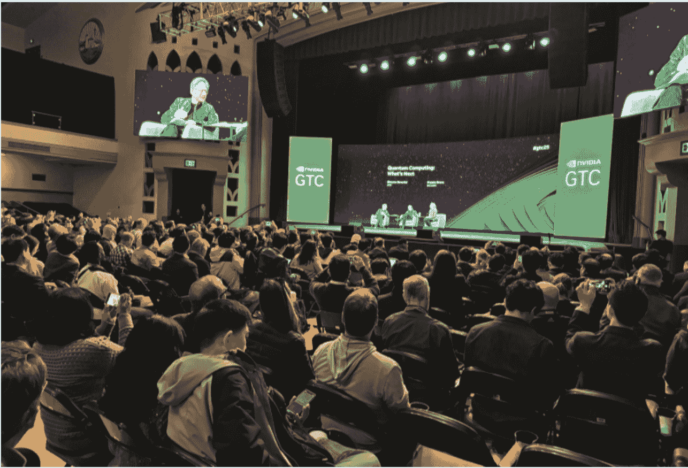

## CAIXIN | 听文章

文 | 财新周刊 刘沛林 发自美国圣何塞

美国当地时间3月18日上午8点，距离英伟达一年一度的GPU技术大会（GTC）开幕演讲还有两个小时，当地最大体育馆之一SAP Center门口排满了候场观众，队伍拐过多个街角，延伸数百米。

10点，英伟达创始人、首席执行官（CEO）黄仁勋如明星般登台，场下座无虚席、气氛热烈。

"去年是GTC第一次重回线下，被称为AI界的伍德斯托克音乐节（世界上最著名的摇滚音乐节之一），而今年的GTC是AI界的超级碗。"黄仁勋笑称。

2025年的GTC是英伟达史上规模最大的一届，线下参会者从上届的1.6万人增至2.5万人，线上参会者超过30万人；为期四天的议程，有超过1000场活动、2000名演讲嘉宾和400家参展商，可见风头之盛。

英伟达是新一轮生成式AI（人工智能）热潮中炙手可热的“算力底座”。2022年ChatGPT引爆这轮热潮后，云厂商出于FOMO（fear of missing out，害怕错过）情绪，在两年多时间内，总计斥资上千亿美元搭建以英伟达GPU（图形处理器）为主的数据中心，用于训练AI大模型。在大模型训练领域，英伟达高端GPU几无替代方案，长期供不应求。由此，英伟达股价迅速飙升，市值一度超过苹果公司，市场预期不断被推高。

但随着大模型标杆OpenAI迟迟未推出下一代预训练模型GPT-5，市场开始质疑Scaling law（规模定律）是否走到尽头；同时，云厂商巨量资本投入，商业化却不及预期，市场担心未来的投资能否持续。红杉资本合伙人David Cahn数次发文，测算全球GPU投入产出间的巨大“缺口”：截至2024年6月，全球厂商所购买GPU全生命周期的最低营收要达到6000亿美元，才能打平资本开支；但终端用户需求不过千亿美元，供需“缺口”上升至5000亿美元。

英伟达自身产品也一波三折。其2024年3月推出的Blackwell架构芯片接连出现过热问题，供货也晚于预期。与此同时，老对手英特尔、AMD也对AI“蛋糕”虎视眈眈。比如AMD于2024年四季度量产了GPU芯片MI325X，已获部分云厂商订单。此外，谷歌、Meta、亚马逊等云厂商亦着手研发自己的专用AI芯片，以降低对英伟达的依赖；美国芯片厂商博通、Marvell等，则凭借多年芯片设计制造积累、网络连接经验，成为云厂商专用AI芯片合作伙伴。

总部位于中国杭州的私募机构幻方量化旗下大模型公司DeepSeek（深度求索），于2024年12月26日发布新一代开源预训练大模型DeepSeek-V3，并在2025年1月20日发布开源模型R1，对标OpenAI最先进的推理模型o1。DeepSeek以远低于美国大模型公司的训练成本，就能推出性能媲美对手的模型产品，且免费、开源，一时震撼了美国AI业界；其侧重算法的路径，也令市场掀起对英伟达GPU需求缩减的担忧。（详见本刊2025年第5期封面报道《DeepSeek启示》）

在3月17日前往英伟达GTC场馆的路上，网约车司机Jaime急切地询问财新：“前阵子美国新闻全是关于DeepSeek。那家中国公司花了几百万美元就训练出了AI（大模型），打败了美国公司花十几亿美元训练的，这是真的吗？现在是不是应该卖掉英伟达股票？”当2024年11月英伟达开始冲击150美元/股关口时，市场就开始“恐高”，对算力市场泡沫产生犹疑。2025年中国蛇年春节前后，DeepSeek火爆全球，市场对算力泡沫的担忧情绪加重，推动英伟达股价震荡回调，同期美国科技股也几乎集体大幅回调。到3月27日，市场担心美国进一步限制英伟达为中国市场推出的H20芯片出口，英伟达股价跌至111美元/股附近，市值2.72万亿美元，距离1月初巅峰的3.66万亿美元跌超两成。

黄仁勋试图用这场长达两个多小时的演讲重振市场信心。他不仅发布了主打AI推理能力的下一代芯片Blackwell Ultra，还一口气公布了未来三年内四代芯片产品的路线图；此外，还推出首款开源推理软件Dynamo，号称可以将DeepSeek-R1模型的运行速度加速30倍。

英伟达甚至亲自下场打造AI应用的“样板间”，发布了基于Llama训练的首款开源推理模型，以帮助企业直接构建智能体；以及首款开源的人形机器人通用基础模型等产品。黄仁勋认为，生成式AI（Generative AI）的下一步是智能体AI（Agentic AI），未来智能体将取代企业软件彻底改变工作流，智能体能自主使用工具、解决问题；而智能体AI的下一步是物理AI（Physical AI），AI能够理解真实物理世界，并赋形予AI，从而实现真正的AI和物理世界的融合。

黄仁勋强调，2028年全球数据中心资本开支将达到1万亿美元，英伟达仍将受益于此。目前，Blackwell正在全力生产，客户的需求是不可思议的。

可以看到，英伟达的技术和产品布局全面而长远，具象地勾勒了AI时代的演进路线，而它自是弄潮儿甚至引领者。美国银行、Bernstein的分析师均给出了积极评价，认为英伟达在基础设施和数据中心市场的地位将加强，分别维持其高达200美元/股、185美元/股的目标价。但中国券商华泰证券的观点也有代表性，这些谨慎的机构认为，从英伟达GTC开幕当天跌3.4%的股价表现来看，发布会未能完全打消投资人对规模定律的忧虑，虽然推理路线有望成为推动AI算力增长的主要动力，但需求什么时候爆发、谁能成为最受益的公司，目前还不确定。

市场之外，英伟达面临的潜在政策风险在加剧。1月13日，拜登在卸任美国总统之前，仓促出台了《人工智能扩散暂行最终规则》（Interim Final Rule on Artificial Intelligence Diffusion），对AI芯片的限制扩大到全世界，即无论出口到全球哪个国家，都需要美国的许可，只是不同国家及实体有不同待遇。英伟达原本预计世界各国的主权AI需求将带来数百亿美元的营收，但步步加严的出口管制政策令未来充满不确定性。在被问及上述政策对英伟达在中东等地区销售的影响时，黄仁勋仅含糊回应：该规则是一个长期的问题，英伟达希望能用美国的技术和标准来支持每一个国家。

英伟达的新产品和中国市场无缘，目前其能在中国销售的是基于落后一代架构的“特供版”H20和落后两代架构的“特供版”L20。尽管英伟达向中国客户保证将基于H20进行软件和硬件的优化，但历经打压的中国厂商已清醒地转向国产替代，包括阿里、腾讯、百度等在内的中国科技公司纷纷加码自研AI芯片，并加大与华为昇腾等国产GPU的适配。在被问及中国市场时，黄仁勋的表态一如既往的无奈：当世界变得复杂，这些决定不是公司能够做的，公司只能在法律允许范围内尽力服务客户。

## 顺应推理模型

DeepSeek火爆“出圈”极大地冲击了大模型公司及云厂商的认知，中美大模型厂商纷纷推出新模型以对标DeepSeek-R1，竞争从预训练转向推理应用。黄仁勋顺势将DeepSeek-R1等推理模型，变成延续英伟达增长的新叙事。（详见本刊2025年第8期封面报道《DeepSeek效应》）

在本届GTC期间，黄仁勋反复强调，DeepSeek-R1、OpenAI-o1等推理模型正带动AI应用落地，使得推理调用需求大幅增长；推理模型在预训练之后的后训练（post-training），通过强化学习、思维链等技术增强能力，对算力的需求不降反升。

黄仁勋指出，随着推理模型成为主流，后训练和测试时缩放（test-time scaling）将是下一阶段“规模定律”的重点。他认为，推理模型产生的token（词符）数量将是预训练模型的100倍。

在开幕式播放的演示视频中，黄仁勋直接将DeepSeek-R1和Meta最新的预训练模型Llama 3.3 70B对比，要求两个模型解决同一个婚礼排座位的复杂任务，后者在很短的时间内生成了439个token但未满足要求；而前者经过了长思考，生成了8559个token，并实现了要求。

“一面是439个毫无用处的token，一面是超过8000个有用的token，而这只是一个简单的问题带几个复杂的变量而已。”黄仁勋称，DeepSeek-R1仅有6710亿个参数，而下一代推理模型参数量可能达上万亿个，计算量还将大幅提升。

英伟达新推出的AI芯片的卖点，也从以往的预训练转向推理。英伟达称，新推出的Blackwell Ultra是为AI推理而生的芯片，例如运行6710亿参数的DeepSeek-R1，在相同时间内，Blackwell Ultra生成的token数量是前代采用Hopper架构芯片的10倍，同样任务的处理时间从1.5分钟减少至10秒。基于Blackwell Ultra芯片，英伟达推出了面向企业训练、部署AI模型的工作站DGX station，仅有消费级PC机箱大小就能提供20 PFLOPS的算力，堪比数据中心。

英伟达还明确释放了未来三年的产品路线图：2026年下半年，将推出基于下一代架构Rubin的AI芯片相关产品，算力指标是Blackwell Ultra的3.3倍，内存从HBM3e升级到HBM4，内存传输速度快1.6倍，GPU间互联协议也从NVL72升级到NVL144，即支持144块GPU芯片互联。从Rubin架构开始，英伟达还计划创新性地采用CPO技术（光电共封装），即在代工环节将芯片和光通信模块封装在一起，能提高带宽密度并降低通信时延，有望颠覆现有的芯片和光通信模块的连接方式；2027年下半年，英伟达还将推出Rubin Ultra，算力指标达到Blackwell Ultra的14倍，内存升级至目前量产的最先进的HBM4e，互联协议再升级至NVL576；2028年，将推出新一代架构Feynman，升级芯片内存、GPU互联协议、网络交换机等关键部件。

黄仁勋强调，下一代架构Rubin将采用台积电3纳米工艺，576块该芯片的系统将包含1300万亿个晶体管，在FP4的推理精度下最高可提供15 EFLOPS的算力。作为对照，英伟达2024年发布的Blackwell架构采用台积电4纳米工艺，单芯片晶体管为1040亿个——目前，AMD、英特尔等竞争对手的硬件指标尚未达到这一水平。

硬件之上的软件和生态，是英伟达的“护城河”，除了深耕已久的软件开发生态CUDA，2023年以来陆续推出了训练、推理AI大模型的算力租用服务，并针对语言大模型、视觉、研发等不同场景推出了大模型代工服务。英伟达还直接向最终用户推出了数十项生成式AI“微服务”，利用这些微服务，用户可在自家平台创建和部署定制AI应用，同时保留对相关知识产权的完整所有权和控制权。

在本届GTC上，英伟达推出了首款开源推理软件Dynamo，该软件可以协调并加速数千个GPU之间的推理通信，让大型语言模型的处理和生成分配到不同的GPU上，从而最大化地利用GPU资源。例如，在Hopper架构的芯片平台上，使用相同数量的GPU，使用Dynamo软件可为Llama模型的运营方提高一倍性能和收益；而在72卡Blackwell芯片的机架上运行DeepSeek-R1模型，使用Dynamo软件在相同时间内生成的token数量是未使用的30倍。

美国开源模型第三方推理服务商Together AI，已宣布将其自研的推理系统和Dynamo集成，以实现更高效的推理效果。

英伟达负责超大规模数据中心和HPC（超级计算机）的副总裁Ian Buck进一步向财新指出，该软件同样可运行在前几代硬件平台上。这也意味着A100、A800、H20等芯片也可使用该软件获得推理速度大幅提升，中国一众提供开源模型推理服务的厂商将获益。

一名中国大模型行业人士向财新分析称，英伟达推出Dynamo，一方面降低了开源模型的推理部署门槛；另一方面，对提供推理部署服务的厂商来说，Dynamo可使其更高效，预计未来推理价格将进一步降低。

## 重在AI应用

尽管黄仁勋强调英伟达在推理时代的关键地位，但市场普遍认为，用于训练的算力投资到2025年可能已达高点，下一个上行周期需要等待智能体 AI和物理AI等应用的成熟。

在黄仁勋看来，智能体AI是继认知AI、生成式AI之后的第三阶段，根本区别在于智能体可以进行逻辑推理。智能体AI可以理解复杂情形，进行逻辑推理并给出答案，还能推理得出下一步行动，并使用不同工具。而最终阶段是AI能够全面理解三维物理世界，并能理解摩擦力等抽象物理概念，从而以机器人、自动驾驶车辆等形式和物理世界互动。

相较此前强调硬件产品，近年来推动AI应用的软件、工具库等成为英伟达发布会的“重头戏”。此次GTC期间，英伟达发布了首个自研的开源推理模型Llama Nemotron、首个开源的人形机器人模型Isaac GR00T N1；前者对应企业开发智能体应用，后者对应人形机器人企业开发。此外，英伟达还发布了新的Cosmos世界模型，该平台主要用于合成运动数据，可让公司以更低成本训练人形机器人或自动驾驶汽车等。

英伟达介绍，Llama Nemotron推理模型是基于Meta旗下开源模型Llama训练，英伟达改进之后，使其准确率较基准模型提高了20%，推理速度是其他开放推理模型的5倍。目前埃森哲、楷登电子、德勤、微软和SAP等公司已与英伟达合作构建智能体。

以美国餐饮集团Yum! Brands为例，其与英伟达合作，在旗下必胜客和Taco Bell两个产品线推出智能体，以处理复杂的订单并作出推荐，从而帮助顾客完成自助点单。Yum! Brands计划2025年旗下500家餐厅都完成这一AI部署。

市场调研机构Gartner指出，到2028年，至少15%的日常工作决策将会通过智能体AI自主作出。咨询公司波士顿咨询亦称，2024年，智能体AI的市场规模约为57亿美元；而到2030年，这一数字将达到521亿美元，年复合增长率高达45%。

英伟达也在下注人形机器人、自动驾驶等场景。英伟达称，采用GR00T N1，结合英伟达的世界模型Cosmos和仿真平台Omniverse，开发者可以仅凭少量人类演示生成大量合成数据，比如利用该组件11小时内生成78万条合成数据，相当于6500小时或连续9个月的人类演示数据。

目前，美国机器人公司Agility Robotics、波士顿动力、以色列机器人公司Mentee Robotics和德国机器人公司NEURA Robotics等头部机器人公司，都已基于GR00T N1进行研发。“在我们开发自有模型的同时，GR00T N1为机器人的推理和技能提升提供了极大的帮助。我们利用最少的训练后数据，在产品上进行了全面部署。”挪威人形机器人创业公司1X Technologies首席执行官Bernt Reite Bjørnichen称。

在GTC现场展示中，Agility Robotics的人形机器人Digit，可以从超市货架上选购商品并装入购物篮。1X的人形机器人NEO外形、动作更像人类，可以感受到周围情况并和人类语言交流，几乎感受不到延迟；还可以对人类命令下执行浇花、吸地等任务。显然，这些机器人远未实现真正的智能，除了受电池、灵巧手等硬件能力的约束，由于一直接受针对性训练，尚无法应对复杂多变的突发状况。

缺少足够的真实数据，是机器人提高智能水平的最大瓶颈。美国机器人创业公司Ambi Robotics联合创始人Ken Goldberg指出，适用于机器人训练的真实数据目前主要通过真人模拟来收集。大语言模型Qwen-2.5的训练数据量相当于真人收集12亿个小时，而具身智能模型π0一年收集的训练数据量仅为1万小时左右，这也意味着具身智能模型若想达到大语言模型的智能程度，以现在的方式、速度收集数据，还需要12万年。（详见本刊2025年第11期封面报道《机器人来了》）

英伟达负责Omniverse仿真平台、物理AI的副总裁Rev Lebaredian对财新直言，以大语言模型类比，英伟达推出的Cosmos世界模型目前水平仅相当于GPT-1，“直到GPT-3，ChatGPT才真正变得对大众有意义，而真实物理世界远比自然语言的规则更复杂”。

自动驾驶层面，英伟达主要布局车内计算、用于自动驾驶算法训练和数据仿真的基础设施两大业务。英伟达汽车事业部副总裁Ali Kani向财新介绍，2025财年，英伟达的汽车业务收入达到50亿美元，其中大部分由基础设施业务贡献。为自动驾驶企业提供基础设施，才是英伟达汽车业务的真正定位。“即便特斯拉未采用英伟达的自动驾驶芯片，但其亦采购大量的英伟达AI芯片用于数据中心，服务于算法训练。”

在被问及如何看待近年来崛起的地平线等中国汽车芯片公司时，Ali Kani指出，这些汽车芯片公司的定位还是做车内计算，而英伟达专注于更大的基础设施市场。即便在车内计算市场，英伟达的产品仍牢牢占据高端市场。“现在，它们正在开发软件方案，我们也希望和它们合作，帮助它们训练、生成仿真数据。”

## 技术路线胜负未决

华泰证券认为，目前智能体AI和物理AI等应用大规模商用的时间点尚不明确。实际落地时，博通等ASIC（专用集成电路）方案、DeepSeek等优化算法和系统架构的方案、英伟达的GPU方案，目前还不能确定谁会胜出。

为降低成本、提高效率，近年来，包括谷歌、亚马逊、微软在内的云厂商纷纷自研AI芯片。AI加速芯片按照技术路线可以分为GPU、FPGA（可编程芯片）、ASIC三类，由于ASIC设计目标明确，为特定的应用进行优化，因此其性能在特定场景通常比通用芯片更好；不过，亦因受限于特定结构，ASIC开发周期长且不易更改，存在技术短板。美国芯片厂商博通和Marvell（美满电子）是主要的代工方，前者客户包括亚马逊AWS、谷歌和微软等；后者近年来成为亚马逊AWS、微软的供应商。受益于云厂商加码自研AI芯片，博通、Marvell股价在2024年翻了一番。

3月6日，博通发布2025财年一季度财报，当季实现AI相关收入41亿美元，同比增长77%，占总收入149亿美元的28%。博通CEO陈福阳透露，当季又有两家大型客户选择和博通合作开发AI芯片，目前该业为大客户达到4家。博通正和这些客户紧密合作打造专用计算系统。“制造一款芯片通常需要1年半时间，而我们现在有一套成熟的框架，可以加速这一过程。”他还强调，ASIC在矩阵运算等任务中效率比通用加速器高50%以上，且功耗降低约30%。

华泰证券预测，全球数据中心中，ASIC的市场规模预计在2025年达100亿美元，2028年飙升至429亿美元，年复合增长率45%。ASIC在推理领域的份额，将从2023年的5%提升至2028年的25%。

ASIC来势汹汹，市场一度传出英伟达要组建ASIC事业部的消息。此次GTC期间，在被问及ASIC芯片会否对英伟达产生威胁时，黄仁勋回应称，英伟达在2022年3月发布Hopper架构的AI芯片至今没有竞争对手，且在三年内新推出了四代AI芯片，业界也已基于英伟达GPU投资了数千亿美元打造AI应用，ASIC很难复制。“仅仅是建造了一些（基于ASIC）的东西，并不意味着它是伟大的。”黄仁勋说。

博通之外，受限于美国先进芯片出口禁令的中国公司，正从算法及系统优化入手，探索另一条“去英伟达化”路径。

3月11日，蚂蚁集团旗下百灵大模型团队发布论文，提出了一种在资源和预算受限条件下的大语言模型的训练策略。该团队称，在较低配置的AI芯片上，该方法也能实现大模型的训练任务，且成本仅为每1万亿个token 508万元，较使用H800方案所花的635万元低20%。

蚂蚁集团称，该论文证明了国产大模型能够寻找成本更低、效率更高的非英伟达芯片或其他替代方案，以进一步降低对包括英伟达A100、H800在内的高性能AI芯片的依赖。

"以前，中国业界确实对美国禁令忧心忡忡，担心与美国先进技术水平的差距越拉越大，但是近年来中国国产半导体产业链各个环节都取得了很大的进步，大家的信心明显增强，至少现在觉得美国卡不死我们了。DeepSeek出来后，大家又看到了新的路径，未来从算法和系统优化层面发力的公司会越来越多。"一名中国半导体产业链资深人士对财新称。

2022年10月以来，美国连续发起三轮大规模对华芯片制裁，围堵中国先进算力。英伟达一退再退，先是将先进GPU H100和A100“阉割”带宽，推出特供中国的H800和A800；此后这些特供版芯片也受限，英伟达于2024年一季度向中国市场推出了H20，性价比大打折扣，然而这已是现行芯片出口管制下的“天花板”。

可预计的是，短期内英伟达对华销售不会改观。财报显示，2023年四季度，英伟达来自中国大陆的营收占比已由此前的20%—25%降至个位数百分比，此后一直维持这一水平。在2025年2月26日的财报会上，黄仁勋称，相较于出口管制措施出台前，英伟达在中国的数据中心收入已经减半，公众号懒人搜索，懒人专属群分享。

包括中国移动、百度、美团、科大讯飞等在内的中国企业正在转向以华为昇腾为代表的国产GPU方案，华为甚至一度成为英伟达公开点名的中国市场头号竞争对手。昇腾910发布于2019年8月，起初采用台积电7纳米工艺；此后的910B提升了内存容量，升级了类似英伟达NVLink的华为自研接口，大模型训练能力明显提升。据财新了解，目前市面上主流的昇腾方案均采用了910B，而下一代910C也已量产。

目前使用华为芯片意愿较高的主要为“信创类”客户，它们往往更注重自主可控，而非性能和使用体验。

各方也在努力优化国产芯片及生态系统，使其从“可用”逐渐走向“好用”。一名头部云厂商人士告诉财新，美国不允许英伟达卖A800给中国厂商之后，运营商大量下单华为昇腾910B，并寻求与壁仞、摩尔等国产GPU适配。2024年，中国移动建设内蒙古呼和浩特的万卡集群，设备国产化率超过95%。到8月哈尔滨万卡集群建成时，已是百分之百国产化了。目前，哈尔滨智算中心部署了1.8万张AI加速卡，提供算力6.9 EFLOPS（每秒690亿亿次浮点运算），相当于300多万台高性能计算机。

“中国移动对待国产芯片的原则是‘能用尽用’，与华为、阿里、壁仞、燧原、摩尔线程、海光等国产芯片厂商都建立了合作，并通过软件进行系统优化。芯片厂商也很积极，大家的共识是要把国产生态培育起来。到2024年底，中国移动的智算系统运转基本没有问题了。”上述名头部云厂商人士称。

AI算力标准化服务商无问芯穹，亦在2月11日宣布打通了在壁仞、海光、摩尔线程、沐曦、昇腾、燧原、天数智芯七家国产芯片平台的DeepSeek-R1“满血版”模型的推理服务，意味着不同来源的各类国产芯片可以组成统一的“算力池”，终端用户无需考虑底层国产芯片的兼容问题。

整体来看，国产GPU落后英伟达1—2代的水平。无问芯穹联合创始人、CEO夏立雪向财新指出，英伟达芯片也一直领先的根本原因是成功搭建了应用生态，从而能够掌握技术发展方向。而卡住很多国产芯片公司的的问题是不知道下一个芯片该怎么做、向哪个方向发展，随着越来越多终端用户使用国产芯片部署DeepSeek模型，这些国产芯片厂商就能掌握更多数据作为未来发展的参考。

## 相关视频：

【华尔街原声】黄仁勋：DeepSeek的推理能力对算力需求不降反升

## 视频说明：

2025年3月19日，英伟达创始人兼CEO黄仁勋表示，因DeepSeek的推理特性，它对算力的需求不降反升，比传统大模型高出100倍。

## 更多报道详见：

【专题】AI全景、DeepSeek与全球AI竞赛

## 最新财新周刊 | 低空飞行里程焦虑

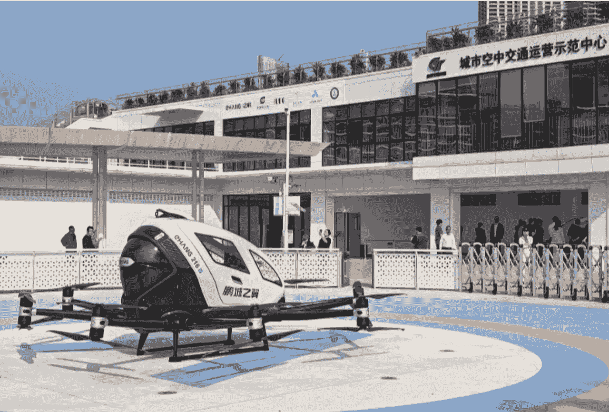

## CAIXIN | 听文章

文 | 财新周刊 方祖望

电动垂直起降飞行器（Electric Vertical Take-off and Landing，eVTOL）是低空经济的核心硬件，也是眼下政策和资本的宠儿。

部分人士认为，欧美企业在通用航空领域领先全球，而中国企业在eVTOL领域先行一步，eVTOL有望扮演与新能源汽车类似的角色，帮助国内通航产业实现“变道超车”。

eVTOL并不能“躺赢”，它需要先飞起来，再逐步开展商业化运营，最终实现“多拉快跑”，才能持续证明自己的价值。但现在，eVTOL面临与新能源汽车发展初期类似的瓶颈。

由于电池技术制约，纯电动eVTOL续航里程并不理想，应用场景大受限制。多名业内人士告诉财新，目前各类构型纯电eVTOL极限航程仅200公里左右。

混合动力作为eVTOL行业新兴动力路线，正在吸引资本注意。[追梦空天科技（苏州）有限公司](https://www.example.com)（下称“追梦空天”）是国内最早研发混合动力eVTOL的公司之一。该公司在2月20日宣布，连续完成Pre-A及Pre-A+轮亿元级融资。

2月27日，成立不足一年的混动eVTOL企业[蓝霄航空科技（济南）有限公司](https://www.example.com)（下称“蓝霄航空”）也宣布，连续完成数千万元天使轮和天使+轮融资。

据追梦空天和蓝霄航空披露的数据，两家研发的增程式混动载物eVTOL可实现最高1000公里续航里程。[天翎科航空科技（上海）有限公司](https://www.example.com)（下称“天翎科”）也是同类企业。该公司发布的数据显示，其增程式混动载人eVTOL的续航里程可以达到600公里。

混动eVTOL还在起步阶段，全球范围内，纯电仍然是主流动力路线。美国头部eVTOL企业 Joby （NYSE：JOBY）、Archer （NYSE：ACHR）旗下主力机型均为纯电。

国内亿航（NASDAQ：EH）、上海峰飞航空科技有限公司（下称“峰飞航空”）、四川沃飞长空科技发展有限公司（下称“沃飞长空”）、上海沃兰特航空技术有限责任公司（下称“沃兰特”）、上海时的科技有限公司（下称“时的科技”）、御风未来飞行科技（广东）有限公司（下称“御风未来”）等知名eVTOL企业均坚持纯电动力。

沃兰特创始人董明告诉财新，从技术角度看，纯电路线确定性更高，纯电产品能更早进入商业循环。随着技术进一步发展，业内对固态电池寄予厚望。它以固态电解质替代液态电解液，有潜力将eVTOL的极限航程提高到400公里。

除了续航里程，商业应用还要考虑补能效率。正是因为电解质固液转换，固态电池充电速度难以提升。行业因此把换电模式当作另一种解决方案。换电可以缩短补能时间，提高eVTOL起降频次，难点在于换电站建设投入大、运营成本高，无法快速铺开网络。

看好混动路线的人士称，混合动力eVTOL可以兼顾续航和补能，既能提高运营效率，又可减少对基础设施的依赖。他们认为，新能源汽车的发展历史会映射到eVTOL领域。新能源汽车行业发展初期，大部分从业者都把混合动力看成过渡产品；如今，混动车辆销量增速持续领先于纯电动产品。

增程式混合动力eVTOL正在研发环节稳步推进。但这类动力系统也有短板，它包含内燃机，生产制造更复杂，成本也更高，而且国内民航监管机构目前还没有混合动力eVTOL的适航经验。

适航审定是民航监管机构对航空器安全性的技术审查，也是航空器商业化运营的前提。放眼全球，混合动力航空器适航都属于前沿领域。监管部门的态度将决定混动路线在eVTOL领域的发展态势。

## 续航双重限制

全球航空巨头对eVTOL续航也缺乏信心。空客直升机从2015年就开始研发eVTOL。2025年1月27日，空客直升机首席执行官（CEO）布鲁诺·埃文（Bruno Even）在业绩电话会上宣布，公司将暂停eVTOL项目。

布鲁诺·埃文称，eVTOL的产业链不够成熟，电池还不能满足80至100公里的续航需求。空客评估认为，如果eVTOL达不到该航程，商业模式就难以成立。

保时捷管理咨询（Porsche Consulting）航空航天板块负责人吕东泽告诉财新，eVTOL的核心应用场景聚焦在100公里至400公里的中短途通勤及物流。如果距离太近，专车等地面交通不需要接驳，更加高效；而一旦距离过远，民航客机更具经济性。

美国Joby和国内峰飞航空旗下的eVTOL机型都成功验证过超过200公里的试飞。不过，在这两家企业试飞时，机上均无乘客，而实际运营通常需要满载。

行业人士还提示，非载人试飞时，企业为尽可能增加续航里程，还可能在座舱内额外增加电池。这样达成的极限续航里程没有真正的参考性。

天翎科联合创始人卢懿认为，要摸清eVTOL真实的续航里程，可能要参考美国Joby和Archer已经公布、准备真正运营的航线，这些航线长度均为几十公里，最长不超过100公里。

为了飞得更远，eVTOL搭载电池的能量密度大致为285瓦时/千克（Wh/kg），比车用三元锂电池高出四成，是磷酸铁锂电池能量密度的两倍。尽管如此，现阶段eVTOL仍是短腿产品。

追梦空天创始人蔡文宽告诉财新，eVTOL能耗是新能源汽车的6倍左右，在同样电池技术条件下，如果新能源汽车能跑600公里，eVTOL只能飞100公里。

由于工作状态不同，eVTOL电池还需要更高放电倍率。放电倍率可以通俗理解为电池的“爆发力”。放电倍率的单位为C，倍率越高，单位时间内输出功率也越高。广州凌顶能源科技有限公司是一家专注研发航空动力电池的企业。该公司CEO梅骜告诉财新，新能源汽车行驶时的电池放电倍率通常在1C左右，而eVTOL电池通常需要2C到3C的放电倍率。

市场上常见的汽车动力电池难以满足eVTOL行业发展需求。瑞银证券在2024年8月28日发布的研究报告称，固态电池能量密度和安全性更高，是eVTOL的潜在选择，但固态电池充电速度较慢，应用在eVTOL领域也会存在局限。

使用不同材料作为电池负极，也可以提升电池能量密度。梅骜称，当前车用动力电池多使用石墨负极，而使用硅负极的锂电池具备较高能量密度和较好快充性能，是eVTOL短中期的最优选择。

以金属材料作为电池负极，可将电池能量密度提升至新的高度。梅骜称，更长远来看，以锂作为负极的金属锂电池可实现更高能量密度，是未来最佳选择。

金属锂电池也有缺陷。业内将放电倍率、能量密度和循环寿命称为动力电池“不可能三角”。金属锂电池具备高能量密度，意味着在电池寿命方面会做出牺牲。金属锂负极还对电池安全性构成挑战，这类电池仍处于从实验室到产业化的过渡阶段，技术、工艺等难题还未攻克，商业化应用尚无时间表。

除电池技术，eVTOL的里程焦虑还来自航空运营规章针对安全运行的要求。据美国相关航空运行法规，直升机每次完成飞行任务后，需保留30分钟燃油安全冗余。Joby和Archer的eVTOL即确定按上述规则运行。

中国也有类似规定。不同构型的eVTOL均需留存一定比例电池余量。例如亿航EH216-S的型号合格证数据单明确规定，着陆时电池剩余电量不得低于25%，以确保飞行器在紧急情况下有足够的功率完成安全着陆或复飞。

“纯电eVTOL续航里程原本就不够用，如果再扣除安全冗余，实际航程会更低。”卢懿对财新说。

国内多家eVTOL企业和电池公司开展资本和技术合作，希望取得突破。蔡文宽称，当前最先进的电池技术也只能实现500Wh/kg能量密度，可以将纯电eVTOL续航能力提高约60%，续航里程仍然不及新能源汽车。

## 混动路线潜力

新能源汽车企业针对里程焦虑提出了超快充和换电两种解决方案，部分eVTOL企业也在“复制”尝试。

美国eVTOL企业BETA研发了地面Charge Cube快充桩。该公司称，Charge Cube已部署到佛罗里达等三个州的47个站点。这一方案吸引了头部企业Archer加入快充阵营。2023年11月，Archer宣布，公司将在飞行测试中使用BETA的Charge Cube。

Charge Cube快充桩支持350千瓦（kW）功率输出，为BETA的eVTOL机型充满电约需50分钟，速度仍然不够。蔡文宽认为，eVTOL可能需要600kW或更高的功率，这意味着企业需要额外投资、单独建设专用的电网线路，整体成本是汽车快充桩的数倍。

换电模式的代表企业是德国的Volocopter。该公司旗舰机型VoloCity配备9组电池，所有电池可在5分钟内更换完毕。在换电模式下，电池在站点以较低功率充电，有利于延长寿命，运营商可以通过优化充电时段和降低峰值功率，降低电费成本。

但换电属重资产，运营商不仅要大量投资购买电池、建设站点，还要针对存储、维护持续投入。蔡文宽称，eVTOL单个换电站的成本可能是汽车的10倍左右。

纯电线路及其运营生态方面的薄弱环节给混动eVTOL提供了机会。混动eVTOL主要分增程式混合动力和氢燃料电池混合动力两大类。与氢混路线相比，增程混动在技术上成熟度更高。

增程式混动eVTOL相当于在纯电eVTOL上加装了一套燃油发电机，燃油发电机持续为电池充电，以此提高续航里程。由于不需要和飞机的主驱动系统挂钩，燃油发动机始终保持在较为温和的工作状态，可以大幅降低飞行器对燃油发动机的性能要求。

罗兰贝格在2024年发布的一份研报指出，在城际通勤应用场景中，混合动力更具经济优势。

“航空类动力电池放电倍率高，使用环境恶劣，再加上本身能量密度更高，综合寿命也会低一些。”梅骜说。多名行业人士认为，目前eVTOL电池循环寿命在1000圈左右，远不及汽车动力电池。

更重要的是，eVTOL消耗每圈电池寿命的速度也更快。卢懿称，普通商业场景下，eVTOL完成一次巡航飞行任务起降，差不多就会消耗掉一个电池循环。

上述特性意味着纯电eVTOL需要频繁更换电池。董明称，沃兰特在构建商业模型时，将电池损耗折旧考虑在内，正常商业运营强度下，在研机型的电池更换周期约为每年1次到1.3次。

行业对于eVTOL电池更换周期形成共识。蔡文宽称，纯电eVTOL假如每天运行四至五个小时，就需要消耗两到三个电池循环，差不多一年到一年半，电池就需要更换。

保时捷管理咨询在2025年2月14日发布的研究报告指出，纯电eVTOL电池频繁充放电，加速电池老化。如果将电池折旧成本考虑在内，纯电飞行器的经济性表现远不如混动飞行器。

吕东泽称，根据团队测算，纯电eVTOL单台每公里综合运营成本在9.2元至15.7元之间，混动eVTOL单台每公里综合运营成本可低至7元，公众号懒人搜索，懒人专属群分享。

保时捷管理咨询称，增程式混动eVTOL单次充电可支撑超过五次起降，无需在每次降落后充电，也不要求每个起降点都具备充电能力，可以减少电池在飞机全生命周期中的更换次数，亦可大幅提升机队运行效率和机动性。

据财新了解，在行业发展初期，eVTOL电池缺乏规模效应。目前纯电eVTOL电池容量普遍在150度到200度之间，更换成本约为100多万元。

蔡文宽称，考虑到电池更换折旧，混动eVTOL的运营成本会比纯电eVTOL低10%。不过，混动eVTOL结构更加复杂，在行业发展初期，混动eVTOL整体售价会比纯电eVTOL高出5%至10%。

eVTOL电池价格会伴随产能扩张而下降，增程系统的产业链也会逐渐发展成熟。蔡文宽认为，在行业应用五到六年后，混动eVTOL和纯电eVTOL在售价和运营成本上几乎会持平。未来eVTOL市场可能也会像新能源汽车，容纳纯电和混动两类产品长期存在。

## 局方鼓励百花齐放

国内大多数纯电eVTOL均处于冲击适航取证阶段。一名曾经考察过混动eVTOL企业的风投人士告诉财新，纯电eVTOL适航还在摸索、完善中，再把增程系统这部分加上去，适航难度必然会是更高。此外，混动eVTOL的产业基础还比较薄弱，例如在航空用高转速发电机领域，研发企业并不多。

国内民航监管部门还没有受理过混动eVTOL的型号合格证（Type Certificate，TC）申请，但这并不等于监管部门持封闭态度。TC取证占整个适航审定工作量的九成以上，是其中最重要的环节。近年来，多家eVTOL企业和民航局保持互动，局方亦尽可能为各种新设计构型的eVTOL适航创造条件。

"局方对待新生事物的基本立场是安全和发展兼顾，在一定限制范围内，先让新能源航空器具备基础的安全评价，让它飞起来。"在2023年12月14日举行的深圳eVTOL World大会上，中国民航局适航审定中心广州分中心负责人王敏表达过监管态度。

亿航的eVTOL产品EH216-S就是典型案例。EH216早在2018年就已发布，适航认证直至2021年才有实质性动作。"先制造、再申请"的做法并不符合常规的航空器研发适航流程。

由于航空产品每次改进都需要重新通过适航认证，时间和经济成本极高，因此航空器研发讲究“一次成型”。一名从业人士告诉财新，在产品研发设计阶段，企业就要和民航局密切沟通，确定产品的适航基础，以及对应的符合性验证方法，“而不是把东西做好之后再去找局方过来看一看”。

即便如此，中国民航局表现出开放姿态，在2021年1月受理了亿航EH216-S的TC申请。2022年2月22日，中国民航局发布《亿航EH216-S型无人驾驶航空器系统专用条件》，这也是全球首份针对载人无人驾驶航空器的适航审定文件。2023年10月13日，EH216-S获得中国民航局颁发的TC。亿航成为全球首家获取TC的eVTOL企业。

在亿航之后，民航局又陆续受理了沃飞长空、沃兰特、时的科技、御风未来、小鹏汇天等企业的TC申请。无论是在驾驶模式，还是在构型设计上，这些企业的eVTOL产品都与亿航完全不同。其中，小鹏汇天提交的TC申请更是开创了先例。

小鹏汇天是小鹏汽车（NYSE：XPEV/09868.HK）的eVTOL研发主体，计划推进量产分体式“陆地航母”。“陆地航母”实际上是两个产品，即陆行部分的增程式混合动力皮卡，以及飞行部分的eVTOL。皮卡搭载eVTOL，作为其运载工具和充电站。

小鹏汇天将eVTOL与汽车结合起来的设计，在国内尚属首次。中国民用航空中南地区管理局在2024年3月21日受理了飞行体X3-F的TC申请。2025年3月17日，民航局航空器适航审定司发布了X3-F的适航专# 显影 | 上海“梧桐区”网红小店浮沉：出局和入局的年轻人

3月中旬，武康大楼前，许多游客正在拍照留念，包括前来拍摄婚纱照的新人。

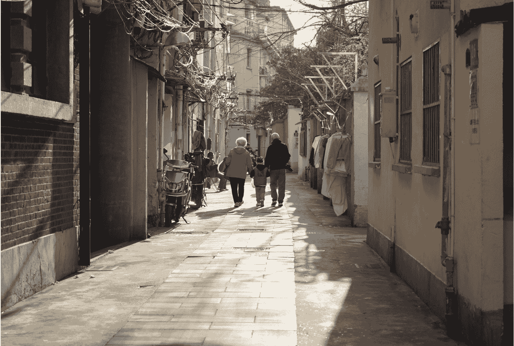

3月初，“梧桐区”的弄堂里，一对老年夫妇带着孙辈散步。

毛曼观察，“最近，附近的店铺是关停蛮多的”。她推测一方面是因为街区走红推动了房租水涨船高，另一方面或许跟许多外国人离开上海有关。虽然疫情结束后居住在上海的外国人数量较疫情期间有所回升，但跟疫情前相比仍有不小的差距。根据上海发展统计公报，2019年，上海旅游入境的外国人为692.12万人次；2024年，上海边检总站数据显示的入境外国人为456万人次。

检索公开报道即可发现，2024年年末的确有不少“梧桐区”的网红小店宣布闭店。比如永康路上，在大众点评上有着10.5万收藏量的甜品店56 rue de YongKang于2024年12月29日结业；而在大众点评上有5.8万人收藏、产品冲上过品类Top1的愚园路 上的咖啡店Dosage，于2024年12月26日结束营业。

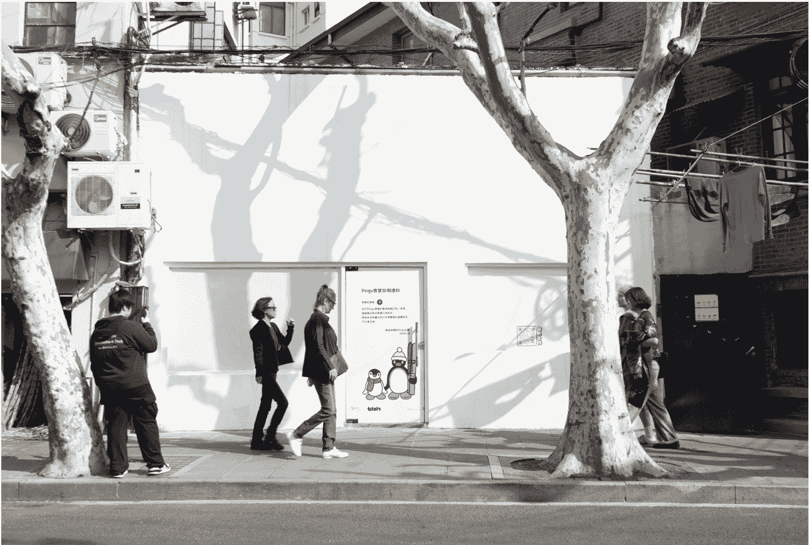

3月初，延庆路上的一家快闪店门口，路人在拍照留念。

2月下旬，永康路上，附近的居民在一家闲置的店铺外休息，其前身是大众点评上有着10.5万收藏量的网红甜品店。

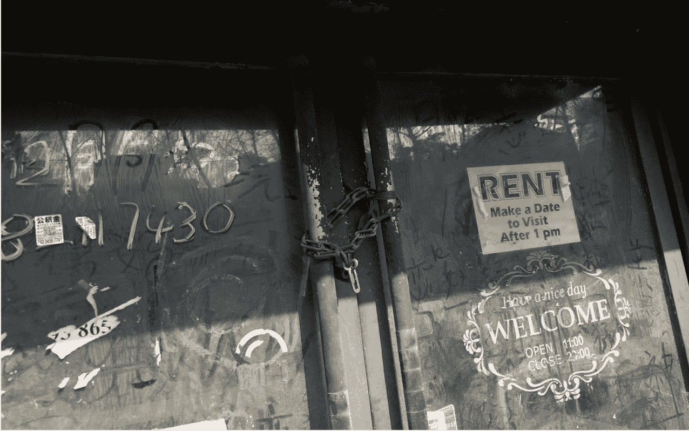

“梧桐区”富民路上，一家闲置的铺面外贴着英语出租广告。

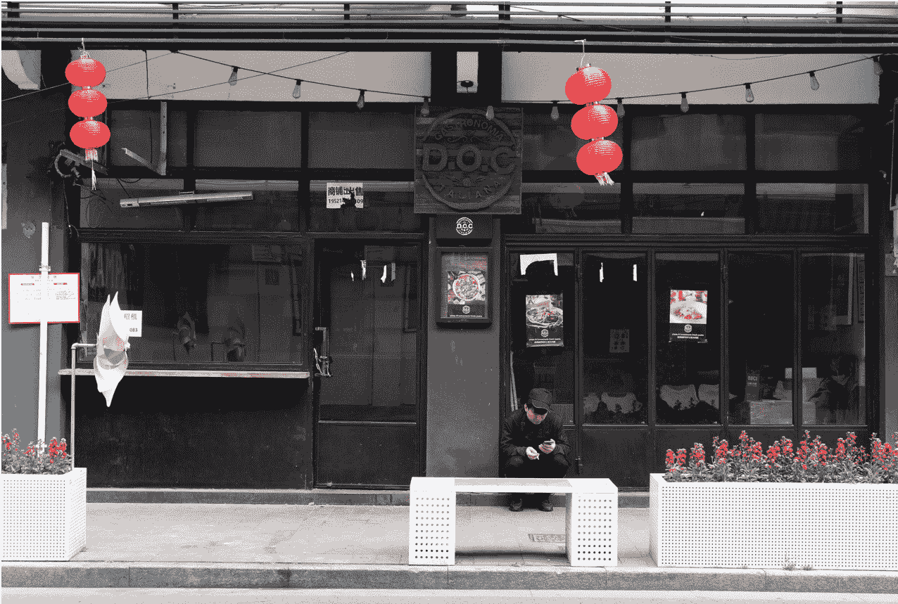

2月下旬，永康路上，一家西餐厅处于停业状态，一名隔壁店铺的服务员在店外休息。

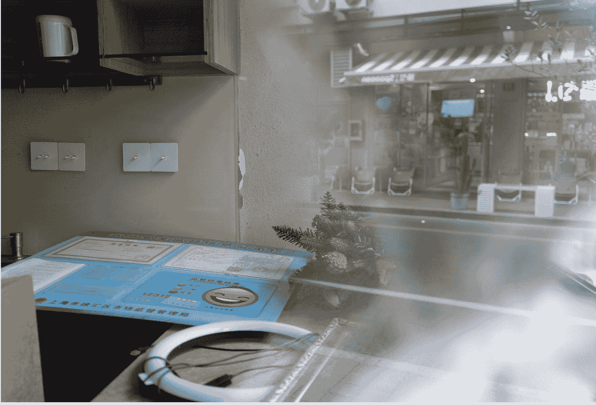

2月下旬，永康路上一家停业的咖啡店内，食品安全监督公示牌被遗留在店内。

上海据称是拥有咖啡店数量最多的城市。《2024中国城市咖啡发展报告》显示，2023年上海咖啡门店数量达到9553家。澎湃研究所公布的2024年数据也有8000多家。在“梧桐区”所在黄浦、静安、徐汇三个行政区，咖啡馆的密度最高。

天气晴朗时，东湖路上餐厅的外摆区坐满了人，许多居民带着孩子外出散步。

“梧桐区”另一种主流业态是精致餐饮。2022年上半年，上海精致餐饮市场门店数量达到885家，位居全国第一。其中，黄浦区有220家，占上海市总量的24.8%，是上海精致餐饮密度最高的行政区。截至2024年上半年，上海精致餐饮门店数量超过1000家。

延庆路上，游客在city walk，装修工人在搬运水泥。

进入2025年，有不少网红小店在出清，同时又有不少商铺外冒出了装修围挡，工人们拉着建筑垃圾与新的装修物料进出进出——许多新店又在紧锣密鼓地筹备开业。似乎随着天气的变化，“梧桐区”的商业生态也有转暖的迹象。

3月初的晚9点，体感温度仅3°C，一身黑色的小贾带着三名工人出现在建国西路路口，岳阳大楼一家欧式装修风格的咖啡店门前。店门上镶嵌着彩色玻璃花窗，橱窗上用记号笔写了出租咨询电话，门口摆着等人高的圣诞树，枝叶已经全部干枯发黄。

小贾是这家咖啡店的职业店长，咖啡店在2024年6月份正式开业，仅9个月后，就因为营业收入水平无法负担房租选择结业。下午，他一个人将店内的东西盘点了一遍，晚上就带着工人们把冰柜、咖啡机、磨豆机等大件设备装车，再把各种箱子垒在上面处理掉。小贾一边指挥着工人的行动，一边把一大筐瓷质餐具递给工人。工人问他是否要打包，“不要紧的，我已经做好了碎掉一部分的准备”。

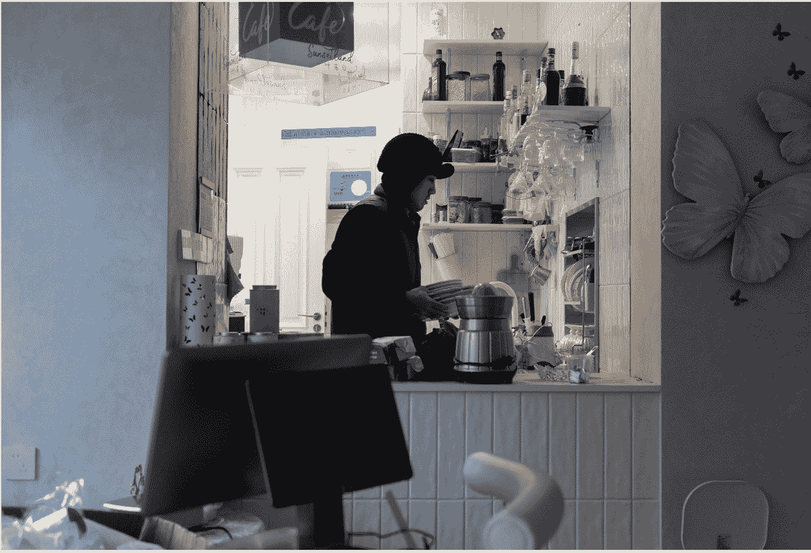

3月初，小贾作为职业店长管理的咖啡店选择关店，他在后厨整理值得搬走的用具。

3月5日下午，小贾清点完咖啡店内要搬走的设备后，在店门口抽烟，等待搬家工人。

晚9点，搬家工人把小贾咖啡店里边的冰柜搬到拖车上。

其中一名搬运工人其实是附近一家五金店的老板，小贾作为职业店长管理过五六家店，都是请这位工人帮忙的。他熟练地用绳子捆扎固定住车上的大包小包，然后转弯开上了岳阳路，消失在道路尽头。

“梧桐区”白天路窄人多，又时常有交警检查，因此店铺搬迁通常选择晚上。Raphael的手冲咖啡店也是在晚上搬走的。一般咖啡店通常有一台又大又重的意式浓缩咖啡机，而手冲咖啡只需要磨豆机、滤纸、滤杯、手冲壶、咖啡壶、电子秤和温度计，一个小箱子就能打包带走。2月底营业的最后一天晚上，Raphael一个人就将这些工具收进了仓库。

七岁之前，Raphael和外公外婆生活在上海的弄堂里。每天早上，外公会用摩卡壶做咖啡，Raphael就会被咖啡香气唤醒。2007年本科管理学毕业后，Raphael决定开一家咖啡店，先是在杭州滨江区开了第一家，2020年回到上海开了第二家，选址最终落在了淮海中路人民坊的弄堂里。2022年，又陆续在日本东京、大阪开了店。

2月27日下午，Raphael的手冲咖啡店营业的最后一天，他与顾客合影。

据Raphael描述，关闭上海的店是因为从2022年开始他本人常住日本，上海店没有聘请咖啡师，因此处于不常营业的状态。Raphael觉得，“上海的房租简直是全世界最贵的”，对上海店的盈利状况，他没有明确的账目明细统计，只是觉得“应该没亏，银行卡里还有钱”。

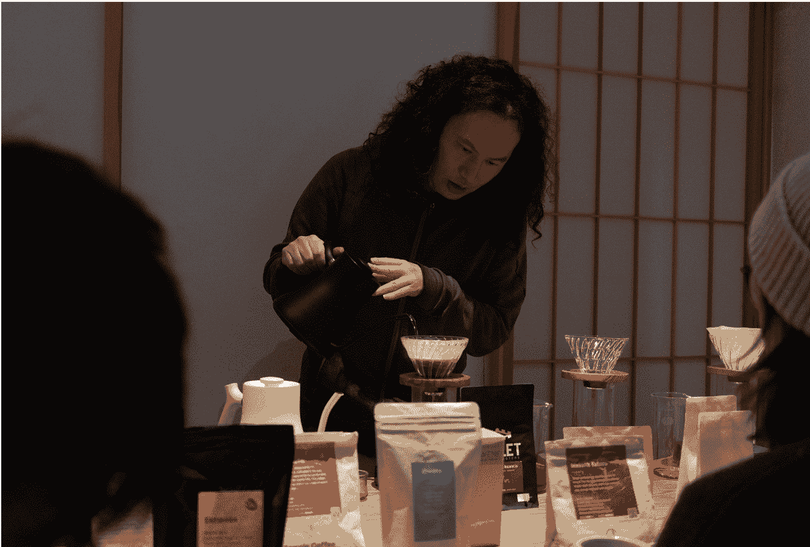

Raphael在店里给客人制作手冲咖啡。每天，他会根据不同的天气、环境氛围等因素，摆出十几种不同风味的咖啡豆。

Raphael的“粗心”还不止于此，他曾经在一周内交了两次房租，直到房东退款才意识到。但他做咖啡很讲究，吸引了不少忠实客户。在咖啡店营业的最后一周里，店里几乎时时坐满顾客，他们中有些专程从杭州赶来，有些甚至是东京店和大阪店的顾客。最后一周，他还开设了四天的手冲咖啡教学课程，“梧桐区”新晋咖啡店主硬仔就是学员之一。

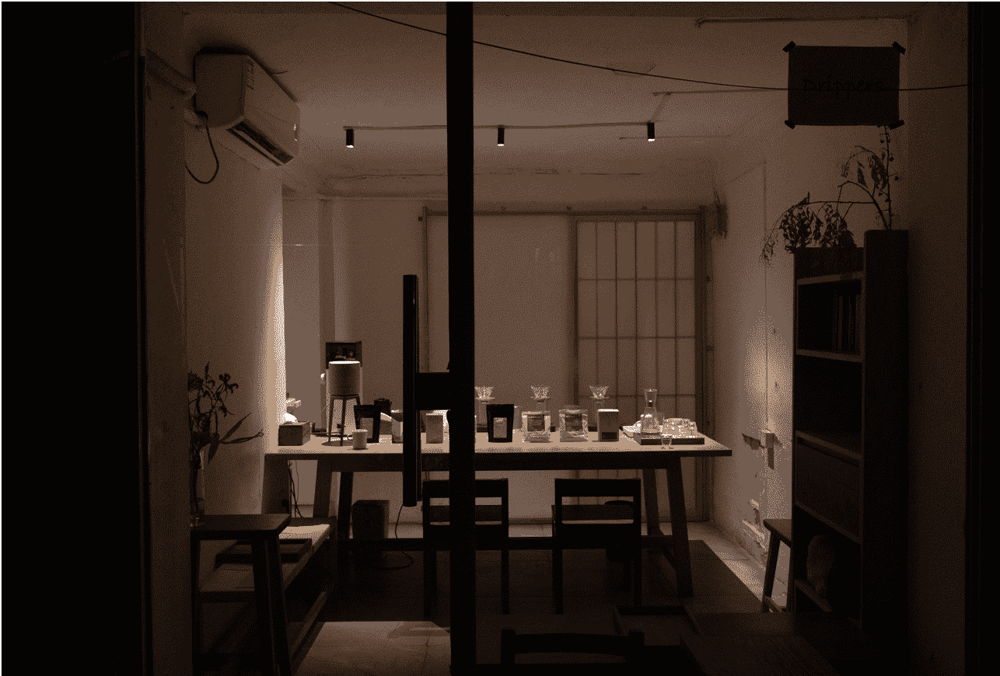

## 2月底，Raphael的咖啡店营业的最后一个晚上

在开店之前，硬仔在互联网大厂工作了三年，最终在2024年10月提出了离职。离职前一段时间，她在去工作的路上经常会无意识地哭泣，回家后也哭，“不仅仅是工作本身的压力，还有和其他人协作承受的情绪压力也非常大。”

提出离职后，硬仔开始思索实现自己在五六年前就产生的想法——拥有一个自己的品牌，而独立咖啡店成了首选，选址就在“梧桐区”，“这里的生活方式与独立咖啡店是匹配的”。硬仔深知“梧桐区”咖啡店的竞争激烈，经过对国内外咖啡店的实地考察，她为自己的店铺制定了差异化的经营策略：主打和中式茶叶结合的鸳鸯咖啡；同时考虑到“梧桐区”的居民养宠比例高，她计划组织宠物户外团、开发牵引绳等宠物用品。

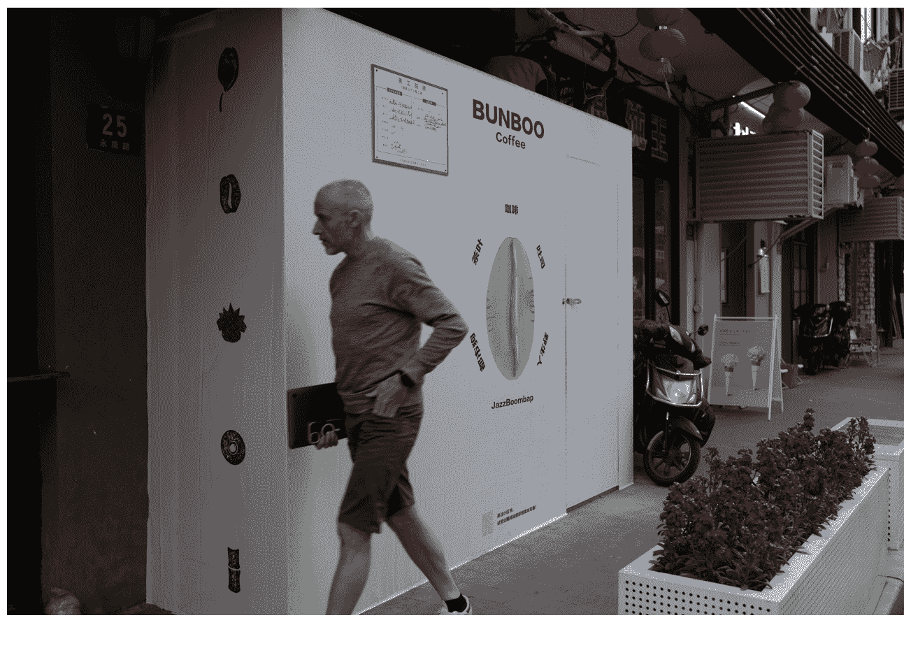

永康路上，硬仔的咖啡店外建起了装修围挡，一名外籍人士走进隔壁的咖啡店。

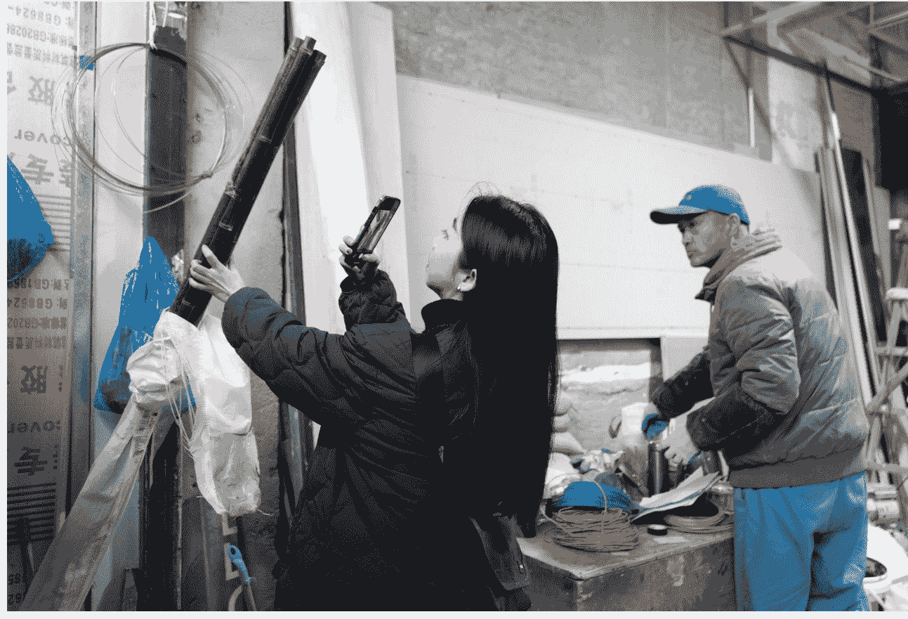

2月下旬，硬仔查看咖啡店的装修进度，签收新到的装修材料。

3月初，硬仔向财新展示她咖啡店的设计效果图。市场上专攻商业店铺的装修工作室的报价普遍在4到10万不等，硬仔通过朋友介绍找到的个人设计师的设计费为1.5万。

徐正阳是帮助硬仔选铺的房屋中介。15年前，他主要提供住宅和写字楼的中介服务，疫情开始后，住宅和写字楼的业务下滑得厉害，于是转向专门做梧桐区的商铺业务，“商铺的需求量比较大，因为想创业的年轻人一直很多，特别是一些预算不高的”，徐正阳表示，“所以就算市场再不好，只要有新的客户进来，商铺的流转还是很快的”。

徐正阳发现，许多新店主对开店的复杂流程缺乏足够的预期，最基础但也可能最繁复的是办理营业执照。如果是开一家零售店，那么只需要办工商营业执照，但如果涉及餐饮行业，还需要食品经营许可证，“要做饮品，就是自制饮品执照；如果饮品中含有酒精，就是自制饮品含乙醇饮料执照；如果要做餐饮，还需要消防备案、外立面报备、招牌报备等手续。”

如今，有些执照想办理下来“难于登天”，比如使用明火的重餐饮执照，这一执照要求店里有完善的排烟管道，排烟口距离居民区20米以上，并且店铺距离居民区至少10米以上，这在民居密集的“梧桐区”几乎不可能满足条件。因此，这种执照变成了“世袭制”的硬通货。如果这个店面之前申请过这种珍贵的执照，那么这个店面的身价也会随之上升。

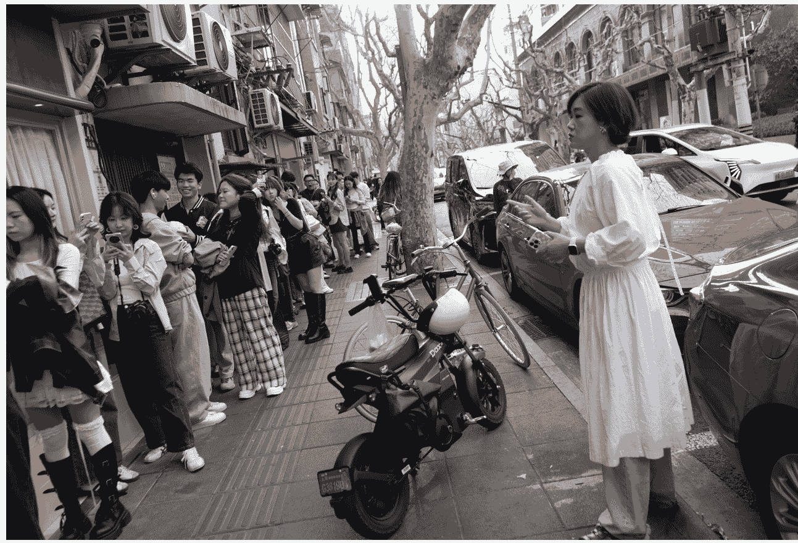

晚餐营业时间前，提子的泰餐店前排起长队，最早的顾客提早40分钟就到了。

提子是在“梧桐区”有着九年开店经验的老手，曾经在乌鲁木齐中路拥有五家门店。2024年2月，她又新开了一家泰餐店，光是铺面的转让费和中介费就达到了17万元。许多人认为不值，但提子毫不犹豫，因为这家店铺有着使用明火的重餐饮执照，“没有这个执照就没有这家店”。

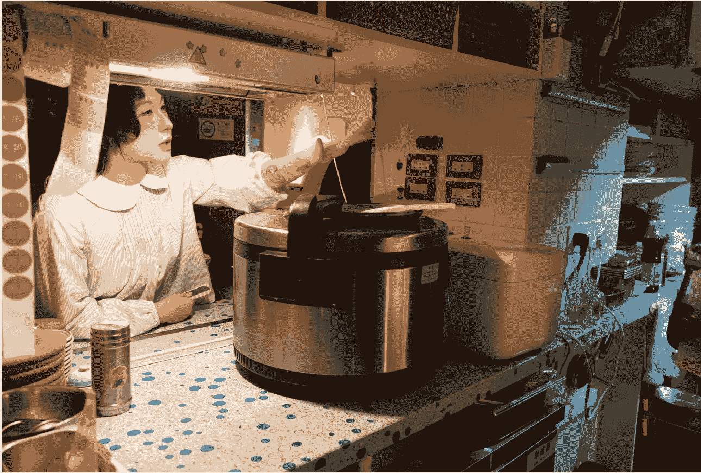

提子在泰餐店内跟后厨沟通近期收到的差评，要求厨师调整口味。

泰餐店的晚餐营业时间，提子站在餐饮收银系统旁排单，告知后厨烹饪菜品的顺序。

目前，据提子计算，她投入的124万元已成功回本。提子深谙，在“梧桐区”开店，影响评价的第一要素并不是食物的口味，而是店铺整体的氛围，“如果客人进到店里，喜欢整个氛围，那么就成功了”，提子说，这种氛围是由装修、设计等细节体现出来的，她开的一系列店铺都有着鲜明的个人特点，“有些顾客进到我们的新店，凭装修氛围就会猜测老板是我”。

提子目前运营着7家店铺，其中一家日式家庭餐厅内，墙上贴着与动物救济组织合作的海报。

在“梧桐区”开店，格调是必须考虑的因素。因为整条路的店铺风格都比较高级的话，就能为整体带来更多热度和流量。很多时候，顾客到店里光顾，其实是在购买店主的审美和品位。以永康路为例，曾有一家位于路口的甜品店被房东收回铺面，但是新的店铺风格不够精致，和整条街的风格不匹配，遭到了同街许多人反对，于是新店出清，老甜品店又得以重返。

3月初的寒风里，满载着咖啡设备的电动三轮车驶向了富民路的一条弄堂深处，工人卸货的声音惊动了楼上的住户，一位爷叔从一旁的楼道走下来询问。小贾给爷叔递了一根烟，“我们要在这里开一家咖啡馆，弄一些冷的、预制的蛋糕，没有油烟的”。

与此前建国西路路口的店面相比，这间小区深处的店面房租成本大约是先前的四分之一。小贾觉得地址换到小区里面对生意影响不大，“因为我们跟普通的咖啡厅不一样，我们是提供给别人拍照打卡的场地，你可以理解为自拍馆”。小贾介绍，他的店一般三个月翻一次景，更换软装和花艺，用新鲜的环境和氛围吸引顾客。根据以往做买手店的经验，小贾计划着新的店面将在“五一”劳动节开业，“开业不能选个普通的周末，一定得是特殊的节假日”。

不过，“梧桐区”生命力最顽强的店铺并非网红小店，反而是一些朴素的家常小店。乌鲁木齐中路上，有一家人均消费30元的河南烩面店已经扎根14年，这家店满足了周围居民、上班族的用餐刚需。同时，乌鲁木齐中路爆火前的房租水平比较低，徐正阳估计当时的房租大约是现在的四分之一，由于基数小，即使按照每两到三年涨5%—6%的一般涨租规律，目前的房租水平也不会太高，但是“现在这个铺面转出去就要七八万元一个月了”。

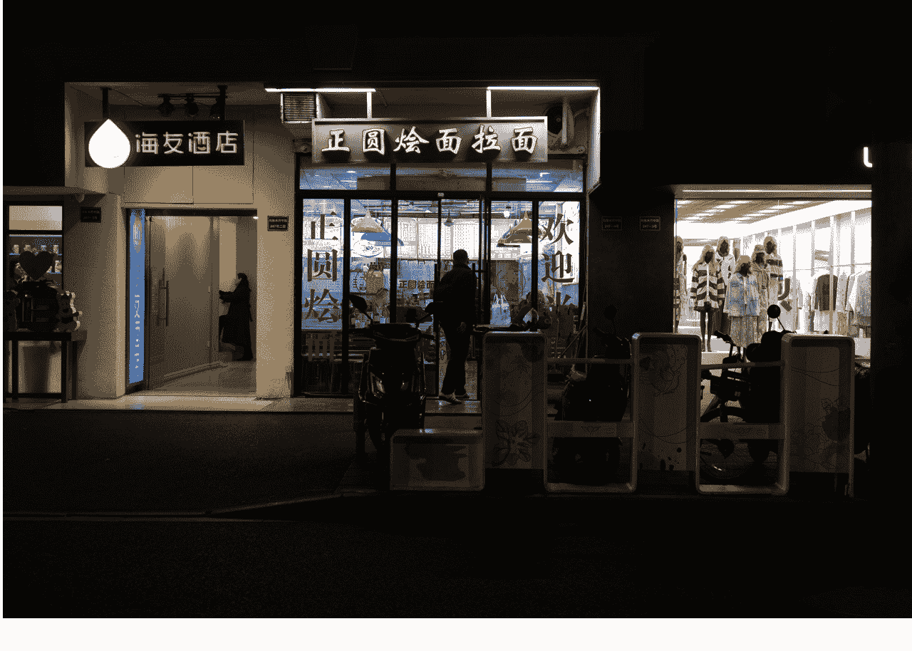

乌鲁木齐中路上，一家人均消费30元的烩面店已经经营了14年。

理发15元
上午7:30上班
下午5:00/5:30下班
15921399023

理发
上午7:30-12:00
15921399023
157451

理发
1592139

嘉善路上，一家理发小店内，理发师正在给附近居民理发，价格为15元一次。

据徐正阳观察，每到年底，网红小店的关店率都比较高。一方面是因为上海冬季是旅游淡季，本来生意就差，春节的那个月多数都是亏损的；另一方面，到了年底，许多店主盘算全年收益，觉得不好的话，就索性关店了。春节后，游客和“打工人”回到了上海，各种店铺的生意就往往会有一个旺季，“有些想要再努力一下的店主就会撑过春节，如果还是不见起色，一般4月会迎来第二波倒闭”。

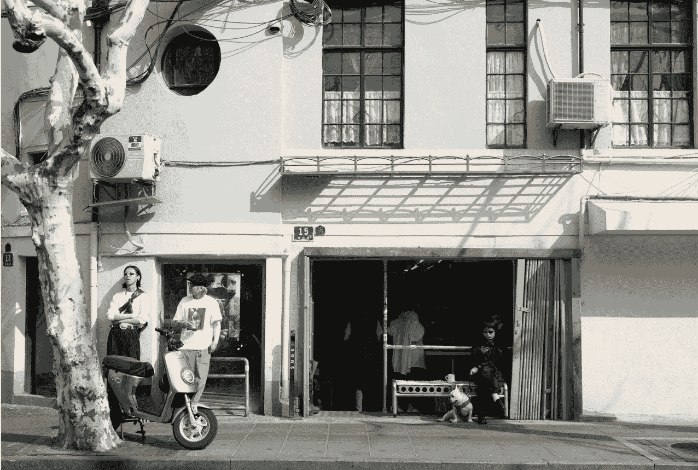

3月初，延庆路上的一家咖啡店，在社交媒体上以“潮人聚集”为特色。

2025年3月23日，周日，上海的天气回暖，和煦的阳光洒在永康路上，硬仔的咖啡店营业首日就坐满了顾客，硬仔和店里新招的咖啡师在吧台后忙得不亦乐乎；下午4点多，提子的泰餐店还没到营业时间，门口早早地就排起了长队，取号机已经取到40多号，“只要天气好，我们的生意就特别好”，负责取号的服务员笑着说。

当天晚上，硬仔在小红书上公布了开店首日的“战况”：“靠着自然流量，第一天就做了150杯，超过了预期”，徐正阳也光顾了她的咖啡店，并在朋友圈分享道，“最真实的永康路，虽然没有以前顶流，但是在努力恢复”。

(应受访者要求，文中毛曼、徐正阳均为化名)

图片编辑 | 翁倩

# 商业 BUSINESS
Basement FG

# 上海“梧桐区”网红小店浮沉

因流量而兴的街区商铺，频繁的关店与开业，是正常迭代还是经济的微弱晴雨表？

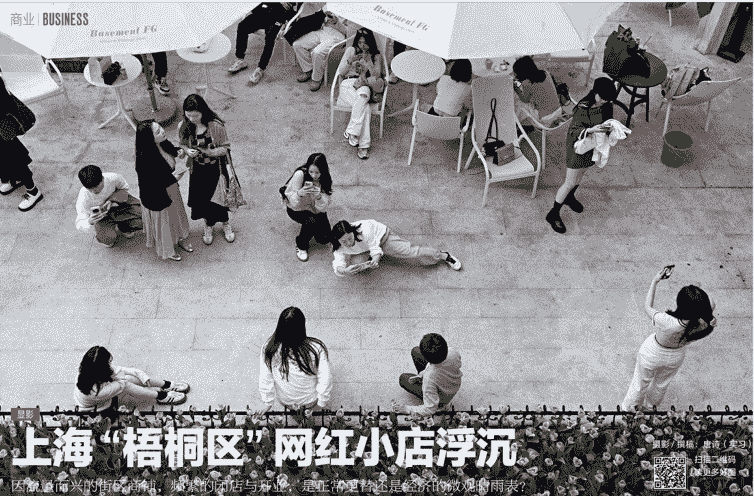

2025 年 2 月底，毛曼坐在上海市乌鲁木齐中路的一家天蓝色的店铺“遗址”前，一边喝咖啡，一边接听工作电话。这家天蓝色的店铺早在 2024 年 12 月就结业了，店内空空如也，只剩下一张海报提示着曾经的“日咖夜酒”。在毛曼印象中，这家店对宠物非常友好，因此养狗的人都很喜欢光顾，过去生意一直不错。

毛曼居住在乌鲁木齐中路十年了。回想起来，十年前这里只是一条安静的小马路，直到六七年前流量突至，引来了许多游客。随即，各种网红小店——独立咖啡馆、买手店、西餐厅纷纷兴起。

乌鲁木齐中路位于上海“梧桐区”。“梧桐区”并非行政区划，而是社交媒体上的一种流行说法，通常指上海市中心以梧桐树景观闻名的历史街区，尤其是原法租界的部分区域。街道两侧保留着许多上世纪 20 年代—40 年代建造的花园洋房、公寓和里弄，最为出名的是由邬达克设计的武康大楼。近些年，“梧桐区”走红网络，尤其以武康路—安福路为甚。每逢周末，这里便被游客、网红、街拍摄影师、跑车等围得水泄不通。

毛曼观察，“最近，附近的店铺是关停蛮多的”。她推测一方面是因为街区走红推动了房租水涨船高，另一方面或许跟许多外国人离开上海有关。虽然疫情结束后居住在上海的外国人数量较疫情期间有所回升，但跟疫情前相比仍有不小的差距。根据上海发展统计公报，2019 年，上海旅游入境的外国人为 692.12 万人次；2024 年，上海边检总站数据显示的入境外国人为 456 万人次。

检索公开报道即可发现，2024 年年末的确有不少“梧桐区”的网红店宣布闭店。比如永康路上，在大众点评上有着 10.5 万收藏量的甜品店 56 rue de YongKang 于 2024 年 12 月 29 日结业；而在大众点评上有 5.8 万人收藏、产品冲上过品类 Top1 的愚园路上的咖啡店 Dosage，于 2024 年 12 月 26 日结束营业。

01. 2025 年 3 月初，新乐路上的一家服装店门前种满了郁金香，吸引了大量游客拍照打卡。
02. 3 月中旬，武康大楼前，许多游客正在拍照留念，包括前来拍摄婚纱照的新人。
03. 3 月初，延庆路上的一家快闪店门口，路人在拍照留念。
04. 天气晴朗时，东湖路上餐厅的外摆区坐满了人，许多居民带着孩子外出散步。

上海据称是拥有咖啡店数量最多的城市。《2024 中国城市咖啡发展报告》显示，2023 年上海咖啡门店数量达到 9553 家。澎湃新闻所公布的 2024 年数据也有 8000 多家。在“梧桐区”所在黄浦、静安、徐汇三个行政区，咖啡馆的密度最高。

“梧桐区”另一种主流业态是精致餐饮。2022 年上半年，上海精致餐饮市场门店数量达到 885 家，位居全国第一。其中，黄浦区有 220 家，占上海市总量的 24.8%，是上海精致餐饮密度最高的行政区。截至 2024 年上半年，上海精致餐饮门店数量超过 1000 家。

进入 2025 年，有不少网红小店在出清，同时又有不少商铺外冒出了装修围挡，工人们拉着建筑垃圾与新的装修物料进出进出——许多新店又在紧锣密鼓地筹备开业。似乎随着天气的变化，“梧桐区”的商业生态也有转暖的迹象。

## 出局

3 月初的晚 9 点，体感温度仅 3℃。一身黑色的小贾带着三名工人出现在建国西路路口，岳阳大楼一家欧式装修风格的咖啡店门前。店门上镶嵌着彩色玻璃花窗，橱窗上用记号笔写了出租咨询电话，门口摆着等人高的圣诞树，枝叶已经全部干枯发黄。

小贾是这家咖啡店的职业店长，咖啡店在 2024 年 6 月份正式开业，仅 9 个月后，就因为营业收入水平无法负担房租选择结业。下午，他一个人将店内的东西盘点了一遍，晚上就带着工人们把冰柜、咖啡机、磨豆机等大件设备装车，再把各种箱子往上面处理掉。小贾一边指挥着工人的行动，一边把一大袋瓷质餐具递给工人。工人问他是否要打包，“不要紧的，我已经做好了碎掉一部分的准备”。

其中一名搬运工人其实是附近一家五金店的老板，小贾作为职业店长管理过五六家店，都是请这位工人

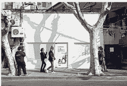

帮忙的他熟练地用绳子捆扎固定上车的大包小包，然后转弯开上了岳阳路，消失在道路尽头。

“梧桐区”白天路窄人多，又时常有交警检查，因此店铺搬迁通常选择晚上。Raphael 的手冲咖啡店也是在晚上搬走的。一般咖啡店通常有一台又大又重的意式浓缩咖啡机，而手冲咖啡只需要磨豆机、滤纸、滤杯、手冲壶、咖啡壶、电子秤和温度计，一个小箱子就能打包带走。2月底营业的最后一天晚上，Raphael 一个人就将这些工具收进了仓库。

- 05. 延庆路上，游客在 city walk，装修工人在搬运水泥。
- 06. 永康路上，附近的居民在一家闲置的店铺外休息，其前身是大众点评上有着 10.5 万收藏量的网红甜品店。
- 07. “梧桐区”富民路上，一家闲置的铺面外贴着英文出租广告。
- 08. 3月5日下午，小贾清点完咖啡店内要搬走的设备后，在店门口抽烟，等待搬家公司。
- 09. 晚9点，搬家公司把小贾咖啡店里的冰箱搬到拖车上。
- 10. 2月27日下午，Raphael 的手冲咖啡店营业的最后一天，他与顾客合影。
- 11. Raphael 在店里给客人制作手冲咖啡。每天，他会根据不同的天气、环境氛围等因素，送出十几种不同风味的咖啡豆。

卡里还有钱”。

Raphael的“粗心”还不止于此。他曾经在一周内交了两次房租，直到房东退款才意识到。但他做咖啡很讲究，吸引了不少忠实客户。在咖啡店营业的最后一个月里，店里几乎时时坐满顾客。他们中有些专程从杭州赶来，有些甚至是东京店和大阪店的顾客。最后一周，他还开设了四天的手冲咖啡教学课程，“梧桐区”新晋咖啡店主硬仔就是学员之一。

七岁之前，Raphael 和外公外婆生活在上海的弄堂里。每天早上，外公会用摩卡壶做咖啡，Raphael 就会被咖啡香气唤醒。2007 年本科管理学毕业后，Raphael 决定开一家咖啡店，先是在杭州滨江区开了第一家，2020 年回到上海开了第二家，选址最终落在了淮海中路人民坊的弄堂里。2022 年，又陆续在日本东京、大阪开了店。

据 Raphael 描述，关闭上海的店是因为从 2022 年开始他本人常住日本，上海店没有聘请咖啡师，因此处于不常营业的状态。Raphael 觉得，“上海的房租简直是全世界最贵的”，对上海店的盈利状况，他没有明确的账目明细统计，只是觉得“应该没亏，银行

## 入局

在开店之前，硬仔在互联网大厂工作了三年，最终在2024年10月提出了离职。离职前一段时间，她在去工作的路上经常会无意识地哭泣，回家后也哭，“不仅仅是工作本身的压力。还有和其他人协作承受的情绪压力也非常大。”

提出离职后，硬仔开始思索实现自己在五六年前的想法——拥有一个自己的品牌，而独立咖啡店成了首选。选址就在“梧桐区”，“这里的生活方式与独立咖啡店是匹配的”。硬仔深知“梧桐区”咖啡店的竞争激烈，经过对国内外咖啡店的实地考察，她为自己的店铺制定了差异化的经营策略；主打和中式茶叶结合的鸳鸯咖啡，同时考虑到“梧桐区”的居民养宠比例高，她计划组织宠物户外团、开发牵引绳等宠物用品。

徐正阳是帮助硬仔选铺的房屋中介。15年前，他主要提供住宅和写字楼的中介服务，疫情开始后，住宅和写字楼的业务下滑得厉害，于是转向专门做梧桐区的商铺业务，“商铺的需求量比较大，因为想创业的年轻人一直很多，特别是一些预算不高的”，徐正阳表示，“所以就算市场再不好，只要有新的客户进来，商铺的流转还是很快的”。

徐正阳发现，许多新店主对开店的复杂流程缺乏足够的预期，最基础但也可能最繁琐的是办理经营执照。如果是开一家零售店，那么只需要办工商营业执照，但如果涉及餐饮行业，还需要食品经营许可证，“要做饮品，就是自制饮品执照；如果饮品中含有酒精，就是自制饮品含乙醇饮料执照；如果要做炒菜，那就是热食类食品执照；如果要做冷菜，那就是冷食类……”除此之外，还要办理装修报备、外立面报备、招牌报备等手续。

如今，有些执照想办理下来“难于登天”，比如使用明火的重餐饮执照，这一执照要求店里有完善的
商业 BUSINESS
排烟管道,排烟口距离居民区20米以上,并且店铺距离居民区至少10米以上。这在民房密集的“梧桐区”几乎不可能满足条件。因此,这种执照变成了“世袭制”的硬通货。如果这个店面之前申请过这种珍贵的执照,那么这个店面的身价也会随之上升。

提子是在“梧桐区”有着九年开店经验的老手,曾经在乌鲁木齐中路拥有五家门店。2024年2月,她又新开了一家泰餐店,光是铺面的转让费和中介费就达到了17万元。许多人认为不值,但提子毫不犹豫,因为这家店铺有着使用明火的重餐饮执照,“没有这个执照就没有这家店”。

目前,据提子计算,她投入的124万元已成功回本。提子深谙,在“梧桐区”开店,影响评价的第一要素并不是食物的口味,而是店铺整体的氛围。“如果客人进到店里,喜欢整个氛围,那么就成功了”,提子说。这种氛围是由装修、设计等细节体现出来的。她开的一系列店铺都有着鲜明的个人特点,“有些顾客进到我们的新店,凭装修氛围就会猜测老板是我”。

在“梧桐区”开店,格调是必须考虑的因素。因为整条路的店铺风格都比较高级的话,就能为整体带来更多热度和流量。很多时候,顾客到店里光顾,其实是在购买店主的审美和品位。以上康路为例。曾有一家位于路口的甜品店被房东收回铺面,但是新的店铺风格不够精致,和整条路的风格不匹配,遭到了同街许多人反对,于是新店出清,老甜品店又得以重返。

## 春天会来吗?

3月初的寒风里,满载着咖啡设备的电动三轮车驶向了富民路的一条弄堂深处,工人卸货的声音惊动了楼上的住户,一位爷叔从一旁的楼道走下来询问。小贾给爷叔递了一根烟,“我们要在这里开一家咖啡馆,弄一些冷的、现制的蛋糕,没有油烟的”。

与此前建国西路路口的店面相比,这间小区深处的店面房租成本大约是先前的四分之一。小贾觉得地址换到小区里面对生意影响不大,“因为我们跟普通的咖啡厅不一样,我们是提供给别人拍照打卡的场地,你可以理解为自拍馆”。小贾介绍,他的店一般三个月翻一次景,更换软装和花艺,用新鲜的环境和氛围吸引顾客。根据以往开店的经验,小贾计划着新的店面将在“五一”劳动节开业,“开业不能选个普通的周末,一定得是特殊的节假日”。

不过,“梧桐区”生命力最顽强的店铺并非网红小店,反而是一些朴素的家常小店。乌鲁木齐中路上,有一家人均消费30元的河南烩面店已经扎根14年,这家店满足了周围居民、上班族的用餐刚需。同时,乌鲁木齐中路爆火前的房租水平比较低,徐正阳估计当时的房租大约是现在的四分之一。由于基数小即使按照每两到三年涨5%—6%的一般涨租规律,目前的房租水平也不会太高。但是“现在这个铺面转出去就要七八万元一个月了”。

据徐正阳观察,每到年底,网红小店的关店率都比较高。一方面是因为上海冬季是旅游淡季,本来生意就差,春节的那个月多数都是亏损的;另一方面,到了年底,许多店主盘算全年收益,觉得不好的话,就索性关店了。春节后,游客和“打工人”回到了上海,各种店铺的生意往往会有一个旺季,“有些想要再努力一下的店主就会撑过春节,如果还是不见起色,一般4月会迎来第二波倒闭”。

- 12.永康路上,硬仔的咖啡店外建起了装修围挡。一名外籍人士走进隔壁的咖啡店。
- 13.硬仔查看咖啡店的装修进度,签收新到的装修材料。
- 14.晚餐营业时间前,提子的泰餐店前排起长队,最早的顾客提早40分钟就到了。
- 15.提子在泰餐店内跟后勤沟通近期收到的差评,要求厨师调整口味。
- 16.泰餐店的晚餐营业时间,提子站在餐饮收银系统旁排单,告知后厨烹饪菜品的顺序。

2025年3月23日,周日。上海的天气回暖,和煦的阳光洒在永康路上,硬仔的咖啡店营业首日就坐满了顾客,硬仔和店里新招的咖啡师在吧台后忙得不亦乐乎;下午4点多,提子的泰餐店还没到营业时间,门口早早地就排起了长队,取号机已经取到40多号,“只要天气好,我们的生意就特别好”,负责取号的服务员笑着说。

当天晚上,硬仔在小红书上公布了开店首日的“战况”:“靠着自然流量,第一天就做了150杯,超过了预期”,徐正阳也光顾了她的咖啡店,并在朋友圈分享道,“最真实的永康路,虽然没有以前顶流,但是在努力恢复”。

受访者要求,文中毛霞、徐正阳均为化名
82
83

## 专栏 | 美元会继续下跌吗

## CAIXIN | 听文章
文 | 吉姆·奥尼尔
英国皇家国际事务研究所前主席

尽管我已经不再每日跟踪金融市场变化的细节，但我从未忘记早期作为金融机构经济学家所学到的一些重要教训。

教训之一是，做出错误的判断，往往比预测正确要容易得多。以2025年初的一个重大意外为例，2024年底特朗普再次赢得美国大选后，美元稳步升值，这反映出市场对特朗普政府上台后美国经济增长相对强劲、财政刺激加码及新一轮加征关税的预期。但是，现实却截然相反，2025年1月底特朗普就职后，美元大幅贬值。

我早年学到的另一个教训是，考虑到外汇市场的规模和深度，所有已知信息都会被迅速定价，对压倒性的共识持怀疑态度至关重要。因为，市场共识所基于的某些要素，常常被证明是存疑的。

比如，许多预测者认为美国加征关税虽然对美国消费者不利，但利好美元，而且不太可能对美国经济造成过度冲击。这一观点令我困惑。

目前已知的事实是，特朗普的核心经济顾问已经公开表示希望其他货币走强。这是他们一直试图推出新版广场协议的原因。1985年的广场协议，让日德两国同意日元和德国马克对美元升值来缓解美国压力。所谓的“海湖庄园协议”也希望能达到类似的效果。

在我看来，特朗普政府聚焦制造业的政策及其对竞争力的定义，都难以支撑美元持续走强。持相反观点的一方常常以美国经济具有“无与伦比”的优势来作为反驳理由。这些优势包括美国拥有更具深度和流动性的金融市场，在尖端技术上处于领先地位，在安全事务上占据优势，与同等发展水平国家相比增长更快等，因此，美元走强不可阻挡，进而认为加征关税是必要的，公众号懒人搜索，懒人专属群分享

如果2025年以来的美元相对疲软仅仅是短期价格修正，这些颇为流行的论调可能再次出现并被更广泛的人群所接受，但周期性、结构性甚至系统性因素使美元持续走弱的可能性更大。

从周期性因素来看，近期高频数据显示，美国经济增长短期内可能放缓。备受关注的亚特兰大联储GDPNow追踪模型预测，2025年一季度美国国内生产总值（GDP）可能出现负增长。当然，判断这一预测是否成真还为时过早，这可能只是暂时的或者技术因素导致的数据失真，但这绝非惟一的警示信号，最新的商业和消费者信心调查结果也并不乐观。

此外，通胀问题也让更多非金融界人士感到不安。美国密歇根大学最新的调查显示，美国五年期通胀预期已经升至3.9%，为30多年来最高水平，如果这一情况持续，前景不容乐观。

一些分析人士认为，由于调查方法调整，加之存在“民主党选民比共和党及独立选民更积极参与调查”的质疑，这项调查的可靠性已经不如从前。但这些专业民调机构深谙如何校准此类偏差，除非在实际计算过程中确实存在系统性偏向民主党的着操作，否则这种质疑缺乏说服力。无论如何，越来越多的评论者开始频繁谈论起美国的滞胀风险。

对特朗普的反复无常和现有激进政策，其他国家并不是简单地坐以待毙。正如我上篇专栏曾指出的，许多国家的政策制定者，尤其是欧洲和中国，都已经认识到必须做出改变，以减少自身经济对美国的依赖。

美国及全球的这些发展动向可以解释美元最近为什么贬值。但也除了这些周期性因素，还有更根本的问题。如果特朗普坚持加征关税，并且这些关税确实导致美国通胀持续上升，并在实体经济中产生一系列连锁反应，那么美元的长期均衡水平可能会低于此前的市场预期，这必然会引发美元价格调整。如果特朗普政府在当前政策路径上继续加码，美元价格可能会大幅调整。

这引出了系统性层面的讨论。对美元为何能长期保持强势，学界一直以来都存在争论。部分观点认为，美元的价值与美国作为主要安全担保国和“二战”后多边机构主导者的地位密不可分。如果美国现在放弃这些角色，其他国家将不得不站出来维护自身利益，美元的绝对主导地位或将终结。■

## 最新财新周刊 | 滞留太空的宇航员 如何成为政治攻击的武器?

## CAIXIN | 听文章
文 | 财新周刊 黄晏浩

美国东部时间3月18日17时57分，太空探索技术公司（SpaceX）的一艘“龙飞船”降落在美国佛罗里达州塔拉哈西海岸附近的水面。海豚在飞船附近游弋，Crew-9乘组的四名宇航员依次被抬离飞船，走在最后面的苏妮塔·威廉姆斯和布奇·威尔莫尔一边微笑一边挥手，结束了他们原计划8天、实际286天的太空之旅。

以滞留太空的故事性而论，这两名宇航员可能仅次于“最后一位苏联公民”谢尔盖·康斯坦丁诺维奇·克里卡廖夫。1991年5月18日，克里卡廖夫前往苏联的“和平”号空间站，7个多月后，苏联解体，克里卡廖夫“被遗忘”在太空。直到1992年3月17日也就是311天后，转变为俄罗斯国籍的他才重返地球，此时苏联和两极冷战格局已不复存在。

“洞中一日，世上千年”。身在太空的苏妮塔和布奇，也要面对一个出发和降落时完全不同的美国——特朗普赢得大选，再任总统，掀起了一场比2016年更为浩大的MAGA（“让美国再次伟大”）运动；美国商业航天的最大功臣、SpaceX公司创始人埃隆·马斯克的一系列改革，以及引发的反对和抗议，撼动美国社会；就连美国国家航空航天局（NASA）也已大不相同，它面临一系列悬而未决的问题：如何应对预算削减和裁员？国际空间站是否要早日脱轨？登月还是去火星？

回看两人的太空之旅，可谓一波三折。上半场，是老牌航天巨头波音公司的失败历史，与SpaceX这样的后起之秀对比，显示出美国传统航天工业体系的低效与陈旧；下半场，特朗普与马斯克以“政治原因”为由介入，声称“拜登政府抛弃了宇航员”，既成为两人政治攻击的武器，也成为特朗普“Endless Win”（无止境地赢，特朗普的演讲口号之一）中的一环。

这个充满撕裂、挫败和反唇相讥的嘈杂故事，最有趣也最让人欣慰的部分，却在于两名宇航员的太空经历。在轨期间，两人飞行约19528万公里，绕地球飞行4576圈，苏妮塔成为太空行走时长最长的女性宇航员。苏妮塔说：“每天都很有趣，因为我们在太空中。最困难的是地面上的人们不知道我们什么时候回来。”

当地时间2025年3月18日，SpaceX公司的一艘龙飞船在美国佛罗里达州附近海域降落。至此，两位美国宇航员终于结束了他们原计划8天、实际286天的太空之旅。图: NASA/reuters/IC photo

## 波音的失败

龙飞船着陆当天，波音公司举行了观看派对，来庆祝苏妮塔和布奇返航。Crew-9着陆后的新闻发布会上，NASA商业载人航天项目经理史蒂夫·斯蒂奇再一次为波音背书：“我们正在与波音公司合作，对星际客机进行认证，让该航天器重新飞行。他们用龙飞船返回，这表明拥有两种不同的载人运输系统是多么重要。”

事实上，波音的星际客机是这个故事的开端。2024年6月5日10时52分，延宕多年的星际客机终于发射升空，苏妮塔和布奇是首批宇航员。按原计划，两人只需要在国际空间站驻留8天。然而，进入太空之后，星际客机频频发生故障，共发生5次氦气泄漏，5台姿控发动机先后异常，更重要的是，尽管做了地面测试，但技术团队始终没有找到问题根源。原定的返航时间不得不一再推迟（参见本刊2024年第37期《波音的飞船败局》）。

星际客机存在的问题，背后是波音的系统性积弊。和SpaceX相比，传统巨头波音的航天工业能力大幅下降，无法兑现对NASA的承诺。

而NASA对波音的支持，则有更复杂的政治因素。美国推行商业载人航天计划之初，得益于波音的参与才正式推进。2014年9月，NASA迄今最重要、金额最大的载人航天开发合同花落两家，波音拿走了42亿美元，SpaceX分得26亿美元。

另一项波音负责的SLS火箭，是美国登月计划的主力火箭之一，外号“参议院发射系统”，有许多航天飞机时代的工业残留。据《科学美国人》报道，SLS是由多个传统航空航天公司制造的零件拼在一起的笨重装置，不是NASA任务驱动需求的结果，而是“来自有影响力的国会议员们的政治压力，例如当时的参议员比尔·尼尔森”，这些议员希望相关投资流入他们的选区。尼尔森是民主党的资深参议员，在拜登政府期间被任命为NASA局长。

基于上述原因，马斯克从不掩饰对波音等传统供应商的鄙夷，曾多次尖锐批评其项目延期、成本超支、架构臃肿，星际客机遂成为他的有力论据。公开“挺川”后，马斯克更将矛头指向民主党和相关的政府机构，也是他进行“政府效率部”改革的动因之一。

一直到2024年8月24日，NASA宣布，经过工程团队大量工作，包括审查一系列数据、飞行和地面测试、推进专家的独立审查以及制订各种返回应急计划，不确定性和缺乏一致的专家意见不符合NASA对载人航天飞行的安全和性能要求，两名宇航员将继续留在国际空间站，相继加入“远征71号”和“远征72号”机组工作，直到与另外两位Crew-9乘组的宇航员乘载人龙飞船返回。

2024年9月7日，星际客机空载降落地球，苏妮塔和布奇则留在国际空间站。2024年9月28日，搭载美国宇航员尼克·海格和俄罗斯宇航员亚历山大·戈尔布诺夫的“自由号”龙飞船发射，抵达国际空间站，4人组成正式的Crew-9乘组，当时预计其任务持续到2025年2月。

为什么时间推迟如此之久？需要解释一下国际空间站的机组轮换。当前国际空间站的宇航员以“远征”（Expedition）编组，任务周期一般为半年。每个机组都会经历若干宇航员乘组，由俄罗斯的联盟号和美国SpaceX的龙飞船轮流运送，原则是下一个乘组到来后，原有的乘组才会离开。举例来说，苏妮塔和布奇加入“远征71号”机组时，机组有联盟号MS-25乘组的三名宇航员，2024年9月11日联盟号MS-26乘组到来，12天后联盟号MS-25乘组离开空间站，“远征72号”任务也随之开始，苏妮塔被任命为指挥官。

因此，苏妮塔和布奇在内的Crew-9乘组要想离开空间站，需要等到Crew-10乘组2025年2月到来。可以说，NASA做此决策主要是出自项目考量——要想接两名宇航员早日回家，会打乱空间站的机组轮换，在成本上不经济，安全上也不稳妥。NASA副局长、载人计划负责人肯·鲍尔索克斯就表示，由于预算问题，发射额外太空舱或提前返回太空舱的计划“很快被排除”。

Crew-10乘组原计划搭乘编号为C213的新型龙飞船，但SpaceX的进度也不及预期，这导致2025年2月这个时间点也不得不推后。2024年12月17日，NASA公告称，将不早于2025年3月底将Crew-10乘组的四名宇航员发射到国际空间站，这一变化为NASA和SpaceX团队提供了时间，以完成新型龙飞船的处理工作。

## 有趣的太空

当“被抛弃”的叙事大行其道时，苏妮塔和布奇都表示他们享受太空的时光。苏妮塔2月7日身穿“远征72号”的工作服接受哥伦比亚广播公司（CBS）采访时表示：“我不认为我被抛弃了，我不认为我们被困在这里……我们是比我们自身更伟大事物的一部分，我们是国际空间站的一部分，我们有义务为国际合作伙伴开展科学探索。”

说这些话的时候，阳光照耀在苏妮塔的右脸上，她的爆炸头卷发因失重而飞扬——狂野头发（Wild Hair），这是苏妮塔在太空的标志。

苏妮塔和布奇在太空一共度过了286天，绕地球飞行4576圈，年龄各长一岁，完成了一系列科学研究、空间站维护和技术演示，每天都非常充实。如果选一天来代表两名宇航员的工作，最合适的就是1月30日。这天早上7时43分，苏妮塔和布奇先后出站，他们的任务很多，要从空间站拆除射频天线组件，从实验室和气闸舱表面收集材料样本，对可能存在的微生物进行分析，并且为一台机械臂准备备用零件。两名宇航员一直忙到下午1时9分，总共5小时26分钟，才返回国际空间站。

这是布奇的第5次太空行走、苏妮塔的第9次太空行走，她以62小时6分钟的记录刷新了女性宇航员太空行走总时长的纪录，也成为NASA历史上太空行走第四长的宇航员。第二天是周五，其他宇航员工作时，苏妮塔和布奇美美睡了个懒觉。

## "政治原因"

62岁的布奇是虔诚的基督徒。2024年6月初抵达国际空间站后，他通过视频直播出席了一场约250人的周日礼拜，并带领教友参观了空间站，发表了演讲，然后与其他宇航员领唱赞美诗。

59岁的苏妮塔成长于马萨诸塞州，她的父亲是印度人，母亲是斯洛文尼亚人，两位老人居住在马萨诸塞州的法尔茅斯。作为印度裔宇航员，2024年10月28日，苏妮塔通过视频参加了时任总统拜登在白宫举办的排灯节招待会。排灯节是印度教的重要节日，象征光明战胜黑暗，盛典会持续5天，苏妮塔说：“排灯节是一个欢乐的节日，因为世界上充满了善良。”

2024年8月18日，苏妮塔在国际空间站参加了家乡每年一次的法尔茅斯公路赛，2024年是第52届，比赛起点在伍兹霍尔村，终点是法尔茅斯高地，全程7.1英里。不过，苏妮塔是在跑步机上原地完成的，或者说是以每小时1万多英里的速度环绕地球同时完成。最终，她用1小时16分完成了比赛。

苏妮塔的赛事号码布上是“SUNI ISS”和“416”，“SUNI”是她的名字，“ISS”指国际空间站，“416”则指2007年4月16日，那一天苏妮塔在国际空间站的跑步机上完成了波士顿马拉松比赛，是第一个在太空中跑马拉松的人。

在空间站期间，苏妮塔瘦成了锥子脸，头发也开始从发根处变白。有医生认为她很不健康、需要稳定体重。2024年11月，苏妮塔用直播解释说，她的脸型奇怪是因为太空中常见的“体液转移”——不同于地球的重力环境使人的体液主要集中在下半身，在太空微重力环境中，体液会更多地分布于上半身，导致脸部肿胀和腿部消瘦。

在一封题为“忙碌的蜜蜂”的信中，苏妮塔介绍了自己的身体情况：“我吃得像马一样，深蹲和硬拉可以举起近200磅，以90%的体重进行间歇跑，骑自行车比以前更努力。所以，我很好。”她还调侃了自己的白发，说有点像库伊拉——那是迪士尼动画电影《101忠狗》里的魔女反派，头发一半黑、一半白。

不管是苏妮塔还是布奇，或者国际空间站的其他宇航员，每天他们都需要高强度锻炼，来对抗微重力造成的肌肉萎缩和骨骼退化。每天5时30分至7时30分，苏妮塔会锻炼两个小时，包括跑步、骑自行车和举重，她和布奇经常在早上轮流骑车。

跑步机位于空间站的一条必经之路上，所以常有宇航员从跑步者的头上飘过。布奇说，很难从苏妮塔的身上飘过。“苏妮塔跑步时会把手臂向后甩，还有她的肘部。她用肘部击中我的肚子几次。”他笑着说，“我不想打断她跑步，但当她在跑步机上时，试图从她身上过去是很困难的。”

从2月开始，苏妮塔和布奇的返航时间频繁改变，因为特朗普和马斯克以“政治原因”为由介入了。

事实上，1月28日，也就是特朗普正式上任8天后，他就将目光转向了国际空间站的苏妮塔和布奇。在社交平台Truth Social上，特朗普发文称：“我刚刚要求马斯克和SpaceX去接两名勇敢的宇航员，他们被拜登政府抛弃（abandon）在太空。”

马斯克也在社交平台X（推特）上回应称：“特朗普总统要求SpaceX把滞留国际空间站的两名宇航员带回家，我们会这样做。拜登政府让他们在那里待了这么久，真是太糟糕的。”一位网友评论：“他们恨你超过想救回这些宇航员”，他对此还回复道，“真的”。

特朗普和马斯克似乎都非常喜欢这个“拜登政府抛弃宇航员”的叙事，此后两人多次阐述这一说法，细节也越来越多。2月19日，特朗普和马斯克接受FOX（福克斯新闻网）采访时就提到两名宇航员——特朗普说，“他们被抛弃在太空。”马斯克随即接话，“是的，他们因为政治原因被留在太空，这并不好。”特朗普转头问马斯克，“你们什么时候发射（飞船去接他们）？”马斯克回答说，“大约四个星期。”

这次采访中，特朗普还提出，马斯克之前并没有获得拜登政府的批准，“他（拜登）打算把他们留在太空，他（拜登）不想引起公众关注，你能相信吗？”

此言一出，反对者众。国际空间站前指挥官、丹麦籍宇航员安德烈亚斯·莫根森立刻在X上表示，“这是一个大谎言（What a lie）”。爱打嘴仗的马斯克很快在推特上反唇相讥，“你真是弱智（you are fully retarded）”“白痴（idiot）”。马斯克声称，SpaceX几个月前就可以把宇航员带回来，甚至都没有讨论过价格问题，“我直接向拜登政府提出了这个要求，但他们断然拒绝……真正的问题是，他们不希望支持特朗普的人获得正面报道”。

结合两人的说法，苏妮塔和布奇两名宇航员被拜登政府抛弃在太空，原因是不愿意特朗普获得正向关注；马斯克或者SpaceX向拜登政府提议提前发射飞船接回宇航员，却遭到拒绝。

这其中唯一能核实的信息，就是马斯克或SpaceX是否向拜登政府提出过上述建议，多家美媒尝试核实此事。2月24日，2021年6月至2025年1月间任NASA副局长的帕姆·梅尔罗伊接受彭博社采访时，直接否认了马斯克的说法，“提前将机组人员带回家的提议从未传达给总部”。梅尔罗伊表示，即便马斯克确实和某人谈过这个提议，那也不是NASA领导层中的任何人。“我不知道他和谁谈过，不是（时任NASA局长）尼尔森，不是我，不是我们总部的高层领导。”梅尔罗伊还表示，拜登办公室经常不参与NASA的决策。

3月4日，国际空间站举行的新闻发布会上，两名宇航员回答了一系列问题，布奇前后矛盾的表态马上成为头条，他回答媒体提问时说：“从我的角度看，政治与此事毫无关系。”但在下一个问题中，有媒体询问如何看待马斯克的说法，布奇又表示：“我只能说，马斯克说的绝对是事实（factual）。”然后，他补充说：“我们没有这方面的信息，我相信他（马斯克），我不知道所有的细节，我不认为我们中任何一个人能给你答案。”

或许意识到NASA不曾收到建议，马斯克3月5日在X上发文补充说，“6个月前，SpaceX本可以发射另一艘龙飞船并将他们带回地球，但拜登政府（不是NASA）拒绝允许这样做”。

6个月前，即2024年9月，当时NASA已经确定了方案，也就是前述的星际飞船空载返回，发射有两个空座的龙飞船，让两名宇航员加入Crew-9乘组并按期返回——相关合同还有SpaceX总裁马斯克的签名。

3月7日的NASA媒体电话会上，鲍尔索克斯和斯蒂奇出席，首次对此事公开回应。鲍尔索克斯表示，SpaceX确实提供了很多方案，其中也有方案能够用龙飞船直接将两名宇航员带回，“但我们很快就排除了这些选择，因为我们的预算有限，而且要考虑让机组人员留在国际空间站的重要性”。

“当我们把所有事情都考虑清楚后，我们现在所采取的方案才是最好的选择。”斯蒂奇表示，“然后我们一起进行了飞行准备审查流程，NASA局长也听取了意见。所以我们向该机构（指SpaceX）提出了建议，这是我们通常使用的流程。”

在电话会中，对于马斯克向拜登政府提出了什么建议，SpaceX副总裁比尔·格斯滕迈尔没有作答。

媒体Ars Technica的高级太空编辑、著名记者艾瑞克·伯杰在报道中称，他们无法证实马斯克是否向拜登政府的高级官员提出了建议，但拜登政府从未向NASA内部的低级官员传达过这样的提议。伯杰写过两本赞誉SpaceX的书，是SpaceX一贯的支持者。

3月18日，CNN（美国有线电视新闻网）援引一位拜登政府前高级官员的说法称，他们从未听说过马斯克或SpaceX提出过这样的提议。“我们不知道有任何（提议）。”该官员称，“如果他们（马斯克或SpaceX）联系了NASA，NASA肯定会联系我们并让我们知道。如果他们联系了白宫，我们也会让NASA知道。”

纷纷扰扰之下，最后的结果是，2月11日，NASA宣布将在3月12日发射载有Crew-10乘组的龙飞船，让Crew-9乘组提前返航；3月12日，由于地面故障，原定发射的龙飞船在起飞前最后一刻取消发射；3月14日，Crew-10乘组搭载龙飞船发射，并在3月16日1时35分顺利对接国际空间站；3月18日，两名宇航员返回地球，和原定的3月底相比提前了两周时间，公众号懒人搜索，懒人专属群分享。

可以确信这其中有特朗普的影响。NASA和SpaceX能够提速的原因之一，是他们放弃了此前计划使用的新型龙飞船C213，转而使用已服役的“耐力号”龙飞船。斯蒂奇在3月7日的电话会上表示，更换“耐力号”的决定是在1月底做出的，这使得发射日期提前“实际上是由很多因素推动的，在总统和马斯克先生发表一些声明之前，我们就已经开始考虑这个问题了”。鲍尔索克斯则补充说：“总统的兴趣无疑增添了活力。”

NASA代理局长珍妮特·佩特罗则在3月18日专门感谢特朗普的作用，“按照特朗普总统的指示，NASA和SpaceX努力工作，将计划提前了一个月。这支国际团队和我们的地面团队接受了特朗普政府的挑战，即制订一个更新的、有点独特的任务计划，将我们的机组人员带回家”。

3月17日，宇航员返航前，特朗普在Truth Social上发表了一篇洋洋洒洒的长文。“拜登政府没有能力这么做。他们可耻地忘记了宇航员，因为他们认为，这对他们来说是一件非常尴尬的事。”特朗普写道，“这是我从那群失败的无能者那里继承来的另一件事。”

让宇航员回家成为政治事件的，正是特朗普和马斯克以“政治原因”为由的介入。国际空间站和太空并非不被以国际政治影响，但当美国内政介入时，当太空也被塑造成特朗普相比前任和民主党“Endless Win”的一部分时，未来将会如何呢？

3月6日，特朗普在白宫椭圆形办公室新闻发布会上，谈到了太空中的苏妮塔和布奇，他用一种调侃的语气，在阵阵笑声中说：“我希望他们喜欢彼此，可能他们会爱上彼此（Maybe they’ll love each other），我不知道。”布奇和苏妮塔都已结婚，布奇还育有两个女儿。 ■

## 相关视频：【华尔街原声】SpaceX2021载人首秀：二手装备送4名宇航员上太空

视频说明：2021年4月23日，SpaceX用猎鹰9号火箭成功发射了名为“奋进号”的龙飞船，将4名宇航员送入太空，24小时之后抵达国际空间站。这次SpaceX使用的龙飞船和火箭都是之前执行过载人飞船任务之后回收再使用的。此前一年内，SpaceX已为NASA将10名宇航员送上太空。

更多报道详见：【专题】“影子总统”马斯克

注：本文刊发于《财新周刊》2025年第12期，原题为：财新周刊 | 太空286天

## 阅读 | 埃德蒙·费尔普斯：经济学家的自我超越之旅

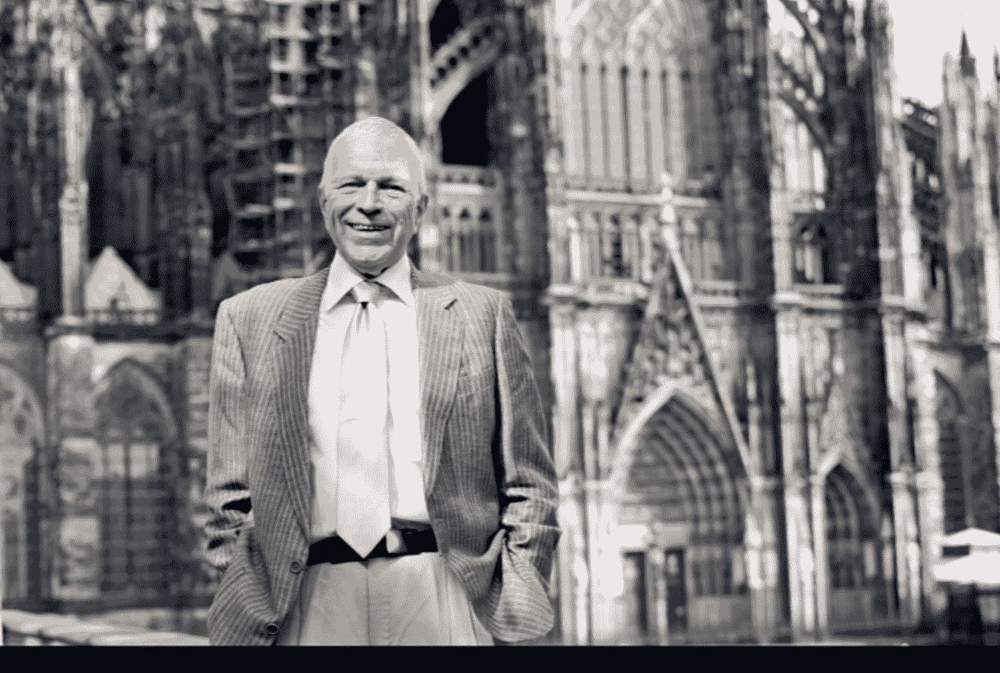

CAIXIN | 听文章

文 | 黄小骑

独立撰稿人

> “人的自我是在人生旅途中创造出来的。”（One's self is created through life's journey.）

## 《埃德蒙·费尔普斯：我的经济学之旅》

埃德蒙·费尔普斯 著 何志毅 张占武 译

中信出版社 2024年12月

经济学家中的思想家阿尔伯特·赫希曼写过名篇《自我颠覆的倾向》，指出学者或许会自我批评，但极少自我颠覆，原因显而易见——“他们已经在自己功成名就的发现与主张上投入了太多的东西——自尊，甚至身份。”（贾拥民译）

赫希曼曾提出，解毒剂在于始终保持开放心态，自我颠覆可以成为自我超越的途径。而费尔普斯的《我的经济学之旅》，正是这种开放心态和自我颠覆精神的生动体现。这本书不仅让我们领略到他自我超越的独特方式，更通过他所叙述的学术交往，让我们得以一窥其他一些大经济学家的个性风采。我们所学习的经济学知识，不正是这些经济学家的思想成果——他们的成功与失败，塑造了经济学的面貌；而他们的创造力，则决定了经济学的生命力。

## 把“人”放入模型

费尔普斯自述，上世纪50年代初，他在阿默斯特学院攻读本科期间，修读了为期两学期的人文课程，不仅塑造了他的人生观，还对他后来的学术生涯产生了深远的影响。尤其是法国哲学家柏格森关于创造力和变化的观念，让他深受震撼——“在过去的25年里，这些观念逐渐融入我的工作并成为不可或缺的一部分。”

柏格森于1927年获得诺贝尔文学奖，尤以《创化论》（Creative Evolution, 1907）名世。在这部“蕴含着取之不竭的动力的、又伴随着遨游天际之灵感的宇宙论杰作”（陈圣生译）里，柏格森批判了传统思想中将生命视为机械过程的观点，创造性地提出了“生命冲动”的概念，强调了生命的创造力和整体性。生命演化的力量正在于，不管遇到何种困阻都设法超越自己，是谓“创化”（张东荪译）。这一思想与当时西方世界所经历的变革形成强烈呼应。在这一时期，整个世界步入“现代”，生活方式的彻底转变带来了全新体验。这种对不确定性和创造性的关注，不仅在哲学领域引起巨大反响，也在同一时期的经济学界催生了相应的思想。

费尔普斯认为，经济学的现代风格，由凯恩斯、奈特和哈耶克等人奠定。1921年，奈特出版《风险、不确定性与利润》，区分了“风险”和“不确定性”，指出前者可以用概率刻画，而后者永远在概率模型之外游荡，但又构成人类生存的基本境况；同年，凯恩斯出版《概率论》，拓展对不确定性的认知；之后，哈耶克提出，比劳动分工（the division of labor）更基本的是知识分化（the division of knowledge），拥有不完全知识的人与人之间的互动才是经济学的核心问题。

以此为基础，费尔普斯的学术探索围绕就业与经济增长等问题渐次展开，成果斐然。2001年，经济学界向他致敬，公认其主要贡献是“把不完全信息及相关摩擦和不完全知识及随之而来的复杂性引入宏观经济学”（Knowledge， Information， and Expectations in Modern Macroeconomics： In Honor of Edmund S. Phelps， 2003）。换言之，他以不完全知识为微观基础，通过社会互动的预期，而集结为宏观模型。他本人也指出，这其实是把“人”放入宏观经济学模型。而人类，既只有不完备的知识，又凭着想象力和创造力，驰骋在这个充满不确定性的世界。

在耶鲁大学读博期间，他非常喜欢罗伯特·萨默斯，这位经济学世家出身的讲师，在统计学课堂上的提醒：“先生！那个模型里的人在哪里？”这句话直击宏观经济学模型见数不见人的要害。费尔普斯从不掩饰他对主流经济学一些观念的批判。他在自传中再次指出：“在现代世界中，任何关于最优货币政策的确定性模型都忽略了关于未来的巨大不确定性，在某些方面也忽略了现代的不确定性。”

## 跨越学科边界

1998年诺贝尔经济学奖得主阿马蒂亚·森评价，为宏观经济研究构筑微观基础，只讲述了费尔普斯一半的故事，另一半则是他对人类各种兴趣或利益的关切，正是这些关切主导了他对宏观问题的选择。

费尔普斯交友广泛。他不仅活跃在经济学界，还与哲学界的一众大家私交甚笃，如理查德·罗蒂、唐纳德·戴维森和托马斯·内格尔等，朋友中也不乏政治学家和心理学家等。不过，对他影响最深的，应该是政治哲学家约翰·罗尔斯。

正是阿马蒂亚·森促成了费尔普斯与罗尔斯的相识。当时，费尔普斯在斯坦福大学访问研究，而罗尔斯正在撰写其划时代的代表作《正义论》。二人的交流，融入费尔普斯关于通货膨胀政策、工作和失业等问题的思考中。他对“工作”的思考尤其充满人味儿，没有被数学遮蔽。比如，他指出，在一个运作良好的经济社会中，可能会有很多“好工作”，“这些工作能让人们有机会去发现、探索、尝试，甚至创造”。

在充斥着“毫无意义的工作”（大卫·格雷伯语）的当下，费尔普斯的这些思考更显重要。也正是基于对有意义的工作的思考，费尔普斯反对“全民收入计划”，认为该计划“将使人们失去只有通过工作才能获得的尊严、归属感和工作满足感”。

上世纪70年代，哲学界和社会学界开始热议利他主义和道德对经济的影响。在与哲学家托马斯·内格尔的交流中，费尔普斯萌生了组织一次会议来探讨利他主义的想法。研讨会很精彩，但在学术界反应寥寥。对此，费尔普斯有着深刻的思考：“将人类行为和知识的研究划分为不同的探究领域，并把学者们分隔在这些领域之中，这似乎是科学界普遍认可的事实。然而，这些分隔并非密不透风，领域之间的知识渗透和交流往往与划分它们的界限同样重要。”其实，早在耶鲁求学时期，他就曾听过英国科学家和小说家C·P·斯诺关于“两种文化”的讲座，在斯诺看来，自然科学与人文艺术之间的隔阂是解决世界问题的严重障碍。

这次研讨会引起了芝加哥大学经济学和法学学者的关注，但他们对利他主义都持批评态度。费尔普斯决定接受芝加哥学派领袖人物、1982年诺贝尔经济学奖得主乔治·斯蒂格勒的邀请，冒着狂风前往“风城”芝加哥，舌战群儒。在论辩场上，芝加哥学派可谓“身经百战”。按费尔普斯在自传中披露，他未能说服对手，算是败下阵来。然而，2000年经济学诺奖得主詹姆斯·赫克曼在《埃德蒙·费尔普斯的诸多贡献》（The Many Contributions of Edmund Phelps）中披露了故事的另一半，费尔普斯跟他笑谈：“我想让芝加哥的这些人知道，经济学可不只是价格-数量图表那么简单。”值得注意的是，一年后，芝加哥学派的加里·贝克尔融合社会生物学的视角，发表了关于利他主义的论文。

费尔普斯欣喜地看到许多经济学家和哲学家能够熟悉彼此的工作，没有隔阂，正如两次世界大战期间的剑桥大学、牛津大学等学术重镇所展现的跨学科交流的盛况。但他也悲叹于某些经济学理论假设的狭隘，以及一些经济学家的固执己见。他述及自己和导师詹姆斯·托宾的疏远。托宾曾是他心目中的英雄，曾托举着耶鲁经济学的光荣，凭借对金融系统的研究于1981年获得诺贝尔经济学奖。但是，费尔普斯哀叹晚年的托宾因循守旧，因其狭隘甚至限制了年轻学者发挥创造力。

## 创造力精神绘制大图景

在詹姆斯·赫克曼眼中，费尔普斯堪称“充满创造力的独行侠”（a creative loner）。经济学泰斗萨缪尔森也对费尔普斯赞誉有加，称赞他总是愿意去挑战均衡理论的鼓吹者们所忽视的领域——规模收益递增、信息不对称、市场不连续性，以及其他各种市场不完善的情况。

事实上，费尔普斯的挑战更为彻底。就在2001年受到经济学界众声赞赏时，他开始反思，经济学界关于经济增长来源的普遍观点是否过于狭隘：“一个国家的本土创新的驱动因素是什么呢？当时我是68岁，幸运的是我还有20年时间去探索。我迫不及待地想要开始！没有退路，我正在寻找一个崭新的起点。”这种“没有退路”的决心，源自人的生命力对自身的要求，而非他人外在的要求，正对应着赫希曼所述的“自我颠覆的倾向”。

柏格森的“创化论”在费尔普斯18岁时就冲击了他的心灵，50年后更全面融入他的理论探索中。这一转向还有一个更深层的背景——他提到，上世纪七八十年代，他的巅峰之作虽然重要，但“其创作过程都不需要大量的理论想象力，即真正的创造力”“它们并没有提出新的国家经济大图景（new big picture）”。

经济学的大图景最初源自亚当·斯密对“秩序”的感悟——看不见的手，而后经数学表达为“一般均衡理论”。那些提出大图景的人，费尔普斯列出的名单，包括瓦尔拉斯、熊彼特、奈特、凯恩斯和拉姆齐等人。而其他经济学家构思的新观点，无非是对已有观点的补充或替代，而没有新的大图景。

费尔普斯心中的大图景，表现为他所构想的本土创新局面。这一思想贯穿于他的多部著述，包括《大繁荣》《活力》等。他将现代主义价值观追溯到文艺复兴时期的南欧——那是人的一次觉醒，生命力表现为自我表达的冲动，现代社会应运而生。他认为，现代主义精神是现代经济的关键要素之一。在他构想的良好经济图景中，现代经济的快速增长，源于人的活力从基层扩展到整体，人们运用自己的创造力、好奇心和判断力，参与到新事物的创造中去。他认为，这一图景也曾出现在现实中，造就过欧美国家的繁荣，公众号懒人搜索，懒人专属群分享

据此，他批评欧美国家活力的丧失，认为这不仅由于政府的不当措施，也表现为民营企业的官僚化，滥用专利和保护主义法规；更根本的是，人的创造力精神的衰落，对金钱的病态痴迷，也是这一现象的表征。实际上，更早之前，经济学家汪丁丁教授在其系列文章《个性化经济的价值决定》（2001—2002年连载于《IT经济世界》）中就提出了这一图景，他借熊彼特指出——企业家能力潜在于一切人身上；继而借哈耶克指出——一个伟大的充满创新的生命力的社会制度的基本特征是“鼓励一切人在一切可能方向上进行创新”。

费尔普斯关注并强调创新的价值观，认为“只有通过创造本土创新，一个国家才能实现超越利用外部发现所能实现的创新。一个国家可以根据自身价值观设定创新活动的水平。而这种创新精神对国家的工作体验和生活方式有着巨大的影响”。周其仁教授走访世界各地，也曾感悟：“让创新真正变成行为，难度是非常大的。最重要的就是氛围，就是那群人当中弥漫的风气。如果没有这个社会风气，你有楼，你有钱，也是空空如也，最后不会给国民经济提供一个新的发动机。”这种“风气”，正如钱穆先生所说，是人与人之间的感动，它不是一种控制，而是一种经由感动而衍生的力量，可以由少数人提倡而形成。

随着人工智能浪潮的翻涌，我们更加迫切地需要关注抒发人的生命力，因为我们生而为人的价值所在，而不只是少数人的价值所在。这正是费尔普斯强调的“工作”的价值。经济学通常假设工作是“负效用”，忽视了工作给人带来的成就感——普通人可以通过努力工作获得满足感，可以是工匠打造出更好的产品，也可以是商人以看到自己的船只进港，甚至可以是对世界产生影响的满足感。而今，就业已呈现新的局面，如北京大学国家发展研究院张丹丹教授研究指出，制造业零工经济已成不可忽视的趋势。更灵活的就业方式如何激发更多创造力的表达方式？在费尔普斯看来，判断力、直觉和想象力便是驱动现代经济的核心。汪丁丁教授也已经在课堂上呼吁，企业要尽快转型为“判断力密集型”组织。

费尔普斯的自传在中国出版，恰逢其时。不论是他本身的创造力，还是他所研究的国家活力理论，都能给我们带来诸多启发和思考。他对现代主义价值观的研究，可以结合知识社会、人类合作秩序的扩展等问题，得到进一步拓展。更为可贵的是，费尔普斯结合精神维度思考经济问题，而这正是那些为人类秩序绘制大图景的大师走过或正在走着的道路。■

## 专栏|人生更冷酷了
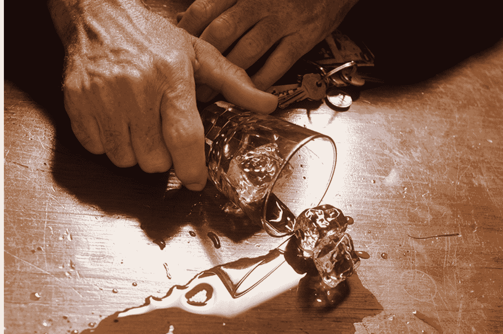

## CAIXIN|听文章
文|王竞
作家

“喝吗?”海明威问。我爽快的回答令他很满意,微笑变成了大笑。他让雷内去调马爹利,说道:“谢天谢地你会喝酒。自打我让你过来之后,我就一直担心这一点。前一阵子有个摄影师在这里待了三天,滴酒不沾。他是我遇到过最冷酷的人了。全世界最冷酷的人。”

这是《大西洋月刊》主编罗伯特·曼宁的记录，收在《海明威：最后的访谈》一书中。1954年12月，他去古巴采访海明威，知道海明威多年就是超级酒徒，且总能保持不醉。两人乘船去海钓，除了给船加足燃料，船上还装满啤酒、威士忌、葡萄酒以及一瓶龙舌兰。暮色降临后，他们在返航途中喝完了仅剩的龙舌兰。海明威太太端上一锅热腾腾的炖牡蛎当晚饭，之后，海明威又赶紧端起了一杯睡前酒。

六年半后，61岁的海明威自杀。浑身上下200多个弹片疤痕没有摧毁他，但常年酗酒无疑使他生不如死。

酗酒和抽烟一样，早就被定义为有毒的生活方式。然而，我们的常识对饮酒还保留一个温暖的认可，即适量饮酒有益于身心健康。何为“适量”？德国的头号健康畅销书作家巴斯·巴斯特（Bas Kast）给出的标准是，男人每天两杯，女人一杯。杯有大小，他给出精确的量化：5度啤酒340毫升，12度葡萄酒140毫升，40度烈酒40毫升。这是他在2018年出版的《饮食指南针》里给出的建议。

谁知，巴斯特最近宣布，他要把这条建议删了。改写德国国民“饮食圣经”的理由是，他站到了“哪怕一滴酒也是毒”的立场，反转了对适量饮酒的信任。作为葡萄酒庄园主的后代，他不仅要戒掉自己从生下来就最熟悉最亲密的东西，还要以他的超级影响力毁掉一个产业的声誉。他说他很抱歉，但无法继续虚伪。

2024年，德国营养协会明确把酒列为人体的细胞毒素。研究表明，哪怕平均每天只喝一杯酒，都足以显著提升患癌几率，特别是肠癌和尤其针对女性的乳腺癌。我的德国邻居是行动派，第二天就把家里的红酒和啤酒都换成了无酒精的品种。结果发现，啤酒还凑合，但无酒精红酒没法喝了，比劣质果汁的口感都差不止一个等级。

多年来，德国人在饮食健康方面一直高看意大利人，向往地中海饮食，即橄榄油、新鲜食材配葡萄酒的组合。意大利人的平均寿命比德国人长，这让德国人更相信葡萄酒的功效。遗憾的是，最新研究揭示，意大利人的健康功臣其实与酒无关，而是新鲜食材。

我周围有很多自律的德国人，忙碌一天后，晚饭时喝一两杯啤酒或红酒，让自己放松下来。更美丽的图景是，饭后坐在沙发上，手边一杯红酒，手里一本好书，此乃精致生活的标配。跟奔放的啤酒不同，葡萄酒可以抚摸到灵魂。

我是个功利的饮酒者，有着一喝酒脸就红的体质。正因为相信了红酒保护心脏之说，多年来坚持饭后喝一杯。难道我遵循科学的指引，反而是给自己“下毒”？

尽管看网剧时不反转不过瘾，但在生活里，反转又是那么令人措手不及。欧洲刚刚接受一夜间美国不再是盟友的现实，正需要酒来抚慰愁肠的时候，科研新成果却又断送了这个念想。本来来说烟是敌，酒是友——在饮用适度的前提下。而现在，酒也反友为敌了，不管你适不适度。这个世界真的透出了海明威说的感觉——冷酷。

冰冷的数据呈现，你每咽下一口酒，患癌风险就增加一分。酒精会通过小肠黏膜细胞进入血液和体液，到达所有器官。给我印象深刻的，是巴斯特对“上头”的科普：人有一道类似防火墙的机制，把大脑神经密不透风地保护起来。然而，酒精中的乙醇分子，却能穿过防护，直达脑神经细胞，破坏细胞之间的连接，对众多脑区域产生有害影响。

有“人工智能之母”之称的李飞飞，对人类大脑做过精彩描述：“这一奇特的解剖结构完全由有机化合物组成，终生被困在头骨的黑暗之匣中。正是因为大脑，我们珍视的一切生命体验才成为可能。”为了保护好大脑，从今往后，我们只能在无酒精的状态下体验人生了。这不也是人工智能的恒常状态吗？

前不久，一位非虚构作家在柏林讲述他去乌克兰的见闻。他说，在哈尔科夫市离俄罗斯最近的地方，有一所被炸毁的中学，他见到几个青少年坐在长椅上喝啤酒，大白天的，已经醉醺醺了。“这些少男少女是从周边城镇逃出的流离失所者，他们的家乡已经被战争从地表上彻底抹去。”

对这些乌克兰少年，我实在不忍心去讲解喝酒的害处。

## 专栏|别为不值得的人浪费呼吸

## CAIXIN|听文章
文丨刘宗坤
律师

20多年前，克莱斯勒生产过一款短命跑车，叫“交叉火力”——Crossfire，因销量太低，早就停产了。现在马路上已经不容易见到，偶尔看见一辆，会想起一位名叫莫瑞的老同事，他喜欢开交叉火力，直到去世。

莫瑞是犹太人，又瘦又高，年轻时在美国陆军特种部队“绿色贝雷帽”服役。和他共事时，他看上去60岁上下。后来才知道他1944年生在波兰，是个孤儿，被美国一家犹太人收养。念完印第安纳大学，被送到越南打仗，退役后又念法学院，成了律师。

莫瑞讲话直来直去，不加掩饰。有次吃饭，一位熟人抱怨说投资被人骗了不少钱，在座的都表示同情。莫瑞就说，有人告诉你，他能在水上走，像变魔术一样赚大钱，你就把钱给他？还是我妈妈说得对：有人这样说，你就得赶紧跑远点，跑得越快越好。这是福音书中一个典故，把耶稣在水上行走的故事当成神迹。如果哪个人说他能像耶稣一样行神迹，肯定是个骗子。

莫瑞对老板、生意伙伴和客户不太客气，对同事却很和蔼，尤其乐意帮业务新手。那时候，我是个新手，他没少帮助我。他嘱咐我说：“别为不值得的人浪费呼吸。”“浪费呼吸”相当于中文成语白费口舌、对牛弹琴。

有次来了一对穿着体面的夫妇，谈一个案子。老板说，那两口子和善，你要拉上莫瑞，他知道底细。那对夫妇你一言我一语，先倾诉如何被生意伙伴欺骗，如何跟那人打官司，说那人到了法庭上还撒谎。莫瑞打断他们说，“我认识那个人，他不是骗子。”这对夫妇继续滔滔不绝。莫瑞再次打断：“我说他不是骗子！”然后，招呼秘书把他们送走了。那次是他亲自演示如何不在不值得的人身上浪费呼吸。

有一年春天，美国正在争论“植物人”安乐死的事情。同事们下班后去喝酒，有人问莫瑞怎么看。他说，对于他这种经历过越战的老人来说，谈这个话题有点过于奢侈。我坐在旁边，不知道为什么，感觉到他话语中有股难言的无奈和悲凉，虽然脸上仍然是熟悉的那种不动声色的笑容。

后来知道，那时离他去世的日子只有不到半年时间了，八成他已经知道自己患了肝癌。

复活节后不久的一天，我起早去上班，莫瑞已经先到一步，从他办公室传出震耳的乡村摇滚，是Montgomery Gentry的Hell Yeah：往昔的美好生活，轻轻松松的爱情，还有战争中的生与死，牺牲在越南的兄弟……看见我从门口走过，他把音乐关了。我们各自打招呼，问早安。他捏着一支未抽完的雪茄，窗口的晨光中烟雾缭绕，他脸上还是那种从容的笑容。

从那以后，他上班越来越少，同事们才知道他得了肝癌。不久，老板说莫瑞去世了。

葬礼在一处犹太人墓地举行，他儿子回忆了父亲生前的一些事，有不少好友来送别，都是六七十岁的老人。棺木入土的时刻，莫瑞的助理泣不成声，同事们也不知道怎么安慰她。她是位本地姑娘，人很踏实，重感情，说话甜美，工作也特别努力，莫瑞对她像对待女儿一样。有好多年，我没在现实中看到过有人哭得那么伤心。莫瑞不只是一位上司，也是一位良师。

葬礼后不久，我离开了那家事务所。再不久，克莱斯勒停产了交叉火力。两年前，在105号公路的一个路口，偶尔看到一辆交叉火力，就像隔着马路看到多年不见的老朋友，仿佛开车的就是莫瑞。绿灯一亮，转眼消失在车流中。

经历了更多摔打，我也不再年少轻狂。在不断被磨平的人生中，莫瑞的教诲就像警钟一样敲响——别为不值得的人浪费呼吸，别对着拒绝倾听的耳朵说个没完，就因为那种人不值得你花时间、费口舌。把时间节省下来，花在值得的人身上。

有位我很喜欢的牧师，叫里克·沃伦（Rick Warren）。人们经常引用他的话：“你可以挣更多钱，但你挣不了更多时间。”时间是最宝贵的财富，也是最容易被挥霍的财富。最没有价值的挥霍，就像莫瑞警告的那样，花在不值得的人身上。

沃伦牧师还有句话：“当你在别人身上花时间的时候，你是在把自己一部分生命给他们，一旦给了，永远也收不回来。”他告诉人们，在把自己的一部分生命给别人之前，要先问一句：那个人或那些人，值得吗？乍一听，这个问题可能让人觉得冰冷，但是，很多让人生更有价值的道理，往往乍一听都是冰冷的。

莫瑞经历了动荡与生与死，一生处在交叉火力中。我来美国后的最初几年里，像浮萍一样漂来漂去，遇到他这样一位既智慧又温暖的良师益友，虽然一闪而过，却足以感到庆幸——让我在犯晕的时候能清醒一点，让我在软弱的时候能坚强一些，让我在坎坷中避免跌倒。

## 逝者|房维中:亲历八个“五年计划”擘画
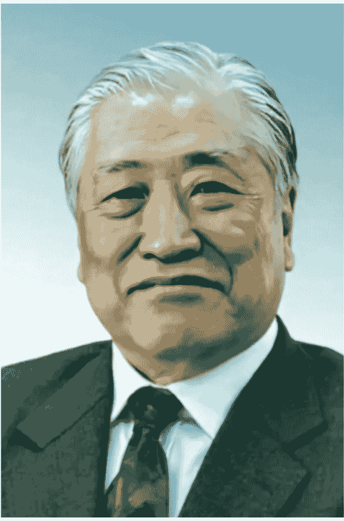

## CAIXIN|听文章
文|财新周刊张兰太

2025年3月16日，原国家计划委员会副主任房维中在北京病逝，享年98岁。

自1952年起，房维中即在国家计划委员会（国家发展改革委前身）工作，并于1977年至1993年担任副主任，时间跨度四十余载；参与起草国家“一五”和“二五”计划建议报告，以及从“三五”到“八五”计划的讨论或制定等，亲历从计划经济转向社会主义市场经济的改革过程。

房维中1928年3月生于辽宁海城。1947年至1949年，先后就读于吉林长白师范学院、东北大学社会科学院和东北师范大学经济系，求学期间投身革命工作。1952年11月国家计委成立，职能是负责编制长期和年度的国民经济计划。在国家计委办公厅编译处工作的房维中，参与了编制第一个五年计划的工作，直至1955年初“一五”计划编制完成。

作为国家计委办公厅副主任梅行的助手，房维中参与起草国务院副总理兼国家计委主任李富春在全国人大所作的关于“一五”计划的报告，还编写了《第一个五年计划解说》小册子。此后，又参与了“二五”计划建议报告的起草工作。1961年，他随梅行到沈阳调查，着手草拟《国营工业企业工作条例（草案）》（简称“工业七十条”）；次年，参与整理周恩来总理关于1962年国民经济计划调整的讲话稿。

在担任国家计委研究室副处长、负责人期间，房维中参与起草“三五”“四五”“五五”计划及十年规划纲要，以及《关于加强经济管理和整顿财经纪律问题》《关于基层工业的若干问题》（简称“工业二十条”）等文件。他回忆那些年的工作时说，心情最舒畅的是第一个五年计划。“二五”至“四五”计划时期，尽管经济起伏震荡，但总的来说各项事业还是向前发展的。

1977年7月，房维中任国家计委副主任。此后，组织起草《关于加快国民经济发展速度的23年设想（汇报提纲）》；参与组织编写“六五”“七五”“八五”计划，并牵头重新制定“工业二十条”。1978年3月，改革开放后的中国派出第一个大型经济代表团出访日本，房维中任副团长。1979年初，他主持起草了《国家计委关于修改1979年计划的汇报》；同年7月，国务院财政经济委员会成立经济体制改革研究小组（简称“体改组”），房维中任副组长。

回顾在原国家计委41年往昔，房维中在一篇文章中自陈，“经历了国家从发展、稳定到比例失调的多次反复，增强了对国情的认识，坚定了坚持实事求是、稳步前进以及转变经济增长方式或发展方式的信念”“经历了计划经济阶段和从计划经济到社会主义市场经济过渡阶段，深刻认识到计划经济体制的弊端，树立了建立社会主义市场经济体制的信念”。

1993年3月，房维中卸任国家计委副主任；2003年12月离休。他自1993年起担任中国宏观经济学会（前身为中国计划学会）会长达22年。针对“九五”计划到“十二五”规划的制定和执行，他多次向中共中央、国务院提出建议。他还时常就中国经济发表意见和看法，批评以GDP为最高考核标准、主要依靠投资和出口拉动的传统增长方式，为中国转变经济发展方式鼓与呼。

房维中曾在文章中写道：“五年规划（计划）最重要的是量化指标，路线方针政策，党代会已经确定，而规划（计划）的作用就是通过具体指标来落实这一路线方针。”在他看来，制定规划只是个开始，而不是结束。房维中亦曾撰文，总结上世纪80年代经济建设中一些经验教训。他引用一副对联，“曲突徙薪无恩泽，焦头烂额为上客”，认为救火者固然有功，但提倡曲突徙薪的更应当受到尊重。不能老忙着救火，要研究“曲突徙薪”之道。

曾在国家计委和发改委连续工作29年的徐林这样回忆房维中：“这是一个从东北起家的老计委，那时我觉得他是一位十分保守的老计划人。但后来经过多年接触，特别是他退休后的一些接触，渐渐认为房主任是一位实事求是、敢于说真话并大胆谏言的好领导。”

房维中一生著述颇多。2004年，他根据多年积累资料，编著《在风浪中前进》，翔实梳理1977至1989年中国发展与改革编年纪事；2012年再作充实改写，题为《十三年纪事（1977—1989）》，成为研究中国当代经济的重要参考文献，被学界频繁引用。

他还著有《房维中文集》《房维中自选集》等。前者收录了他1978年至2009年所作的时事报告、会议发言和文章；后者作为成果汇编，涉及经济建设稳步前进、转变经济增长方式、改革经济体制、破除GDP考核机制、完善社会主义市场经济体制、实现宏观调控下市场对资源配置的基础性作用、资源环保等广泛课题。

## 前瞻|罗马尼亚将重新举行总统大选

CAIXIN|听文章
文|财新周刊罗子琳

罗马尼亚将于5月4日重新举行总统大选。自去年年底极右翼候选人卡林·杰奥尔杰斯库意外赢得首轮选举、又被该国宪法法院裁定结果无效以来，罗马尼亚政治危机持续发酵，亲欧盟势力与极右翼民族主义之间博弈升级，未来充满不确定性。

在2024年11月的罗马尼亚大选中，以“亲俄、反欧、反北约”著称的独立候选人杰奥尔杰斯库爆冷赢得第一轮选举，击败时任总理马塞尔·乔拉库。但这场选举随后被指控遭到了俄罗斯的外部干预，罗马尼亚宪法法院于2024年12月裁定首轮总统选举结果无效并下令重新举行选举。

罗马尼亚实行半总统制度，总统由全民直选产生，总理由总统提名并授权组阁，但需要通过议会信任投票，总理和内阁对议会负责。总统选举采用两轮选举制，若第一轮没有候选人票数过半，则得票最多的前两名进入第二轮角逐。总统任期5年，可连任一次。

如果5月4日的首轮投票不能决出胜选者，第二轮投票将在5月18日举行。

选举结果取消引发罗马尼亚国内政治地震，社会分裂加剧，数万名罗马尼亚民众走上街头，抗议宪法法院的裁决。

同时，罗马尼亚极右翼呈现持续扩张势头。在2024年12月底的罗马尼亚议会选举中，尽管中左翼的社会民主党仍保持议会第一大党的地位，但极右翼的各政党却史无前例地获得了合计三分之一的议席。

2025年2月10日，罗总统约翰尼斯因推动宪法法院取消了总统选举结果一事中的所作所为面临议会弹劾，宣布辞去总统职务，进一步加剧了政治不稳定。两周后的2月26日，罗马尼亚警方对杰奥尔杰斯库进行逮捕并以“破坏宪法秩序、公开煽动、成立和参与法西斯组织”等罪名移交检方，同时对其本人及亲信发起了47次搜查行动。尽管杰奥尔## 杰奥尔杰斯库在当天稍晚时候离开检察官办公室大楼，但他仍将在此后的60天内处于司法管制下。

3月初，杰奥尔杰斯库向罗马尼亚中央选举办公室提交候选人文件以期再度参选，但遭到驳回，随后其上诉至罗马尼亚宪法法院。3月11日，宪法法院作出最终裁决，禁止杰奥尔杰斯库参加新一轮总统大选，再次引发了罗马尼亚国内的激烈抗议。

目前，罗马尼亚极右翼已转而支持罗马尼亚人团结联盟党（AUR）主席乔治·西蒙，后者的候选资格于3月15日获得通过。3月24日，民调机构CURS释出全部候选人确认后的首轮民调结果，西蒙以29%的支持率领跑所有候选人，针对第二名的竞争相对激烈，获得目前执政联盟支持的前代理总统克林·安东内斯库与布加勒斯特市长尼克索尔·丹分居二三名。■

## 国风 | 中国六成儿童青少年缺觉

## CAIXIN | 听文章

文 | 财新周刊 张粲

春季开学一个月以来，杭州初二学生家长姚刚已多次向各科老师申请“免交作业”。姚刚这么做，是因为学校每天都会布置语文、数学、社会、科学、英语5门学科作业，“孩子全部做完基本上每天都要到12点才能睡觉，第二天6点就要起床”。13岁的儿子睡眠只有五六个小时，这让姚刚无比焦虑。

社交媒体上，不少中学生家长和姚刚一样，对孩子“缺觉”感到担忧和无助。

3月21日是世界睡眠日。中国睡眠大数据中心主任、北京大学人民医院睡眠医学中心主任韩芳接受财新采访时表示，当前青少年的睡眠是个大问题，睡眠时间短尤为突出。“我们发现很多初高中学生睡眠时间不足6个小时，甚至一些小学高年级学生睡眠不足6小时。

全国爱卫办3月18日发布的《睡眠健康核心信息及释义》指出，中小学生每天需睡眠8至10小时。《2024中国居民睡眠健康白皮书》数据显示，整个学生群体的夜间睡眠甚至不足8小时。

兰州大学公共卫生学院李星丽等人研究发现，中国儿童青少年睡眠缺乏率（睡眠不足的人数占总调查人数的百分比）为61%，处于较高水平。随着年龄段上升，睡眠缺乏率呈上升趋势。

韩芳表示，小学高年级至初中阶段的青少年处于青春期阶段，对睡眠时间的要求比成年人要长。睡眠需求和实际睡眠时长之间差距明显。随着年级增长，学生学业负担逐渐加重，这是导致青少年睡眠赤字的主要原因之一。此外，电子产品使用、体育锻炼缺乏、父母高期待、人际关系困扰等，也在无形当中“吞噬”青少年的睡眠时间、影响睡眠质量。

财新还发现，一些城市多校划片政策以及父母主动择校行为，使得部分学生通学时间较长，或对睡眠时间形成挤压。如家住北京朝阳区的陈微，为女儿秀秀选择了一所知名民办学校上初中。秀秀每天早晨要坐校车到16公里外的东北五环上学，晚上到家已是9点30分。

重庆市精神卫生中心廖春梅等人的研究显示，睡眠不足可能导致儿童青少年机体免疫力下降、创造力下降、超重或肥胖，甚至增加代谢综合征的发生风险。长期睡眠不足可能是引起儿童青少年血压偏高的原因之一，睡眠障碍引起的昼夜节律紊乱可能导致儿童青少年近视问题的出现，并最终影响儿童青少年心理健康。

近年来，青少年焦虑、抑郁等心理、情绪问题高发。《2023年度中国精神心理健康》蓝皮书显示，高中生、初中生抑郁检出率分别达到40%和30%，且呈低龄化趋势。心理问题与睡眠的关系需引起各方重视。

对当前青少年学习负担重、睡眠缺乏的现状，部分地区的教育部门已展开行动。3月以来，杭州、长沙等城市宣布高一、高二双休政策，旨在减轻学生过重的学业负担，促进学生身心健康发展。可躺式座椅进入福建、四川等地中小学校园，让青少年可以躺着午休。

## 文中家长均为化名

## 心智 | “成为自己”的误区

## CAIXIN | 听文章

文 | 阳志平

安人心智董事长

## 我是谁？

## 从“真实的自我”到“可能的自我”

你或许想过：我这样做，是出于“真实的自我”吗？或者，某人做某事，是出于“真实的自我”吗？与之相对的，则是“虚假的自我”。这种观念假设每个人都有一个相对稳定的自我，似乎只有找到这个“真实的自我”，才算是真正的自己。

然而，这种观念存在重大瑕疵。首先，如果“真实的自我”找不到呢，是否就一直在追寻自我的路上徘徊？其次，如果找到的“真实的自我”不够好呢，你是坚持还是放弃？最后，如果你所处的环境发生变化了呢，即使你找到一个非常认同且足够好的“真实的自我”，但时过境迁，你又该如何应对？

更好的方法是放弃“真实的自我”，去发现“可能的自我”。它是你对未来自我形象的想象，包括你希望、害怕或可能成为的样子。因此，“可能的自我”分为三类：

- 希望我：理想中的自己，如一位高中生希望考上顶尖名校。
- 恐惧我：害怕成为的样子，如一位高中生因高烧错过高考。
- 预期我：现实中可能达到的状态，如一位成绩优异的高中生考上大学。

你由许多个自我构成。这些自我不仅像传统观念所认为的由你的过去决定，很大程度上也取决于你目前的环境，以及你对未来的希望和恐惧。“真实的自我”根植于过去，而“可能的自我”面向现在与未来。部分“可能的自我”由你当下的行为和所处环境决定，另一些则仍然模糊，只存在于你的梦想中。

## 我从哪里来？

## 从简单归因到复杂网络

我从哪里来？在反思过去的经历时，我们常常陷入简单归因的误区。典型表现是试图将过去的人生经历归因于简单的几个原因。

如何避免简单归因？答案是：从简单归因转向复杂网络的视角。你遇到的每个人、经历的每件事，都是网络中的一个节点。由点到线，由线到面，构成了你的整个人生图景。

你可以用“复杂网络”的视角反思个人的成长经历。复杂网络遵循三个重要规律：中心性、涌现和自组织。

中心性：指网络中某些节点比其他节点更为关键。从这个角度来看，主动成为网络中的核心节点能帮助我们取得成就。

涌现：指许多看似独立的部分共同作用，产生超出预期的整体效果。成长不是由某个单一事件决定，而是多种经历、选择和环境共同作用的结果。

自组织：指各部分无需外部指挥，便能自然形成有序结构。人生发展并非总是线性的，一些看似微不足道的经历可能在未来带来意想不到的影响。因此，如果我们每天坚持阅读、思考、写作和运动这些小行动，未来就更容易获得大成果。

## 我将去往何方？

## 从追求确定到拥抱未知

我将去往何方？一个常见误区是无法接受未来的不确定，而是倾向于选择一条看似确定的道路。

如何让不确定带来更多机会？关键在于：重视真实的需求、采取真实的行动、获得真实的反馈。

你在课堂上对学生说：社会很需要心理学与心理测量。这是真实的需求吗？未必。你开发了一个心理测量软件，却从未投入市场，能获得真实的反馈吗？不能。你有很多想法，但从未付诸实践，也未形成任何作品，这是真实的行动吗？当然不是。

真实意味着更棘手、更复杂，既有好处也有坏处，既有肯定也有否定。但正是在解决需求、获得反馈、付诸行动的过程中，你的能力与处境得到全方位提升，你拥有了更多可能。相反，那些看似确定的未来，却减少了人生的可能，最终让你渐渐与大多数人趋同，无法成为更独特的自己。

做人有主动做人和被动做人之分。主动做人意味着努力成为自己。一开始可能模糊，但即使撞了南墙也不回头，坚持下去，模糊的想法会逐渐清晰。被动做人意味着被本能束缚，或只是努力追随世俗观念。例如，一些情感混乱的商界名人之所以被人瞧不起，是因为他们始终未能摆脱荷尔蒙的影响。

成为自己的第一步，也是最重要且最难的一步，就是无条件接纳自己。人在世上，首先要成为自己，然后才是某人的父母、配偶、子女、兄弟姐妹，再扩展到更多的社会角色：比如某人的同事、老板、好友等。我不需要讨好谁，也不需要谁的肯定。我自己就能愉悦自己，就能肯定自己。

生而为人，如果对自己都是有条件的，那又怎么能指望别人无条件地爱你或接纳你呢？显然，一个无条件接纳自己的人，更自爱更自信，最后反而更容易得到他人的爱或接纳。

无条件接纳自己，意味着你要接受自己的优缺点，明白你的记忆力、体能、社交能力和情绪调节能力都各有局限。并努力在工作上，成为自主工作者而非被异化的人；在教育上，成为终身学习者而非被动接受者；在心灵上，成为内驱行动者而非追逐名利者；在创作上，成为知识创作者而非知识消费者。

成为自己，刚开始时，也许你的周围充满噪音，几乎没有人支持你。然而，随着时间推移，理解你的人会越来越多。期待你，成为自己，不完美，但美好。■

更多精彩请阅读：【专题】心智

## 天眼 | 土耳其骚乱

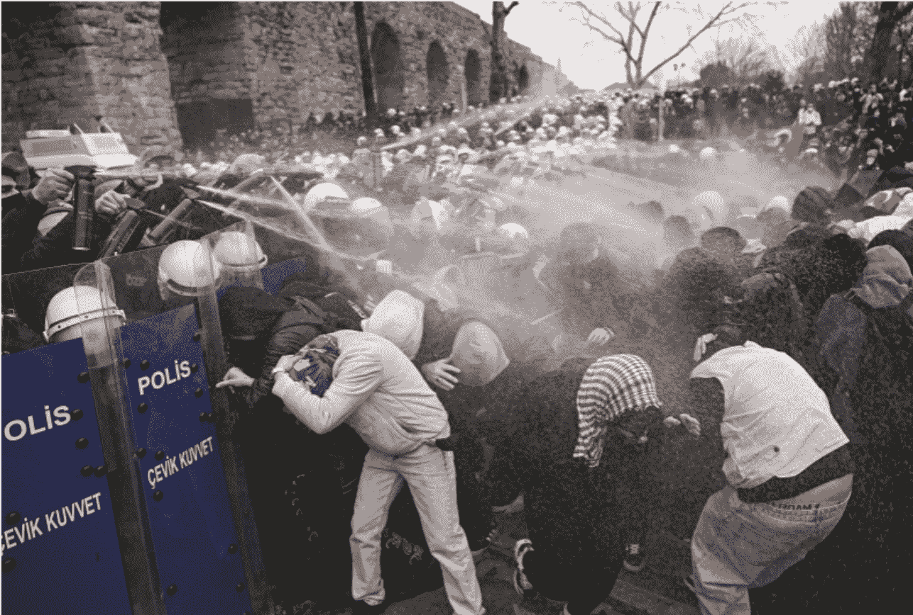

## CAIXIN | 听文章

图 | Umit Bektas/IC photo

当地时间2025年3月23日，土耳其伊斯坦布尔，防暴警察试图使用胡椒喷雾驱散抗议者。据土耳其内政部当天声明，伊斯坦布尔市长埃克雷姆·伊马姆奥卢因涉嫌非法获取个人数据牟利、受贿、干预公共招标和组建犯罪组织，已被羁押候审，并被内政部暂时停职，同时被拘留的还有100多人。这一系列举措被视为土耳其现任总统埃尔多安对竞争对手的打击，随即引发土耳其十多年来最严重的街头骚乱。抗议活动扩展至土耳其81个省份中的55个，多座城市爆发抗议者与防暴警察的冲突。伊马姆奥卢隶属土耳其最大反对党共和人民党，被视为土耳其总统雷杰普·塔伊普·埃尔多安的有力竞争对手。有消息称，共和人民党原定近期宣布他为2028年土耳其总统选举候选人。■