## 财新周刊

## 美国对全球贸易宣战
> “全世界都不得不面临重大调整”

P.52

## 中国产业链大考
P.60

## 财新观察 | 特朗普经济政策能走多远
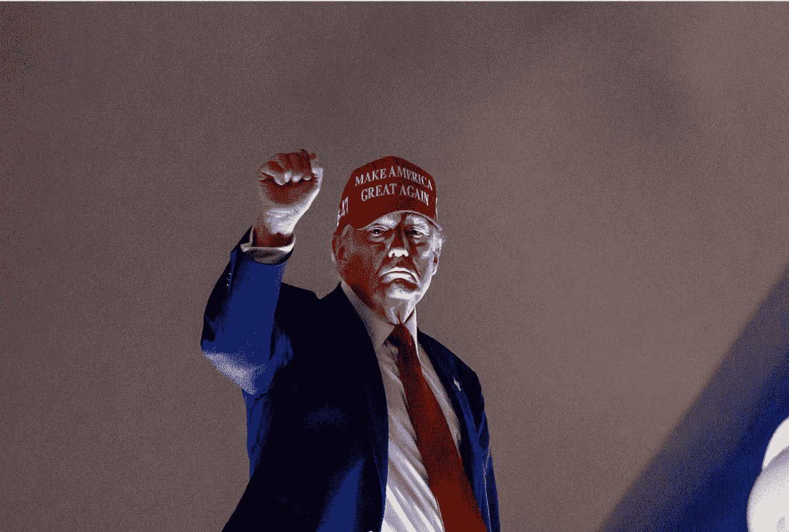

## CAIXIN| 听文章

美东时间4月2日，美国总统特朗普宣布了“对等关税”细则，将对所有贸易伙伴征收“对等关税”。此举对于全球经贸关系乃至国际格局的影响有待观察，可以肯定的是，此举是特朗普当局单边主义和贸易保护主义政策的延续和加码，必将遭到多数国家和地区的反对乃至反制。商务部新闻发言人随即发表谈话表示，中方对此坚决反对，并将坚决采取反制措施维护自身权益。

美国是全球最大的经济体和最大的消费市场，又有美元以国际储备货币的地位加持，其关税等经济政策深刻影响着全球。重返白宫仅仅两个多月，特朗普密集推出一系列经济政策，不断在美国国内和国际社会引发轩然大波。上期《财新周刊》封面报道《美国经济：风暴的起点》对此作了全面详尽的分析。特朗普的2.0版经济“组合拳”，大致包括：削减政府开支、裁撤联邦机构和雇员，驱逐非法移民，提高关税，外加促进制造业回流。略加考察便会发现，这些政策缺乏系统性设计，其多重目标之间往往自相矛盾，且朝令夕改，注定行而不远。

特朗普当局希望通过加征关税保护本国产业和促进制造业回流，其理念似倒退到重商主义时代，且违背产业升级规律。在政策上，提高关税往往让美元走强而非贬值，不利于吸引外国投资、增强出口商品竞争力；希望降低通胀，但提高关税却会推高进口商品价格，导致民众生活成本上升。一些投行和研究机构预测，美国关税税率可能达到20世纪30年代的水平。高盛集团近日发布报告称，美国激进的关税政策将提高通胀率与失业率，阻碍美国经济增长并增加衰退风险。

此外，特朗普当局大规模驱逐移民会加剧本国劳动力短缺，进一步抬升其服务业成本，也可能推升通胀。而且，为了遣返更多移民或修建边境隔离墙，美国政府需要增加人手、扩大开支，这也不利于特朗普政府减少政府雇员、缩减行政开支和财政赤字。总之，这些逻辑难以自洽的经济政策，既平添了美国经济和社会的混乱，也令全球经济风险陡增。

不止如此，特朗普当局的一些经济政策反复无常、不可预测，令投资者和消费者难以形成稳定的预期。以关税为例。特朗普针对加拿大、墨西哥、中国和欧盟的某些商品频繁更改关税税率、起征时点，有时甚至朝令夕改、出尔反尔，实质是将关税作为对外施压、威胁的大棒或寻求谈判的筹码，如此行事其实违反经济常识，必将造成反噬。美国挑战国际贸易规则，会进一步加剧全球供应链紊乱，已经引发不少贸易伙伴乃至其传统盟友的不满和反制。

过往数十年，经济全球化显著提高了大多数国家的经济发展水平，总体增进了人类福祉，其趋势不可逆转。全球产业链、供应链是在长期演化中形成的，强行改变甚至逆转，无异于螳臂当车。单边主义、保护主义、民粹主义并不能使不平等等内部问题消失，而在气候变化、粮食和能源危机等全球性问题面前，任何一国都无法独善其身。出路在于推动全球化往更加平衡、包容和可持续的方向发展。特朗普当局一对多的关税战，将使本来存在分歧、摩擦的国家和地区在一些领域加强联系与合作，这恐怕是美国当政者未曾料到的。

改革开放以来，特别是“入世”以来，中国既是经济全球化的参与者、受益者，也是贡献者、推动者。作为全球第二大经济体和负责任的大国，中国坚定不移推动构建开放型世界经济体系，推动自由贸易和多边主义，维护国际贸易有序稳定发展，与包括日韩、东盟、欧盟在内的国家和地区加强经贸合作，共同维护以世贸组织为核心的多边贸易体制，共同维护开放合作的国际环境，推动经济全球化朝着普惠包容的方向发展。这不仅符合中国的根本利益，也必将成为全球经济的稳定力量。

近年来，美方大搞“脱钩断链”“小院高墙”，频频对华发动贸易战、科技战，中方理所当然地采取了应对措施。对于特朗普当局对华加征关税的做法，中方已经也必将作出相应的反制。保护主义和单边主义不可能一手遮天。事实证明，特朗普在上一任期内发动的对华贸易战并未有效缩小中美贸易逆差。中方主张，中美两国间拥有广泛共同利益和广阔合作了空间，可以成为伙伴和朋友，相互成就，共同繁荣，造福两国，惠及世界。

特朗普当局的施政时间窗口其实有限，明年便将面对就中期选举的考验。在美国制度框架内，特朗普最终能有多大活动余地，民主党又会如何应对，均有待时间给出答案。可以确信，混乱矛盾、充满变数的政策注定走不远，胡乱折腾只会损人又害己，更多杂志关注TG频道《@QiKan2023》。■

## 更多报道详见：【专题】特朗普关税战巨震

## 相关视频：【华尔街原声】巴克莱银行：预计2025年美国经济仅将增长0.7%

视频说明：2025年3月31日，巴克莱银行首席美国经济学家Marc Giannoni表示，由于关税上升幅度超出此前预期，预计贸易加权平均关税税率可能达到15%，在此情景下，巴克莱银行再次大幅下调美国全年经济增长预期至0.7%。

# 最新封面报道 | 美国对全球贸易宣战

## CAIXIN| 听文章
文 | 财新周刊 曾佳 发自美国首都华盛顿，王晶、罗子琳、李忆、路尘、胡暄、侯吴婷 发自北京

美东时间4月2日下午，美国总统特朗普在白宫玫瑰园召开记者会，正式向全球祭出他自第二次当选以来预告许久的“对等关税”，同步向所有国家和地区开刀。

在记者会开到一半时，特朗普举起美国商务部长卢特尼克递过来的，以黑色为底色、蓝黄两栏数字分别列出各国和地区对美关税，以及美国拟对其课税百分比的简报展示板一一详解美国对这些经济体课税的理由。这一画面很快传遍全球。在被视为全球化自贸体制被特朗普亲手拆毁的这一天，他手里抱着的、足有半个人高的长方形黑色展示板，亦有如自由贸易时代的墓碑。

特朗普政府将针对所有贸易伙伴征收不同水平的关税，拟对中国加征34%关税，对欧盟、越南、中国台湾地区、日本、印度、韩国、泰国、瑞士、印度尼西亚、马来西亚、柬埔寨等贸易伙伴征收20%到49%不等的关税。此外，对所有贸易伙伴的最低对等税率也为10%。这项近百年来对全球经贸格局冲击最强烈、覆盖面最广泛的关税举措，料将重塑美国和全球经济，推高通胀并拖累经济增长。特朗普公布的关税方案整体高于投资者预期，全球市场震荡加剧。

在特朗普举起的这一展示板上还特别写道：美方计算的各个贸易伙伴对美国的关税水平除了关税本身，也“包含汇率操纵和非关税壁垒”。不过，全球观察者很快反应过来，特朗普给各国和地区所订的关税，似乎仅是将美国对该国的贸易逆差除以该国对美国的总出口额，再除以二，即得出各国和地区税率。而美国贸易代表办公室事后公布的一项包含进出口量、进口弹性和关税传递系数的公式，经推导后也能得到大致相同的结论。

美方“认为”当前中国对美国的平均关税税率达67%，所以美国将对中国征收34%的对等关税。随后美方官员宣称，此次特朗普政府加征的34%的“对等关税”，将与原本的美国对中国关税20%叠加，因此对中国征收的总关税税率将达54%，这一税率预计在4月9日生效。

按照同样的计算标准，在美国的一系列主要贸易伙伴中，欧盟对美国关税税率为39%，美国将对欧盟征收20%关税；越南对美关税为90%，美国将对越南征收46%关税；中国台湾地区对美关税为64%，美国将对中国台湾地区征收32%关税；日本对美关税为46%，美国将对日本征收24%关税；印度对美关税为52%，美国将对印度征收26%关税；韩国对美关税为50%，美国将对韩国征收25%关税；泰国对美关税为72%，美国将对泰国征收36%关税；瑞士对美关税为61%，美国将对瑞士征收31%关税；印尼对美关税为64%，美国将对印尼征收32%关税；马来西亚对美关税为47%，美国将对马来西亚征收24%关税；柬埔寨对美关税为97%，美国将对柬埔寨征收49%关税；英国对美关税为10%，美国将对英国征收10%关税。整体来看，特朗普政府对欧洲和亚洲贸易伙伴采取了更高税率，对大部分非洲及其余国家加征了10%的对等关税。

美国前两大贸易伙伴——加拿大和墨西哥被排除在外，这被视为特朗普政府作出的重大让步，尽管美国仅有的这两个陆上邻国仍然面临钢铁、铝和汽车行业关税。对于加拿大和墨西哥的输美产品，符合美墨加贸易协定优惠条件的商品将继续获得关税豁免。

特朗普声称，这一天是美国的“解放日”，因为美国在这一天实现了“经济独立”。他还称，美国消费者不会为这些对等关税承担任何额外开销，而关税带来的收入将用于为国民“降税和偿还国家债务”。

特朗普特别点名提到了越南、欧盟、印度等贸易伙伴的对美关税税率，并批评了欧盟的增值税等非关税壁垒，“在很多情况下，美国的朋友比敌人对美国更坏”。

美国对所有国家征收10%的基准对等关税，于美东时间4月5日凌晨0时1分生效。在此基础上，对美国逆差最大的贸易伙伴征收的“个性化对等关税”，将在美东时间4月9日凌晨0时1分生效。美国官方还宣称，特朗普拥有修改权限，可以视情况提高或者降低关税。

一些美国进口商品将被排除在对等关税之外，包括已经被加征过关税的钢铝产品、汽车和汽车零部件、美国缺乏的能源和矿物等，而且金条、铜、药品、半导体和木材制品也不受对等关税的约束。

尽管市场对特朗普发动全球关税早有预期，且特朗普在4月2日当天还特别等到美股收盘后的下午4点，才揭晓对等关税具体税率的悬念，戏剧化的是，当消息传出特朗普拟征的全面关税的基础税率为10%之后，美股三大股指期货短线拉升，纳指期货一度上涨超2%，标普500指数期货上涨超1.5%；但当特朗普举起关税税率展示板，开始逐一介绍各国和地区的加征税率时，三大股指期货又短线跳水，纳指期货转跌超2%，道指期货跌1.4%，标普500指数跌超1.7%。纽约期金首次触及3200美元/盎司，日内涨1.73%。美股主要科技股中，苹果股价盘后一度下跌达5.45%，亚马逊盘后一度下跌达4.5%，特斯拉盘后下跌4.3%，中概股盘后普跌，阿里巴巴下跌4.8%。

国际货币基金组织（IMF）中国处前处长、康奈尔大学经济学教授Eswar Prasad表示，特朗普公布的对等关税让美国过去80年建立的基于规则的全球自贸体系“戛然而止”。Prasad抨击道：“特朗普没有去修正经贸规则，而是决定对国际贸易体制进行直接爆破。”

在特朗普的记者会抛出震撼弹后，美国财长贝森特又在随后的采访中警告各国不许报复。贝森特声称，由于美国是逆差国，历史经验表明在爆发贸易战期间，顺差国通常处于劣势，“传统上，顺差国家总是会在任何形式的贸易战升级中失败。作为一名经济史学者，我建议不要这样做”。

2018年3月13日，湖北省荆州市江陵申达电气有限公司员工在质检出口的特种变压器。该公司产品出口美国、俄罗斯、印尼等23个国家。图：张鸿/视觉中国

澳大利亚是最先作出回应的美国贸易伙伴及美国传统盟友之一。在大部分时间中，澳大利亚是为数不多的美国对其维持贸易顺差的国家之一。澳大利亚总理阿尔巴尼斯表示，美国决定对澳大利亚实施10%的所谓对等关税“不合逻辑”，并称真正的“对等”应当是相互零关税。

即将在5月迎来澳大利亚议会大选考验的阿尔巴尼斯谴责道，美国此举“不是朋友应该作出的举动”，但他依然维持了原先的立场，重申澳大利亚不会对美国实施报复关税，因为“澳大利亚不会加入一场逐底竞赛之中，这只会加剧通胀、拖累增长”。

加拿大总理卡尼表示，这些关税将“从根本上改变国际贸易体系”。尽管加拿大并未出现在特朗普所宣布的对等关税针对国家名单当中，但加拿大仍然面临于美东时间4月3日0点生效的汽车关税。

许多民主党议员强烈批评特朗普的对等关税政策。伊利诺伊州选出的参议员德宾（Dick Durbin）在一份声明中谴责特朗普“将美国置于经济衰退的风险之中，同时不必要地疏远了我们最亲密的盟友”。德宾担忧：“当美国人看到这项关税政策对汽车、食品杂货和汽油价格造成的影响时，这将对整个国家产生负面的经济影响，并导致大量美国人失业。”

美国全国制造商协会表示，尽管其仍在分析特朗普关税措施的细节和影响，但关税带来的高成本“威胁到投资、就业、供应链，进而损害了美国超越其他国家成为制造业超级大国的能力”。美国零售联合会表示，关税将给美国企业和消费者带来更多焦虑和不确定性。该协会强调，特朗普关税不会由外国政府或外国供应商支付，而会是美国进口商支付。美国餐馆协会表示，特朗普对等关税将导致食品和包装成本上升，增加供应的不确定性，推高消费价格，餐厅的经营者必须在关税带来的变化和混乱中设法维持经营。

4月3日，中国商务部发出回应指出，中方注意到，美东时间4月2日美方宣布对所有贸易伙伴征收“对等关税”。中方对此坚决反对，并将坚决采取反制措施维护自身权益。

中国商务部批评，美方声称自己在国际贸易中吃了亏，以所谓“对等”为由提高对所有贸易伙伴的关税，这种做法罔顾多年来多边贸易谈判达成的利益平衡结果，也无视美方长期从国际贸易中大量获利的事实。美方在主观、单方面评估基础上，得出所谓“对等关税”，不符合国际贸易规则，严重损害相关方的正当合法权益，是典型的单边霸凌做法。对此，很多贸易伙伴已经表达强烈不满和明确反对。中方还重申，历史证明，提高关税解决不了美国自身问题，既损害美国自身利益，也危及全球经济发展和产供链稳定。贸易战没有赢家，保护主义没有出路，“中方敦促美方立即取消单边关税措施，与贸易伙伴通过平等对话妥善解决分歧”。

中国社会科学院国家全球战略智库国际政治研究部主任赵海认为，美对等关税将是一个历史性的节点，“是全球进一步确认国际格局走向多极化世界的一个标志性事件”。他认为，特朗普政策的本质是追求反全球化，从而达到重塑整个国际贸易、改变美国对外贸易关系的根本目标，而这必将造成重大的、全球性的经济后果。“势必造成包括产业链、供应链和金融市场在内的普遍的市场混乱。”

## 对美冲击已至

过去几周，特朗普经济政策的不确定性已为全球市场笼罩上一层阴霾。截至3月中旬，美股基本回吐了特朗普2024年11月胜选以来的所有涨幅。在今年的前三个月，美国股市标普500指数下跌了近5%，以科技股为主的纳斯达克指数下挫了10.4%，跌入调整区间。

3月底，高盛在一个月内第二次下调标普500指数的目标价格，预计标普指数将在年底收跌。高盛报告称，这一预期反映了美国经济活动弱化、不确定性升高、衰退风险走高，以及企业营收预期的下滑，“4月2日关税带来的风险要比许多市场人士先前预判的更为严峻”。

高盛首席中国经济学家闪辉在4月3日对等关税公布后对财新表示，该机构在2024年末对美国2025年四季度国内生产总值（GDP）同比增速的预测是2.5%，但目前对2025年四季度的GDP同比增速预测已经下调到1%，并已将美国经济在12个月内陷入衰退的可能性上调到35%。“两三个月内出现1.5个百分点的下调是非常大的调整。”闪辉对财新表示，“对于衰退，2023年硅谷银行爆雷的时候，我们对美国经济在未来12个月内衰退的可能性也只上调到30%，由此可见其程度。”

闪辉表示，在当前对等关税措施公布以后，考虑到仍有其他行业关税、美国国内政策等一系列不确定性存在，仍可能对美国经济施加进一步的负面影响，因此高盛当前预期美国经济增长将比目前市场共识更弱，仍有进一步下行的风险。在此之前，高盛对于2025年一季度的美国经济增长预期已经低至0.2%。闪辉表示，一季度预测值已经走弱，尽管其中可能有一部分临时因素的扰动，例如骤然增加的实物黄金进口，因此虽有扭曲的成分存在，但整体而言仍不影响其走弱趋势。

对于美国的通胀水平，闪辉表示，高盛目前预测美国核心通胀会因此在今年底上升1.5个百分点，达到3.5%，“所以关税还是造成了非常大的影响”。

惠誉评级首席经济师库尔顿（Brian Coulton）对财新表示，美联储可能会担心关税刺激通胀复燃，然后进一步推迟降息时点，预计2025年10月之后才会再次降息。

贸易逆差反映了来自其他国家的商品和服务的对美供应。“很难指望受到关税冲击的国家的出口商会降低价格。在最近的一些贸易中，我们看到美国从中国进口的价格已经开始上升。这将传递给美国居民。美国进口商也可能会挤压一些利润，但这不足以抵消关税的影响。我们认为这将增加美国通货膨胀和消费压力。"库尔顿说。

对于特朗普宣示的把制造业带回美国的目标，库尔顿表达了悲观的看法，"但不幸的是，提高关税无法做到这点"。关税理论上会为美国制造企业在美国市场提供更多保护，但所有经验证据都显示，实际上关税将给美国企业带来额外的成本，即更昂贵的资本货物和中间产品的进口投入，然后在生产过程中使用这些投入，再加上负面影响。此外，美国消费者的支出将受到实际收入下降的影响，企业将会因为不确定性升高而暂缓投资。这些都将导致美国经济增长放缓。"总体而言，我们认为制造业的增长也将放缓。"他说，"市场没想到特朗普会对所有人同时征收关税，现在意识到这是一个非常非常严重的事实，美国贸易政策的方向发生了变化。"

根据美国世界大型企业联合会（Conference Board）3月25日发布的数据，3月份美国消费者信心指数录得92.9，连续第四个月下滑，明显低于预期的94和修正后的前值100.1，创2021年初以来新低；未来6个月的预期指数大幅下滑至65.2，创近12年来新低，远低于80的关键分水岭。

摩根士丹利3月底发布的研报认为，贸易紧张局势给本已放缓的全球经济增长增添了更多下行风险，预计各国的货币和财政政策将进一步放松。但由于财政空间有限，货币宽松政策将发挥更重要的作用；预计亚洲各大央行在本轮周期中的降息幅度将超过2018—2019年，也就是上一轮特朗普贸易战时期。总体而言，各国的政策宽松并不足以抵消新一轮美国关税对全球经济增长的冲击。

2025年2月16日，墨西哥伊拉普阿托，工人们正在采摘草莓，这些草莓将分发到墨西哥不同州并出口到美国。

2025年4月3日，越南胡志明市，一家出口T恤和内衣到美国的服装工厂工人在缝制服装

对外经济贸易大学中国WTO研究院院长屠新泉对财新表示，美国“小院高墙”局面下，特朗普可能想要的“正是和世界脱钩”。屠新泉表示，由于美元和美国国内生产成本的问题，按照贸易规律，美国的贸易逆差难以避免。由此，屠新泉认为，各国就对等关税问题与美国的谈判空间并不大，即使能够通过谈判争取豁免，可能也将局限于某些美国有需求的特定产品或零部件，能够经由谈判实现大幅度关税削减的可能性很小，“因为特朗普考虑的并不是真的所谓‘对等’的问题”。

当地时间2025年4月3日，乌兹别克斯坦撒马尔罕，欧盟委员会主席冯德莱恩在电视演说中表示，特朗普的新关税政策是“对世界经济的重大打击”，如果欧美双方谈判失败，欧盟将准备进一步的“反制措施”。图：Dati Bendo/IC photo

屠新泉表示，美国关税政策属于结果导向，“他并不是真的看你的关税是多少，他想要的就是减少逆差，也就是减少美国从其他国家的进口，而不是要让什么国家降低关税”。

对于潜在的各国与美国之间的谈判前景，屠新泉认为，可能会有相当一部分国家选择退让，例如同意增加对美投资，或自行施加出口限制以减少对美国的顺差，特别是与美国传统上关系较好，而对美国依赖程度又较深的国家，例如日本和韩国。但并非所有国家都有这样的妥协动力和谈判空间。

屠新泉也警告称，北美供应链一体化程度已经相当高，加拿大和墨西哥在本轮对等关税中的“豁免”，进一步凸显“北美关税同盟”的图景仍然可能，即美国将加拿大与墨西哥纳入其产业链构图，取消对加墨关税，而三国对外维持统一关税水平。但面对美国的施压，加拿大目前的抗拒立场明显，因此尚不清楚北美地区贸易局势未来将如何发展。

在特朗普作出该声明数小时后，加拿大总理卡尼表示，加拿大政府将对特朗普的汽车有关关税进行反制，并为受影响的工人提供支持。即使加拿大似乎暂时避开这一轮对等关税，这位曾经掌舵加拿大银行和英国央行的经济学家仍表示，这些关税将“从根本上改变国际贸易体系”。在美方对所有进口钢铁和铝加征25%关税后，加拿大对额外299亿加元的美国商品再加征25%关税，主要为金属制品和信息技术设备。

一直致力于避免与美国陷入关税战的墨西哥则表示，其将在当地时间4月3日早上公布一份“全面计划”。美国高额关税可能损害墨西哥经济。目前经济学家普遍预测，如果美国长期维持高额关税，墨西哥经济将陷入衰退。墨西哥央行此前在2月预测称，2025年墨西哥经济可能最差萎缩0.2%、最多增长1.4%。

## 全球反弹四起

在大西洋彼岸，美国在国际政治中最亲密的盟友英国，亦未能免于对等关税的打击。美方认为，当前英国对美综合关税税率为10%，美国将对英国征收10%的对等关税。英国商业和贸易大臣乔纳森·雷诺兹（Jonathan Reynolds）发布声明重申，英国政府会保持冷静，致力于达成与美国的贸易协议，以减轻关税制裁的影响。

英国和美国互为重要的贸易伙伴，美国是英国的第二大出口市场。根据美国贸易代表办公室的数据，2024年美英商品贸易总额约为1480亿美元，美国在与英国的商品贸易中实现了119亿美元的顺差。英国对美国的主要出口产品包括机械、运输设备和车辆等。

尽管面临关税威胁，英国首相斯塔默仍对与美国达成有利的贸易协议持乐观态度，认为有可能获得比欧盟更优惠的条件。与加拿大或欧盟不同，英国拒绝直接采取报复性的反制措施来回应美国关税，而是希望通过谈判同美国达成经济协议。不过，斯塔默也表示，如果无法达成豁免协议，英国“保留”对美国征收对等关税的权利。作为谈判策略的一部分，英国政府提议缩减对美国大型科技公司的数字服务税（DST），以期缓解美国对英国商品征收关税的压力。

对于欧盟，美国亦征收20%的对等关税。对此，欧盟中对美国经济依赖最为严重的国家爱尔兰迅速回击称，特朗普的关税“毫无正当理由”。爱尔兰总理马丁称，每天欧盟和美国之间的商品和服务贸易额超过42亿美元，破坏这种深度融合的关系对谁都没有好处。“关税推高了通胀，伤害了大西洋两岸的人民，并使就业面临风险。”马丁表示，爱尔兰政府将与欧盟伙伴共同商讨最佳应对方案。爱尔兰财政部和ESRI智囊团联合撰写的分析报告显示，关税可能会让爱尔兰承担逾180亿欧元的贸易损失。在欧盟中，爱尔兰是最依赖美国的国家，对美国的贸易也较为单一。2024年，爱尔兰对美国的商品出口额为730亿欧元，几乎占该国出口总额的三分之一。

特朗普特别强调，欧盟在贸易上“非常、非常强硬”。“你们可能以为欧盟对我们很友好，（实际上）他们对我们敲竹杠厉害得很。”特朗普说。他还在演讲中指出：“在很多情况下，美国的朋友比敌人对美国更坏。”

对此，欧盟委员会主席冯德莱恩在美东时间4月3日凌晨回应称，对特朗普的这一选择“深表遗憾”。她表示，美国的普遍关税是对世界经济的重大打击。“欧洲做好了进行回应的准备。”冯德莱恩称，欧洲正在敲定对于美国钢铁关税的回应措施的最终方案，与此同时，“如果谈判失败，我们也在准备进一步的反制措施。”

连被视为与特朗普政府政治立场亲近的意大利总理梅洛尼，在美国宣布这一举措后也表示，特朗普的新增关税是“错误的”，更有可能导致美欧之间的“贸易战”。但她仍寄希望于能够与华盛顿和布鲁塞尔进行谈判，避免贸易争端升级。

欧洲议会最大党团、欧洲人民党（EPP）主席曼弗雷德·韦伯也回应关税措施称：“对我们的美国朋友来说，今天不是解放日，而是怨恨日。特朗普的关税并不捍卫公平贸易，他们出于恐惧而攻击公平贸易，伤害了大西洋两岸。欧洲团结一致，随时准备捍卫其利益，并愿意进行公平、坚定的谈判。”

冯德莱恩警示，接下来面临特朗普政府关税威胁的行业将是半导体、制药和木材。她表示，许多欧洲人对美国感到“非常沮丧”。“欧洲并没有挑起这场对抗，我们不一定想报复，但如果有必要，我们会有一个强有力的报复计划，而且我们会实施它。”

欧盟此前已经宣布了针对美国钢铝关税的两轮反制措施。其中，欧盟将恢复其2018年和2020年曾经出台过的对美反制措施，以应对美国征收关税对价值80亿欧元（约合87亿美元）的欧洲钢铁和铝出口造成的损害。同时，由于美国新关税给欧盟价值180亿欧元（约合196亿美元）的出口产品造成影响，欧盟还将对美国向欧盟出口的等值商品加征新关税。预计两轮反制措施都将在4月13日左右生效。

法国和其他国家呼吁贸易官员考虑使用欧盟的反胁迫工具，该工具旨在反击那些使用胁迫性贸易和经济措施的国家。

冯德莱恩表示，欧洲市场对美国大型科技企业的重要性不容小觑，或可以此作为反制的目标。欧盟委员会可以限制政府合同或数字广告销售市场的准入，该市场的价值在1000亿欧元左右。“欧洲握有很多筹码。”冯德莱恩表示，“从贸易到技术，再到我们市场的规模……所有手段都在考虑之列。”

同日，全球外汇市场也陷入震荡。一般而言，货币汇率受到贸易收支、跨境资金流动、避险意愿等因素影响。加征关税不利于经济体的贸易，会导致经济体贸易项下的外汇收入减少。此外，经济预期下降也有可能带动本国货币汇率下降。4月3日，欧元先是涨幅迅速扩大，后有所回落。处于1.0860一线的欧元兑美元一度涨破1.0920，日内涨约1%，后回吐过半涨幅。在岸人民币兑美元汇率开盘“跳跌”。开盘后仅15分钟即贬值突破7.30关口，最高触及7.3048；开盘约一个半小时后，在岸人民币汇率小幅回调至7.29左右。离岸人民币汇率的震荡更为明显，一度突破7.33，为2025年2月以来的次高值，随后汇率小幅回调，但仍在7.3关口上方。

此次遭征关税、出口主导型的经济体受到影响较大。越南在此期间为谈判作多种努力。3月26日，越南允许了特朗普盟友马斯克旗下的“星链”（Starlink）卫星互联网服务在越南运营。在此之前，越南总理范明政在3月13日会见美国驻越南大使纳珀时表示，越南相关部委、行业和机构正在积极审查美国进口商品的关税，鼓励增加进口美国有优势且越南有需求的产品，特别是农产品、液化石油气、天然气和高科技产品。就在特朗普对越加征关税前夕，越南还宣布其修改了一系列进口商品的税率，汽车、木材、乙醇等多种商品的进口税均有所降低。尽管如此，越南此次仍被加征46%的关税，受到沉重打击。

在赵海眼中，美国现在已经彻底走向单边保护主义和经济民族主义，长期来看，这一路线将对美国资产、美元霸权和美国在全球的霸权产生非常深远的影响。“通过这次事件，各国将更有可能认清特朗普以及特朗普政策的本质，以及美国所选择的未来的道路。”他还说，美国与全世界的“脱钩”不仅发生在经济意义上，也发生在政治意义上，贸易保护主义和外交孤立主义是一枚硬币的两面；这意味着全球治理将面临更大赤字，地区冲突、公共卫生挑战和气候变化等领域将迎来更多动荡和压力，这将带来世界范围内的混乱局势加剧。

## 深远影响浮现

摩根士丹利的研报指出，对美国经济而言，特朗普政府的限制性贸易和移民政策，加上与财政政策相关的不确定性，很可能对经济增长前景产生重大影响。如果这些关税持续存在，其对美国经济增长前景的风险更多倾向于下行，对通胀前景的风险则倾向于上行，尤其是在未来3—6个月内。“一个世纪以来，有效关税率从未如此之高。可以说，今天的决定，是美国脱离金本位制以来影响最大的政策框架变化。”

赵海表示，在正在形成的多极世界中，如果全球南方国家的话语权得到加强，预计将能够对全球乱局起到稳定器的作用，“全球南方国家追求的是和平发展，所以如果全球南方国家拥有更多的话语权和主导权，将可以一定程度上弥补全球治理缺位的局面”。

赵海也预计，区域和跨区域自由贸易谈判将迎来一个空前活跃时期，特别是对经济体量较小、国内市场狭窄的国家和资源出口型国家而言；区域性或跨区域组织将更容易解决其对外贸易困境，多边组织的优势将在其中进一步凸显出来。

屠新泉认为，美国的最终消费曾经在拉动全球经济方面扮演重要角色，但随着美国改变过去依赖世界的习惯，世界也不得不改变依赖美国的习惯，“对整个世来说都不得不进行一场调整”。美国当前的政策指向的是要打造美国自己的“内循环”，这意味着美国将谋求回到其19世纪的状态，“这确实是历史上最大的一次经济实验，谁也不知道它究竟会得到什么结果”。他的基本判断是：“美国会成为世界上生产成本最高的地方。”

对于特朗普的普遍关税是否将刺激世界各区域的内部合作，以及是否将推动全球南方国家走得更近，屠新泉表示，尽管目前仍难以判断特朗普的未来动向，但这一场景有相当高的可能性会实现。如果特朗普选择以关税为威胁，要求各国孤立某个特定国家，这一策略亦有可操作性，但美国是否真有这样大的影响力，目前看起来非常难说。

屠新泉还表示，特朗普当前的举动使人难以信任，这将削弱各国与他的谈判意愿，“现在有谁能信得过他？”

屠新泉认为：“从战略上来说，我们还是主要就应该发展内需，与此同时，应当为世界经济创造新的增量，例如一直在推进的‘一带一路’的尝试。中国过去40年的成功故事，希望能够在其他国家重新上演几次，这样的话，让世界经济循环能够再次运转起来。”

## 更多杂志关注TG频道《@QiKan2023》
## 更多报道详见：【专题】特朗普关税战巨震
## 相关报道：最新封面报道之二丨中国产业链大考

相关视频：**【华尔街原声】安联：特朗普政府对等关税或改写全球经济**

**视频说明：**2025年4月1日，安联首席经济顾问穆罕默德·埃尔埃利安（Mohamed El-Erian）表示，特朗普政府对等关税或改写全球经济。

# 最新封面报道之二 | 中国产业链大考
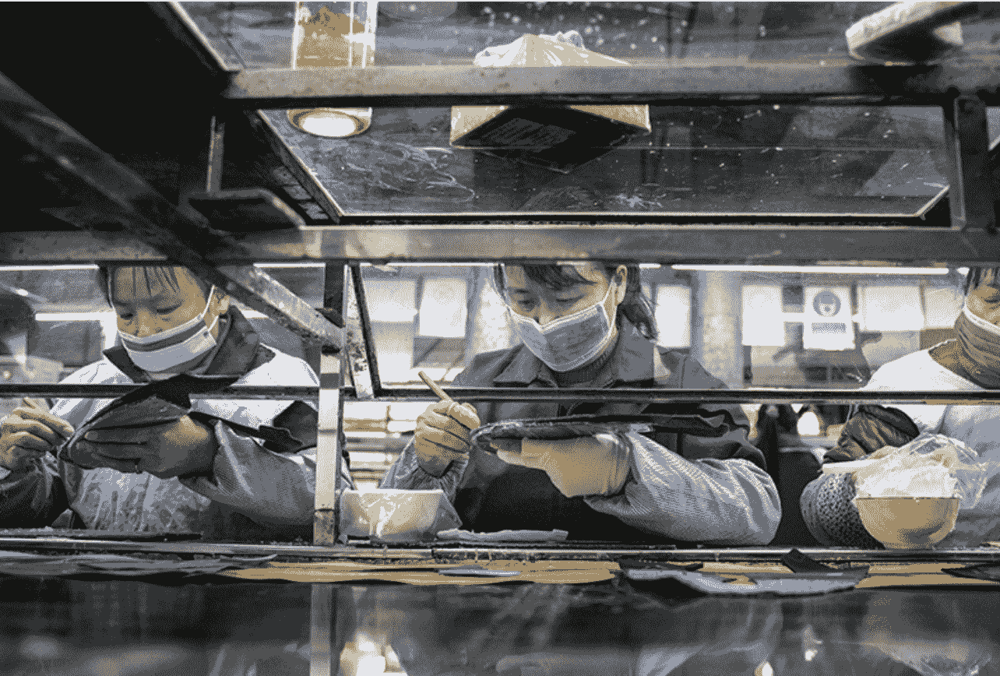

## CAIXIN | 听文章
相关报道：最新封面报道 | 美国对全球贸易宣战
文 | 财新周刊 冯奕铭 覃敏 赵煊 卢羽桐 包云红 罗国平 屈运栩 范若虹 包志明

“早上醒来，整个朋友圈都是美国加税的消息。”一家中国汕头的女衣服饰企业负责人 Jerson Wong 4 月 3 日告诉财新。他从做代工订单起家，主要下游是外贸组货商，其最大市场是美国，公司近年转向跨境电商业务，依靠平台的全托管服务出口海外，美国市场占其销售的40%：“这次美国加征关税，也对跨境小包征税，产业链恐怕无人消化得了这个成本增幅。”

几个小时前，也就是美东时间4月2日，美国总统特朗普宣布了全球瞩目的“对等关税”。白宫官员确认，34%的对华对等关税将与原本的美国对华关税20%叠加，因此对中国征收的总关税税率将达54%，这一税率预计在4月9日生效。关税落地同期，特朗普宣布，针对800美元以下的跨境小包的免税政策也将在5月2日取消，跨境小包关税将达到30%，或每件25美元的关税在2025年6月1日后增加到50美元。

一般贸易和跨境电商同时落地高关税，超过了市场预期，各大产业带全线受到冲击。Jerson所在的汕头是中国最大的内衣产业带，包括他在内的诸多厂商受美国加征关税影响已经多年。早在特朗普上一任期，内衣针织品作为服饰产品已被征收25%的惩罚性关税，到2025年又被连续两次增加10%的关税。

作为外贸产业链最上游的制造企业，Jerson的外贸客户在2024年已经大量减少下单，而原本春节后的旺季也没有来临，此前美国外贸商抢运货物出港，近期码头装货量大大减少。“美国贸易商告诉我的客户，其对中国采购的占比要从80%下降至0。美国贸易商囤了一些货，但也很难维持长期销售，美国国内消费也不好，他们的日子和我们一样难过，甚至更难过。”

Jerson从2024年开始转做跨境电商业务，直接通过跨境平台面向海外消费者，选择平台全托管的模式，可以享受跨境小包的免税政策：
“越来越多厂家想直接面向海外消费者，这会挤压掉很多美国贸易商的生意。”

然而，2025年2月1日，特朗普签发总统令不再给跨境小额包裹免税，这一政令三天内又因为美国海关系统无法实现而暂缓。“我们上个月接到的消息是跨境小包征税将延期半年，没想到这么快就落地了。”Jerson告诉财新，早在春节前，其跨境业务已经不在美国市场做平台的流量投放和新品开发，目前正在转向往海外仓发货的半托管模式，并且通过TikTok这样的平台在开发意大利等欧洲市场。

劳动密集型的企业都面临类似Jerson的难题，对鞋服、家具、家装等企业而言，目前关税已经高达40%到45%，再加34%的关税政策一旦落地，单一品类的税率将达到空前的79%。财新问询的十数家不同产业带企业，对于最终美国对华关税是“一刀切”定在54%还是将达79%均无法确定，甚至已经不再特别关心，因为这些行业普遍的毛利率都在10%到15%之间，再难消化进一步的关税成本。“中国制造商、中美两国的贸易商都将难以消化，美国消费品势必涨价，中国出货势必减少。”Jerson如此判断。

关税政策落地前，市场已经反映出这一趋势。2025年前两个月，中国服装及衣着附件、家具及其零件、帽类、鞋靴、玩具出口金额同比分别下滑6.9%、15.5%、4.5%、18.3%、11.1%。

向美国之外要市场变得更为迫切，中国内贸、东南亚，包括俄罗斯在内的欧美国家都是潜在市场，但做起来均不容易。Jerson曾经帮一家沃尔玛的大型供应商做过分包业务，2024年这家供应商拿到了天猫品牌的订单，顺利完成内贸转型，但这样成功的案例他身边还不多，有厂商出口欧洲转口俄罗斯遇到了美元无法结算的问题，出口东南亚市场则必须确保国内生产的产品质量高于东南亚，实现品牌区隔。

另一边，过去数年火热的东南亚产业转移不得不停下或暂缓。“我们在越南的工厂和自主品牌本来4月1日就应该开工建设了，因为已经有一个占地90亩、辐射越南和柬埔寨全产业链的园区准备好了，”Jerson告诉财新，但4月2日的美国关税政策基本宣告把产能转移到越南和柬埔寨已经没有意义，“现在整个计划都必须放缓。”

根据美国最新的关税政策，中国企业“出海”的主要目的地越南、柬埔寨、泰国和马来西亚税率将分别达到46%、49%、36%和24%。其征税的品类完全覆盖中国向外转移的重点产业，包括越南的全部制造业、柬埔寨的服装业、泰国全行业、马来西亚的电子产品和加工贸易。

中国机电商会家电分会秘书长周南指出，就家电行业而言，相比对中国79%的关税，东南亚仍然有税差，但美国对越南的对等关税计算系数高达90%，一些家电企业目前对在东南亚设厂选择观望：“中国企业在海外投资不要去做选择题，税差大了就赶着去投资，税差波动了又撤回来，来回‘拉抽屉’无疑将带来巨大的损失。”

实际上，这次美国针对中国加征关税，在品类选择上下了功夫。钢铝产品、汽车和汽车零部件等，美国缺乏的能源和矿物以及金条、铜、药品、半导体和木材制品并不在4月2日所谓“对等关税”加征之列。原因大体有二，一是这些品类在这轮关税前已被征收高额关税。比如，3月12日，美国已向全球钢铝征收25%的关税，而中国半导体对美出口关税早在1月已经达到50%；二是对包括石油、天然气、部分关键矿产品、冶炼产品在内的诸多美国仍然需要的初级产品免加征新关税。

而对中国制造业而言，呼吁多年的转型升级和版权保护更显重要。财新采访的多名出口业务人士均指出，欧美目前的制造业基础和配套无法完全支持其消费，想要制造业回流也很难在短期完成供应链搭建。中国商品在全球市场竞争中如果不能有价格优势，只能通过产品快速升级迭代，让美国甚至全球采购方无法货比三家。“现在我们开发新品要快，而且要防止被抄袭，才可能有溢价，低价‘内卷’的话所有人都活不下去。”Jerson告诉财新。

“'对等关税'将给美国带来巨大的伤痛，一些美国企业将会因为无法获得原材料而倒闭。而中国这边，估计有40%—50%的制造业企业已经亏本或不盈利，但仍然坚持经营。”政策咨询公司科恩集团高级顾问、前美中贸易全国委员会(USCBC)会长克雷格·艾伦(Craig Allen)对财新说，这次最大的受害者不是中国或是美国，而是完全融入全球产业链的其他发展中国家，它们要和中国的高性价比、超高效、低利润的制造商竞争的话，将是非常困难的。

## 劳动密集型冲击大

美国对华再提关税对各大劳动密集型行业冲击最大，也远超市场预期。按国别统计，美国仍是中国第一大贸易伙伴国。2024年中国对美出口额达5246.56亿美元，占总出口额的14.7%。

分品类而言，中国主要对美国出口机电、音像设备，以钢铁和铝为代表的贱金属及其制品，以及纺织原料、塑料制品、服装、玩具、家具、灯具等劳动密集型产品。

今年2月以来，美国对中国已经连加两轮10%关税。首个10%关税2月4日生效，3月4日起再征收10%关税。中诚信国际研报指出，全面加征关税对上游原料和劳动密集型产品的负面影响更大；展望后续，中美贸易摩擦加剧下外需不确定性上升，美国关税制裁、全球产业链重构下出口或持续承压。另外，更大范围的贸易摩擦概率提高，给中国出口带来更多的不确定性。

而上述劳动密集型行业，早在特朗普发动上一轮关税战时，就被征收20%到25%不等的惩罚性税率。这些品类最近四年对美出口下降趋势明显。海关总署数据显示，2024年中国对美出口杂项制品（包括家具、寝具、灯具、玩具等）645.64亿美元，同比下滑1.4%，比2021年的高点下滑21%；而非耐用消费品出口则在疫情后显著下滑，2024年稍有回暖。2023年，中国对美国出口鞋帽伞、人发制品等合计159.92亿美元，同比下滑25.1%，2024年该品类出口额微增3.1%至164.83亿美元。

上海交通大学上海高级金融学院实践教授胡捷直言，中国产业带在上一轮加征关税时已经消化了部分成本，但降本有极限，放弃美国市场并不现实，“美国毕竟是全球最大的消费市场”。

一家在广东和柬埔寨同时设有工厂的国内手袋企业人士告诉财新，面对特朗普上一任期内25%的惩罚性关税，中国厂商和美国贸易商通过协商以15比10或者10比15方式各自承担。今年以来，美国两次加征10%的关税，到第二次加征10%的时候，工厂已经无力和美国贸易商分担，因为中国企业的毛利率已经低于20%，一旦分担关税成本将直接亏损。部分工厂可能短期维持和贸易商的关系，零利润出货，但中长期这部分订单势必流失：“有些大厂看着一个月几亿元出货，其实利润率已经贴近零，再加税会非常困难。而鞋服消费美国占据了全球市场的30%，短期找到新的大市场不容易。”

不止工厂，很多贸易商也无利可图。一名在青岛做鞋类出口的贸易商对财新说，美国此前加征的20%关税目前由公司和客户对半分摊，这对于企业已是“流血”接单，今年以来客户订单减少：“现在有几个企业的利润超过10%？”

劳动密集型行业主要分布在华东、华南和川渝等几大产业带，一些城市甚至镇一级产业带，其单一品类的产能就占到全球产能的10%到50%不等。比如，截至2022年末，广东省汕头市澄海区的塑料玩具生产占全球产能的33%。海关数据显示，2024年，澄海一地出口玩具102.4亿元，其产能占中国塑料玩具产能的50%。出口贸易商则集中于广东、福建、上海、青岛等几大港口周边。从上游原材料、零配件制造、组装到最后的出口贸易，这些产业带都形成了完整的配套。

美国本次加征如此幅度的关税，将对中国产业带上下游造成严重冲击。一名“出海”美国的头部饮料品牌人士对财新称，此前20%的关税加征对任何品牌而言消化起来都已经非常困难。具体到最终是否转移给消费者还无法确定，因为销售链条很长，涉及品牌方、经销商、渠道、消费者四方，其中存在转移定价，“理论上这个税率四方都可以承担，但每一方的博弈能力都不一样，所以现在还在掰扯中”。

浙江省绍兴市柯桥轻纺城的金蝉窗帘是国内一线窗帘生产型企业，出口主要聚焦欧美，总经理杨卫告诉财新，此前新增的关税成本主要以客户承担为主，公司大约承担5%。据其了解，其客户也会进一步在终端销售涨价以转移新增成本，涨幅预计在8%—10%，“多少会影响销量”。另一名中小纺织品贸易出口商则表示，美国对中国加征关税后，其美国客户联络称受关税影响、成本上涨，希望能降价。双方决定协商各承担一部分，但截至目前，尚未就分摊比例达成一致。美国本次再加征34%的关税，意味着中美贸易商之间的谈判将更加困难。

博弈能力较强的出口商，才能将成本转嫁到美方。一名在大连主做玻璃器皿出口的贸易商对财新表示，此前加征的20%关税全部由客户承担，因为在美国之外的市场仍有布局，该贸易商决定不要“以身饲虎，宁可不做（美国生意），也不让步”。

另一边，美国的贸易商只能通过“抢运”降低短期关税风险。直接后果是加大了中国海运的价格波动，进一步增加了贸易商等的成本控制难度。2024年美国集装箱进口总量达到2819.65万标准箱（TEU），为其疫情最严重的2021年外的历史最高年份。其中7月和9月还创出历史新高。2025年2月4日起，美国对中国商品征收10%的新关税，美国1月从中国进口的箱量达到近100万TEU，同环比增幅均超10%。

春节后，美国贸易商的此轮“抢运”结束。失去货量的支撑，美国航线的运价“雪崩”。据上海航运交易所数据，中国至美国西部港口的集装箱运价在1月初达到每箱5000美元的高位后开始快速回落，至3月21日，运价已跌至每箱1872美元，累计跌幅达63%，甚至跌破了航运企业的成本价。

“去年年底的抢运潮让该出的货都出掉了，航运企业和货主企业现在以观望为主。”一名货代公司负责人告诉财新，今年春节后，远东至北美的货运需求一直不振，运价持续下跌，原本预期的3月出货小高峰也未到来。多位贸易人士指出，对于目前仍在海上的货物，大概率到港后的关税成本增加需要美国贸易商负担，最终转移给美国消费者。

美国凯腾律师事务所合伙人韩利杰也表示，从历史经验来看，加征关税产生的成本最后都会转嫁到美国本土的产业界和消费者头上。此外，美国贸易商会进一步寻求供应链替代。在他看来，要抵抗美国加税带来的负面影响，持续创新、产业升级是关键路径。

全球海事数据及情报机构Lloyd's List亚太区主编沈慈晨表示，“对等关税”将给全球物流业带来前所未有的挑战，对拥有200多个国家和地区的全球贸易体系来说，要在短时间内完成如此精细且复杂的关税政策设计和实施，几乎是一项不可能完成的任务。这种不确定性使得物流企业在规划航线、安排运力时面临巨大的风险，一旦政策有变，前期的投入和布局可能瞬间化为泡影。

北京盈科（上海）律师事务所律师陈晖长期关注国际贸易，他对财新指出，虽然美国的进口商在降低从中国采购的比例，但国内有技术优势、全产业链成熟的产品难以被其他国家替代，在加征关税的大背景下，国内很多“低质”供应商在未来可能会被出清，“这是国内外市场共同调节的结果”。

汕头飞鹰科技公司负责人吴裕钦告诉财新，澄海地区主做对美贸易的几个大型玩具商4月2日一早聚集在公司办公室商量对策：“美国的所有订单全部停止。”

吴裕钦2022年考察美国市场时，观察到诸多玩具零售商销量不济，连锁玩具店关门，判断给美国大客户做代工就能活下来甚至成为上市公司的时代一去不返。到2024年，其美国客户要求他向东南亚转移产能，但考虑到越南等国面对贸易战时抗风险能力低，一旦汇率波动大，企业利润就被蚕食，他最终留在了汕头，将公司从玩具生产转向了户外运动商品，而客户也从美国大贸易商转向了中小客户。这一看似做小市场的转型却给他带来了更高的利润率，从而扛住了美国多轮加税。“因为产品足够创新，客户难以找到可以替代的竞争者。”

在他看来，虽然玩具等是劳动密集型行业，但包括人工智能（AI）等在内的技术必然带来更多科技产品：“我整个上午和老板们都在讨论AI新产品。中国的AI技术现在欧洲也没有，只要AI产品玩具开发出来，有比抄袭者更快的迭代能力就能找到市场。今年春节我在德国看到，他们的玩具店还在销售我们十多年前的产品，如果新的产品开发出来，再有新的跨境电商渠道，一定会有新的市场。

## 跨境电商转型

实际上，跨境电商依靠美国小包免税的红利期也即将过去。来自中国内地、中国香港的所有货物都会被征收30%或者25美元/件，最终50美元/件的高关税。而来自中国澳门的货物还有90天的考察期。

所谓小件包裹免税待遇，是指《美国法典》第1321条规定的“最低限度”(De Minimis)免税，即美国对商品总价申报值低于800美元的入境包裹不征进口税；这类商品一直通过无需缴纳关税的“T86”(Entry Type 86)方式清关。2024年，美国适用上述免税条款进口的包裹数量超过13亿件。

对如此大量的货物征税，美国需要完善海关系统。美国最新的行政令称，美国商务部长宣布已建立完善的系统来收取关税收入。

主攻欧美日等发达市场的资深跨境卖家小汪哥向财新表示，跨境电商行业普遍对正式取消小包豁免有预期，甚至有头部货代做好了4月2日就没有T86的准备，现在还有一个月的缓冲期。但对征税本身，目前大部分商家还比较困惑，在何种情况下按商品价值的30%缴纳、什么情况下按25/50美元缴纳：“有很多商品价格低于25美元，交25美元的税也太不合理了。”

他指出，由于贸易整体征税提高，大量中国对美出口的商品关税远超过30%，小包的新政策依然有优势，因此会有商家继续使用T86向美国出货。

依赖跨境电商平台全托管模式的中小商家首先受到冲击。

资深跨境商家众一跨境首席执行官（CEO）海哥指出，新的跨境征税政策可能会影响超过一半的直邮小包，成本会激增30%—50%。

“新关税政策对像我这样的小卖家来说，是毁灭性的打击。”一名美区亚马逊FBM（Fulfillment by Merchant，商家自发货）卖家此前告诉财新，她在亚马逊销售定制品和普货，长期依赖小件免税政策，免税一旦取消，商品价格优势不存，履约时间也变长，竞争力将大幅下滑，销量堪忧。而且，这名卖家也无转型应对之策，因为她的定制商品无法提前备货至亚马逊海外仓库，即采用亚马逊仓库发货模式（Fulfillment by Amazon，FBA）。此类小卖家亦没有资源和资金实力转向海外仓备货模式，更多杂志关注TG频道《@QiKan2023》。

跨境电商平台也深受影响。过去几年，以SHEIN、拼多多（NASDAQ：PDD）旗下Temu、阿里（NYSE：BABA/09988.HK）旗下速卖通和TikTok Shop为代表的中国跨境电商平台迅速崛起，采用全托管方式，从诸多中小卖家手中用小件包裹方式直接向海外买家发货。所谓“平台全托管”，即卖家专注于产品研发和供货，平台为卖家提供产品上架、运营、物流、售后等一系列服务，而此前亚马逊平台上的中国卖家主要用贸易形式出口商品到美国。

中信证券此前预估，Temu、SHEIN两大平台在美国市场的占比在30%—40%，跨境小包履约模式占销售大头，预计短期受到一定扰动。东方财富证券研报则称，SHEIN目前海外仓发货占比仅5%，Temu占比为20%。据彭博Second Measure数据，在2月5日至9日的五天内，SHEIN在美国的销售额下降了16%—41%，Temu的销售额则至多下降32%。

SHEIN的自营模式亦面临挑战。过去数年，SHEIN基于数字化系统的“小单快返”模式，建立了供应链竞争壁垒，从平台复购数据、社交媒体流行元素等因素分析消费者需求变化，设计好版型后提供给供应商生产，首单一般在一两百件，上市三到七天后销售状况良好的产品才会大量返单。这类大量返单的“常青款”产品才会在SHEIN海外仓备货。而这一模式高度依赖小件包裹物流快速销售和反馈，如果未来依赖海运和海外仓备货，SHEIN最为擅长的小单快返模式将无法实现，供应链灵活性因此受损。

关税变动对海外仓备货模式亦有影响。中国国家税务总局此前发布支持政策，纳税人以海外仓方式出口的货物，在报关离境后，即可申报办理出口退（免）税，支持跨境电商以海外仓方式发展。但目前，由于大宗贸易也被征收高关税，海外仓模式的成本也将增加。

对中小卖家而言，海外仓模式另有挑战。小汪哥介绍称，跨境小件包裹模式下，商家是收到订单后再发货，有的甚至是临时采购；销售资金回笼周期一般会在30天内，而供应链付款周期往往超过30天，这一时间差对商家有利，自有资金要求不高。一旦改用海外仓备货，从海运、仓储到销售、回款，资金回收周期可能长达100天。如果不能向供应链转移账期压力，商户资金压力骤增。一旦资金周转率变化，商户对商品毛利率的要求将大幅提高，这意味着选品都需应变。“（跨境小包和海外仓）两种模式可说是完全不同的两种生意。”他说。

“距离新政落地还有一个月的时间，大家都在找有没有别的办法。”一名服装品类跨境电商卖家对财新表示，按比例征税之下，跨境卖家肯定会在报关时低报商品价值，因此对于低价的卖家是最痛苦的，商品价格高的卖家相对来说好一点，“比如SHEIN一件衣服就10美元，报1美元肯定要被海关查出来”。

他认为，海外仓的体量一定会变大：“从今年开始已经有很多卖家大量往缅甸、越南转移海外仓，尽管这些国家也大多被加征关税，但转移依然有意义，一方面是规避特朗普朝令夕改的政策风险，另一方面也可以从越南发小包到美国。这种方式理论上是最好的，有人已经开始做这个事，但越南物流基建还不完善。”

## 产业转移暂缓

对东南亚多国来说，美国是其最大出口市场，在对美贸易中有较大顺差，而东南亚各国又是中资产业转移的重要目的地。美国新关税政策对中国产业转移影响立竿见影。

“此次柬埔寨对美出口的服饰品关税一旦提升至49%，工厂将难以为继。”前述手袋企业人士告诉财新，目前其所在的小手袋行业，柬埔寨工厂对美出口关税从其建厂时的几乎零关税增至超过10%，一旦征税达到49%，工厂很难独立承担。

依据此次特朗普“对等关税”政策，美国将对柬埔寨征收49%关税，是此次特朗普宣布征收关税所有国家中除了非洲小国莱索托（50%），税率最高的国家。2024年，柬埔寨与美国的双边贸易总额达101.8亿美元，年增11.2%。其中，柬埔寨对美国出口为99.2亿美元，年增11.4%。柬埔寨对美国出口的主要产品为纺织品、服装及鞋类，为柬埔寨出口经济的支柱。

对越南来说，美国也是最大的出口市场。2024年，越南对美国出口额1190亿美元，同比增长23.3%，并从美国进口130亿美元，增长7.3%，其中大部分是电子、纺织服装品。根据美国普查局数据，美国对东南亚贸易的逆差规模越来越大，其中对越南贸易逆差从2017年的383.4亿美元升至2024年的1234.6亿美元，8年增长了2倍以上。（详见本刊2025年第9期特别报道《中企大“出海”》）

东南亚还是中国光伏产业链在海外惟一成规模的生产基地，此前是中国光伏产品前往美国的政策缓冲地带。但在美国关税“大棒”反复威胁之下，光伏产品在东南亚的转口贸易价值处于失效边缘。柬埔寨、越南、马来西亚、泰国这东南亚四国的光伏电池片环节的开工基本停滞。

2024年11月，美国商务部曾发布初步裁定，认定来自柬埔寨、马来西亚、泰国和越南四国的太阳能产品以低于生产成本的价格在美国市场倾销，反倾销税率涵盖从0%到271.2%之间。根据计划，最终裁定结果将于2025年4月18日公布。

上述东南亚四国光伏“双反”关税加码后，亦有当地中资光伏厂商前往邻近的印尼和老挝生产。2024年，东南亚四国出口到美国的光伏组件约占该国总进口量的82%。但2024年12月，美国从东南亚四国进口组件从当年4月的高峰期下降七成，比重降至55%。

但此次东南亚多国进入“对等关税”名单，并实施高税率，光伏产品对美出口直接风险进一步加大。由于光伏供应侧产能过剩和激烈价格竞争，东南亚本地光伏产业无疑面临更大压力。

整体来看，未来东南亚在光伏产业链的角色重要性会逐渐下降，全球光伏供应链会更多元分散。“从目前的关税成本来看，可能中东或者土耳其当地建设光伏供应链所受关税的影响较小。”彭博新能源财经光伏分析师谭佑儒说。此次特朗普加征的“对等关税”中，对沙特阿拉伯、阿联酋、阿曼、巴林、卡塔尔、土耳其、埃及征收的税率均为10%。

对同时在国内和东南亚均有产能的企业来说，特朗普的对等关税对其影响需要区分辨别。“关税落地后，我们第一反应是，第二天产品就会涨价，预计很快能看到全行业涨价。”总部位于杭州的五金工具生产商巨星科技（002444.SZ）4月3日举办路演回应，超过200家国内外投资机构参与了这次路演。巨星科技生产电动工具、中高档手工具等工具五金产品，是亚洲最大、全球第三的手工具龙头企业。

巨星科技副总裁周思远介绍，截至2024年上半年，美国市场收入占公司整体收入的65%左右，其中一部分由中国发货，一部分由越南、泰国、柬埔寨三个地区发货，公司在美国本土还有约1亿美元的产能。

他指出，此轮加征关税后，中国出口至美国的工具产品多数被征收累计79%的关税，但越南、泰国和柬埔寨也被加征了高昂的关税，缩小了中国与东南亚的关税差至30%—43%，而此前中国与东南亚国家的关税差在45%，不过这仍能覆盖两地的生产成本差距，因此在当前的关税下，在东南亚制造仍比中国国内制造具有优势。

实际上，对于巨星科技这样全球布局的跨国公司，美国加征关税将全面考验其供应链。华泰证券研究所全球科技战略首席分析师黄乐平对财新分析，苹果手机收入约30%来自美国，而生产主要在中国大陆、越南和印度等地，三地关税将分别加至54%、46%和26%：“假设中国大陆、越南和印度分别生产65%/25%/10%的对美出口产品，关税落地意味着美国进口苹果手机的价格平均上升30%左右。”

三星手机同样不乐观。据黄乐平测算，三星手机35%的收入来自美国，而其主要的生产地在越南和韩国。越南、韩国此次分别被加征46%、25%关税。“美国加征的关税成本会部分转嫁给消费者，另一部分则由厂商通过优化成本来消化。因此，此次加征关税对中低端市场的影响更大，而在美国市场，三星、联想等是主要的中低端区间的玩家。”Canalys高级分析师朱嘉弢对财新表示。

另一边，对于特朗普此轮大范围关税对美国本地产业的拉动作用，周思远并不看好。“我们美国本土的产能预计很难受益于本轮关税，美国本土的产能仍然依赖进口的零部件，关税将导致美国本土的制造成本明显上升，以及通货膨胀带来的全行业成本上升。”

中国机电商会新闻发言人高士旺对财新介绍，此前，受美国对华政策影响，包括苹果在内的很多外资企业不得不考虑多元化配置供应链，寻找“中国+1”甚至“中国+2”解决方案。但是，由于当地供应链生态不完善、工人效率相对较低等问题，中国仍然是生产的核心。此次美国对等关税落地，不会对中国产业链转移带来更多的负面影响，相反更多的外资企业会选择观望，等具体税率落地之后再综合考虑生产成本。

“特朗普一直倡导美国本土制造，呼吁苹果等企业重回美国生产，但这明显是不现实的。”Counterpoint资深分析师Ivan Lam对财新直言，苹果是设计公司，需要依赖全球供应链进行生产。而美国不具备完整的手机供应链生态，生产模组、零部件大部分依赖进口，且美国缺少工人且人工成本高，短期内也很难建立起足够多的产能。“即使是象征性地跟制造厂在美国本土建厂或者扩大产能，也并不能直接对冲整体本土生产成本的提升”。

Ivan进一步指出，目前美国的意图更多是让受到明显影响的国家来到谈判桌前。手机、模组、各类零部件等怎么征税、具体的税率，仍需等待美国进一步的细则。他透露，考虑到关税的影响，一些企业已经赶在关税落地之前将产品运进美国，如果美国民众接受了关税预期，接下来可能引发一波抢购潮。长远来看，为了对冲加征关税的影响，包括苹果在内的企业可能会考虑优化财务组合、合理避税。

虽然东南亚的产业转移可能退坡，但业界普遍认为，目前的“对等关税”政策会让拉美地区继续成为中国企业对美转口贸易的核心区域，各家航运公司的布局也在持续进行。中外运集运、阿联酋航运等7家亚洲航运公司将在4月30日开通上海港出发的“亚洲—墨西哥快线”(AMX)。而中国航运央企中远海运集团在秘鲁投资建设的钱凯港已于2024年11月投运。截至2025年2月底，钱凯港开港三个月来，进出口货物总额超过2.92亿美元，其中进口申报1901份，货值超1.4亿美元，主要来自中国；出口申报1240份，金额逾1.39亿美元，主要出口至中国、墨西哥、美国等地。

## 豁免加税不可恃

特朗普此次“对等关税”豁免了部分产品，包括半导体、汽车和汽车零部件，美国缺乏的能源和矿物，以及金条、铜、药品和木材制品；同时加拿大、墨西哥两个国家也被列入豁免之列。豁免并不意味着不征收关税，大部分是由于此前美国已经针对这些产品征收了较高的关税。而加拿大和墨西哥是美国前两大贸易伙伴，此次被排除在“对等关税”之外，这被视为特朗普政府作出的重大让步，而这两个国家仍然面临钢铁、铝和汽车行业关税。

已被征收高额关税的典型产品是半导体，美国自2025年1月开始对华半导体关税达到50%。

2018年7月，作为中美贸易战的一部分，美国政府是对来自中国大陆的半导体加征25%的关税。2024年5月，美国白宫发布公告称，该税率水平增加至50%，并于2025年1月1日生效。而美国贸易代表办公室于2024年12月23日针对半导体领域发起的301调查仍在进行。

“半导体行业是全球科技创新的引导性产业，是经济全球化和全球深度分工与合作的推动者和受益者。半导体产业高度依赖全球协作的特点，使得任何破坏这种平衡的使用单边主义行为或政策的国家或地区，最终都将自食其果。”高士旺强调，中美半导体产业合作与贸易是全球化分工的市场化选择，对中国半导体继续提高关税或采取其他救济措施，都将损害双方合作的基础，扰乱全球半导体产业链的分工与合作。

高士旺介绍，美国从中国进口半导体芯片主要是逻辑芯片、其他类、LED芯片和存储芯片，其中LED芯片、晶体管自中国进口占比较高，接近30%。301关税造成美国在过去几年里从中国进口芯片绝对值和份额的下降。2018年其从中国进口半导体芯片价值38.8亿美元，占美国半导体芯片整体进口额的10.33%；2024年降至20.9亿美元，份额降至4.49%，创近十年新低。

值得注意的是，中国向美国的出口中，超威（AMD）、英特尔、美光、三星等外资在华企业，是对美直接出口芯片的主要企业主体。高士旺介绍，这些外资企业将生产芯片的部分工序放在中国，最终还是要运往美国再加工。

据高士旺观察，近年来，随着美国对华半导体管制不断加码，以及301关税不断升级，中国半导体企业正在多元化“出海”，对韩国、越南、印度、马来西亚等地的出口明显增加，其中印度增幅尤为明显，2024年中国出口到印度的集成电路达到74.6亿美元，较2017年的3.8亿美元增长近19倍。但此次美国对印度也要加征26%的“对等关税”。

除了产品多元化“出海”，为了规避美国的贸易壁垒和制裁，一些头部半导体企业也在“产能‘出海’”。一名半导体行业资深人士对财新称，一些欧美客户基于美国限令担忧提前预防，明确要求产品中不能包含中国生产的芯片，企业不得不应客户需求进行供应链转移。当前，中国半导体企业主要在东南亚投资建厂或收购，随着海外市场拓展，拉美甚至欧洲都有望成为投资热门地区。

“我们投资的一家芯片公司目前主要是从国内发货，毛利率还比较高。特朗普加征关税，这家公司仍可以与客户分摊成本，影响相对可控。但如果美国的关税进一步提升，严重冲击利润，那公司可能就转为由美国公司发货。”一名硬科技资深投资人对财新称。

高士旺介绍，整体来看，中国对美国直接出口的芯片，无论从数量还是金额上，占比都比较低。中国生产的大部分芯片可通过在国内组装为模组、终端等成品以后，再出口美国，不会受这一轮关税加码的影响。但他担忧，美国贸易代表办公室在新近的301调查中强调关键行业的各种产品中存在基础半导体，并暗示了任何关税救济措施都可能包括“组件关税”，即对下游产品中包含组件支付的关税，这将对中美企业均造成伤害。

除了半导体，美国针对汽车及零部件这一行业刚加征完新关税，此次也被豁免。2025年3月26日，特朗普引用美国《贸易扩张法》第232条款签署了行政令，对美国进口的整车加征25%关税，包括进口乘用车（轿车、SUV、跨界车、小型货车、货车）和轻型卡车，4月3日起正式生效。

对于符合“美国—墨西哥—加拿大协定”优惠关税待遇的汽车，进口商可以提交申请，说明其美国成分（U.S.content），获批后可将美国成分的价值扣除，只对非美国成分的价值征收25%的关税。

墨西哥料将成为汽车关税冲击最大地区。美国进口的整车中，23%来自墨西哥，21%来自欧盟，其中一半来自德国；18%来自日本，17%来自韩国，13%来自加拿大，只有2%来自中国。

标普全球评级2月发布的一份统计指出，中资车企在美国和墨西哥的敞口较小，2024年，美国市场约占中国汽车总出口的2%，仅占中国汽车总销量的0.4%；同年墨西哥市场占中国汽车总出口的6.9%，占中国汽车总销量的1.4%。据其统计，2022年至2024年，中国分别出口至美国7万辆、7.5万辆、11.6万辆。

特朗普3月26日的行政令还对关键汽车零部件，包括发动机、变速箱、锂电池和电气部件加征25%关税，将于5月3日起正式实施，市场预计这将对中国企业的影响更大。美国联邦政府4月3日更新的加征关税零部件进口代码显示，此次关税覆盖近150个汽车零部件类别，包括发动机、变速器、锂离子电池、汽车电脑，以及轮胎、减震器、火花塞线和刹车软管等较便宜的零部件。

在上一任美国总统拜登任上，美国2024年8月落地新一轮对华301关税，锂离子电动汽车电池的关税税率从7.5%提高到25%；2026年开始，锂离子非电动汽车电池的关税税率将从7.5%提高到25%；天然石墨和永磁体的关税税率将从0%提高到25%。

今年初美国两次对华加征关税共20%，加上2025年5月3日最新关税后，中国出口至美国的锂离子动力电池将被征收70%的关税，这将对中国动力电池制造业造成较大冲击。自2020年起，美国一直是中国锂电池第一大出口目的地，且2024年市场占比有所上升，好于业内预期。海关总署数据显示，2024年中国锂电池出口至美国金额为153.15亿美元，同比增长13%，占中国锂离子电池出口额的25%，占比较2023年提高4.2个百分点；出口数量1.89亿个，同比减少15.7%。

标普全球评级指出，美国是中国最大的汽车零部件出口市场，按价值计算，约占近年此类产品出口的15%—20%。不过，出口至美国的产品在中国汽车零部件供应商的收入中占比不到5%。如果车企要求零部件供应商共同承担关税负担，或者因价格上涨致使美国汽车需求弱化，这可能导致企业销量和利润率下降，特别是美国市场敞口较大的汽车零部件供应商。

孙嫣然、杜知航对此文亦有贡献

更多报道详见：【专题】特朗普关税战巨震

# 最新财新周刊 | 特别报道：缅甸大地震

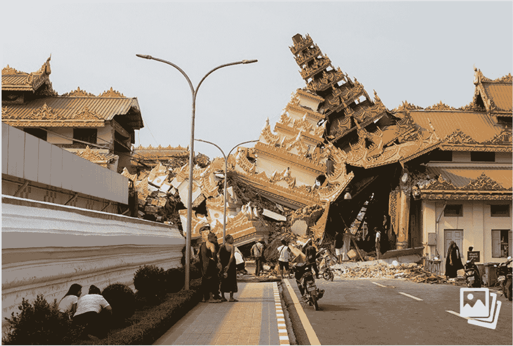

CAIXIN | 听文章

文 | 财新周刊 冯华妹 唐爱琳 王克柔 黄晏浩 胡暄、马铭泽（实习）

3月27日，湖北人胡亮又一次来到曼德勒（Mandalay）。他原计划在此待一个星期，处理完手头上的生意就回国。胡亮是一位40多岁的翡翠商人，往返于云南瑞丽和缅甸曼德勒两地已有十多年时间。

3月28日是传统的“拜佛节”，缅甸全国放假。胡亮也放下工作，和朋友开车到位于曼德勒与彬乌伦（Pyin-Oo-Lwin）之间的娃纳(Wanat)大象营地游玩。中午时分，当地气温达到39摄氏度，胡亮和朋友们躲在树荫下观看、投喂大象。大象吃得很欢，游客们也在开心嬉闹。

在一刹那间，突然地动山摇。头顶的树枝猛烈摆动，一头受到惊吓的亚洲象将背上的游客甩了出去。胡亮反应过来：“地震了！”

幸好景区简陋，只有矮小的草棚，没什么东西可以砸伤人。胡亮以最快的速度驱车往回赶。“我知道曼德勒情况不好，但是东西和朋友都在那里，所以一定要回去。”他告诉财新。

此时是3月28日14时20分，一场里氏7.9级、震源深度仅30公里的浅源地震在缅甸中部爆发。这是全球今年以来最大的一次地震。其震中就位于缅甸第一大河伊洛瓦底江（Irrawaddy River）南岸，距离曼德勒仅约20公里。

曼德勒又名“瓦城”，位于伊洛瓦底江中游东岸，是曼德勒省的省会。这座缅甸第二大城市既是历史悠久的几朝故都，也是佛教圣地与交通枢纽。“瓦城”这个名字源于城郊的古都阿瓦，因为这里华人众多，曼德勒又被称为“华城”。据中国驻缅甸使馆网站，曼德勒市人口约75万，华人华侨约7万。有数据显示，在曼德勒省的华人可能超过40万。

4月3日，缅甸7.9级强震后的第7天。缅甸国家管理委员会新闻信息小组、气象和水文局发布消息说，截至当日上午8时，缅甸强震已致3085人死亡，4715人受伤，另有341人失踪；截至上午8时30分，共发生了63次余震，震级从2.8级到7.5级不等，最近一次震级为3.9级。此外，缅甸强震还波及邻国泰国，其首都曼谷有20人死亡。

截至发稿，地震发生已过去128小时，被困在废墟下的生命存活概率已微乎其微，当地一线救援工作也基本结束，转入消杀防疫。然而这场大地震留给这个饱经战乱的国家以及在此地经商、生活多年的华人群体的伤痛，还将持续很长一段时间。

## 大地震袭瓦城

彭林在曼德勒老城区的主大街上经营着一家中文书店，地震发生时，他正在三楼跟客户打电话。“突然晃得厉害，捏着电话扶着桌子，动也不敢动，桌上的电脑都掉地上了。”第一波地震持续了十几秒，稍有缓和后彭林迅速跑下楼，在街边等待了几分钟，又回去取护照和现金，“又开始震了，赶紧扶着墙”。此后又连续发生了好几次余震，他不敢再在建筑物内逗留。

彭林介绍，主大街是从曼德勒机场进城后的惟一主干道。3月28日财新在与他视频通话过程中，主干道上不时有救护车驶过，许多人或坐或站在路边，打着遮阳伞遮蔽烈日；有的建筑物墙体脱落，玻璃碎了一地，还有几栋房屋倾倒，其中一栋建筑物压住了两辆汽车，车的后轮抬起，后备厢已被砸坏。

地震发生时，居住在曼德勒的陈先生和同事刚吃完饭回到办公室，“突然就地动山摇，轰隆隆的声音跟打仗一样，人都站不稳，当时瞬间就反应过来地震了，赶紧从二楼跑下来，跑到空地上抱头蹲着，跑的时候腿都软了”。陈先生一个朋友的亲戚家住在一栋5层的楼里，地震时整个一层瞬间坍塌，3位华人被埋在下面。在当地人帮助下，救出来的时候只有一个人存活，另外两人已没有生命体征。

陈先生介绍，地震后他开车去城区转了一圈，受灾较重的主要是华人的楼房，因为华人楼房建得比较高，是四五层，地基不稳，“地震后有些房子整个一、二层没了，很多人被困在下面”。

卓明信援创始人郝南告诉财新，曼德勒市区破坏的情况与2015年加德满都地震相似，一楼人员被埋压的情况较多。

3月29日晚，人在曼德勒的旅行博主“破产野哥”对财新表示，地震发生时他恰好在外面拍摄，躲过一劫。他所住的金国酒店（Golden Country Hotel）一共8层，坍塌以后一、二层都没了，整个楼体裂成两半，酒店里有2名女服务员被困。在他看来，曼德勒市区受损严重的有两种建筑，一种是古建筑，比如古老的佛塔、寺庙、皇宫，这些建筑已经几十、上百年了，“经不起折腾”；一种是老一点的多层或小高层建筑，如酒店、公寓或学校等，这些建筑楼层比较高，加上楼结构比较老，坍塌得比较严重。

2025年4月2日，缅甸实皆省，民众在伊洛瓦底江边沐浴，身后是倒塌的阿瓦大桥。地震发生五天后，居民区仍未通电或供水。图：SaiAungMAIN/视觉中国

2025年3月29日，缅甸曼德勒，地震发生第二天，搜救人员正在搜索被困在SkyVilla（天空别墅）的幸存者。在地震发生30小时后，搜救人员从公寓楼废墟中成功救出一名女性。图：SaiAungMAIN/视觉中国

微软公司的“AI for Good”实验室用AI（人工智能）分析了曼德勒的卫星图像，结果显示当地有515栋建筑的受损程度达到80%—100%，1524栋建筑的受损程度在20%—80%，另有18万栋建筑的受损程度为0%—20%。

曼德勒的巴利语名称意为“多宝之城”，早在19世纪，它就因翡翠贸易声名远扬。作为缅甸最大的翡翠交易中心所在地，曼德勒集聚了许多从事翡翠生意的华商。这里的玉石市场每天吞吐着来自缅甸北部克钦邦（Kachin）的原石，经过华人玉商的筛选、切割，再通过瑞丽口岸运入中国云南。除了翡翠华商，曼德勒还聚集了经营金铺的广府人、开超市的福建人和搞物流的云南人等。

华商小徐经营翡翠生意七八年，近几年每年要在缅甸打拼10个月，不时会因突发情况临时回国。她告诉财新，华人在缅甸做生意时，一般会选择月租酒店居住，这样相对比较安全。

但要想做翡翠生意，来缅甸仍是最好的选择。小徐介绍，曼德勒有全世界最大的翡翠交易市场，不仅翡翠价格比国内便宜很多，而且品类也非常丰富，各种手镯、挂件、珠串、原石、红蓝宝、琥珀金珠等一应俱全，华商来这里就有了“源头优势”。2019年—2020年之后，网络直播卖货在缅甸翡翠行业兴起，“马仔”们把翡翠送到市场档口，商人们就地直播，买家看中后直接采用空运或陆运发货，“整个销售模式很成熟”。

此次地震中，翡翠华商群体遭受重创。位于曼德勒市中心的Win Star酒店，因为挨着曼德勒最大的翡翠交易市场角湾市场，住着许多来此做生意的翡翠华商，他们在这里买料子、做直播。地震后，这家酒店7层楼全部倒塌。

居住在Win Star酒店的35岁翡翠商人熊佳鑫不幸遇难。据熊佳鑫的朋友吴女士介绍，熊佳鑫是云南大理人，地震后和两名女性、两名男性一起被困。从被困人员拍摄的视频中可以看到，地震后屋内一片狼藉，熊佳鑫的左小腿受伤，用白布包扎着，一名身穿绿色短袖的男子呼喊救命，一名女性说“天哪，地震了，太恐怖了，死里逃生”。另有现场视频显示，Win Star酒店共发生至少三次坍塌，第一次坍塌后，有人从酒店一楼逃出，楼体裂成了两部分；几分钟后楼体左半部分发生了第二次坍塌；之后视频中有人说“完了完了”，随即右半部分彻底倒塌，很多人在呼喊、哭泣。

3月29日晚，救援队赶到后经过探测，发现这里已没有生命迹象了。“听说有三四十人遇难，很多是做直播的，这边太热了，人长时间被困是坚持不住的。”一位在现场的人士表示。

2025年3月31日，缅甸曼德勒，地震中受损的曼德勒皇宫。这座宫殿始建于1857年，是当今世界上最大的宫殿。图：SebastienBERGER/视觉中国

2025年3月28日，缅甸内比都，一位在地震中受伤的女性在医院中休息。图：SaiAungMAIN/视觉中国

2025年4月2日，缅甸曼德勒，人们在临时帐篷旁休息。当天，曼德勒以南发生4.7级余震，废墟清理面临二次坍塌风险。

据吴女士了解，和熊佳鑫一起被困的其他4人均已获救，但熊佳鑫被找到时已经没有了生命体征，“可能是第二次余震倒塌被砸到了”。其中一名获救女子在社交媒体上发视频表示，地震时5个人在熊佳鑫的房间正准备吃饭，他们从6楼塌下来，4人不同程度受伤，“Win Star酒店住的都是在这里做翡翠珠宝生意的，基本都是中国人，带我来的师傅龙潭珠宝（即熊佳鑫）已经不在了，很难过，我来跟着他学习”。

吴女士称，熊佳鑫做翡翠生意很久了，以前一直在云南瑞丽，2024年开始来曼德勒收货，这一年在中缅之间来回跑，帮翡翠圈的人收翡翠，挣点跑腿费用。

云南女子小云做翡翠生意已有10年，她表示，因为在源头做生意性价比高，所以今年过年的时候，她和爱人也到曼德勒做翡翠直播。3月28日，她和家人吃完午饭一起去湖边坐着吹风，未曾想途中就发生了地震。

“一开始很晃，不知道是地震，反应过来后我们马上从车上下来，整个人是晕的，全身都在发抖。”小云回忆，他们一路上看到很多倒塌的房子，路上的摩托车侧翻着，路两边都是跑出来的人，远处升起浓浓的黑烟，交通也瘫痪了，到处是车鸣喇叭声。后来发生了第二次地震，他们躲了差不多3个小时才往酒店走，“一路上看到很多揪心的画面，到了酒店大多数都是中国人，大家在一起抱团互相安慰”。

一座名为 Sky Villa（天空别墅）的 11 层公寓，是本次曼德勒震区最大的一幢倒塌建筑物，亦有不少华人居住于此，其中包括以做翡翠直播为业的 29 岁的明艳珠。她的姐姐明女士告诉财新，这座公寓分为四栋，共有几百户人家，明艳珠住在 D 栋五层。3 月 28 日缅甸全国放假，明艳珠也在家。“我一个表妹住在 A 栋，过来找我妹妹玩。她们还拌了柠檬吃，后来肚子饿了要去吃饭，我妹妹说叫外卖好了，外面天气太热就不出去了。外卖还没有到，表妹的朋友叫她们一起过去吃饭，我妹妹说不想出去。”明女士说，表妹下楼坐上车才 3 分钟的时间，就目睹房子坍塌了。

缅甸中华总商会副秘书长赵德仁介绍，Sky Villa 公寓楼平面呈东西向狭长形状，东侧低楼层坍塌，剩下上面的 6 层楼；西侧坍塌范围更大，只剩下 3 层楼。他表示，救援队和军人都在现场，但是救灾经验不足，设备工具很少，再有小的余震都可能导致二次坍塌，许多焦急的家属亲友等候在周边，有人送了许多饮用水和食品到现场。

“（公寓内）被困的人实在太多了，好多人都和我们一样在担心，不敢想象伤亡会上升到什么程度。”明女士受访时人在仰光，地震后她一直联系不上妹妹，直到一个小时后才和表妹联系上，“她一直在哭，现在曼德勒面临的一个困难就是通信不好、没有信号，联系不上人。”

曼德勒省的基础设施在地震中也遭受重创。据缅甸国家管理委员会新闻组 3 月 29 日通报，强震已造成曼德勒地区 1591 栋房屋、670 座寺庙、60 所学校、3 座桥梁和 290 座佛塔损毁。其中曼德勒伊洛瓦底江上的地标性建筑物阿瓦大桥部分坍塌，缅甸曼德勒国际机场塔台建筑也在地震中倒塌，至少6人死亡。

缅甸最后一个王朝贡榜王朝留下来的曼德勒皇宫宫墙和塔楼，也在此次地震中坍塌。这座宫殿始建于1857年，呈正方形，长宽各为2000米，占地面积400万平方米，是当今世界上最大的宫殿。它曾在战争中被毁于战火，1989年缅甸政府开始依据历史图片和资料重建，恢复了89个主要大殿。

## 地震发生于实皆断裂带

缅甸的这次特大地震，发生在缅甸活动性最强、规模最大的孕震断层——实皆断裂带（Sagaing Fault）上。实皆断裂带位于印度板块和巽他板块交接地带，是板块相互作用的边界。在缅甸的西部，印度板块向东俯冲，形成对欧亚板块中南半岛的强烈挤压，在中南半岛的地壳内部发育了许多活动的地震断层，其中实皆断裂带就是规模最大的一个。

从地图上看，实皆断裂带北起喜马拉雅山脉，途经缅甸人口稠密的第二大城市曼德勒、首都内比都、勃固，最后连接安达曼海（Andaman Sea），全长1200多公里。这里长期以来是缅甸地震高风险区域，20世纪以来已经发生过9次7级以上大地震，其中1929年—1931年连续发生四次7级以上大地震。2023年，缅甸政府还向民众提示过实皆断裂带的地震风险，更多杂志关注TG频道《@QiKan2023》。

“这条断裂带上经常发生强烈地震，地震平均发生周期比较短，地震比较频繁。”中国地震局地球物理研究所原副所长、研究员高孟潭告诉财新，实皆断裂带呈现右旋走滑的特征，这次地震也是一次右旋走滑型地震，“这么大的地震，地表会产生比较大的错动。”走滑型地震的特征，是地壳板块或断层两侧的岩石沿着近乎水平的方向相互滑动，一般震源深度较浅，能量更容易传递到地表，造成巨大破坏。

缅甸地震发生后，中国地震局地质研究所徐杜远博士的简要解读显示，本次地震破裂长度可能约300公里，最大滑动量约6.5米，破裂持续时间约90秒。他还表示，本次震源区上一次强震是1839年发生的8级地震，已经历近200年能量积累。另有其他地震学家估测称，破裂长度可能达400—600公里，可能为陆地走滑地震之最。

破裂长度大、能量积累多，也造成本次地震烈度极高。中国科学院青藏高原研究所碰撞隆升及影响团队的初步研究结果表明，计算震中区的理论地震烈度约为X度。2008年的国家标准《中国地震烈度表》共将地震分为12级，其中X度属于第10级，房屋将出现大多数毁坏。2008年“5·12”汶川大地震中，除震中映秀镇和受灾最严重的北川县烈度为“XI度（第11级）”，震中附近区域均为“X度”。

雪上加霜的是，此次缅甸地震震中位于缅甸的“母亲河”伊洛瓦底江附近，两岸都是稠密的村镇和城市，更靠近缅甸古城曼德勒。这里曾是缅甸文化经济的中心，不仅人口众多，而且广泛分布英国殖民时期的砖砌建筑甚至更古老的木建筑。缅甸的建筑抗震设计规范也较低，抗震级别远低于本次X度的地震烈度，导致了更大的灾害。

从破裂方向来看，本次地震主要向南破裂，朝向泰国曼谷方向，对中国的影响有限。国家自然灾害防治研究院首任院长、中国地质大学教授徐锡伟告诉财新，缅甸地震以向南破裂为主，所以震中向南方向的破坏力会比较大，向北的破裂很小，地震波向东西两侧则衰减很快，“我们国家距离有300公里，实际的影响很小”。

徐杜远介绍，此地震往南破裂的长度约为其往北破裂长度的2—3倍，因为北边2012年发生过6.9级地震，已经释放了大量能量，能量积累不过十多年；而在南边，上次大地震发生在1929年与1930年，距今已经积累近100年的能量，积累的能量远超北边，所以此次地震往南破裂的长度较北边更长。

## 救援之难和民间自救

强震发生后，缅甸军政府宣布，该国中部的大片地区，包括曼德勒和首都内比都、实皆、勃固、马圭以及掸邦东部等地，进入“紧急状态”。“我们希望国际社会尽快提供人道主义援助。”缅甸军方和国家管理委员会发言人佐敏吞对外呼吁说。

交通等基础设施的损坏，也加大了地震救援的难度。地震中，连接伊洛瓦底江东西两岸的阿瓦大桥部分垮塌，曼德勒到机场和南部仰光的高速公路也损毁严重，导致部分道路封闭。曼德勒国际机场跑道受损，航班全部停飞。仰光至曼德勒的列车也停运，物资运输困难。国际红十字会称，供电线路被毁使得救援队要到达曼德勒、实皆和掸邦南部面临更多挑战。由于震区出现了通信中断，许多受灾地区的损失也情况不明。

正因如此，地震发生后的第一时间，当地少有组织化的系统救援，多是民间自救。

3月28日14时34分，在缅甸经营一家建筑企业的中国商人张正益发了一条朋友圈：愿所有人平安。18分钟后，他又发了一条朋友圈：曼德勒（瓦城）哪里需要大量人员救援的可以打电话给我。张正益的朋友圈日常是晒工作、老婆和孩子，但地震发生后，他的朋友圈内容变成了救援路上与现场救援画面。他发布的视频里，工人们穿着日常在建筑工地干活的装束，从倒塌的废墟残垣里往外抬人，隔着屏幕也能感受到现场腾起的热气和烟尘。

由于缺乏重型机械，灾区的救援行动进展缓慢，当地民众不得不在白天冒着40摄氏度的酷暑，以徒手挖掘的方式寻找地震幸存者。博主“野哥”介绍，地震发生后他没有看到特别组织化、系统化的政府救援，不管是住宅里面的老百姓，还是商业酒店，基本上都以自救为主，“大量的房屋倒塌，但根本没有救援的工具、机械设备等”。

与曼德勒隔江相望的实皆市华人不多，受灾情况也很严重。缅甸媒体《今日缅甸》（Myanmar Now）称，由于进出实皆市已受到限制，救援工作只能依靠当地居民有限的人手来进行，每挖出一具遗体都需要花费数小时的时间。一名当地社会救援组织的人士称，许多坍塌的建筑物都需要重型机械才能清理，一个受灾现场可能要一两天时间才能完成清理。

遇难人数太多，当地不得不对遗体进行集体埋葬或火化。

唐建祖是缅甸华裔家庭的第四代，住在与曼德勒相邻的彬乌伦市（旧称眉谬），地震发生后，他自发成为志愿者，每日往返于彬乌伦、曼德勒、实皆三个地区。4月2日，他对财新说，实皆市区房屋损毁严重，“4层的楼房很多都毁了”。人员伤亡情况同样不乐观，还有一些本地救援人员在残垣上进行挖掘工作。但他的了解仅限于市区，更远的地方无法抵达。

唐建祖告诉财新，实皆地区的居民以缅甸本地人为主，少有华人。地震发生后，实皆与曼德勒之间的主要交通通道新实皆大桥在震中受损，最初只能靠水运往来，他也是在近两日才前往实皆运送物资。据唐建祖的观察，目前基础物资的赠送量已经相当充足，但医疗物资仍然很紧张，当地的救援力量也显匮乏。“天气很热，有些作业点又闷又热，氧气又不足，所以那些队员隔一段时间就得交接作业。”在如此炎热恶劣的天气环境里，唐建祖担心流行于当地的登革热可能会进一步发展。

## 生死救援

当地时间3月30日凌晨3时9分，蓝天救援队国际部部长张宇朴给财新发来消息：“到曼德勒了，现在先搜索”。此时，已先期抵达灾区的中国公羊救援队正在一幢坍塌建筑物处开展搜救工作。据中国驻缅甸大使馆消息，缅甸“3·28”大地震后，中国派出28支官方和民间共计600余人的救援队，迅速向缅甸提供了大量紧急人道主义援助。

首支抵缅的国际救援队是中国云南救援医疗队。3月29日6时许，该救援队一行37人从昆明长水国际机场乘飞机出发，当日7点10分抵达仰光国际机场。此后，中国救援队、中国红十字国际救援队、香港救援队等官方救援队也纷纷抵达缅甸。

中国民间救援力量同样第一时间集结奔赴缅甸灾区。3月29日，16名中国蓝天救援云南队队员从云南瑞丽口岸出境，抵达缅甸木姐市后展开救援工作。中国公羊救援队紧急派出16名USAR（坍塌搜救专班）队员组成的侦搜力量，由杭州紧急赶赴泰国曼谷和缅甸震中区域。厦门市曙光救援队22名救援队员从厦门启程紧急赶赴缅甸，3月30日上午抵达仰光。深圳公益救援队亦组织首批20余名专业救援队员出发驰援缅甸地震灾区开展救援。

郝南3月30日告诉财新，当日有200余名中国救援人员抵达曼德勒。他们分为航运和陆路两线抵达，从仰光到曼德勒有螺旋翼小飞机可运转，有三支队伍通过这一方式抵达曼德勒；由于仰光至曼德勒的高速公路中断，其余队伍是通过老路行车进入曼德勒，全程十几个小时。

郝南表示，此次救援现场难度较大，需要重型救援设备，但由于中国救援队大多是飞抵缅甸，能够携带的装备设施有限，需要各个队伍间协作完成作业。此外，电力供应、通信中断、油料供给等问题仍需克服。实皆地区残存的未爆炸物和地雷亦是安全隐患。

震后几日，多支中国救援队奋战在曼德勒，开始了一场与时间赛跑的生死营救。3月31日，当地气温已飙升至最高40摄氏度以上，对救援者和等待施救者都是考验。张正益告诉财新，由于缺乏专业救援工具和大型机械设备，当地救援非常困难，又碰上高温天气，“今天救出四五位吧，没有救出幸存者，基本上希望很渺茫了；这边温度太高了，白天快到45度了”。张宇朴也向财新证实了前述情况。

据一名在现场参与救援的人士介绍，3月29日晚Sky Villa公寓废墟起火，导致救援暂停，并且救援过程中又发生了多次余震，救援难度很大，加上四栋楼连接在一起，不能同时开展救援。3月30日上午，深圳公益救援队到达现场后商定具体的救援方案。

公羊救援队在回传的信息中表示，3月29日晚抵达现场后，他们连夜在曼德勒市区的一幢坍塌楼房展开救援，30日上午7时许，在废墟中寻获一名尚有生命体征的缅甸籍少年。不幸的是，该少年在急救车转运途中失去了生命体征。当日公羊救援队也转场至Sky Villa公寓开展搜救工作。他们定位了3名幸存者，经敲击喊话后，确认为3名被困人员处于深度埋压状态。但救援工作一度被现场发生的次生余火和浓烟中断。队长何军表示，当天气温43摄氏度，且余震频发，救援队员体力透支。

救援队员搜寻的目标里，还包括一名父亲的一儿两女。这名父亲告诉财新，地震发生时他在外地，孩子母亲有事外出，Sky Villa公寓的8层房间里仅有三名孩童和一名40岁左右的帮佣，地震发生后，他曾多次电话联系，但都无人接听。他一直在公寓废墟处等待，甚至能够从废墟里辨认出自己家，看到被卡在楼层下的家中床垫、保险柜，他顺着这个方向呼喊，也没有听到回应。“这边救援太慢了，现在中国救援队来了还有点希望。”他说。

3月31日零时41分、5时37分、6时20分，中国救援队与公羊救援队通过切割、破拆、移除、绳索等救援技术先后救出2名孕妇和1名女童，其中两人被困于Sky Villa公寓。

回到曼德勒后，胡亮得知，为了开展救援活动，受灾最为严重的Win Star酒店废墟要进行爆破，他在3月31日赶去现场查看情况。“来了几波救援队，发现Win Star酒店那里找不到人生命体征之后就先去其他地方了。没有任何当地的组织和媒体帮我们扩散找人信息，都是靠自己。救援方面，不管是缅甸官方还是民间，救援队都几乎没有，可以说是任其发展。目前已经看到中国蓝天救援队、公羊救援队和深圳公益救援队来到这边开展救援。”胡亮说。

4月1日8时19分，缅甸曼德勒一间地震后坍塌的公寓里，厦门曙光救援队的队员向黑压压的废墟里呼喊:“我敲三声，你回应我啊!“话音刚落，从下面传来“噔、噔、噔、噔、噔”5次清晰的敲击声，救援者随即重重敲击了3下管道，废墟下又传来回应的敲击声。曙光救援队表示，这是被困者近20个小时以来第6次、也是最清晰的一次回应，无需借助声波探测仪。

到4月1日，中国公羊救援队已在曼德勒市救出5名缅甸被困民众。损毁严重、多名人员被困的Sky Villa公寓的救援工作也近尾声。公羊救援队称，他们在3月31日傍晚最后一次对该公寓坍塌废墟利用雷达生命探测仪进行排查后，认为除非该场所顶层废墟得到全面清理后再次探测，目前已基本排除存在生命迹象，故已撤出该场所。“公羊救援队前指已经决定，将工作重心调整为对特殊地区的侦搜排查和开展大范围消杀防疫工作。"

据中国应急管理部消息，截至当地时间4月1日8时，中国救援队伍共搜救出8名幸存者。其中，中国救援队搜救出4名幸存者，中国云南救援医疗队搜救出1名幸存者，社会应急力量搜救出7名幸存者（含配合国家队搜救出4人）。另据缅甸消防部门消息，4月1日在曼德勒省玛哈隆迈镇的长城酒店和昂迈塔赞镇的Sky Villa公寓中找到了6具尸体，并救出了3名幸存者。

当地时间4月1日中午12时51分，缅甸各地响起了警报声，以对地震遇难者表示哀悼。在Sky Villa公寓，救援人员暂停了救援工作，他们站成一排，将双手放在背后，向遇难者默哀。现场警笛长鸣，一面系在救援帐篷竹竿上的缅甸国旗降下了半旗。

在连日不休的生命救援工作后，中国救援队伍也已有序进入防疫消杀、灾后安置工作阶段。

4月1日下午，北京蓝天救援队第一梯队11人撤离曼德勒。当天中国公羊救援队继续在指定作业区域进行侦搜，排查了12处疑似生命迹象的埋压点，协助当地群众完成了16具罹难者遗体的挖掘和转移工作，并于4月1日晚上10点正式启动第二阶段的消杀防疫工作，消杀工作计划持续7天。中国公羊救援队USAR特勤队一行16人则于4月2日上午由曼德勒机场起飞返航。同日中国红十字国际救援队第二梯队约20人从云南出发奔赴缅甸，这支由云南、四川、广西、贵州四省份精干力量组成的队伍，将开展灾后赈济、供水和大众卫生、防疫消杀等工作。

生命救援告一段落，灾后处置工作仍然艰巨。一位实皆市的灾民告诉财新，的频繁余震使得一些在强震中尚未损毁的房屋倒塌，居民不得不露宿街头；仍有多个地区处于缺水状态，卫生条件堪忧。至于大量居无定所的难民，在此次地震中受到的影响尚未有明确信息公开。

联合国方面4月1日呼吁国际社会加大对缅甸的紧急援助。联合国驻缅甸临时人道主义协调员马尔科鲁伊吉·科尔西表示，针对缅甸的人道主义响应一直资金不足。进入4月，缅甸人道主义响应所需的11亿美元只有不到5%到位。现在又发生了地震，紧急资金对于拯救生命至关重要。

世界卫生组织驻缅甸代表费尔南多·图沙拉指出，内比都的医院已经人满为患。他警告说：“医疗用品几近耗尽，一些医院因电力中断而无法正常运行运作……甚至连基本的自来水供应都成问题。在某些情况下，医院发电机因缺乏燃料而无法使用。”

胡亮觉得缅甸不能久留，但他发现从仰光回国的机票价格4月1日已翻倍，曼德勒机场则一直处于停摆状态，他只能驱车十几个小时到仰光再乘飞机回国。“玉石交易市场的恢复需要很长时间，我短时间内不会来缅甸了。”他说。■

更多报道详见：【专题】直击缅甸7.9级强震

# 最新财新周刊 | 拍卖协会会长的罪与罚

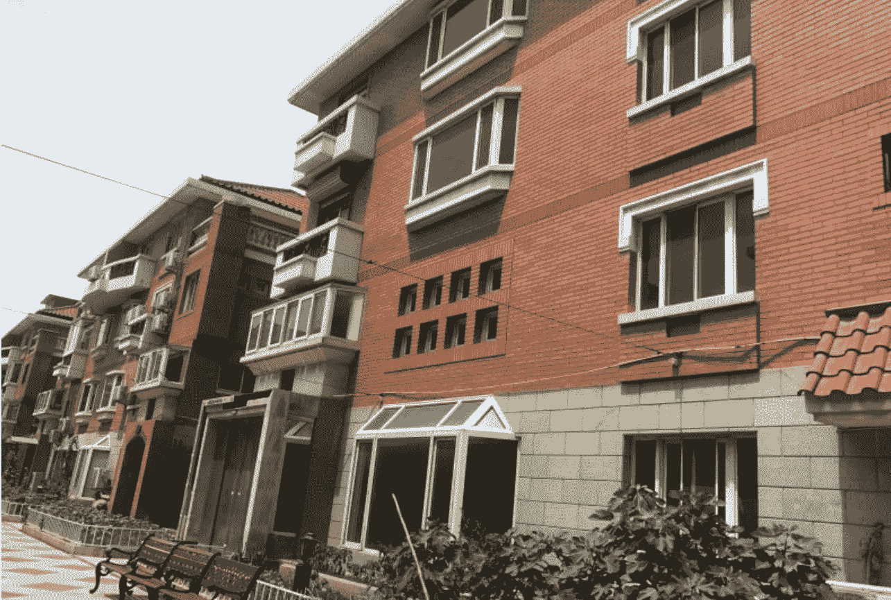

文 | 财新周刊 孙良滋

七年前的2018年3月，53岁的马驰在天津市拍卖行业协会（下称“天津拍协”）换届选举中当选会长。次年他开始接触法院，参与司法拍卖资产处置。这个业务拓展，为他卷入刑事案件埋下伏笔。

2018年3月，马驰在天津市拍卖行业协会换届选举中当选会长。图：受访者提供

2020年，在协助天津市滨海新区法院处置非法集资案房产时，马驰的亲属参与拍卖，先后购入一套别墅和四套公寓。2023年5月马驰被监委调查，五个月后遭刑事立案。2024年2月，天津市河西区检察院指控马驰涉嫌贪污罪和挪用资金罪，当年12月31日，河西区法院作出一审判决，认定马驰非法占有国有财物共计1597万余元，构成贪污罪，且属数额特别巨大，判处有期徒刑12年，并处罚金200万元；挪用公司资金503万余元归个人使用，构成挪用资金罪，且属数额巨大，判处有期徒刑4年，决定执行有期徒刑15年，并处罚金200万元。

## 与处非办和法院合作

马驰是天津本地人，1965年出生，17岁参加工作，曾经在天津迎宾馆、中国国际旅行社天津分社工作。1992年，27岁的马驰下海经商，主要做进出口贸易。据其子马子扬介绍， 2007年，马驰在家人建议下进入拍卖行业，同年成立天津市汇绅拍卖有限公司（下称“汇绅拍卖”）。

2018年3月，天津拍协换届，马驰当选新一届会长。天津拍协官方网站介绍，其成立于2002年11月，是经天津市社团局批准登记设立，在业务主管部门指导下结成的行业性、非营利性社会组织。

当上会长之后，马驰和司法机关的联系多了起来。2019年起，他参与天津市和平区法院的非法集资涉案财产处置。马子扬也是在2019年进入汇绅拍卖工作，据他回忆，当时拍卖行业已经不太景气，为了扩大协会业务量，在得知滨海新区法院有较多非法集资案件的涉案财产需要处置以后，马驰和天津拍协工作人员一同接触了滨海新区法院。

2020年1月14日，滨海新区防范和处置非法集资领导小组办公室（下称“处非办”）召开了一次会议，参会人员来自滨海新区区委政法委、区法院、天津拍协等单位。会议明确，为加快涉案资产处置速度，加强涉案资产拍卖工作效率，由区处非办与天津拍协签订框架协议，具体项目由区法院执行局开展拍卖变现工作。

六天后，滨海新区处非办与天津拍协签订了一份协议书。双方约定，滨海新区处非办委托天津拍协为非法集资案件被扣押物品处置提供咨询，资产处置责任单位向天津拍协提供相关案件扣押物品的清单。协议同时明确，天津拍协向处非办推荐符合资质的拍卖公司拍卖相关资产，具体拍卖合同由资产处置责任单位签署，天津拍协则对拍卖公司实施监督等。协议有效期一年。

2022年5月，滨海新区处非办与天津拍协签署了补充协议书，明确天津拍协提供服务的非法集资案件为盛世富邦案、泰诺润发案和权释案等15起案件，双方合作至工作完成。两份协议签署时，天津拍协的联系人都是马驰。

盛世富邦案是指盛世富邦（天津）股权投资基金股份有限公司以高息为饵，在一年多的时间里非法向1万人募集69亿余元。据公开报道，非法募集的资金除部分返还投资人、购买企业，余款被刘重光等被告人挥霍用于购买房产、汽车、高档手表等。

权释案是天津权释股权投资基金管理合伙企业（普通合伙）非法吸收公众存款案。根据审计署披露的数据，2010年至2011年，该企业以私募股权投资的名义吸收公众资金1.9亿元。2013年7月，滨海新区法院一审以非法吸收公众存款罪分别判处被告人王传生、谭宇健有期徒刑8年6个月，各处罚金30万元，该案已追缴资金1719万元，查封、扣押11处房产、1处会所和7辆车辆。

达成合作后，包括马驰在内的天津拍协工作人员和滨海新区处非办、公安局、法院等单位一起出差确认了涉案资产的状况。判决书记载的马驰供述说，滨海新区法院根据其选择的公司走委托程序，后由拍卖公司拍卖变现。

滨海新区处非办的夏淑一在证言中说，当时协议的内容比较宽泛，天津拍协向处非办推荐拍卖公司等条款并未实际履行。因为处置变现并非处非办职责，处非办负责组织协调，具体工作是法院负责。处非办只要求法院及时将拍卖所得汇到指定账户，再由处非办返还给集资参与人。

对于涉案资产的委托处置，时任滨海新区法院执行局局长路磊在证言中说，在区处非办牵头召开会议时，他本人在会上口头告知马驰，决定委托马驰本人选取有资质的评估公司、拍卖公司，并由马驰具体负责涉案财产的变现。拍卖方式为线下，滨海新区法院与马驰虽没有签署过委托协议，但他多次要求马驰做这些工作的时候一定要依法依规。“马驰负责滨海新区非法集资案涉案财产的拍卖变现工作，他肯定不能竞买涉案资产。”

路磊同时也确认，马驰选择评估公司、拍卖公司后，滨海新区法院执行局会组织合议庭，对评估公司、拍卖公司是否符合资质进行审核。

## 香港路的别墅

2020年6月11日，滨海新区法院向天津鼎信房地产土地资产评估有限公司（下称“鼎信评估公司”）发函，委托后者对权释案中的天津香港路10号8门别墅进行价格评估。两个月后，鼎信评估公司评估师郑亚娟等完成了评估。郑亚娟以该公司法定代表人身份致函法院，确认以2020年6月28日的价值时点，根据市场价值标准，评估该套房屋的总价为2864万余元。

2020年8月28日，滨海新区法院委托佳诚（天津）国际拍卖有限公司（下称“佳诚拍卖公司”）对该别墅进行拍卖。9月17日，佳诚拍卖公司以2004.8万元的起始价进行拍卖，但无人参与竞买。次日佳诚拍卖公司向法院递交了一份流拍结果报告，报告显示，该房屋在公拍网进行公开整体拍卖，9月2日在报纸上刊登拍卖公告，9月8日至9日提供展示，虽有人咨询但至9月16日无竞买人报名及缴纳保证金，所以拍卖没有达成。因为一拍流拍，佳诚拍卖公司建议法院在一拍起拍价格基础上下调价格，再次拍卖。公拍网是上海市拍卖行业协会建设的网络信息发布和竞价公共平台，公开资料显示，公拍网成立于2010年，至2014年已与上千家政府机构、金融机构合作，覆盖全国，尤其以上海为核心辐射长三角地区，累计成交拍品超1亿件，规模居行业前列。

2020年9月23日，佳诚拍卖公司再次在报纸上刊登拍卖公告，称10月24日将举行拍卖，同时仍在公拍网进行公开整体拍卖。在二拍中，该套别墅被一名买家拍得。10月25日，佳诚拍卖公司致函滨海新区法院，表示在拍卖期间有一人缴纳了保证金参与竞买，以1604万元的价格成交。

事实上，香港路别墅的购买者正是马驰的妻子杨智红。她向法院提交了一份情况说明称，一拍流拍后，马驰和她提到过这套别墅，并讲到委托方希望尽快成交变现。第二天的电话中，她和马驰商量购买这套房产，并表示如果无人竞拍，不行就自己买下，于是就参与了拍卖。

天津市河西区检察院据此指控，为低价竞拍别墅，马驰安排其下属肖丹采取低价评估和通过肖丹实际控制的佳诚拍卖公司，在上海市拍卖行业协会管理的公拍网进行线上拍卖，致该房产一次流拍后，以约1604万元起拍价第二次拍卖。马驰以其妻子的名义按起拍价获得该房产。检方认为，马驰受国家机关委托管理、经营国有财物，利用职务上的便利侵吞国有财物，应当以贪污罪追究刑事责任。

天津拍协副会长肖丹作为案件的证人出具证言称，马驰对她说法院委托他个人选定拍卖公司和评估公司，具体负责非法集资案件涉案财产的拍卖变现工作，拍卖公司是马驰选定的，再由自己告诉执行法官。

肖丹称，马驰看中了此套别墅，想低价拍得，就将拍卖业务交给了她控制的佳诚拍卖公司去拍卖，并让她从评估、拍卖和知悉面三个方面进行操作。具体来说，一是向评估公司打招呼要求低评；二是走线上拍卖降低拍卖价格，因为线上拍卖一拍的最低起拍价是评估价的70%，而线下拍卖一拍起价就是评估价，两种方法二拍最低起拍价都是一拍价的80%，而且线上拍卖二拍一旦流拍就要走变卖程序，但线下可以进行三拍，三拍起拍价最低是二拍起拍价的80%，三拍流拍后再走变卖程序。她还指出，为了以最低起拍价买下该别墅，马驰要求线上拍卖，但法院要求线下拍卖，所以她才和法院沟通，将别墅挂在上海的公拍网，而该网站上大都为江浙沪一带的司法拍卖项目，另外刊登拍卖公告选择的报刊也是订阅量相对较小的《中国新闻》报，这样把知悉范围限制在了最小。

肖丹还称，滨海新区法院没有委托天津拍协处置非法集资案的涉案财产，相关拍卖业务也没有通过会长办公会或相关正规程序。

此外，鼎信评估公司的两名证人武利国和刘诗奇都在证言中说，直接或间接知道马驰提前打招呼要买别墅，因此做低了评估，而且两人连同评估师配合了马驰的这一要求。刘诗奇还介绍，她是公司的实际控制人，但因为没有评估师资格证，所以法定代表人由郑亚娟担任。

一审法院对指控予以认可，认为马驰拍卖前就已经看中该房产，进而产生了占有的目的，要求评估公司在价格区间内对房产尽量低评，此情节可印证马驰对涉案房产具有非法占有故意。

此外法院表示，涉案房产在公拍网进行拍卖，拍卖信息刊登于《中国新闻》报，上述操作虽符合拍卖规则，但该报的全国发行量为10万份，且发行方式为订阅、航班合作及针对重点用户定制配送，即该报系对特定用户发行，用户需通过提前订阅才能阅读；公拍网出具的情况说明证实，2020年全年，天津各法院仅有极少量标的在公拍网处处置，且佳诚拍卖公司在入驻公拍网期间，仅发布过这一条拍卖信息。法院认为，上述情形足以证实，在拍卖工作中，马驰基于非法占有的目的，在存在更有利于房产成交的拍卖平台及宣传媒介可供选择的情况下，故意选择上述平台及宣传媒介，在可操作空间内，利用拍卖规则最大程度限制知悉范围，降低成交价格。

法院还表示，在拍卖别墅等金额较大房产时，为提高成交率，行业惯常做法是线上宣传的同时亦在线下进行宣传，采取主动联系有购买能力的客户介绍拍品、联络拍品所在地中介及物业公司协助宣传、推广等手段，扩大拍品知悉范围，引起有购买能力及意愿客户的关注度。而本案中，马驰未采取任何上述行业惯常做法，特别是在第一次流拍后，马驰仍未采取任何提升成交率的措施。

综上法院认为，马驰系基于非法占有目的，利用其负责拍卖工作的职权便利，恶意利用拍卖规则，侵吞国有财物，其行为构成贪污罪。根据2020年10月河西区价格认证中心评估，该套房屋的市场价格约为3026万余元。法院将市场价与拍卖成交价1604万元的差额定为贪污金额，共计1422万余元。

此外一审法院还查明，2020年10月，滨海新区法院委托普德国际拍卖有限公司（下称“普德拍卖公司”）拍卖北京市东城区崇文门外大街一套涉案房产，同年10月9日以515.52万元被他人竞得，拍卖款汇入普德拍卖公司账户。后马驰指示将前述拍卖款中的503万元转入其个人账户，用于支付其竞拍香港路房产的差价。法院认为，马驰挪用公司资金归个人使用进行非法活动，构成挪用资金罪。

一审宣判后马驰不服上诉。2025年3月20日，该案在天津市第二中级法院二审开庭，当庭未宣判。

## 马驰的辩解

《刑法》第382条规定，国家工作人员和受国家机关、国有公司、企业、事业单位、人民团体委托管理、经营国有财产的人员，利用职务上的便利，侵吞、窃取、骗取或者以其他手段非法占有公共财物的行为，构成贪污罪。

该案一审中，马驰坚称自己不构成犯罪。他表示，涉案财产的司法拍卖工作并不是路磊口头委托给他个人的，而是法院委托给了天津拍协；香港路别墅面临流拍，其妻子参与竞拍系为提高成交率；他本人没有向任何人打招呼做低评估，也没有刻意缩小知悉范围。

马驰的辩护律师王兆峰告诉财新，在会见时马驰提到，2021年滨海新区处非办与天津拍协签订的协议即将到期，滨海新区法院为此向处非办发函，希望处非办与天津拍协续签协议，否则工作无法继续展开。还有其他书证可以证明，滨海新区法院将涉案财物处置工作委托的是天津拍协而非马驰个人。比如一份合议庭笔录明确记载，“根据区委政法委会议纪要的精神，本院与天津市拍卖协会进行联络”。另外2020年6月17日，在香港路别墅拍卖前，滨海新区法院向天津拍协发去一份送达回证，这份文件明确记载，接受方为“拍卖协会”，送达的文件为别墅拍卖的裁定书和价格评估委托书，而该份文件由天津拍协副会长肖丹签收。

2024年3月，辩方律师曾联系评估师郑亚娟询问香港路别墅评估的情况。据通话录音，郑亚娟称整个评估过程依法合规，从未有任何人打过任何招呼，是正常履行了评估职责，且评估底稿还在，她不知晓马驰的案件，办案单位也没有找过她本人。这段录音被作为证据提交。河西区法院认为，律师未如实向郑亚娟告知身份及问询目的，亦未告知通话内容将作为证据用于刑事诉讼中，这些情形足以影响郑亚娟所述内容的真实性，因此不予采纳。

王兆峰解释，因为是初次接触，怕郑亚娟有抵触情绪，所以侧面问了评估的情况。后来还向法院申请郑亚娟出庭作证，但未获允许。

关于拍卖宣传，马驰说并非没有做线下宣传，原本计划在小区内贴广告，但物业不让，其间还曾找过房产中介。

辩方表示，公拍网是最高法院公布的司法拍卖网络服务提供者名单库的第一批入库成员，也是迄今为止的七家入库成员之一，是得到最高法院认可并广泛推行的网拍平台，包括天津市各级法院在内的全国法院系统均在使用。以2024年4月15日为例，天津市各级法院系统当日共有114件拍品正在公拍网上进行拍卖，其中河西区法院最多，有22件。“不能因为网站注册地在上海，就说主要是拍卖江浙沪的涉案物资，而且‘天津客户关注较少’的说法属于主观臆断，显然不能成立。

辩方还表示，《中国新闻》报为国家级媒体，查询可知2020年7月—2020年10月期间该报刊曾发布过11份司法拍卖公告。除佳诚拍卖公司发布的拍卖公告，天津市拍卖总行有限公司等发布过2份拍卖公告。2020年正值全国疫情期间，线下宣传有困难是客观事实，而马驰主动提出要线上拍卖，并提前进行公告，恰恰说明主观上没有缩小涉案房产的拍卖知悉范围。

此外辩方认为，拍品信息发布在公拍网上，鉴于互联网的公开性，意向竞买人均可通过互联网报名、出价，任何人都无法限制广大潜在竞买人自由报名、出价及竞价。因此，马驰没有、也不可能控制竞买人范围。

对于挪用资金罪的指控，马驰承认，他确实安排下属将普德拍卖公司款转给他个人账户，2020年10月21日到账约503.2万元，但同年11月20日，这笔资金又悉数转回普德拍卖公司账户。

根据工商登记资料，普德拍卖公司有两名自然人股东各持股50%，马驰在该公司不担任任何职务。不过两名股东在证言中称，她们仅为名义股东，是为马驰代持，并不参与公司决策、不享有股东权益。

辩方表示，实际上马驰是普德拍卖公司的实际控制人、一人股东，该公司实为一人公司，而且公司也不存在任何债务。马驰个人资产与普德拍卖公司资产高度混同，使用公司资金不过是对其所有的资金的一种支配和处分行为，既不存在损害其他股东利益的问题，也未对公司资金安全造成损害，且涉案资金转出不超过一个月即归还，购买的房产也作为普德公司办公场所使用，因此依法不构成挪用资金罪。

辩方还称，即使构成犯罪，马驰挪用资金也是为了能够购买涉案房产，所有行为均是出于通过所谓“贪污”获取非法利益这一个犯罪目的，犯罪目的具有同一性，其挪用行为仅是贪污行为的手段。因此，马驰所涉嫌的贪污罪、挪用资金罪构成牵连犯。对于牵连犯，除《刑法》分则有特别规定，应按照数罪中最重的一个罪所规定的刑罚处罚。

法院认为，公司一经成立，对外进行经济活动需以公司财产对外承担责任。根据《刑法》规定，对挪用资金罪进行处罚不单是为了保护公司股东的经济权益，还为保护交易安全，确保公司能够对外承担责任以及公司资金不被用于非法活动。因此，马驰挪用公司资金用于其个人贪污，应认定其行为构成挪用资金罪。另外司法解释规定，挪用公款进行非法活动构成其他犯罪的，依照数罪并罚的规定处罚，基于上述司法解释精神，马驰挪用公司资金用于贪污行为，亦应数罪并罚。

## 君临大厦的房产

检察院起诉马驰涉嫌贪污罪的另一个事项是，2020年6月，马驰受滨海新区法院委托负责盛世富邦案四套涉案房产的拍卖处置工作。马驰安排由其实际控制的易拍联合（天津）拍卖有限公司（下称“易拍拍卖公司”）和佳诚拍卖公司承揽处置变现，后上述房产两次流拍。马驰为自购上述房产，安排肖丹操作竞买及出售房产事宜，并安排其亲属围拍，拍得上述房产中二套后随即转卖，从中获利175万元。

涉案的四套房产位于天津市河北区君临大厦内，登记信息显示其中一套面积约60平方米，其他三套面积都在20平方米左右。与香港路别墅采用线上方式拍卖不同，这四套房产是线下拍卖。

马子扬解释说，君临大厦房屋存在开发商遗留问题。据他介绍，虽然有三套房产登记面积在20平方米左右，但屋内实际面积都在60平方米左右，而且房屋的燃气等配置也不相同，如果将这四套房屋挂在网上拍卖很难介绍清楚。天津当地一家大型房地产中介亦向财新确认，君临大厦内房产确实存在登记面积和实际面积不符的情况。君临天下是江苏省委原秘书长赵少麟之子赵晋2007年在天津开发的楼盘。2014年6月，赵晋在北京住处被有关部门带走调查，四个月后赵少麟落马。（参见《财新周刊》2015年第20期封面文章《"赵衙内"的房产帝国》）

2020年5月21日，滨海新区法院将君临大厦四套房屋委托给评估公司进行价格评估。6月3日，评估公司提交了估价报告。6月15日，滨海新区法院将涉案四套房产委托拍卖。2020年10月10日和11月17日，拍卖公司组织过两次拍卖，因为流拍，两次向滨海新区法院递交了流拍结果告知函。12月4日，在第三次拍卖中，四套房子被马驰的儿媳和肖丹的外甥拍得。

关于拍下这四套房产的经过，马驰和关键证人肖丹的说法有所不同。

判决书载明的肖丹证言称，滨海新区法院虽然将四套房产委托给两家拍卖公司处置，但实际活儿都是自己的佳诚拍卖公司干的，资金也是走的自己公司账户。她称，当时马驰装修香港路别墅缺钱，君临大厦的四套房产已经流拍了两次，三拍起拍价格已经最低，拍下来也好出手，马驰就让她替他买下来用来投资。“马驰知道作为受委托负责涉案财产拍卖变现的工作人员，且实际经营的公司负责拍卖，他自己竞拍就违法了，就找人代拍了房屋，办理了手续。”肖丹说，后来马驰找了儿媳，她找了外甥，以他们二人名义竞买了君临大厦的房子，后期手续也是以二人名义办的。

肖丹称，马驰让自己尽量保证房子成交价格低。当时拍卖公告上留的是肖丹的电话，为防止他人参与竞拍抬高成交价，其接到咨询电话时，就会跟咨询的人强调房屋缺陷，劝退有意向的买家，最后一次拍卖时，只有马驰儿媳和自己外甥到场竞买。最后，四套房产以总价约340万元成交。

肖丹还说，这四套房产竞拍成功，都是过户后先将房子转卖，再用售房款支付的拍卖尾款。她先卖了外甥所拍得的房产，用卖房款支付拍卖尾款，但因为不够，佳诚拍卖公司又垫付了一部分。马驰儿媳名下的两套房产卖出后，肖丹才找马驰要了90万元尾款。马子扬告诉财新，妻子拍得的房产转卖后获利265万元，扣除税费等，将剩余250余万元确实都转给了马驰。

判决书记载的马驰供述则是，肖丹主动向他提出有四套房子，价钱不高，问他要不要买这四套房子投资。“因装修房子需要用钱，就让肖丹去办了。”到该案一审开庭时，马驰的说法是，君临大厦房产的拍卖事宜均系肖丹操作，其不知情。

辩方表示，据马驰的供述和肖丹的证言，马驰在二次流拍之前对君临大厦四套房产拍卖一事根本不知情，不可能操作两次流拍。辩方还认为，2021年1月15日，滨海新区法院收到了佳诚拍卖公司汇入的四套房产的全部拍卖款共计340余万元。因此，在成交价格合理、拍卖过程合规、拍卖款已足额收取的情况下，涉案君临大厦四套房产不存在被违规制造低价竞买的情况，滨海新区法院也未因此产生任何财产损失。至于涉案房产在拍卖成交后再次转卖的情况，属于房地产交易价格的正常市场波动，与法院无关。

一审法院评判认为，证人证言、马驰庭前供述证实，马驰参与竞拍君临大厦房产，目的系低价竞得房产后出售牟利，二人商定由肖丹负责具体操作，故马驰具有非法牟利之目的；银行交易明细、证人证言证实，竞拍君临大厦房产所获利益均流向马驰；证人证言称房屋尾款的交付事宜由马驰与肖丹对接，上述情形足以证实马驰系本起事实的预谋、策划者及受益者，马驰当庭所提其对房产拍卖不知情的辩解不予采纳。

法院同时认为，涉案房产在未支付拍卖款的情况下即过户至买受人名下，后上述房产被出售，售房款用于补缴拍卖款。结合马驰庭前供述及证人证言，足以认定马驰利用职权，通过肖丹具体操作，并向法院隐瞒事实，通过法院将房产过户至亲属名下，马驰随即将房产出售牟利，其行为应认定为贪污罪。马驰通过亲属竞得君临天下房产实际支付90万元，获利265万元，故其贪污的数额应认定为175万元。

2025年3月20日，马驰被控贪污、挪用资金一案在天津二中院二审开庭。检方认为马驰构成贪污罪、挪用资金罪，马驰仍坚持不认罪。目前该案在等待二审的判决结果。

拍卖工作人员自己或者通过亲属购买拍卖的财产，是否合法？根据《拍卖法》，拍卖人及其工作人员不得以竞买人的身份参与自己组织的拍卖活动，也不得委托他人代为竞买。

马驰案中，辩方认为，根据《拍卖法》，拍卖人是指依照本法和《公司法》设立的从事拍卖活动的企业法人，可见只有拍卖公司及其工作人员受到法律关于竞买人身份的限制。而在香港路别墅竞拍活动中，拍卖人系肖丹经营的佳诚拍卖公司，马驰不在“拍卖人及其工作人员”之列，委托其妻子参与竞买并未违反法律对竞买人主体的限制规定。在君临大厦四套房产的竞拍活动中，马驰实际控制的易拍拍卖公司系本次拍卖活动的拍卖人之一，虽然该公司没有实际参与竞拍工作，但马驰委托他人参与竞买，从形式上看违反了法律对竞买人身份的限制规定。

《拍卖法》第62条规定了违法竞买的法律后果：拍卖人及其工作人员违反本规定，参与竞买或者委托他人代为竞买的，由工商行政管理部门对拍卖人给予警告，可以处拍卖佣金1倍以上5倍以下的罚款；情节严重的，吊销营业执照。王兆峰据此认为，《拍卖法》仅对拍卖人违法参与竞拍的行为设置了行政责任，而未设置刑罚升格条款。因此，对于马驰以其亲属参与竞买君临大厦房产的违规行为，依据法律规定对拍卖公司及马驰本人处以警告、罚款、吊销营业执照等行政处罚措施即可，而无需上升到刑事定罪的程度。

有从事过司法拍卖业务的拍卖行业人士告诉财新，疫情以来拍卖行业不景气，拍品不好卖，法拍物品风险更大，市场上很多人不敢买。拍卖人员因为了解涉案财产的实际情况，在即将流拍时委托亲友拍得的情形，在行业内并不鲜见，马驰案无论最后判决如何，都给拍卖行业敲响了警钟。■

# 最新财新周刊 | 银行控险拓收寻路

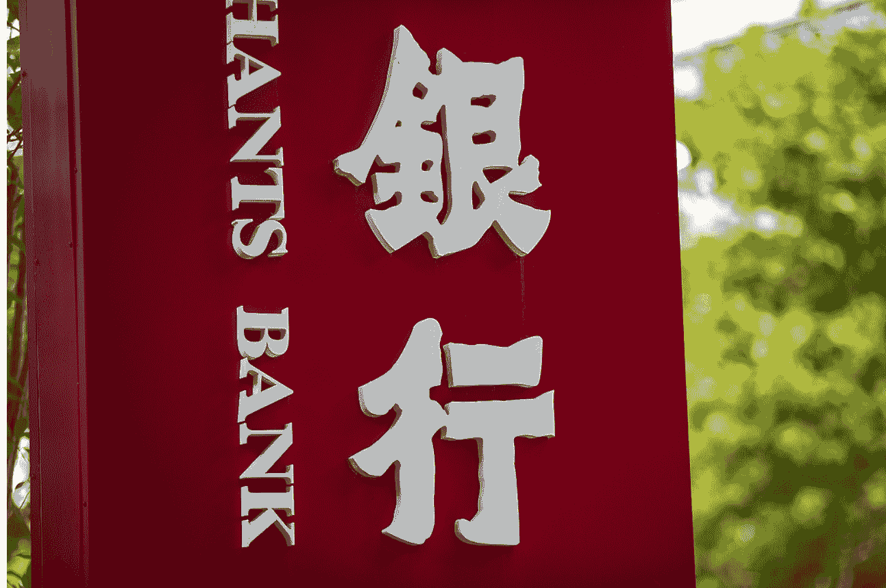

### CAIXIN | 听文章

文 | 财新周刊 武晓蒙 朱亮韬 范浅蝉

> “商业银行现在钱是一块一块地挣，日常管理成本要一毛钱一毛钱地省。”兴业银行董事长吕家进在业绩会上这样形容当下的紧日子，并提出要以工作质效提升的“确定性”来应对外部环境的“不确定性”。

过去一年，国际形势复杂多变，国内有效信贷需求不足，银行业绩承压：得益于规模扩张、“债牛”支撑、资产减值计提减少，一些大中型银行净利润增长率年内扭负为正，但成色欠佳；零售资产质量承压，不良率全线攀升。为应对低利差、高风险的经营问题，多家头部银行提出加强国际化、综合化业务布局，寻觅新的增收点。

截至2025年3月31日，工商银行(601398.SH/01398.HK)、农业银行(601288.SH/01288.HK)、建设银行(601939.SH/00939.HK)、中国银行(601988.SH/03988.HK)、交通银行(601328.SH/03328.HK)、邮储银行(601658.SH/01658.HK)六家国有大行，以及上市的十家全国性股份行、多数城/农商行已披露2024年“成绩单”。

六大行2024年全年营收同比增长率均值为0.17%，较2023年低41个基点（BP）；归属于母公司股东的净利润同比增长率均值为1.64%，较2023年低27BP。不过，与2024年上半年营收、净利润同比增长率均值“双负”相比，有所改善。

十家上市股份行2024年营收同比增长率均值为-0.64%，较2023年的-3.29%略有好转，但仍承压。其中，平安银行(000001.SZ)、光大银行(601818.SH/06818.HK)、民生银行(600016.SH/01988.HK)、浦发银行(600000.SH)、招商银行(600036.SH/03968.HK)连续两年营收同比负增长，浙商银行(601916.SH/02016.HK)则连续两年逆势正增长超4%；归母净利润同比增长率均值为2.45%，较2023年的-3.61%反转，主要与浦发银行净利润大落大起有关，民生银行、平安银行净利润分别同比下滑9.9%、4.2%，其余八家股份行正增长。

城/农商行数量较多，且与当地资源禀赋及区域经济发展高度相关，个体差别较大。其中，江浙地区的多家银行营收增速提高，南京银行（601009.SH）、江苏银行（600919.SH）、杭州银行（600926.SH）、苏农银行（603323.SH）、宁波银行（002142.SZ）分别提高10.08、3.5、3.28、2.78、1.8个百分点，分别至11.32%、8.78%、9.61%、2.99%、8.2%；但它们的归母净利润增速有所放缓，或与2024年四季度拨备计提力度加大有关。也有一些区域性银行净利润大跌，例如盛京银行（02066.HK）同比下降近16%。

整体看，银行的营收结构发生变化，净息差收窄、量难补价，导致利息净收入占比下滑。不少银行靠债券市场行情扛起投资收益的大旗，但相比更考验基本功的利息净收入，可持续性存疑。

收入承压之下，控成本尤为重要，交行、招行、邮储银行、兴业银行（601166.SH）等成本收入比均有所下降。建行行长张毅指出，要坚持“有保有压”，在压缩一般性开支的同时支持战略推进和客户拓展，金融科技投入占营收比例近年来一直在3%以上。

部分银行通过降低拨备来平滑利润增速。据财新统计，在六家国有大行和十家上市的全国性股份行中，有十家银行2024年末的拨备覆盖率同比下降。

在资产质量方面，零售风险压力自2024年上半年起备受各方关注。受居民收入波动、房地产市场调整影响，多家银行个贷不良率在贷款总规模增长的情况下继续攀升，住房按揭、消费贷、经营贷、信用卡不良率全线上行。受此影响，部分银行零售板块净利润骤降，多年来备受业内推崇的零售战略被重新检视。

穷则思变，差则思勤。“一定要闯出一条新路来。”工行行长刘珺用三个“立起来”点明未来的发力方向：一是国际化、综合化经营立起来，“这两个板块的资产占集团的11.8%，比例不算小，进一步挖潜和增益的空间很大”；二是现代金融服务立起来；三是金融科技、数字赋能立起来。

无独有偶，招商银行、兴业银行高管亦在业绩会上提出加强国际化布局，意在服务中资企业“出海”的同时拓宽银行收入来源。

“当前国内竞争激烈，不少企业认为‘不出海就出局’。我们要紧随客户步伐，适时加快海外布局，将国际业务作为优质客户必不可少的金融服务。现在国内外货币政策周期不同步，中美利差‘倒挂’，适当提升国际业务占比面临较好的时间窗口。”吕家进说。

不过，这一切在4月2日美国掀起新一轮空前的全球“对等关税”狂潮后，又被蒙上了新的一层不确定性。

## 零售不良压顶

作为2024年A股市场“最靓的仔”，银行股板块全年上涨超34%，但多数银行目前依然“破净”，即市净率（PB）低于1，投资者的主要顾虑是风险尚未出清，尤其是零售贷款的风险。

财新统计的大中型银行数据显示，多数银行2024年个贷不良率较2023年明显上升，而国有大行更为显著：除了邮储银行个贷不良率上升16BP，其余五大行个贷不良率均上升超20BP。

以个贷规模最大的工行为例，截至2024年末，该行个贷规模8.96万亿元，较上年末增长3.5%。其中，不良贷款1028.3亿元，较上年末增长69%；不良率1.15%，较上年末上行45BP。

具体来说，占工行个贷规模近七成的个人住房抵押贷款2024年末不良率0.73%，较上年末上升29BP；占比18%的个人经营贷不良率1.27%，较上年末上升41BP；占比超8%的信用卡透支不良率3.5%，较上年末上升105BP；占比近5%的消费贷不良率2.39%，较上年末上升105BP。可以看出，工行个贷的主要风险点是消费贷、信用卡。

建行不良上升较多的是个人经营贷、信用卡，这两项贷款规模占个贷的23.5%，不良率分别较上年末攀升64BP、56BP；农行不良上升较多的是消费贷、个人经营贷，这两项贷款规模占个贷的33.7%，不良率分别上升51BP、46BP；邮储银行、交行、平安银行、招行不良上升较多的是经营贷或小微贷，升幅分别为48BP、43BP、19BP、18BP；中行未披露细项。

个人经营贷风险是大中型银行面临的共同挑战。这类贷款的发放对象一般为小微企业主、个体工商户、农户等，品种包括信用贷、房产抵押贷款两大类。

据财新多方采访了解，本轮个人经营贷风险暴露，除了受经济下行、市场行情变化等因素影响，还有一些其他原因：一方面，银行的信用贷产品面临外部数据欺诈风险；另一方面，主要以房产为抵押物的抵押贷款遭遇房价下跌，部分借款人资金链承压，一些三四年前违规挪用经营贷炒房、购房的群体已尝到短贷长用的苦果（参见本刊2024年第40期《个人经营贷不良率攀升背后》）。

银行个人贷款不良率上升的另一面是，因贷款违约而陷入债务困境的个人增多。在当前的经济环境下，银行与个人如何共担风险？2025年3月中旬，国家金融监督管理总局印发通知，提出开展个人消费贷款纾困，银行业金融机构可根据借款人信用记录、还款保障，针对暂时遇到困难的借款人，合理商定贷款偿还的期限、频次，也要有序开展续贷工作。

多位业内人士认为，在当前经济环境下，支持小微企业和个人续贷的政策一定程度上会延缓风险暴露。

资产质量劣化令多家银行零售板块净利润缩水。中信银行（601998.SH/00998.HK）2024年零售业务税前利润92.3亿元，占总额之比由上年的21.3%下滑至11.4%，接近“腰斩”，引发外界对其是否还应坚持“零售第一战略”的疑问。

“零售信贷风险的特点是刚性暴露、即时影响，多数时候需要先核销再清收，会抬高当年风险成本。本轮风险主要受居民收入、房地产调整影响，我们的战略、策略、管理没有大问题，方向不会改变。”中信银行董事长方合英指出，该行2024年个人信用类消费贷逾期率正逐季下降，分别是1.49%、1.47%、1.43%、1.34%；抵押贷款主要有按揭、个人经营贷款两类，其中2024年下半年房抵经营贷、住房按揭贷月均新增不良环比分别下降17%、60%，已有改善迹象。

兴业银行首席风险官赖富荣称，该行2024年下半年信用卡逾期率环比下降43BP，月均入催额同比下降12.4%；预计2025年信用卡风险继续收敛，有望逐步摆脱困境、回到正轨。

不过，银行业本轮零售风险何时出现拐点仍难判断。

“即便如此，招行仍会把零售信贷作为重要的资产投放方向，因为从综合定价水平、风险状况、资金成本来说，零售贷款创造价值的能力更强，我们要在管控风险的前提下找准客户、找准市场。”招行行长王良说，更多杂志关注TG频道《@QiKan2023》。

2024年，不少银行在个人住房按揭贷款增长低迷的情况下，个贷余额大增。例如交行2024年个贷余额较2023年增长11%，其中信用卡增长10%、经营贷增长20%、消费贷增长90%，住房按揭持平。

相比零售，多家大中型银行对公贷款不良率同比下降，且降幅不小。对此，中信银行副行长胡罡称：一是国家出台了企业纾困政策，存量贷款安全性提升；二是银行业加大核销处置，近年来每年处置规模超3万亿元，2023年前主要集中在对公领域。此外，经济结构调整、新旧动能转换、金融监管趋严，提升了银行新发放贷款的质量。

值得一提的是，一些银行2024年的“重组贷款”规模飙升。例如，兴业银行的“重组贷款”由2023年的30.93亿元增至2024年的275.4亿元。该行称，这主要是因为《商业银行金融资产风险分类办法》对重组贷款口径进行了调整，此前只包括不良贷款重组，现在也涵盖了非不良贷款重组。

> “自从不再强制将重组贷款划分至不良贷款后，不少银行重组贷款规模明显上升，实际的资产质量压力或不止于账面不良率。”一位银行业分析师这样说。

## 信贷投放的价与量

银行营业收入包括利息净收入和非利息收入，通常前者占比更高，受净息差、信贷规模等因素影响。在近几年净息差持续收窄的环境下，部分银行刚开始的策略是“以量补价”，但后来发现这一策略不可持续，需要更精细的资产负债管理。

据财新统计，在大中型银行中，2024年净息差最高的是招行，为1.98%；四大行中，建行以1.51%的净息差高出其他大行近10BP。

与2023年相比，银行净息差继续收窄，且幅度不小。在六大行中，工行、建行、中行均下行19BP，农行、邮储银行、交行分别下行18BP、14BP、1BP。在股份制银行中，降幅较大的是平安银行、浙商银行、光大银行，分别为51BP、30BP、20BP；中信银行降幅最小，收窄1BP至1.77%；有行业标杆之称的招行，2024年净息差同比收窄17BP。

> “据我们判断，2025年净息差下行仍是行业共性趋势，但下降幅度有望收窄。”工行副行长姚明德说。

姚明德的判断基于以下多方面情况：一是宏观政策层面，资产端收益水平仍然存在较大下行压力，2024年贷款市场报价利率（LPR）三次下降，同时存量房贷利率调整，这些因素的影响将在2025年逐步显现；同时，2025年财政政策更加积极，货币政策适度宽松，对银行净息差提出了更高要求。二是银行经营层面，负债端加强成本管控的效果有所显现。三是该行主动加强低利率环境下的资产负债布局调整，坚决不打“价格战”。

招行副行长彭家文提到，在加强同业存款定价自律的背景下，活期存款的成本有望进一步降低。该行活期存款占比出现了一些变化，2024年三季度末低至48.7%，年末反弹至52.24%。“我不敢说这代表形势逆转，但确实有边际上的变化，2025年到目前为止活期存款日均增量同比大幅多增。”

当下，多家银行将压降存款成本作为稳息差的重中之重，减少高定价品种的供应。但亦有市场人士提醒，商业银行对负债结构和定价的调整不是无限度的，应在降成本与流动性之间合理平衡，警惕存款过度流失。

受手工补息被禁、存款“搬家”到理财等因素影响，自2024年上半年起，银行负债端告急，部分银行因“缺存款”减少资金融出，成为2025年初市场资金紧张的原因之一。据财新最新统计，包括交行、浦发银行、民生银行、兴业银行、浙商银行、中信银行、光大银行在内的多家大中型银行，2024年全年“经营性现金流量净额”为负值，即净流出；此外，多家银行虽为正值，但同比降幅较大，例如工行、建行同比分别下降59%、47%；少数银行同比正增长，例如招行、邮储银行同比分别增长25%、51%。

“如果经营性现金流量净额长期为负或同比大幅下降，是值得警惕的危险信号。”有业内人士对财新说。

“随着利率市场化持续推进，资产决定负债的经营逻辑越来越明显，只有合理的贷款增长才能更好地保持净息差稳定。”王良指出。

彭家文介绍，2024年招行贷款及垫款增速是5.8%，如果剔除票据贴现，对公和零售贷款合计增速7.8%，与往年相比保持稳定；2025年贷款增速7%至8%的目标可否实现，与外部环境紧密相关。

中信银行以对公业务起家并见长。该行行长芦苇称，2025年全年增量安排比2024年略多，考虑到对公信贷增势较好，资源会相应倾向对公领域，计划增量2700亿元，增幅10.4%；零售业务顺应形势变化安排，增量暂定1200亿元上下，增速5.2%。

基建是建行传统优势业务。张毅表示，该行2025年在服务“五篇大文章”的同时，会重点做好“两重”项目和基础设施领域信贷支持，服务好保交房项目、“三大工程”；推进城市房地产融资协调机制、小微企业融资协调工作机制落地，加大股票回购增持贷款投放，落实民营经济高质量发展行动方案等。

对零售领域，张毅称，在房地产市场降首付、降税费等支持政策及活跃度提升之下，将巩固个人住房贷款基本盘；同时，响应国家消费提振专项行动，加力支持消费品以旧换新，加强购车、家装、家电等重点领域消费信贷拓展。

近期政策层面对个人消费贷有所“松绑”，部分银行的消费贷额度已由20万元提至30万元，线下提款最高可达50万元，贷款期限最长可到七年。不过业内人士提醒，银行发展消费贷业务要基于有效消费需求，同时也要考虑客户还款能力，不宜在利率上过度“内卷”。

此外值得注意的是，自2024年9月国家出台一系列购房支持政策以来，建行个人住房贷款的受理量显著回升，具有一定风向标意义。

建行副行长纪志宏在回答财新问题时表示，2024年四季度，建行个人住房贷款日均受理量环比提升73%，同比提升35%，增速较高；2025年以来，该行房贷受理量、投放量延续良好势头。此外，2024年四季度该行房贷的提前回收规模和三季度相比下降6.6%，2025年一季度环比继续下降。

## 债券收益稳定性存疑

在息差收窄拖累利息净收入的局面下，2024年债券牛市行情带动的投资收益大增，成为银行业绩最重要的支撑因素之一。

在银行财报数据中，其他非利息净收入主要由投资收益和公允价值变动净收益组成。据财新不完全统计，公布这项数据的17家上市银行中，其他非利息净收入增速超过50%的有6家，分别是渤海银行（09668.HK，107.8%）、平安银行（68.7%）、浙商银行（61.7%）、渝农商行（601077.SH，55.5%）、郑州银行（002936.SZ，51.3%）、建设银行（50.6%）。

浙商银行年报分析称，其他非利息净收入增加61.7%，主要是因为集团加强市场研判和专业能力建设，把握债市收益率下行机会，交易性金融资产业务收益较好；具体而言，投资收益增长28%，公允价值变动净收益增加109%。

据广发证券银行业分析师倪军团队的研报统计，在23家已发布年报的上市银行中，2024年国有大行、股份行、城/农商行的投资收益占归母净利润的比例分别为13.83%、39.86%、41.86%。

研报同时分析指出，自2025年初以来，央行稳汇率态度坚决，年前降准、降息预期落空，银行间市场流动性紧张，推动国债收益率大幅回升，金融市场投资收益预计将成为2025年银行业绩最主要的扰动因素之一。

中国货币网的信息显示，10年期国债收益率已从2025年1月初至3月中旬上行约30BP。“预计2025年一季度部分银行的营收会因此略微负增长。”一家股份行的资产负债部负责人对财新谈道。

除了短期营收受到利率波动的影响，不少银行的金融市场业务人士都谈及，在当前的利率环境下，金融市场业务模式已从过往的以配置为主转向更强调交易获利。另一家股份行的原资产管理部负责人此前也对财新表示，银行配置债券此前更多是为了满足流动性指标的要求，在债券牛市环境下，卖出一部分配置型的“老券”还能在投资收益上调剂增补营收。

但2024年的债市红利尽收之后，银行金融市场业务面对的形势已有所变化。当前债券收益率与银行负债端利差接近“倒挂”，叠加债市震荡，不少上市银行提出将加强金融市场的波段交易能力。

“现在金融市场的盈利模式已经从过去的配置获利转向了‘配置是为了交易获利’。配置利率债本身边际上已是负息差，配置转向交易，是要以交易平台搭建为基础，从整体的波动对冲中去寻找跨期、跨市场、跨品种的多元化交易结构。这种模式也是低利率时代银行金融市场业务获利的关键。”浦发银行金融市场业务总监薛宏立在3月30日的业绩说明会上说道。他在回答财新提问时进一步解释，过去配置的收益率更高的债券对银行是好资产，并不是拖累，但现在的配置是为了交易，“这是根本性的转变”。

前述股份行的资产负债部负责人也对财新称，2025年初债市下行，整体而言银行只能被动承受压力，但是各家银行做波段交易的能力不同，也可能导致不同银行的差异化表现。

对银行金融市场部门的一线员工而言，在目前的债市行情下，工作要求更高了。“以前是吃债券票息，还能吃到（债券价格上涨的）资本利得，但现在负债端和资产端利率都快‘倒挂’了，而且2024年债券收益率下行到低位，继续下行的空间有限，后面经济企稳可能还会上行，现在就是要赚波段交易的钱。”一家东部城商行自营部门的投资经理直言，现在的金融市场业务更“卷”，震荡行情也更加难做。

不过，彭家文判断，在适度宽松的货币政策和择机降准降息的大背景下，债券利率可能会震荡向下；尽管2025年一季度债券估值存在一定压力，但全年其他非利息净收入有可能企稳。

受代销保险、基金等减费让利政策因素影响，作为各家上市银行中间收入重要组成部分的手续费及佣金收入，2024年还在持续拖累业绩。

以客户基数最大的六大行为例，2024年工商银行、建设银行、农业银行、中国银行、交通银行、邮储银行的手续费及佣金净收入都为负增长，分别下降8.3%、9.3%、5.7%、2.9%、14.2%以及10.5%。

不过据中泰证券银行业分析师戴志锋团队的统计分析，在“9·24新政”之后资本市场表现回暖，2024年四季度六大行的手续费及佣金净收入降幅有所收窄，全年的降幅比前三季度收窄1个百分点至-7.9%。

## 拓收新支点：国际化、综合化

面对低利率环境的挑战，多家银行开始寻觅破局之道，将更多目光投向国际化、综合化经营。

部分银行的财报数据已体现出相关板块创收的强劲势头。据工行副行长张伟武介绍，截至2024年末，该行境外机构资产规模超4300亿美元，同比增长4%；全年实现税前利润超44亿美元，同比大增19%。此外，工行拥有基金、金融租赁、保险、债转股、理财等子公司牌照，在各自领域占有相应的市场份额。

刘珺表示，2024年工行已按照“一行一策”“一行一表”重新校准了境外机构和子公司定位，优化了母行与子行之间的联动机制，国际化、综合化两个板块的营收、税前利润贡献分别达到9.6%、11%。“未来如果这一占比能提高到两位数，将会形成一个价值创造更加多元的资产负债表，对工行的高质量发展起到强有力的支撑。"

中行的海外业务起步早、规模大，是业内公认的“领头羊”，具有行业风向标意义。年报显示，2024年中行境内利润额同比下降5.72%；港澳台、其他国家和地区利润额分别同比增长13.07%、35.11%，远超集团-0.22%的增速，合计贡献率较上年提升约4个百分点至26.72%。

中行副行长蔡钊表示，未来要巩固扩大传统跨境业务优势，持续在结售汇、国际结算、贸易融资等领域发力拓展；构建新兴业务领域优势，加强对跨境电商、海外仓、中间品贸易等外贸新业态的主动服务，提升全品类金融服务市场份额。

“我们虽然与中行有差距，但在跨境人民币、外汇存贷汇兑，以及国际结算等方面已经有很多布局。未来海外业务的侧重点应该是加大国际清算量、支持新业态。”一位大行海外业务人士告诉财新。

波士顿咨询公司（BCG）董事总经理、全球合伙人谭彦接受财新采访时表示，从国际经验看，日本快速走向零利率的十年，也是日本银行业“走出去”最快的十年。目前，中国银行业在国际化方面的比例和深度，与中国经济的国际化地位并不匹配，“中国商业银行的国际化大有可为，关键是如何找到稳健可行的方式”。

招行在2024年年报中首次提出要推进“四化”转型，国际化排在首位。招行董事长缪建民称，该行在海外业务扩张的过程中，首先要考虑地缘政治的影响，主要是做强存量，特别是在香港的机构；同时，根据与监管部门沟通的情况、防范各种风险的需要，审慎地推进增量业务。

从具体业务板块来说，基于服务中资企业“走出去”的发展需求，以及高水平对外开放的政策导向，对公业务是目前银行业“出海”的重要抓手。

国家外汇管理局发布的《2024年中国国际收支报告》显示，2024年非储备性质的金融账户呈现逆差，主要是境内对外投资增多：境内主体对外各类投资净增加4838亿美元，大幅增长81%；其中，对外直接投资规模1722亿美元，处于历史高位。

浦发银行行长谢伟在业绩会上称，该行的五大赛道之一就是跨境金融，其中跨境并购有较大的市场机会。“中国企业正在‘走出去’，参与国际市场的竞争。它们要快速做大做强靠什么？靠并购重组。我们一定要把握这个机会。”

“零售业务天然具有本地化特征，深受政策合规、消费者客群等影响更大。”谭彦对财新分析称，一般可以分为两类：一是银行在境外设立网点，服务当地零售客群，这部分的发展相对会慢一些；二是服务银行境内已有的零售客户，在合规前提下满足其跨境资金流动需求，特别是高净值端财富管理业务。

“我们非常重视跨境客户。”王良称，随着富裕阶层子女境外留学以及客户资产全球化配置的需求增加，跨境金融服务需求日益增长，这一领域具有巨大的发展潜力。

商业银行开展海外业务亦存挑战和不确定性。随着特朗普新一轮对等关税政策的推出以及逆全球化趋势的演进，国际贸易规模大概率会受到一定影响，从而影响银行的国际业务。此外，全球主要经济体开启降息周期，随之而来的汇率和利率波动亦需警惕。

在综合化经营方面，目前头部大中型银行牌照相对齐全，关键是如何做好联动协同。兴业银行行长陈信健表示，要支持各类子公司做大做强，促进中间收入增长。目前，该行理财子公司管理规模保持市场第二，基金子公司公募管理规模较年初增长32.7%，信托公司资管规模增长118.37%，增幅都比较大。■

# 最新财新周刊 | 险资转向权益投资

## CAIXIN | 听文章

文 | 财新周刊 吴雨俭

险资加大对权益市场的投入，是当前保险行业颇受关注的话题。哪些公司在2024年踩对了点，哪些公司又痛失良机？刚刚披露的多家险企2024年年报数据已经反映了一些情况，险企的投资收益率因“9·24行情”获得极大修复。

## "9·24"险资赚钱了吗

截至2025年3月末，各大上市保险公司2024年年报已经悉数出炉。数据显示，2024年，中国人寿、中国平安（601318.SH/02318.HK）、中国太保（601601.SH/02601.HK）、中国太平（00966.HK）、新华保险和中国人保（601319.SH/01339.HK）六大上市保险公司分别实现归母净利润1069.35亿元、1266.07亿元、449.60亿元、74.32亿港元、262.29亿元、428.69亿元，同比分别增长108.9%、47.8%、64.95%、38.30%、201.1%、88.2%；各公司的总投资收益率也大多超过5%，分别为5.50%、5.80%、5.60%、4.57%、5.80%、5.60%，同比分别提升了2.93、2.2、3.0、1.91、4、2.3个百分点。

作为典型的长期资金，保险资金的投资时间跨度长，连续性、稳定性与长期资本、耐心资本天然匹配。但具体到实践中，各家保险公司在“9·24”前后的权益市场操作选择和投资收益率也有所分化。

比如，某大中型寿险公司在2024年初便开始逐步提升权益占比，后迅速加仓，全年投资收益同比增长超80%。还有两名来自不同中小型寿险公司的资管人士向财新表示，公司在“9·24”前后精准实现“低吸高抛”，成功博取了短期波段收益。其中，一家“在‘9·24’当天把买入权限全部放开、第二天卖出权限也全部放开”；另一家选择在2024年“十一”假期之前大量卖出。“2024年10月的行业交流聚会上开了好几瓶茅台。”一名保险资管公司人士回忆称。

当然，也有部分保险公司选择了稳健操作，其权益资产配置在“9·24”前后“几乎没动”。另一家大中型险企的资管人士则表示，该公司的权益仓位常年保持在20%上下，“之前的收益率都是负的，净资产也都亏完了，一直死扛着，终于靠‘9·24行情’赚回来了”。

然而，并非所有的保险公司都是幸运儿，也有机构在巨大的投资压力下操作变形，在“9·24”前后追涨杀跌。一名中型寿险公司投资人士向财新回忆称，由于权益市场低位震荡，其所在公司从2024年起便计划降低权益仓位，本意是为了减少投资业绩的波动，“少赚点没关系，不亏就行”，至9月中旬仓位已降低至行业平均水平之下。“9·24”后虽然依旧执行了减仓操作，但在连续几天的上涨中又深感错过，最终选择在10月8日开盘后3600点时高位建仓，至今仍然浮亏不少。

部分保险公司配置到股票和基金的比例有所提升。比如此次在上市险企中表现最为亮眼的新华保险，截至2024年末配置到股票和基金的比例合计18.8%，同比提高4.6个百分点；中国人寿配置到股票和基金（不包含货币市场基金）的比例为12.18%，比上年提升0.98个百分点；中国太保的股票和权益性基金资产占比11.2%，同比提升0.5个百分点；中国平安投向股票和权益型基金的比例合计9.9%，同比提升0.6个百分点。

值得关注的是，在净利润上涨的同时，部分保险公司的净资产规模出现下降。比如新华保险2024年的净资产同比下降8.4%至962.69亿元，中国太平同比下降7.7%至1224亿元，中国人寿在2024年四季度的净资产规模相比三季度也环比下降了10.8%至5074.67亿元。

据财新此前报道，在上市险企和“银行系”险企等部分机构实施新会计准则后，保险公司虽然利润普遍增长，但净资产波动加大，打破了过去净利润与净资产正向联动的惯性思维。

在业绩会上，中国人寿对此表示，2024年四季度公司净资产和保险服务业绩变化主要是利率下行造成的。2024年，全年市场利率累计下降89个基点（BP），其中第四季度就下降了50BP。但中国人寿同时强调，2024年全年中国人寿净资产是稳定增长的；寿险业务具有长期经营的特点，应更多关注长期表现，降低对单个季度波动的关注程度。

中国太平也指出，2024年公司净资产出现一定幅度的不利变动，主要是货币市场利率水平与前些年度相比调整更剧烈，10年期国债价格在短时间内大幅上行，对资产负债两端产生冲击，负债端保险责任准备金刚性增加计提超800亿元，但投资端业绩和综合回报对冲了大部分影响，此外还受汇率变动和分红影响，综合下来净资产小幅下降。中国太平表示，净资产波动属于管理范围；随着新会计准则实施的深入，公司在资产负债两端的前期工作将发挥积极作用，未来净资产和净利润会稳定增长。

## 举牌潮再起

保险资金的“大块头”在资本市场上十分显眼。2024年险资再现“举牌潮”，全年合计举牌20次，主要集中在下半年，且基本集中在港股市场举牌；其中，长城人寿、瑞众人寿、新华保险和中国太保等险企动作较为频繁。从行业分布来看，被举牌企业主要涉及交通运输、公用事业、医药生物和环保，整体红利风格较为明显。

2025年，保险资金的举牌热情料将延续。相关数据显示，从2025年初至今，保险资金举牌共12次，其中举牌大行H股尤为突出。比如，中国平安在2025年多次举牌银行股H股，举牌对象包括邮储银行（601658.SH/01658.HK）、招商银行（600036.SH/03968.HK）、农业银行（601288.SH/01288.HK）等银行的H股；此外，还有瑞众人寿举牌中信银行（601998.SH/00998.HK）H股、新华保险举牌杭州银行（600926.SH）。

险资青睐银行股，主要因为其股息率较高；同时，保险公司在连续持有H股满12个月取得的股息红利，享有可免除20%企业所得税的优惠政策，进一步提高了股息优势。此外，保险公司在实施新会计准则后，也更倾向于持有高股息资产，因其能够有效提升净投资收益率，平滑权益类资产对利润波动的影响。

2025年1月，中央金融办、中国证监会、财政部、人力资源和社会保障部、中国人民银行、国家金融监管总局联合印发《关于推动中长期资金入市工作的实施方案》，相关监管部门在发布会上提出“两个力争”，即力争大型国有险企从2025年起将新增保费的30%投资于A股、力争保险资金投资股市的比例在现有基础上继续稳步提高。在近期召开的几家上市险企业绩发布会上，各家公司高管均对此作出回应。

比如，保险行业的“头雁”、资本市场的重要机构投资者中国人寿表示：“对于2025年的权益市场保持相对乐观，预计权益资产投资比例将适度提升。”最新数据显示，从资产配置来看，截至2024年末，在中国人寿6.6万亿元的投资资产中，股票和基金（不包含货币市场基金）配置比例为12.18%，较上年末提升0.98个百分点。

中国人寿副总裁、首席投资官刘晖在业绩发布会上表示，中国人寿一直以来持续做好中长期资金的投资工作，着眼于长远开展权益资产的投资布局，通过股票、公募基金、私募证券基金等多种形式来提升权益配置组合，权益配置规模近年来一直在增长，仅2024年全年就净加仓超过1000亿元，权益投资收益也取得了很好的增长，实现了提升收益和支持资本市场发展的双赢。

值得一提的是，中国人寿与新华保险2024年率先在行业内发起设立规模为500亿元的鸿鹄基金，创新了长期股权投资的模式。据刘晖介绍，这只基金在市场低迷时坚定入市，投向关系国计民生的重点领域，取得了很好的投资业绩，为保险资金长期价值投资积累了经验。目前，行业相关创新试点已从500亿元扩展到了1620亿元，其中鸿鹄二期基金再次获批200亿元。

截至2025年3月初，鸿鹄基金500亿元已全部投资落地。该只基金采用非市价计量方式计入FVOCI（以公允价值计量且其变动计入其他综合收益的金融资产），可以减小股价短期波动对资产负债表和损益表的冲击。公开信息显示，鸿鹄基金分别在2024年二、三、四季度买入伊利股份（600887.SH）、陕西煤业（601225.SH）、中国电信（601728.SH）的股份，并进入前十大流通股东名单，持有市值合计约109亿元。截至2024年末，鸿鹄基金的净资产为527.16亿元，其中综合收益总额为27.16亿元。

截至2024年，保险行业资金运用余额达到33.26万亿元，同比增长15%；其中股票和基金配置比例长期维持在12%至14%之间。

华创证券分析师徐康指出，从长期来看，保险资金作为长钱配置以债为主，利率下行带来再投资压力，而增配权益能够增厚投资收益，兼顾安全性考虑或流向低波高息资产。同时从现金流角度考虑，红利资产能够以股息收入部分补偿利息，减缓净投资收益率压力。

## 分红水平引关注

在投资收益和净利润大幅提升的同时，各家险企的分红水平也有所分化。

数据显示，在上市保险公司中，2024年股息率最高的为新华保险。该公司在2024年实现归母净利润同比增长201.1%的基础上，现金分红规模也同比增长约200%至78.93亿元（含税），占归母净利润的比例为30.1%。与此同时，此次利润分配后，新华保险核心/综合偿付能力充足率下降约8.18个百分点。

其他上市险企在业绩大增的同时，股东回报力度却略显不足。比如，中国人寿2024年全年拟分红共计183.72亿元、分红金额同比增长51.1%，中国人保拟全年分红派息共计79.6亿元、同比增长15.4%，中国太保拟全年派息103.90亿元、同比增长5.9%，中国太平拟现金分红12.58亿元、同比增长16.67%；四家险企分红金额占归母净利润的比例分别为17.2%、18.6%、23.1%、16.9%。

自从上市保险公司开始实施新会计准则之后，关于分红的考量就成为广大投资人关注的焦点问题。目前，上市保险公司的分红水平仍主要依照旧会计准则执行。

“人保集团和人保财险法定报表是新会计准则报表，监管机构和主管部门目前仍按旧准则管理和考核，对人保来说实际上是新旧准则并行的阶段。”中国人保总裁赵鹏在业绩会上回应分红政策时表示，集团在2024年分红比例需要考虑新旧会计准则的差异，求得平衡。在旧会计准则下，2024年人保集团分红率超过30%，人保财险的分红率超过40%，且比例均在持续提升，更多杂志关注 TG 频道《@QiKan2023》。

他同时表示，实施新会计准则以来，上市保险机构的净利润波动加大，这是行业普遍面临的问题。据财新此前报道，由于在新准则下，保险公司持有的二级市场股票资产大量划转至TPL（以公允价值计量且其变动计入当期损益的金融资产），短期投资收益对净利润波动的影响加剧。这就直接导致各家上市险企近两年的的净利润波动主要来自资产端的投资业绩，而保险业务的贡献却有所淡化，难以充分反映保险公司的长期盈利能力。

赵鹏则指出，在新会计准则下，公司的净利润波动提升，虽然浮盈反映在当期利润，但是没有变现，因此不能简单按新会计准则以一定比例进行分红。人保集团分红资金来自子公司，所以在考虑分红比例时，不能简单按照新会计准则来确定，否则就会直接影响子公司的资本实力和偿付能力。此外，公司需要预留一定资金来保持资本实力，增强公司承保能力、抵御风险的能力，提升公司可持续发展能力，从而为股东创造长远价值。

中国太保则表示，在净利润波动加大的情况下，公司的分红政策将考虑更稳定、可持续、能够体现长期价值的营运利润指标，同时考虑偿付能力和股东回报。

以中国平安为例，该公司早在2017年的年报中就首次采用营运利润指标，即以净利润为基础、剔除短期波动性较大的损益表等项目后的数据。截至目前，中国平安分红总额连续13年保持增长，2024年派发全年股息每股现金2.55元，同比增长5%，基于归母营运利润计算的现金分红比例为37.9%。

# 专栏｜特朗普“对等关税”冲击全球贸易体系

CAIXIN| 听文章

文|高占军

国家金融与发展实验室(NIFD)副主任

特朗普2.0贸易战的冲击，超出了多数人的预期。2025年2月初以来，在两个月里，美国已施加多轮关税，涉及几乎所有经济体，以及钢铁、铝、汽车等重要行业和产品。但与美东时间4月2日特朗普宣布的所谓“对等关税”（reciprocal tariff）相比，所有这些还只能算热身。

美国此轮加征的“对等关税”，包括两部分：“基准关税”和在基准关税之外的“额外关税”。基准关税为10%，适用所有经济体；额外关税有个体差异。

比如，此次对欧盟征收的对等关税为20%，其中的10%属于基准关税，另外10%是额外关税。对中国征收的对等关税为34%，其中的10%为基准关税，24%为额外关税；若考虑此前两个月已对中国加征的20%关税，这轮贸易战中，美国已对大多数中国输美产品加征54%关税。其他被征收较高对等关税的经济体有柬埔寨49%、越南46%、泰国36%、印尼和中国台湾32%、南非30%、印度26%、韩国25%、日本和马来西亚24%。

加拿大和墨西哥此前已被征收25%关税，所以此次未被追加对等关税。特朗普在其第一个任期内促成的《美墨加三国协议》（USMCA）所涵盖商品的豁免将继续存在。之前已受关税影响的钢铁、铝和汽车将不会面临相应的关税。预计正在接受“232调查”的铜、药品、半导体和木材产品，也将获得豁免。

整体看，特朗普此次征收“对等关税”的税率之高、覆盖面之广，超出各方预期。尤其令人困惑的是对其他经济体关税的计算方式，包括了汇率操纵和非关税壁垒等多项难以量化的内容，背后有极大的主观成分。因此，该政策宣布后，股票、原油市场价格暴跌，债市上涨，而美元指数一路下行。

此轮贸易战对全球经济影响几何？在笔者看来，各经济体虽有分化，但从整体看，贸易战将导致全球经济成本提高、增速下降和通胀上涨，并促使金融市场的波动性飙升。

经济合作与发展组织（OECD）曾于3月中旬基于特朗普的激进贸易政策做过一个测算报告。OECD测算的前提是——考虑了中美之间截至3月已采取的措施，以及美国对所有钢铁和铝进口征收的25%关税；该分析还基于对加拿大和墨西哥商品征收25%关税的假设，以及这两个国家采取同等报复措施；这些计算没有考虑特朗普发出的任何其他威胁，包括汽车关税和全球对等关税。

该报告认为，由于贸易壁垒增加限制了商业活动，而不断上升的不确定性又会抑制企业投资和消费者支出，所以2025年全球经济增速将放缓，由3.3%降至3.1%。其中，受冲击最大的是加拿大和墨西哥，加拿大由2%降至0.7%，墨西哥由1.2%降至-1.3%。美国则由2.4%降至2.2%，欧元区由1.3%降至1.0%，印度由6.9%降至6.4%。报告认为，但由于国内政策抵消了关税的影响，中国的经济会表现出韧性，大概是主要经济体中惟一被调高预测的。

至于通货膨胀，OECD将G20国家整体提升了0.3个百分点至3.8%。其中，美国提高0.7个百分点至2.8%，加拿大和墨西哥分别提高1.1个百分点至3.1%和4.4%，日本提高1.3个百分点至3.2%，欧元区、德国和印度小幅提升，中国则下调了0.5个百分点至0.6%。

相比之下，美联储于3月中旬将美国2025年的经济增速由之前预测的2.1%大幅降至1.7%，基本通胀预期（核心PCE）从2.5%上调至2.8%，并将失业率由4.3%升至4.4%。而彭博的一项研究显示，若采取极端措施，美国的平均关税可能会增至34.9%，导致未来两到三年内美国GDP降4%、价格涨2.5%。

总体看，上述OECD的测算尚未考虑此次对等关税及未来还会采取的其他举措的影响；美联储的评估也只能算阶段性的。在全球贸易体系已被严重冲击并导致不确定性急剧增加的世界里，如何应对将是对人类智慧的极大考验。■

更多报道详见：【专题】特朗普关税战巨震、特朗普新政、特朗普2.0时代：影响与变局

相关视频：【华尔街原声】美前商务部长：对等关税将引发多国与美贸易谈判

视频说明：2025年4月3日，美国前商务部长古特雷斯（Carlos Gutierrez）认为，对等关税征收幅度显然超出了市场普遍预期，但不太可能长期持续，接下来市场将会看到美国与各贸易伙伴间大规模的贸易谈判，更多杂志关注 TG 频道《@QiKan2023》。

# 最新财新周刊｜小米高处不胜寒

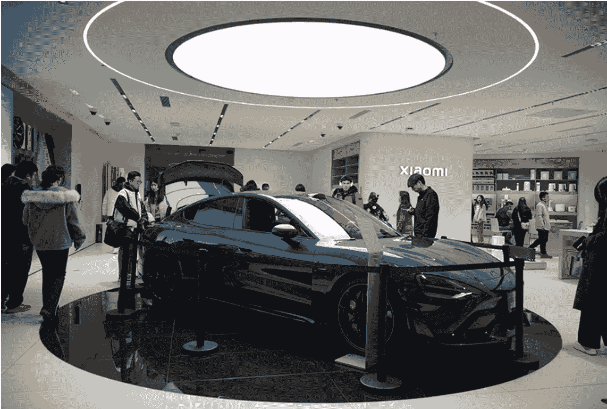

CAIXIN| 听文章

文 | 财新周刊 刘沛林 余聪 屈运栩

直到4月1日之前，小米集团（01810.HK）及其创始人雷军都处在令同行艳羡、市场瞩目、资本追逐的乐观氛围之中。

不到一年，首款中高端电动轿车SU7满产满销，销量直逼所有“新老造车势力”；上探50万元以上性能车市场的SU7 Ultra预订超预期，备受期待的SUV车型YU7即将年中上市，在手订单十余万、客户提车要等十个月，今年汽车工厂产销目标均剑指35万辆；即将发布自研芯片，“人车家”生态故事渐入佳境……正是在这一系列利好消息的组合与“化学反应”之下，小米3月31日宣布顺利收官港股多年罕见的巨额再融资——以53.25港元/股的高价总计配售融资425亿港元，引入主权基金等长线投资机构，优化了股东结构。

然而，这一派高歌猛进的节奏，被一场交通事故打乱。

3月29日22时44分，一辆小米SU7标准版小轿车在安徽铜陵的高速公路上激烈碰撞隔离带并起火，事故照片显示车辆有明显过火痕迹，座椅只剩下金属框架。事故造成驾驶人和两名乘客死亡。接近当事人的人士告诉财新，三人均为在校女大学生，此行是从武汉到安徽池州参加事业编考试。

4月1日午间，小米公司首次发布声明，称事故发生前车辆处于智能辅助驾驶（NOA）状态，以116公里/小时的速度持续行驶。事发路段因施工修缮，用路障封闭车道、改道至逆向车道。车辆检测出障碍物后发出提醒并开始减速。随后驾驶员接管车辆进入人工驾驶状态，持续减速并操控车辆转向，但不到三秒后，车辆与隔离带水泥桩发生碰撞，碰撞前系统最后确认时速约为97公里/小时。

事故车型SU7凭借精准的产品定位和营销能力，取得了远超市场乃至小米自身预期的成功。雷军在为汽车宣传造势的过程中，进一步强化其作为互联网“顶流”的地位，也成为小米汽车一炮打响的核心引擎。然而这桩牵涉三条年轻生命的“黑天鹅”车祸，让互联网流量成为一把微妙的“双刃剑”，将雷军本人卷入公众舆论争议的中心。

截至目前，雷军在新浪微博有2626万粉丝、抖音4554万、小红书446万，三大社交网络平台超过7600万粉丝，在所谓“车企大佬”流量榜的各类指标中基本都上冲首座，超过了此前的“人气王”华为终端有限公司董事长余承东。

微博是雷军与粉丝互动的重要平台，他在这里直播汽车工厂现场、发布各类产品甚至分享生活动态。3月31日，雷军还发了七条微博，转发了小米汽车工厂参观活动、汽车赛道轮胎上新，并分享了汽车开店进展和车主故事，发布了小米手机拍摄的图片......但从当晚开始，越来越多的网友到雷军的微博下留言，呼吁其本人对上述事故作出回应。

4月1日，雷军的微博沉寂了一整天、一言未发，晚间对家属表达慰问，称“由于事故还在调查，我们一直没有接触到事故车，很多问题此刻还没有办法回答”；还称，“等到此时，我觉得我不应该再等了，我必须站出来，代表小米承诺：无论发生什么，小米都不会回避，我们将持续配合警方调查，跟进事情处理的进展，并尽最大努力回应家属和社会关心的问题”。

小米股价自3月19日达到历史新高的59.45港元/股之后，即震荡向下，25日宣布配售8亿股、净筹资425亿港元（约合53亿美元）的消息利空股价，此后数日连续下挫。尤其在4月1日午后小米官方回应上述事故之后，避险资金大量出逃，股价断崖式下跌，到4月2日收盘报44.55港元/股，距离高点11个交易日跌去了25%；同时意味着刚刚参与小米配售融资的投资者，需要承受超过15%的账面亏损。

小米这次融资一举创下四年来全球TMT（科技、传媒和通信）行业最大的一笔股票配售交易，融资规模略低于3月初以制造业逻辑配股的比亚迪（002594.SZ/01211.HK），后者以335.2港元/股发行1.298亿新股，净筹资433.83亿港元，定价较宣布日之前连续十个交易日和五个交易日平均收市价分别折让约11.8%和12.3%。比亚迪称配售吸引了全球众多长线基金、主权基金及中东战略投资人等参与。另一家过去一年遭遇销量瓶颈的造车新势力公司蔚来汽车（NYSE：NIO/09866.HK），也以每股29.46港元价格配售了约1.37亿股A类普通股，募集了40.3亿港元资金。

三家车企短短一个月在港股的再融资总额就接近900亿港元。一家国际投行人士告诉财新：“资本目前相对看好中国资产，一些长线资金认为，2025年初是中国中长期资产价格的一个底部。”新能源车企当前在资本市场的“吸金”能力也可见一斑，众多未提前布局的海外投资者希望借此搭上中国新能源汽车发展的“快车”。

尽管雷军宣布造车之初，外界都认为其是造车新势力中自有资本最雄厚的“玩家”——小米积累十余年的智能手机及生态链可创造营收超过3000亿元、净利200多亿元。但雄心勃勃，欲在汽车业务上全力出击、站上鳌头的小米仍然缺钱，该笔巨额融资即宣称用于业务扩张、研发投资等用途。

小米的配股价高于市场预期，仅较前一交易日收盘价折让6.6%，较最后十个交易日折让3.6%。“小米融资低于市场一般7%—10%的折让，但配售顺利，体现了小米和投资者对股价的信心。”前述投行人士称。但二级市场对小米股价分歧巨大，道琼斯公司（Dow Jones &（Company）旗下网站MarketWatch的统计显示，分析师给出的目标价介于33.63—74.50港元，中位数为60.70港元。

多名市场人士认为，SU7事故可能对小米的汽车业务和股价带来压力，但调整走向和深度仍待观察。“汽车不是大玩具”，安全问题一再拷问发展势头凌厉、挑战百年传统燃油车巨头的新能源造车公司；但类似事故在舆论场屡见不鲜，市场也时常表现得“健忘”。

仍有多名分析人士对财新称，中长期而言，小米的基本面不会因为这场车祸发生大的变化，其生态概念已为市场接受，公司的估值体系也一分为二：盈利的手机和IoT（物联网）正在高端化和国际化；汽车业务虽暂时不盈利但处于高增长期。市场对小米集团中长期整体估值落在1.2万—1.7万亿元之间——截至4月2日收盘，其市值约在1.15万亿港元。在生成式AI大模型DeepSeek带动中概股重估、国家补贴升级带动消费热潮之下，小米成为港股市场最受关注的股票之一，市值从一年前的4000亿港元一度暴涨3倍。

雷军多次公开称“造车是最后一次创业”。一名接近小米高层的人士向财新称，目前雷军的精力和时间分配是：约50%在汽车，手机占25%，其他业务占25%。小米起家的智能手机业务，目前更多交给了集团总裁卢伟冰。

小米SU7 2024年销量达到13.6万辆，远超内部初期预估的6.7万辆；近期将2025年目标销量自30万辆上调至35万辆。而在新势力车企中，目前年销量超过30万辆的只有理想汽车，在2023年和2024年分别交付37.6万辆和50万辆；零跑汽车2024年销量29.3万辆，也在逼近这一大关。

小米汽车的利润率也超预期。2024年三季度，小米汽车首次公布毛利率15.4%，四季度随着产量增长，规模效应进一步扩大，同时生态周边产品贡献利润，毛利率进一步上升至20.4%。小米汽车2024年的综合毛利率为18.5%，已经超过特斯拉（NASDAQ: TSLA）同期17.9%的毛利率。

手机业务方面，自2019年切割低端品牌红米、开始升级主品牌小米，此后推出多款Pro、Ultra机型，打开了4000—6000元价格段市场。在手机的带动下，包括平板、耳机、手表等传统消费电子品类亦增长迅速。市场调研机构IDC的数据显示，2024年小米腕戴设备出货量同比增长33.0%，中国市场份额15.3%、位列第三，仅次于华为的16.0%和苹果的18.1%，三家市场份额已十分接近——2024年华为腕戴设备出货量同比增长33.6%，而苹果则下跌6.3%。“全面兼容苹果生态”是小米可穿戴设备常用的口号，显露“平替苹果”之意。

手机打造高性价比爆款的能力，正在延伸向传统家庭白电。在消费补贴助力之下，2024年，小米空调、冰箱、洗衣机出货量分别同比增长超过50%、30%和45%。尽管从出货量来看，小米白电和美的、海尔、格力三大巨头有数量级的差距，但业已搅动价格段较低的二线市场。

小米自有家电工厂于2024年11月于武汉开工建设，成为手机工厂、汽车工厂后的第三大工厂，彰显了其摆脱过去轻资产互联网思维和贴牌代工的低端形象、冲刺高端家电的战略思路。

而在海外，小米是最早“出海”的中国手机厂商之一，近年凭借旗下红米、POCO两个子品牌推出高性价比入门机型的市场策略，迅速拓展了拉美、中东、欧洲、东南亚等市场，初步站稳脚跟。同时小米手机旗舰的数字系列以其出众的影像能力建立了海外消费者口碑，该系列入门标价在欧洲甚至高于iPhone，但仍获得了快速增长。小米财报显示，其2024年收入中，已有41.9%来自海外市场。

※财新数据专题《高歌猛进被事故打乱，小米业务重新检视》，结合本篇封面报道和详尽财经数据，数据通Pro会员专享。

## SU7致命事故

3月29日上午，雷军首次出现在中国电动汽车最重要的行业会议（中国电动汽车百人会论坛）上并发言。他回顾了小米造车的故事。“所有人都说太晚了，现在看来可能是刚刚好。”雷军称，小米开始造车时，新能源汽车技术、产业供应链以及用户消费习惯都已走向成熟，“我们来得正是时候”。

以2019年末特斯拉上海工厂启动生产为起点，中国新能源车市加速市场化。以“蔚小理”为代表的中国新能源车企，拼车型、拼电池动力系统、拼智能座舱和智能驾驶，目前已进入生死搏杀的淘汰赛。2025年初，比亚迪甚至在10万元级别电动车上推广L2+的辅助驾驶功能。

而小米在激烈的市场竞争环境中交出了惊人的成绩单：2024年3月28日SU7发布，到年底仅销售了三个季度，就以13.6万辆的交付量，位居2024年中国市场售价20万元以上纯电车型榜单第三位，排在其前面的两款车型分别是特斯拉Model Y（超48万辆）和Model 3（17.6万辆）——也就是说，小米初战即站上了该榜单国内车企中的第一名。

2025年2月27日，小米发布了定价超过50万元的豪华轿车SU7 Ultra，推出三天锁定订单1万辆，而2024年中国同价位轿车总销量不过是12万辆，这意味着小米首款高端车型就拿有了近10%的市场份额。

2021年1月，小米被美国国防部纳入“中国军事企业”名单，虽然此后通过起诉美国国防部和财政部并在5月移出清单，但小米仍担心后续会再遭类似风险，导致芯片、系统断供。小米内部人士告诉财新，造车可说是被“逼上梁山”的选择。雷军后续复盘称，被列入名单当天小米就启动了关于造车的调研。

当时，雷军组成六人调研组70多天走访十多个城市、访谈85场200多名业界人士。蔚来汽车创始人李斌和小鹏汽车（NYSE: XPEV/09868.HK）创始人何小鹏，都劝雷军不要造车。雷军创办的顺为资本参与了这两家公司的早期投资。但雷军向董事会汇报的调研结论是：智能电动车是大势所趋，小米必须干；汽车会像手机一样赢家通吃，只有干到全球前五才能活下去；造车至少要投100亿美元。经过激烈讨论，董事会支持了雷军的造车决定，前提是他要亲自带队。

前述小米内部人士告诉财新，雷军一开始其实是抱着不造车的目的去做市场调研的，但调研后发现仍有机会，让他萌发了造车的兴趣与决心。此后一年半时间，雷军试驾了170辆车，写了十几万字试驾心得。

接近小米高层人士透露，小米之所以首款车型选择运动轿车，就是对标特斯拉Model S和保时捷电车Taycan——而与后者外形过于相似，也曾让小米备受诟病。但一家新势力车企资深人士认为，小米在消费者调研方面做了大量工作，SU7的定位其实很清晰，就是20万至30万元价格带的保时捷，这撬动了很多年轻消费者的购买决策。

市场调研机构Canalys首席分析师Jason Low向财新直言，小米SU7销售大超市场预期，迅速打造了产品辨识度，提供繁多颜色、功能性选配，极大满足了消费者对差异化产品的需求；此外，SU7延续了小米手机堆料且价格维持在较低水平的特点，让消费者感觉“超值”。“即便此前有厂商推出类似SU7 Ultra的性能车，定价也接近100万元，是小米真正把性能车的价格打下来了。”他说。

产品定义之外，一款产品能否成功还要靠品控、交付等能力。“小米汽车之所以卖得好，本质上造车扎实是基础；各方面质量测试也是过关的。”前述接近小米高层人士称。博世智能驾控系统中国区总裁吴永桥曾透露，2023年底曾给雷军提议在车辆量产前提供500辆车给“米粉”测试，每辆车每个月跑5000公里，收集测试中的问题每周改进，雷军采纳了这个建议。

小米汽车两家合作供应商向财新称，小米SU7作为小米推出的第一款车，为树立品牌，大部分硬件配件都选择合资或外资大厂。小米汽车也称，SU7供应商大部分为豪华品牌BBA（宝马、奔驰、奥迪）的供应商。

除了选型、产品定义契合市场需求，SU7从研发到发布都抓住了新能源汽车市场起飞的窗口。从2020年到2024年，中国新能源乘用车渗透率起跳，从5.4%提升至47.6%。到2024年三、四季度，单季新能源车市场渗透率连续突破50%，SU7正是在这个阶段进入大量交付期。

天时之外，小米手机粉丝是SU7起步的“用户池”，推出首月订单量就达数万辆，其中60%用户只看了汽车图片或视频就下单了，根本没有看过实车，更没有试驾。

其他车企都羡慕小米和雷军的营销能力。自从SU7问世，雷军就以平均每月一次的频率做直播介绍汽车和工厂；元旦、元宵节等阖家团圆的节日，他也出现在已经放假的工厂，带着工程师或部门负责人一起做直播。雷军努力展现技术派的“人设”，反复强调自建工厂，自研三个电机、“泰坦合金”材料等创新，市场传闻其投入了3400名工程师造SU7。前述接近小米高层人士证实，目前小米造车的工程师队伍已达5000—6000人；不同于传统车企采用项目制造车，参与SU7的工程师在未来十年都将持续跟进这一车型的更新迭代。

伴随着SU7销量和交付提升，其用户画像也逐渐明晰。雷军在2024年4月北京车展期间披露，当时小米SU7女性购买者占比达28%，女性车主预计占比40%—50%——而小米后期也发现，诸多男性用户购车后是给女性亲友驾驶。

直播之外，雷军从博客时代就养成的通过社交媒体和用户互动模式，令同行羡慕。3月29日，长安汽车副总裁、深蓝汽车CEO邓承浩在中国电动汽车百人会论坛上坦承，自己过去认为有一个好的产品就可以赢得市场，但现在发现，好产品跟好流量结合非常重要。“我们上热搜就像过年一样，结果小米雷总天天在过年，有时（一天）还过好几个年，对我们的挑战还是蛮大的。”

这次SU7交通事故就在中国电动汽车百人会论坛召开当晚发生，驾驶者为年轻女性，是小米SU7的典型用户。两天后，这一事故冲上了微博热搜。根据小米公司的声明，事故前NOA发出风险提示“请注意前方有障碍”、驾驶者接管汽车、车辆撞上水泥护栏，这一系列过程在不到三秒钟内发生。

小米称，SU7标准版有前向防碰撞辅助功能，包括碰撞预警（FCW）、紧急制动（AEB）两个子功能，作用对象是车辆、行人、二轮车三类目标，目前不响应锥桶、水马、石头、动物等障碍物。即事故车辆的辅助驾驶功能无法帮助其在面对水泥护栏时紧急制动。而在小米汽车公众号定期答网友问里，公司在回答关于AEB的问题时，均未提及上述关乎车辆性能边界的重要内容。

小米事故让市场对智驾的安全性产生了质疑。实际上，目前市场在售车辆所谓“高级辅助驾驶”均为L2级辅助驾驶，人类驾驶员仍要全程监控路面情况，而且交通事故发生时，驾驶员是责任人。小米SU7用户手册也显示，“智能辅助驾驶作为一项辅助功能，无法实现自动驾驶，并不能完全代替驾驶员控制车辆，驾驶员始终承担着安全驾驶车辆与符合道路交通安全法律法规的全部责任。”

但诸多新能源车企为在市场竞争中赢得声量，大力宣传“零接管”“车位到车位”等智能概念，这类话术让许多消费者误以为可以完全交由智驾系统开车。

雷军后来坦承，尚未接触到事故车辆，因此对包括车辆为何起火、车门能否打开等诸多和车辆安全相关的细节问题，无法作出判断和回应。不过小米否认了车辆自燃的可能性，并推测车辆起火系猛烈撞击隔离带水泥桩后，整车系统严重受损导致。

SU7在发布时自称电池不易起火，全栈自研的电池管理软件紧急情况下可实现四毫秒内切断电流；还称电池采用了远超行业平均水平的安全标准。实际上，电动汽车起火原因复杂，电芯质量、电池管理系统和模组保护都是重要因素。不愿具名的电池行业专家提醒，世界上没有绝对安全的电池，任何实验和标准都有边界条件。

SU7发生事故前，市场对小米汽车的担忧极少聚焦在安全性问题上，而是交付能力。小米汽车官网显示，小米SU7目前提车周期至少为42周，即超过十个月。2025年3月初，雷军称：“小米SU7上市11个月销量超32万辆，已经交付18万辆，还有14万到15万辆车的订单在排队。”

小米一期工厂设计产能是15万辆，据财新了解，小米产能目前已经全部拉满；二期工厂在加速投建，预期年中开始投产。

小米就上述事故成立的专项小组于3月30日赶赴铜陵，配合警方调查、取证等工作；并于31日晚依法向警方提交完成所掌握车辆的行驶数据及系统运行信息。截至本刊发稿，该事故仍在调查中，其在社交网络和资本市场的影响仍在持续。

## 融资备战汽车+芯片

3月31日，小米宣布完成了425亿港元的巨额再融资。

接近小米高层人士告诉财新，小米推出新车之前，股价长期徘徊于10—12港元/股；而自SU7出货高峰到来后，股价于2024年三季度开始启动。“那时已经有较大的机构资本进入，2025年股价继续狂飙。这次融资的一个重要背景是，部分境外机构错过了2024年买股票‘上车’的机会，这次想要跟上，这些长线基金加入后轻易不会退出，融资价就是未来几年中长期投资者认为的小米股价的底线。”

据财新了解，包括中东股权基金在内的数个长期投资人参与了本次配售，各有数亿美元不等的份额。小米也在融资目的中明确是为了“优化资本结构”。“小米港股的散户和对冲基金占比偏高，这次融资是调整股东结构的好方法。”前述接近小米高层人士指出。

招银国际、麦格理等机构对于配售后的小米集团都给出了“买入”评级，目标价分别为每股59.52港元、66.75港元。

前述投行人士指出，机构和散户对小米配资态度分化。对普通中小股东来说，小米上市以来盈利近千亿元，先后三次融资超900亿港元，但从未分红，且持续投入包括汽车在内的新业务。配售后股权稀释，股价短期回调也符合配售规律。“卢伟冰在业绩会上提出要对AI、系统和芯片持续投资，海外也将持续投入，这几个方向都对资金提出了需求。”

小米上市六年，三次融资后在资本市场的估值逻辑逐步演变，尤其此次配资后的投入方向备受关注。一名小米早期股东指出，雷军创立小米主要依靠市场资金支持，可谓“资本高手”。

2018年7月，在私募市场估值高达450亿美元的小米上市，手机代工模式下公司自定义互联网公司，以此希望获得相对高的PE（市盈率）倍数发行，但港股对这一估值法接受度较低，最终小米以发行区间下限17港元/股IPO（首次公开募股），募资240亿港元，研发、IoT和生活消费产品、全球化各占30%用资需求，剩余约10%用于运营资金。然而，小米公司股价长期低于发行价，公司也多次启动回购。

前述早期投资人指出，小米一开始依靠手机和家电贴牌方式切入硬件，是全球较早将终端产品互联网化的企业。公司在各阶段抓住了从“80后”到“00后”对品牌硬件终端时尚化的诉求，依靠较强的执行力，基本达到了股东预期收益。其机构作为早期投资人在2019年前后从小米退出后获得了50%左右的收益。

而在诸多早期投资人退出后，2020年小米再次融资310亿港元，包括配售240亿港元、发行可转债70亿港元，资金用于提高市场份额、投资生态系统、还款和优化股东结构。小米内部将2020年定义为公司的第二个阶段。

上市后，2019年进入世界500强，2020年开始考虑自建工厂，在北京亦庄有了第一个手机的黑灯工厂。传统手机工厂都是靠人装配，我们做无人工厂没有参照物，设备都是自己设计的，经历了手机爬坡实验。前述小米内部人士透露，在此过程中，小米逐步意识到要从之前追求的互联网公司向智能制造公司转型发展。

2020年是一个大转折点，小米成立十年，内部召开了千人大会，核心干部参会，抛出了未来十年发展的重要方向——高端化；也提出了未来十年要成为一个硬核科技公司。从轻变重，掌握核心技术，“从0到1”做智能制造。

2020年融资310亿港元之后，小米先后开启了包括造车、芯片、大家电等自研自产等多个制造业方向。财新了解到，其重启主力芯片研发的时间几乎和造车同步，新芯片原本将在4月上旬发布，但因突如其来的车祸而推迟。

小米在汽车出货一年之际再次发起巨额融资，其投资仍将延续此前布局的几个方向。首先是手机高端化。小米在内部强调高端机占比要再提升；然后是汽车；此外，芯片、AI和海外都是后续主投方向。

2024年，小米的研发投入241亿元，同比增长25.9%，主要投资方向是智能电动汽车等创新业务；而公司全年资本开支104.80亿元，其中手机和智能物联网业务、智能电动汽车分别为64.19亿元、40.61亿元。雷军在SU7 Ultra发布会上进一步透露，小米2025年研发预算超过300亿元，未来五年预计研发投入达1050亿元，其中投在AI及相关业务的预算大概为四分之一。

前述小米内部人士指出，小米从2014年开始做芯片，2017年就量产过28纳米的芯片，但当时市场主流产品已进化至16纳米，小米遂放弃芯片流片和商业化，但仍有小型芯片的研发和制造，包括影像、通信等芯片。

“汽车、芯片等都是百亿级高投入的产品。”前述接近小米高层人士说，雷军极其重视现金流和现金储备。“他早年在金山创业，经历过一次差点发不出工资的情况，从那之后他就特别重视现金流，在目前市场环境下融资，是为未来储备的合适时机。”

该人士指出，小米之所以同步推进两大高资本密集的研发和投入，基础判断是，消费电子工业中真正的巨头最终一定会成为芯片巨头，“如果不掌握芯片的能力，就无法建造出长期稳健、差异化的护城河”。

目前，市场机构普遍将小米的估值分为汽车和非汽车两部分。前述投行人士指出，非汽车业务给予30倍PE，亏损的汽车业务按2.5倍PS（市销率）估值后，小米总市值大概在1.3万亿元，和此轮因车祸带来的调整前市值相当。“远期甚至有机构给出了汽车单一板块按PE估值就达1.7万亿元。”

平安证券3月研报则对小米汽车以外的手机和IoT等，以净利润330亿元的23.4倍PE估值，整体估值7722亿元。汽车板块，小米的可比公司是小鹏汽车、理想汽车、特斯拉，三家的PS分别为2.3倍、2.8倍和3.5倍。平安证券以小米汽车业务2027年营收2.3倍PS估值约7613亿元，由此公司未来两年估值大概是1.5万亿元。如果小米能够实现规模化销售，达到600万辆销量，参考丰田汽车1倍PS，小米汽车板块的长期估值则是1.2万亿元。

“市场目前看好小米的本质首先是车辆的成功，再次证明了团队能力。”前述接近小米高层人士甚至想象小米的未来是“苹果+特斯拉”市值的十分之一，估值上限还可以大大抬高。

但SU7事故后，市场会不会对新生的小米汽车持续如此狂热的乐观情绪？

## 手机“出海”+高端化

手机业务越来越接近市场天花板，小米给出的解决方案是高端化和“出海”。

中国智能手机普及率的提高和产品创新，为国产手机厂商带来了第一波成长机会。IDC数据显示，2016年是全球智能手机的巅峰，仅当年四季度出货量就达到4.285亿部，中国当季出货量也达到1.36亿部。随后智能手机市场逐渐饱和，产品同质化，消费者换机周期逐年拉长。2019年中国智能手机出货量跌破每季度1亿部，而至2023年这一数字已不到0.7亿部，相比2016年接近“腰斩”。

中国智能手机市场已臻成熟，增速远低于其他新兴市场。Canalys数据显示，2024年中国智能手机出货量同比增长4%，落后于拉美市场的15%、中东市场的14%和欧洲市场的5%，在主要市场中仅高于北美的1%。

2024年中国智能手机出货量为时隔两年重回增长。市场调研机构Counterpoint指出，手机国家补贴将会为2025年一季度中国智能手机销量带来额外的2个—3个百分点的同比增长，但短期销售热潮后仍可能下滑。

而从全球来看，小米手机已稳居全球出货量排名第三，和不断变化的第四名拉开差距；三星和苹果则交替第一、第二把交椅。2024年，小米手机全球出货量同比增长15%，而苹果、三星出货量均同比下滑1%。苹果、三星、小米三家出货量分别为2.26亿、2.23亿和1.69亿部，对应市场份额分别为18%、18%和14%。

小米手机的增长主要来自拉美等新兴市场。2019年小米率先通过电信运营商进入智利、哥伦比亚、墨西哥等市场。Canalys指出，小米进入南美市场时采取渗透营销策略，展开价格战，通过推出多个产品让部分价格区间快速饱和。2020年，小米一度在哥伦比亚市场出货量增幅达6500%，在墨西哥增长244%，在智利增长1610%，一跃成为拉美主要手机厂商，市占率仅次于三星、摩托罗拉。Canalys称其为“小米效应”，更是带动OPPO、vivo等中国手机厂商加速进入拉美市场。

一名头部中国手机厂商的南美业务人士告诉财新，小米在拉美凭借直供渠道体系，在多个国家已建立品牌认知，想要在低端市场和小米竞争并不容易，OPPO等“出海”后来者一直重投入销售网络，但只能卖利润空间更大的中高端产品来支撑发展。

卢伟冰在3月3日巴展期间向财新等称，小米手机目标最晚到2027年出货量达2亿部，届时全球手机行业格局将会形成三家年出货量超过2亿部的厂商、两到三家约1亿部的厂商，以及数家5000万部以下的厂商，形成明显的行业梯队。手机出货量增长带动了平板电脑、可穿戴设备销售，卢伟冰称，小米平板产品2024年增速高达70%，位居全球第五；手环出货量已全球第一。

“比规模更重要的是产品结构，也就是小米手机的高端化进展。”卢伟冰引用第三方数据称，小米手机在国内4000—6000元价格段市场占有率为17%，下一步要提升6000元以上产品份额；而在中国以外市场，过去几年重点是提升600—1000美元价格段市场。“海外高端化整体上比国内慢半拍，1000美元以上产品还处在探索阶段，总体偏谨慎。”

芯片、操作系统和影像能力是小米手机的核心所在。前述小米内部人士称，苹果的高端化壁垒在于“软硬结合”，但小米最初在操作系统、芯片方面都没准备好，只好把影像当作高端化的切入点。小米在2020年连续发布了八款高端手机，售价在3999—12999元之间，主打自研影像功能，欲抢占华为手机退出的海外市场空间。

英国消费电子领域杂志《Stuff》的作者Tom Morgan向财新称，小米手机的拍照性能是英国消费者选择的最大原因。其他中国品牌中，荣耀此前被海外用户视为“便宜版华为”，目前凭借个人电脑、平板等全面产品线和最广分销渠道，成为英国增长最快的手机品牌之一；而尽管OPPO旗下OnePlus（一加）更早进入欧洲市场，建立了一定品牌知名度，但更多是直销渠道，尽管进入市场更早，但出货量未能持续突破。

市场普遍认为，小米手机冲高端的难点在于品牌调性而非硬件本身，雷军此前给出的解法是“依靠米粉”。而随着SU7不断吸纳苹果手机用户、BBA车主，小米的整体品牌形象也有望获得提升。

不过，从市场份额来看，小米手机高端化并不明显。IDC的数据显示，中国600美元以上的智能手机市场中，小米2024年的市占率仅为3.8%，落后于vivo的4.6%和荣耀的4.6%；苹果和华为分别以51.1%和30.7%的市占率，占据600美元以上的绝大部分份额。

一位手机行业分析师指出，小米数字旗舰系列明显多于其他品牌同类产品，但600美元以上份额却没有提升，主要原因一是2024年OPPO和荣耀调整了产品发布策略，一年两次发布旗舰产品抢占了份额；其次在超高售价的折叠屏产品上，小米难言成功；此外，小米子品牌红米的售价多在600美元以下，而vivo、OPPO的子品牌售价更高。

目前，小米仍依赖规模换增长的模式。2024年总体ASP（平均售价）上升5.2%至1138.2元；但在中国市场，因四季度用低价的红米手机抢占市场，拉高了3个百分点的市场份额，中国市场手机ASP反而下降。同时由于供应链成本上升，2024年小米手机业务毛利率同比降了2个百分点，至12.6%。华泰证券预计，2025年小米手机全年出货量1.8亿台，同比增长9.5%，市占率提升1个百分点；在高端化推动下，手机业务毛利率有望回升至13%。

## 大家电“由轻转重”

小米汽车抢夺高光时刻的同期，智能生态中的家电板块也动作频繁。

2024年10月29日，雷军发布性能车SU7 Ultra的同时，还发布了一款分区洗衣机，两大产品都登上了热搜，引发热议。该洗衣机采用“大小眼”设计，由一个滚筒清洗外衣，另一个滚筒专门用于洗涤内衣、袜子等贴身衣物，该产品一经推出迅速成为爆品，“内衣外衣分开洗”是许多消费者的痛点。

近年来，小米注重精准化消费者需求，并结合自身较强的工业设计能力，快速反应推出高性价比产品，这一套路已在空调、加湿器、插座等多个品类打造出爆款。同时，小米汽车也在为家电导流，历次小米汽车的发布会均有家电产品露出。

2024年，小米空调、冰箱、洗衣机产品出货量分别同比增长超过50%、30%和45%，至680万、270万和190万台；大家电收入同比增长56.4%，带动其IoT与生活消费品业务收入同比增长30%，至1041亿元。

在线上渠道，小米的多个白电品类已对传统家电巨头形成挑战之势。根据奥维云网数据，以销量计，2024年小米空调在线上销售渠道的市占率快速增长至13.91%、排名第三，仅次于美的21.82%和格力的19.82%；不过在线下渠道，小米目前差距明显，美的和格力空调的市占率分别为32.64%、28.31%，分列第一、二位；而小米市占率仅为0.22%，排名第18。

小米早期从互联网硬件切入家电，2013年开始推出“黑电”电视，以及加湿器等小家电，采用贴牌代工生产的轻资产模式，牺牲利润率换取市场份额。电视是其互联网硬件的重要入口，通过广告、会员订阅等业务变现。

直到2019年，小米才把白电列为战略重点，成立大家电事业部；2023年则将“人车家”上升为集团战略，家电成为智能生态的一部分。前述接近小米高层的人士称，小米发力大家电，一方面是因为大家电是“人车家”生态的重要组成部分；另一方面家电行业利润空间大，竞争水平低。“家电行业通过激烈竞争在每个品类都形成了双寡头模式，厂商都活得很好。”

小米的白电希望复制早年间黑电“价格屠夫”的竞争策略，以线上冲击线下。奥维云网数据显示，2024年上半年，小米空调的线上零售均价为2205元，比行业均价低515元。浙商证券研报指出，小米空调份额的快速提升离不开中低端市场扩容，2024年1至8月，2400元以下低端产品占比提升了19个百分点至56%；而2400—5000元、5000元以上价格区间占比分别减少16个、3个百分点。

浙商证券指出，小米空调产品的价差优势来源于极致让利，通过对价值链拆解，测算得出小米空调净利率在1.5%水平，不仅远低于美的、格力两家龙头10%以上的空调净利润率，还低于二线空调企业3%—5%的净利润率，也低于雷军2018年作出的“硬件净利润率不超过5%”的承诺。而小米空调目前仍未自产，供应链还未形成规模优势，生产成本高于头部厂商。

不过该研报也指出，小米家电想进一步提升存在不少挑战。在电视品类上，小米的硬件不赚钱、线上广告和内容付费模式已被其他电视厂商模仿，其他厂商也有能力降低价格，而小米采购面板的成本较头部电视厂商没有优势；在标品属性较弱的白电品类上（相较于电视，冰箱和洗衣机更会根据家庭空间等不同需求提供更多SKU），小米此前通过较少SKU（最小存货单位）实现“爆品”的策略更难实现，则这也导致了小米冰箱、洗衣机的线上零售份额徘徊在4%左右。

目前，小米家电仍以轻资产的贴牌代工模式为主，并不掌握核心技术，单纯依靠让利难以应对行业变化和上游反扑。例如石头科技曾是小米扫地机的代工方，2020年石头科技逐步退出小米体系独立发展，导致小米上新迭代速度放缓、份额下降。

浙商证券认为，小米家电能凭借产品迭代能力和流量优势对二线品牌发起冲击，但很难撼动头部白电品牌。不同于黑电，白电企业产业链一体化程度高，规模优势形成壁垒，龙头企业掌握了话语权，行业集中度高。渠道扁平化、给经销商让利不足，也使得小米家电渠道很难下沉。

小米已经意识到了上述问题，决定将重心转向核心品类自研自产。2024年11月，小米在武汉的家电工厂开工建设，一期家用空调智能制造工厂计划于2025年11月投产，2026年大规模量产；同时筹建的还有百余间先进实验室，实现设计、研发、生产闭环，更多杂志关注TG频道《@QiKan2023》。

前述小米人士称，自研方式前期成本会高，但未来出货量增大，毛利率提升更有空间；而另一方向是大家电“出海”，2025年会是“大家电出海”元年。“我们要在海外建‘小米智家’，从过去依靠运营商和分销商的模式转变为直营模式，而直营模式需要足够多的自有产品支撑。”■

吕娅霆（实习）对此文亦有贡献

# 最新财新周刊 | 疫苗处方试水

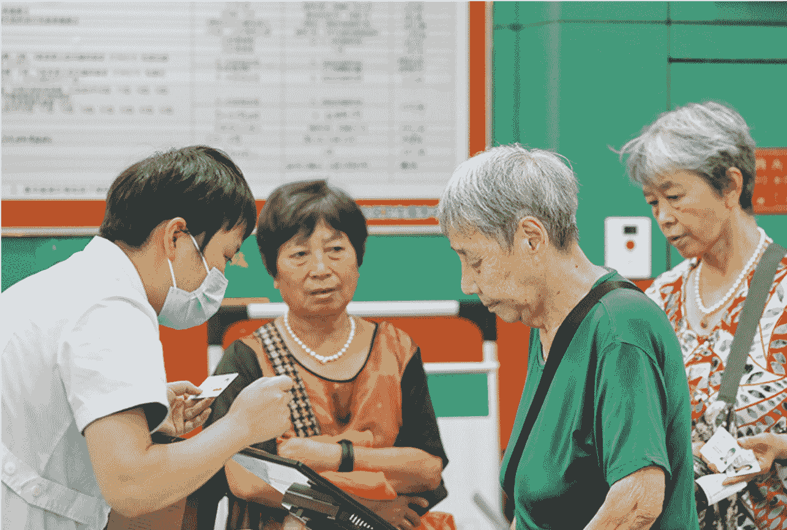

## CAIXIN | 听文章

文 | 财新周刊 杨玉琪

3月23日，一个早春的周日下午，北京龙潭湖畔的人卫酒店会议室气氛热烈。幻灯片一张张掠过，场下座无虚席，听众们迅速举起手机拍下内容。这一幕发生在中华预防医学会主办的医防协同医防融合学术会议“政策与技术创新融合发展”分会场。

会上，身为主持人的中国疾控中心免疫规划中心副主任余文周对听众笑言：“我知道你们都想了解疫苗处方。”随后，山东疾控专家介绍了全省范围试点“疫苗处方”的经验，来自各地疾控系统、医疗机构、医药企业的参会代表纷纷记录细节。

区别于居民主动前往预防接种门诊接种疫苗的传统方式，“疫苗处方”是指医生在诊疗过程中，根据患者健康状况和需要，主动给出疫苗接种建议。

临床医生由此进入预防接种体系，这被视为提高部分疫苗接种率的有力措施。据财新不完全统计，目前已有山东、浙江、天津、福建等十余个省份推进“疫苗处方”试点；开具的处方多针对中老年人常用疫苗，如流感疫苗、肺炎球菌疫苗、带状疱疹疫苗。

多种疫苗在中国接种率长期低下，“重治轻防”现象导致医疗资源非必要消耗，一些疫苗可有效预防的疾病仍有不低的发病率。为改善医防割裂状况，监管层几次尝试整合发展医疗与预防保健服务。

一些地方对疫苗处方寄予厚望。但在疫苗生产到接种的链条中，处方也仅仅只是提高可及性的环节之一。如果没有信息系统衔接、临床医生激励机制等配套，疫苗处方或难有提高接种率、保障全人群健康之效。

而从“防治结合”到“医防协同”“医防融合”，公共卫生与医疗体系割据犹存，也反向影响着疫苗处方的进一步推广。

清华大学万科公共卫生与健康学院常务副院长梁万年在上述会议上表示，无论疫苗处方，还是更宏观的医防协同与融合，关键在理顺政策逻辑，形成疫苗接种覆盖率提升、传染病及慢病并发症发病率下降、基层医疗资源消耗减少、结余资金反哺基层能力建设的良性循环。

## 试点疫苗处方

接种疫苗被公认是预防对应疾病最经济的措施，但中国许多疫苗接种率一直较低。与国外相比，2018年美国19岁以上人群流感疫苗接种率已达42%；19—64岁人群肺炎球菌疫苗接种率约20%，65岁以上接种率65%；60岁以上人群带状疱疹疫苗接种率约27%。

根据中国疾控中心（CDC）调查，2019至2023年的四个流感季，全国60岁及以上人群流感疫苗接种率分别为1.57%、3.03%、3.75%、4.16%；2020—2022年，全国60岁及以上人群PPV23（23价肺炎疫苗）接种率分别为2.35%、2.80%、3.23%，RZV（带状疱疹疫苗）接种率则分别是0.01%、0.04%、0.10%。

低接种率背后，“疫苗犹豫”现象显著：公众对疫苗安全性、有效性、提供疫苗系统等信任存疑；对疫苗接种的必要性和重要性认识不足；疫苗可及性、可负担性和支付意愿也影响个人接种选择，进而影响接种率。

3月23日，山东省疾控中心免疫预防管理所所长张丽在中华预防医学会会议上介绍，在是否接种疫苗这个问题上，患者通常更倾向临床专家的建议。她举例，一项根据美国风湿病学会（ACR）和欧洲抗风湿联盟（EULAR）的建议评估波兰自身免疫性炎症风湿病（AIIRD）患者疫苗接种覆盖率的研究显示，风湿科医生的建议是促使AIIRD患者接种疫苗的主要因素。

2025年3月23日，北京，在中华预防医学会主办的医防协同医防融合学术会议“政策与技术创新融合发展”分会场，山东省疾控中心免疫预防管理所所长张丽介绍全省推开疫苗处方试点的经验。图：任波

现实中也有印证。上海居民林伊（化名）从小学开始几乎每年接种流感疫苗，“因为我的免疫系统非常活泼，每次流感我都要发烧，很折磨”。新冠疫情后，她中断了流感疫苗接种。但林伊称，如果就诊时被医生建议，她会考虑继续接种。“因为我们病人相信医生的专业，相信他们的判断。如果我很信任这个医生，我希望他是出于为我的健康考虑，而不是出于为完成接种指标考虑。”

张丽在发言中表示，近年她接触的许多临床医生，尤其是权威医生，都坦言病人对他们建议的依从性很高，但他们对疫苗安全性有所保留，难给病人推荐。“所以我们当时就想，怎么把临床医生拉到我们预防接种的体系里来？”

山东疾控部门2023年开始在全省范围试点疫苗处方。当年9月，山东省疾控中心下发《山东省成人疫苗处方试点工作方案》（下称《试点方案》），选取了青岛市一家民营医院、东营市一家公立医院、烟台市一家乡镇卫生院、济宁市一家综合医院以及聊城市一处卫生服务中心5家医疗机构，试水成人疫苗处方。

“我们选这5家，一方面是它们工作基础比较好，另一方面也觉得相对有代表性。”张丽回忆，当时流感季即将到来，成人疫苗接种任务重、时间紧，“流感季过了，效果就看不出来”，推出《试点方案》迫在眉睫。

2024年4月，新成立不久的山东省疾控局、省卫健委发布《山东省预防接种服务提质行动工作方案（2024—2025年）》。其中提出，到2025年，每个市至少在两个县（市、区）开展成人疫苗处方试点；2024年至少在一个县（市、区）试点。

同年7月，山东省疾控局、省卫健委发布《山东省成人预防接种健康处方试点工作方案》（下称《方案》），明确了试点目标、范围和疫苗选择、试点条件等工作安排。《方案》要求，试点仅针对流感、23价肺炎、带状疱疹三种成人常用疫苗，试点地区如计划扩大试点疫苗范围，需向省疾控中心备案。

三个月后，《山东省疾病预防控制提质增效行动方案（2024—2025）》被山东省疾控局、省发改委等9部门联合下发，确定逐步扩大成人预防接种试点，至2025年每个市至少覆盖2个县（市、区）。

张丽介绍，系列政策出台后，疫苗处方试点2024至2025年开始全省铺开。起初仅有5家医疗机构试水，《方案》落定后，各市纷纷选取试点。每个试点县选取一家二级以上医院和四家社区卫生服务机构、乡镇卫生院，“我们不想让每个县选太多，因为每个医院情况差别特别大，选太多不一定能做得了”。

疫苗品种上，方案选择了常见的“老年三件套”：流感、23价肺炎和带状疱疹。张丽解释，临床医生不了解疫苗，疫苗扩得越多，培训难度越大。“一旦试点出问题，工作可能就推不下去。”

考虑到现实情形，《方案》也为一些其他常见苗留下空间，“因为有些市自己也扩了，像配合加速乙肝控制的乙肝疫苗，再一个就是HPV（人乳头瘤病毒疫苗）”，张丽说。

不止山东，小范围疫苗处方试点已在全国多地开花。2022年4月，浙江在全省7个县（市、区）的35家社区卫生服务中心（乡镇卫生院）开展预防接种健康处方项目；2023年4月，天津东丽区在张贵庄社区卫生服务中心试点开展“全科医生疫苗处方”项目；2023年5月，广东在广州、深圳10家社区卫生服务中心、社康服务中心开展《广东省全科医生处方疫苗》课题研究；2023年12月，武汉市江岸、江汉区试点“疫苗健康处方”；2024年，重庆市南岸区在辖区3家基层医院启动试点；河南、贵州、上海等地也相继推进。

公开报道中，最早的疫苗处方尝试可追溯至2021年初。当年1月，福建三明市卫健委发布医防融合经验称，三明市中西医结合医院在儿科门诊系统里新增“疫苗处方”模块：医生可根据患儿的实际情况开具疫苗处方，引导家长到合法合规的疫苗接种门诊接种疫苗。随后几年，多个省份跟进，但大部分面向成人。

不少试点单位称，疫苗处方提升了接种率。重庆市南岸区疾控中心免疫规划科科长朱玲2024年9月介绍，试点工作推进以来，流感疫苗、23价肺炎疫苗以及带状疱疹疫苗接种率较去年同期上升了50%。而据同样参加上述会议的青岛市疾控中心免疫规划科副主任杨峰披露，青岛市内省级试点市北区和市级试点即墨区，2023年成人疫苗接种数量较2022年分别上涨43.9%和38%；2024年，青岛市成人疫苗接种数量较往年同期上升1.17倍。

## 医防结合新契机

疫苗处方的关注度很大程度上也缘于它被认为是医防融合的新形式。

以流感疫苗为例。中国疾控中心传染病管理处呼吸道传染病室主任彭质斌2023年12月曾公开发言称，据相关研究者对全球95项流感疫苗保护效果的综合分析，在流感流行季，老年人接种后可减少流感样症状39%，减少确诊流感49%，减少相关的并发症28%。而接种一支四价流感疫苗个人所费不过百元左右。

梁万年3月23日与会时介绍，一项关于中国流感经济负担研究的系统综述显示，全年龄组人群流感门诊病例的人均直接医疗费用为194.8至440元，其中60岁及以上人群为378元；流感住院病例的人均直接医疗费用为4301至11986元，而60岁及以上人群达14250至19349.1元。

换言之，公共卫生支出较治疗支出效益更高，“预防优先”将减轻社会经济负担。

中国医疗服务体系和社会面长期存在“重治轻防”“防治分离”问题，2003年非典型肺炎期间表现明显。此后，政策制定者一直试图协调医疗与公共卫生体系，整合发展医疗服务和预防保健服务。

近年医防协同、医防融合趋势渐明。国家卫健委副主任、国家疾病预防控制局局长王贺胜2023年8月撰文指出：“医防协同、医防融合不是新概念，其理念与‘防治结合’是一脉相承的，并在此基础上，更加强调了医疗机构在疾病预防控制工作中的责任和作用。”

新冠疫情促使“医防融合”体系建设加快。2021年，党中央、国务院印发疾控体系改革方案，将“创新医防协同机制”列入十大改革举措之一。2022年10月，中共二十大报告提出创新医防协同、医防融合机制，健全公共卫生体系。2024年7月，二十届三中全会再次提及，实施健康优先发展战略，健全公共卫生体系，促进社会共治、医防协同、医防融合。

梁万年表示，疫苗处方实践是医疗、公卫、医保资源横向整合，实现服务连续性、协同性和效率提升的一种尝试。

2025年全国两会期间，全国政协委员、首都医科大学全科医学与继续教育学院院长吴浩递交“成人疫苗处方，推动医防融合”提案，建议基层全科医生应为成人开具个性化“疫苗处方”，以预防流感、肺炎、带状疱疹等疾病。他认为，利用家庭医生签约服务模式，提升全科医生诊疗能力，确保医疗知识与服务人群健康需求相匹配，是推动基层医防融合的重要举措。

但实际运行中，疫苗处方仍面临定位争议——它能否具备医疗处方的同等效力？由此是否适用于2007年发布的《处方管理办法》？

医卫界和政策实践均发现，成人疫苗处方在现实中有健康教育行为和等同医疗处方两种理解。前者类似“健康处方”“营养处方”“运动处方”，是医务人员向就诊患者、慢病管理对象、公众提出接种疫苗的建议；后者指医疗机构完成的一种医疗行为。二者分别嵌入不同管理体系。

张丽介绍，为克服这一障碍，山东疫苗处方采取允许两者并行的“灵活定位”，具体模式各地自行探讨。例如，全科医生可以在为慢性病人、老年人定期查体时，提供一张“宣传纸”，告知对方适宜接种哪种疫苗，“实际上只有健康教育功能”。

另一类情形中，临床医生培训合格后，经询问就诊人群病史，可以开具符合某类疫苗接种条件的健康处方。“这就具备处方功能，可以凭此付款”。

国外已有提高疫苗可及性的不同尝试。在美国，疫苗可以在私人诊所、药店、工作场所、社区卫生诊所、卫生部门或其他社区场所（如学校和宗教中心）获得。英国国家医疗服务体系（NHS）为不同人群推荐应接种的疫苗种类，全科医生为本地居民提供包括常规免疫在内的卫生服务，接种提醒频次等服务方式上有一定自由度。

与渐进改革的医卫体系相比，在中国出生率下降与老龄化两重危机来袭，儿童接种萎缩、老年人群疾病负担加重等因素影响下，提高国内成人疫苗接种率更显紧迫。但现实中障碍重重，一方面，流感疫苗、肺炎球菌疫苗、带状疱疹疫苗等中老年人常用疫苗均为自费疫苗，公众对疫苗认知有限，主动接种疫苗积极性不高；另一方面，传统预防接种门诊以服务儿童为主，被动提供服务且工作量基本处于饱和，难以有效兼顾成人疫苗接种服务。

两者交集的后果是，成人疫苗接种工作相对滞后，流感、肺炎等疫苗接种率偏低，并徘徊不前。

张丽援引数据称，在全球范围内，成人疫苗市场占比由2017年的约35.58%提升至2021年的50.38%，超过儿童疫苗市场成为疫苗消费的结构主体；国内市场中，成人疫苗2021年的市场规模（不含新冠疫苗）达427.4亿元，市场占比由2018年的31.9%快速上升至2021年的56%。

现有产品包括成人流感、甲肝、23价肺炎、水痘和即将恢复供应的甲乙肝等疫苗的一家疫苗企业人士向财新介绍：“国内接种最多的成人疫苗主要还是流感、HPV、乙肝等。但随着儿童免疫规划疫苗接种覆盖，有一些传染病的发病规律有了变化，比如甲肝、水痘等发病向着大年龄甚至成人群体迁移。”

他以甲肝举例称，随着2008年甲肝疫苗纳入国家免疫规划，国内儿童感染情况得到缓解。2009年以后，40岁以上年龄组报告病例的比例逐渐增加，成人也应接种甲肝疫苗。2023年全国传染病监测报告数据显示，2023年甲肝报告病例数最多的是50—54岁组，占总报告病例数的14.12%；随后两位是55—59岁和45—49岁组，分别占13.60%、10.20%。

## 推广掣肘

虽然疫苗处方意在打通“防”与“治”，但疾控与医疗两套系统的不兼容之处仍造成现行试点的种种不便，也限制了其推广可能。

矛盾之一在于接种疫苗使用的免疫规划系统和临床诊疗常用的医院信息（HIS）系统相互独立、不互通，“信息孤岛”推高协同成本。“这就牵涉到医生处置过程中存在系统切换，以及疾控系统能不能开放临床口径来用的问题。”北京西城区白纸坊社区卫生服务中心主任徐静说。

张丽在会上进一步解释，医疗单位内部系统也不一致，“综合医院各用各的系统，社区卫生服务中心情况相对简单，整体用的一家或两家”。她介绍，山东推行疫苗处方试点前，在全省免疫规划信息系统上装载了医疗机构接口，提供接种式查询、库存和疫苗处方上传三项功能。

接种式查询的理想情况可以仅凭身份证跟踪的接种记录，初步判断病人符合哪些疫苗的接种条件。库存功能旨在解决无法接入免疫规划系统，临床医生无法掌握可用疫苗数量的问题。张丽介绍，山东尝试“虚拟库存”，即从与省免疫规划信息系统对接的接种门诊的实际疫苗库存中，划出小部分专供给成人疫苗处方使用，消耗后再从实际库存中补充。

疫苗处方上传则试图将临床疫苗处方上传至免疫规划系统，掌握疫苗处方的最终转化率。

上述《方案》称，试点医疗机构如需要HIS系统与省免疫规划信息系统对接，可由市疾控中心向省疾控中心提出申请，由省疾控中心协调提供国家标准数据集或数据交换接口。“这种系统对接要花钱，有些医院可能也不愿意。”张丽认为，医院也要考量成本与获益。

杨峰分享青岛市疫苗处方经验时也提及，医院HIS系统要求高，社区卫生服务中心HIS版本多，所有系统开发对接费用高。

“信息孤岛”之外，疫苗处方工作还面临全科医生激励机制不足、开具处方效益风险不成正比难题。

不少业界人士认可基层是疫苗处方乃至医防协同、医防融合的关键。但现实情形是，社区卫生服务中心医生任务繁重，难有精力接受疫苗培训、主动开具疫苗处方。上海市闵行区某社区卫生服务中心的全科医生李兆（化名）称，宣传肺炎疫苗、流感疫苗仅是家庭医生常规工作中的极小部分，一年中他还同期承担着高血压、糖尿病、大肠癌等“七八个条线”管理任务。

据他概述，一个社区全科医生的常规工作包括每周两至三天门诊，随访管辖小区内的重点人群，包括65岁以上人群、肿瘤、高血压、糖尿病患者，以及曾有精神卫生中心就诊经历人群等。随访周期根据病人情况在每个月、每季度或半年之间不等。“管辖的一个小区居民人数可能是两三千。”此外，全科医生还承担着行政区内运动会、会展等活动医疗保障任务。

“我们每个月都在不停地转，如果让我们发张单子、向病人宣传两句是可行的，但如果一本正经推广，比如规定硬性指标，那后续就有大量工作，绝大多数医生应该都接受不了。”李兆说。

他坦言，医生推荐疫苗，意味着出了问题也得医生负责。但临床医生很难充分了解疫苗，“面对这种新事物我们可能底气也不是那么足，也是个建议。但病人会相互交流，甚至放大不良反应”。他倾向于相信经过长时间验证的疫苗，“如果是那种新研发的，或者宣称功效良好但面世时间较短的，我一般都会劝病人再观察观察”。

与此同时，现有政策尚无成人疫苗接种服务的绩效奖励机制，被徐静称为“壁垒”。她认为，社区医疗机构整体工作内容越来越多，在绩效封顶情况下，临床医生没有动力主动参与或提供成人疫苗接种服务。

“这个问题特别现实，从医生的角度确实要考虑绩效和风险这一点。所以我们一般推荐固定的那两三种常用疫苗，如果让我主动推荐其他疫苗，尤其是新疫苗，我可能就不会那么积极。”李兆说。

徐静称，即便在北京各区，基层医疗机构的激励机制也不一致，致使每个机构在推进疫苗处方工作时有各自顾虑。“对我们而言，要想开展这个工作会先去做激励调整。没有激励的话，疫苗处方是给临床医生增加一项工作内容，并没有增加实际的绩效额度，这就不好推动。目前我们中心不太积极去推动临床疫苗处方，就是因为不太想再给大家增加工作量。”

她表示，疫苗处方是为了更好推广使用疫苗，同时增加接种便利性，但门诊处方还有很多开展困难，实现这一目的需要寻求解决办法。比如，预防接种有其自身较系统的管理链条、疫苗从运输到储存再到接种均有严格管理要求，推行疫苗处方目前仍面临冷链、管理流程等运行掣肘。

徐静认为，在上述限制解决齐备的条件下，临床医生开具疫苗处方的通道才能打开，疫苗处方才能对疫苗使用和普及起到极大促进作用。

李兆还担心，家庭医生面对的大部分人群是老年人或一些基础疾病患者，这类脆弱群体担忧接种新疫苗对身体的影响，而这些影响往往缺乏临床数据支持。张丽也提及，因为目前不具备相关技术标准，老年人和患有基础疾病人群能否接种疫苗评估困难。

张丽在会上披露，山东现已确定84家单位、324个科室、1189名临床医生纳入疫苗处方试点。但根据他们做的调查，受访对象中仅72.5%的临床医生觉得成人疫苗处方可行。

还有一重至关重要的关卡则是大众在多大程度上能够接受。这除了对疫苗的预防效果的认知外，在很大程度上与支付能力有关。许多就医者并未养成疫苗消费的习惯，加之一些疫苗价格不低，如带状疱疹疫苗，完成接种疗程价格数千元。

湖南长沙芙蓉区定王台街道社区卫生服务中心人士告诉财新，该中心近年来一直探索成人疫苗处方，目前仅能通过自费支付，不支持医保基金和个人账户，“医保费用不能用于预防”。

浙江杭州四季青社区卫生服务中心开具的疫苗处方可以通过医保个账的“历年账户余额”支付，“疫苗一般都是自费的，除了之前新冠疫苗这种国家大规模推广的。它不进医保，但历年账户里如有余额，可以用来付费”，该中心防疫科人士说。医保历年账户是参保人员在往年医保年度中未使用完的个账资金，适用范围依据各地医保政策而有所不同。

2024年财新报道曾梳理，国内已有部分地区探索将非免疫规划疫苗纳入医疗保险。2019年前后，四川、福建以及深圳、青岛、杭州、洛阳多地出台通知，允许医保个账或家庭共济账户为孩子接种HPV疫苗、流感疫苗等二类疫苗埋单，更多杂志关注TG频道《@QiKan2023》。

问题是，近年医保支付范围收紧，地方探索或将受限。有地方医保局人士告诉财新，国家医保局成立后，特别是近两年通过待遇清单制度等，把医保支付范围等权限上收，目前当地均执行国家和省规定的医保支付范围，地市则没有自己制定范围的权限。

基层政策突破空间受限，而国家医保部门层面也暂无为疫苗接种打开新筹资渠道的规划。“医保支付现在突破很难”，一位疫苗处方试点城市的疾控专家称。财新查询到，近几年，无论是地方两会，还是全国两会，均有相关提案议案，建议将部分免疫规划疫苗未覆盖的非免疫规划疫苗纳入医保支付目录，但医保部门或卫健部门未曾给出肯定答复。

梁万年在上述会议上提出，医保制度在打包预付、特别是在当前DRG（按病组付费）、DIP（按病种分值付费）的状态下，部分结余的医保资金能否用于医防融合，建立对减少发病的正向激励，让支付制度从买服务、买过程，转向买结果，这个问题值得进一步研究和讨论。“其实医防融合最核心的理念，就是要提高医疗的价值，这个价值是老百姓受益的价值，如果要真正能持续，还需要医疗机构、临床医生、医保基金等多方受益，围绕这个价值来设计筹资、支付、激励等制度。”

## 许雯对此文亦有贡献

# 显影丨罕见病患儿父母直播跳舞抓住悬浮在流量中的救命稻草

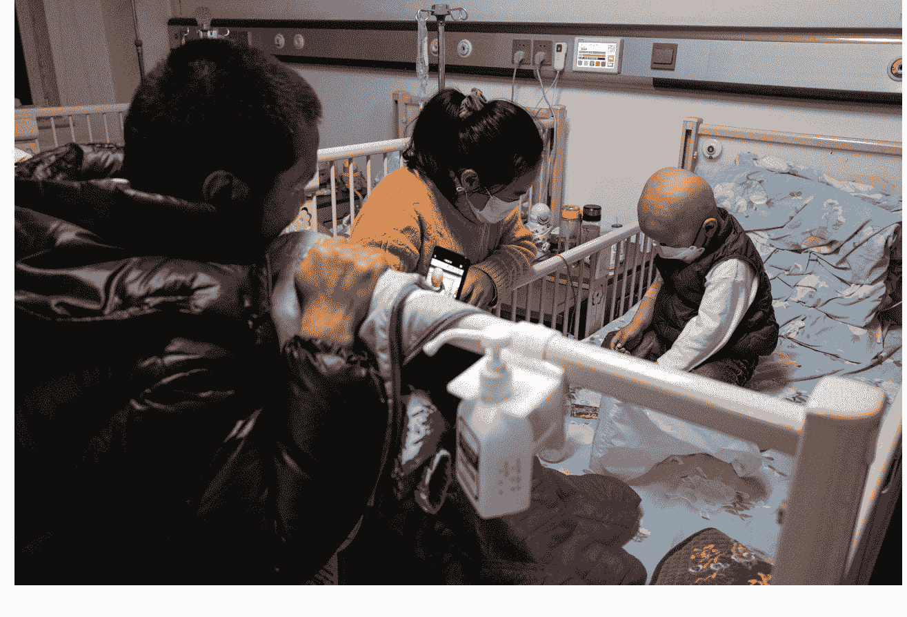

直播结束后，解道成前往山东省肿瘤医院，看望正在接受治疗的孩子。

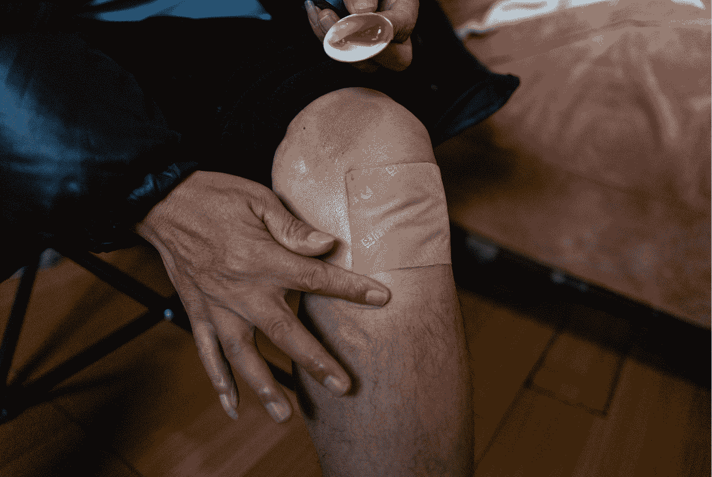

因为高强度跳舞，解道成的膝盖酸痛，爱心网友为他寄去了膏药。

为了不触及平台监管导致直播间限流甚至封号，除了特定的感谢话术，解道成直播时很少说话，只是不停地用力甩头，挥舞着手臂，抖动着肩膀，鞋子拍打在地板上发出沉闷的声响，汗水洒了一地。每过一段时间，解道成就得趴下身子，用纸巾擦拭脚下的汗水以免滑倒，然后侧身拿起水杯猛灌一口，再接着投入到快节奏的舞蹈中，有时累到抱着垃圾桶干呕。

直播间的粉丝们习惯一连串打出“叔叔，别跳了，休息一会”的字样，解道成坦言，“也想休息，但只要一停，直播间的人数立马减少”。当屏幕上接连出现“跑车”驶入的动画，解道成按捺不住激动的情绪，声音嘶哑地大喊：“谢谢大哥送的‘跑车’......”随后后退一步，把手举过头顶，双膝微弯，比出爱心，接着上半身前倾90度，深鞠一躬。

每天下午，住在解道成家附近的陈兴斌也在直播间跳舞，他的儿子轩轩同样患有神经母细胞瘤。他们一家租住在河头王庄的一处民房内，床头一侧临时拉了帘子，将室内区分为“客厅”和“卧室”。“客厅”的茶几被挪开后，就是陈兴斌临时跳舞的场地。相比解道成直播间动辄上千人，陈兴斌的直播间冷清不少，最多的时候大概200多人同时在线，一般只有几十人逗留。

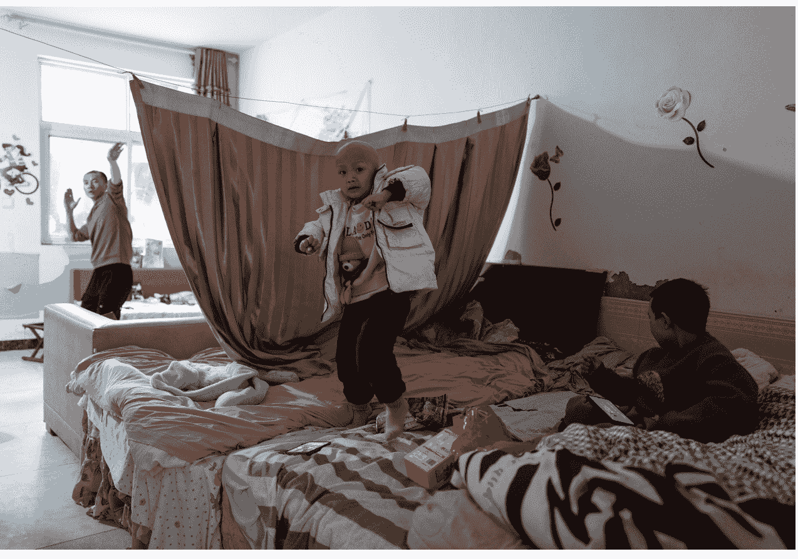

陈兴斌个人直播跳舞时，患儿小凡在旁边跟着舞蹈。

直播过程中，陈兴斌需要模仿短视频中的舞蹈动作。

直播时间久了，为了避免违规，他们摸索出一套经验，比如在直播间不能说“癌症”“帮帮孩子”“医院”“肿瘤”“病”等字眼，只能不停跳舞，展示才艺。为了让刚进直播间的网友了解他们的遭遇，陈兴斌的爱人刘显芬不停地刷着“谢谢大家能为这个群体停留”“轩轩爸爸在陪孩子加油”，以期网友能做短暂停留。直播跳舞2小时，陈兴斌的个人账号分成后有近200元钱收入，虽然不多，但足够日常生活开支，“还可以给孩子买个牛奶，买点水果”。

除了个人直播，每天晚上他们还会组团直播。解道成、陈兴斌是“五个小超人的爸爸”的成员，五位爸爸的孩子都被确诊为神经母细胞瘤，需要经历化疗、手术、移植、放疗、免疫治疗等多个治疗流程，费用动辄上百万元。在做直播之前，他们曾在医院附近打过零工、送过外卖，但是工作机会不多，收入有限，直播跳舞成为现阶段唯一的选择。

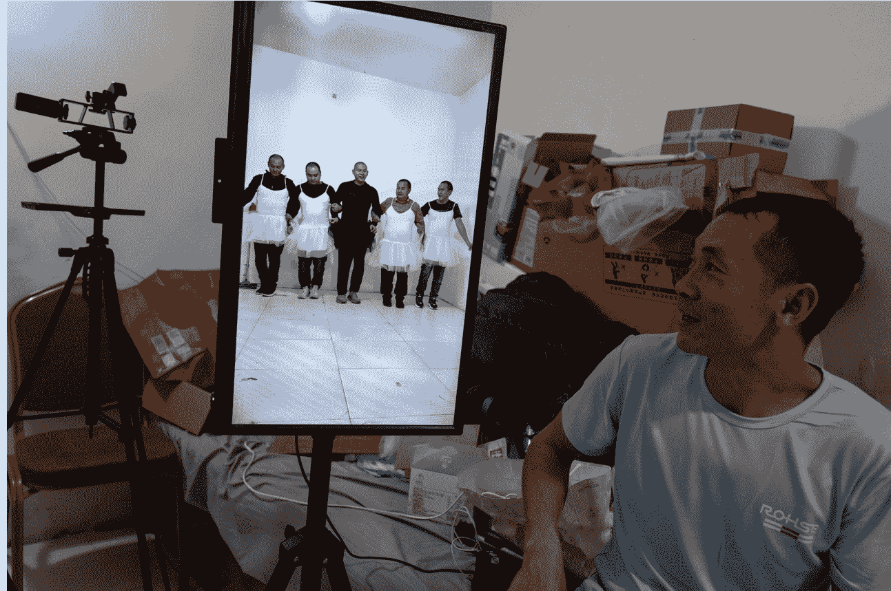

为了吸引关注，几位患儿的爸爸之前曾在直播间造型奇特地跳小天鹅舞。

晚上，几位爸爸聚在一起直播跳舞。

直播期间，陈兴斌的爱人刘显芬不停地点击手机屏幕，为直播间点赞。

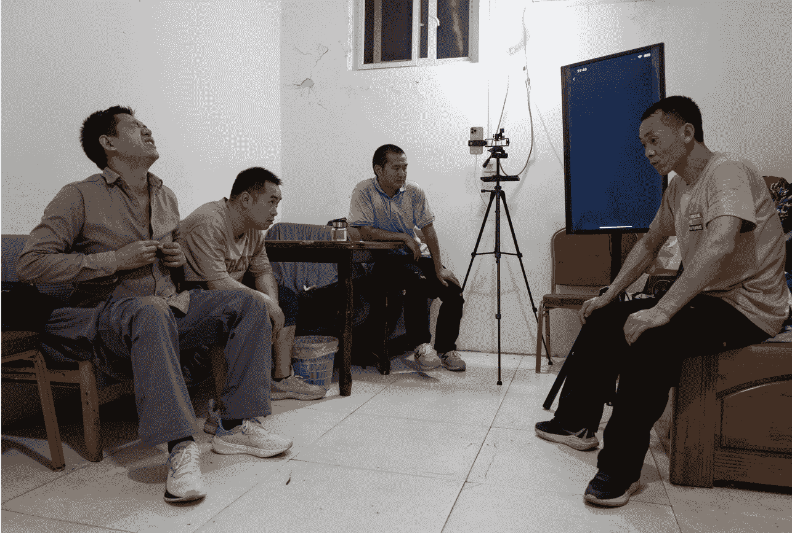

直播跳舞两小时后结束后，每个人坐下来休息，身体非常疲惫。

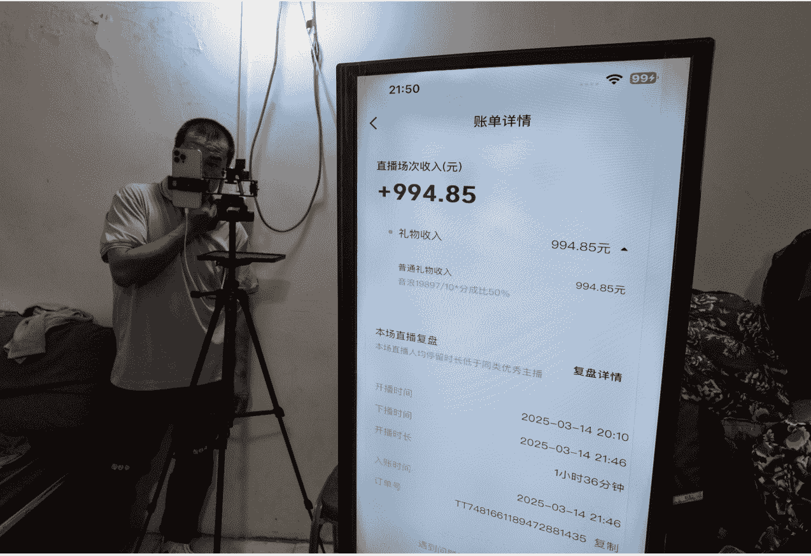

3月14日晚上直播1.5个小时，几位爸爸分成收入近千元。

为了给孩子筹集高昂的医疗费，五个爸爸被命运推着走到了一起。去年10月19日，“五个小超人的爸爸”开启直播，筹款目标是600万。他们剃光了头发，身穿白色纱裙在直播间跳起小天鹅舞，强烈的反差使他们短暂受到关注，可接踵而来的还有质疑和调侃：“老头子，你还跳上舞了？”“工地上搬砖不好吗？”“看不懂几个成年人为什么这么低俗地跳舞？”......

解道成说：“每次直播就是把面子踩在脚底下，但相比给孩子看病，面子不算什么。”直播半个月后，在自媒体大V的推荐下，11月4日晚，他们的直播间在线人数冲上8万，直播打赏金额达到40多万元。

这个数字让他们始料未及，也让每个家庭看到了给孩子延续生命的希望。

但之后直播间的在线人数急剧减少，“有的时候只有几十个人”，打赏收入急转直下。他们怀疑是账号被限流，但平台否认干预。最后，大家猜测可能是媒体过度关注导致，“每上一次热搜，我们的账号流量就会下降”，为此他们婉拒了很多媒体的采访。后来一位爸爸返回云南老家陪孩子治疗，加上大号直播效果不佳，解道成、陈兴斌开始用个人号直播，“这样还能多一份希望”。

直播一直伴随着一种矛盾心理，“想被看到又不想太火”，感觉像悬浮在直播间，“怕掉下来，又怕升上去”。一方面他们担心直播数据持续滑落，这意味着无人关注，给孩子治病的希望更是渺茫；另一方面，他们又担心流量的副作用，比如质疑、网暴，甚至随之而来的平台监管，到时候得不偿失。为此，无论在大号，还是个人号直播，几个爸爸更希望不温不火地播下去，这样才能小心翼翼地攥住最后的希望。

持续低谷后，3月中旬，账号“五个小超人的爸爸”直播数据逐渐向好，开播不久人数曾短暂破万，在线人数始终能保持在几千人。为了避免人数减少，他们不敢停下来，除了感谢的话语，只是沉默地拼命跳着，而孩子们的妈妈们，则在直播间里不断地点击手机屏幕，为爱人们点赞。

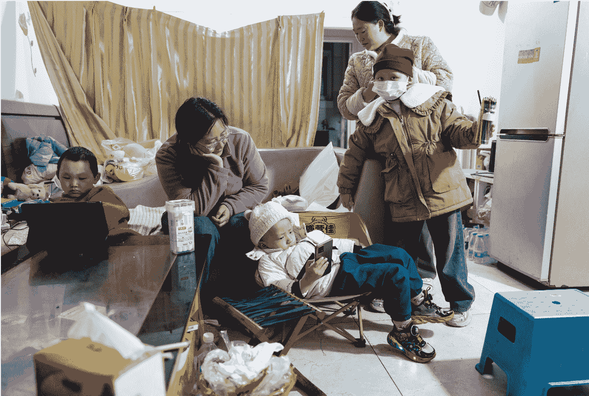

晚上爸爸们聚在一起直播时，几位妈妈则聚在一起照顾孩子。

目前，四位爸爸的孩子们都处于神经母细胞瘤四期高危阶段，随时面临危险。山东省肿瘤医院儿童肿瘤科主任王景福称，神经母细胞瘤起源于交感神经节或双侧肾上腺，是儿童期最常见的颅外实体瘤，占14岁以下儿童恶性肿瘤的7.2%。去年广州妇儿中心儿童肿瘤外科在官微发文表示“神经母细胞瘤，占所有因儿童肿瘤致死人数的15%，在中国的发病率为10.1/100万”。

涵钰和秋言同样是神经母细胞瘤患儿，她们的妈妈蒲晓娜和王莹刚涉足直播。

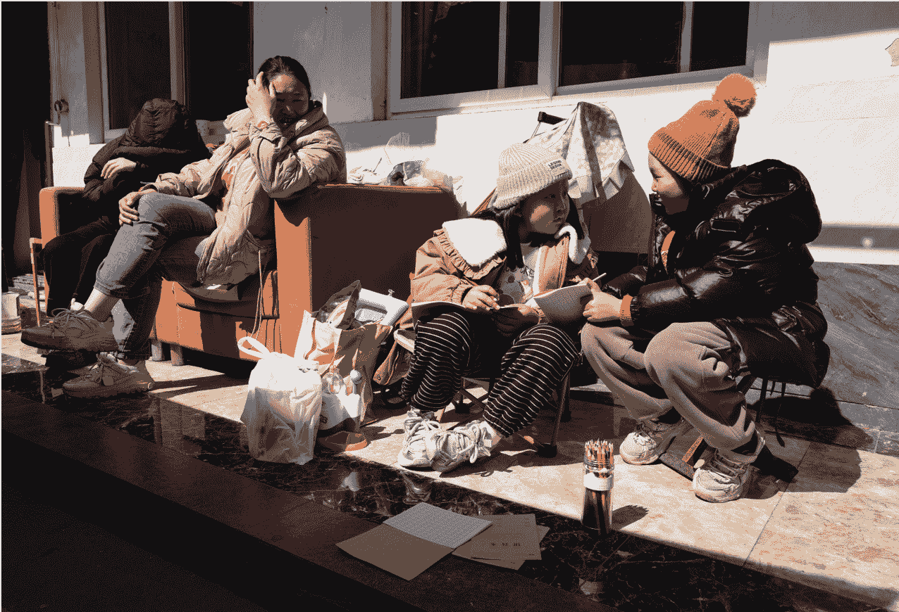

患儿轩轩和攸攸在门前练习写字，家长们在旁边短暂地休息。

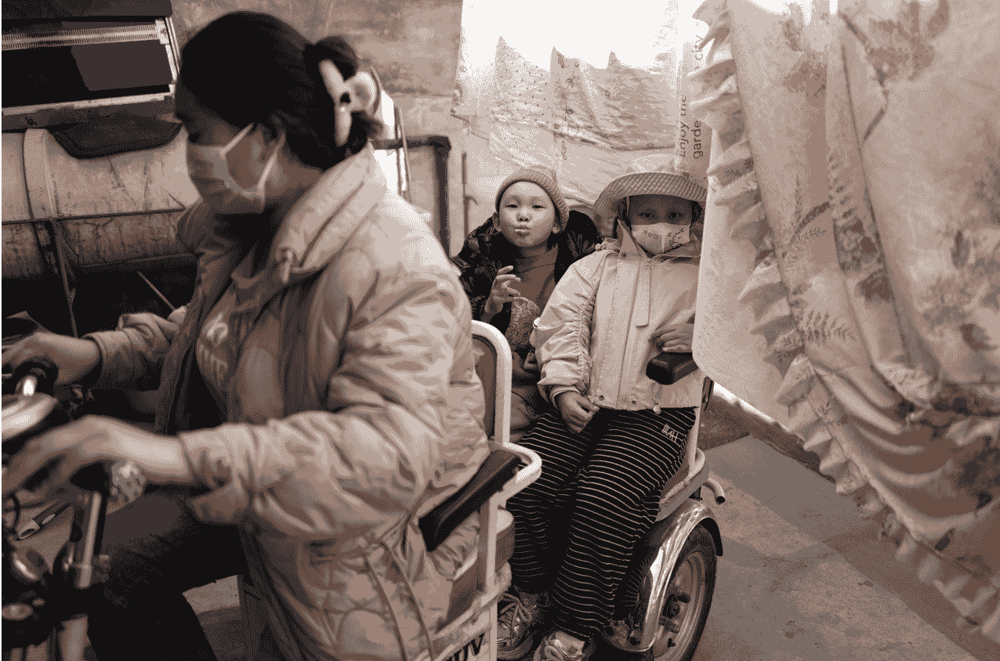

陈兴斌的爱人刘显芬每隔几天会带着孩子去医院做常规复查。

天气渐暖，患儿们聚在一起玩耍。攸攸眼睛附近泛起小红点，引起家长的担心。

2023年，神经母细胞瘤被《第二批罕见病目录》收录。尽管该疾病发病率较低，但是中国儿童患实体肿瘤的人数却不容小觑。2月15日“国际儿童癌症日”，国家儿童肿瘤监测中心的最新研究数据推算2020年到2024年期间，中国新增儿童肿瘤患者超15万，其中实体肿瘤占比约六成，已超越白血病，5岁以下儿童易患神经母细胞瘤，而其治愈率比白血病低得多，社会关注度却更低。

2021年8月，“达妥昔单抗β”获国家药监局批准上市，成为国内首款获批治疗神经母细胞瘤的新型靶向免疫药物，并被列入国家《第一批临床急需境外新药名单》，国家医疗保障局官网的药物说明称其“对于初治高危患者获益明确，能显著提升患者治愈潜能”。但是罕见病药物研发成本高昂，且市场容量小，价格高企。陈兴斌介绍，免疫治疗费用按体重计算，至少要做四五轮才有效果。以轩轩为例，如果接受免疫治疗，靶向药“达妥昔单抗β”每支零售价为 5.9598 万元，每轮需要5支，五轮免疫治疗至少需要150万元。虽然国内近年加大了对罕见病的关注，但“达妥昔单抗β”尚未入选医保名录。

自2024年10月开始直播，截至2025年3月中旬，直播给每位爸爸带来的真实收入有30多万元，因为平台提现限额，陈兴斌称“其中一部分资金还锁在短视频后台，实际到手并没有那么多”。而且，30万元只能购买5支“达妥昔单抗β”，仅够一轮免疫治疗的费用。

因距离山东省肿瘤医院仅数百米，房租相对便宜，济南槐荫区河头王庄成为大部分病患家属落脚的地方。爱心人士在村里搭建了共享厨房，供患者家属做饭。“村里80%的人都是病患家属，”陈兴斌猜测，“外面的人都叫这里是‘癌症村’。”因为直播“出圈”，近期“五个小超人的爸爸”成为村里家喻户晓的人物，和他们相同遭遇的很多患儿家长，也纷纷效仿开启了直播。

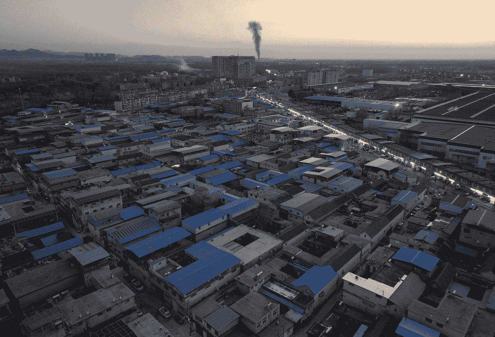

济南河头王庄因距离山东省肿瘤医院仅有几百米，成为很多大病家庭的暂居之地。

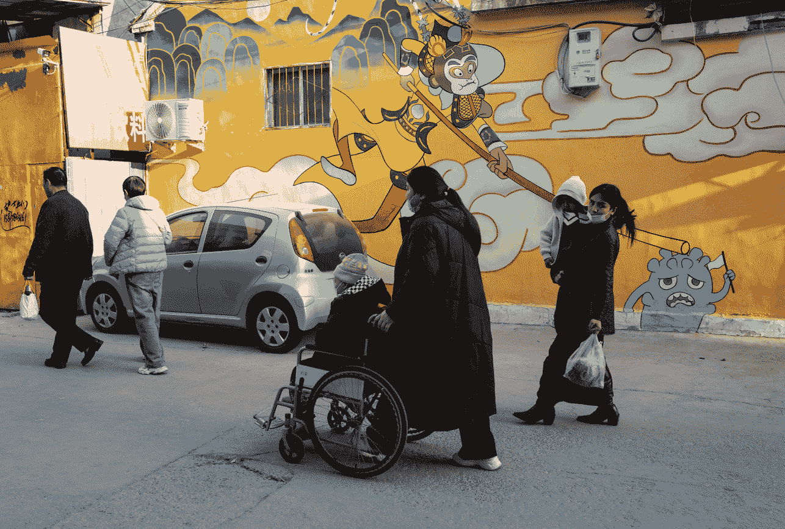

在河头王庄，随时可见接受化疗、头发掉光的患儿。

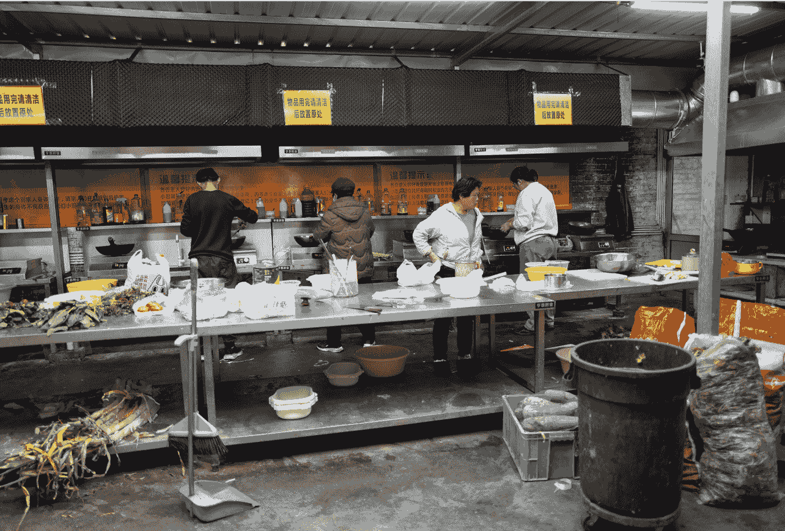

村里的一处共享厨房，患者家属们正在做饭。

医院附近的理发店，摆放着很多假发。理发师称这些假发基本都用于肿瘤患者。

每天晚上8点开始，蒲晓娜就带着王莹在村里的街道上直播唱歌、跳舞，直至晚上11点路灯熄灭才结束，她们的女儿涵钰和秋言都患有神经母细胞瘤。

初尝直播效果并不好，直播间在线人数一般仅有几十人。2021年初，2岁的涵钰被确诊为神经母细胞瘤，此后蒲晓娜辗转多地陪女儿“打怪升级”。她觉得同样是在直播间跳舞，“妈妈们没有爸爸们受欢迎”，猜测是因为男性跳舞能带来更大反差感，父亲的角色更能引发大家共情。

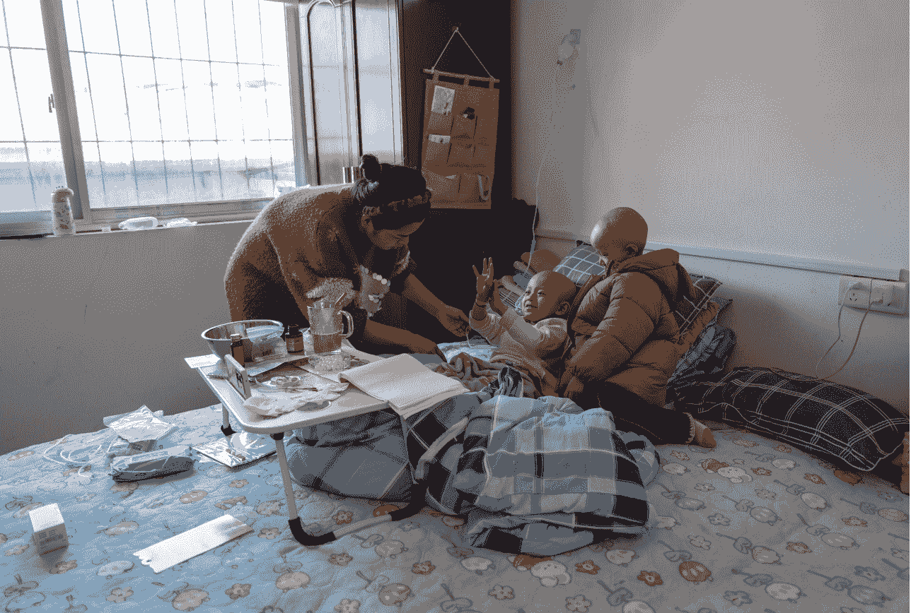

涵钰近期身体不好，蒲晓娜在家里给女儿打点滴。

王莹和女儿租住在出租屋中，为陪护女儿，她辞掉了教师工作。

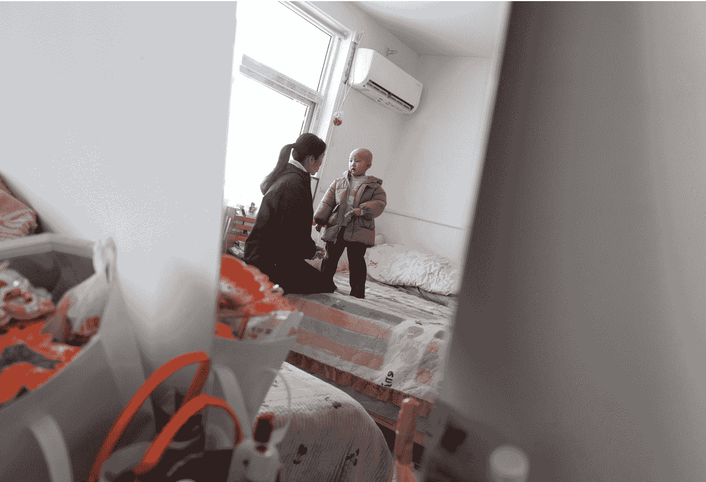

晚上借着路灯的光亮，蒲晓娜就带着王莹在村里的街道上直播唱歌、跳舞。

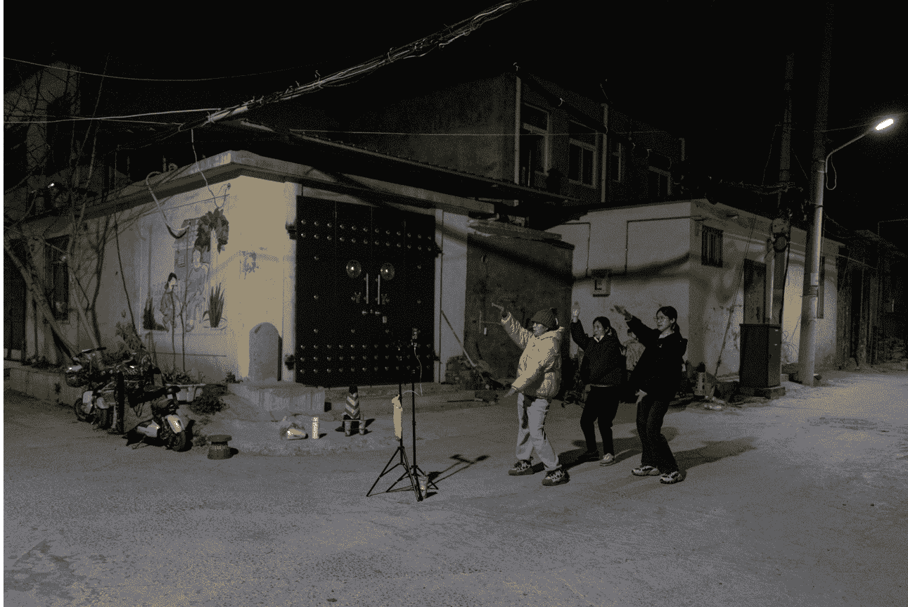

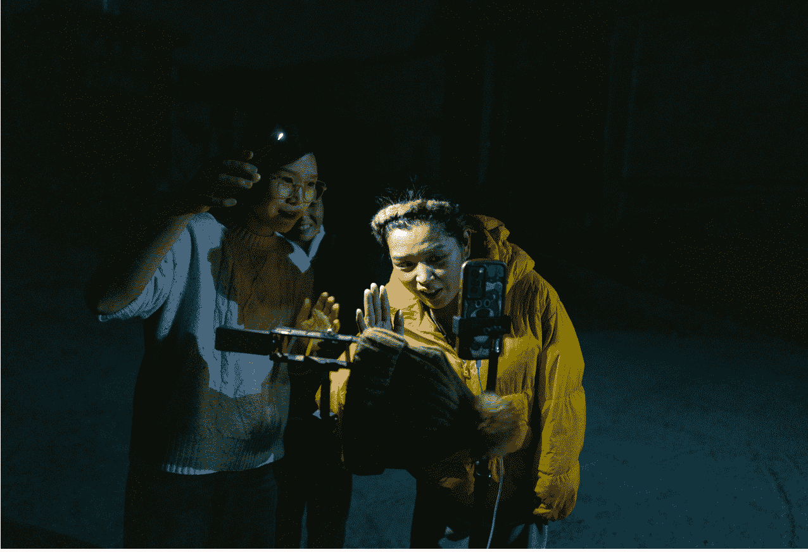

晚上11点，村里路灯熄灭，蒲晓娜与王莹和直播间的网友说再见。

面对有限的打赏，王莹挺知足，“起码可以用直播挣的钱去给孩子增加些营养”。女儿秋言患病后，有着15年教龄的语文老师王莹的身份一夜之间变成专职陪护妈妈，孤身一人来到济南全身心陪女儿治病。孩子的爸爸则继续坚守教师岗位，依靠有限的收入支撑整个家庭。刚开始面对直播镜头，王莹坦言“确实放不开，年龄大了，动作很笨拙”，从讲台到直播间的心理落差也很大，但随后话锋一转，她认为至少通过直播能将患病家庭聚在一起，经历相似的家长们一起聊天、唱歌、跳舞“能短暂地把不好的情绪忽略掉”。

目前秋言已经接受了免疫治疗，花费了100多万元，但是王莹仍不得不做好“复发几率很高”的心理准备。除此之外，像解道成、陈兴斌一样的很多家长都正在拼命筹钱，等待为孩子做免疫治疗，王莹说：“他们如果不拼到最后，始终是一个遗憾!”

为了不留遗憾，杨志鹏带着几位病友家长也正在通过直播“给孩子寻找生命延续的机会”。所有人白天送外卖，下午有时间大家就聚在一起排练新舞蹈，晚上8点准时直播，直到深夜11点。晚上，为了不扰民，他们特意将直播安排在户外的小公园，戴上耳机跳舞。3月上旬，山东济南气温骤降迎来强降雪，当天他们在暴雪中直播赢得了很多网友围观，“直播间始终有1000多人，”杨志鹏回忆，“我们不想卖惨，就想卖把子力气让大家看到。”那之后，他们的直播间一直不温不火，人数经常保持在200人以内。“直播一晚上，每个人平均能分到100多元钱”。

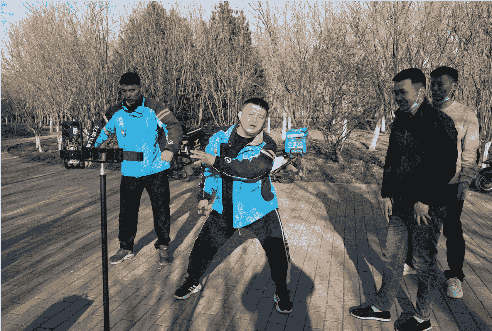

下午没有外卖单时，杨志鹏（右二）和几位家长在户外练习新舞蹈。

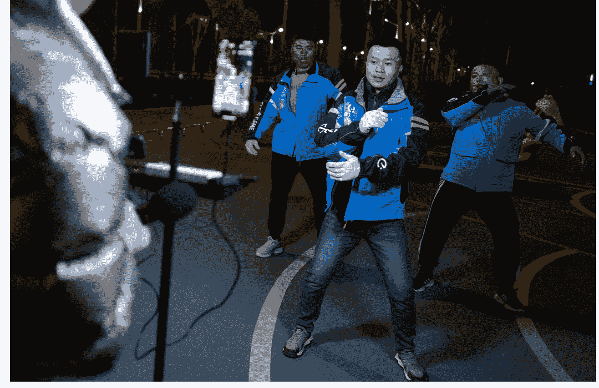

晚上8点，患儿家长杨志鹏带着几位家长在户外开启了直播，但是直播间在线人数较少。

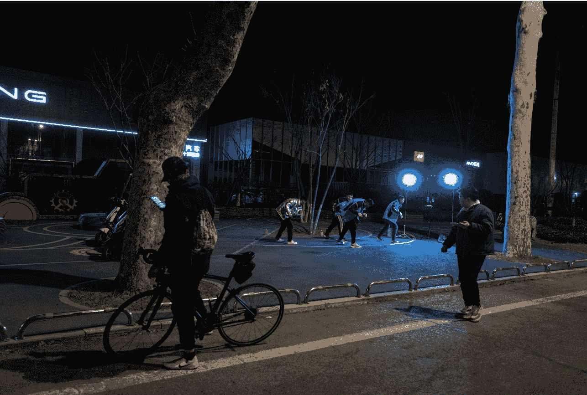

晚上杨志鹏和几位患儿家长在路边直播，引得路人侧目。

杨志鹏的孩子豆丁和丁广涛的孩子森森都患有肝母细胞瘤，各自动过10次和7次手术。杨志鹏早年当过兵，作为团队中的大哥，他经常宽慰大家。丁广涛在团队中年纪最小，每天送外卖至少8小时，医院周边单量有限，加之很多病患家属都做骑手贴补生活，竞争很激烈，“平均一天只能收入100元钱”。丁广涛回忆前不久因为骑车过快，被路人大声呵斥“败类，年纪轻轻就送外卖”的时候，不禁眼圈泛红，但更令他伤神的是“不知道孩子能不能留得住，现在是蒙着面往下走”。

和杨志鹏一起直播的还有白圣荣，他9岁的女儿彤彤患有罕见恶性肿瘤——横纹肌肉瘤，目前已经做了25次放疗和14次化疗；周爱卿8岁的孩子治锦患的是神经母细胞瘤，目前正处于免疫治疗阶段，谈及高昂的治疗费用，他觉得“别留遗憾，反正都是摸着石头过河，你迈出这一脚，也不知道脚下是什么”。

3月18日晚上，户外开播10分钟，直播间突然涌入3000多人观看，杨志鹏举起话筒向直播间的网友激动地说：“谢谢大家关注我们这个特殊群体。”几分钟后直播间被封禁10分钟，平台方给出的理由是：“因消极负能量内容博关注已累计违规2次。”封禁结束后直播间继续开播，伴随着《胜利之舞》的伴奏，他们不敢再说话，只是一味地猛地跳，但直播间人数却始终保持在几十人，再难破百，更多杂志关注TG频道《@QiKan2023》。

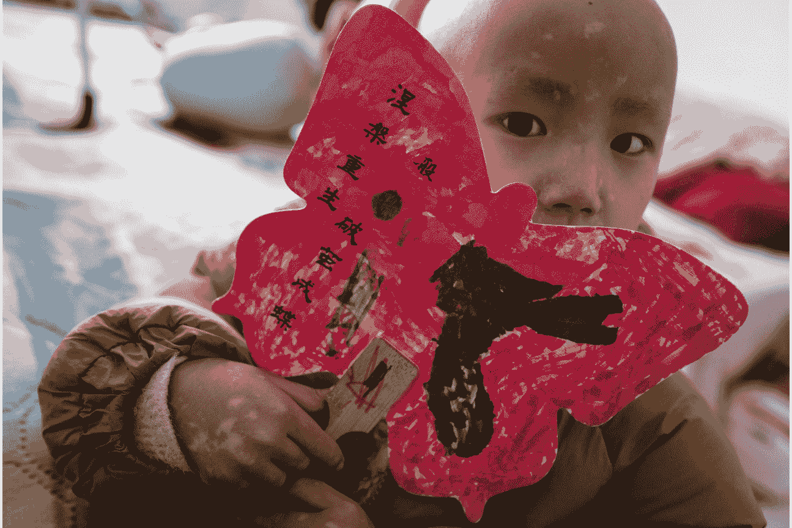

王莹的女儿秋言因为患病，身上留下了很多疤痕。她拿着一把扇子玩耍，则上面写着“涅槃重生、破茧成蝶”。

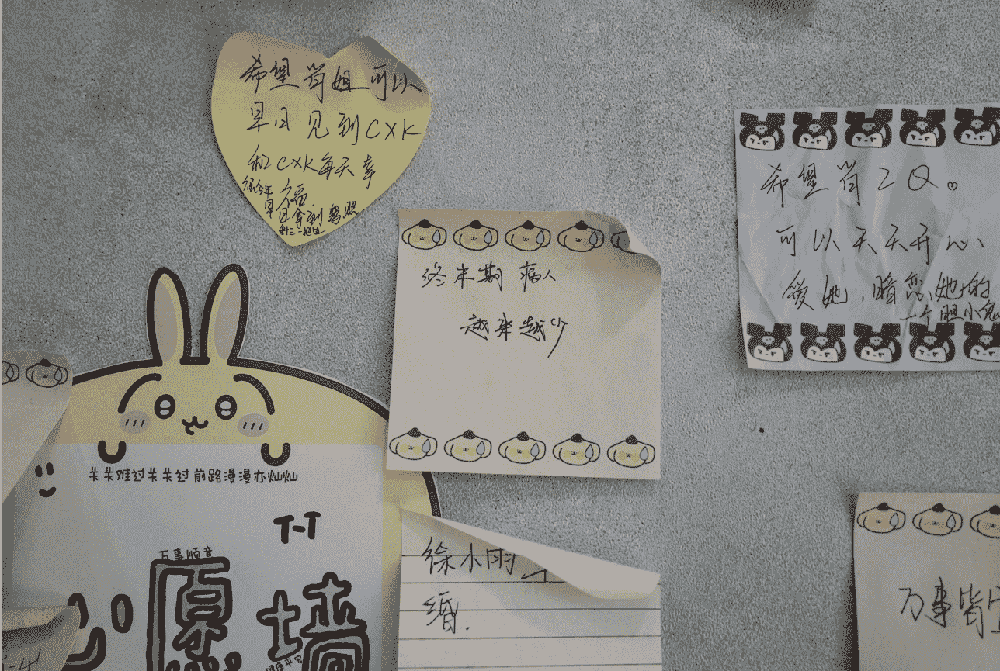

河头王庄，一家饮品店中的心愿墙上，有人留下“终末期病人，越来越少”的字样。

当天晚上，蒲晓娜和王莹在直播间也跳起了《胜利之舞》，在线人数同样只有几十人；而“五个超人爸爸”的直播间，解道成领舞，跳得大汗淋漓，在线人数基本维持在千人以上，礼物特效不断在手机屏幕上绽放。解道成觉得机会只有一次，“能跳一天就拼命跳一天，下个月一定想办法给儿子先上两轮免疫治疗”。

越来越多的大病家庭正试图在直播间博取一线希望。第二天，一位身患尿毒症的重庆女孩私信解道成说：“不好意思，模仿你的直播，我的爸爸没有文化，也想为我治疗挣点费用。”之后女孩询问了直播间被限流的情况，解道成回复女孩：“这种情况很正常，一起加油，早日康复。”

## 图片编辑 | 翁倩

## 直播间里的救命舞蹈

为筹集动辄上百万元的医疗费用，罕见病患儿家长们在直播间笨拙起舞，争取飘忽不定的流量带来的爱心资助

### 何以筹款，惟有跳舞

下午1点，山东省肿瘤医院附近的出租屋内，解道成准时开播。伴随抖音神曲《胜利之舞》的节奏，40岁的他扭动着发福的身体，蹩脚地重复相同的舞蹈动作。顷刻间直播间的在线人数便突破1000，网友们不停地刷着礼物。收到打赏，解道成跳得更加卖力，开播10分钟后，他的衣服被汗水浸湿，出租屋昏暗湿冷，解道成的头顶和后背随即“冒烟”，腾起了热气。

1公里之外的医院，他4岁的儿子解子恒刚刚吃完午饭，躺在病床上接受治疗。去年4月，子恒被确诊罹患神经母细胞瘤。这是一种罕见病，有“儿童癌王”之称，后期免疫治疗保守估计需要上百万元。解道成只能寄希望于直播流量带来的爱心资助。开播20分钟，直播间人数短暂破万，手机屏幕左上角显示2万“音浪”，意味着扣除平台50%的抽成，将可获得近千元的打赏收入。为了不触及平台监管导致直播间限流甚至封号，除了特定的感谢话术，解道成直播时很少说话，只是不停地用力甩头，挥舞着手臂，抖动着肩膀，鞋子拍打在地板上发出沉闷的声响，汗水洒了一地。每过一段时间，解道成就得趴下身子，用纸巾擦拭脚下的汗水以免滑倒，然后侧身拿起水杯猛灌一口。再接着投入到快节奏的舞蹈中。有时累到抱着垃圾桶干呕。

直播间的粉丝们习惯一连串打出“叔叔，别跳了。

道成只能寄希望于直播流量带来的爱心资助。开播20分钟，直播间人数短暂破万，手机屏幕左上角显示2万“音浪”，意味着扣除平台50%的抽成，将可获得近千元的打赏收入。为了不触及平台监管导致直播间限流甚至封号，除了特定的感谢话术，解道成直播时很少说话，只是不停地用力甩头，挥舞着手臂，抖动着肩膀，鞋子拍打在地板上发出沉闷的声响，汗水洒了一地。每过一段时间，解道成就得趴下身子，用纸巾擦拭脚下的汗水以免滑倒，然后侧身拿起水杯猛灌一口。再接着投入到快节奏的舞蹈中。有时累到抱着垃圾桶干呕。

- 01. 2025年3月14日晚9点，济南河头王庄的出租屋内，几位爸爸直播跳舞，为孩子筹集医药费。他们的孩子都患有罕见病神经母细胞瘤。
- 02. 40岁的解道成跳舞时，大汗淋漓，他希望尽快凑够为儿子进行免疫治疗的费用。
- 03. 为了吸引关注，几位患儿爸爸在之前曾在直播间造型奇特地跳小天鹅舞。
- 04. 陈兴斌个人直播跳舞时，患儿小凡在旁边跟着舞蹈。

休息一会儿”的字样，解道成坦言，“也想休息，但只要一停，直播间的人数立马减少”。当屏幕上接连出现“跑车”驶入的动画，解道成按捺不住激动的情绪，声音嘶哑地大喊：“谢谢大哥送的‘跑车’……”随后后退一步，把手举过头顶，双膝微弯，比出爱心，接着上半身前倾90度，深鞠一躬。

每天下午，住在解道成家附近的陈兴斌也在直播间跳舞，他的儿子轩轩同样患有神经母细胞瘤。他们一家租住在河头王庄的一处平房内，床头一侧临时拉了帘子，将室内区分为“客厅”和“卧室”。“客厅”的茶几被挪开后，就是陈兴斌临时跳舞的场地。相比解道成直播间动辄上千人，陈兴斌的直播间冷清不少，最多的时候大概200多人同时在线，一般只有几十人逗留。

直播时间久了，为了避免违规，他们摸索出一套经验，比如在直播间不能说“癌症”“帮帮孩子”“医院”“肿瘤”“病”等字眼，只能不停跳舞，展示才艺。为了让刚进直播间的网友了解他们的遭遇，陈兴斌的爱人刘显芬不停地刷着“谢谢大家能为这个群体停留”“轩轩爸爸在陪孩子加油”，以期网友能短暂停留。直播跳舞2小时，陈兴斌的个人账号分成后有近200元钱收入，虽然不多，但是够日常生活开支，“还可以给孩子买个牛奶，买点水果”。

## 想被看到，又不想太火

除了个人直播，每天晚上他们还会组团直播。解道成、陈兴斌是“五个小超人的爸爸”的成员，五位爸爸的孩子都被确诊为神经母细胞瘤，需要经历化疗、手术、移植、放疗、免疫治疗等多个治疗流程，费用动辄上百万元。在做直播之前，他们曾在医院附近打过零工、送过外卖，但是工作机会不多，收入有限，直播跳舞成为现阶段唯一的选择。

为了给孩子筹集高昂的医疗费，五个爸爸被命运推着走到了一起。去年10月19日，“五个小超人的爸爸”开启直播，筹款目标是600万元。他们剃光了头发，身穿白色纱裙在直播间跳起小天鹅舞，强烈的反差使他们短暂受到关注，可接踵而来的还有质疑和调侃：“老头子，你还跳舞了？”“工地上搬砖不好吗？”“看不懂几个成年人为什么这么低俗地跳舞？”解道成说：“每次直播就是把面子踩在脚底下，但相比给孩子看病，面子不算什么。”直播半个月后，在自媒体大V的推荐下，11月4日晚，他们的直播间在线人数冲上8万，直播打赏金额达到40多万元。这个数字让他们始料未及，也让每个家庭看到了给孩子延续生命的希望。

但之后直播间的在线人数急剧减少，“有的时候只有几十个人”，打赏收入急转直下。他们怀疑是账号被限流，但平台否认干预。最后，大家猜测可能是媒体过度关注导致，“每上一次热搜，我们的账号流量就会下降”，为此他们婉拒了很多媒体的采访。后来一位爸爸返回云南老家陪孩子治疗，加上大号直播效果不佳，解道成、陈兴斌开始用个人号直播，“这样还能多一份希望”。

直播一直伴随着一种矛盾心理，“想被看到又不想太火”，感觉像悬浮在直播间，“怕掉下来，又怕升上去”。一方面他们担心直播数据持续滑落，这意味着无人关注，给孩子治病的希望更是渺茫；另一方面，他们又担心流量的副作用，比如质疑、网暴，甚至随之而来的平台监管，到时候得不偿失。为此，无论在大号，还是个人号直播，几个爸爸更希望不温不火地播下去，这样才能小心翼翼地攫住最后的希望。

## 罕见的病，昂贵的药

持续低谷后，3月中旬，账号“五个小超人的爸爸”直播数据逐渐向好，开播不久人数曾短暂破万，在线人数始终保持在几千人。为了避免人数减少，他们不敢停下来，除了感谢的话语，只是沉默地拼命跳着，而孩子们的妈妈们，则在直播间里不断地点击手机屏幕，为爱人们点赞。

目前，四位爸爸的孩子都处于神经母细胞瘤四期高危阶段，随时面临危险。山东省肿瘤医院儿童肿瘤科主任王景福称，神经母细胞瘤起源于交感神经节或双侧肾上腺，是儿童期最常见的颅外实体瘤，占14岁以下儿童恶性肿瘤的7.2%。去年广州妇儿中心儿童肿瘤外科在官微发文表示“神经母细胞瘤，占所有因儿童肿瘤致死人数的15%，在中国的发病率为10.1/100万”。

2023年，神经母细胞瘤被《第二批罕见病目录》收录。尽管该疾病发病率较低，但是中国儿童患实体瘤的人数却不容小觑。2月15日“国际儿童癌症日”，国家儿童肿瘤监测中心的最新研究数据推算2020年到2024年期间，中国新增儿童肿瘤患者超15万，其中实体肿瘤占比约六成，已超越白血病，5岁以下儿童易患神经母细胞瘤，而其治愈率比白血病低得多，社会关注度却更低。

2021年8月，“达妥昔单抗β”获国家药监局批准上市，成为国内首款获批治疗神经母细胞瘤的新型靶向免疫药物，并被列入国家《第一批临床急需境外新药名单》。国家医疗保障局官网的药物说明称其“对于初治高危患者获益明确，能显著提升患者治愈潜能”。

但是罕见病药物研发成本高居，且市场容量小，价格高企。陈兴斌介绍，免疫治疗费用按体重计算，至少要做四五轮才有效果。以轩轩为例，如果接受免疫治疗，靶向药“达妥昔单抗β”每支零售价为5.9598万元，每轮需要5支，五轮免疫治疗至少需要150万元。虽然国内近年加大了对罕见病的关注，但“达妥昔单抗β”尚未入选医保名录。

自2024年10月开始直播，截至2025年3月中旬，直播给每位爸爸带来的真实收入有30多万元。因为平台提现限额，陈兴斌称“其中一部分资金还锁在短视频后台，实际到手并没有那么多”。而且，30万元只能购买5支“达妥昔单抗β”，仅够一轮免疫治疗的费用。

## 大病家族刮起“直播风”

因距离山东省肿瘤医院仅数百米，房租相对便宜，济南槐荫区河头王庄成为大部分病患家属落脚的地方。爱心人士在村里搭建了共享厨房，供患者家属做饭。“村里80%的人都是病患家属。”陈兴斌猜测，“外面的人都叫这里是‘癌症村’。”因为直播“出圈”，近期“五个小超人的爸爸”成为村里家喻户晓的人物，和他们相同遭遇的很多患儿家长，也纷纷效仿开启了直播。

每天晚8点开始，蒲晓娜就带着王莹在村里的街道上直播唱歌、跳舞，直至晚上11点路灯熄灭才结束。她们的女儿涵钰和秋言都患有神经母细胞瘤。

初尝直播效果并不好，直播间在线人数一般仅有几十人。2021年初，2岁的涵钰被确诊为神经母细胞瘤，此后蒲晓娜转多地陪女儿“打怪升级”。她觉得同样是在直播间跳舞，“妈妈们没有爸爸们受欢迎”，猜测是因为男性跳舞能带来更大反差感，父亲的角色更能引发大家共情。

面对有限的打赏，王莹挺知足，“起码可以用直播挣的钱给孩子增加些营养”。女儿秋言患病后，有着15年教龄的语文老师王莹的身份一夜之间变成专职陪护妈妈，孤身一人来到济南全身心陪儿子治病。孩子的爸爸则继续坚守教师岗位，依靠有限的收入支撑整个家庭。刚开始面对直播镜头，王莹坦言“确实放不开，年龄大了，动作很笨拙”，从讲台到直播间的心理落差也很大，但随后话锋一转，她认为至少通过直播能将患病家庭聚在一起，经历相似的家长们一起聊天、唱歌、跳舞“能短暂地把不好的情绪忽略掉”。

目前秋言已经接受免疫治疗，花费了100多万元。

在暴雪中直播赢得了很多网友围观。“直播间始终有1000多人，”杨志鹏回忆，“我们不想卖惨，就想把力气让大家看到。”那之后，他们的直播间一直不温不火，人数经常保持在200人以内。“直播一晚，每个人均能分到100多元钱”。

杨志鹏的孩子豆丁和丁广涛的孩子森森都患有肝母细胞瘤，各自动过10次和7次手术。杨志鹏早年当过兵，作为团队中的大哥，他经常宽慰大家。丁广涛在团队中年纪最小，每天送外卖至少8小时，医院周边单量有限，加之很多病患家属都做骑手贴补生活，竞争激烈，“平均一天只能收入100元钱”。丁广涛回忆前不久因为骑车过快，被路人大声呵斥“败类，年纪轻轻就送外卖”的时候，不禁眼圈泛红，但更令他伤神的是“不知道孩子能不能留得住，现在是蒙着面往下走”。

和杨志鹏一起直播的还有白圣荣，他9岁的女儿彤彤患有罕见恶性肿瘤——横纹肌肉瘤，目前已经做了25次放疗和14次化疗；周爱卿8岁的孩子治锦患的是神经母细胞瘤，目前正处于免疫治疗阶段，谈及高昂的治疗费用，他觉得“别留遗憾，反正都是摸着石头过河，你迈出这一脚，也不知道脚下是什么”。

3月18日晚上，户外开播10分钟，直播间突然涌入3000多人观看。杨志鹏举起话筒向直播间的网友激动地说：“谢谢大家关注我们这个特殊群体。”几分钟后直播间被封禁10分钟，平台方给出的理由是：“因消极负能量内容博关注已累计违规2次”。封禁结束后直播间继续开播，伴随着《胜利之舞》的伴奏，他们不敢再说话，只是一味地猛跳，但直播间人数却始终保持在几十人，再难破百。

当天晚上，蒲晓娜和王莹在直播间也跳起了《胜利之舞》，在线人数同样只有几十人；而“五个小超人的爸爸”的直播间，解道成领舞，跳得大汗淋漓，在线人数基本维持在千人以上，礼物特效不断在手机屏幕上绽放。解道成觉得机会只有一次，“能跳一天就拼命跳一天，下个月一定想办法给儿子先上两轮免疫治疗”。

越来越多的人大病家庭正试图在直播间博取一线希望。第二天，一位身患尿毒症的重庆女孩私信解道成说：“不好意思，模仿你的直播，我的爸爸没有文化，也想为我治疗挣点费用。”之后女孩询问了直播间被限流的情况，解道成回复女孩：“这种情况很正常，一起加油，早日康复。”

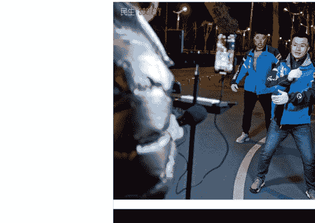

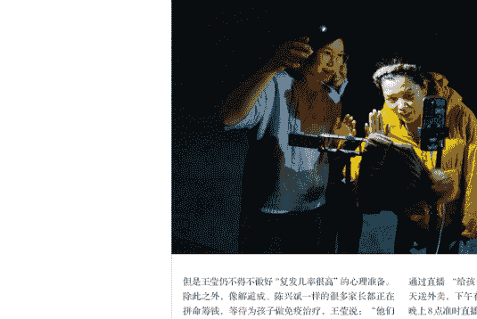

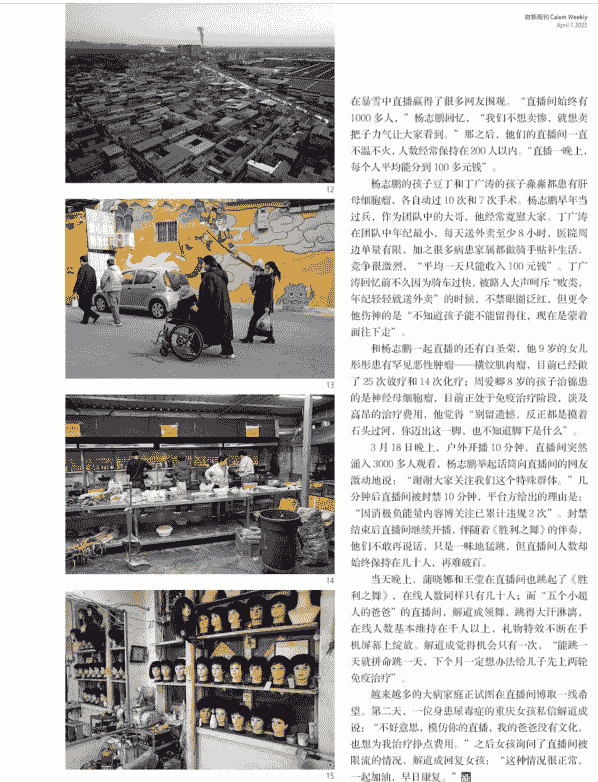

- 05. 直播结束后，解道成前往山东省肿瘤医院，看望正在接受治疗的孩子。
- 06. 天气渐暖，患儿们聚在一起玩耍，牧依眼睛附近泛起小红点，引起家长的担心。
- 07. 患儿轩轩和秋言在门后练习写字，家长们在旁边短暂地休息。
- 08. 涵钰和秋言同样是神经母细胞瘤患儿，她们的妈妈蒲晓娜和王莹则经常凑在一起直播。
- 09. 晚上爸爸妈妈在一起直播时，几位妈妈则聚在一起照顾孩子。
- 10. 晚上8点，患儿家长杨志鹏带着几位家长在户外开启了直播，但是直播间在线人数较少。
- 11. 晚上11点，村里路灯熄灭，蒲晓娜与王莹和直播间网友说再见。
- 12. 济南河头王庄因距山东省肿瘤医院仅有几百米，成为很多大病家庭的暂居之地。
- 13. 在河头王庄，随处可见接受化疗，头发掉光的患儿。
- 14. 村里的一处共享厨房，患者家属们正在做饭。
- 15. 医院附近的理发店，摆放着很多假发，理发师称这些假发基本都用于肿瘤患者。

但是王莹仍不敢做好“复发几率很高”的心理准备。除此之外，像解道成、陈兴斌一样的很多家长都正在拼命筹钱，等待为孩子做免疫治疗，王莹说：“他们如果拼不到最后，始终是一个遗憾！”

为了不留遗憾，杨志鹏带着几位病友家长也正在

通过直播“给孩子寻找生命延续的机会”。所有人白天送外卖，下午有时间大家就聚在一起排练新舞蹈，晚上8点准时直播，直到深夜11点。晚上，为了不扰民，他们特意将直播安排在户外的小公园，戴上耳机跳舞。3月上旬，山东济南气温骤降迎来强降雪，当天他们## 最新财新周刊 | 如何选择经济学的未来

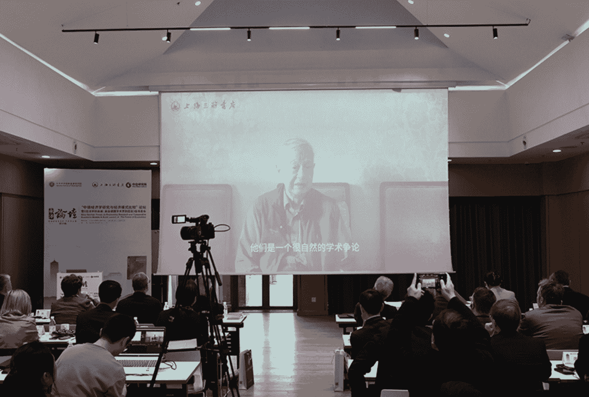

## CAIXIN | 听文章

## 文 | 财新周刊 王石玉

在当今世界政治与经济不确定性愈发凸显的环境下，全球主要经济体都在求解经济增长与发展之道。政策制定者应该采取什么对策，走哪一条路？经济学能给出怎样的建议？

不久前，仅次于美国、中国的世界第三大经济体，欧洲最大经济体，世界第二大出口国德国也来到了这样一个“十字路口”。3月21日，德国上议院以压倒性的差距通过了德国松绑“债务刹车”的历史性宪法修正案。这标志着德国这一届政府将放松长期以来的财政审慎立场，以期通过财政扩张和提高地方债务上限，应对德国当前面临的经济增长停滞与地缘政治挑战。

众所周知，德国的财政审慎立场可以追溯到魏玛共和国时期恶性通胀的惨痛教训，以及德国“本土经济学派”秩序自由主义的理论传统。

扎根德国的秩序自由主义学派主张放开市场、保护产权、合同自由等理念，可归属制度经济学旗下。这一学派发源于上世纪30年代，兴盛于1948年联邦德国的社会市场经济改革，对德国战后的经济复兴作出巨大贡献，在德国经济学界和政策界长期有着举足轻重的地位。

2009年，德国经济学界掀起了一轮方法论之争。表面上看，争论缘起于德国经济学“重镇”科隆大学决定取消一直以来由秩序自由主义经济学派主导的经济政策课程及教席，代之以美式宏观经济学的课程及教席；但实际是当时面临欧美金融危机后在政策与理论层面如何应对、是否实行短期大规模刺激政策、放松财政审慎原则的选择，甚至演变为对于德国经济与社会的未来之辩。而那一轮论战是以德国坚持了财政审慎原则、推出了“债务刹车”机制暂告一落。

近日出版的新书《经济学的未来：来自德国学术界的回答》（下称《经济学的未来》）收录了学术界对于这场论战的记录和评价。

2025年3月25日，北京大学国家发展研究院，瓦尔特·欧肯研究所所长拉尔斯·菲尔德（Lars Feld）、中国社会科学院金融研究所研究员胡琨、上海三联书店董事长兼总编辑黄韬、瓦尔特·欧肯研究所经济思想研究组主任丹尼尔·尼恩提特（Daniel Nientiedt）（从左至右）为《经济学的未来》新书发布揭幕。图：王石玉

3月25日，在北京大学国家发展研究院举行的新书发布会和研讨会后，财新专访了《经济学的未来》一书的三位主编：曾任德国经济专家委员会（俗称“五贤人委员会”）委员和主席、瓦尔特·欧肯研究所所长拉尔斯·菲尔德（Lars Feld），中国社会科学院金融研究所研究员胡琨，瓦尔特·欧肯研究所经济思想研究组主任丹尼尔·尼恩提特（Daniel Nientiedt）。

为什么今天的经济学者仍在关注15年前的这场学术争论？这场发生在千里之外的经济学“辩经”，对于面临经济停滞的许多国家，有何启示？德国又为何在近期改变了一直坚持的财政审慎立场？

现年58岁的菲尔德认为，当前德国面临的许多问题是供给侧导致的经济停滞，包括监管和税收过高、监管太复杂、劳动力成本太高等。“一些公司发现，它们在德国支付了高额税收，却没有获得好的基础设施服务。”

虽然当下的德国正在松绑“债务刹车”，但菲尔德认为这些问题并非是更多聚焦于需求端的凯恩斯主义短期刺激政策能解决的，因此他并不认同扩大政府债务能有效解决这些结构性问题。“此前，政府的经济政策是高补贴、多干预、强监管，所以新一届政府需要允许更高的债务——但是，如果我们不优化监管，不进行对症的供给侧改革，这个钱就会被浪费。”

# "本土经济学"辩经始末

秩序自由主义学派主张，政府应该专注于改善市场交易的法律规则框架，而不是试图直接影响市场中的交易。

胡琨指出，市场经济制度在德国的确立历经曲折，从而塑造了德国经济学研究中的制度研究传统。作为一个“土生土长”的德国经济学派，秩序自由主义屡次见证德国经济制度变革的重要节点。

1929年的“经济大萧条”波及了当时的魏玛德国，失业率一度高达30%，最终导致了希特勒的上台。1933年后，纳粹政府逐渐采取扩张性的财政立场，以应对军费增加和其他政府支出，实行统制经济。

同一时期，以瓦尔特·欧肯（Walter Eucken）为代表的一批反纳粹经济学家主张放开市场、保护产权和合同自由，成为秩序自由主义的发端。欧肯被认为是“秩序自由主义之父”，1927年后一直在德国弗莱堡大学任教，“弗莱堡学派”因此得名。

欧肯提出的“竞争性市场经济立宪原则”是秩序自由主义的核心主张。其中，价格体系的有效运作是最重要的基础原则，此外，还要开放市场、保护产权、契约自由、稳定的经济政策、责任自担（liability）、价格稳定。

这些主张成为之后德国经济制度改革的基础。“二战”结束后，经济重建成为联邦德国的首要课题，关注焦点就在于如何建立自由市场经济。1948年4月，路德维希·艾哈德（Ludwig Erhard）成为英美占领区经济部门负责人，同年6月推行了“新马克”并宣布废除配给制和价格控制，建立了社会市场经济。

这是德国经济史上最重大的改革之一。这场价格制度改革缔造了“德国经济奇迹”，联邦德国经济迅速恢复活力。

就在秩序自由主义在德国生根发芽的同一时期，为了应对大萧条，英国经济学家约翰·凯恩斯提出“总需求管理”这一概念，一场“宏观经济学革命”由此席卷英美两国。上世纪50年代后，凯恩斯主义在德国迅速传播开来，并在上世纪60年代后期、70年代的能源危机冲击时，基于凯恩斯主义的扩张经济政策对宏观经济的稳定起到了正面作用。菲尔德认为，相对而言，秩序自由主义的影响力有所减弱，但在一些大学和政策制定者之间仍举足轻重，在欧债危机期间，德国也坚持了财政审慎的基本理念。

但2008年爆发的美国金融危机很快冲击欧美及全球经济，德国也深受影响。此时，德国是否应仿效美国针对危机的一系列扩张性政策，这成为2009年大论战的一大背景。而直接导火索则是2009年初，科隆大学宣布改革经济学系，将“经济政策”这门课改为西方主流的宏观经济学。根据传统，经济政策在德国的经济学院系被设立为独立学科，包括产业政策、货币政策等内容。当时，科隆大学共有六个经济政策教授职位，一直由秩序自由主义学者占据。但新一轮公开招聘后，全部席位均交给了接受美式宏观经济学训练的学者，象征着经济学系的一次大改。

这一决定很快引来一些经济学教授的不满。2009年5月，83位经济学教授在报刊上联名发布公开信，要求“拯救大学经济政策研究”。这些教授认为，经济政策应当作为独立学科，也就是被视为研究对象，因为一个好的经济政策不仅要基于扎实的经济理论，“还要研究从理论得出的结论在多大程度上能在现实世界中适用和落实，关于真实制度及其激励作用的知识是必不可少的”。

这封联名信很快得到了论战另一方的回应。2009年6月，188名经济学教授在另一份报刊上发表题为《按照国际标准改造德国经济学》的回信。这些教授则认为，经济政策只是“大问题”的一部分，主张引入由凯恩斯主义主导的“英美宏观经济学”，反思所谓的“德国本土经济学”，也就是秩序自由主义学派。

胡琨认为，这场论战不仅涉及经济学研究方法，还涉及经验主义和理性主义之辩，以及两种经济学派之间理念和政策导向的分歧。

95岁高龄的中国著名经济学家吴敬琏在《经济学的未来》的序言中写道：“这场争论似乎主要关乎经济学的方法，其实争论的要害在于德国经济学和德国社会的未来究竟应当依托于德国式的秩序自由主义，还是应当依托于糅合新古典经济学和专注于凯恩斯短期分析框架的凯恩斯主义经济学，所谓'新古典综合经济学'。”

在论战之后，秩序自由主义并没有失去吸引力，包括在2009年欧美金融危机后，推动出台了德国的“债务刹车”机制；而凯恩斯主义经济学也非一成不变，包括深入思考“短期激励”框架，逐渐研究刺激政策的退出问题，发展出新凯恩斯主义学派。

回顾这场论战的始末，《经济学的未来》一书的三位主编都认为，凯恩斯主义与秩序自由主义之间的分歧并没有那么大，就如凯恩斯和哈耶克也并非互相全盘否定，只是对政府与市场边界的看法有所不同。

“实际上，经济系统的运作逻辑不管在哪里都是一致的。”胡琨认为，“秩序自由主义并不是某种特殊的‘德国经济学’。虽然经济学的实际应用当然需要考虑各国国情，但我认为，不存在所谓的‘XX国经济学’，就像不存在‘XX国物理学’。”

“出现非常强烈的经济冲击时，需要凯恩斯主义式的回应，但最终还是需要通过政策规则将财政和货币政策引导回常态化框架中。”菲尔德说，这样才能帮助实现中期或长期的经济繁荣。

## 短期刺激vs结构改革

凯恩斯主义的政策主张看似与秩序自由主义“放开市场、避免干预”的理念截然相反。在1936年出版的《就业、利息和货币通论》一书中，凯恩斯提出应该放弃市场的自由放任原则，增加货币供给，降低利率以刺激消费，增加投资，从而保证社会有足够的有效需求，实现充分就业。

但在采访中，《经济学的未来》一书的三位主编都认为，凯恩斯主义和秩序自由主义之间并非“水火不容”，反而更像是面对不同问题的不同解法。

“无论是地缘政治、经济风险，还是公共卫生事件、自然灾害，这些外部冲击不期而至的时候，政府肯定不能仅仅维持竞争秩序，还要维持这个秩序所处环境的稳定性。”胡琨解释道，“但当外部冲击持续不断的时候，这种政府干预可能就会慢慢变为一种常态。一旦形成惯性，很难跳脱。”

菲尔德也认为，凯恩斯的核心观点是要重视不确定性，而经济面临的问题究竟是不是全是因不确定性导致，要加以区分。

“当一个经济体受到剧烈的外部冲击，不确定性就成为最大的挑战。比如2008年的金融危机、2020年疫情导致的经济危机，这些是外部冲击，而非经济自身的问题。但如果经济面临一般性衰退，中央银行试图控制通胀或通缩而无果，那这很显然不是单纯的不确定性的问题。”菲尔德指出。

尼恩提特也指出，凯恩斯主义是否适用，取决于危机的性质。必要时，秩序自由主义并不反对扩张性政策。“秩序自由主义允许制度设置'紧急条款'，也就是在有适当理由的情况下，采取特别的政策措施，使用'非常手段'。”

2009年德国设置的“债务刹车”就有类似的“豁免条款”。2009年6月12日，德国通过立法，规定在2016年前德国财政赤字上限必须降至国内生产总值（GDP）的0.35%，联邦州自2020年起不允许新增债务，必须实现完全无赤字预算。

不过，法案也指出，在经济危机、自然灾害或紧急情况下，政府可以暂时突破债务限制，但必须制订债务偿还计划，确保未来偿还债务。

“遇到经济萎缩或者其他深层危机时，凯恩斯主义政策确实有效，但一定要警惕过度使用这类政策的风险。”尼恩提特强调，“以美国为例，《通胀削减法案》和大规模财政扩张措施虽然成功缓解了疫情冲击，但用力过猛、退出不及时等问题也引发了之后的大通胀，一定程度上帮助了特朗普再度入主白宫。”

“危机来了要及时应对，危机结束也要及时回归正常。”菲尔德提醒道，“我们要警惕‘危机’一词被滥用。有时候刺激政策很难退出，因为结束刺激也意味着约束。”

菲尔德认为，衡量危机的关键性指标是失业率或通胀。“当然，这两者也是中央银行货币政策的目标。不过，能否实现低失业率、价格稳定，还要看微观经济环境的情况。当这两个指标出问题的时候，就要思考这是周期性问题还是结构性问题。”

“如果是结构性问题，那就必须要作出根本性的改变。”菲尔德说。

他指出，德国就曾依靠结构性改革走出高失业率的困境。“上世纪80年代之后的数据显示，每当经济周期下行，失业率就攀升，但经济复苏后，失业率却也无法回落到原先水平。这就是结构性失业的表现，仅靠凯恩斯式的需求刺激政策根本无法解决。最终，是劳动力市场改革帮助德国降低了失业率。”

在德国失业率高企的背景下，2003年至2005年间，时任德国总理施罗德（Gerhard Schröder）进行了一系列的劳动力市场改革举措，主要是放开一部分对于雇主的限制，降低失业金、缩短可以领取失业金的时限等。2005年，德国失业率一度超过11%，两年内下降了近一半。

菲尔德强调，结构性改革带来的变化可能远比一些人想的更快。“有些变化可能四五年就会见效，甚至可能通过改变预期，效果就立竿见影。”

“很多人一提到改革就想到周期，一提到周期就是十几年。有些凯恩斯主义者可能会说，可能一整代人都看不到结果、享受不到改革带来的变化。”菲尔德并不同意这种说法，他反驳道，“如果企业认为改革可信，它们会立刻投资，因为能预期到未来成本会降低。”

## 松绑“债务刹车”

2025年3月21日，德国上议院以53:16的表决结果高票通过了德国松绑“债务刹车”的历史性宪法修正案。由于德国联邦议院已在3月18日通过该法案的表决，该法案现已通过所有立法程序。法案包含对于“债务刹车”的三方面改革，分别针对基建投资、国防支出和地方财政。

首先是成立5000亿欧元基建专项基金，用于交通、能源、教育、数字化等公共投资领域；其次，国防支出将免受“债务刹车”的限制；最后，各联邦州的财政赤字将从0%上调至GDP的0.35%，取消地方政府“零赤字”的规定。值得一提的是，在德国的法律中，财政对社会保障基金的补贴也看作是对基础设施的投资。

菲尔德认为，目前看这三个举措都有明显短板。国防方面，考虑到当前欧洲地缘政治的不确定性风险，国防建设的需求确实在增加，“但我建议给国防支出项下的赤字融资设定时限要求”。

对于5000亿欧元的基建专项资金，菲尔德担心这笔资金能否真正投入到“基础建设”中，对投资的实际拉动效果存疑。“从当前新总理候选人默茨为组建联合政府而进行的谈判中可以看出，各方都在试图把自己的支出项目包装成'基础设施'。另外，5000亿欧元听起来很多，但有12年的有效期，如果没能及时投入项目，资金就将作废。”

对于放宽各州的债务限制，菲尔德更是不赞成。“现在最想提高负债的州政府，恰恰是那些曾陷入财政危机的联邦州，这显然会引发新一轮危机。我担心这最终可能会演变成联邦政府为地方债务兜底。”

菲尔德强调，德国当前的经济挑战主要还是结构性问题，债务上限放宽并不能解决根本问题。“'债务刹车'的机制本身已经足够灵活，在新冠疫情期间，也允许政府通过财政刺激应对经济冲击。我认为没有修改的必要。”他指出，“在我看来，'债务刹车'发挥了预期的作用，降低债务率、降低融资成本、促使各联邦州加强财政纪律。”

胡琨也认为，德国并不缺少资金，而是市场经济环境有待改善。“德国基础设施建设不足，更多不是缺钱，而是审批程序繁杂、监管成本高等因素造成的。”

尼恩提特也指出：“确实很多德国人认为，德国的基础设施有太多'欠账'，无论是永远晚点或故障的德铁，还是数字化水平不高的学校设施，让他们在日常生活中有切实感受，自然会想到为什么政府不在这方面增加投入呢？”

“但从根本上，还是要激活私人部门投资，比如降低企业所得税、简化监管流程等，通过这些政策从供给侧激活企业活力。”尼恩提特直言，“在基础设施建设方面，公共部门的占比本身就不高。如果过度依赖公共开支，资金的用途——投资与不投资、优先投向哪里——很容易沦为政治问题。”

财税也是德国当前面临的一大结构性问题。菲尔德指出，部分德国城市当前面临着严峻的财政危机，是否对这些城市实施救助，也是组建新联合政府的相关谈判中的重要议题。菲尔德建议在地方层面解决债务问题，由各州政府对各自的地方财政自主负责。“如果将偿债责任推给联邦政府，各州就会消极等待联邦出手救助，这种'等待效应'会进一步恶化财政纪律。”

菲尔德重申了秩序自由主义所说的责任自负原则。“这方面，德国央地财政分权存在缺陷。虽然为联邦制国家，但州政府、城镇政府只有财政支出的自主权，却在税收自主权上受到严重限制。大约有四分之三的税收由联邦政府集中收取，再通过共享税比例、洲际财政平衡制度（转移支付）等财政手段分配回地方。”

菲尔德认为，德国可以借鉴瑞士模式，也就是各市镇和州级政府都拥有独立的征税权，当某级政府决定增加支出时，必须同步考虑如何通过自主征税来筹集资金，而不同的税率也反映了不同城镇公共服务水平的差别。“相比之下，德国的城镇想改善市政服务时，反而承担了更多债务，形成了负向激励。”

“在设置了债务上限的情况下，过去几年德国凝聚了相当的改革动力，现在随着限制放宽而减弱，从我了解到的联合政府谈判的情况来看，改革意愿已经大幅下降。”菲尔德直言。

## 贸易碎片化的挑战

德国经济学和经济政策围绕秩序自由主义展开了数十年的探索，对今天的中国和世界有何启示？

在3月25日的新书发布会上，吴敬琏以视频形式致辞时表示：“我们要从德国经济发展所经历的反复中吸取教训。虽然秩序自由主义成为‘二战’后德国经济政策的基础，并且为欧洲经济一体化和欧盟竞争政策提供了重要指导，但其发展并非一帆风顺。”

吴敬琏指出：“不管是哪一派的经济学家都知道，市场机制的核心就是价格机制。只有能够反映资源稀缺程度的价格，才能引导资源做出有效的配置；只有放开市场、让竞争决定价格，才能出现这样的价格体系。这是经济学的基本原理。”

胡琨也对财新表示，秩序自由主义看重有效的市场，其中一个重要原则就是绩效原则。“决定一个企业的存亡和发展，不是看银行关系、政府关系，而是看能不能够用物美价廉的产品获得更多消费者的青睐，促使企业必须去创新、主动地发掘产品需求，这是自然而然的逻辑。”

“德国进行结构性改革的勇气，是值得我们吸取的经验。”胡琨说道。

目前，国际政治经济不确定性不断累积，本届美国政府发起的贸易保护主义和关税壁垒愈发凸显，给世界主要经济体均带来很大挑战，尤其是中国、德国这样的出口大国。

菲尔德指出，关税政策只是特朗普贸易政策的一部分，更重要的是西方内部的分歧正在加剧。他直言：“如果只有关税，欧洲并非不能应付，但如果这种关税对峙进一步演变成贸易战呢？欧洲就将不得不面对一个加剧碎片化的世界经济，以及美国越发动摇的安全承诺。欧盟国家不得不纷纷增加国防开支，这也是德国这次修订‘债务刹车’以调整国防开支计划的背景。”

菲尔德指出，尽管特朗普宣称全球化损害了美国的利益，但真正致使一部分人成为“输家”的并非全球化本身，而是美国自身的财富分配机制，这同样是个结构性问题。“德国也受到了全球化带来的成本冲击、东欧国家进入欧盟的冲击等，但我们通过社会市场经济找到了一个平衡点。”

“过去的世界秩序是经济收益主导的多边主义，但现在正逐渐从原先的经济逻辑转向安全逻辑。”菲尔德解释道，经济逻辑讲究的是以各自的相对优势自愿交换，创造更多价值，是“正和游戏”。安全逻辑则是“零和思维”，保护主义会愈发盛行，更多杂志关注TG频道《@QiKan2023》。

“世界各国都必须重新思考国际关系的多元化战略，特别是在贸易领域。在贸易碎片化的挑战下，区域贸易协定可能会成为保持全球自由贸易韧性的重要一环。”菲尔德说，“我们不应放弃重返多边主义和全球化的机会窗口。”■

## 专栏丨贸易保护主义影响全球增长和减碳

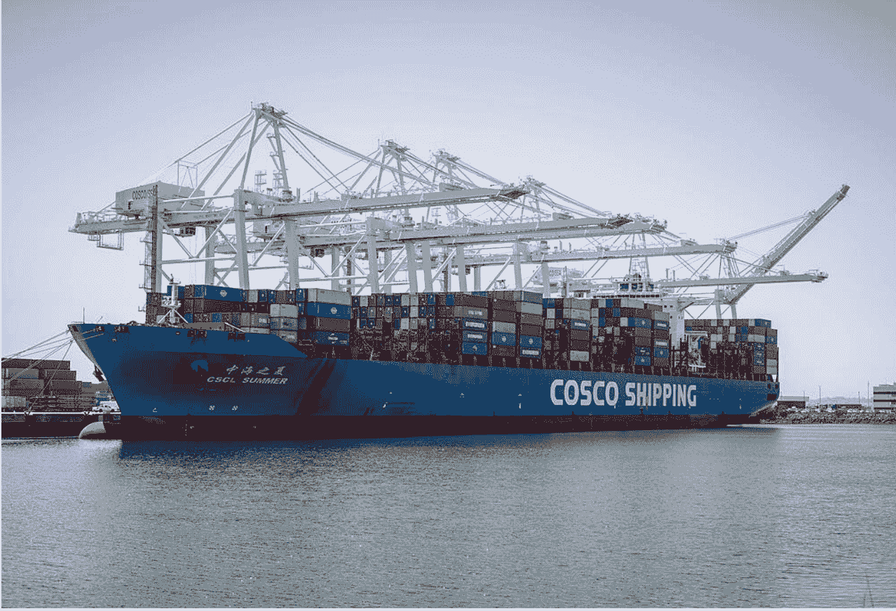

## CAIXIN丨听文章

## 文丨埃里克·伯格洛夫

### 亚洲基础设施投资银行首席经济学家

21世纪20年代可能会逐渐成为全球经济增长中“失去的十年”。短期内，这对新兴市场和发展中经济体尤为不利，而且由于这会削弱全球应对气候变化的努力，最终所有人的境况都将受到不利影响。当下的情景与20世纪30年代有一定相似之处，当时全球同样面临重大经济冲击、保护主义加剧、民族主义抬头以及多边主义衰落。其中，地缘政治都占据主导地位，这让情况可能更加不利。

过去一段时间以来，反全球化的浪潮愈演愈烈。但2020年至今贸易占全球GDP的比重相对稳定。全球价值链已经变得更长，尚未发生根本性改变。随着美国对贸易伙伴全面加征关税，其他国家可能采取报复性措施，全球贸易和投资流动进一步碎片化几乎已成定局。

新兴发展中经济体尤为脆弱。新冠疫情带来的疤痕效应仍在阻碍经济增长、全球利率下降速度慢于预期、美元持续升值等，都是挑战。对许多发展中国家而言，外债成本已经达到不可持续的水平。虽然这些国家并不是造成气候危机的主要责任国，却往往率先承受气候问题的冲击。

新兴发展中经济体将迎来更多动荡。虽然全球价值链和资金流动变化为一部分国家创造了机会，但全面贸易战和更严格的跨境投资限制将几乎损害所有人的利益。毕竟，新兴发展中经济体在增长和减碳方面高度依赖外国资本和技术。

亚洲基础设施投资银行近期的研究显示，近年来太阳能电池板、电动汽车及电池等低碳技术产品的全球贸易快速增长，自2015年至2023年增长了63%。其中，发达经济体增幅最大，低碳产品进口增长83%，新兴发展中经济体仅增长34%。低碳产品贸易主要发生在发达经济体之间，它们向发展中经济体出口的低碳产品并不多。虽然新兴发展中经济体之间的低碳贸易也在增长，中国是这些技术的主要来源国，但这不足以支撑这些国家的经济增长和低碳化。

针对低碳产品的贸易限制措施正在增加。最常见的限制措施是进口关税，约占各类限制措施的70%，其次是进口许可要求和进口禁令等非关税壁垒。历史上贸易限制措施在新兴发展中经济体中更为常见，但近年来，发达经济体也推出了许多贸易限制措施。2023年全球针对低碳产品新推出的贸易限制措施中，发达经济体占了42%。发达经济体的贸易限制主要影响新兴发展中经济体，除了中国，还包括印度、马来西亚和泰国等。

部分发展中国家正在向低碳化转型，如果无法获得更多外国技术和资本，这些努力将难以成功。同样，对全球净零排放至关重要的新兴发展中经济体，如果无法利用最新技术，产业脱碳进程也将举步维艰，进而影响这些国家在重要市场的长期准入，包括已实施碳边境调节机制的欧盟。

全球价值链的进一步中断可能以其他方式破坏脱碳努力。全球价值链本质上是一种治理安排，由主导企业在生产和分销全过程中制定并执行标准。通过减少每个环节的排放，全球价值链的碳排放才能降低。若这些安排被削弱，减碳进程也将受阻。如果新兴发展中经济体看到外资进入可再生能源和低碳交通等绿色产业可以创造就业并促进增长，它们将更有动力推动脱碳。出于地缘政治目的对价值链的压制，意味着此类机会将大幅减少。

近几十年来，新兴发展中经济体在全球价值链中的作用明显加强。当疫情引发重大贸易中断时，新近参与全球价值链的经济体被迫率先退出。新一轮关税战可能产生类似效果，而且影响可能更持久。疫情冲击过后，贸易迅速恢复正常，支撑全球价值链的信任纽带依然完好，发展中经济体可以迅速重新加入全球价值链。而贸易战可能摧毁了这种信任，这意味着未来全球价值链的恢复将更加困难。

与20世纪30年代不同，眼下“失去的十年”或许不会引发严重的经济萧条或世界大战，至少我们希望如此，但它很可能导致增长疲软，并阻碍应对气候变化的进程，新兴发展中国家将付出代价。

# 随笔 | 历史的回声：一位中国教授的访美行程
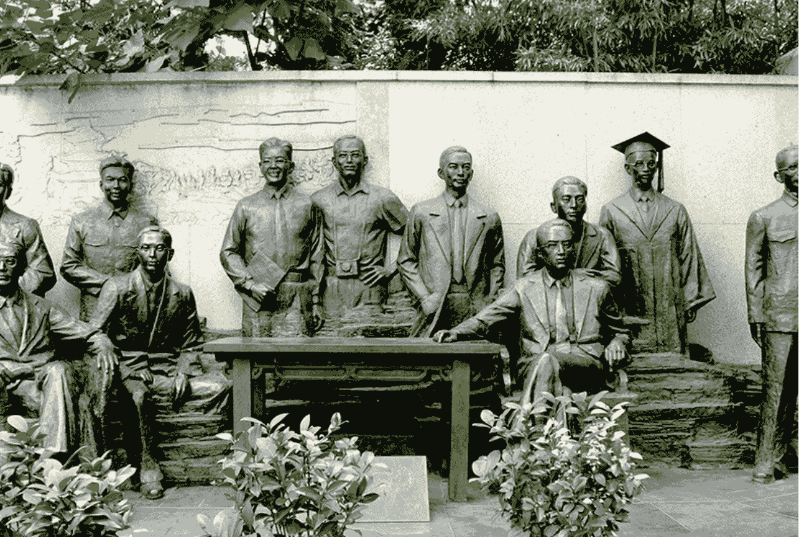

CAIXIN | 听文章
文 | 张冠生
学者

从1942年开始，美国政府邀请中国知名大学派员赴美访问，作学术研究和文化交流。由美国国务院文化关系司提供资助，为期一年。教育部要求国立云南大学选派一名教授，云大确定费孝通前往。据说他在首批被选中的教授里最为年轻。

当时，云南大学有学生办的《生活导报》，得到一批进步教授的支持，费孝通、闻一多等人常为该报写文章。该报编辑部得知费孝通将赴美访问的消息，和他约定，把途中见闻写成“旅美寄言”，随写随寄，及时分享给云大师生。这些文字写于1943年。80多年后，它们所表达的基本观点和主张，仍然可以给我们以启示。

费孝通发回给《生活导报》的第一篇文章，题目是《人生的另一道路》。

这个标题来自1934年硕士毕业于燕京大学社会学系的学长杨庆堃。在密歇根大学获得社会学博士学位后，他写信给费孝通：“希望你早一些来这个世界，——相信会给你看见人生的另一道路。”他们都曾醉心于田野调查，“一筒旱烟，半天旷野里的阳光，同样能得到心理上的平静和恬适”“洋蜡都点完了，还不肯住口”。但杨庆堃也担心，“在乡下住久了会忘记这种潜在于我们人类里的创造力”。他渴望费孝通早日到美国，现场观摩一种创造世界的伟力。

“东方的底子”是费孝通的自我定位。他曾说，“带着传统的性格和成见，对于上海的嚣尘，香港的夜市，生不出好感。苏州长大的人生活的理想似乎走不出绸长衫、缎子鞋和茶馆里的懒散。”但他并不否定他者的勤勉和“不惮烦”，尤其是进入到“东西文化碰了面，我们那种‘知足常乐’的处世之道已带来了毁灭的消息的警报”，给予他足够的危机感，“移动了我这个爱好懒散的苏州人，跋涉万里向地球的另一面出发。”

费孝通说：“我相信这是每一个认真为中国文化求出路的人，说得更狭小一点，每一个认真要在现代世界里做人的中国人，多少会发生彷徨的一个课题：我们是维持着东方的传统呢？还是接受一个相当陌生的西洋人的态度？东方和西方究竟在什么东西上分出了东和西？这两个世界真是和它们所处地球上的地位一般，刚刚相反的么？它们的白天是我们的黑夜，它们的黑夜是我们的白天？它们的黑暗时代是我们的唐宋文采，它们俯视宇内的雄姿是我们屈辱含辛的可怜相？历史会和地球一般有个轴心在旋转，东西的日夜，东西的盛衰，是一个循环么？我们有没有一个共同的光明？”

带着一连串问号，费孝通开始了初访美国之旅。最初的行程，让他经历了一场“文化的下马威”。他乘坐巴尔的摩到俄亥俄之间的火车到新泽西，那里的工厂烟囱排列，被费孝通描述为“梳子一样”，无数的车在梳齿缝里穿梭。从新泽西坐渡船去纽约，对岸矗立着曼哈顿的耸天高楼，背后是烟尘笼罩的巨大厂房。水面中心，是著名的自由女神像。

费孝通从这些景观中读到了美国文化“文摘”。他写信告诉朋友，在新泽西渡船上看到的“文摘”图景，确实使他在最短时间里对美国有了鲜明印象。

大约半年后，随着对美国现状和历史的了解不断深入，费孝通看到了营造摩天大楼的创造力生成的土壤，感受到了来自拓殖时代乡村生活的美国精神，相信了“每个人赤手空拳都有出人头地的机会”，目睹了妇女从家务劳动中解放出来的事实，知道了美国人怎样从“贫困的早年”一步步走进现代化生活。费孝通用“慢慢使我喜欢美国”述说心情的自然变化。

## 二
在《幸福单车的脱节》一文中，费孝通举证，“铁道大王凡德俾尔特出身是一艘帆船的主人”“煤油大王洛克菲勒是一位游方的外科医生的儿子”“钢铁大王卡内基是苏格兰手织机工的儿子”“汽车大王福特是个机器匠出身”。费孝通说：“我们若看看这些成功人物的传记，总不免会发生项羽‘彼可取而代之’的雄心。舜亦人耳，大家有此机会——有为者亦若是！”

1943年7月3日，费孝通写出《遗传和遗产》一文，显然跟他受到的这类触动有关。

美国的现实，使他想起中国，想起和其恩师潘光旦的洱海夜话，“潘光旦先生的优生论——引不起人切身的关注，正反映出我们社会中天分才智还不是一个人事业成败、享受厚薄的必要条件。”“高踞社会要津，叱咤风云，众望所归的人物，有些可以真的胖得和愚笨得像某种智力最低的动物。若是我们把他们的智力测验一下，也许会不及那些被他们使唤呼喝和奴役的轿夫们。——一个赤手空拳的人，除了非法的手段外，想获得财产实在是一个不容易实现的企图。——你要生活优裕，记着我的话，你必须有个好爸爸。他给你一笔财产之后，你才有资格讲努力讲拼命。在只有财产能生财产的社会里，决定人的生活的不单是财产而是遗产。

费孝通为此感慨：“我们这个社会说来也实在叫人难过。它奖励人做好人，而并不给好人预备下奖品。我在农村里调查过不少实例，我的结论也是无法承认一个吃苦的农夫做了一生牛马能创立一个可以养老的家业。”

从访美日程看，费孝通写这篇文章时，应是在哥伦比亚大学访学期间。那段行程，该校人类学系主任拉尔夫·林顿（Ralph Linton）派其助理为费孝通提供服务。在该校太平洋关系学会办公室里，这位助理帮助费孝通把《禄村农田》译成英文，编成Earthbound China一书内容的第一编。书名是1938年马林诺夫斯基在费孝通完成博士论文后为他确定的。他当时表示，希望这是费孝通的下一部著作的题目。

著名的禄村调查，得到云大校长熊庆来的支持，他专函教育厅，征得县方协助。禄村调查回城时，费孝通用手枪被车站扣留，熊庆来致函检查处，申明理由作保。费孝通的研究成果，是对校方的回报，也被国际同行关注和期待，不妨看作这次出访的主要本钱。他自述，带着特定心情，在美“埋头编写Earthbound China一书”（汉译本《云南三村》）。他的调查成果，是这次访美交流的需要，也牵动了后续的中美双方学术交流与合作，即富布莱特项目，史称“世界上规模最大、声誉最高的国际交流计划”。

## 三
雷德菲尔德（Robert Redfield）是富布莱特项目首批学者之一。他是费孝通燕园求学时来华讲学的派克（Park）老师的女婿。1943年11月，费孝通访问芝加哥大学，二人得以相识。

费孝通到校时，派克老师到南方避寒去了。他被安排在派克的办公室工作。一位书记员领着他到社会科学大楼502号房间，表示可以把门上铜格里的Robert Park字牌换下。他还记得派克老师燕园讲学第一课引起的轰动，记得跟着派克老师游走天桥街区的情景，记得派克老师嘱咐他多读小说、不必多读《社会学大纲》的教诲，记得派克老师因雪中迟到表示的真诚道歉——他怎么会舍得把老师名牌换掉?

费孝通说：“在我，这件有意或无意的安排是深有意义的。——私心窃喜，在他常坐的椅子上，一定会得到一点他余下的灵感，希望写出一本能自偿以前辜负他早起、谆谆教导我们的苦心。这里似乎有一种历史因缘。目前的情境因过去的纪念而发生了超出于现有一切之上的意义。我坚持着不要把门上的名牌取下，我需要具体，生动，活着的历史。我感觉到这门牌，这些围在墙壁上的旧书架和架上的书，甚至这屋内的空气，都动不得，在这一切活着的过去里，我看到了在几个月之后，在桌上可能有的那本Earthbound China的稿纸。动一动，一切可能都会完了。”

某日，有人轻叩502号房门。费孝通开门，见到派克老师的女儿、雷德菲尔德的妻子格里塔（Greta Redfield）。格里塔表示，愿意协助费孝通工作，修改、翻译Earthbound China尚未完成的部分，不计酬劳。对此，费孝通当然求之不得。他们愉快地一起工作，并受邀到她和雷德菲尔德的乡间别墅小住一周。

在格里塔的帮助下，《易村手工业》和《玉村农业和商业》顺利编译成了Earthbound China第二编和第三编。费孝通离开后，她积极联络芝加哥大学出版社，促成国际学界早日分享“中国社会学派”最新成果。据说该书出版后轰动一时，“各报的书评大都在方法论上加以肯定。该书至今还是美国社会学专业的指定参考书。”

1944年2月到3月，费孝通转至哈佛大学。该校商学院的埃尔顿·梅岳（Elton Mayo）教授精于工业生产现场研究，著有《工业文明的社会问题》。有梅岳作指导，梅岳夫人出手具体帮助，费孝通把史国衡的魁阁研究成果China Enters The Machine Age（汉译《昆厂劳工》）编译成书，该书于1944年由哈佛大学出版社初版。

4月到5月，费孝通回到芝加哥，最终改定Earthbound China书稿，写完序言。该书于1945年由芝加哥大学出版社出版。

这些成果都根据魁阁研究的整理而成。“魁阁研究”指20世纪40年代以费孝通为首的一批学者在云南呈贡魁阁进行的社会学、人类学研究工作。

## 四
《世界历史评论》2021年夏季号发表陈希撰写的《“最后离开的第一批”：富布莱特学者雷德菲尔德的中国之旅》一文，文中说：“除了开展翻译和研究工作之外，费孝通此次访美肩负的另一项更为重要的使命，是尝试开拓战后中美两国社会科学界合作的可能性。1943年夏天，刚到美国不久，费孝通便马不停蹄地奔赴哈佛大学、密歇根大学和哥伦比亚大学等高校，向这些学校提议筹划战后合作。

费孝通的努力，促成了一份合作计划备忘录，其中有组建高校联合委员会、互派学者实地考察、研究成果以中英文同时发表等具体设想。经历一番曲折，其中部分设想于1948年在中美官方合作的富布莱特项目中正式启动。

虽然没有更多时间和精力做专业的社会调查，但他处处留心，从观光现场和见闻中得到一些美国人生活的印象。在一个人类学者、社会学者的眼里，在他充满一连串问号的心里，还是会看到、感受到一些深层的东西，有可能从面相看骨相，从切片察整体。

“旅美寄言”系列通讯里，有一篇《贫困的早年》。费孝通希望和《生活导报》读者一起由表及里看问题，他说：“若忘记了美国的历史，被暴发的都市文化挡住视线，我们会误解美国的国民性。大企业，大工厂，大都市在美国确有它们的势力，它们表示了美国的力量，可只是皮肤和肌肉，并不是骨骼。骨骼还是他们在早年工业尚没有发达之前，拓殖时代乡村生活中所养成的。那种粗放旷达的生活环境养成了独来独往，不亢不卑，自负自骄，耐苦耐劳的性格。这性格归结于他们崇尚平等，爱好自由的精神。美国的创造力并不是凭空获得的，而是从这种对生活的认真，对自由的爱好中长成的，更因为有这种性格，这种精神，他们所发生出来的创造力并不像西欧日尔曼民族那样爆发成为人类的破坏和毁灭。我们要认识美国，不在它外表的耸天高楼，而是在他们早年的乡村里。”

梅岳所著《工业文明的社会问题》，曾由费孝通译介到中文读者中。该书第六章的标题，费孝通译为“爱国主义是不够的；我们对人必须没有仇恨或怨气”。

这是梅岳的主张，也合乎费孝通的价值观念和具体认知。他没有仇恨和怨气，也没有媚态和傲气，保持着对世界的冷静观察，尽量如实，以接近事物真相。

## 五
在美一年，费孝通看到的有“自由之邦的传统”和“年轻文化的前途”，也有“民主的沉睡”“劳资的鸿沟”“文化的隔膜”和华侨受排斥的情况。他笔下的“旅美寄言”，陆续寄到中国昆明，展示出一幅幅美国文化风景。即便不考虑体察字里行间的人类学眼光，只把这些篇章当作游人的手笔，也能随着通俗、生动的文字隔海观光，步移景换，不时有所触动。50多年后，还有读者记得这些文章，称费孝通为“文学圈外文章高手”。

费正清的学生阿古什，自称对费孝通当时每周活动日程都有所了解。他看到了费孝通访美期间写的不少信件，其中有写给太平洋关系协会的，有写给雷德菲尔德夫人的，还有写给费正清夫人的。

阿古什对费正清夫人为费孝通做的旅行安排做了梳理：邀请美国著名社会科学家到中国进行为期一年的学术活动；挤出时间多次到东海岸和中西部等地，和当地社会科学名家广泛接触；提出在美国财政支持下两国交换大批学生的设想；说服雷德菲尔德赴中国考察各种社会调查机构，并为此取得洛克菲勒基金会资助；为云南大学的同事和学生争取赴美深造的奖学金；为魁阁的研究工作向太平洋关系学会和哈佛—燕京学社募捐；为芝加哥大学争取研究唐人街经费，并物色研究人员。阿古什说：“这是一位国际博学的事业家和精力充沛的人物，他与美国人在一起，为建立中美社会科学长期学术合作的基础而努力。”在并不轻松且有时限的著述工作缝隙中，费孝通穿插了这许多事情，需要旺盛的精力、出众的才智、足够的热忱和卓越的社会活动能力。

1943年12月7日，费孝通写信告诉吴文藻，芝加哥大学对“世界上各种伟大的当代文化”抱有强烈的研究兴趣，为此设立地区研究委员会，雷德菲尔德是该委员会成员。芝加哥大学可能是最适合实施战后中美社会科学合作计划的美方院校。

费孝通和芝加哥大学地区研究委员会主席约翰·A.威尔逊（John A.Wilson）商定，由美方派一位代表先行访华，考察中方社会科学研究机构实况，根据考察意见制定后续具体合作方案。吴文藻帮助费孝通取得国民政府教育部的正式邀请函，费孝通争取到洛克菲勒基金会的资助，提名由雷德菲尔德担任访华代表，得到芝加哥大学校方和美国国务院的认可。

## 六
1944年5月底，雷德菲尔德接到中国政府教育部长陈立夫的正式邀请函电后，专程前往纽约，拜访胡适，听取其建议，于当年10月启程前往中国。他乘坐轮船出发不久，即受牙疾复发严重困扰，不得不立刻返回，失去了这次机会。

好事多磨。此后因抗战胜利、原定访问的西南地区几所高校忙于校址复原，雷德菲尔德迟迟无法重启访华计划。直到1947年11月，中美政府签署富布莱特项目合作协议，雷德菲尔德申请项目成员获准。1948年10月9日，他终于开始了迟到数年的访华旅程，和夫人、儿子同行，于11月1日抵达北平。第二天，费孝通和潘光旦把他们一家接到清华园，开始了特殊历史时期的一段学术交流活动。

穿行在中美文化之间，联络着一件又一件事情，费孝通对不同文化的差异体会得比平时更充分、更深入，看到了文化沟通的重要和迫切。

他说：“世界上各式各样文化里长成的人现在已开始急速的渗透往来，我们必须能相安相处，合作同工。可是我们的心理上却还没有养成求了解，讲容忍的精神，说不定我们因之还会发生种种烦恼，种种摩擦。在将来的历史家看来，也许会说我们在建立天下一家的世界过程中曾付出了太大而且不必需要的代价。”

费孝通说的是现实，他并不愿作前景不祥的预言。话音犹在，日本广岛原子弹爆炸的消息震惊世界。费孝通看到消息的时候，已是从美国返回中国一年之后。当时，他正在整理《初访美国》的文稿，遂把震惊之余的焦虑写入“余笔”——

“战争给我们明明白白看到的就是我们对于怎样毁灭的知识长进得实在太快。当我写这余笔时，报纸又送来了原子炸弹的消息。原子力的运用已产生了人类整个毁灭的可能性，要避免这可能性的实现（这应当毫无问题的是人类共同的目标），我们实在只有用同样的努力去发展可以促进人类合作的知识。若是沟通文化是可以消弭国际误会的话，这无疑是我们不应再事延缓的工作了。我怎能不心急呢！我们这一代处在这一代历史的考验里！”

## 七
看待社会问题时，在通常角度上增设一个文化观察角度，或是人类学者职业特征之一。访美途中，回国之后，费孝通的相关思索和表达都体现了这一特征。

赴美行前，一位朋友知他长年田野调查的艰辛，对他说，你也该有个假期了，出去休息休息，养养胖，回来再干。费孝通在美期间却不觉得放松。他说：“我到美国已经有四个月了，说是享乐吧，真是天知道，当然，主人们给我们的盛情宽待再也不能更加添了。香烟和牛奶从来没有吝啬过，可是，不知怎地我们害了病，有个黑影追着我们，永远也不能使我们心平气和地消受这朱门的酒肉。”“哪里是假期，哪里有休息的闲情，实是一回磨难。心头总是沉着一块丢不掉的石头：我担心这地球背面那四万万人的前途。——下一代大概免不了都得送到这个文化里来，我怕，不论我们愿不愿，我们不能不这样做。”

告别美国，回到四万万同胞当中，费孝通评说内政问题，继续向读者呈现文化观察角度。他说：“我们短短几十年中政治上的变动并不能说少，而实际上，变就来变去，有多少改革，谁也不敢估计得太高。我们是不是应当反躬自问，这是什么原因？若是我们将现中国的基本问题看成是一个文化的转变问题，而把文化看成人民的生活习惯和生活态度，也许就可以扩大一些我们应当努力的对象。我们得多注意一些生活的各方面，多养成一些现代生活中做人处事所必需的观念和态度。这样或比整天高呼政治改革更基本些，也更切实些，至少也是相互为辅的。”

这段文字，费孝通写于1943年。80多年后重读，这些文字表达的基本观点和主张，依然不失贴切。■

# 专栏 | 不谈钱也会伤感情
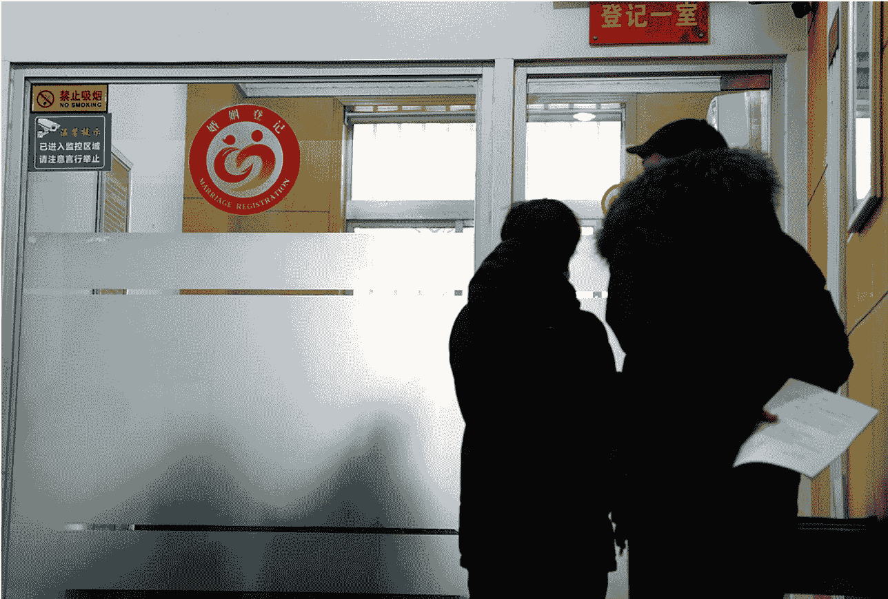

## CAIXIN | 听文章
文 | 张佳佳
北京市康达律师事务所家事律师

这是我作为律师办理的第一个婚姻案件。客户是位女士，后来我们成了朋友，我叫她黄姐。黄姐在事业单位工作，相夫教子，生活简单而平静，直到有一天她发现老公出轨了。还没从致命打击的痛苦中缓过来，又接到法院的通知，她被老公起诉离婚，而且几乎是要让她净身出户，来找我时她无助又愤怒。

为什么男方敢明目张胆地让黄姐净身出户呢？因为黄姐犯了致命的错误——婚前共同出资买的房产，却只登记在了男方一个人名下，离婚时男方完全否定双方共同出资的事实，声称房产全部是他的个人财产。

房产总价值500万元，首付款200万元，两人各出了100万元，贷款300万元。但是，黄姐出资的100万元没有任何凭证。钱既没转到开发商账户，也没直接转到男方账户，而是陆陆续续取出现金，由男方存进自己的账户。没有转账留痕，也没有收款收据，更没有共同买房共享产权的协议。

黄姐解释说，不用转账是想省手续费！而写收据订协议又说不出口，生怕太见外而伤感情。这是黄姐犯的第一个错误。

其实还有补救机会，都共同出资了，婚后可以在产权证上补加名字，以绝后患。黄姐说，都已经结婚生子了，还能有什么变化？再谈在房本上加名字太伤感情。这是黄姐犯的第二个错误。

就这样，等到被背叛的那一天，黄姐陷入了极为被动的境地。我的客户中80%涉及财产纠纷的，都是因为怕谈钱伤感情，殊不知，不谈钱反而更伤感情。为了帮黄姐争取她应得的财产，我不得不进行了大量调查取证。

第一步，要证明黄姐真的出了首付款。一方面，把黄姐购房前的银行流水全部调取出来，整理取现的时间、金额；另一方面，申请法院调取男方各个银行卡同时间段的交易流水。证明了黄姐取现金的同时，男方账户都有相应的现金入账。整体算下来，黄姐取现91万元，男方也相应地进账110多万元。虽然男方极力否认，但是他无法解释这100多万元到底从哪来的。

与此同时，找到了婚前两个人财产混同的证据，也就是两人相互使用对方银行卡、代为签名的各种票据。最终，法院采信了我方的意见。房子市值800多万元，剩余200多万元的贷款，最终黄姐分得了320万元的折价款。整个过程一审、二审，诉讼长达两年。虽然胜诉了，但我和黄姐都已经身心俱疲。

在此，我想给即将或已经走入婚姻的朋友提供如下建议。

- **签署婚前协议，或婚后签署夫妻财产协议。** 对双方各自名下的婚前财产、婚后财产的归属进行约定，协议一旦签字就有法律效力。这种行为并非只为离婚做准备，也能避免婚后产生纠纷而影响婚姻。某种意义上来说，它甚至是保护婚姻的手段。如果一方婚前财产较多，或者财产类别较复杂，比如有股权、股票、房产、名贵字画等，一定要签署财产协议予以明确。

当然，也可以通过财产协议做一些特殊的安排，来彰显和保障婚姻中的情感与付出。比如，我有客户，男方是某公司大股东，资产数亿元，女方是金融公司白领。双方婚前商议，女方在婚后辞职做全职太太，这理应被视为家庭共同利益做出的牺牲。为了让女方安心，双方在婚前协议中特别约定，男方在婚前给付女方1000万元，玩笑说，相当于买断女方婚后30年的工龄。但是，这又何尝不是对女方牺牲的肯定和感激呢？

- **签署忠诚协议。** 如果实在无法开口签署财产协议，可以从感情角度出发，约定一方一旦发生违反忠诚义务的行为，要付出一定的代价。和财产协议不同的是，法律对忠诚协议的效力没有明确的认可条款，但只要不是要求过错方净身出户、支付天价补偿金，在合理幅度内的代价，多数会被法院支持。抛开法律层面的效力问题，我更想称之为“君子协定”。出轨不忠的屡见不鲜，甘愿承担代价、认错认罚的真君子不多见。

- **平衡家庭财产。** 你有算过你实际能控制的家庭财产有多少吗？很多人想当然地以为，夫妻财产共同制，家庭所有的财产就一定是夫妻双方共同财产，在谁名下都一样。事实上，婚姻中可以实际获得的权利≠法律上享有的权利。也就是说，你以为的夫妻共同财产，在实际执行中不一定分得到，所以你要对你的财产有控制权。

你可以试着画一下家庭财富天平：一边是你的可控财产，一边是另一半的可控财产。两边的可控财产不平衡，甚至严重倾斜的，往往会增加婚姻的风险。因为有控制权的一方，在婚姻中往往更有话语权，也更容易转移或处分财产。比如，如果你发现家里现金1000万元都在另一半账户上，天平明显朝另一方倾斜。这时请开始有点风险意识，不一定马上让另一方转账500万元，但可以逐渐进行财产规划，慢慢打破这种不平衡，消除风险。比如，如果有两处房产，双方名下各一处；一方掌管理财账户，另一方掌管流动账户。总之，双方的悬殊不要太大。

这不是算计，也不是耍心眼。婚姻稳定需要智慧，自我保护也需要技巧。■

# 逝者 | 张晓朴：英年早逝的金融研究官员

## CAIXIN | 听文章
文 | 财新周刊 凌华薇

2025年3月21日晚，中央财经委员会办公室经济一局局长张晓朴，在北京因病去世，年仅51岁。

张晓朴人如其名，朴实谦和，始终以专业态度接人待物，以“务实、深刻、开放”为追求，是一位学者型官员；多年笔耕不辍，在金融研究领域颇有建树。他曾两度获得孙冶方经济科学奖，2009年入选“新世纪百千万人才工程”国家级人选，享受国务院政府特殊津贴。

1973年出生的张晓朴，1990年进入中国人民大学统计系本科学习，后师从袁卫，在该校获得硕士、博士学位。他的博士论文于2003年获首届“黄达—蒙代尔经济学奖”，获中国金融学会第六届全国优秀金融论文评比最高奖。

从人民大学毕业后，他先后任职于中国人民银行下属国家外汇管理局国际收支司、资本项目管理司、综合司等部门，主要工作和研究领域包括人民币均衡汇率理论、人民币汇率制度与政策、国际资本流动、人民币资本项目可兑换等。其间，他曾在美国斯坦福大学亚太研究中心做访问学者。2002年，张晓朴所著《入世后中国应对国际资本流动的政策选择》一文发表在《经济社会体制比较》期刊上，并于2005年获第十一届孙冶方经济科学奖。

2003年，银监会从央行中分立。张晓朴加入银监会，继续从事政策研究，覆盖领域包括银行监管、银行风险管理、银行合规风险管理与监管、金融集团的风险与监管等；后升任银监会政策研究局副局长。同期，他是巴塞尔银行监管委员会研究工作组（RTF）成员、联合论坛（Joint Forum）金融集团监管原则工作组成员。

在银监会工作期间，张晓朴完成了多部专著，如《人民币均衡汇率研究》《商业银行合规管理原理与实务》《商业银行合规风险管理》等，译有《反思银行监管》等。其中，《外资进入对中国银行业的影响：后评价分析和政策建议》一文，2008年发表于《比较》杂志，2011年获得第十四届孙冶方经济科学奖。在这篇论文中，张晓朴阐述了外资作为战略投资者进入中国银行业带来的催化剂效果，评估了引入外资的收益与风险，也强调了金融安全、金融稳定、宏观审慎的重要性，强调外资为我所用、提高了中资银行竞争力。2014年6月，在银监会政策研究局副局长任上，他出版《变革与稳健：银行监管和银行转型的思考》一书，讲述了改革开放35年来，中国经济以年均近10%的增长速度创造“世界奇迹”，离不开金融业的改革与发展。

2013年，影子银行甚嚣尘上之际，在谈到如何看待金融创新中的监管套利时，张晓朴提出，纯粹以监管套利为目的的创新可能会损害监管的公信力，并认为对于表外业务，如果承担信用风险、利率风险，就应该和表内业务的活动一样受到监管。当时互联网金融泡沫方兴未艾，他在耐心听取业内呼声的同时，也颇为严肃真诚地提醒从业者应更多自律，一旦监管出手，必定雷霆万钧。2018年，张晓朴与姚勇合著的《未来智能银行：金融科技与银行新生态》出版，反映了他对于金融科技的开放态度。

2017年，张晓朴调入中央财经委员会办公室，很快升任中财办经济一局局长，同期加入经济五十人论坛，成为新一代有影响力中青年经济专家的翘楚。2021年，他在《求是》杂志刊登署名文章坦言，党中央已就“十四五”期间乃至到2035年的经济社会发展作出了一系列战略部署，但当前制约发展的一个突出因素是，一些领导干部在“怎么干”上存在不懂、不会、不敢、不愿等问题。此后，他应邀去不少单位和机构做了专题讲座，反响颇佳。

2021年张晓朴出版的《金融的谜题：德国金融体系比较研究》一书受到业界认可。在经济、金融发展道路和制度安排上，德国与中国存在一些相似性，张晓朴由此提炼了德国金融的七个“谜题”，包括德国是“小金融—大实体”，实现了金融与实体经济的良性循环；德国银行业没有经历私有化浪潮，保有大量公共银行；德国宏观杠杆率长期处于低水平，还保持了长期金融稳定，“二战”以来几乎没有发生大的金融危机，货币、金融和房地产保持稳健；德国银行“雨天少收伞”，中小企业融资环境稳定性强，银企关系具有明显的协调性和共济性特征。张晓朴认为，德国金融说明了现代金融体系的多样性和与一国现代化模式的关联性。

张晓朴在中财办工作期间，保持与业界和学界的积极沟通，为经济和金融改革出谋划策，真知灼见，意气风发。谁料2023年起患病，2024年9月确诊为癌症，仅半年后不幸辞世，唯有追悼会上对其“朴心晓义”的总结永存缅怀者心。■

# 前瞻 | 加拿大将提前举行联邦大选
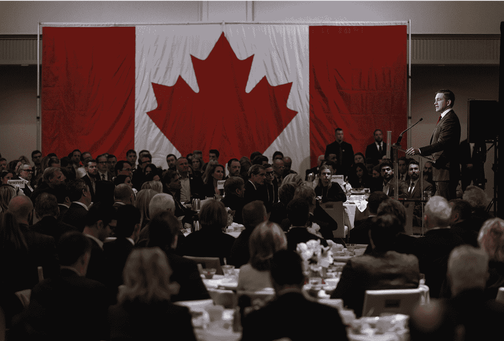

## CAIXIN | 听文章
文 | 财新周刊 侯吴婷

3月23日，在正式就职不到10天后，加拿大总理马克·卡尼宣布解散议会并提前举行联邦众议院选举，选举活动将持续36天，投票日为4月28日。

卡尼在宣布这一消息时表示，他希望得到加拿大民众强有力的授权，以应对美国总统特朗普的威胁，后者意图“摧毁”从而“占据”加拿大。

“由于特朗普总统不合理的贸易行为以及对我们主权的威胁，我们正在面临一生中最严重的危机。”卡尼说。

他补充道：“我们的回应必须是建立强大的经济和更安全的加拿大。特朗普总统声称加拿大不是一个真正的国家。他想要摧毁我们，这样美国就可以占据我们。我们不会让他得逞。”

除了作为自由党党魁在全国范围内进行选举，卡尼还将在渥太华的内皮恩选区参选议员。现年60岁的卡尼此前并非经民选产生的众议员。

今年1月9日，执掌加拿大近10年、出身自由党的前总理特鲁多辞职，执政党自由党举行领袖选举。3月9日，加拿大银行前行长、英国央行前行长卡尼以压倒性优势当选自由党新党魁，并于3月14日宣誓就职为加拿大总理。

而在3月23日，主要反对党保守党的领袖波利埃库尔亦宣布启动该党竞选活动。他在讲话中表示，将对抗特朗普及其吞并加拿大的威胁，加拿大永远不会成为美国的第51个州。

魁北克集团、新民主党和绿党等政党当天也分别启动了竞选活动，但预计只有自由党和保守党有机会组建政府。

此次大选将是加拿大众议院席位由原来的338席增至343席后的首次大选。获得众议院最多席位的政党将赢得大选，获得组阁权，执政党领导人将成为总理。获得172席及以上席位的政党将能够组建多数党政府。

目前，两党选情呈现高度胶着状态。加美两国争端、经济和民生挑战等议题料将成为选举议程的重点。

在加拿大政治危机最初加剧时的2024年12月17日至2025年1月，保守党支持率区间为43%至48%，稳居首位；自由党支持率区间为16%至23.8%，创近年来新低。

但随后的三个月内，因特朗普不断重复“美国的第51个州加拿大”等挑衅言论，以及美国不断威胁对加拿大实施各种关税的影响下，加拿大国内的民族主义情绪被激起，一扫此前自由党的民意颓势。

益普索2月25日公布的民调数据显示，自由党支持率攀升至38%，较保守党的36%建立微弱优势，首次在民调支持率中处于领先地位。

现自由党的支持率仍在持续攀升。据加拿大安格斯·里德研究所3月24日公布的民调，有46%的受访者支持自由党，比保守党38%的支持率已高出8个百分点。■

相关视频：【华尔街原声】卡尼：Libra有很多问题需待解决
视频说明：2019年10月16日，时任英国央行行长的卡尼出席IMF和世行秋季年会。2025年3月，他接替特鲁多出任加拿大总理。

# 国风 | 中国有6.62亿微短剧用户
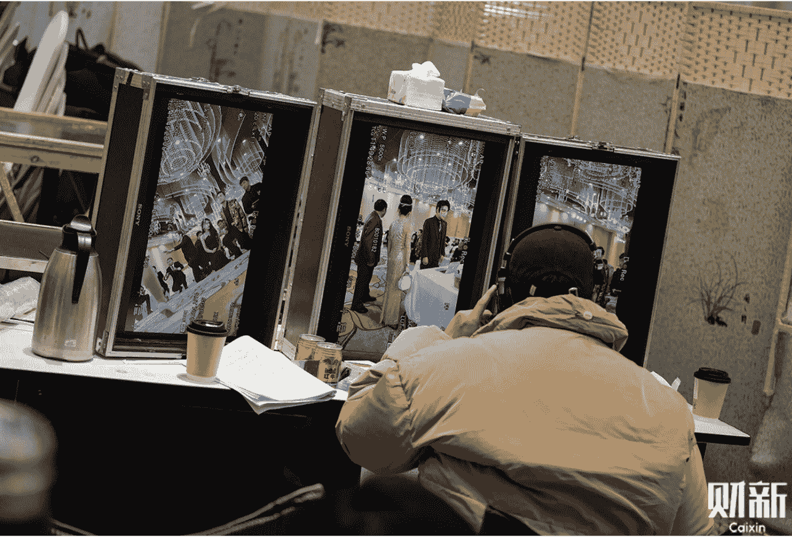

## CAIXIN | 听文章
文 | 财新周刊 关聪

微短剧持续获取用户。3月26日，第十二届中国网络视听大会发布的《中国网络视听发展研究报告（2025）》（下称“报告”）显示，截至2024年12月，中国网络视听用户规模为10.91亿人，同比增长1.6%，网民使用率98.4%，同比增长0.1个百分点，微短剧用户已达6.62亿人。

在各类内容形式中，短视频应用的用户规模、使用时长仍居首位。截至2024年12月，中国短视频用户规模达到10.4亿、使用率93.8%，连续六年保持网络视听应用细分领域第一。

在短视频之后，各内容形式按照用户规模排序依次为网络直播、长视频、微短剧和网络音频，截至2024年12月，分别拥有8.33亿、7.52亿、6.62亿、3.35亿用户。其中，短视频的人均使用时长最长，达到156分钟，比2023年同期增加了2分钟。

微短剧是用户增长最为迅速的内容门类，使用率为59.7%，较2024年上半年提升7.3个百分点，仅半年独立微短剧App单日使用时长从90分钟涨到101分钟，仅次于长视频，超过直播和长音频，亦超过即时通讯的100分钟。

2024年院线电影、电视剧行业都出现萎缩势头，微短剧仍是类型最多元、供给最充裕的内容形态。中国网络视听协会在1月发布的报告显示，2024年中国微短剧市场规模504.4亿元，同比增长34.9%，预计2027年市场规模将突破1000亿元。

与此同时，微短剧正在以免费模式快速影响中国的在线视频行业。字节跳动的红果免费短剧App成为当前中国最大的免费微短剧平台。据移动数据调研机构Quest Mobile测算，截至2025年1月，红果免费短剧App月活跃用户规模已达1.66亿，同比增长349%；第二名河马剧场App月活为3700万，其余竞争者繁花剧场、喜番免费短剧、星芽免费短剧月活规模均在700万以下。

中国微短剧正在踊跃“出海”。报告显示，2024年海外视听类应用下载量前100名中，中国（含港澳台）应用有19个，同比新增3个，其中2个为微短剧应用；在海外视听类应用收入规模前100名中，中国（含港澳台）应用有20个，新入围者11个，微短剧占据8席。

值得注意的是，业态受到微短剧冲击的长视频行业守住了用户底盘。据报告，截至2024年12月，中国长视频用户规模为7.52亿，创2018年以来新高。

2024年，中国网络视听行业市场规模达12226.49亿元，同比增长6.1%。用户下沉特征明显，网络视听在三、四、五线城市的用户占比达62%，对网络视听应用的使用率均在99%左右，且地域层级越下沉，使用率越高。

同期，中国网络视听行业从业企业达75.70万家，创历史新高。其中2024年新成立企业12.57万家，占比约16.6%。报告称，生成式AI（人工智能）的快速发展正在重塑网络视听内容生产方式，使用AI工具进行图片、视频制作的用户占比在半年内从25.6%上升到31%。

# 心智 | 当职业倦怠来袭

## CAIXIN | 听文章
文 | 北顾

职业倦怠已成为当今时代的普遍问题。世界卫生组织已将职业倦怠从简单的疲惫“状态”升级为由“长期职场压力”引发的“身心综合征”。它不仅会让我们自我评价更低，还会变得“冷漠”“疏离”，开始把他人当作“待处理的客体”而非情感丰富的人，对同事、客户乃至家人、朋友变得不耐烦。

如果你觉得自己出现了职业倦怠，不妨先检查一下，你所处的职场环境是否真的有“毒”。

比如，你的领导对工作量抱有不切实际的期望，没有评估布置的工作量，无休止地增加任务，设置不切实际、需要牺牲休息甚至睡眠的截止日期，或要求长时间持续工作。还有一种情况，领导布置任务但指示不明确，下属不清楚工作标准，需要花费很多精力去猜测潜在的标准、探索可能的任务路径。

当你长时间感觉自己无法控制环境、任务或时间安排，工作的决策和执行节奏都由领导指挥时，意味着你对自己的工作失去了掌控感，就会积累职业倦怠。

如果职场环境出现以上特征，那么你所处的职场环境确实有“毒”。这时，你可以考虑换个工作或部门了。

如何应对职业倦怠？苛刻的自我对话和提高工作效率的方法不能从根本上解决问题，单纯的休息可以缓解，但还不够。更好的策略是主动行动。

## 1. 采用“心理距离”调节情绪
处于职业倦怠状态时，我们常常会陷入对自己能力的负面评价中，并伴随更多的焦虑。此时，你可以采用“心理距离”策略来调节情绪。通过转换视角，从狭隘的消极情绪和自我沉浸的第一人称视角中抽离，从而降低负面情绪的影响。

例如，擅长写作的人可以尝试用这种策略来改写叙事。如果你叫“张翔”，在反思工作和上下级关系时，可以用第二或第三人称描述：“张翔最近对某位领导的意见越来越大，今天领导布置了新工作，却没有考虑张翔手头已有三件紧急工作，也未明确新工作的标准及可寻求的资源支持与额外信息。”

还可以采用更大的时间观来重新评价这段关系，例如自问：“十年后，张翔成为领域专家，拥有核心竞争力和更多职业选择，还会如此在意与这几位领导的关系吗？”或者假设事情发生在朋友身上，你该如何帮朋友出主意。先把自己抽离出来，换个视角或从更大的视角来解决问题。

## 2. 写下消极想法并重新审视
记录并重新审视消极想法。例如，记录下“我在工作中遇到了问题，对自己的能力产生了怀疑”。然后问自己：支持这种想法的证据有哪些？我是基于事实，还是基于感觉作出这个判断？我是否曲解了情况？其他人会如何看待这种情况？例如，小李会怎么看？如果小李遇到这种情况，我会如何看待？

## 3. 重写个人故事
每个人都会形成自己的个人故事，它反映了我们对世界和自身处境的看法。但有时我们会陷入自我批判，无法客观审视自己。将头脑中的自我对话转变为纸上的对话，有助于跳出思维定势。

借助心理距离策略，你可以先写下自己的感受、经历和困扰，然后以朋友的角度写一封鼓励信，提供不同视角，改写偏激的个人故事。

## 4. 寻找社会支持
职业倦怠的成因之一，正是领导或同事未能提供及时、有效且真诚的支持。尽管寻求他人支持能有效改善职业倦怠，但实际行动起来并不容易，因为人们往往害怕求助。在推崇独立自主的文化中，人们往往希望展现自己的能力与独立性，担心寻求支持会被视为软弱。

你可以向信任的同学、朋友或家人真诚且不带评判地分享自己的感受。被他人理解往往能缓解焦虑。若无法与领导建立积极关系，尝试与同事加强沟通，建立融洽关系，避免工作中长期缺乏人际连接。同事不一定要成为知心朋友，即便是“松散或肤浅”的联系，也能为我们带来活力。

## 5. 巧用任务绑定技巧
另一个小技巧是，将对自己重要的事与必须做的事绑定在一起。心理学家理查德·瑞安认为，这样能增强对行动的控制感。而失去控制感正是职业倦怠的重要诱因之一。

例如，若你喜欢写作，可将工作与自由写作交替进行。在业余时间培养一两个小爱好，每天投入一点时间，也能增强掌控感。

最后，职业倦怠的出现是一种信号，调节情绪是策略之一，但最有效的方法是聚焦自身发展。职业倦怠通常由工作引发，但人生发展中的慢性压力不仅来自工作，还可能源于健康、财务、人际关系等问题。这些压力如同鞋里的小石头，虽不影响当下行动，但长期积累会让我们倍感痛苦。

在工商业文明时代，交易是显著的生活方式，与上级的关系也可视为一种交易。我们付出时间、技能和情绪价值，上级则提供经济报酬、职级晋升等回报。遇到好平台或好上司是概率事件，即使遇不到也不应影响自身发展主线。过度依赖上级或平台，个人发展容易受到干扰，外界条件的变化可能成为持续发展的潜在风险。我们不应陷入与某些领导的情感纠缠，而应聚焦于自己能掌控的事情，用作品夯实核心竞争力。

通常只有当自身实力，如技能、经济能力、影响力等提升到新阶段，才能从根本上解决原有的卡点。在职业倦怠袭来之前，我们就应不断提升竞争力，以更大的格局和结构化力量实现人生发展的反脆弱。

更多精彩请阅读：【专题】心智

# 天眼 | 被烧毁的特斯拉
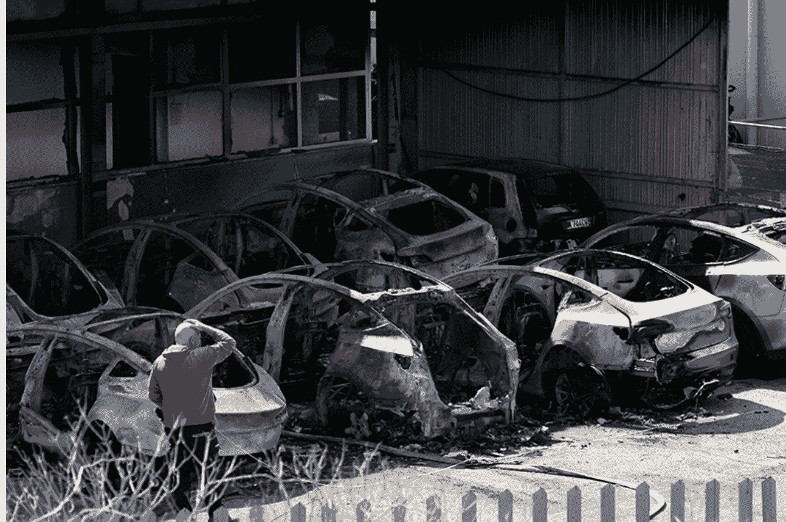

CAIXIN| 听文章

图 | Alessia Pierdomenico/视觉中国

当地时间2025年3月31日，意大利首都罗马市郊，一处特斯拉汽车展厅当天凌晨突发大火，至少17辆电动车被烧毁。当地消防部门发言人表示，暂时无法确定火灾发生的具体原因，不排除人为纵火的可能。由马斯克创立并担任首席执行官的特斯拉汽车公司近来在欧洲和美国多地成为抗议对象和破坏目标。媒体分析认为，马斯克在美国总统特朗普授权下领导“政府效率部”推行联邦政府大规模机构裁撤与裁员举措，以及他个人公开力挺欧洲极右翼政党的言行，招惹广泛不满，连累其名下企业。