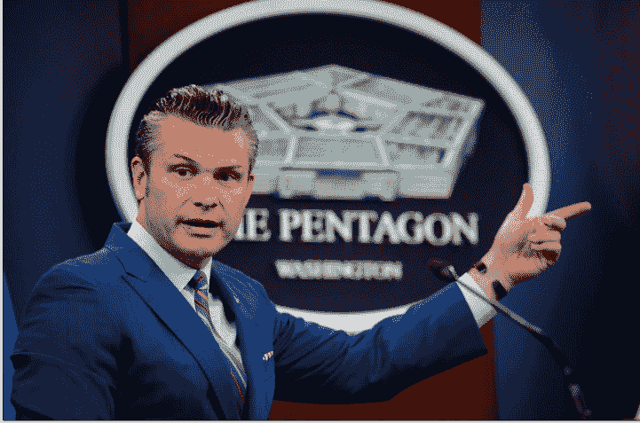

# 五角大楼 VS 美国媒体

251016 新闻实验室

整理：公众号懒人搜索，懒人专属群独享

懒人微信：lazyhelper

从最初对记者的公然审查，演变成了对记者和政府雇员的双重恐吓。

一场前所未有的风暴正在美国国防部的核心地带酝酿。这场风暴也是川普第二任期开启后，美国媒体和新闻自由面临的又一场严峻考验。

风暴的起因，是国防部长皮特·赫格塞斯（Pete Hegseth）推出了一系列极具争议的新闻采访规定，要求所有驻五角大楼的记者签署一份承诺书，否则将面临被驱逐的命运。

这一举动引发了美国新闻界的集体抵制，几乎所有主流媒体都拒绝就范。这可能导致自艾森豪威尔政府以来，五角大楼首次没有主流媒体的常驻记者。这场对峙不仅是关于记者采访权的争夺，更被视为对美国宪法第一修正案所保障的新闻自由的直接挑战。

## 「从事前审查到限制采访」

冲突的导火索是五角大楼在9月18日发布的一份备忘录。这份文件中的条款被广泛解读为：记者在发表任何未获国防部批准的信息前，必须先寻求官方许可，即便这些信息并非机密。这一史无前例的要求，无异于一种“事前审查”（prior restraint）——即政府在言论发生前进行审查和压制，这在美国最高法院的相关判例中通常被视为最严重的违反第一修正案的行为。

面对新闻界的强烈反对和无一人签署的尴尬局面，五角大楼被迫让步，并于10月6日发布了新版备忘录。

然而，在很多人看来，修改版的备忘录危险性丝毫不亚于初版。尽管新规澄清了记者无需将稿件提交国防部审批，但它却将矛头从“新闻发布”转向了“新闻采集”本身。新规引入了一个极具争议的概念——“索求/怂恿”（solicitation）。备忘录警告称，任何“索求/怂恿”联邦雇员泄露未获批准发布的信息的记者，都可能被吊销记者证。

五角大楼对“索求/怂恿”行为的定义极其宽泛，它不仅包括与国防部人员的直接沟通，甚至涵盖了“公开广告或呼吁提供线索，鼓励（国防部）雇员分享非公开信息”等行为。这实际上将记者日常工作中不可或缺的提问、挖掘信源、寻求线索等基本新闻采集活动，都重新定义为一种可能招致惩罚的违规行为。美国笔会（PEN America）的新闻与虚假信息项目主任Tim Richardson 指出，新规“将威胁升级到了报道行为本身”，从最初对记者的公然审查，演变成了对记者和政府雇员的双重恐吓。

这一转变让新闻界面临一种前所未有的困境。正如一位记者所言，你无法在提问之前预知受访者给出的答案是否会包含“未经授权”的信息。这种模糊性本身就构成了巨大的威胁。

因此，几乎所有美国主流电视网络、通讯社、报纸和广播电台，包括美国广播公司（ABC）、全国广播公司（NBC）、哥伦比亚广播公司（CBS）、有线电视新闻网（CNN）、美联社、路透社、《纽约时报》、《华盛顿邮报》等，都公开表示拒绝签署这份协议。甚至连赫格塞斯的前东家福克斯新闻（Fox News）以及其他右翼媒体如Newsmax也表示反对。截至最后期限，唯一公开同意签署的媒体是极右翼新闻频道“第一美国新闻网”（One America News Network，OANN）。

美国媒体的集体不合作态度，意味着一场关于新闻自由的底线之战已然打响。

# 国防部长赫格塞斯的个人战争

这场风波的核心——国防部长皮特·赫格塞斯，本身就是一位从媒体界走出来的人物。在被川普提名为国防部长前，他曾是福克斯新闻的主持人，以鲜明的保守派立场和对川普的坚定支持而闻名。

成为国防部长后，他将这种对主流媒体的敌意带入了五角大楼。其首席发言人 Sean Parnell 在一份声明中直言，赫格塞斯选择“直接向军队和美国人民传递信息”，而“不依赖主流媒体这个腐败的信息过滤器（corrupt filter）”。

赫格塞斯与媒体的冲突实际上充满了个人恩怨的色彩。根据《纽约时报》的报道，三位知情人士透露，赫格塞斯上任后不久，便下令禁止 NBC 的五角大楼记者 Courtney Kube 进入大楼。此举的背景是，在赫格塞斯的提名确认听证会期间，Kube 参与了对赫格塞斯过往黑历史的挖掘报道，其中包括一份来自其前嫂子的指控他虐待第二任妻子的宣誓书。尽管五角大楼的律师以不能单独针对某个新闻机构为由，没有执行这一命令，但这一事件预示了他对新闻界的强硬姿态和报复心理。

另一位成为赫格塞斯攻击目标的资深记者是他在福克斯新闻的前同事、驻五角大楼记者 Jennifer Griffin。赫格塞斯曾在社交媒体上点名批评 Griffin 的报道，称之为“今日假新闻”。在一次新闻发布会上，当 Griffin 就美国空袭伊朗核设施提问时，赫格塞斯当众回应道：“Jennifer，你一直是那个最故意歪曲事实的人。”赫格塞斯的助手 Tami Radabaugh 在一份声明中，在没有提供任何证据的情况下，指责格里芬的报道“始终草率，充满错误和不准确之处”。

当各大新闻机构纷纷发表声明，拒绝签署新规时，赫格塞斯在社交媒体上的回应极具挑衅性。他用一个挥手告别的 emoji（👋）回复了《纽约时报》和《大西洋月刊》等媒体的声明。他甚至发布了一张清单，标题是“给傻瓜看的记者证指南”，内容包括：“记者不再自由闲逛”、“记者必须佩戴可见证件”、“持证记者不得再怂恿犯罪行为”等。

事实上，这份备忘录只是赫格塞斯一系列限制媒体行动的最新举措。早在此之前，他就已经采取了多项史无前例的措施。今年 1 月，他以所谓的“轮换计划”为名，将《纽约时报》、美国公共广播电台（NPR）等四家主流媒体赶出了五角大楼的专用办公区，并将空间分配给了极右翼的 Breitbart News 和第一美国新闻网。随后在 5 月，他进一步下令，禁止记者在没有官方陪同的情况下进入五角大楼的大部分走廊，彻底终结了几十年来记者可以自由走动、接触信源的传统。这些行动与川普政府整体对媒体的敌对政策一脉相承，共同构成了一幅政府权力与新闻自由激烈碰撞的图景。

## 「公众知情权的危机」

五角大楼的新规虽然表面上针对记者，但其深远影响却直指政府内部的“吹哨人”和广大公众的知情权。备忘录明确警告，任何未经批准泄露非公开信息的文职、合同或军事雇员，都将面临“不良后果”，甚至可能承担刑事责任。这种措辞严厉的警告，无疑在整个国防部系统内制造了一种强烈的寒蝉效应。

《哥伦比亚新闻评论》的一篇文章记录了一位记者的亲身经历，生动地说明了信息获取变得何等艰难。当川普总统在一次讲话中误称“我们昨天在委内瑞拉进行了一次打击”时，记者们立刻陷入了困惑，因为官方公布的打击行动是在前一天。这位记者按照以往的惯例，致电海军和国防部长办公室的官员求证，最终才通过 off the record (私下透露)的方式得到“我认为他口误了”的澄清。这位记者感叹，如今即使是想获得一句“不，这在事实上是不正确的”这种最基本的官方确认，都变得越来越困难。

法律专家普遍认为，五角大楼的规定可能触犯了宪法第一修正案。第一修正案专家 Kevin Goldberg 引用了 2001年最高法院在 Bartnicki v. Vopper 一案中的判例——该案确立了一个重要原则：只要记者本人没有违法或教唆他人违法，他们就可以接收并发布通过非法手段获取的信息。Goldberg 强调，仅仅是提问并不构成违法。第一修正案保护的正是人们在“灰色地带”提问和言论的权利。

这场对峙的背后，是美国政府长期以来试图控制信息流动的更广泛趋势。佛罗里达大学布雷克纳中心信息自由项目主任 David Cuillier 指出，自水门事件和尼克松政府以来，政府越来越多地采用私营部门的公关策略来控制媒体报道，例如要求记者提前提交书面问题、要求公关人员陪同采访、将发表负面报道的记者列入黑名单等。然而，此次五角大楼以吊销记者证作为制裁威胁，标志着这种控制手段的显著升级。

当记者无法自由地报道政府时，最终受损的是公共利益。正如美国笔会的 Tim Richardson 所说：“如果今天生效的这些政策在过去就已存在，那么公众可能永远不会知道美军虐待伊拉克战俘事件、五角大楼文件或美军空袭造成的平民死亡。而正是这些报道，定义了问责新闻，尤其是在战时。”

在这几个案例中，都有吹哨人的存在：

- 2004 年，伊拉克战争期间，一系列令人震惊的照片被公之于众。这些照片显示，在巴格达附近的阿布格莱布监狱，美国军警人员对伊拉克囚犯进行了系统性的、骇人听闻的身体虐待、性羞辱和精神折磨。照片中，囚犯被堆叠成金字塔状、被狗恐吓、被迫摆出带有性意味的姿势。这一事件严重损害了美国的国际形象，并引发了关于战争中道德底线和军事纪律的全球性讨论。此案的吹哨人是美军士兵 Joseph Darby。他偶然发现了一张存有虐囚照片的光盘，深感不安，于是匿名将其交给了美国陆军刑事调查司令部。尽管军方内部启动了调查，但公众对此一无所知。直到几个月后，CBS 的《60 分钟》节目和《纽约客》杂志的传奇记者 Seymour Hersh 通过各自的调查渠道获得了这些照片和信息，并将其公之于众，事件才真正引爆全球舆论。

- 1971 年，《纽约时报》开始刊登一份名为《美国-越南关系，1945-1967：国防部研究报告》的绝密文件，这份文件后来被称为“五角大楼文件”。这份长达 7000 页的报告详尽地揭示了，从杜鲁门到约翰逊的四届美国政府，如何在越南战争问题上，系统性地对国会和公众撒谎，不断升级战争，而私下里却对战争前景深感悲观。文件的泄密者 Daniel Ellsberg 是一位曾参与撰写该报告的军事分析员。出于对战争和政府欺骗行为的失望，他花费数月时间复印了这份报告，并将其提供给了《纽约时报》记者 Neil Sheehan。尼克松政府立即以危害国家安全为由，试图通过法院阻止报纸继续刊登，最终案件打到最高法院。最高法院以 6 比 3 的裁决，支持了新闻机构的出版权，确立了政府在阻止媒体发布信息方面必须承担极高的举证责任。

- 在阿富汗、伊拉克、叙利亚等地的反恐战争中，美军官方发布的空袭报告常常宣称“精准打击”，仅消灭了恐怖分子，平民伤亡为零或极少。然而，大量独立调查报道揭示，许多空袭造成了大量无辜平民的死亡，而军方往往在内部知情的情况下选择隐瞒或淡化处理。例如，《纽约时报》曾通过大量内部文件和访谈，揭露了2019年美军在叙利亚巴格兹的一次空袭导致多达70名妇女和儿童死亡，而军方多年来一直试图掩盖这一事实。这类报道极度依赖多方信源。包括：实地探访的记者、当地幸存者的证词、人权组织的报告，以及最关键的——来自军方内部的吹哨人。这些内部人士可能会提供空袭评估报告、无人机监控录像、内部通讯记录等“非公开信息”，这些证据是反驳官方说法的关键。

在新规之下，这些吹哨人面临更高的风险，记者与吹哨人的接触很可能被定义为“怂恿”或“教唆”吹哨人“违法”，

五角大楼记者协会在声明中指出，限制媒体报道美国军事的能力，辜负了那些将自己的子女托付给军队的美国家庭，也辜负了每年为国防部提供数千亿美元的纳税人。

尽管几乎所有媒体都拒绝低头，但川普总统公开表示支持赫格塞斯的政策，称媒体“非常不诚实”，并认为这些规定对于“世界和平和国家安全”是必要的。这使得这场僵局短期内难以化解。

接下来，记者们虽然可能失去进入五角大楼的物理权限，但他们表示将继续报道军方动态。他们的报道会不会因此遭到明显的削弱？我们还能不能读到重磅的军队调查？这些问题都值得继续关注。

# 最后，安利小懒的付费群：
懒人专属群（介绍）

📖懒人专属群持续更新中，已持续运营 6 年，整理超 3000 份各类精选付费文章 & 年费社群干货，全部开放下载。

本资料为付费群内部分享，仅供真实有需要的朋友查阅 🙅‍♂️

## 懒人专属群更新记录：
https://lazy2025.top/blog/record2

## 懒人专属群更新记录（需梯子，备用）：
https://lazybook.fun/blog/record2