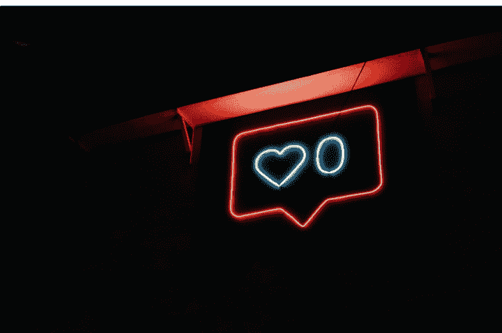

# 社交媒体的黄金时代结束了吗？

251016 新闻实验室

整理：公众号懒人搜索，懒人专属群独享

懒人微信：lazyhelper

无论用户们如何憎恨它们，平台也已经攫取了几乎所有资源，令人无处可逃。

10月6日，科技媒体“极客公园”在一篇最新推送中，以一则耸人听闻的标题宣告了一个分水岭的到来：“社交媒体的黄金时代，结束了”。

这篇文章引用了数字人文学家 James O' Sullivan 等人的观点，用平铺直叙的简练语言指出：当 AI 主导的算法和生成的内容充斥各大平台的信息流时，这些平台正变得日益同质化与空洞化，显著“缺乏活人感”。无论是内容创作者还是普通用户，都在 AI 算法、低质信息及情绪化引导机制的包围中深感疲惫，使用行为也逐渐退化为一种无意识的机械式的刷屏动作。在这种环境下，人们的精力和耐心，正在被 AI 逼到极限的“注意力经济”模式中彻底榨干。

这样的判断，能找到一些论据，但同时，我们也能看到不少反面证据。在本期新闻实验室会员通讯中，我们为这一论断提供一些更全面的观察视角。

## 「宏观数据视角：社交媒体的使用真的下降了吗？」

就在极客公园文章发布的几天前，英国《金融时报》分析了数据公司 GWI 对 50 多个国家 25 万名成年人的调研。结果显示：人们在社交媒体上花费的时间在 2022 年达到峰值，之后开始缓慢下降。在发达国家中，16 岁及以上的人群每天在社交平台上花费的平均时间约为 2 小时 21 分钟，较 2022 年下降了 10 分钟，而使用社交媒体频率最高的青少年群体的使用频率下降更为明显。

GWI 的数据还指出，自 2014 年以来使用社交平台与朋友保持联系、表达自我或结识新朋友的人群比例下降了超过四分之一，更多的人正在用社交媒体去做追星和填补空余时间这一类与“社交”无甚关联的活动。

根据这些数据，《金融时报》专栏作者 John Burn-Murdoch 认为，假以时日，人们未来会把此刻视作社交媒体平台“塌房”的转折点，它从一个光鲜亮丽的秀场变成了一个艳丽庸俗的垃圾堆。

但是，我们对这组数据也可以做出这样的解读：发达国家的社交媒体使用虽然有所下降，但幅度是很小的，说“黄金时代”已经过去，似乎言过其实，顶多是“已经到达顶峰、无力再攀升”。

其实，社交媒体平台的全球使用人数在最新统计中仍然呈上升趋势。2025年2月发布的大型综合商业报告《2025 Global Digital Report》指出，全世界的社交媒体用户已经达到了 52.4 亿，占据总人口的 63.9%，比一年前增长了 2.06 亿；在使用互联网的全球人口中，有 94.2%是社交媒体平台用户，这一数字在东亚更是高达 96.9%。在欧洲和亚太国家社交媒体使用时间开始下降的同时，北美国家的社交媒体使用时间依然在增长，已经比欧洲的平均时间高出 15%。

自新冠疫情爆发到 2022 年，社交媒体使用时间最高一度达到每天 2小时31分钟。随着疫情模式的减缓和结束，这一时间开始缓慢下降，但还远远没有降到 2017 年以前的时长。

我们还可以看看另一组关于青少年的数据——学术期刊《Computers in Human Behavior》最近刊发了一则研究，数据来自 28 个国家 32 万多名 11-15 岁青少年。

这份研究的作者将这些青少年分为四种不同的群体：非活跃用户、活跃用户、高强度用户、问题性用户，并提出了九种判断用户是否存在社交媒体使用成瘾的迹象。在这其中，迹象不多于五种而使用频率最多仅是每周使用的是“非活跃用户”，迹象不多于五种而每天使用但不频繁的是“活跃用户”，迹象不多于五种而每天频繁使用的是“高强度用户”，而无论使用时间如何，迹象不少于六种的都属于“问题性用户”。

根据这份报告，在这四年的时间里，活跃用户的数量没有显著的变化，从总人数的 40.7%下降到了 39.9%，仅仅减少了 0.8%。与此同时，在青少年中，非活跃用户从 12.6%下降至 9.8%，表明完全不用或极少使用社交媒体的青少年越来越少。而问题用户则是从 2018 年的 6.6% 上升至 2022 年的 9.4%，表明出现社交媒体成瘾迹象的青少年已经开始变得越来越常见。

也就是说，从这些青少年群体的数据来看，社交媒体的影响力，尤其是负面影响力实际是在上升的。

在这其中，社交媒体成瘾的问题性用户与社会整体的种种问题呈现着强烈的关联性：女孩成为问题性使用的几率是男孩的 1.56 倍，而这一风险差距的增幅还在不断扩大，以 11-13 岁的女孩为甚。低家庭经济水平的青少年出现问题性使用的增长幅度更大，家庭和朋友支持度较低的青少年出现问题性使用的频率也更高。从国家的角度来看，性别和经济不平等系数越高的国家与更高的问题性使用率相关。

## 「个体视角：我们可以“退网”吗？」

在使用时间长度的变化之外，用户对于社交媒体平台的使用方式更值得关注。

Z 世代和青少年群体主要的关注点仍然以娱乐和兴趣为主的“短平快”类内容，而其它年龄段的群体则更加注重社交媒体的复合性，将社交媒体视作获取信息、职业工作以及塑造个人品牌的综合工具。在这一过程中，用户们已经不再为了单纯意义上的“发表感受”和“生活分享”性的社交功能而使用这些平台，而平台已经从单纯的“社交广场”扩展为集信息、商业、工作于一体，对个人综合发展不可或缺的基础设施。

这种变化也就决定了：从个人角度而言，我们“退网”（或者更准确说，退出社交媒体）实际上是很难做到的事情。在这样的情况下，社交媒体的使用人数和时长几乎不可能出现明显的下降。

2020 年，科罗拉多州立大学传播学教授 Natalie Pennington 发表了一篇论文。在其中，她对 20 名此前使用社交媒体但已彻底停用超过六周的 18-35 岁青年进行了深度访谈。

根据她的研究，“退网”之后，大家失去了往常交流的便利性，需要以电话、邮件和面谈等更加传统的方式与亲友联系，在这个过程中反而促进了更深入用心的交流，并借此对自身的周边关系进行了全面的重新审视和筛选。在“退网”阶段结束后，一部分参与者表示他们的自尊心出现了增强，“成瘾”现象开始出现了减弱，不会再像以前那样因为浏览 Instagram 等平台里他人精心打造的内容而感到焦虑。

不过，许多参与者也表示，自己单独停止使用社交媒体的行为让他们时常感到落伍，担心自己不能及时了解最新的消息以参与和亲友之间的交流。作为大学里的学生，“退网”还可能会影响他们的职业前景：来自潜在雇主或合作伙伴索要社交媒体账号的压力让他们担心，自己在求职竞争中处于不利地位。

因此，在社交媒体已经无孔不入地与我们的生活工作方式融为一体的时代，以个人为名义对平台进行的独立抵制恐怕都很难撼动这些平台的实际地位，也很难改变这些平台对于个人和社会产生的影响。

## 「监管视角：大而不倒的平台」

在个人“退网”的困难背后，是另一个问题：平台权力已经很难约束。

我们在会员通讯第 652 期当中曾经介绍加拿大科幻小说作家 Cory Doctorow 提出的“垃圾化”（enshittification，直接翻译是“粪便化”）概念。

他当时指出，随着市场竞争的消失，以社交媒体为代表的互联网平台正在为了追求利润最大化而有意降低用户和客户的使用体验。

> 他的论述是：“平台是这样走向死亡的：首先，它们对用户很好；接着，它们开始牺牲用户的利益，让事情对商业客户更有利；最后，它们牺牲这些商业客户的利益，为自己收回所有的价值。然后，它们就走向死亡了。我称这个过程为垃圾化（enshittification）。”

这个词折射出普通人面对不同平台的挫败感，也因此很快风靡全球，并被美国方言学会评为 2023 年度词汇。

两年过去，Doctorow 将自己发明的这个粗俗的词汇写成了一本书，并扩展成了一个完整的理论框架，指出这一现象所波及的范围已经远远不只是平台本身。在他看来，羸弱而滞后的监管架构让从政治到经济再到技术上的各类巨头变得越来越不受制约，从而不再需要照顾它的用户们的感受：无论用户们如何憎恨它们，这些人和平台也已经攫取了几乎所有资源，令人无处可逃。随着法律和社会管理体系的全面崩溃，这些统治阶层已成功瓦解了所有曾约束他们的规范。在采访中，Doctorow 悲观地表示，“如今困扰我们的，恰恰是他们最荒诞最糟糕的念头。”

在讨论如何解决垃圾化对社会所产生的影响时，Doctorow 将他的侧重点放在了加强法律管理的约束之上，并认为只有通过更加有效的立法和公私合作的监督，互联网才能找回初心，也即一个开放而平等的公共空间。

然而，对于个人而言，在呼吁和期待未来的法律制定之前，我们必须从自己开始行动，不能继续让 AI 和社交媒体平台的无限下滑刷屏机制去无条件地取代我们自身的自主意识，替我们作出所有的思考、判断甚至是行为。无论互联网平台未来将会如何发展，有机和有效的信息，也就是所谓的“活人感”，都是在现实社会中主动观察、主动倾听、主动思考、主动行动、主动和一个个真实存在的人相遇相知相谈所获得的。在这个一切都走向“垃圾化”和“AI化”的年代，我们更应该将能动性和自主性视作宝贵而不可被替代的财富。

另外，O'Sullivan在文章中指出，随着主流社交平台内容质量不断下滑，加之个性化算法大行其道，人们正愈发倾向于培育属于自己的微型同温层社群。为此，他们转向以付费订阅为基本模式的会员俱乐部，或是依托特定兴趣主题构建的垂直社区，以此从由算法主宰的平台中转移，重新夺回主动权。

在此趋势下，当X和Facebook等主流平台陷入增长瓶颈时，一批垂直社群平台却逆势上扬：Reddit的日均独立访问量在一年内上升了21%；Discord的月活跃用户与营收稳步增长；Substack的付费订阅数两年内增长了150%；而Patreon上拥有付费会员的创作者数量，相较2021年也大幅增加了82%。随着无限滚动的垃圾内容的反噬遭到越来越多的用户嫌恶，那些一贯“算法为王”的平台也注意到了这一变化，开始着重奖赏创作者并强调私信和社群在平台生态中的重要性。

# 最后，安利小懒的付费群：

懒人专属群（介绍）

懒人专属群持续更新中，已持续运营 6 年，整理超 3000 份各类精选付费文章 & 年费社群干货，全部开放下载。

本资料为付费群内部分享，仅供真实有需要的朋友查阅

懒人专属群更新记录：
https://lazy2025.top/blog/record2

懒人专属群更新记录（需梯子，备用）：
https://lazybook.fun/blog/record2