# 小红书旅游赛道单月270+客资：流量端有瓶颈，在成交端找答案
## 251016 生财精华

公众号懒人搜索，懒人专属群独享
懒人微信：lazyhelper

大家好！我是生财新人汐米，也是刚从职场牛马转变身份的创业小兵。

2025年2月，有幸被贵人背书，开启了小红书境外旅游获客的合作创业路。到25年9月，最高单月获客270+客资，半年业绩过百万。

虽然是生财新人，但在我还没进「生财」之前，「生财」就改变了我的人生轨迹。感谢这半年圈友薇安、圈友珍妮、圈友易寒等贵人赋能，让我顺利从职场牛马的身份脱身，微微蹭上了一点创业的牌桌。

如果你也遇到这样的困惑，那么这篇文章将有可能帮到你：

- 1. 在职场中遇到瓶颈，不知道如何提升
- 2. 有单点运营能力，但对独立操盘一个业务感到费劲
- 3. 看了很多小红书获客的保姆级教程，也去按步骤落实了，却还是出不了爆款

下方为「从职场牛马到上创业牌桌的真人故事版」的前言。

如需跳过故事，也可戳目录直接看正文：

- 1. 如何确定境外旅游的细分赛道是否值得做？
- 2. 项目开始前，引流、销转、产品端分别需要调研什么？
- 3. 什么是适合境外旅游细分赛道的打法？
- 4. 如何突破流量核心卡点，解决客资量问题？
- 5. 如何突破销转核心卡点，解决转化率问题？

## 一、前言

2024年，我还在深圳一家留学公司做小红书运营。

那一年，身体垮了，平均一个月要跑一次医院，最崩溃的一次——五一黄金周7天假期，我发烧了3次，咳出来的都是大块大块的红血丝，走路去洗手间脚都是软的。

躺在床上的那个夜晚，我真的吓怕了。我知道，这次回去，我必须离职了。

一个人生病其实都是有迹可循的，情绪上的纠结最消耗人。

理性告诉我：别冲动，上班多稳定啊，没做出成绩至少也有份底薪撑着啊。

感性却在咆哮：在一个不喜欢的环境上班，你打算持续多久呢？都要奔三了，你不为后面的事情考虑吗？结婚以后，生孩子是打算把爸妈接来深圳帮我带孩子？住出租房？他们会开心吗？不接过来你要离职带娃吗？

理性说留下，感性想逃离。而这样的纠结，我竟然持续了一年。

我甚至找过各种师傅帮我看，要不要离职，因为我实在已经消耗完，没有能量决策了，但得到的答案都是建议不要离职，这就让我更内耗了。

汐米.pdf 69.5 KB
报告已发送给你，查看完毕后如有问题都可提问

哈哈 期待了很久！
12"

以及你后面问的这个问题就是明年3月想要离职，应不应该离。其实，我建议你，因为明年的话，截止到上半年，其实找工作的运势并不是说很好。

那如果离职后，容易找到好的工作机会吗？建不建议离职
13"

对，就是下个月，还有阴历的3月和4月，就这两个月。要是走了，你要是离职了，你就在这两个月。
9"

如果你离职以后找工作，肯定是比较比较有阻力的。
29"

最后身体实在扛不住，谁的意见都听不进去了，只能听内心的声音——离职。

2024 年 5 月底，我收拾完工位，回出租房收拾行李，退租。然后直奔机场，飞云南大理，在苍山脚下住了半个月。每天看日出日落，听风声水声，坏情绪像潮水一样退去。神奇的是，从那以后到现在，我再也没生过病。

真的，做自己喜欢的事，心情舒畅，就是最好的解药。

休息完回到老家，做什么好？说不紧张是假的，毕竟要奔三了，不能像 20 出头那样随便试错。于是先找了个能远程办公的留学公司过渡，想着边干边寻找突破口。

说实话，24 年的硕士留学赛道已经很难做了。那段时间一方面想把留学主业做好——毕竟技能不能荒废，经验也是积累。另一方面心里总有个声音在说：你不是为了继续打工才出来的，你是要做自己的事业。

和薇姐聊天时，她给我推荐了另一位生财圈友，"你去找珍妮，她也是靠小红书留学起家的，也许能给你一些启发。"

于是，我加上了珍妮老师的微信，咔咔猛学。刚开始颤颤巍巍，感觉加上大佬微信，不好意思提问请教，发一段话要做好久心理准备，编辑好后再想几天，确定了再发。

被珍妮老师指点后，我发现不是我不够认真，而是我选择的赛道不对。

于是我从最卷的硕士留学赛道，切换到境外旅游——瞬间起飞了，不断地跟珍妮老师报喜，她调侃我是报喜大佬哈哈哈。

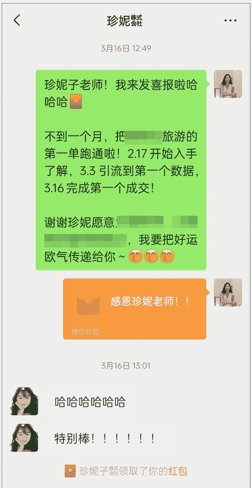

珍妮老师
4月24日 10:36
珍妮老师，小小报喜一下🤭

上周根据您的指导，调整了找封面的方向和改正文的方法，已经小小爆了一篇啦！

刚发出去就进来了7个精准客资！

原来宝藏都在避雷群的帖子里，我重看排查一遍，落实下来就出数据了🤭

哈哈哈哈哈

是你天赋异禀！！！

珍妮老师！我又来报喜啦😄

昨天成交了一单10日游，盲猜佣金也5000+🧧

每日客资也有长进了，昨天就进来9个精准客资！谢谢珍妮老师上个月的指导，太太太有用了😆

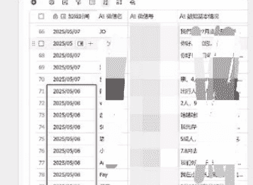

珍妮老师
6月3日 23:52
珍妮老师，深夜给您爆个喜🧨

旅游赛道昨天进来9个精准客资，今天进15个精准客资。

昨天来的一位客人，今天已经成交，只是包车不含项目费用客单就5w+😁

重点是，这些客资都是一个纯新手打的，以前读工科，从来没接触过小红书运营，用珍妮老师教的打法，3个月不到就出效果了！

珍妮老师yydd🤓🤓

你也太牛逼了吧哈哈哈哈哈哈哈哈哈哈

你真的绝绝子哈哈哈哈哈哈

期待你通过

公众号懒人搜索，懒人专属群分享

珍妮老师！这个月大爆发啦！

一个月搞了270+客资！签单签到手软

这几万你拿着

已经开始独立成交了哈哈哈哈

牛逼炸了

哈哈哈哈哈哈哈哈哈哈

这一年，我真正理解了什么叫"选择大于努力"。

接下来，我会详细分享，一个旅游行业小白，如何做到单月270+精准客资，半年业绩过百万的方法。

## 二、确定赛道

旅游行业，是一个大的赛道。

继续往下分，还能分不同国家、不同地区、不同业务。

当一个旅游小白进场，这么多地方，这么多业务，到底要选择哪个更好做？

既然要比较，那就先了解旅游赛道有哪些细分业务，和它们对应的业务范围。

### 2.1 旅游行业细分业务有哪些？

#### 2.1.1 跟团
特点：固定行程、固定排期，一般 2-30 人成团后发出。

#### 2.1.2 包车
特点：提供客人旅途中，需要的用车和司导。

#### 2.1.3 租车
特点：提供客人旅途中，需要的用车。

#### 2.1.4 全包定制
特点：提供客人旅途中，需要的用车、司导、住宿、餐食、项目门票和行程定制服务。

#### 2.1.5 门票
特点：提供客人旅途中，需要的项目门票预定服务，一般比官网订要便宜。

#### 2.1.6 酒店住宿
特点：提供客人旅途中，需要的住宿。

#### 2.1.7 旅拍
特点：提供客人旅途中，需要的拍摄服务。一般给蜜月客人提供拍婚纱照服务比较多。

#### 2.1.8 行程定制
特点：提供客人旅途中，需要的行程定制服务。比如客人需要当地人帮忙设计行程、推荐美食、推荐特色住宿等。

### 2.2 如何判断哪些细分业务值得做？

了解了有什么之后，我们再去判断，什么赛道什么业务值得做。这是所有环节最重要的一环。

选择大于努力，同样能力，不同赛道，你能拿到的结果完全不一样。

以汐米过去打小红书客资的经历举例，

我在做硕士留学申请赛道的时候，28 天跑通第一个客资，59 天跑通第一个成交。

我在做国际学校赛道的时候，24 天跑通第一个客资，53 天跑通第一个成交。

但我切换到境外旅游赛道的时候，14 天跑通第一个客资，27 天就能跑通第一个成交。

我实实在在地体验过，赛道选择不同，跑通的速度和结果到底有什么不同。所以如果只有一点我能分享的，那一定是选赛道的方法。

### 关于选赛道，我有两个判断标准：

#### 2.2.1 你做的赛道是不是高客单价？

如果一个产品客单价是1000元，我们要赚100万，就要卖1000份。以10%的成交转化率算，我们要引1万个客资；

如果一个产品客单价是1万元，我们要赚100万，就要卖100份。以10%的成交转化率算，我们要引1000个客资；

如果一个产品客单价是10万元，我们要赚100万，就要卖10份。以10%的成交转化率算，我们要引100个客资；

现在这个时势，获客只会越来越难，而不会越来越简单。

所以，能做客单价10万的产品，就不做客单价1万的产品；能做客单价1万的产品，就不做客单价1000的产品。

那境外旅游行业的细分业务，客单价10万、1万、1000的产品分别是哪些呢？

客单价10万：能到10万的肯定只有全包定制了，这块业务相当于给客户提供旅游的一站式解决方案，用车、司导、吃住、门票都包含了，所以客单会拉高。

客单价1万：跟团、包车、租车、旅拍等。

客单价1000：项目门票、酒店住宿、行程定制服务等。

（因不同国家地区消费水平不一样，所以只是粗浅区分，不完全精确）

当然再往下深挖，还有利润率等其他因素需要考虑。

也许会出现客单价 10 万的产品还没有客单价 1 万的产品赚得好，这个和不同公司的产品设计、成本控制等手法有关，在你还没有深入业务的时候，这个数据其实是不那么精确的。

只有多开发业务，把它做深，才会得到能参考的数据。这时候再去做横向对比，把吃力不讨好且利润率低的产品筛掉。

#### 2.2.2 你做的细分赛道到底卷不卷？

不是所有高客单的赛道，我们都可以进。如果一个赛道的运营高手太多，那我们小白进场，就真的只能拼命卷了。

所以，进场之前，我们需要调研一下，这个细分赛道有多少专业团队、运营高手在干。

一般，我会用这 3 种方法，大致看一看，有一个基本的体感。

- 1）在对标帖子下，评论“求推荐”，看看有没有专业截流团队进场。
  如果你评论“求推荐”后，10 分钟内有 3-5 个人私信你，那基本上专业的截流团队已经进场了。他们已经用截流工具监控了这个帖子, 只要有客资评论, 他们能马上收到通知, 然后私信截流。
  这时候,这个赛道已经是大红海了。即便你用心写了帖子,吸引来客资,如果你回复速度不够快,那客资也会被同行引走。这时候,只能看你的产品能不能吊打同行,把客户拉回来了。
  而如果你评论“求推荐”后,半天只有1个人私信你,甚至1天都看不到1个人私信你,说明这个赛道很蓝海。有几个人手动截流是正常的,如果我们回复速度比他快,就不会对我们有太大影响。

- 2）刷对标帖子, 有没有出现常见的爆款标题、爆款封面。
  如果你看到一些爆款标题和封面反复出现, 说明已经有一些专业运营进场了。
  他们不是只是写写帖子的小白,他们很懂小红书的爆款内容和爆款手法, 所以这时候, 你需要考虑自己有多少能耐和他们PK。
  可以假装顾客加他们微信, 去对比研究。如果实力太悬殊, 感觉自己没有空间了, 那也可以考虑换一个赛道。

- 3）刷对标帖子，看看帖子是不是水军顶起来的。
  如果一个赛道很蓝海，一发帖就能爆，一发帖就能爆，这时候其实是不需要雇水军的。雇水军需要钱需要人力，何必呢？所以如果你看到这个赛道，基本上都是水军顶起来的，说明这个赛道已经在变红了。

  那什么样的小红书用户，是水军呢？一般可以通过这些标准去判断：

  ① 看关注数和赞藏量
  真实用户关注数很高，赞藏量很少，因为他们看到喜欢的博主，就关注一下，越攒越多；但是发帖很少，所以赞藏量不高；水军经常发帖，所以赞藏量会高，但是如果没有养号习惯，会懒得关注博主，如果不是截流，很少有这个动作，所以关注量低；

  ② 看收藏贴
  真实用户的收藏贴内容很丰富，因为能吸引他的不只是一个领域，比如我是获客操盘手，我收藏的可能是获客的方法、业务的分析，我还有其他生活的爱好，看到也会点赞收藏一下。
  水军的收藏贴都是硬广贴，如果不是硬广贴也都是1-3个赛道的，比如统一都是化妆品的，说明他们最近接了化妆品的甲方，专门给他们点赞收藏；统一都是四级考试的，说明他们接了四级培训机构的甲方。

  ③ 有没有在同一个账号的其他帖子也评论，且评论的内容都是引导私信的
  真实用户很少在同一个账号的不同帖子多次评论，特别是低粉账号。
  水军会经常在同一个账号的不同帖子多次评论，且评论的都是“求推荐”、“姐妹选的哪家呀”、“可以分享给我吗”这些有明确营销导向的内容。

## 三、项目调研

当我们选定某一个赛道后，就需要调研这个赛道各方面的具体情况，主要是引流、销售和产品这三个方面。

### 3.1 引流端调研

因为汐米做境外旅游主要是通过小红书获客的，所以我们想了解前端的运营打法，需要调研的内容包括：

- 【账号类型】这个是蓝V号，KOS号还是纯素人号？是否有投流？
- 【人设类型】这个是以旅行社官方人设，还是定制师人设，还是真实游客人设的口吻来做号的？
- 【选题】这个是硬广贴，还是干货贴，还是互动贴，还是引流贴，还是生活贴？
- 高赞、高藏、高评论、高转化的帖子分别是哪些？有什么共同特点？
- 吸引同行但不吸引真实客户的帖子是哪些？有什么共同特点？
- 【下拉关键词】有哪些？哪些关键词是用户要付款的时候才会搜索的？
- 【爆款标题】【爆款封面】有哪些？
- 【铺设标签】有哪些？哪些标签才能吸引真实用户？
- 【评论区回复引导话术】同行都是怎样引导真实用户后台私信的？
- 【小红书后台引导话术】同行都是怎样引导真实用户加微信的？怎样避开违规关键词的？用了什么词语替代？

在你调研的时候，同时把你的答案整理出来。这样当你要扩大团队，找助理替代你的某一工作时，可以快速拿出资料培训，而他可以在你的调研知识库上，走得更快。

比如这些都是汐米做境外旅游赛道整理的部分文件：

| 博主ID | 博主链接 | 博主昵称 | 博主性别 | 小红书号 | 个人简介 | 粉丝数 | 获赞与收藏 | 关注 | IP地址 |
|---|---|---|---|---|---|---|---|---|---|
| 66682c55000 | https://www.x | 小曲是我 | 未知 | 265028285 | ENFJ | 358 | 2401 | 136 | 重庆 |
| 67906067000 | https://www.x | 好大一只姐 | 女 | 1158261172 | 人生不是轨道~ | 211 | 2238 | 382 | 重庆 |
| 66dfbb31000 | https://www.x | Nanako | 未知 | 9549057233 | 双休是为了看番 | 171 | 5120 | 24 |  |
| 67566620000 | https://www.x | 小游 | 未知 | 9415169606 | 一起去海边吹吹风吧~ | 163 | 3793 | 38 | 湖南 |
| 67319e7b000 | https://www.x | 晚晚de游记 | 未知 | 9413363185 | 爱拍照的小女子 | 86 | 637 | 31 | 江苏 |
| 668f85a6000 | https://www.x | 小红薯67F | 未知 | 2651145795 | 纪录片生活片段 | 284 | 17063 | 174 | 中国香港 |
| 6616bf26000 | https://www.x | TaeYeon | 未知 | 9521753217 | 知食分子 | 525 | 1770 | 257 | 新加坡 |
| 672c725f000 | https://www.x | 樱海小囡子 | 未知 | 9547597427 | 还没有简介 | 302 | 27033 | 11 | 江苏 |
| 5b993713946 | https://www.x | 出来喝点呀 | 男 | 380339734 | 马大哈是我自己 把背包... | 531 | 949 | 49 | 浙江 |
| 66dfdf10000 | https://www.x | 小南要进步 | 未知 | 9549040106 | 享受生活 提升自己 | 243 | 11477 | 43 |  |
| 5a9986f8eae | https://www.x | 小吴旅游E | 女 | jinrong1717 | 久处 | 73 | 208 | 150 | 四川 |
| 6791b881000 | https://www.x | Siyink | 未知 | 1151716803 | 不被定义的我 | 325 | 2931 | 368 | 重庆 |
| 5c700521000 | https://www.x | 宝耶与小泽 | 女 | 220965982 | 90后新手耙麻，2岁e人 | 696 | 5510 | 95 | 北京 |
| 66549681000 | https://www.x | 从南吃到北 | 未知 | 1167980766 | 母婴亲子|家居生活|家 | 173 | 2718 | 27 | 中国香港 |

| 序号 | 博主昵称 | 笔记标题 | 笔记摘要 | 阅读 | 点赞 | 评论 | 收藏 | 链接 | 发布日期 |
|---|---|---|---|---|---|---|---|---|---|
| 1 | TaeYeon | 不是，你们迈步的人真... | 你们迈步照片先别发册... | 7 | 1 | 0 | 2 | https://www.xiaohongshu... | 2024-04-17 08:48:26 |
| 2 | TaeYeon | 普通人一个月旅行一次... | 平时也没乱用，擦点线... | 3 | 18 | 0 | 0 | https://www.xiaohongshu... | 2024-04-21 18:16:56 |
| 3 | TaeYeon | 24岁女生，存钱还是多... | [叹气风][叹气风]我总是感... | 2 | 13 | 0 | 0 | https://www.xiaohongshu... | 2024-04-22 22:49:56 |
| 4 | TaeYeon | 土耳其的团块现了 😓 | 准备带妈妈去土耳其玩... | 103 | 290 | 78 | 13 | https://www.xiaohongshu... | 2024-04-23 20:03:38 |
| 5 | TaeYeon | 在伊斯坦布尔跑行李... | 马大哈是我自己 把背包... | 2 | 3 | 0 | 0 | https://www.xiaohongshu... | 2024-05-08 19:28:55 |
| 6 | TaeYeon | 可以看看大家这两天收... | 谁懂啊姐妹！ 号史送... | 1 | 0 | 0 | 1 | https://www.xiaohongshu... | 2024-05-22 10:41:57 |
| 7 | TaeYeon | 妈妈说我像个小老头... | 有人和我一样喜欢按摩... | 1 | 0 | 0 | 1 | https://www.xiaohongshu... | 2024-05-28 18:30:40 |
| 8 | TaeYeon | 🥺🌸💐 | #开心 #旅途中的美景 | 1 | 0 | 0 | 1 | https://www.xiaohongshu... | 2024-05-30 10:37:47 |
| 9 | TaeYeon | 摘草莓🍓 | 猜我吃多少个🍓摘草莓... | 1 | 0 | 0 | 0 | https://www.xiaohongshu... | 2024-06-03 14:41:12 |
| 10 | TaeYeon | 跟着香港澳台友到处吃... | 有够好吃的 一票站说go... | 3 | 0 | 0 | 1 | https://www.xiaohongshu... | 2024-06-05 16:06:01 |
| 11 | TaeYeon | 我的Peony今天4岁啦 🎂 | [仙女R][烟花]希望Peo... | 1 | 0 | 0 | 1 | https://www.xiaohongshu... | 2024-06-12 16:37:59 |
| 12 | TaeYeon | 宝宝刚刚家那会儿小... | 真是一转眼就长这么大... | 1 | 0 | 0 | 1 | https://www.xiaohongshu... | 2024-06-13 16:33:51 |
| 13 | TaeYeon | 夏天到啦 💐 Peony也是... | 扑通扑通米🍓🐶 🏖️夏天... | 1 | 0 | 0 | 0 | https://www.xiaohongshu... | 2024-06-17 21:12:17 |
| 14 | TaeYeon | Peony烧糕日记! | #贪吃的狗狗 #狗狗日记... | 1 | 1 | 0 | 0 | https://www.xiaohongshu... | 2024-06-18 18:27:01 |
| 15 | TaeYeon | 带Peony出门啦 🌹 | #我们的狗 #宠物友好 #... | 1 | 0 | 0 | 0 | https://www.xiaohongshu... | 2024-06-20 18:35:51 |

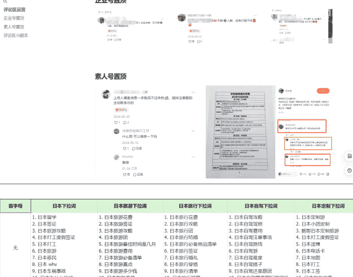

| 首字母 | 日本下拉词 | 日本旅游下拉词 | 日本旅行下拉词 | 日本自驾下拉词 | 日本定制下拉词 |
|---|---|---|---|---|---|
| 无 | 1. 日本留学 2. 日本签证 3. 日本旅游攻略 4. 日本打工度假签证 5. 日本打工 6. 日本旅游 7. 日本移民 8. 日本 whv 9. 日本车祸事故 10. 日本为什么没蛇 | 1. 日本旅游花费 2. 日本旅游签证 3. 日本旅游攻略 4. 日本旅游团 5. 日本旅游最佳时间是几月 6. 日本旅游费用 7. 日本旅游必备清单 8. 日本旅游景点 9. 日本旅游多少钱 10. 日本旅游季节 | 1. 日本旅行花费 2. 日本旅行攻略 3. 日本旅行团 4. 日本旅行结婚 5. 日本旅行必备物品清单 6. 日本旅行签证 7. 日本旅行婚礼 8. 日本旅行穿搭 9. 日本旅行清单 10. 日本旅行预算 | 1. 日本自驾攻略 2. 日本自驾驾照 3. 日本自驾费用 4. 日本自驾注意事项 5. 日本自驾路线 6. 日本自驾游 7. 日本自驾租车 8. 日本自驾柜子 9. 日本自驾还是跟团 10. 日本自驾需要国际驾照吗 | 1. 日本定制游 2. 日本小团定制 3. 鹏哥日本定制旅游 4. 日本打工度假签证 5. 日本读博 6. 日本电话卡 7. 日本地图 8. 日本打工 9. 日本工签 10. 日本旅游花费 |
| a | 1. 日本 a2 奶粉 2. 日本酱虾 3. 日本奥克兰大学 4. 日本奥克兰 5. 日本安全吗 6. 日本 aewv 7. 日本澳大利亚 8. 日本蟹粉多少钱一只 9. 日本奥塔哥大学 10. 日本 acg 私校 | 1. 日本旅游 app 2. 日本旅游安全码 3. 在日本申请澳洲旅游签 4. 日本澳大利亚旅游攻略 5. 澳洲日本旅游签证 6. 澳大利亚和日本旅游攻略 7. 日本澳洲旅游 8. 澳洲日本旅游攻略 9. 澳洲去日本旅游 10. 澳洲和日本旅游哪个好 | 1. 日本旅游签证 2. 日本旅游花费 3. 日本旅游 4. 日本旅游最佳时间是几月 5. 日本旅游攻略 | 1. 日本打工度假签证 2. 日本移民条件 3. 日本旅游花费 4. 日本签证多久下签 5. 日本自驾 6. 日本旅游签证 7. 日本旅游最佳时间是几月 8. 日本入境申报 9. 日本买什么便宜 10. 日本工签 | 1. 日本打工度假签证 2. 日本读博 3. 日本地图 4. 日本旅游花费 5. 日本移民条件 6. 日本签证多久下签 7. 日本电话卡 8. 日本旅游最佳时间是几月 9. 日本买什么便宜 10. 日本必买好物 |
|  | 1. 日本半边莲 | 1. 日本旅游必备清单 | 1. 日本旅行必备物品清单 | 1. 日本不自驾可以玩 | 1. 日本打工度假签证 |

| 序号 | 要写 | 不能写 |
|---|---|---|
| 1 | 包车游、包车司导、全程包车 | 包车小团、定制小团 |
| 2 | 找的地接社、找的旅行社、找的一手地接 | 报的团 |
| 3 | 司导（就是司机导游） | 领队（更多是新疆的说法） |
| 4 | 我们住宿是自己定的，司导会跟我们说这附近哪些地方会有性价比高的民宿酒店，真的会为我们省钱！ | 包住宿的（我们不包含宿） |
| 5 |  | 带药带吃的有备无患 |

- 一、我们的业务
- 二、常见修改重点
- 三、写稿素材
  - 1. 旅行社优势
    - 1.1 出行体验
    - 1.2 服务特色
    - 1.3 创始人背景
    - 1.4 公司/团队优势
  - 2. 选择包车的原因
    - 2.1 与自驾相比
    - 2.2 与跟团游相比
  - 3. 行程中的真实吐槽
  - 4. 人群场景和痛点
    - 4.1 一家四口带小孩（一定强调小团）
    - 4.2 一家四口带父母
    - 4.3 我们不做的群体（成交概率低）
  - 5. 著名景点特色和痛点
- 修改案例
  - 封面案例（可以模仿改写）
  - 大字报
  - 旅游场景+大字
  - 付款截图
  - 旅游合集
  - 人物+emoji
  - 备忘录
  - 聊天记录

### 3.2 销转端调研

在调研完引流端之后，我们需要加一些对标帖子引流到的旅行社名片，看看他们的朋友圈运营、成交话术和常见的 Q&A。

这是在新手阶段接触行业最快的方法。因为你有什么不懂，都可以问同行的销售，看看他们是怎么回答你的，看看他们的回答能不能用在你写的帖子、你回复的客户身上。

与此同时，你可以感受出来，这个旅行社的成交端专不专业，朋友圈运营得有没有章法，你就可以大致判断出同行的销转实力。

同样，你可以记录下这个调研步骤中，让你有收获的销转话术和思考。同时也整理出这份工作的 SOP，未来如果这部分工作比较消耗你时间，就安排助理去干。比如：

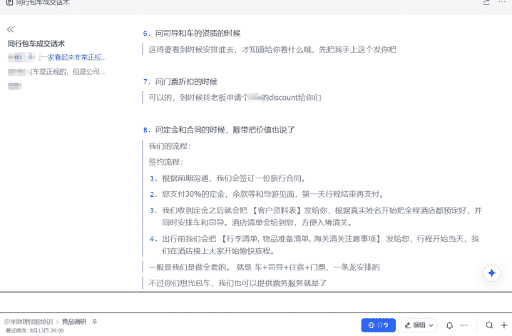

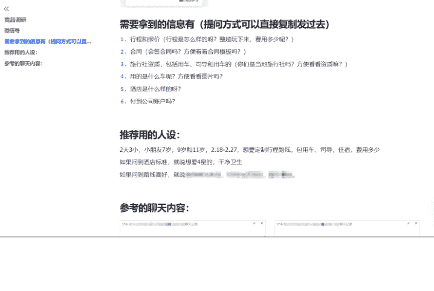

### 3.3 产品端调研

这个部分，我们需要拿到同行销售给你的行程方案、包含的权益和报价，以及销售多次突出表达的卖点。去思考：

这个产品用户画像是怎么样的？

这个产品能打中这些用户的什么痛点？

这部分用户，也是我的产品可以打的用户吗？

他们用什么方案解决这些用户的痛点？

我可以用这些方案解决这些用户痛点吗？

如果目前没有成熟资源，未来有没有可能推动供应链拿到这个资源？

有哪些痛点是同行不注意表达，但是我们却很有优势的？

当我们把这些问题想透，就知道怎么写小红书帖子了，也知道怎么成交用户了。

引流端、销转端、产品端的调研内容很多，并不是在一两天就能全部完成的，而是在整个项目推进过程中，逐步深入、慢慢了解的。

## 四、确定打法

在调研的时候，我们就会发现，小红书获客打法，就那么几种。我们先来简单盘一盘。

### 4.1 视频混剪

如果你常刷旅游行业的视频，这几个封面应该很熟悉。这就是混剪的打法，将多个旅游视频剪辑在一起。无论是国内还是国外旅游，这类视频都大量出现在小红书、视频号和抖音等平台。视频的流量通常比小红书图文更高，但剪辑成本也更高。如果你擅长剪辑，并能掌握这套系统，视频混剪是一个值得探索的方向。

Japan
日本
闺蜜两人去日本玩一趟,需要
多多在日本
08-12
♡ 1389

JAPAN
日本
和朋友去日本玩一趟，需要准备多少预算？
皇包车定制师谦谦
08-31
4130

ICE LAND
冰岛

两人勇闯冰岛，需要准备多少预算？ 🤔🤔
Ruby游北欧
08-18
1871

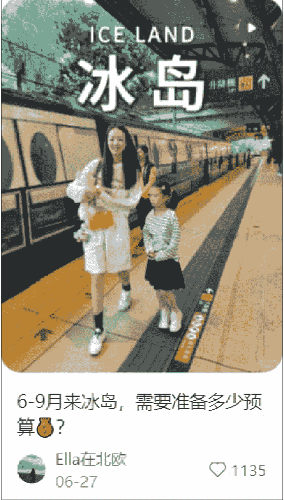

### 4.2 第三方素人推荐

这种打法主要是模仿游客的人设，分享自己到某个国家旅行的经历和体验，从而为我们的旅行社或供应链做推荐。但因为最近小红书打击虚拟账号，汐米写这篇文章的时候搜索，这类型的帖子已经下架非常多了。可以预估，以后这种类型的打法会受到很大限制。

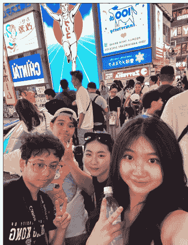

日本跟团已回，别再听网上乱说了。。

刚刚从日本回来不久，也算是体验了一次跟团旅游，对于这个话题我跟大家说实话🥹

我们当时选择跟团的原因主要是：
1. 我们几个都是路痴，到了国外更是分不清东南西北，导航也玩得不转，自由行怕迷路哈哈哈🤣🤣
2. 第一次去日本，人生地不熟，网上说的那些“必去景点”太多，自己做攻略做到头大，也不知道怎么安排合理，最后几个人一致决定跟个小团👩‍👩‍👧‍👧
PS：姐妹们如果还在犹豫跟团还是自己玩，可以参考我们报的这种半自由，感觉挺适合我们第一次去玩的人群👩‍👩‍👧‍👧

在XHS上看了好多去过日本的姐妹的分享，安利了各种各样的团。期间还有好多网友主动来给我推荐(但我总觉得差点意思)对比得我一头雾水💦💦。好在有几个的热心姐妹一步步教我排除雷区，才选出一家各方面都比较靠谱的，在这里我要感谢XHS哈哈哈，还得是girls help girls嘻嘻🤫

日本跟团旅游4人私家团，人均1.5W+超高体验

🥳终于还是去了期待已久的日本，和闺蜜一起找了小红书上，去过的小姐姐推荐的旅行社，报了个私家团，8天7晚，东京和大阪都可以自由活动，算上签证和机票大概1.5W💰，全程独立用车，司机小哥哥说话巨巨巨温柔，很有服务意识，点个赞👍👍👍

🌸我们上海坐飞机到了东京，去了浅草寺，大红灯笼🏮看了，彩色小丸子🍡和鳗鱼饭吃了，二次元集合地秋叶原逛了；后面去了镰仓，在镰仓高校前站，正好碰上有轨电车🚃，大佛拜了，祈求天天开心呀；富士山和忍野八海打卡了（其实就是八个小池子，水倒是很清澈），新干线🚄体验了；到了大阪稻荷神社去了，稻荷神拜了🙏，清水寺打卡了（路上有好多穿和服📸拍照的），岚山小火车🚂坐了，奈良小鹿🦌喂了，东大寺拜了，心斋桥拍了，最后一站怎么能不去环球影城呢，心心念念的马里奥，爱了爱了。一路上拜了🙏拜了🙏，逛吃🍜逛吃🍜... 

💡💡💡TIPS
1️⃣ 手机提前设置双时钟，有一个小时的时差哦
2️⃣ 换了2w樱花币💴足够了，大部分都可以扫码
3️⃣ 带好充电宝和多插头口充电头，手机相机才够用

### 4.3 图文攻略领资料

这种类型主要是分享旅游攻略，吸引大量的用户点赞收藏，部分运营会以此为卖点吸引用户添加微信，领取攻略资料。但现在这种引导也变得越来越少了，目前大多数账号用来增加权重。

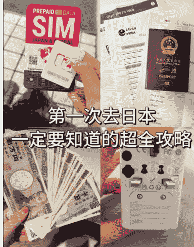

第一次去日本旅游！一定要知道的超全攻略！

日本真的很好玩呀！！！但我们第一次去也踩到了很多坑！！！今天给大家整理了一下去日本旅游要注意的细节！全攻略！希望能帮到各位姐妹！建议🌟住哦！

- 🌟出行前期准备：
- 🌟护照：一般7个工作日完成，有护照的一定查看是否过期。
- 🌟签证：可在网上找代办电子签，不用提供纸质资料，一般10个工作日办好（护照➕电子签，建议可以提前一个月开始准备哦～我们走的大学生签，网上拍材料给他们发过去就可以了，申请很简单的）
- 🌟现金：日元建议不用兑换太多，日本很多地方都可以微信、支付宝，汇率很好。
- 🌟多功能插头：日本使用的是两孔插头，建议可以带一个。
- 🌟流量卡：可以提前在网上购买，飞机落地就可以把卡插上了，免得没有网络
- 🌟垃圾袋：日本户外垃圾很少的哦，可以提前准备

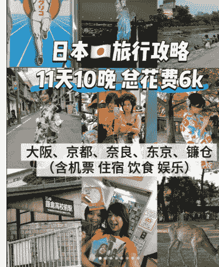

日本JP11天10晚旅行攻略！总花费6k

这次我是5.13号从上海去大阪，5.23号从东京去武汉，大阪进东京出。11天10晚总花费6218元。

5.13号中午落地大阪关西机场T2航站楼，出来后可以直接在门口车站坐摆渡车到地铁站。

总体路线：
大阪——京都——奈良——东京——镰仓——东京。
（京都到东京坐的新干线，700多rmb，夜间大巴会便宜很多，但比较麻烦）

具体行程：
Day1 大阪——心斋桥、道顿堀
Day2 大阪——奈良——大阪——奈良公园、若草山、春日大社、奈良国立博物馆
Day3-5 京都——四条河原町（逛街）、八坂神社、二三年坂、清水寺、永乐町（京都两天完全呆不够，还有好几个想去的地方这次都没去成，而且太好逛了，真的会惩罚每一个没有购物欲的人...个人觉得京都的古着比大阪好逛！）

### 4.4 蓝 V 认证号投流

这种类型的客资主要来自于聚光投流，调研的时候，看到账号旁边有个蓝V标志，或者搜索时看到帖子右下角有“广告”的标志，就是投流的玩法。

- 奢游国际日本旅游定制 4天前更新
  小红书号：624991679
  旅行社 | 粉丝·1.2万 | 笔记·299
- 深游国际日本旅游定制
  小红书号：9565511193
  旅行社 | 粉丝·1.1万 | 笔记·620
- 海伦天空·日本旅行 5天前更新
  小红书号：zta13716738311
  旅行社 | 粉丝·3.1万 | 笔记·177
- 日本旅行USJ旅玩资讯 23小时前更新
  小红书号：qq318020
  粉丝·1.9万 | 笔记·649
- 日本旅行定制师の小E
  小红书号：49449972414
  粉丝·3385 | 笔记·104
- 嘉辉·日本旅游
  小红书号：947895972
  旅行社 | 粉丝·263 | 笔记·52

日本旅游
搜索
全部
用户
商品
群
问一问

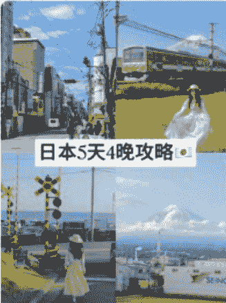
收藏！！5天4晚阪进东出自由行攻…
一只橘…
04-18
485

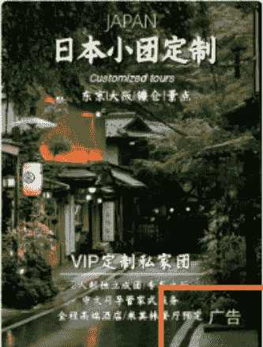
日本私家定制游|量身打造您的日本旅…
致行睿…
昨天 22:35
448

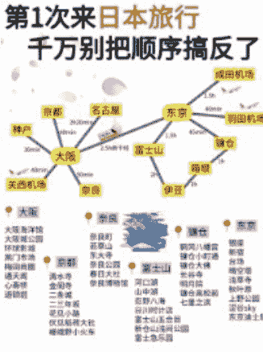
讲真的日本会惩罚每一个不做攻…
跟着携程…
08-26
1046

大阪Vlog幸福两日逛吃日记！…
草莓…
05-14
4040

### 4.5 IP 出镜视频

出镜做 IP 的好处就是，如果这个账号封了，你再起一个账号，用户还能记得住你这张脸。同时，你在用户加上你微信之前，已经对这个 IP 建立一定信任度了，成交也会更快。

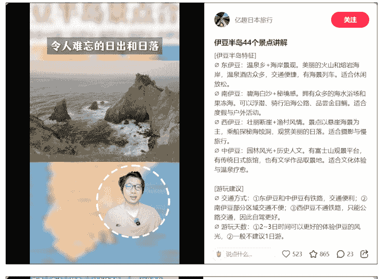
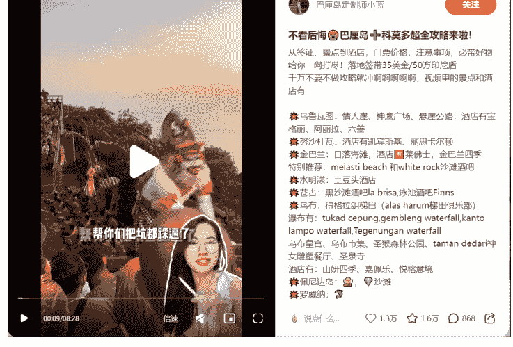

现在境外旅游赛道做 IP 的账号还不多，所以这也是个机会吧。

其实还有很多其他打法，比如 KOC 矩阵、小红书店铺、截流等等可以根据业务的深入做延伸。

对于新手来说，可以先从自己的优势技能入手。例如，如果你以前的工作主要涉及图文内容，比如知乎运营、公众号运营，那可以从小红书图文方面入手。如果你以前的工作主要涉及剪辑，那可以先从视频混剪、IP 出镜等方面入手。

但无论选择哪种方式，新手都建议先从自然流开始。因为在前期，我们并不确定这个项目的利润和转化率，是否有足够的利润分配给小红书、抖音、视频号等平台投流。

等做出数据后，我们就能算出每个粉丝的单粉价格大概是多少。然后，通过打听这个赛道做投流的客资平均价格，就能判断出投流该不该做了。

## 总结

如果你做境外旅游，已经利润核算出来了，投流 ROI 是正的，那么优先蓝 V 认证号打法，因为稳定、安全、少操心。

如果你的细分旅游赛道已经是红海，建议做 IP 出镜视频。如果利润充足，ROI 是正的，那么同时投流。

如果你是新手，那么根据你的能力范围，擅长视频剪辑做视频混剪，擅长图文做第三方素人推荐号。

如果你是获客到私域成交，不太建议做图文攻略的形式，如果是做店铺卖旅游攻略为主要利润的，可以做。

## 五、如何突破流量核心卡点，解决客资问题？

当我们确定了打法后，就可以开始开干了。我们的第一个目标，就是打到第一个客资。顺利的话，我们写几个帖子就能爆一篇，很快就会打到客资。

像汐米 2 月 19 日开始了解项目，3 月 3 日就打到第一个客资，只花了 14 天。但是卡点马上就来了，我写爆了一篇，但是没办法生产第二篇。说明，第一篇的爆款我是靠运气踩中的。

那怎么行？长期做项目，我们必须以实力取胜。怎么再往前迭代一下呢？

李笑来老师在《财富自由之路》书中提到，当我们遇到问题时，那个需要被解决的问题就像被锁住的锁头，而解决方案就像钥匙一样，它一定不在锁孔里，而是在别的地方。

所以，如果我们在流量端卡住了，不要急着在流量端找解决方案，而是要去成交端寻找突破口。如果在成交端卡住了，也不要只盯着成交端，而是去产品端找找看。当你从下一个环节去寻找解决方案时，前一个环节卡住的问题往往就会自然而然地被解决。

接下来，我们就去销转端看看，找找突破流量卡点的解决方案。

### 先想清楚三个问题：

你的帖子是写给谁看的？

这些人会买你家产品吗？

这个产品是公司最赚钱的吗？

认真回答完这三个问题，你可能已经找到了症结所在。

所以，

### 解决方案1：先确定目标人群，你的内容才有针对性

以“小团业务”为例。什么样的人会选择小团？

单人出境游的女性用户——她们通常不敢一个人在国外自驾，对当地路况不熟悉；又觉得一个人包车费用太高，司导成本分摊下来不划算，小团正好满足了她们对安全感和性价比的需求。如果是男生，他就可能选择自驾了。

两人出行——两人包车成本仍然很高，特别是长时间旅行，在这种情况下，他们要么选择自驾，要么选择小团。为什么有些人选择小团而不是自驾呢？可能是在某些国家右舵驾驶不习惯，或者不熟悉当地环境，自驾时可能找不到加油站、交通规则不清晰等问题，还有些人觉得自驾麻烦或危险，希望在旅行中轻松一些。

两人出行又可以细分为——蜜月旅行的新婚夫妇、带着3-8岁孩子的家庭、陪60岁以上父母出游的子女等。每个群体选择小团都有自己的具体原因。

你需要回到自己的业务后端，从成交客户那里挖掘真实信息：最近成交的客户中，有多少是单人出行？有多少是带孩子的妈妈？有多少是陪父母的子女？都是几月份出行？哪个群体占比最大？

如果这些数据不够清晰，那么吸引来的流量就不够精准，转化率自然很低，客单价也上不去。

### 解决方案2：找到真实的用户痛点，圈住精准的人群

如果你只会抄爆款笔记，小红书用户天天都刷到类似内容，就会觉得你的帖子很假。

假设用户真的相信了，但同行公司和你公司情况完全不同。对方的痛点卖点是一回事，你的痛点卖点可能完全相反。如果你用别人的痛点去吸引用户，对你来说可能反而是劣势。

比如同行都用低价吸引用户，你也照搬，把"性价比高"写进帖子。但你公司其实走的是高端路线——高价、高品质、服务到位。你用"性价比"这个痛点去引流，即使来了人，也很难成交，因为这些根本不是你的目标客户。

### 那真实痛点到底该怎么找?

当然要先在小红书里找爆款帖子，看他们的痛点共通性是什么，这样你能知道小红书用户真正关注哪个痛点。

但更重要的是从成交客户身上找答案。去问已经下单的用户:“当时为什么选择我们公司?”

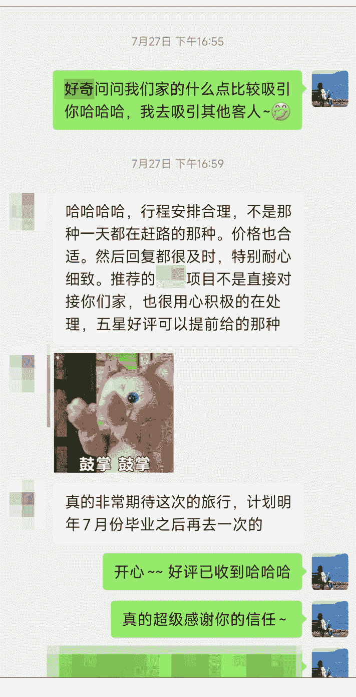

还有他想的很周到
5月10日 下午15:57
好奇！！
然后都很透明
🤭
哪里让你感觉到周到了哈哈哈
考虑到国庆人多 国人来的会多 所以他就选一些小众的
然后我们都比较喜欢看看风景 慢悠悠的他安排的也不会紧凑行程

啊这个对，因为每次五一国庆春节人都巨多，如果都在小红书做行程，人都挤在一块了

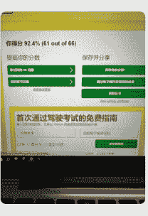
好奇问问，当初为什么您最后决定找我们嘿嘿嘿，您应该也对比了很多其他旅行社吧[偷笑][偷笑]
6月5日 晚上18:01
也不是，我没那么多时间到处找人聊[呲牙]
还很热情回答我问题，我和你沟通的也很愉快，就选了你们[呲牙]
缘分
本来我都要租车了，都在网上答题了[呲牙]

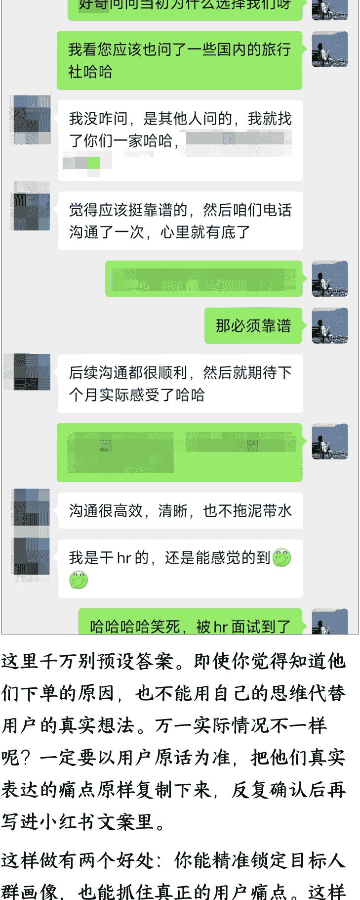
哈哈哈哈笑死
原来您还打算自驾

这里千万别预设答案。即使你觉得知道他们下单的原因，也不能用自己的思维代替用户的真实想法。万一实际情况不一样呢？一定要以用户原话为准，把他们真实表达的痛点原样复制下来，反复确认后再写进小红书文案里。

这样做有两个好处：你能精准锁定目标人群画像，也能抓住真正的用户痛点。这样带来的流量才是我们真正想要的流量。

做前端运营，表面上你在研究小红书内容怎么做，实际上你在研究成交本身。你到底成交了哪类客户？这些客户想解决什么需求？他们选择你的原因是什么？把这些客户的画像、选择理由和需求都写进帖子里，你写的就不只是小红书文案，而是成交文案。

当你理解这一点时，你会发现：不懂销售的小红书运营，很难成为真正的好运营。

## 六、如何突破销转核心卡点，解决转化率问题？

当我们解决了客资量问题后，接下来要关注转化率，也就是销转的核心。同样，请记住那句话：当你找不到解决方案时，问题往往不在你关注的这个点上。

当你已经解决了客资量问题——一天能进来二三十个客户，一个月也有上百个客户。但为什么成交金额还是不高？这时候核心要解决的就是销转率，也就是你的销转路径。

想提升销转率，先观察一下市面上那些牛逼销售都有什么特性：

第一种，靠大IP吃饭的销售。销售本身能力可能一般，但有强大的IP或老板背书，客户认的是这个IP。无论销售是谁，客户都无所谓，只要认这个IP，哪怕销售能力弱点，客户也会选择这个产品。

第二种，背靠好产品的销售。客户对销售本身没太高要求，只要让他感觉舒服就行。但他对比了市面上很多产品后，还是觉得这家公司产品最好。所以即使销售能力一般，客户也愿意在这里买单。

第三种，个人能力超强的关系型销售。只要和客户关系好，无论推什么产品，客户都信任你，愿意在你这里下单。这种完全靠销售的个人魅力。

我们要清楚自己目前属于哪种销售类型。一般来说，如果你在这个环节遇到瓶颈，大概率是前两种类型，也就是销售能力相对较弱的销售。如果你是第三种销售，通常不会有这样的困惑。

所以，突破销转卡点的解决方案，除了提高销转能力，还可以在IP和产品上下功夫。

IP怎么做？可以推动老板去打造IP，你要不断向老板灌输这个信念，让他意识到前端IP对成交端有多重要。当然如果你自己上，也可以，以定制师的身份打造的个人IP，在这个市场上还很少。

IP做起来，在前端建立了充分的信任感，即便销转能力一样，你的转化率也会提高很多。

### 另一个思路是提升产品优势
你要仔细观察公司产品在整个市场中的优势是什么，客户为什么会选择我们，并对比竞品A、B、C，找出他们共同强调的痛点和优势。你一定要突出这些优势，同时还要找到那些竞品很少或从未强调过的点，并加以利用和强调。

除了宣传包装层面，我们甚至可以通过开发产品线、替换产品线的方式，来提高销转率，提高利润率。

比如，这半年，我们推动过的事情是：
- **开发新业务**：我们观察到，我们吸引来的数据，50-60%都是1-2人出行的群体，这部分的群体大多数的需求是小团或自驾出行，原本我们没有小团的业务，那现在我们是否能开发小团业务？从原本无法成交的客户，到拥有适合产品后能够成交，转化率自然提升。
- **优化现有产品，提高利润率**：我们原本做包车业务，现在转向全包定制，将门票、住宿等所有卖点整合在一起，整体利润就可能更高。本来卖的是产品，现在卖的是解决方案，调整产品形式后，我们的产品利润就翻了倍，接下来我们还会继续拔高。
- **拓展周边合作**：比如与旅拍公司合作，因为很多人出国旅游都希望留下纪念。市面上已有旅拍公司，你可以寻找这类合作机会。或者与酒店合作，推荐优质酒店并获得提成，虽然不多，但也是额外收入，转化率也会提升。

我们做操盘手，一定要深刻了解到，只有产品有竞争优势，销转才会高，我们才能赚到钱。只有帮老板赚到钱，提高老板的利润率，我们才能长长久久赚到钱。

祝福每一位老板，每一位操盘手都能长长久久赚到钱，长长久久赚大钱！

## 致谢
此文感谢薇安，在我刚离职出来的时候，带我进靠谱优质的圈子。每一次聊天都会把最优质的资讯发给我，让我看到更大的世界。

感谢珍妮，在每一个关键节点都点拨我，引领我再往前探索一步。在我没做出结果的时候愿意为我背书，链接靠谱资源和合作机会。

感谢易寒，在我做境外旅游赛道遇到困惑时，为我指点迷津。让从未接触过旅游行业的我，也能独立获客、转化旅游客资，顺利拿下半年百万业绩的成绩。

最后，感谢生财有术！这里真的聚集了全国最最最最会搞钱，最最最卷最上进的富哥富姐。在我还没进生财之前，就已经感受到了生财圈友的赋能和加持能量，简直改变了我的人生轨迹！

未来，跟着生财，跟着圈友，一起生财有术！

最后，安利小懒的付费群：

懒人专属群（介绍）

📚懒人专属群持续更新中，已持续运营6年，整理超3000份各类精选付费文章&年费社群干货，全部开放下载。

本资料为付费群内部分享，仅供真实有需要的朋友查阅🙏

懒人专属群更新记录：
https://lazy2025.top/blog/record2

懒人专属群更新记录（需梯子，备用）：
https://lazybook.fun/blog/record2