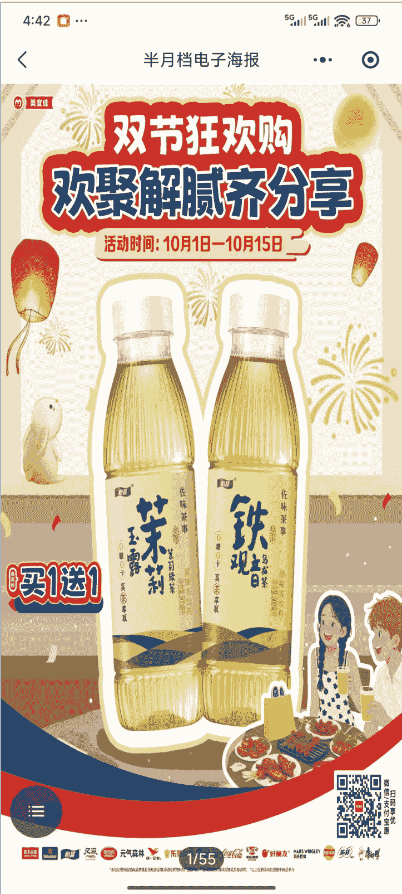
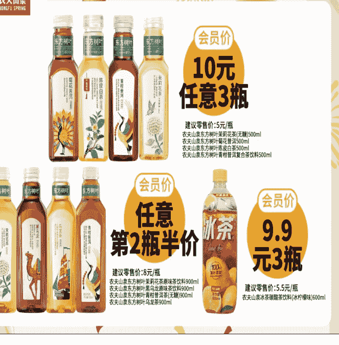
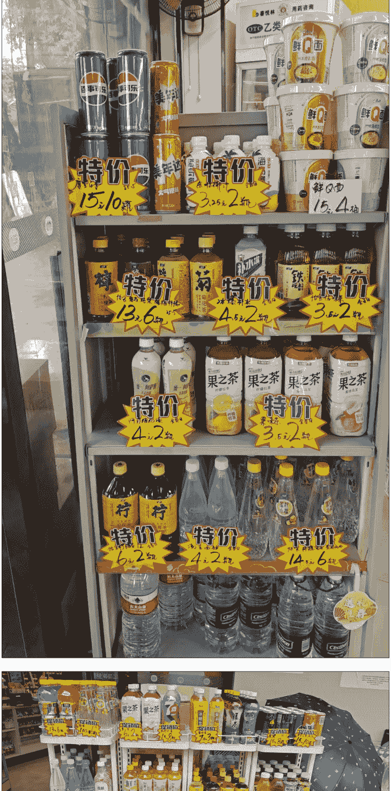
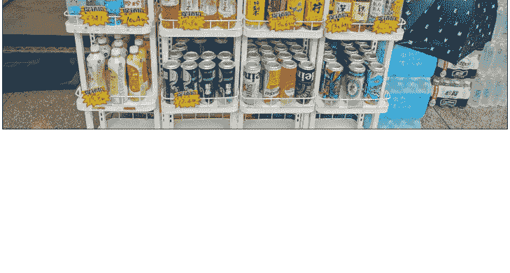
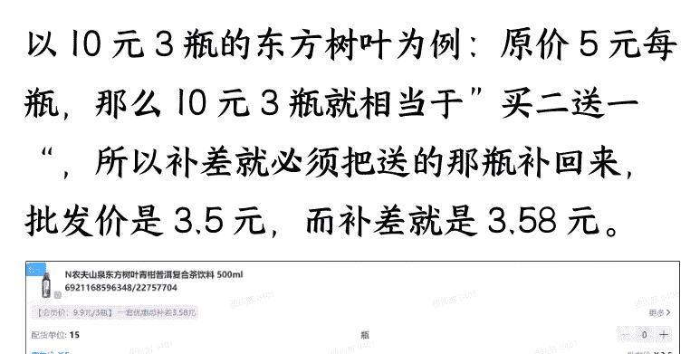

# 我们回老家开一间美宜佳好不好?

251016 生财精华

公众号懒人搜索，懒人专属群独享

懒人微信：lazyhelper

国庆假期期间在汕尾参加了一场线下聚会，介绍的时候说起自己是开便利店的，然后罗卜跟 MAZC 都说生财好像还没有圈友发表过类似的内容，并鼓励我把自己这些年开便利店的经验总结一下写成一个帖子，所以，便有了今天的这篇文章!

为什么我会选择回老家开一家这样的便利店呢？原因主要有两个吧，一个是 9 年前得了一场病，做了一个全喉切除的手术，医生建议当时已经 29 岁高龄的我找个空气好一点的环境养老，所以我回来了。

二是小时候就特别羡慕家里开小卖部的同学，所以在没办法再从事高强度工作的情况下，我选择了开一家便利店来维持自己的生活。而那时候除了易捷，美宜佳就是业内最大的便利店龙头，所以我就加盟了美宜佳了。

## 一、选址

跟所有的线下生意一样，想要开好一家便利店第一重要的肯定是选址，这个方面我总结了一下大概可以分为五类：

### 一、类垄断区域（大型客运站内、机场候车厅、医院内部、高校内部等）

如果你有资源能拿到这种位置，得益于每天大量且稳定的客流，那肯定可以无脑冲。但这种都近乎是垄断的场合，且毛利也会比其它店铺高不少，一般需要在当地要有较高的人脉，大家都懂，不做赘述！

### 二、季节性区域（景区、高校周边等）

这种虽然人流不比第一类少，但受季节及政策影响较为明显，有的地方甚至需要入场费或利润分成，所以在这种地方开店的话，需要考虑以下几点：

#### 1、附近有没有当地人开同类型的店

如果附近有当地人的店，要注意会不会过来使绊子，虽然不能说“穷山恶水出刁民”吧，但有些地方本来能创收的营生就不多，如果我们再过去分掉一部分的话，那还是会存在徒增冲突的可能，特别是淡季大家生意都不好的时候。

建议：实地考察时多与已有店铺交流，深度了解当前业态。

#### 2、旺季的收入能否抵销淡季的亏损

这一块在高校周边的店会显得特明显，一到寒暑假校内基本没人，这时候租金和人工都是一个不小的支出，所以需要计算旺季时的营利能否覆盖掉这部分成本。

建议：做好成本核算，可以夸大一点淡季的成本，用来跟业主争取淡季时减免租金。

#### 3、合同能否顺利续签

这个类别的位置如果不是你自己的物业，那无非就是当地人的物业或者所在高校或景区管理处的物业，前者有可能会看你生意好随意加涨租金，后者则有可能因为管理层人员变动，在合同结束的时候，需要我们重新去疏通关系。

建议：尽量争取签长租，如果可以签长租甚至可以在租金及其涨幅上做适当妥协。

### 三、城市办公区（CBD 或工厂集群区等）

这种也是人流量也不少，但是白天跟夜晚的人流量相差很大，所以需要值得注意的是以下几点：

#### 1、白天巨大的人流能否接得住

特别是上班高峰期过来买早餐的人都很赶时间，如果人多门店收银效率跟不上的话，客流有可能会流失，所以考察时不能把所有人流量都算上。

#### 2、晚上门店是否有充足的营业点

晚上很多人都会选择回家，所以要看下附近办公区晚上加班频率如何、是否有宿舍区或住宅区、是否有大型商业体，如果没有，那附近的饮食及娱乐业态怎么样，晚上有没有让人出来过夜生活的地方！

### 四、新建小区

如果是在一线城市，只要不是在很偏远的地方，那拿得到除消防门外的任何一个门边上的第一个铺面就可以直接开，基本上都不会差，因为小区的入住率很快就会跟上。

如果不是一线城市，那想在新建小区里开店要注意的就以下几点：

#### 1、选铺位

无论如何，一定要在除消防门外的任何一个门边上的第一个铺面开，不然就算开起来了，后期让别人在第一个铺面开，也会大幅度影响我们的生意。

#### 2、入住进度估算

新建小区刚开始做基本上都是亏本的，所以做好入住进度很重要，而做好这个估算主要可以从以下几下方向入手：

#### 1、小区房源是带装修的多还是不带的多？

（带装修会比不带装修的入住快）

#### 2、附近是否有新建或规划近几年内要建的小学

（只要有，那在学校投产的时候小区入住率也会迎来大幅度的提升）

#### 3、该小区在所在城市属于哪个档次？

（一般情况下高档小区的入住进度都会比中低档的要慢，而且高档小区住户密度要比中低档要低）

#### 4、购买该小区的业主是本地人多还是外地人多？

（外地业主基于刚需买房的情况较多，所以入住速度会比本地业主要快，而且出去跑老城区应酬朋友的情况也较本地业主会少很多）

### 五、普通区域（没人跟你争，你想开就能开的区域）

上面的四种情况都各有各的先天优势，也都比较抢手，因此如果真的要很想开一家自己的便利店，但又拿不到以上四种区域内的店铺的话，就需要在普通区域内遴选出优质的铺位，而这就需要做好以下几方面的工作：

#### 1、确保目标店铺能申请烟草专卖

几乎所有的便利店，烟草部分的销售额都会占到三到五成，所以一个便利店要有一张自己的烟草专卖证，这是最基础的配置，哪怕现在很多烟草的价格都在倒挂，但只有一张证在手，才有了整个店接下来销售额的基本盘!

申请烟草证的要求也很简单：

- 50米内没有幼儿园、小学、中学。
- 离最近的一张专卖证的距离大于30米。

#### 2、统计人流量

开便利店相对于其它生意来说其实是一项回本较慢且较难抽身的生意，好的人流是营业额的基本盘，一旦选错位置，后面就算再用心经营，也很难有质的飞跃，所以人流量的统计很重要。

无论你的看中的店址是自己选的还是品牌方拓展员推荐的，都应该自己去或者叫靠得住的人去好好统计一下人流量，这步不应该省！下面说一下统计人流量的具体操作：

- 统计范围
- 统计时间
- 要剔除的人流

统计范围：一个是统计站在门口不用转头就能看到的人、车；另外一个是统计方圆50米内民宅的入住率跟年轻人占比。

统计时间：最好统计一个完整的星期，没时间也要有五天，即2个不同的工作日，跟一个完整的周五、六、日。按早高峰、上午、中午、下午、晚高峰、晚上分时段统计，夜班主要统计附近娱乐场所的客流及宵夜摊的客流。

要剔除的人流：

- 送外卖的骑手
- 马路对面的人流
- 刚放学的学生群或下班的厂工。

#### 3、估算营业额

完成上面那一步之后就会有一个“有效的人流量”，而美宜佳的预测模型中“进店率”是5%-15%，我们取中间值10%。

进店后的“购买率”是60%-80%，我们也取中间值70%，

而进店后“客单价”一般是15-20元，我们取中间值18。

上面的几个指标跟门头设计、竞争程度、后期门店运营、还有人流量中年轻人的占比有关，前三者都不是我们刚开店时能控制的，所以我们的估算模型可以按照统计人流量时年轻人的占比作上下浮动。这里均取中间值，即：

预估营业额=有效人流量*10%*70%*18、

有了这个预估营业额之后，我们就可以估算我们的营收了，现在美宜佳的平均毛利是22个点，

即：月毛利=预估营业额*22%

然后我们用这个月毛利减去房租、水电、人工，剩下的就是我们的净利了，

大家可以根据这个计算模型衡量一下一个店值不值得开!

#### 4、选址加减分项

加分项:

- 附近有公交站或地铁口
- 附近有娱乐场所(棋牌室、台球室、会所等)
- 门口有足够供过路车辆停车的位置
- 门口位置宽阔可供摆摊、铺货

减分项:

- 门口有台阶
- 地势低洼、大雨天积水
- 门口朝西，有西晒
- 门口道路为单行道，过往车辆无法停驻
- 门口有老头老太太闲聊（有老人闲聊一来是说明这个地方不会有太多来来往往打扰他们，从侧面说明这个店经过驻足的人不多，二来是老人睡眠浅，可能会投诉我们店开夜班）

## 二、投资

我想很多圈友应该都很关心两个问题，那就是开个店要投资多少钱？多久能回本？那么下面就是我从拓展那里要来的一份今年9月份开业的新店投资明细表：

| 序号 | 项目名称 | 金额(元) | 备注 |
|---|---|---|---|
| 1 | ①加盟店应交费用确认书 | | |
| 2 | 店号 | | 店名：广东...威美宜佳 |
| 1 | 加盟保证金 | 30,000.00 | |
| 2 | 特许加盟费 | 25,000.00 | 含品牌加盟费1万元及商业软件注册使用费1.5万元 |
| 3 | 开业服务费 | 6,000.00 | 含开店策划与支持服务，开业宣传单、海报、专用章制作费 |
| 4 | 调试服务费 | 790.00 | |
| 5 | 商品款 | 80,000.00 | |
| 6 | 专项设备、货架款 | 101,100.00 | 统一标准，详见《应交费用明细清单》 |
| 7 | 代收付卖场装修工程款 | 40,447.00 | 统一标准，详见《应交费用明细清单》 |
| 8 | 专项招牌款 | 9,980.00 | 统一标准，详见《应交费用明细清单》 |
| 9 | 代收财产保险款 | 550.00 | 代收，款项转付保险公司 |
| 10 | 代收雇主责任保险款 | 200.00 | 即员工意外保险，款项转付保险公司 |
| 11 | 代收春悦林费用 | | |
| | 投资额汇总： | 294,067.00 | 含以下“支持总额”及“未付总额” |
| | 专项设备、货架支持额度 | 29,990.00 | |
| | 支持总额 | 29,990.00 | |
| | 首批商品款未付金额 | 0.00 | 申请分期偿还，偿还方式以《还款协议》为准 |
| | 专项款未付金额 | 0.00 | 申请分期偿还，偿还方式以《还款协议》为准 |
| | 未付总额 | 0.00 | |
| | 首期应付金额： | 264,077.00 | 首期应付金额(含已交诚意金/保证金)=投资总额-支持总额-未付总额 |
| 加盟者确认： | | | |
| 日期： | | | |

其中加盟费、保证金、开业服务跟调试服务是所有门店收取标准都一致的。不同的就是根据卖场面积不同，而收取的设备费、装修费跟招牌造价不同。

上面这个门店就是非常经典的门店，卖场大概 70 平方，两个铺位，招牌大概 8 米，所以他初期投资加起来是 30 万左右，大部分门店的初期投资都是这个金额前后。

除了初期开店的投资，美宜佳每六年还会要求门店重新装一次，也就是说门店每六年大概要再花上面红色边框里的钱，除却有部分设备能继续用，大概每个店是要加投 10 万左右。

另外美宜佳每个月还会收取一笔 1000 元的后台服务费。

## 三、运营

### 营销

加盟美宜佳本身的优势之一就是公司每个月都会做丰富的活动，这些活动不限于：半月档活动、会员日活动、大牌满减活动、新品尝鲜活动，抖音团购，而我们作为门店经营者要做的就是把这些活动推广出去即可！

### 半月档

门店最基础的活动，以前是只要进店就能享受，23 年 9 月份之后就改成要会员才能享受了，不过也简单，会员是免费注册，只要扫码登录一下就是会员，而且全国通用！

半月档大致可以分为3种：加N元多N件、特价N元，第二件半价！例如这两年最火的活动就是500毫升的东方树叶10元3瓶！

### 会员日、大牌满减、新品尝鲜

这三类活动都是在“美宜佳便利店”小程序里领取优惠券来做的营销，对年轻顾客比较受用，对于中老年顾客初期一般都比较排斥，但只要取得信任之后，中老年顾客的粘性有时比年轻更强。

公众号懒人搜索，懒人专属群分享

大牌好券

【大牌好券】百事可乐指定商品5元代金券(满25元...) 使用时间: 10.06~10.12 立减¥5 满25元可用 已达上限

【大牌好券】亿滋食品指定商品5元代金券(满25元...) 使用时间: 10.06~10.12 立减¥5 满25元可用 立即领取

【大牌好券】康师傅饮料指定商品5元代金券(满25...) 使用时间: 10.06~10.12 立减¥5 满25元可用 立即使用 已达领取上限

【大牌好券】怡宝茶饮果汁指定商品5元代金券(满2...) 使用时间: 10.06~10.12 立减¥5 满25元可用 立即领取

【大牌好券】元气森林指定商品5元代金券(满25元...) 使用时间: 10.06~10.12 立减¥5 满25元可用 已达上限

【大牌好券】青岛啤酒指定商品5元代金券(满30元...) 使用时间: 10.06~10.12 立减¥5 满30元可用 立即领取

12 / 38

加码福利 限时定点抢

11点抢 14点抢 16点抢 18点抢

【周二会员日10.14可用】屈臣氏饮用纯净水... ¥0.1

更多好券 5折好券

馋嘴零食 聚会饮品 清凉茶饮

【周二会员日10.14可用】明治海盐荔枝雪糕... ¥2.5

【周二会员日10.14可用】明治菠萝生椰味雪... ¥2.5

【周二会员日10.14可用】绝小鲜香辣虎皮凤... ¥7.45

【周二会员日10.14可用】绝小鲜卤香虎皮凤... ¥7.45

咋一看是不是感觉活动力度不大？

但其实这些在小程序里领的优惠券都是可以叠加半月档的优惠的，相当于折上折，所以只要每个月花点时间给一些活动商品做好叠加优惠陈列，就会让活动看上去每劲棒了！

### 抖音团购

美宜佳的抖音团购是近两年才引入的，刚开始由于活动补差不大，很多店家不愿意参与，所以搞了大半年也没多大起色，而 2023 年 4 月份以来，由于补差明确而结算比半月档的快很多，很多店家都引进了这个营销活动。

做这块主要就有以下几点要操作：

#### 1、开通“团购带货”功能，

单独留一部手机开通团购带货功能，也可在店里直播，并引导购客下次通过本店抖音号下单，实现线上线下结合，一鱼多吃。

顾客有时候会嫌麻烦，不愿意关注店里抖音，可以把抖音团购里的商品里比小程序领券价高的商品挑出来，有顾客过来兑换这些商品的时候就引导顾客退掉抖音券，改领更优惠的小程序券。

用抖音券的顾客都是图便宜，我们跟他说有时候是抖音便宜，有时候是门店线下便宜，具体情况叫他关注我们抖音号上的更新，这样就可以起来吸粉的作用了。

#### 2、做好备货工作

抖音上的团购商品店里要齐全，这样顾客每次来都不至于跑空，这样才能增加顾客的黏性。

### 营销补差

这么大的活动力度当然不可能由门店一方来承担,公司是有补差的,而且相较于其他国产品牌的便利店,美宜佳的补差还算比较高。

补差方式:

- 返款:在活动结束后半个月后结清,结算方式是直接全额抵扣货款。
- 积分:实时结算,但每次只能抵扣货款的5%。

补差力度:

覆盖优惠出去的商品的成本,以保证门店的利润不会受损并略有盈余。

以10元3瓶的东方树叶为例:原价5元每瓶,那么10元3瓶就相当于”买二送一“,所以补差就必须把送的那瓶补回来,批发价是3.5元,而补差就是3.58元。

### 陈列、堆头

如果想从事零售业,那无论是做便利店还是超市,抑或是只是想自己开个小卖部,那学会做陈列跟堆头都是必修的功课。

陈列跟堆头也被称为“无声的推销员”,只要做得好,便可以显著地提升门店的营业额，而且很多时候陈列跟堆头本身也能拿到品牌方的相关费用，甚至有听说在美宜佳里有关用陈列跟堆头这块的费用就能大致抵掉铺租，由此可以看出，陈列跟堆头是门店日常运营中的重中之重！

陈列的要领：

- 黄金位置的选品

黄金位置是指最容易被顾客看到和拿取的位置，也就是人们抬手不会觉得累的那个高度，一般是离地120到150厘米，儿童商品另算。

有人说要摆放给最畅销周转率最高的商品，但我不认同的，我觉得应该留给新品或本店销量低于周边但利润又比较高的商品。

留给新品是为了让顾客觉得门店时常在上新，会给他充足的新鲜感，让他更有来店的欲望。

留给新品或本店销量低于周边但利润又比较高的商品是因为这个品的销量肯定是有提升的空间，但因为顾客找不到，所以在本店的销量才会低于周边。

至于周转率比较高的畅销品，我更愿意把它放在最不起眼的地方，因为这种商品顾客找不到肯定会问，所以没必要让这种商品占用黄金位置。

- 关联陈列

也就是将功能或用途相关的商品摆放在一起，刺激顾客的连带购买。例如：

- 牙膏与牙刷
- 泡面与火腿肠、鸡蛋
- 咖啡与方糖
- 调制酒与果味饮料等

- 货品饱满、整洁。

货架必须始终保持丰满（Fullness）和整洁（Tidiness），避免出现“空洞”感。

丰满：即使库存不足，也要使用“前推陈列”或“平面陈列”技巧，让商品靠前，填满货架的前端空间。空货架会给人留下“滞销”或“缺货”的负面印象。

整洁：商品正面必须朝向顾客，价格标签清晰，无灰尘，无散乱。

- 垂直陈列与横向陈列结合

陈列方式的选择影响品牌曝光和顾客的选择效率。

垂直陈列：同一品牌或品类沿货架垂直摆放（从上到下）。这能最大化品牌的视觉冲击力，便于顾客快速定位品牌。

横向陈列：同一品牌或品类沿货架水平摆放（从左到右）。

便利店受限于场地因素，一般是同一面货架陈列一个品类，然后同一行陈列同一品牌。

- 价格标签须清晰对应

所有陈列的商品必须有清晰、正确且无损坏的价格标签。

作用： 价格标签是顾客做出购买决定的最后一步，标签缺失或错误会极大影响购物体验。

堆头的要领：

- 选址：高流量高曝光

堆头的位置选择是成功的一半。

最佳位置： 店铺入口附近、主通道中央、或收银台附近的顾客必经动线上。

避免： 死角、光线不足或被其他货架遮挡的区域。

- 主题：单一与清晰

堆头必须有明确的促销主题，千万不能成为“杂物堆”。

原则： 一个堆头只推销一个主要活动或一类核心商品（例如：夏季饮品促销、买一送一）。

视觉： 必须配合醒目的促销海报（POP）、价格卡或灯光，突出“特价”或“限时”的紧迫感。

## 3、量感：视觉冲击力与丰满度

堆头要以“量”取胜，营造出热销抢购的氛围。

高度：适度的堆头高度（不宜超过120cm）能带来强烈的视觉冲击，同时要确保最上层商品顾客可以轻松拿取。

形状：保持堆头的形状稳定、整齐，利用道具（如托盘、展示架）确保商品堆放得如同金字塔或方阵，而非松散的乱堆。

## 4、安全：稳固是前提

安全永远是堆头的第一要素，尤其是涉及到瓶装或罐装饮料等重物时。

> PS:陈列是一个持续优化的过程，需要根据每天的销售数据来调整主推商品的位置。

## 仓库管理

每个便利店都可以大体分为“卖场”跟“仓库”两块，卖场还能根据顾客的行为来优化，而仓库则需要完全根据店主主动去管理，而且一不慎则容易造成货品补货不畅，从而造成货品过期，所以我觉得，库存管理的重要性完全不亚于卖场。

### 1、采购与订货（防止库存积压）

#### 订货原则：少次多量与多次少量结合

对于绝大多数商品，特别是鲜食、奶制品和面包等短保质期商品，应坚持“多次少量”的原则。

而对于畅销品，饮料、啤酒等，应该在厂家搞活动时多订，即“少次多量”，以此提高商品毛利。

#### 考虑周转天数

不要只看销量，更要看周转速度。美宜佳的冷链配货跟常温配货系统都是2天配一次货，所以如果不是厂家打折促销，没必要在仓库里留太多的货。

- 短保商品（鲜食、牛奶）：周转天数控制在3-5天内，避免订货量超过一周的销量。
- 长保商品（零食、饮料）：周转天数控制在7-15天，避免订货量超过一个月的销量。

#### 合理设置商品“上下限”

美宜佳对每个品都有“上下限”设置，当商品少于“下限”时下一个来货日就会来货，理论上这样可以最大程度上避免商品缺货，但商品总有各种各样的损耗，这样也会导致上下限失灵。畅销品要定期盘点，定期调整上下限。

### 2、收货与入库（防止源头错误）

#### 严格执行验收程序

收货是防损的第一关。必须核对三项一致：实物数量、采购订单数量和供应商送货单数量，可以使用美宜佳专用的收货终端协助收货。

- 检查包装：确认外包装是否破损、受潮或挤压。
- 核对效期：对所有短保商品，必须检查生产日期和保质期，拒收保质期剩余天数不符合门店要求的商品。
- 及时清退：一旦发现上述情况，及时做配货退货单，在下一次来货时及时退回，避免损失。

#### 货品上架遵循 FIFO 原则与效期管理（先进先出）

这是库存管理中最基础，也是最容易出错的环节。

- 原则：First In, First Out (FIFO)，即先到货的商品先出库、先上架。
- 入库操作：新货必须放在老货的后面或下方。在货架上架时，新货必须放在老货的后面。

### 3、商品分类、分批盘点

便利店虽然不大，但品类繁多，一般都有2500个单品以上，所以还需要对商品进行分类，将精力放在高价值、高风险的商品上。

#### 高价值商品

这一块主要就是香烟、计生用品、槟榔、跟高价酒。

- 香烟：因为是烟草局统一供货，美宜佳后台没有这个品类的库存，所以香烟入货时第一时间一定要入库，更新后台库存。而且高价香烟要放在货架最顶层，至少让1个监控摄像头可以清楚拍到。
- 计生用品：计生用品因为其体积较小，且很多人羞于购买，所以其实也存在被盗的可能。所以一个是要定期做好盘点，一个是要叮嘱好店员注意照看。
- 槟榔：槟榔是这四类里面最容易出现库存差异的，因为很多槟榔都有中奖的营销活动，这就使得偷槟榔跟偷现金没什么区别。二来顾客中奖后店员如果入机不正确也容易造成库存异常。所以槟榔要放在监控清楚可见的位置，且至少每周要做一次盘点。
- 高价酒：因为人们对高度酒类不会太在意价格，而且很多人也会特意购买陈年老酒，所以高价酒只要放好别摔就行。另外就是过期酒出售时告知顾客后，当面把生产日期涂掉，以防引起不必要的售后纠纷。

#### 高风险商品

对于便利店来说，最大的风险就是食安问题，也就是商品的保质期问题；特别是槟榔、面包、鲜奶制品、鲜果汁、火腿肠等。

- 槟榔：市面上所有槟榔的保质期都是60天，美宜佳目前的政策是不过期不给退，过期超过7天也不给退。而槟榔又是价值比较贵重的商品，所以一定要叮嘱店员每周固定时间查日期，把一周内要过期的槟榔做好退货单。
- 面包跟鲜奶制品、鲜果汁：这几个品类的保质期一般是在20天以内。要注意的是在日常陈列中单独归类，不可与其它同品类但保质期较长的商品混陈，不然很容易出现漏查的情况。至少要每周查一次日期，把一周内要过期的做好退货单。

一般美宜佳门店都是三个班次，可以把槟榔、面包、鲜奶制品及鲜果汁分别责任到人，让他们每周固定时间检查日期。

- 香肠类：香肠类的保质期为3-6个月不等，最重要的是要做好分类，把保质期长的跟短的分开陈列。香肠类都是圆柱型包装，比较难码得稳，所以同个品的香肠应该固定从左边补货，因为右边更方便顾客拿取。做完这些还是需要每半个月固定时间作一个检查，把保质期不足2个月的做退货处理。

#### 其它商品

其它商品也应遵循先进先出的方法陈列，并每月按品类或按货架定期做好日期检查。

除了高度酒之外，最好不要在门店里留有生产超过半年的商品，以免给客户留下滞销的负面印象！

另，美宜佳有些畅销品是不能退的，如果遇到畅销品临期可作促销或用作私域社区拉人的礼品。

> PS:商品的保质期是一个十分关键的问题，一旦管理不善，不但会给顾客造成不良印象，也会给职业打假人有机可乘，所以必须加以重视!

## 店员管理

便利店是服务性行业，所以跟其它服务性行业一样，店员的服务态度、服务质量都是影响门店客服黏性的关键。所以虽然店务的工作都是一些手板眼见的工作，但在店员的管理上依然不可大意。

### 1、店员的招聘：

便利店是小本生意，所以除非是开在类垄断区域里的门店，否则，花在员工上面的预算便不可能太多。像我所在的城市，汕尾，这边美宜佳员工的平均工资就不超过三千块钱，这个金额便注定了请不到多高学历的员工。这里我说一下我招人的几点经验：

- 早班（8：00-16：00）：早班要求员工要长期起早，而且早班最主要的工作量是整个店面的卫生，需要的是一个眼里有活的人。所以最好是能招到孩子已经上了小学且有一定自理能力的宝妈，要是本身就住在门店附近就最理想了。这样的员工比较稳定，我店里工作最长的一个早班是上了三年多，后面她老公叫她回去自己开饮食店才离的职。行里我见过最长的有做了七八年的早班，后面老板直接把门店给她承包了。
- 中班（16:00-24:00）：中班是一天里面最忙的班次，接待顾客数量也是最多的，所以需要请一个形象比较好，人也比较礼貌、干练的员工。
- 夜班（00:00-8:00）：夜班要求员工能熬夜之余，还需要员工要有能独立处理店里一般突发事件的能力，不然你睡到半夜他老是打电话过来也难搞。所以最好请一个性格比较沉稳，情商比较高一点的。

我一般是让夜班跟中班隔一段时间换班一次，这样有两个好处：一是不用让一个人值长夜班，两个人都不会太累，这可以避免夜班休息不足引起的情绪不稳定而跟顾客引起不必要的矛盾；二是我可以要求他们在换白班的时候再请假，这样我自己就不用熬夜。

也有一些门店实施两班倒，这样工资可以相对开高一点。

#### 什么样的员工不能请：

- 看上去很爱美的：例如化着彩妆、身上打各种钉、或手上有美甲的，这些都不会动手干活的，他们之所以想来便利店上班是认为这里上班比较清闲，只是收银而已。
- 身上有各种纹身的：痞里痞气的，一般来的时候还一大堆人一起来的。这些与其说是来上班，倒不如说是来找个地方一起挂壁的，请了他们，会天天店里都来一群烂仔，到时光是看监控都有排忙。
- 家长带过来的：无论是长工还是暑期工，无论家长在你面前怎么叮嘱他都最好别请。这种人一般是比较内向或自闭，别说指望他能跟顾客有效沟通，我们本身跟他沟通都困难。
- 亲戚朋友的孩子：这种也最好别请，一言难尽。

### 2、员工的培训

对于店务，从收银到商品陈列、仓库理货，美宜佳都有一套比较完善的培训教程，跟着做就行。也可以让要离职的老员工带新员工上手后，我们考核完再上岗。

实际上更应该对员工进行针对本店特有的店情进行的培训，以及处理突发事件能力的培训。

例如：

- 遇到难缠的或喝醉酒的客户怎么办？
- 相关部门上门怎么办？
- 有人偷盗怎么办？
- 紧急情况需要外出怎么办？
- 账目有出入怎么办？
- 客户需要大批量货物而店里没有怎么办？

等

## 节假日及特殊天气运营

节假日跟台风等特殊天气的来临都会给门店带来销售额的突然爆发，所以做好备货工作跟人员的排班工作尤为重要。

#### 节假日

节假日期间门店的销售增长主要来自两方面：一是外出的人群回流带动消费，二是本地人群过节引起的暂时性消费升级。

针对第一类人群，需要多备一些烟酒礼盒类的，主要推荐一些经典款，如硬中华、硬荷花等、特仑苏、金典牛奶、王老吉、加多宝等；

针对第二类人群即可以适当增加家庭装的饮料以及一些中高端的零食跟啤酒。

#### 注意事项：

少进一些特定节日才会用到的东西，如月饼、粽子、清明节的祭品等，因为这些市面上会成堆成堆地出现，我们跟外面的小店相比并没有优势。客人可能会为了买一条真烟走进加盟店，但不会为了买一盒真月饼进去。

节假日的时间是固定的，可以提前了解相关商品的活动情况，如有折扣可以多囤。可以挖掘一些替代礼品，在群里提前发起预订测试需求，如果需求旺盛可以直接引入门店大力推广。例如今年中秋伊利就推出了一款新的酸奶，提前半个月搞买一送一的活动，结果在广东多个城市的美宜佳都卖爆了。

每年的各节假日的销量都大差不差，应在节后做好复盘，以作来年参考所用。

#### 台风极端天气

极端天气是突然爆发且持续时间短的需求，核心是备足生存必需品和即时热量。顾客会在天气来临前集中抢购。需要注意的有以下几点：

- 天气预警发布：一旦确定所在区域为受影响的区域，马上到后台用原价备货。每次台风都会出现商家抢货的情况，所以不要指望还能买到特价货。
- 着重备好应急物资：如饮用水（特别是大桶装），方便面、自热火锅、面包、速冻饺子、电池、充电宝、打火机、蜡烛、手电筒、垃圾袋等。及时整理好仓库，确保届时可以迅速补货。
- 不可哄抬物价：大部分便利店做的都是固定人群的生意，一旦哄抬一次，会被人说很久很久，对门店声誉造成很大影响。
- 保证人员安全：风前生意会出奇的好，但也要确保人员有充足的时间撤退，可以参考所在城市的公共交通营运时间，像我们店就是公交停运 2 个小时后我们就关店。

## 突发情况处理

#### 设备与运营突发事件

这类事件处理的核心是保障销售连续性和保护高价值商品。

#### POS 系统/收银机故障

**值班员工：**

- 重启尝试：检查线路或重启一次 POS 机，如果重启无效应及时通知老板，夜班也应报备。
- 应急切换：立即切换至备用手持终端收银，或使用手动开单（纸笔记录）并告知顾客稍候。
- 保障支付：确保微信/支付宝的二维码支付牌可以正常使用，保证支付流程畅通。

**店主：**

- 至少要有不同角度的两个监控对准收银台及收银机，特别是收银机屏幕。
- 保持手持终端有电并联网。
- 在店里要有备用收款码及音响。

#### 突然停电

**值班员工：**

- 通知老板
- 安全保障：立即开启应急照明，并在收银台准备好手电筒和零钱。
- 设备保护：拔掉不需要的电器插头；冷柜/冰柜门保持紧闭，最大限度维持低温。
- 手动交易：使用计算器和纸笔记录销售，待来电后尽快补录入系统。

**店主：**

- 第一时间到店，并启用备用电源，店里可备好小型发动机。如果功率无法覆盖全店，应该依次优先覆盖监控、照明、收银。
- 监控系统及收银系统应设置 UPS，供电时间至少要能覆盖自身到店所需时间。

#### 冷链设备故障

**值班店员：**

- 商品转移：检查冷柜内温度，将高价值、短保质期商品（如鲜奶、便当）转移到备用冰柜或使用干冰/冰袋临时保温。
- 停止销售：温度确认不达标的商品立即贴上“停止销售”标识并撤下货架，等待报损处理。

**店主：**

- 立即联系维修人员并确认大概维修时限。
- 如果维修时限太长，应该马上联系客服，暂停冷链配送。

#### 客户与安全突发事件

这类事件处理的核心是安全第一、以和为贵，冷静沟通、绝不私下肢体冲突。

#### 顾客投诉或争吵

**值班店员：**

- 立即隔离：将顾客带到店内角落或休息区，避免影响其他顾客。
- 倾听记录：保持中立，让顾客先发泄情绪，记录关键信息。
- 有限授权：在授权范围内（如小额退款、赠送小礼品）立即解决；
- 及时上报：超出权限立即上报店长或老板。

**店主：**

- 事先通过微信等方式向店员了解情况，并预演等下到店可能的情况。（例如等下我可能会当面责怪你，但都是给客户看的，你不用放心里）
- 了解客户需求，如果只是情绪不满，则诚挚道歉，或当面责怪店员给他出出气；如果是想要物质赔偿，则衡量对方要求是否合理，不合理的可以拒绝甚至报警。

#### 小偷盗窃

**值班店员：**

- 礼貌提醒：礼貌且清晰地与其对话，声量要确保店内监控可以录取到，可以用“请问还有其它需要买的吗？”或者“您要买的东西都带齐了吗？”。
- 引导录像：如对方没有要拿出所偷物品的意愿，可以引导他看向店内任一监控，以录取其面貌。可以用“抬手示意”的方式，让他视线随着店员的手朝向监控。
- 安全第一：切勿私自搜身或发生肢体冲突。
- 记录备案：记下衣着、外貌和离店方向，调取监控，交由店长处理或报警备案。

**店主：**

- 看是否认识，认识的自己衡量要不要私聊他。
- 不认识的就报警，只要有照片警察是很快可以找到人的，行规是“偷1赔10”。

#### 抢劫或其它危险人物

**值班店员：**

- 不抵抗：人身安全永远排在第一位。遵从歹徒要求，保持冷静。不要试图引导他们看监控，以免触怒对方，不遮掩监控即可。
- 仔细观察：记住歹徒的特征（身高、衣着、声音、逃跑方向），观察是否携带武器。
- 事后处理：歹徒离开后，立即报警并通知老板，并保护现场，等待警方和店长到场。

**店主：**

- 安抚店员情绪，查看是否受到伤害，衡量是否需要调休。
- 报警，配合警方调查。

现在抢劫的比较少，但有半夜去撬没开夜班的店的。我的店之前也有遇到过一个精神失常的，吓跑了 2个夜班，后面警方找到他的家人，才敢开夜班。

#### 环境与公共卫生突发事件

#### 火灾警报/小火情

**值班店员：**

- 自救：如果火势极小（如垃圾桶内），且员工受过培训，使用最近的灭火器扑灭。
- 立即疏散：如果火情较大，即应切断电源，高喊“火灾！请立即撤离”，引导顾客和员工安全撤离至指定安全区域。然后立即拨打 119 报警，并通知店长。

**店主：**

- 店内应配备相应的消防用品，并在店员入职前作必要的培训。
- 发生火情应立即回店，并报 119。

#### 顾客在店内出现不适（如呕吐、受伤、晕厥）

**值班店员：**

- 提供援助：保持冷静，提供急救包（小伤），或立即通知店主并拨打 120（突发疾病或重伤）。切勿随意移动重伤者。
- 隔离区域：立即用警示牌隔离污染区域，防止二次滑倒或污染。
- 清洁消毒：使用专用清洁剂（呕吐物）彻底消毒，佩戴手套和口罩处理污染物。

**店主：**

- 店内配备急救用品，并给店员作必要的培训。
- 出现突发情况应回店协助处理。

#### 食品安全投诉

**值班店员：**

- 立即隔离：将顾客带到店内角落或休息区，并联系老板。
- 保留证据：立即收回有问题的商品，拍照、记录批次号、保质期和顾客的症状描述。
- 安抚顾客：立即向顾客道歉，并安排退款或必要的医疗援助（视情况）。
- 立即上报：立即通知店长、供应商和相关监管部门（若情况严重）。

**店主：**

- 日常做好日期检查
- 到店确认情况是否属实，对方是普通顾客还是职业打假人。
- 若情况属实，安抚顾客，并退款或作适量赔偿。
- 如果情况属实，对方是职业打假人，私下解决，但绝不按规定赔付，如果他提出要按规定赔付，则让他直接走法律流程，反正最后大不了也是这么赔。
- 如果情况不属实，对方是故意来碰瓷的职业打假人，直接报警，并在公司后台调取本店货品所有批号信息，民警一到直接到派出所再聊。

## 结语

话到这里，关于美宜佳怎么做我应该已经说得差不多了，那么美宜佳还值不值得开呢？

我觉得最重要还是得看选址，如果有关系拿到上文中的第一类铺位，那肯定可以开，但如果只是普通铺位的话，我觉得开美宜佳不算一门好生意，原因如下：

- 投入大，回本慢。动辄几十万投下去最快也要两三年才能回本。
- 美宜佳强大的只是供应链，但他整个对于门店的安全管理系统还是比较欠缺的，理论上员工如果有坏心思想偷的话，是怎么都能偷得到的，这就注定了我们在门店上的管理成本其实不低，但这块其实对门店营收并没有帮助。
- 烦杂小事不少，有时会觉得特别消耗心力。零售业是一个最基础的市场，形形色色的人都会遇到，而我们毛利不高，有时候遇到一些烂事时，想跟他较真吧费时费力；不跟他较真的，心里实在是不舒服。

其实还有很多没有写，例如美宜佳有很多的便民服务，还有美团外卖上每周末的69-45，跟我们平时要怎么买才最优惠？但我老婆刚辞职说要去小游一下，那就回来再说吧。

最后，安利小懒的付费群：

## 懒人专属群（介绍）

微信:lazyhelper

懒人专属群持续更新中，已持续运营6年，整理超3000份各类精选付费文章&年费社群干货，全部开放下载。

本资料为付费群内部分享，仅供真实有需要的朋友查阅

懒人专属群更新记录：

https://lazy2025.top/blog/record2

懒人专属群更新记录（需梯子，备用）：

https://lazybook.fun/blog/record2