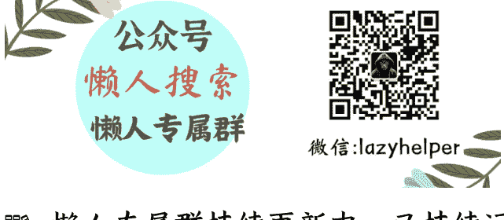

# 142丨闻泰科技的“荷兰劫”

整理:公众号懒人搜索,懒人专属群独享懒人微信:lazyhelper

欢迎打开《蔡钰·商业参考4》，我是蔡钰。

国庆期间还发生了一件事，它的走向，可能会影响所有出海企业的命运：荷兰政府用7天时间，强行接管了一家中国企业全资拥有的半导体公司。这家公司叫安世半导体，它的中国母公司叫闻泰科技。

这个动作，让闻泰陷入了跟2020年华为相似的困境。

## 强行接管

怎么回事呢？我们先说眼前这场变故。

9月30日，荷兰经济事务与气候政策部下达了一个政令，要求安世半导体遍布全球的30个主体，一年内不得对资产、知识产权、业务及人员进行任何调整。

紧接着第二天，安世半导体的三位外籍高管，就联名向荷兰法庭提交了一份紧急请求，用跟政府禁令高度一致的措辞，要求暂停安世的中国籍CEO张学政的职务、冻结安世母公司闻泰的表决权，并给安世任命临时管理人。这个动作，相当于是以反手夺权。

荷兰法庭接到这份紧急请求后，在没有庭审的情况下，立刻满足了外籍高管的全部请求。

10月7日，荷兰法庭又进一步正式裁决：维持暂停张学政职务，给安世任命了一名拥有决定性投票权、有权独立代表安世的外籍董事，同时把安世半导体所有股份（减去1股），以管理目的为名义，从闻泰手中转走，托管给了指定人员。

这番操作下来，安世的母公司闻泰科技，对安世失去了控制权，只保留了可见的分红权。

你品品这紧锣密鼓的节奏和效率。这显然不是巧合，而是预谋。

## 闻泰与安世前缘

接下来，我们再来讲讲安世半导体和闻泰科技的身世背景。

安世半导体，原本是荷兰恩智浦半导体公司的标准产品部门。2016年前后，欧洲半导体行业流行起了轻资产运营，纷纷从全产业链制造转向“设计+IP授权”，恩智浦、意法、英飞凌等公司都在分拆出售利润率低、资本消耗大的制造环节。其中，恩智浦就把安世半导体分拆出来，以大约28亿美元的价格，卖给了中国财团。

中资财团把安世半导体整整齐齐收购下来之后，2018年到2020年，闻泰科技又用三次收购拿下了安世的100%股权。前前后后，花了超过300亿元人民币。

闻泰科技又是谁呢？

这家公司，最早做手机代工业务起家，也是中国的头部手机ODM厂商之一，服务过小米、华为、魅族、联想、华硕等大厂。闻泰2018年借助收购安世和其他一些资产，从手机代工商升级成了半导体企业，切入了苹果供应链。

闻泰入主后，安世业绩翻倍，营收在2022年达到23.6亿美元峰值，毛利率显著提升，实现零负债运营，成了欧洲表现最好的半导体厂之一。

但在这同时，闻泰跟安世之间，仍然有着严格的技术与运营防火墙。安世的专利全都登记在荷兰，核心技术、研发体系、生产线全都留在欧洲，闻泰只能通过授权许可使用。

安世的总部也仍然放在荷兰。CEO虽然是中国的，但主要高管与研发人员都是欧洲人，产线也集中在欧洲。欧洲员工占了大部分，研发中心更是牢牢设在欧洲。

所以，严格来说，闻泰接手安世，并不是从欧洲“拿走技术”，而是继承了一家“技术属地化”的欧洲公司。

到了这里，你可能开始明白荷兰政府的行动底气。

在荷兰看来，安世仍然是一家欧洲企业，核心技术在欧洲，就业在欧洲，税收也在欧洲，中国股东不过是个有分红权的能干管家罢了。

## 美国的施压

那么，荷兰政府为什么要选择2025年的中国国庆，对安世动手呢？

这个问题，如果我们把时间线再往前探一点，就会发现还有两个微妙的时间点，能够回答：

第一个时间点是2024年12月，闻泰科技作为中国公司，被美国列入了实体名单，开始承受出口限制。

第二个时间点是2025年9月29日，就在荷兰动手的前一天，美国发布了一个出口管制穿透性规则，要追加管制上了实体名单企业的子公司，也就是“母公司上名单，子公司一并管”。

荷兰法庭披露的一份文件显示，这之前，美国政府就跟荷兰外交部打过招呼，说自己要对闻泰科技进行穿透性管制了，安世半导体也会受到株连。

如果荷兰想保住安世半导体，那必须把安世的中国籍CEO张学政换掉。

路透社报道说，正是美方的这个威胁，导致荷兰政府出手，强制接管了安世半导体。

甚至，就连三名反水的外籍高管，也是荷兰政府推动的。

那份法庭文件说，荷兰政府官员给安世半导体的外籍高管发过信函，要求安世半导体必须拥有“独立于黑名单上的股东的运营独立性”。荷兰官员还告诉安世半导体，美国贸易限制可能还会扩大，会导致安世的业务受限，除非采取措施，限制安世“向中国转移知识和能力”。

所以，这次安世的遭遇，可能标志着美国对中国的科技封锁，从孤立打压走向了联盟围堵。

## 欧洲的转念

不过，荷兰政府强抢安世，也不完全是迫于无奈。荷兰政府给出的官方理由是，“安世半导体存在严重的治理缺陷”“威胁技术知识和能力的连续性”。

但数据完全不支持这个说法。前面我们说了，安世在闻泰手中业绩翻倍、毛利率提升、负债清零，研发与技术成果始终落在欧洲。

那么，荷兰到底在说什么？荷兰在说：时代变了，欧洲的观念也变了，从开放转向了防御。

2016年，欧洲觉得，安世是个包袱。

2025年，欧洲发现，安世是个宝贝，有技术、有产能、有就业，还是它为数不多的重振科技产业的筹码，却偏偏已经卖给了中国。

所以啊，就算美国不提，荷兰乃至整个欧洲，多少也寝食难安。

这次荷兰政府强行接管安世，引用了一部本国的老法案，叫《货物可用性法案》，这是70年前苏美冷战时期的法律，冷战结束后，它就几乎没有再被采用过。

这部法案最初出台，是为了让荷兰在战争时期能绕过正常程序，控制战略物资，来保证国家安全。

2023年，荷兰特意通过了修订案，把“半导体”也加进了《货物可用性法案》的适用范围里。

70年前的法案既然翻出来修订，那肯定是准备要用的。2025年在安世身上，这部法案就被用上了，只不过这次它的身份不是物资调配法案，而是升级成了地缘武器。

不管从哪个角度说，闻泰对安世的收购早就完成了交割。荷兰这套逼迫闻泰回吐安世股权的拳法，实在太难看了。

这件事如果没能妥善处理好，那就会划开一个口子，启发欧洲乃至世界各国有样学样，向中国企业的海外资产开刀。

到了10月12日，闻泰发声明，抗议荷兰的歧视性待遇。但这件事，已经超出了闻泰能驾驭的范围，上升到了国家层面的博弈了。

中国商务部在假期里紧急发布了公告，禁止安世半导体在中国生产的特定成品部件和子组件对外出口。

外交部也回应说，中方一贯反对泛化国家安全概念、针对特定国家企业采取歧视性做法。有关国家应切实遵守市场原则，不要将经贸问题政治化。中方维护自身正当合法权益的决心坚定不移。

## 总结

这是迄今为止，荷兰强行接管安世事件的进展。它不只是企业控制权之争，更像是一场区域之间关于创新主权的争夺预演。我们会对它的走向继续保持关注。

而如果把这件事当作背景知识，我们还能对今年的诺贝尔经济学奖，有点不一样的解读。

我们下一讲来聊聊。

拜了个拜。

最后，安利小懒的付费群：

懒人专属群（介绍）

📚 懒人专属群持续更新中，已持续运营 6 年，整理超 3000 份各类精选付费文章 & 年费社群干货，全部开放下载。

本资料为付费群内部分享，仅供真实有需要的朋友查阅 🙋‍♂️

懒人专属群更新记录：
https://lazy2025.top/blog/record2

懒人专属群更新记录（需梯子，备用）：
https://lazybook.fun/blog/record2