# 帝国的利剑

251017 江宁知府付费

整理：公众号懒人搜索，懒人专属群独享

懒人微信：lazyhelper

## 前言

在特朗普再次翻脸、威胁加征 100%关税之后，中美关系回到了比 4 月份更加危险的时刻，一旦实现经济层面的大规模脱钩，军事对抗就会迅速浮上台面......

纵观人类历史，帝国通常依赖海外军事基地来执行统治，在这方面，美国、英国、苏联和古罗马帝国并没有什么不同。

英国历史学家阿诺德·汤因比在书中这样写道：“罗马确立政治霸主地位的主要方法，是将较弱的邻居置于自身羽翼之下，并保护他们免受其他强大邻居的侵害。这是一种条约关系，从法律上讲它们保留了主权独立地位，罗马对它们的领土要求仅仅是划出一块土地来作为罗马军事堡垒。”大家不要小看这个“军事堡垒”的作用，直白一点说，霸权国家有能力对试图脱离其掌控的驻军国家施加军事影响，倘若没有这层安全保障（正面意义）兼武力威慑（方便行“废立之事”）的能力在，霸权体系其实很容易松动。

而一旦拥有这些基地，被驻军国就很容易沦为霸权国家的“经济领土”——这一点在特朗普关税风暴期间表现得尤其明显。

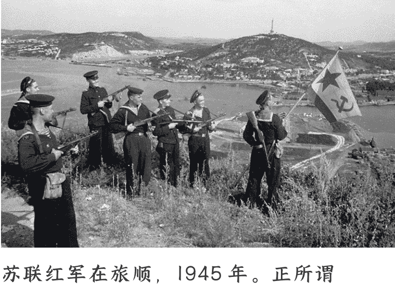

苏联红军在旅顺，1945年。正所谓“请神容易送神难”，趁赫鲁晓夫权力未稳之际中方果断推动旅顺撤军问题，是一个重大外交成功。

海外军事基地是帝国的一把利剑——无论对敌人还是盟友。观察一个国家对于海外军事基地的态度和行为，可以很大程度上倒推其决策层的真实想法。

### 「1、如何获得海外军事基地？」

19世纪大英帝国鼎盛之际，曾统治着一个由全球军事基地系统保护的庞大殖民帝国。

巅峰期，英国在至少35个国家或殖民地设有军事基地，这些基地被部署在英国海军主导的重要海上走廊周边，如：英国本土→直布罗陀→地中海→苏伊士运河→阿拉伯海→印度→马来半岛；英国本土→北美/加勒比；英国本土→西非→南大西洋等。

一个帝国的衰落往往伴随着另一个帝国的崛起。

二战后，美国取代英国成为全球霸主，建立起全球范围内最广泛的军事基地系统。根据时任美军参谋长联席会议副主席 James Blaker 的讲法：

> “第二次世界大战结束时，美国的海外基地系统由三万多个设施组成，分布于约一百个国家和地区。[除了核垄断之外，没有比这一庞大海外基地系统更能象征美国的超级大国地位了]。”

（按照 James Blaker 的话做推演，在核垄断地位被打破后，海外军事基地系统就是美国超级大国地位最重要的标志。）作为野心勃勃的霸权国家，战后美国对这些军事基地的官方立场是“应留尽留”。在 1945 年 8 月 7 日的波茨坦会议上，杜鲁门总统公开宣布：

> “尽管美国不想从这场战争中获利，但我们将维持必要的军事基地，以彻底保护我们的利益和世界和平。”

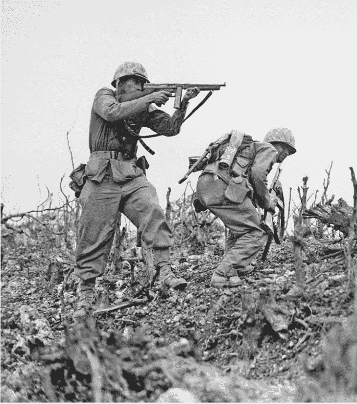

冲绳战役期间的美国海军陆战队，1945 年 5 月。直到今天驻冲绳美军仍保留着当初的番号——第三远征军，足见美国人对这段历史非常自豪。

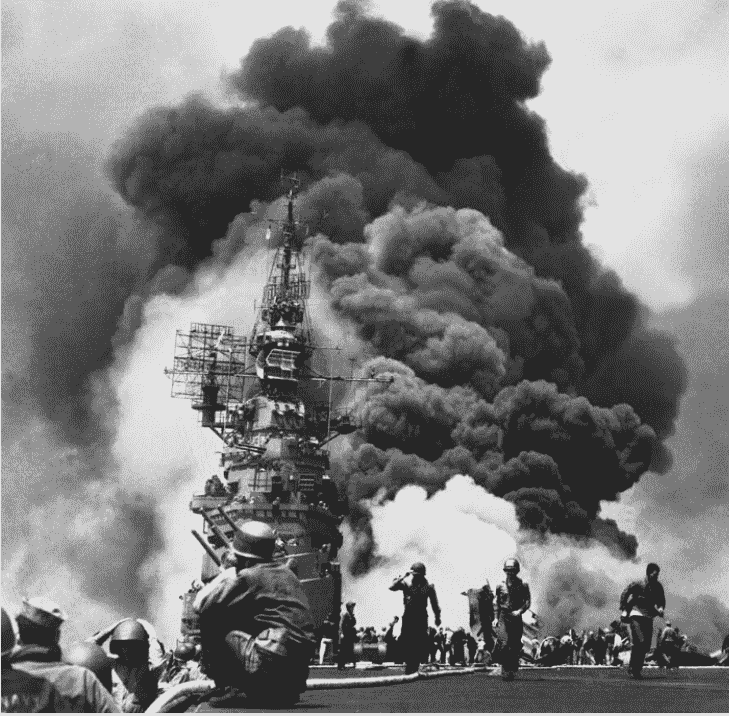

冲绳战役期间，美国“邦克山号”航空母舰因神风特攻队攻击而遭受重创。美国人看待这些基地的心情就跟普通国家看待自己的领土一样，是前辈们牺牲换来的。

回顾历史，「海外军事基地通常是在战争期间获得的」，和平时期想拓展基地十分困难。

以美国为例，古巴关塔那摩基地是在美西战争后获得的，尽管技术上采用“租赁”方式，但租约却是永久性的。美国对关塔那摩基地的管辖权只有在古巴和美国双方共同同意的情况下才能终止，期间美方每年支付象征性的款项。

再比如冲绳，它是二战期间美军通过登陆作战打下来的，之后长期霸占。《美军的攻台计划》一篇里提到过当时美国曾制定登陆台湾岛的作战方案，某种意义上讲，美军放弃登陆台湾对大陆是有利的，否则势必在岛内留下大量美军基地，处理起来只会难上加难。

至于中东的那些军事基地，除部分继承自英国外，大部分也是美军在海湾战争、伊拉克战争期间开拓的，之后长期占据。

与所有帝国一样，美国在获得后极不愿意放弃任何海外基地。美参议院外交委员会曾发布过一份报告，里面写道：“一旦建立了美国海外基地，它就会拥有自己的生命。最初的任务可能会过时，但新的任务又会源源不断被开发出来。”

1990 年代苏联解体后，美国内部曾就是否裁撤海外军事基地一事发生过辩论，最终的结论是保留整套基地系统，因为这对于全球军力投射和保护美国在海外的利益是必要的。为了缓解海外军人的疲惫，克林顿时期采用了“频繁轮换”的方式，但基地本身尽可能不削减。

对于一些短期内实在用不上的基地，美国也会预先部署好设备物资。以中东地区为例，美军在科威特和卡塔尔预留了两个重型旅的装备，目前处于封存状态，战时可迅速启用。

拉姆施泰因空军基地位于德国西南部，既是美国驻欧洲空军总部，也是北约盟军空军司令部。

### 「2、为什么放弃海外军事基地？」

正如通过战争获得海外军事基地的逻辑一样，美国彻底放弃某个大型海外军事基地往往也是因为打输了仗。比如：在中南半岛上的军事基地因越战失利而赔个精光，在中亚地区的军事基地因阿富汗战争失利而丢失殆尽。

> 「帝国对于权力真空是极其厌恶的，对于撤退后丢掉的势力范围更是刻骨铭心、念念不忘。」

最典型的例子即南海，1970 年代之前美国曾同时拥有菲律宾苏比克湾和越南金兰湾一东一西两大基地，后来金兰湾和苏比克湾先后丢掉/撤军。尽管最初二十几年里影响不明显，但待到中国军力崛起，美国明显感到应对乏力，只能用军舰定期航行、演习的做法刷存在感。

再如阿富汗，自 2021 年美国撤军后，中国在中亚地区的影响力迅速上升，正是在这样的背景下，特朗普才放出要收回阿富汗巴格拉姆空军基地的说法。有观点认为，美国正陆续失去之前大部分的“前沿地带”，包括东南亚、南亚、非洲、中亚、拉丁美洲等，霸权的影响力越来越收缩至西欧、远东和中东等几个核心地区。

近期有个新闻是特朗普政府已决定不再延长《非洲增长与机会法案》。《非洲增长与机会法案》2000 年由克林顿签署成为法律，2015 年奥巴马任内续期 10 年，为非洲 32 个发展中国家的若干类商品提供了免税进入美国市场的待遇。凭借该法案，非洲国家才跟美国拥有了一定程度的经贸联系（否则非洲产品竞争力偏低，根本进入不了美国市场），在免税条款终止并叠加新关税之后，美非贸易将遭到毁灭性打击。有学者认为这说明美国在战略层面已经放弃了非洲，早些年设立的非洲司令部现如今已成为驻欧美军司令部下面空挂的一块牌子，最近还传出特朗普要将其裁撤的消息。

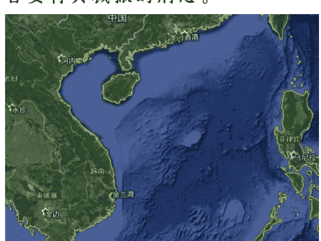

越南金兰湾基地，1972 年之前这里曾部署有大批美国海空军。

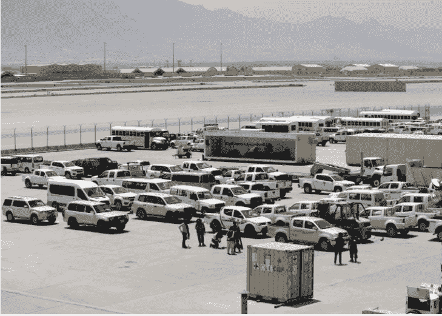

撤离前的阿富汗巴格拉姆基地，2021 年。

虽然海外军事基地是霸权国家的标配，但它也是一把双刃剑，处理不好很容易影响与驻军国的关系。为什么美国 1992 年要撤出菲律宾苏比克湾基地呢？一方面是由于 1991 年 6 月 15 日皮纳图博火山喷发——邻近的克拉克空军基地当场报废，苏比克湾海军基地则被一尺厚的火山灰掩盖；另一方面也是因为它被菲律宾人视为“殖民主义的遗产”，经常引发抗议。

在彻底丧失位于菲律宾的基地后，冲绳成为美国西太平洋海外基地系统的枢纽。尽管当地居民经常抗议，但美国是铁了心要长期占据。一家美国智库的日本政策研究所所长称：“冲绳岛本质上是五角大楼的军事殖民地，一个巨大的‘安全屋’，美国军人可以在这里做他们在美国本土不敢做的事情。它被用来向整个东亚地区投射美国的力量，以服务于华盛顿的大战略，并延续美国在这个关键地区的霸权。”

值得注意的是，美国的海外基地并不像 19 世纪的英国那样，作为殖民帝国的组成部分，而是采用非殖民方式来维护帝国经济体系，将欧盟、日本、韩国等作为其隐性“经济领土”。

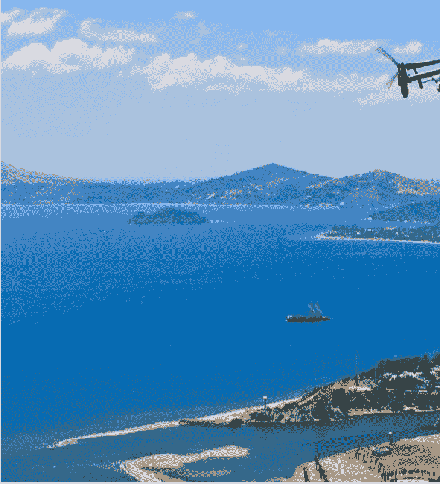

苏比克湾位于菲律宾首都马尼拉西北约 100 公里处，周边人口十分稠密，受政治因素影响较大。与之相较，冲绳民众在日本政治里的影响力就小得多。

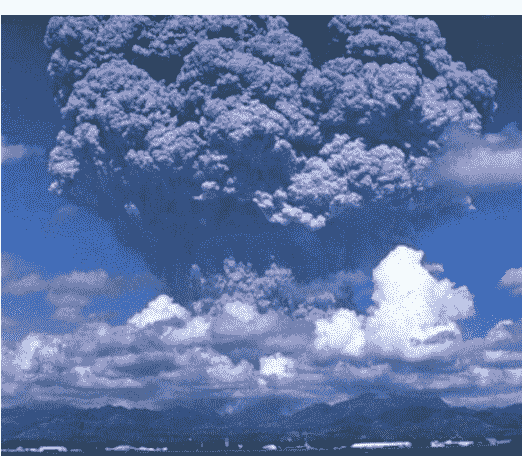

1991 年皮纳图博火山大规模喷发成为美国从苏比克湾撤退的最后一根稻草。

### 「3、海外军事基地的威慑作用」

文章一开始提到，海外军事基地是帝国的一把利剑——无论对敌人还是盟友。回顾历史，美国对盟友行“废立之事”并不在少数，比如南越吴庭艳、智利皮诺切特、埃及穆巴拉克等，只不过因极少发生在欧美日韩等“核心盟友”圈子里，所以外界感受不强烈罢了。同样的行为也发生在苏联身上，典型案例如 1956 年匈牙利事件、1968 年布拉格之春等。

霸权国家行“废立之事”时，提前设置在目标对象境内的军事基地可以起到四两拨千斤的作用。设想一下，假如 2022 年俄罗斯在乌克兰基辅周边有一处空军基地，想要发起“特别军事行动”自然事半功倍，胜算大大提升。

映射到美国与日本、韩国的关系，驻日美军横田基地就设在东京都，而驻韩美军所在的汉弗莱营到首尔也不过 90 公里。假如特殊时期当事国爆发内乱，产生两派旗鼓相当的力量，则华盛顿就拥有了相当大的军事影响力——2024 年 12 月，当尹锡悦深夜宣布“紧急戒严”后，外界第一时间关注的就是 2.8 万驻韩美军的动向。

如果我们把 2022 年“特别军事行动”跟 2014 年的克里米亚作对比，也能够深刻理解驻军基地的重要性。苏联解体后，克里米亚半岛上长期驻扎有俄罗斯黑海舰队，额定人数为 1.25 万人；2014 年危机期间，俄军迅速增兵至 2.2 万人，并组织起数千人的亲俄民兵作为过渡性力量。其间乌克兰海军总司令别列佐夫斯基变节，率领超过一半驻扎该地区的乌克兰军人投向俄罗斯，克里米亚遂兵不血刃被俄方收入囊中。

实际上，1958 年之前中国也曾在平壤周边驻军，总兵力高达 30 万（第 1、16、21、23、54 军），宛如一把“达摩克利斯之剑”高高悬挂。在中方同意撤军后，金日成欣喜若狂——即便当时美韩联军有多达 60 多万，而朝鲜人民军只有 35 万人，平壤方面仍然希望中方尽快全部撤走。

撤有两种撤法，其一是将五个军移驻鸭绿江边，这样一旦有事可以立即介入；其二则是完全撤回内地。出于尽可能减轻国家预算负担的考量，如果只是从朝鲜境内移驻鸭绿江北，后勤供应和营房建设仍将有很大开销，因此我方决定全部撤回内地。

往前几年，中国其实也曾跟苏联积极沟通过苏军从旅顺撤退的事宜。从 1945 年开始，苏联不仅接收了大量日本人留下的基地设施，还自带了不少先进装备到旅顺和大连，1955 年撤离时苏军驻旅顺基地陆海空三军总兵力达 12 万人，巅峰期拥有高达 30 万驻军。伴随旅大苏军全面撤离，莫斯科丧失了一个可以直接威胁中国的桥头堡，此后双方合作愈发平等化，中国处理起对苏关系时独立性大大提升。

一份俄文资料是这样写的：“1955 年 5 月 26 日，最后一批苏军士兵离开辽东半岛。站在俄罗斯人的坟墓上，旅顺港变成了中国的旅顺，达尔尼城被称为大连，苏联失去了一个重要的海军基地。......赫鲁晓夫放弃了前任的政策，在 1954 年秋天做出了一个无法解释的决定——将基地和所有财产捐赠给中国（笔者注：中方象征性支付了一部分费用）。时任国防部长朱可夫意识到旅顺港转让对苏联国防能力造成的巨大打击，一度拒绝了赫鲁晓夫的处置提议，最终未能挽回。对旅顺港政治决定的后果很快便显现出来，到 1958 年春天，赫鲁晓夫向中方提议恢复旅顺港的苏中基地（笔者注：指“联合舰队事件”），但无济于事。”

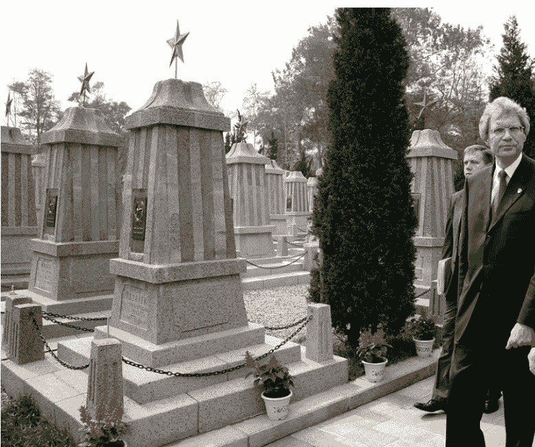

时任俄罗斯总统梅德韦杰夫到访旅顺，2010 年。

### 「4、尾声」

设立大量海外军事基地是霸权国家推行全球战略的重要手段——不光要驻军和演习，霸权国家的全球政治、经济与金融地位还依赖于定期行使或展示军事力量，这也就是为什么大家常说每任美国总统都会打仗。哪怕厌倦海外干预如特朗普，任内也有过击杀苏莱曼尼、“午夜之锤”伊朗核设施、军舰威胁委内瑞拉等行为。因此，海外军事基地的定位以及军事力量的使用不应被视为纯粹的安全现象，它本质上属于帝国霸权的先锋映射。

> 「军事力量的全球扩张其实是经济全球化的一个组成部分，甚至是前提条件——」
先有了统一的地缘政治秩序，才能推动统一的地缘经济秩序。

反过来思考，如果霸权国家决定在地缘政治层面做战略收缩，则经济全球化也会受到显著冲击，正如当下发生的局面。

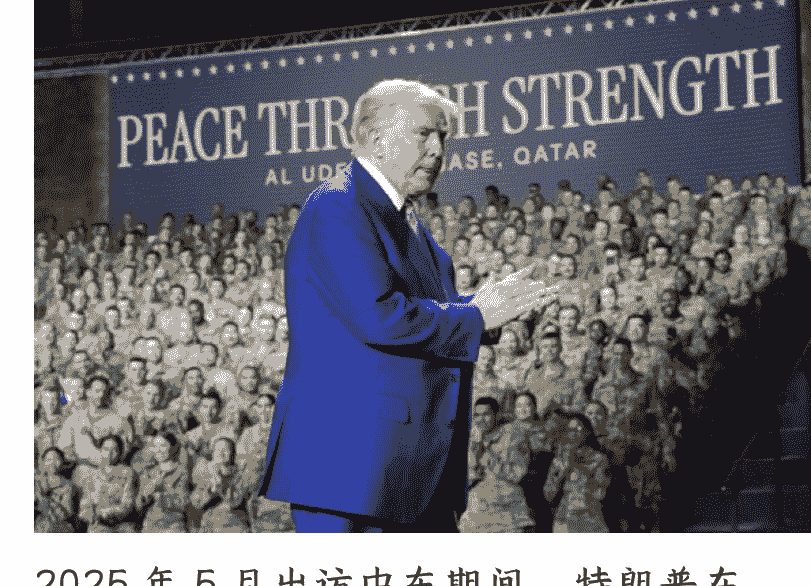

2025 年 5 月出访中东期间，特朗普在卡塔尔乌代德空军基地发表讲话。对于驻军发起国来说，撤离海外驻军的核心考量通常是减少费用开支，而对于（没有明显安全困境的）被驻军国来说，撤军可以增强它们的自主性，同时不必再顾及驻军发起国可能威胁其地位。与传统政客以及历届总统相比，特朗普更倾向于甩掉海外的无底洞，或将海外地缘政治利益尽快“变现”，以服务于国内的政治需求。

另一方面，当我们超脱出特朗普个人视角后，也能清楚地发现，只有当“全球霸权”与“世界工厂”相结合时才拥有大规模海外驻军的能力，比如 19 世纪的英国和 20 世纪的美国。今天，制造业衰落严重影响了美国的军工产能和军工生产成本，“新罗马帝国”已无力维系庞大的海外干预。拜登政府任内，美国依靠美元霸权所提供的掠夺性融资能力勉强支撑，从长期看无异于饮鸩止渴。2024 年大选，是美国人民选择了特朗普、抛弃了海外干预路线，未来无论是共和党或民主党人当总统，大概率都会将重心放在美国国内。

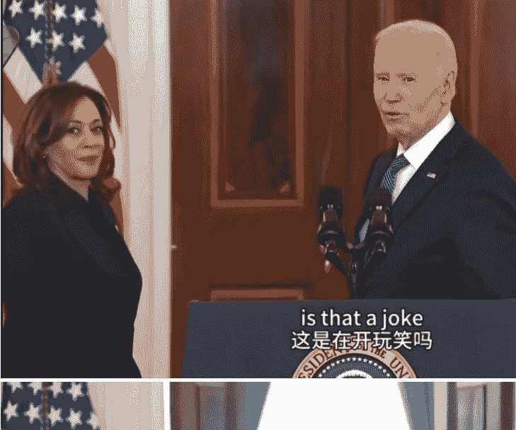
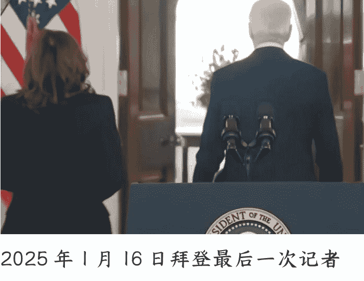

2025 年 1 月 16 日拜登最后一次记者会，三人转身走进历史。

回顾历史，每当帝国开始思考边疆驻军和军事行动的成本问题时，往往会产生两种思路。一种方式是撤军并减少干预。当维系边疆驻军、干预边疆冲突的成本接近其收益时，帝国就不再愿意买单，而是希望通过收缩来实现战略上的优化，中国古代称为“摒弃力所不及之地”。另一种方式是放权。边疆地区不方便统治，既需要一支强大的常备军来威慑敌人，又得尽可能降低驻军与打仗的成本，因此便需要其具备自给自足和自我造血的功能。最终，一个有野心、有能力、有威望的将领会逐渐拉起一支能征善战且无需太多依赖帝国财政的军队，直到“渔阳鼙鼓动地来，惊破霓裳羽衣曲”。

## 最后，安利小懒的付费群：

懒人专属群（介绍）

懒人专属群持续更新中，已持续运营6年，整理超3000份各类精选付费文章&年费社群干货，全部开放下载。本资料为付费群内部分享，仅供真实有需要的朋友查阅。

## 懒人专属群更新记录：

https://lazy2025.top/blog/record2

## 懒人专属群更新记录（需梯子，备用）：

https://lazybook.fun/blog/record2