# 权力与时间的赛跑

251017 江宁知府付费
整理：公众号懒人搜索，懒人专属群独享
懒人微信：lazyhelper

## 前言

无论个人还是国家，其所拥有的权力都是一场与时间的赛跑——谁能在有限的时间里形成“不可逆转”的优势，谁就能在重组博弈时占据主导地位……

## 「小引」

今年 8 月份特朗普斡旋阿塞拜疆和亚美尼亚停火时，曾跟阿塞拜疆总统阿利耶夫有过一段对话——

特朗普：你当总统多少年了？

阿利耶夫：已经 22 年了。

特朗普：22 年！那是很长一段时间了。

阿利耶夫：是的。

特朗普（意味深长地说）：这意味着你强大且睿智。

这段不经意间的交流让人浮想联翩，有美媒就联想起特朗普“封口费案”辩护律师、现任美国司法部常务副部长布兰奇（Todd Blanche）的一句名言：

> 「是否存在赢得选举的阴谋并不重要，这个国家的每一次竞选都是一场宣传候选人的阴谋，一群人齐心协力帮助某人获胜。」

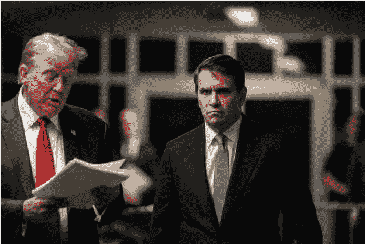

特朗普身旁目光冷峻的男子就是布兰奇。胜选后，特朗普提名多位私人律师担任政府要职。

## 正文

继承制或推举制下，政治人物在刚刚上任时权力最弱，之后逐渐巩固增强；选举制则不同，政治人物在刚刚胜选时声望最强，尔后逐渐减弱。

对于后者来说，如何与时间赛跑、尽快稳固权力，是一个关乎身家性命的问题，也会直接影响其与外部国家互动时的立场及心态。

自今年 1 月上任以来，特朗普始终处于唯我独尊的权力巅峰状态。

他不仅控制着白宫，还通过共和党掌握国会参众两院，能够在不需要向民主党妥协的情况下通过立法。

在最高法院，凭借第一任期内出色的运气，特朗普得以提名多位大法官，现在最高法院的整体立场已明显“右移”，从法律层面为总统扩权保驾护航。

华盛顿之外，与第一任期里许多商界领袖选择抵制特朗普不同，如今各路寡头纷纷宣誓效忠，用他自己的话说，“每个人都想成为我的朋友。”至于内阁及其他关键岗位上的官员，早就被换成了清一色的 MAGA 代表——所有人都在静候特朗普发号施令，生怕自己办事不力惹总统不开心。

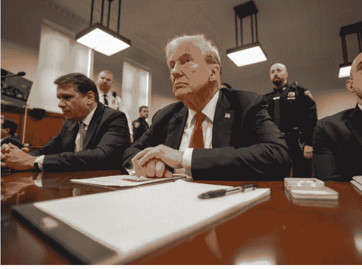

特朗普出庭受审。因为这段经历，使得特朗普对于失去权力的后果有着比普通人更深刻的认识。

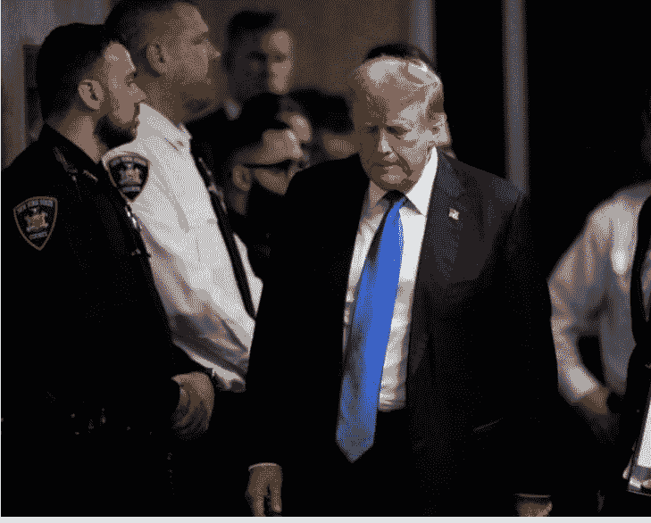

2024 年 5 月，特朗普封口费案 34 项罪名全部成立，他在法官宣读判决时没有表现出任何情绪。

不过特朗普拥有的这一切其实依赖于一个特殊背景——民主党群龙无首。

2024 年大选惨败不仅让民主党丢掉了白宫和国会，连长期秉持的“奥巴马路线”也一并被扫入垃圾堆，离开旧路线后，整个民主党都陷入了迷茫，面对如日中天的特朗普只剩下零星抵抗。

民主党策略师 Patti Doyle 近期在一次采访中被问及民主党的状况，她表示：“现在我们群龙无首，没有信息，没有议程，也没有任何替代想法来应对总统和共和党”。

你知道，如果你的政党入主白宫，那么该党的领袖就是总统。如果你的政党没有入主白宫，那么该党的领袖就是最后一位总统，所以对现在的我们来说（领袖应该）是乔·拜登，但他完全不在雷达上……”

2016 年输掉大选后，由于普选票赢了特朗普 2%，民主党内部普遍认为希拉里的失败是“大意失荆州”，是个人原因而不是路线有错误。

所以特朗普第一任期里民主党的反击非常犀利，因为全党坚信特朗普终将一败涂地。

当时奥巴马以“陪伴小女儿萨莎读完中学”为由继续坐镇华盛顿，时常在豪宅中召集旧部开电话会议，遥控民主党大局。

2018 年中期选举夺回众议院后，议长佩洛西充当了对抗特朗普的“先锋官”，二人频繁较劲，一度把白宫搞得狼狈不堪。

2020 年 5 月，黑人弗洛伊德遭到警察压制颈部致死，该画面与相关视频极具冲击力，在全美引发轩然大波，民主党遂趁机向特朗普发起“总攻”。随后拜登的胜利更是大涨了民主党信心，他们认为特朗普将永远被扫进了垃圾堆，于是不顾两党多年来形成的政治默契，对特朗普及其核心班底成员展开司法追杀，为今天华盛顿的恶劣生态埋下伏笔。

2024 大选期间，民主党面对强势归来的特朗普有些不知所措，在一片手忙脚乱中，被决心复仇、背水一战的 MAGA 团队彻底打懵。

杰夫里斯，二人支持率分别只有 25% 和 30%。

趁你病，要你命。

在这样的背景下，特朗普启动了一轮罕见的抓权与攻伐大戏。

奥巴马和佩洛西。

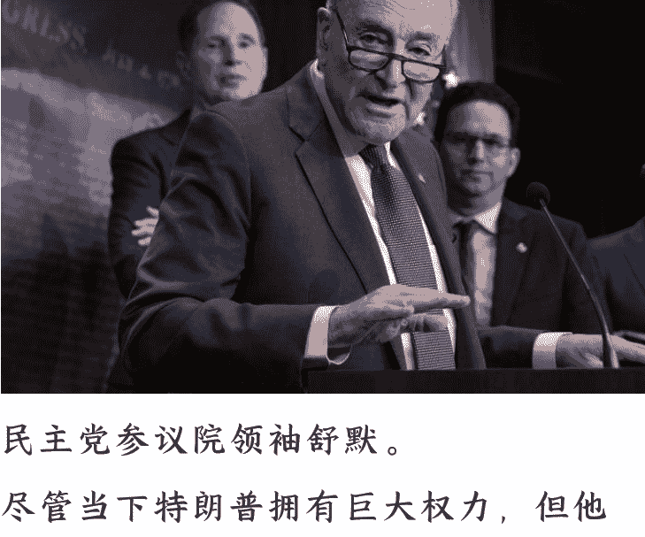

民主党参议院领袖舒默。

尽管当下特朗普拥有巨大权力，但他的执政时间毕竟有限，作为第二任总统，他的权威很快就面临着“截止日期”。

在 MAGA 内部，“特朗普接班人”问题将很快成为焦点，而确定继承人的过程本身就标志着特朗普影响力的下降，他将从“总司令”转变为“造王者”。

从这个意义上讲，特朗普第二任期的重点并不在国际政治，他最在意的是巩固自身政治遗产，尽可能延续在美国政坛的影响力。

《华尔街日报》的一篇文章认为，特朗普正在与时间进行赛跑，他在赌自己能在公众过于强烈地反对他之前——特别是 2026 年中期选举之前——巩固权威。

民主党指责特朗普家族在他第二任期里攫取了巨额财富，其中大部分来自与外国势力的交易。

假如共和党 2026 年 11 月失去对国会两院的控制权，或者更进一步丢掉 2028 大选，则特朗普家族将面临极大风险。

为了应对这种情况，经历过权力失而复得的特朗普势必更加渴望稳固并延续自己的影响力，他正在往普京、莫迪、欧尔班、埃尔多安这类民选威权的风格上走，通过掌控司法、媒体和强力机关，削弱议会与反对党，最终营造对己方有利的选举条件。

一位土耳其裔美国学者调侃称：“土耳其想成为小美国，但现在美国却变成了大土耳其。”

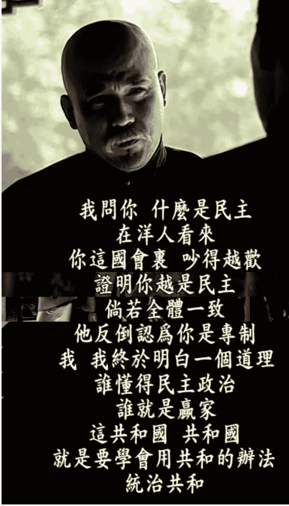

近期，特朗普对内频频出招，一个标志性事件即命令司法部长起诉前联邦调查局局长科米。

科米是奥巴马任内的联邦调查局局长，2016 年大选结束后，民主党不甘心落败，搞出了“通俄门”事件，指责特朗普跟俄罗斯串谋。

当时科米负责调查该案件，与特朗普结下深仇大恨，被解职后还出版了一本书，抨击特朗普“在道德上并不适合担任总统”。

有效的恐吓取决于一个接一个地干掉对手。

此番特朗普很可能是想从科米这位关键当事人入手，顺藤摸瓜把奥巴马和希拉里拖下水，进而向民主党政敌全面开战。

《华尔街日报》称：“特朗普担心司法部长邦迪（Pam Bondi）行动太慢，无法以虚假指控起诉他的政治对手。”

特朗普的权力就像垃圾债券，当下他必须在权力下降之前尽快巩固权力，如同一个在向下运行的自动扶梯上向上奔跑的人——如果输掉比赛，则会被带到更深的地方。

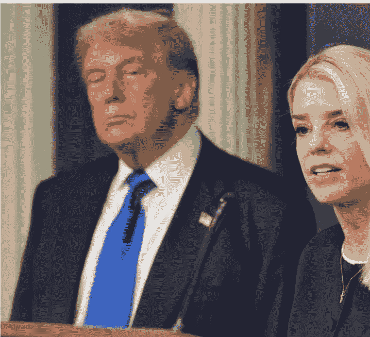

司法部长邦迪是特朗普的长期盟友，曾在 2020 年弹劾特朗普案件中担任辩护律师，她被媒体称为“唯唯诺诺的人”，面对总统指令没有什么讨价还价余地。

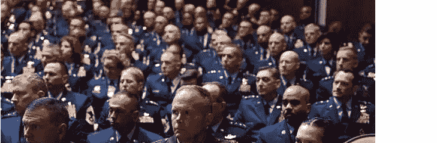

特朗普近期动作频频，国防部长赫格塞斯召集美军准将及以上级别的将领共 800 余人集中开会，特朗普亲自发表 70 多分钟的“整风讲话”，据说要进行大规模人事变动。

司法部长与国务卿、国防部长和财政部长一起被称为“Big Four”，是美国内阁中最核心的四个岗位。

美国司法部的权力非常大，不仅负责着联邦调查局、缉毒局等强力机构，还负责执行联邦法律、代表政府进行诉讼，是事实上的“总检察长”。

现在邦迪等人面临一个严峻的问题：该不该无条件配合特朗普打击政敌呢？

假如不配合，那他们立刻就会被撤职，甚至面临更大的麻烦。

假如配合，则将保留远期风险——不是不报，时候未到，尤其考虑到特朗普已经八十高龄。

某种意义上讲，特朗普正对下属们做一场“服从性测试”，通过一系列极端命令和高度政治化的行动绑架 MAGA 核心圈子里的人物，要么大家齐心协力打赢 2026 和 2028，保江山永固，要么事后一起遭受清算。

历史上，尼克松的司法部长就曾因“水门事件”包庇总统的行为入狱 19 个月。

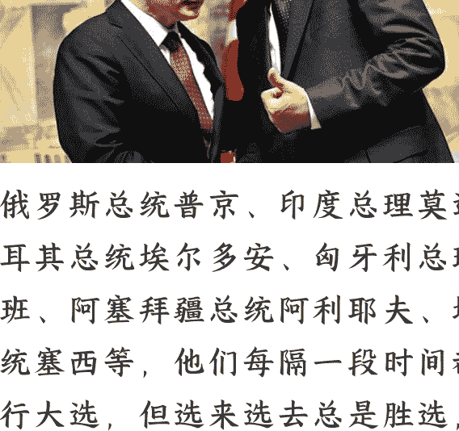

俄罗斯总统普京、印度总理莫迪、土耳其总统埃尔多安、匈牙利总理欧尔班、阿塞拜疆总统阿利耶夫、埃及总统塞西等，他们每隔一段时间都会举行大选，但选来选去总是胜选，这或许是特朗普最希望看到的场景。

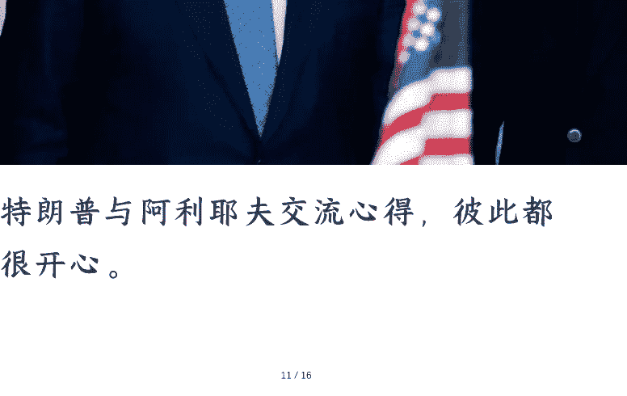

特朗普与阿利耶夫交流心得，彼此都很开心。

在充满不确定性的时代，未来如天气预报一样只能预测个大概，大家知道“冬天”要来了，但无法准确预知寒风会在哪天降临。

这种情况下，“确定性”成为当下最珍贵的东西。

近期，随着中美就 TikTok 问题达成框架协议，两国关系有稳定下来的趋势。

中方领导同志在出席联合国大会并会见美国企业高管和学者时，再次引用了那个经典比喻：“两国就像一对夫妻，会争吵，但最终彼此需要。”出乎很多人的意料，打破中美谈判僵局的并非是关税、台湾或军事姿态，在一系列棘手的争议问题中，让两国找到共识的竟然是 TikTok。

而特朗普之所以如此看重 TikTok 交易，并非出于美国的利益，更多是为了自己，为了 MAGA 能够掌握一块坚实的舆论阵地——他找的收购方（如甲骨文）全都是政治盟友。

需要注意的是，在“不卖就禁”压力下，Tiktok 估值是被人为因素给压低了，根据《华尔街日报》的评估，特朗普家族将有可能从投资者那里得到数十亿美元的交易报酬。

我们可以这样理解，如果是为了美国的国家利益，特朗普可能会索要 100 块钱的筹码，但为了自己阵营及家族的利益，只需要 10 块钱就能将他摆平。

类似的道理相信大家都理解，不必赘述。

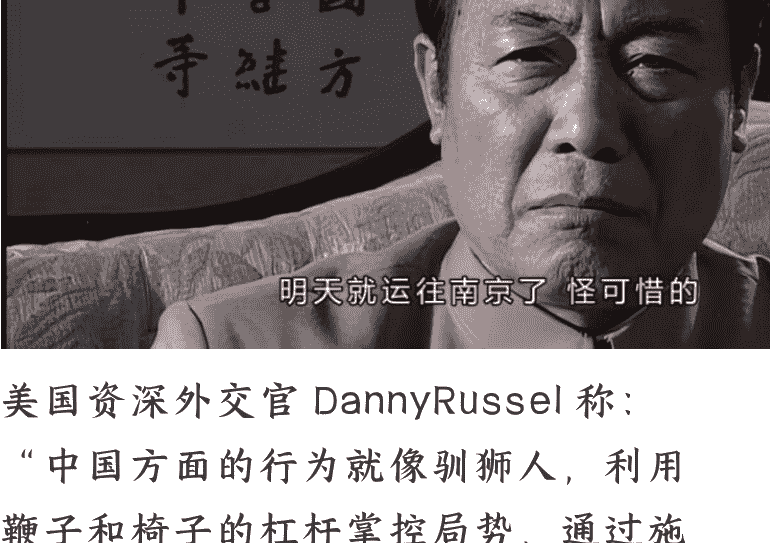

美国资深外交官 Danny Russel 称：

“中国方面的行为就像驯狮人，利用鞭子和椅子的杠杆掌控局势，通过施以小恩小惠来稳住局面。至少就目前而言，北京正在实现其一直以来的目标：通过尽可能的让步，将华盛顿拖入旷日持久的谈判。”

Danny Russel 在 2013 年至 2017 年担任负责东亚和太平洋事务的助理国务卿，是奥巴马政府“重返亚洲”战略的主要制定者。

他认为，中国对美政策的目标不是速战速决，而是塑造一个可控的进程——在对话中度过的每一个月，现状都基本得以维持，过程本身就是最大收获。

中美 TikTok 交易达成正式协议很可能要到今年年底或明年初，完成交割还要再往后推，不排除一直拖到 2026 中期选举前夕。

这意味着在长达一年的整个交易期间，中方都将牢牢掌控局势。

而对于中国来说，时间就是资产，过程收益大于结果收益。

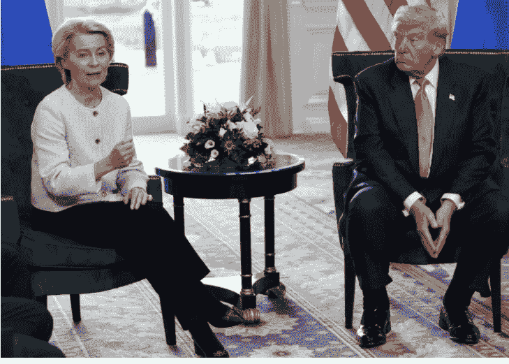

岁月不饶人，反观特朗普，他最缺的就是时间。

因为拜登的存在，使得 2024 大选期间特朗普的健康与思维状况很大程度上被舆论忽视了，其实特朗普经常表达带有明显错误的信息，只不过因为他发言时习惯于来回“编织”，语速流利，所以观感层面尚可。

英国《卫报》近期刊登了一篇详细分析特朗普精神状态的文章，题为 “He has trouble completing a thought”（他很难完成一个连贯的想法）。

文章分析了特朗普多个发言案例，发现他很喜欢虚构，即在陈述一个事实事件时，随意添加一些个人想象中的事情，或跟事件主线完全无关的事情。

在 7 月 8 日召开的内阁会议上（白宫发布了完整版视频），正当大家讨论得克萨斯州洪水、乌克兰和加沙战争、对伊朗轰炸以及全球关税问题时，特朗普突然插入了长达 13 分钟的独白，讲述他如何装饰开会的会议室，从吊灯讲到相框，又讲到天花板……

7 月 27 日，特朗普在英国与欧盟委员会主席冯德莱恩进行会谈，就在双方讨论移民问题时，特朗普突然谈起了“风车”：

> “我们不会允许在美国建造风车，它正在杀死我们，正在扼杀我们美丽的风景，并杀死小鸟……”

然后特朗普就不停地谈论了两分多钟的风车话题，惹得众人面面相觑。

大国崛起是一场与时间的赛跑，谁能在有限的时间里形成“不可逆转”的优势，谁就能在国际秩序重组时占据主导地位。

从这个意义上讲，不光特朗普在跟时间赛跑，中美也都各自在跟时间赛跑。

不同的是，特朗普个人的政治生命再怎么延长也终究有限，而国家的历史行程却远为漫长——无需押注于几年或一届任期，更需要谋划十几年乃至几十年的未来。

### 最后，安利小懒的付费群：

- 懒人专属群（介绍）

懒人专属群持续更新中，已持续运营 6 年，整理超 3000 份各类精选付费文章 & 年费社群干货，全部开放下载。

本资料为付费群内部分享，仅供真实有需要的朋友查阅 🕵️‍♂️

### 懒人专属群更新记录：

https://lazy2025.top/blog/record2

### 懒人专属群更新记录（需梯子，备用）：

https://lazybook.fun/blog/record2