# 普通人也能赢: 死磕小红书4年, 从纯素人做到10万粉的破局之路

## 251017 生财精华

公众号懒人搜索，懒人专属群独享
懒人微信：lazyhelper

## 零、前言

大家好，我是王多维，生财三年级学生，小红书虚拟行业的航海教练。

我是一名普通的国企小职工，副业是小红书博主，目前专注于小红书账号的运营和教学。

今年是我下班做副业的第5年，也是我死磕小红书的第4年，从一个月薪8000、毫无自媒体经验的普通职员，成长为一名全网粉丝超12万、单平台拥有10万粉职场账号和1.8万粉虚拟资源账号的创作者。

### 公众号懒人搜索，懒人专属群分享

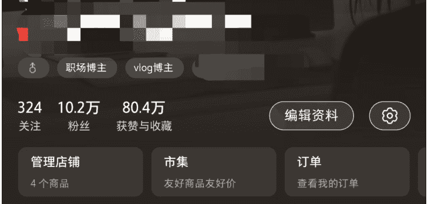

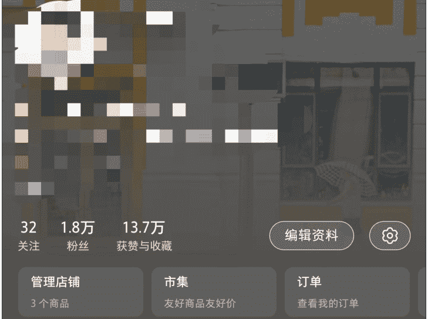

更重要的是，我的副业收入已逐渐超过主业，真正实现了“以热爱支撑生活”的转变。

不过这个过程却很痛苦，我算是和小红书爱恨纠缠了4年，中间遇到了很多瓶颈，也面临很多次账号被禁，没有收入，没有流量的时候，但最后都被我顽强的救回来。一次次的流量低谷，到一次次的五边形战士。

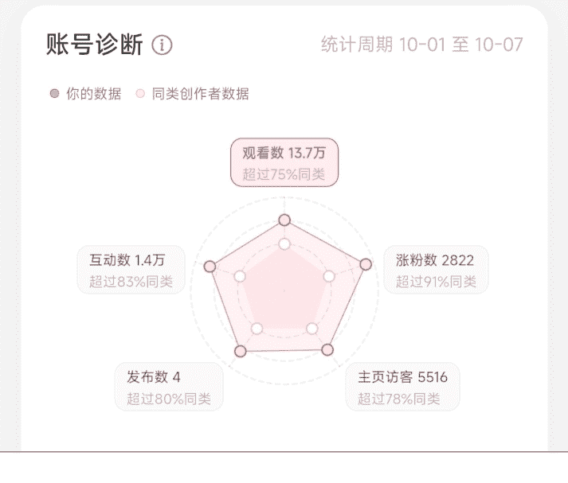

### 为啥不换其他项目？其他项目更赚钱！

因为22年的小红书就像24年的AI赛道一样，是一个公认的确定性的机会，我身边也有朋友已经在小红书上取得过很好的成绩，要么起号成功，要么已经变现过万。

基于这个认知，好不容易碰到一个能有反馈的项目，就不想放手。而且我是喜欢钻研的那类人，抓住一个问题就死磕，不死不休，研究透，研究明白，有结果了，这样更有成就感。

现在的我，除了运营自己的账号，也开始担任企业小红书运营顾问。去年帮助一家教育公司通过小红书获客4000+，实现盈利60万+；同时也开启了自己的知识产品，带200+学员走上小红书创作之路。

这篇文章不是干货教程，而是想和你们分享，我，一个普通人，这几年是如何和小红书较劲，不断被平台狙击，又不断尊重平台，适应平台，在小红书找到自己的一席之地的。如果你：

- 是一名想要开启小红书副业但迟迟不敢行动的普通上班族；
- 是一个努力更新却始终不见起号的内容新人；
- 或者，你只是需要一份“既然TA可以，那我也可以”的真实参照；

那么，我相信我的经历会给你带来信心和动力——不是神话般的逆袭，而是一个普通人脚踏实地、越走越稳的真实路径。

接下来，我会和你分享这段从0到10万粉的心路历程。期待你，也从这里开始，走出自己的第一步。

## 一、抓住小红书红利期，直接开干

> 被小红书打击，不懂方法，起号失败

身边的人都在推荐做小红书，但我发笔记却只有几十个小眼睛！

这应该是大部分人做小红书时的情况，我也不例外。

那时候刚毕业，满怀希望进入国企，工作后才发现国企并没有大家想的那么好。稳定是稳定，职位和薪资也都非常稳定，晋升路窄，薪资提升也很有限。没有关系，没有背景的普通人，发展真的很难，很多情况下，都是干脏活累活，为别人做嫁衣。虽然收入有时候也能破万，但却负担不起高额的房价。

所以就想尝试下班发展副业，比较巧合，顺手在知乎发的学习方法的文章爆了，收获了5k的关注，就这样做了一段知乎，也变现了几千块钱。因为这个机会，我在自媒体平台尝到了甜头，有了自己的IP，认识了一些互联网朋友。

但当年知乎也在走下坡路，月活数据越来越低，短视频发展的冲击，也让知乎发展视频，减少了问答的流量。发的内容流量越来越少，变现也几乎为0，就开始寻找其他方向。

2021年底，我的互联网朋友们聚在一起讨论2022年的趋势，大家都推荐我去做小红书。就在这个时候，我重新认识了小红书。

之前一直觉得小红书是卖美妆护肤品的代购平台，还在小红书上买过口红等产品，没想到小红书还是一个内容分享平台。因为我当时在知乎已经积累了一些创作经验，发的问答累计阅读量也有200多万，我想这些内容发在小红书上，是不是也一样会受欢迎。

就这样，我开始制作和发布小红书笔记。当天就做了一篇关于如何阅读的笔记发了出去，但满心期待却落了空，没有预期的爆款，小眼睛只有几十，点赞也只有个位数。

我当时以为是我的笔记模板没用对，所以就开始看着别人的模板，1比1的制作和创新，开始疯狂的测试不同的笔记样式，但无一例外，都没什么气色。彼时我身边的朋友发小红书都爆了，有的——周涨粉1万，有的几个月就涨粉好几万。

看到别人很轻松的就起号成功，我陷入了深深的自我怀疑，为什么别人可以？为什么我的不行？那个时候，没有人请教，没有人沟通，我当时知道的，就是不断的制作模板，发布笔记。

> # 王多维
> #多维的小红书之旅
> 又制作了一个新的模板！对于喜欢纠结，选择困难症的处女座来说，真的是很难！这是第4个版本了，有小红书的童鞋，能否小红书搜索“王多维”给个支持啊！拜托了🙏🙏🙏能给我提个建议那就更好了，再拜🙏
> 
> 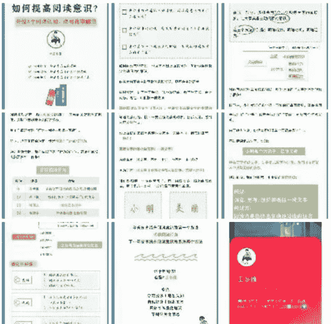
> 
> 2022年2月15日 20:59

> # ## 如何提高阅读意识?
> ## 升级3个阅读认知，读书效率翻倍
> @王多维
> - 明确行为：知道自己正在阅读
> - 明确动机：知道自己为什么坚持阅读
> - 明确阻力：知道自己为什么坚持不下去
> 
> 
> 
> 「如何提高阅读力01」这些是我制作的模板的一小部分。
> 
> 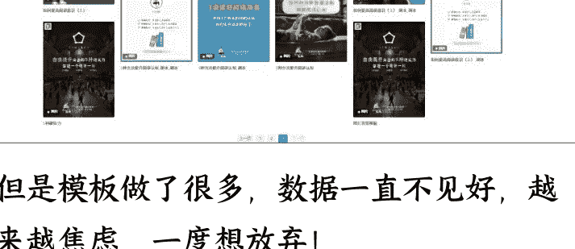

但是模板做了很多，数据一直不见好，越来越焦虑，一度想放弃！我开始怀疑是不是自己账号有问题，是不是自己被限流了。（我知道很多新人发笔记数据不好也会怀疑账号，我太熟悉了，因为我就是从那个阶段过来的！）

后来反思，在这个阶段，我几乎踩了所有新手必踩的坑，不仅导致我起号失败，还让我走上了一条不是那么正确的路线，白白错过小红书飞速发展的时期。

### 第一个坑：没有主动学习的意识

虽然我是研究生，但是在做副业这件事上，真的是盲人摸象，啥都没搞清楚，就是一味的盲干。在没有了解小红书用户人群，变现模式，内容特点的时候，粗糙的模仿和自以为是创作，导致走了很多弯路。

### 第二个坑：总想一个人解决，不好意思求助

当时我身边的朋友小红书做的很好，我还是自己在摸索研究，没有去拜师学艺，更没有付费意识。后来付费学习后才发现，原来我苦苦思索不得的问题，居然花199就能解决，并且还是有体系的解决，同时还有一个愿意随时给你解答的导师。

一个人蛮干，就想自己解决的错误观念，让我浪费了好多时间。

### 像素级拆解和模仿爆款，收获万赞爆款，成功起号

我几乎就要放弃了，无意间刷到一篇爆款，这篇爆款的主题是《大学没课推荐去做的6件事》。

这篇笔记仅仅是写了几个纪录片的名字、电影的名字、证书的名字，就有1万的点赞。相比于我想发的内容，这篇内容太简单了，但数据却非常好，我下意识的反应就是：这不科学！

但存在即合理，爆文之所以成为爆文，肯定有他的道理，尊重事实，弱化情绪，我开始思考，是不是我的内容太小众了，大家其实并不关心呢？这是我第一次有了用户思维，有了选题的意识。

我决定再试一次，不过做同样的选题，我必须做的更好一点。

风格上我要更有吸引力。我重新设计了图文风格，封面用了大标题+内页拼接的形式，颜色上选用撞色设计，内页用大标题+引言+列点内容的形式。

内容上我要更有干货！依旧是大学没课要去做的6件事，但这6件事是根据我从挂科保研211的真实体验，又去搜集了很多资料，不仅信息密度更高，也更实用，在内容的中间还穿插这一些我上过的课，我真正的想把这些建议告诉给大学生。

发布的时候，我就有了预测，这篇肯定比之前的数据好，但我没想到那么好，发出后第4天，跑出去了6000多赞，一周就涨粉1000，还收到了合作邀约。

> # 王多维
> #多维的小红书之旅
> 记录一下！
> 摸索了一个月，终于开窍了！
> 重新调整后第一篇图文就小小爆了！
> 第一篇就有推广来！
> 第一个推广就建议甲方再等一等！
> 对未来有信心，对当下才有耐心！
> 2022年，绝对不重蹈知乎的覆辙！
> 
> 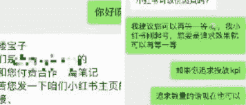
> 
> 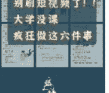

当你放弃幻想，非常虔诚的做好一件事的时候，事情就会变得很顺利。我在我的能力范围内，非常注重每篇笔记的细节，在别人发的选题上，我要做的更好，更有价值。这是我从这篇爆款笔记中学到的东西。

第一篇爆款笔记并没有让我立刻认识到定位的重要性，发了4篇笔记后，大学题材又爆了一篇，这下我才意识到，原来我适合做大学成长博主。

是啊，我从挂科到保研，创业、班长、学生会、做课题、考过四六级、熟悉大学人情世故，大学经历丰富的我太适合做大学博主了。

从知乎到小红书，期间一波三折，我终于认识到自己的定位，找到了自己的赛道。我的定位都是在做的过程中摸索出来的，是通过用户的反馈给出来的，从来不是先有定位再有内容。

一旦有了明确的方向，成长的曲线就会变成指数型！

用了3个月，我就涨粉到7000，期间，我不断的研究图文笔记，对于所有的因素都做过无数次的尝试，光是笔记风格，就修修改改很多遍。导致我的图文技术已经达到了能复刻90%封面和笔记的地步。当一件事情钻研到极致，你就已经成为这个领域的专家了！做不好，就是拆解的颗粒度还不够细。

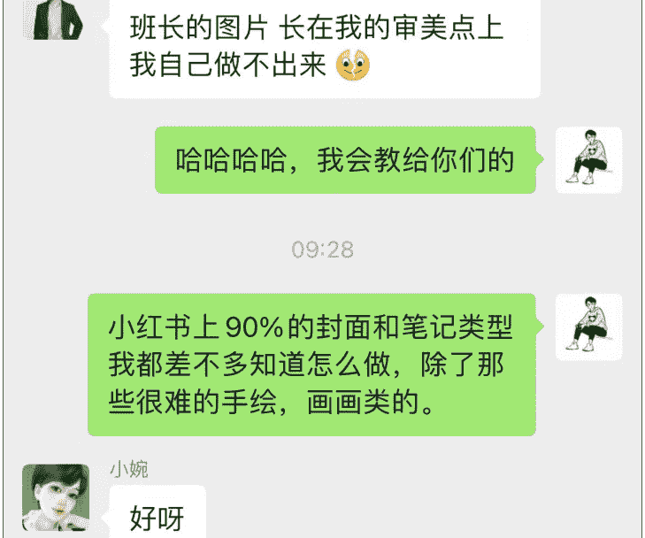

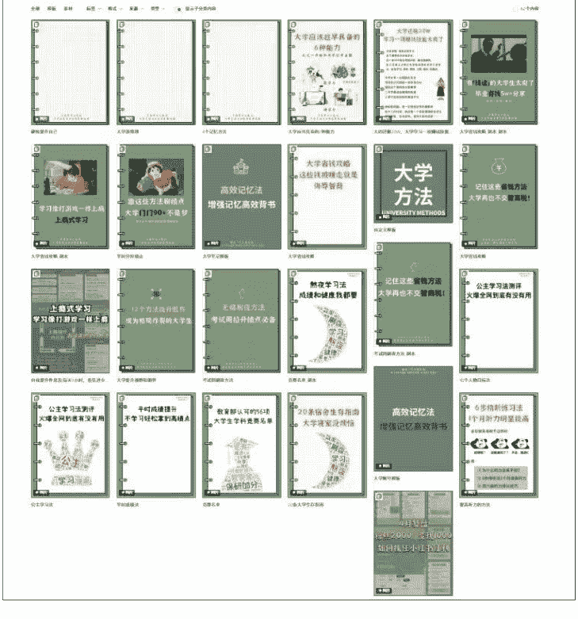

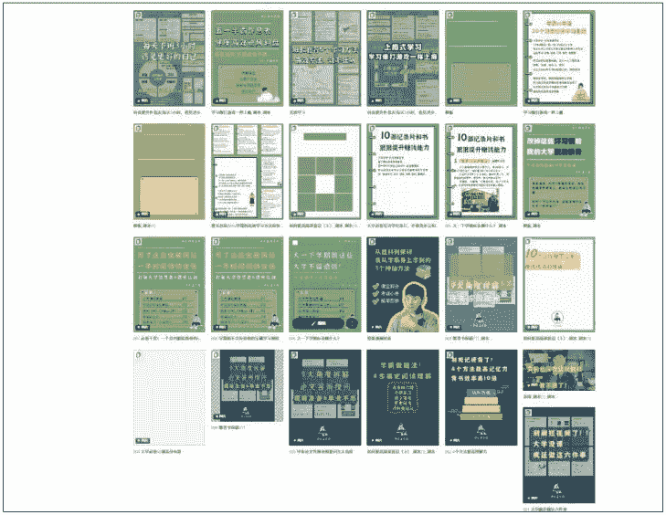

现在看到很多新手抱怨自己对标了别人的账号，结果数据却不好。我总会淡然一笑，很多新手所谓的对标，在我眼里差了十万八千里。我能一眼看出来哪里不好，就是多亏了这个时间段的极致学习和钻研。

## 二、从有流量到能赚钱，悟道“20字赚钱心法”

### 粉丝暴涨2万8，结果却赚不到钱

22年4月份，我设计出了一款非常受欢迎的笔记模板，加上比较好的内容，我的笔记迎来了爆发期。

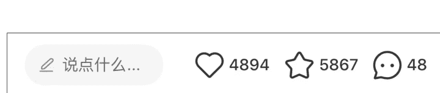

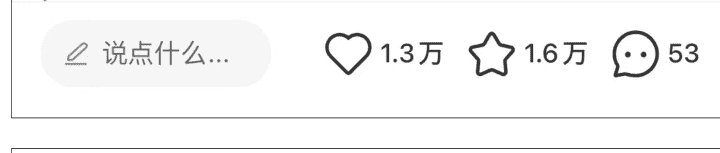

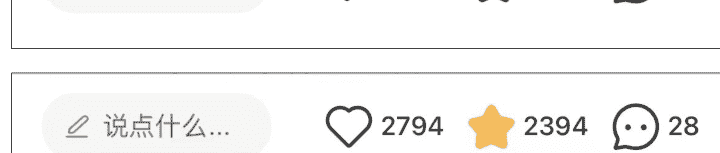

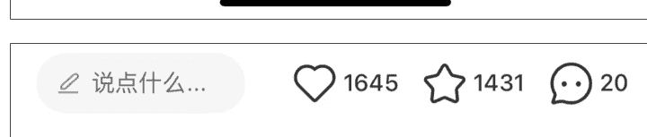

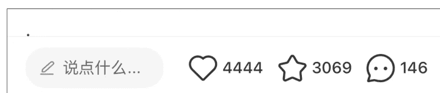

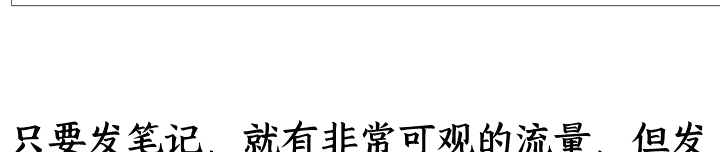

只要发笔记，就有非常可观的流量，但发着发着就发现不对劲，到了年底，我整整一年，只赚到2万块钱。我遇到了一个比做内容还难的问题。

做笔记，无非就是内容差。内容差可以通过拆解、模仿和学习，逐渐提升能力，慢慢打磨，怎么也能做出来爆款。但是变现这件事脱离了我的掌握。

由于极度缺乏对变现的认知，导致我只能干着急，无从下手。这种完全没遇到的问题，最让人焦虑。这也是副业小白最难的卡点，你无法赚到你想象不到的钱。

当不知道你干什么的时候，你就先搞明白，有哪些赚钱的模板。这是我回头看，最有价值的教训。

### 加入生财圈子，悟道 20 字赚钱秘术，重塑赚钱体系

刚开始接触知识付费，是七小和梨云两个前辈现场演示的。他们做出来小红书后，立刻就开了小会做交流，每个人付几十块钱的门票。这种轻快的知识付费，让我快速的学到了很多东西。

所以后来在朋友圈看到七小生财招新的朋友圈，我选择果断加入生财有术。

这是我第一次花费 4 位数进行知识付费，但一进入生财，我整个人就懵了，天灵盖每天都被冲击。每天的感慨就是：

原来这样能赚钱！

原来这个项目是这样赚钱的！

嗯？原来这也能赚钱？！

擦！这 tm 都能赚钱！

作为曾经参加过创赛的人，自己对商业模式本来就有一定的敏感性，进入生财后，一下子扩充了好多商业模型。

但这么多项目，我该怎么选呢？我当时做了以下 3 个动作：

- 1）看完生财近几年的精华帖，先去了解大家都是怎么赚钱的，以及做到什么程度能赚钱
- 2）不断的和人交流，从别人那里获得评价，找自己的基本盘
- 3）筛选，筛选，再筛选，找到能动用自己基本盘去做的，且可以赚钱的项目

在这个过程中，我意识到，赚钱这件事，技术和方法只是非常基础的一件事，相同的资源和相同的时间内，有的人能月入 10 万，有的人只能赚 5 千，最大的区别在认知上。

普通人真正要做的，不是盲目追项目、做账号，而是静下心来，搭建一套属于自己的赚钱认知体系。在我进入生财的三个月里，我反复实践、试错复盘，最终总结出这 20 个字的赚钱心法：向上链接、向下赚钱、最短路径、暴力开局、快速迭代。它们不仅帮我实现了从0到1的突破，更让我在副业路上越走越稳。

### 向上链接

这个上，不是专指比你地位高，能量比你大的大佬，而是你做的这件事的前辈们，他们已经在这个赛道上跑了很久，有了很多的认知、方法、技术、工具，随便透露一些给你，就能让你少走很多弯路。

“向上链接”也不是让你去巴结大佬，而是主动向有结果的人学习。

我们可以具体怎么做呢？

如果你做小红书，别只盯着官方教程。要去主动链接做出过万粉、且实现变现的博主。

我最初做账号时，在小红书私信了20多位大学博主，有了20个优质博主资源，进入生财后，见到我感兴趣的大佬也是立刻主动去打招呼，拱卒就是这么被我挖出来的。

哪怕付费咨询也值得——有段时间想学习口播，就去私信抖音30万粉的博主，付费咨询，一个小时就给我讲明白了做口播所有的知识点和专有的经验。转型职场博主的时候，付费4位数咨询，2个小时，解决了3个月的卡点。

有个非常好用的技巧，很多人都会很真诚的请教问题，但是不会反馈，我会经常给帮助过我的人反馈我的进展，他们看到我的成长也会更加乐意帮助我。问有质量的问题，给对方提供情绪价值或资源互换，关系才能长久。

### 向下赚钱

当你有了50分的成绩，你可以卖给50分以下的人，当你有了80分的成绩，你可以卖给80分以下的人。只要卖，就有人买，这是我副业4年观察到的结果，无一例外。

很多人总觉得自己“还不够好”“不配赚钱”，这是认知上最大的障碍。

其实，赚钱的本质是价值交换：

- 哪怕你只有50分，也可以帮助40分的人；
- 你做出了一个小爆款，就可以教还做不出爆款的人；
- 你用过三款好用的小红书工具，就可以整理出来卖给还不知道的人。

包括我在内，很多人都有道德洁癖，瞧不上知识付费，不屑于卖课卖服务，总是觉得自己不配，但向下赚钱就是有的卖给没有的，已知卖给未知，想分享卖给想要听，服务卖给需求，总是有资源的一方卖给没有资源的一方，总是供卖给求，总是上游卖给下游。

### 最短路径

我走了不少弯路才明白“最短路径”的真谛——真正能让我们坚持做下去、有反馈、有成效的，往往就是那条最直接、最不绕弯子的路。过去我总在“想要流量”和“想赚钱”之间摇摆，其实是因为没想清楚什么才是真正的最短路径。后来我索性把“赚钱”作为唯一目标，所有动作都围绕它展开，事情反而变得清晰简单。

比如我在带小红书虚拟产品的学员时，发现很多人会卡在“发货用哪个平台更好”“资料存百度网盘还是夸克网盘”这类细节上。其实这些纠结大多没有意义。最短路径的核心是：选择你当下最容易执行、最能推动进展的那一步。 先动起来，比纠结“最优解”更重要。比如：

- 如果你刚开始做小红书，别花三天选头像，先用一张清晰的真人照片或品牌logo。
- 如果不知道写什么内容，直接找3个你喜欢的同类博主，拆解他们点赞最高的5篇笔记，模仿主题和结构。
- 如果纠结工具，哪个顺手用哪个：剪映剪视频、Canva 做封面、手机自带相机拍摄——完成比完美重要。

### 暴力开局

“暴力开局”是我实践多年且受益颇深的策略。想做什么，绝不拖延，立刻用最低成本启动。想运营小红书，我当天就找模板发了第一篇笔记；想转型，立刻找对标账号，拆解他们的封面、标题、拍摄角度甚至配色方案，然后马上模仿创作；想建社群，当天就发朋友圈招募。

关键在于：很多问题的答案，只有在行动中才会浮现。你不需要万事俱备，只需要一个清晰的起点。

### 快速迭代

上面 16 个字解决了从 0-1，但快速迭代让我实现从 1-100。有了粗糙的开始，我就会不断的优化流程，为了拍出好看的照片，我刚开始用了破电脑，赚到钱后，换了个 macbook。为了出爆款，我一点点改变封面，标题，内容的结构，每个阶段我都不断的完善，一口吃个大胖子在我这根本就不存在。

很多爆款，都是在这种迭代中产生的。有了快速迭代的能力，才有暴力开局的勇气。

### 打开变现渠道，副业收入提升200%

生财真的给了我很大帮助，我的信息来源是生财的，我的项目案例是生财的，只要我愿意，我还可以直接加入一些项目。最重要的，我遇到的贵人也都在生财。

在这个阶段，我学会了什么是前端流量，什么是后端交付，还认识了一个前辈：拱卒！他是大学资料赛道和大学创赛赛道的佼佼者，我在做知乎的时候就刷到过他，没想到他也再生财，我和他链接后，非常真诚的和他交流，他给我讲了很多小红书的玩法，甚至给了他的独家资料。

有了这个资料，我开始构建起自己的第一个变现通道——大学成长社群！

我邀请了很多小红书博主，用我3万粉的账号，撬动了200万的流量！做了大学有术社群！

同时，我还尝试把我的小红书运营经验分享出去，打造第二个变现通道——小红书训练营！

账号上，则是规划了第三个变现渠道——小红书商单接广！

但这里，却遇到了一个非常大的卡点。我的笔记风格是非常受欢迎的，用这个笔记模板做出来的笔记，数据都很好，但这种图文干货，没有广告位，所以很难接到广，再加上大学成长赛道依然处于细分赛道，广告商数量也不多。

要不要为了以后接广，放弃非常有优势的笔记模板？

毕竟作为副业新人，刚刚取得一些成绩，现在数据好，虽然赚的不多，但终究还是有额外收入的，如果去转型，万一失败了呢？

这时候生财这个圈子又默默拉了我一把，但我回过头再去看精华的时候，我发现那些能赚钱的圈友，无一不是对赚钱又清醒的认知，总是一针见血的直达赚钱的本质。所有的资源、人脉、工具、资料都是为赚钱服务的。自己就是要直奔目标。

还有一个最重要的，沉没成本不参与决策！

我想到我的目标既然是扩大收入，那流量只是过程，不是结果，所以我放弃了我的爆款模板，开始探索书桌、生活场景，增加广告位。

转型初期，数据遭遇下滑，但是广告却多了起来，为了拍好 plog，我又开始像素级拆解学习和模仿，细化到每张图片的角度、物品、打光。先模仿个大概，再不断优化。

构建起立体的变现通道后，我的收入肉眼可见的提升了，相比于副业第一年，第二年副业收入提升了 200%!

## 三、再次跌入低谷到收入翻 10 倍，极致化核心能力

账号进入瓶颈期，收入极速下滑

2023 年，我的账号粉丝只增长了 1 万多，但是变现是第一年的三倍。本来以为，我的副业之路会这样顺风顺水下去，但是第三个瓶颈却接踵而来!

首先是大学成长社群的流量入口被卡死，23 年底，小红书对私域引流的监管越来越严，我的账号一度被禁言 2 个月。没有新的流量来源，后端成交急剧下降。

再加上我刚开始既要发展接广变现，又要引流，没有精力做矩阵批量引流，私域流量存量低，青黄不接的局面下，我们团队成员也只能各自寻找出路，被迫解散。

另一方面，大学领域的商单少之又少，加上账号限流禁言，23年底有好几个月账号都是停滞状态，粉丝不增反跌。进入了一个大的平台期！

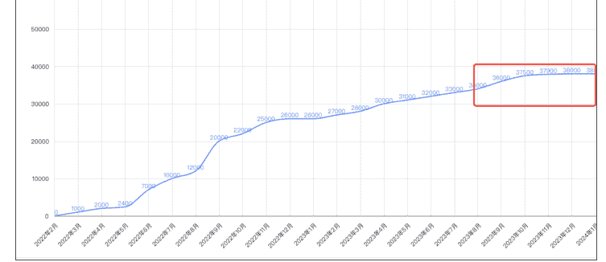

我在这个阶段停滞了4个月，刚开始还靠自己解决这个问题，但不管怎么发，账号都毫无起色，笔记做的不好看，尝试视频也拍的巨垃圾，笔记发出去，没有丝毫波澜。焦虑到我患了过敏性疾病，免疫力急速下降。

我该怎么办？另起炉灶还是努力转型，拯救我的账号？

走投无路的时候，赚钱20字秘术又拯救了我：
- 1）向上链接：我找了不同赛道的博主做了咨询，针对我目前的问题，给我指出了一个新的方向——转型做职场视频博主
- 2）向下赚钱：放弃大学社群，发展小红书社群，利用自己的技能先打造自己的小产品

就这样，大方向渐渐明确，可是落地实操，还差很大一截!

### 像素级拆解学习法发挥极致，副业收入增长 10 倍!

咨询过后，我有了大致的方向，不用像无头苍蝇那样乱撞了。决定了要做职场博主，我又开始利用像素级拆解学习法，开始拆解职场博主这个赛道、内容、视频类型。

我把爆款视频下载下来，一帧一帧的分析画面、文案。

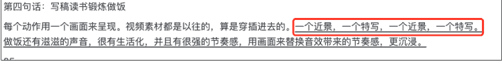

这个时候，我整理了像素级拆解的三级分析结构：
- 宏观：分析赛道、博主、变现方式，精确到每一个内容逻辑和变现路径
- 中观：选题、内容结构、植入方式
- 微观：封面、标题、文案逐字稿、画面逐帧拉片、软植入方式

### ✅ 年底救大命
### ✅ 感谢打工人的好大哥!
### 打工人不熬夜
### 全靠这4个效率工具
速写100页研究报告|实名感谢这4个效率工具

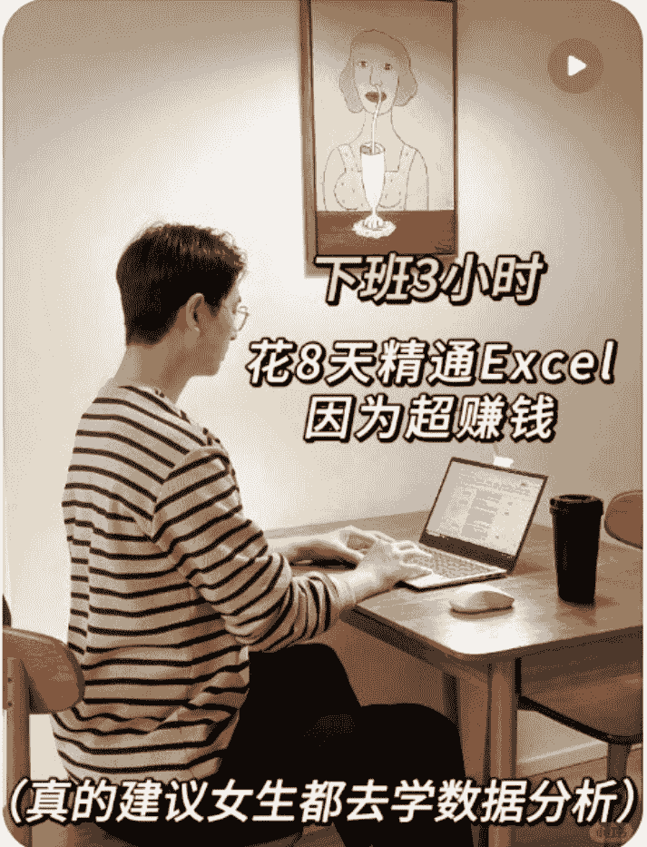

下班3小时
花8天精通Excel
因为超赚钱
(真的建议女生都去学数据分析)

### 偷偷逆袭 | 让我拿2万Offer的Excel速成方法
3685

大学生寒假搞钱必做的3个副业（2）

### 下班3小时学Excel
拿到2万+offer了
(8天精通Excel学习方法)

### 偷偷逆袭 | 让我拿2万offer的Excel速通方法
2.8万

### 1页纸时间管理
- 时间分类
- 时间记录
- 时间打分

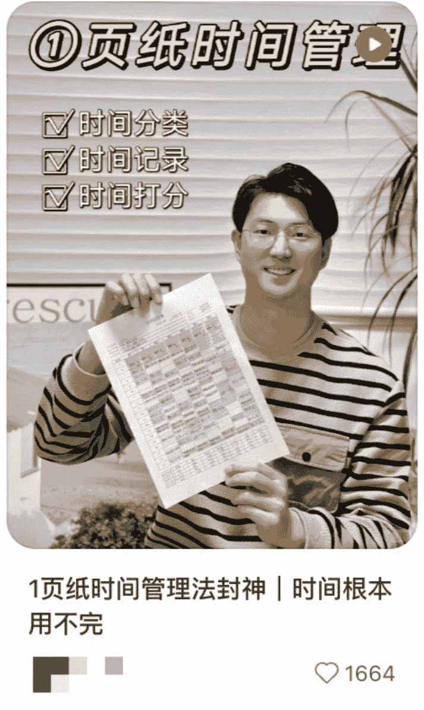

### 1页纸时间管理法封神 | 时间根本用不完

结合小红书数据反馈，点击率不好就换封面标题，点赞收藏不高，就持续精进内容，就算是一个选题第一次发数据不好，也会不断的修改，再做成视频发一次。

就这样暴力开局和快速迭代，终于数据从个位数，到几十个赞，到几百个赞，到几千个赞，最后出了一个大爆款，截止到现在 70 万浏览，2.8 万个赞。

我的账号重新被我激活，进入快速发展的时期。

在这个过程中我遇到过很多问题，比如封面不好看怎么办？比如拍不清楚怎么办？比如不知道怎么拍？拍不出来这种感觉怎么办？口播表现不自然怎么办？家里环境不好怎么办？

几乎 2-3 天就会面临一个新问题，但经历过三次转型的我，这个时期已经很成熟了，遇到的问题绝对不会等靠要，要么付费找人帮我解决，要么继续拆分问题，然后用最短路径和快速迭代的方法，挨个解决。

我的起点很低，纯普通人，没有特长，不会拍照，不会拍视频，录口播录不利索。我相信这些问题大家都会存在，很多人遇到就会下意识的换条路，不会录拍视频、不会剪视频就不拍不剪了，但我不是，我下意识的反应是我要做什么才能达到能拍能剪的程度。

我拍口播的时候，因为表现力不好，加上有口音，咬字不清楚，不自然。怎么办呢？

我就不断的重复，不断的重复，每一句话录 5-10 遍，最多的时候，一篇稿子来来回回录了有 9 遍。为了让我咬字清晰，我上班下班路上就背顺口溜，背贯口。“钓鱼要到岛上钓，不到岛上钓不到。”这句话是我重复最多的。

不会拍视频，就截图别人的视频，一帧一帧的模仿，直到拍到一模一样为止。

不会剪视频，就逐句逐句的拆解，模仿，一个动画一个动画的模仿，别人用啥音效我用啥，别人用啥花字我用啥。

前期真的很费时间，很费力，但是到了中期，爆发就来了，这些所有我优化过的技能，加在一起，就爆发出了惊人般的能量。

最先有变化的就是我的粉丝量。

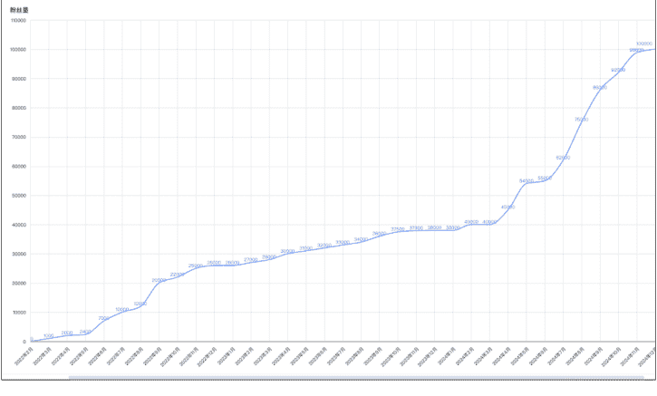

卡在 4 万粉半年之后，我的粉丝数量一路飙升，半年涨粉到 10 万。

我的报价从 2000，到 5000，到 7000、8000，一直到 5 位数，几乎每个月都在涨价。

2024 年，我的粉丝从 4w 涨到 10w，副业收入比第一年涨了 10 倍!

## 四、小结

相比于收入，我更高兴的是我从刚开始就没有选择短平快的小项目，也没有因为遇到的困难选择抄袭、搬运这种快速见到结果的捷径。

从 2022 年到 2025 年，小红书每年都在变化，每年都有新的政策，从大字报图文，到 plog，到口播视频，到 vlog。从 AI 到虚拟行业，我都涉足过，并取得成果。

自媒体平台唯一不变的就是变化，很幸运，我选择了一条难走的路，但也因此收获了能跟随平台变化的能力。

像素级拆解和学习是我的底层能力，而内容变现这是我的个人系统。不断的遇到瓶颈，打破瓶颈是自媒体博主的常态。

如果你想做小红书，在做小红书，想要提高小红书的内容质量和粉丝体量，或是想要通过小红书获客，那么我可以给你几点建议：

### 1. 选择大于努力

小红书平台的节奏变化越来越快，靠自己钻研，埋头苦干的时代已经过去了，直白的玩法已经显得没那么奏效了。找取得过结果的人去学习和模仿，甚至借鉴模式和方式，快进快出，才能跟得上节奏。

### 2. 内容为王

少些幻想，不要寄希望于抄个模板，洗稿别人的内容就能取得成功，要有用户思维，只有真正为用户提供价值的账号，才能在这场小红书淘汰赛中生存下来。

### 3. 做账号要沉得住气，别太浮躁

数据不好真的是常态，别老想着发出去就是爆款，接受慢启动，坚守长期主义，前几个月数据惨淡，但每一次发布都在训练网感和内容能力。日拱一卒，不急于爆火，持续优化的人才能跑赢周期。

### 4. 不是有了路径才行动，而是行动中浮现路径

很多人渴望一张“绝对正确的地图”才敢出发。但真正的路径是在行动中，通过反馈、试错、调整一步步走出来的。先开枪，后瞄准。

### 5. 最大的瓶颈永远是自己

账号会瓶颈，平台会变化，但你的认知、学习和进化能力永不瓶颈。投资自己，扩容认知，提升解决复杂问题的能力，是一切增长的根源。

最后，安利小懒的付费群：

懒人专属群（介绍）

懒人专属群持续更新中，已持续运营 6 年，整理超 3000 份各类精选付费文章&年费社群干货，全部开放下载。

本资料为付费群内部分享，仅供真实有需要的朋友查阅

懒人专属群更新记录：
https://lazy2025.top/blog/record2

懒人专属群更新记录（需梯子，备用）：
https://lazybook.fun/blog/record2