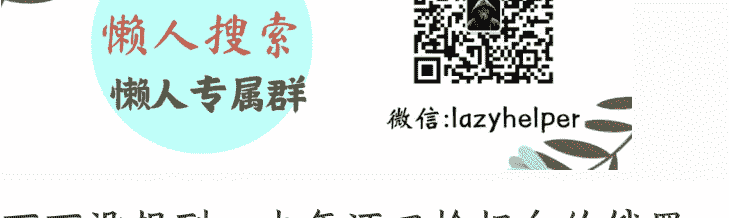

# 朱拉尼访问俄罗斯，阿萨德可能被交出？

251020 文/卢克文工作室嘉宾 星海舰长

整理：公众号懒人搜索，懒人专属群独享

懒人微信：lazyhelper

万万没想到，去年还刀枪相向的俄罗斯和叙利亚沙姆解放组织，现在竟然握手言和了！

10 月 15 日，叙利亚临时政府总统朱拉尼率团到达莫斯科，和俄罗斯总统普京进行了会晤。

啥意思？俄罗斯是要和叙利亚新政府搞到一起去了吗？

这下子，拖家带口在俄罗斯政治避难的叙利亚前总统阿萨德就尴尬了，俄罗斯和叙利亚关系正常化了，那他的安全怎么保证？会不会哪一天突然中毒而亡？

那么，这到底是怎么回事？

朱拉尼这次访俄，不是国事访问，而是去俄罗斯参加“俄罗斯-阿拉伯国家峰会”的，和普京只是顺带见了一面而已。

不过，虽然是顺路而为，但象征意义很大。

在大部分人的认知中，朱拉尼是西方国家通过土耳其这个白手套扶持起来的，其作用就是推动叙利亚变天。他默许以色列驻军戈兰高地，表示“愿意与以色列签订亚伯拉罕协议”，似乎也证明了这一点。

但现在呢？朱拉尼怎么和西方国家的敌人俄罗斯搞到一起去了？

怎么现在几个月过去，双方就冰释前嫌了？

其实吧，早就有预兆了。

今年8月，朱拉尼派叙利亚临时政府外交部长希巴尼，对俄罗斯进行了访问，并与俄罗斯外长拉夫罗夫进行了深入的会谈。

9月，普京就向朱拉尼发出了邀请。

一切，早就铺垫好了。

从目前披露的消息来看，朱拉尼向俄罗斯送出了几份大礼，也提了一些要求。

- 第一份大礼，就是俄军在叙利亚塔尔图斯港和赫梅米姆空军基地的问题。

在阿萨德时期，为了保证俄罗斯在中东的利益，俄罗斯和阿萨德政权签订租借合同，在叙利亚设立了塔尔图斯军事基地和赫梅米姆空军基地。

叙利亚变天之后，朱拉尼把阿萨德政权和外国签订的合同都推翻了，包括这两个基地。

今年 5 月份，朱拉尼还和阿联酋签订合同，把塔尔图斯港转让给了阿联酋。

这样一来，俄罗斯就很难受。

一方面，这两个军事基地对俄罗斯意义重大，塔尔图斯是俄海军在地中海唯一的落脚点，而赫梅米姆则是其控制中东空域的战略支点，对于俄军非洲军团的活动非常重要，不可轻易放弃。

但另一方面，这两个基地在叙利亚变天之后，处于一种不合法的状态，无法从叙利亚得到正常的水电和食品保障倒也罢了，总有武装组织时不时发动个袭击，谁受得了？

比如今年 5 月，就有一个自称是“幼发拉底火山”的武装组织袭击了赫梅米姆空军基地，虽然没造成损失，但只有千日做贼，哪有千日防贼的道理？万一哪天俄军起飞战斗机时候有人用迫击炮轰击跑道咋办？

所以，军事基地的合法性，是俄罗斯必须要解决的问题，而这个时候，朱拉尼的态度就很关键了。

在访问中，朱拉尼表态，不仅愿意承认阿萨德政权有关租借军事基地的协议，而且愿意延长这个协议，一直到 2099 年。

不仅如此，朱拉尼还答应，俄军在塔尔图斯港的所有运输行动，免于叙利亚海关审查；赫梅米姆基地周边 20 公里空域与地面设防，完全由俄方掌控；而且阿萨德政权时期欠下的 80 亿美元军火债务，将在未来 30 年内通过基地租金直接抵扣。

也就是说，俄军租借的军事基地，连租金都不用掏了。

印制权交给了俄罗斯国有造币公司 Goznak 负责印制。印钞权极为重要，此举，相当于把调控国家经济的手段和权力，交到了俄罗斯手上。

普京这会恐怕都有点懵了，我也没做啥啊？朱拉尼你是不是脑子坏了？怎么突然给我送这么大的礼？

当然，朱拉尼也是有要求的，那就是引渡阿萨德回叙利亚受审。

2025 年 9 月，叙利亚法院对阿萨德发出国际通缉令，指控其在 2011 年“德拉事件”中犯下“预谋杀人”等罪行。

说起来，这也是正常操作，一般改朝换代后，为了体现自己的正统性，都要把前朝进行一次盖棺定论，而没有什么比审判前朝皇帝更能体现这一点的了。

只有把阿萨德扣上一个暴虐无道的帽子，才能体现朱拉尼的为民请命、替天行道的正义性不是？

所以，这次朱拉尼在会见普京时，当面正式提出了引渡阿萨德回叙利亚受审的要求，而且想自己回叙利亚的时候直接把阿萨德带回去。

有意思的是，普京没说行，也没说不行。

再联系到今年 9 月份阿萨德在莫斯科离奇中毒的消息，很多人就猜测了，

## 莫非普京会出卖阿萨德，来换取俄罗斯在叙利亚的现实利益吗？

2

要想回答这个问题，我们要从这次俄叙关系变化的本质来说起。

很多人都奇怪，朱拉尼不是亲西方的吗？怎么现在突然又要去抱俄罗斯的大腿了？

其实吧，不是朱拉尼想这么干，是朱拉尼不这么干不行。

首先，是朱拉尼对内部整合很不成功。

我们都知道，虽然叙利亚的变天是朱拉尼领头的，但前朝灭亡之后，就必然会陷入争权夺利了。

这个时候，就需要最强的一支力量迅速地整合各路群雄，才能真正改朝换代。

朱拉尼不是不懂这个，但问题在于，他做不到。

今年 3 月，朱拉尼去打击拉塔基亚省的阿拉维派，结果闹出了阿拉维大屠杀，世界哗然，俄军介入，最后不了了之。

今年 7 月，叙利亚苏韦达省的德鲁兹武装派别和贝都因部落之间发生冲突，给了朱拉尼一个绝佳机会，以化解冲突、保护平民为名派兵进入苏韦达省，但没想到，自己也很快卷入了冲突，和德鲁兹武装打了个一塌糊涂，还引来了以色列的干涉，派飞机轰炸了叙“总参谋部”大楼。

最后，朱拉尼的部队被迫撤出苏韦达省，苏韦达在以色列的支持下变成了国中之国。

更麻烦的在于，就连最强的两支武装叙利亚国民军（SNA）和叙利亚民主军（SDF），也各有心思。朱拉尼的沙姆解放组织是受土耳其支持的，但SNA也受土耳其支持啊，SNA就想了，咱俩的老大都是土耳其，为啥我要听你的？

所以，SNA的态度是，你让我加入临时政府可以，但别想碰我的地盘和武装。

而SDF呢？就更麻烦了。

SDF是由库尔德人组成的武装派别，在美国的支持下，牢牢控制着叙利亚30%的土地，90%以上的石油和天然气生产，以及叙利亚大部分粮食生产。

可以说，如果朱拉尼控制不了SDF，那新政府就没有收入来源。

今年3月份，经过反复谈判，朱拉尼和SDF达成协议，约定将东北部的石油和粮食生产区域纳入国家管理框架，叙利亚临时政府能拿到一部分收益。

但仅仅过去了一个月，朱拉尼就和SDF因为国家是实行省份制还是联邦制而闹翻了，原本约定的给叙利亚临时政府的石油和粮食，也不给了。

随后，趁着朱拉尼的精力都在苏韦达省的吃鸡大赛上，SDF 趁火打劫，在代尔祖尔和哈塞克省增兵，迅速控制了连接伊拉克的战略要道，进一步扩大了其控制区域。

今年 9 月份，叙利亚临时政府要求 SDF 交出新占据的地盘，但 SDF 死活不交，双方就又打起来了，但因为 SDF 有美国人的支持，朱拉尼始终无法彻底解决。

这么来看，虽然朱拉尼还是临时政府的总统，但其实已经是孤家寡人了。朱拉尼要想稳固自己的统治，就必须找个大腿来抱，但看了一圈，美国人有 SDF 抱了，以色列有德鲁兹人抱了，就连一直支持自己的土耳其都有 SNA 抱了，就算自己再去抱土耳其大腿，那也没法独享恩宠啊！

看来看去，只有俄罗斯的大腿还没人抱，于是，也就有了朱拉尼这次的“送礼”之行。

那么，朱拉尼想要从俄罗斯身上得到什么呢？

除了军事上的保护，恐怕最关键的就是粮食和石油援助。

我们都知道阿萨德时期的粮食补贴政策，一张大饼只需要人民币不到 1 毛钱，阿萨德就是靠着廉价大饼才在叙利亚勉强撑了这么多年。

现在呢？朱拉尼当上了临时总统，那叙利亚的老百姓可是该找他要廉价大饼了。

可朱拉尼哪来的钱呢？石油和粮食产区都被 SDF 死死控制着，美国的制裁也没完全取消，答应的 480 亿美元重建资金也没到位，欧盟的 50 亿欧元重建资金被砍到了 9 亿。

不当家不知柴米贵，现在能救朱拉尼的，也只有俄罗斯了，现在俄罗斯的小麦多得吃不完也卖不出去，稍微拿出来一部分，就能解朱拉尼的燃眉之急。

现在知道，为啥朱拉尼主动去送礼了吧？实在是有事求人啊！

除此之外，朱拉尼也需要俄罗斯对冲以色列的军事威胁。

去年 12 月，以色列趁着朱拉尼夺权的关键时期，出兵占领了叙利亚南部的戈兰高地部分地区，而朱拉尼的表现非常克制，毕竟还要去讨好特朗普呢，不能因小失大。

但万万没想到，特朗普承诺推动的叙以关系正常化没啥进展，以色列那边反而是变本加厉，内塔尼亚胡直接给朱拉尼划了一个红线：“在叙利亚的以色列国防军将无限期驻留赫尔蒙山和（戈兰高地）缓冲区，以保护我们的居民点并挫败任何威胁。我们不允许‘叙利亚沙姆解放武装’或新组建的叙利亚军队进入大马士革以南地区。”

这意味着什么？意味着以色列一句话，就要把叙利亚半壁江山非军事化了！

对此，朱拉尼是万万不敢答应的，可是，不答应，以色列就来轰炸，甚至还把炸弹扔到了大马士革总统府附近，这显然是对朱拉尼赤裸裸的人身威胁了。

这就有点欺人太甚了，哪怕朱拉尼再想跪，也要先活下来再跪啊！

以色列做事情不留后路，也就别怪朱拉尼有别的想法了。

比如，这次朱拉尼就提议，可以在叙利亚南部的库奈特拉省白送俄军一个军事基地，库奈特拉省在什么地方？就在戈兰高地嘛！

显然，朱拉尼打的是用俄军来挡住以军，保证叙利亚安全的意思。

可是这样一来，俄罗斯就看明白了，现在的情况是叙利亚有求于俄罗斯，而不是俄罗斯有求于叙利亚，正因为如此，俄罗斯才更不会把阿萨德交出去。

对于俄罗斯来说，阿萨德的存在，不仅关乎俄罗斯的国际信誉，还能为俄罗斯的叙利亚布局留下最后的保证。

如果朱拉尼稳住政权了，那只要不把阿萨德交出去，那就能永远拿来拿捏朱拉尼。

如果朱拉尼稳不住政权，有阿萨德在手，俄罗斯就随时有介入叙利亚的理由。

所以，虽然俄叙关系已经发生变化，看起来二者已经冰释前嫌了，但阿萨德的安全，应该还是可以保证的，阿萨德总算可以安安稳稳打他的电子游戏了。

最后，安利小懒的付费群：

懒人专属群（介绍）

📚 懒人专属群持续更新中，已持续运营 6 年，整理超 3000 份各类精选付费文章 & 年费社群干货，全部开放下载。

本资料为付费群内部分享，仅供真实有需要的朋友查阅 🤫

懒人专属群更新记录：

https://lazy2025.top/blog/record2

懒人专属群更新记录（需梯子，备用）：

https://lazybook.fun/blog/record2