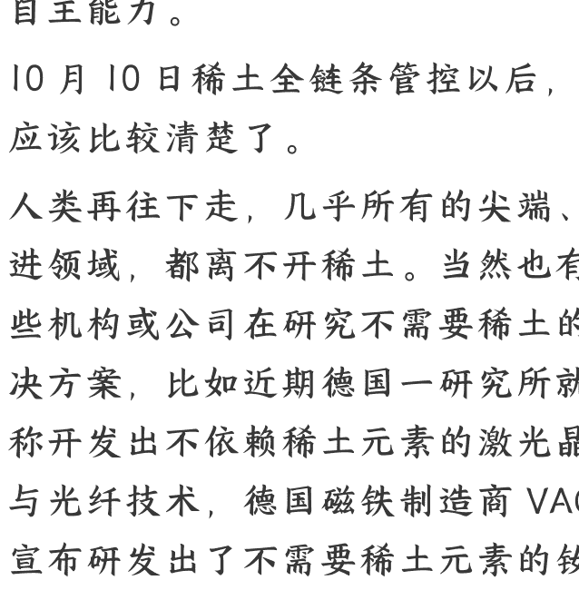

# 要么让中国赚大头，要么被锁死在旧时代

## 251018 大树乡谈

整理：公众号懒人搜索，懒人专属群独享

懒人微信：lazyhelper

小镇之前做出过一个判断：只要有必要，全世界芯片制程最高不超过中国自主能力。

10月10日稀土全链条管控以后，大家应该比较清楚了。

人类再往下走，几乎所有的尖端、先进领域，都离不开稀土。当然也有一些机构或公司在研究不需要稀土的解决方案，比如近期德国一研究所就宣称开发出不依赖稀土元素的激光晶体与光纤技术，德国磁铁制造商 VAC 也宣布研发出了不需要稀土元素的钕铁硼合金，英国也宣称研发出了全球首款不含稀土的永磁体并据此设计出了无稀土永磁发电机，等等，总之自从中国 2023 年开始首次管控稀土元素，欧美纷纷号称成功实现“去稀土化”，但这里面有多少是真的呢？又有多少能够离开实验室实现工业化量产？量产的成本、效率又如何呢？

这些宣传，听听罢了。想要替代稀土哪有这么简单，最大的消耗就是时间。众所周知，中国实现突破也就几年时间了，如果花费大量资源用于开发替代稀土的方案，几年后中国已经赢得了贸易战胜利，全球民用稀土供应自然恢复正常，那么搞另一套技术，又有什么意义呢？

工业终究需要讲究成本，比如两家公司都生产同一种商品，一家公司可以正常从中国获得稀土，于是继续深挖含稀土技术路线，另一家公司被中国限制稀土管控，从头开始用技术替代关键材料，有太多不可测因素了。

中国近期出口管制措施，重点并不是应对贸易战，而是为中国即将突破的先进产业铺路，要打破中国商品只能获得微薄利润的怪圈。

在商务部2025年第61号公告中，特别强调了“最终用途为研发、生产14纳米及以下逻辑芯片或者256层及以上存储芯片”，要特别注意这个限制，想想为什么中国现在才提出这一限制？而不是2018年美国开始针对中国通讯和芯片产业，2020年扩大芯片管制范围，2022年正式限制对华出口先进半导体设备和技术等任何一个时间点？

如果那时候就拿出这个武器，虽然当时中国还没有形成完备的稀土出口管制体系，必然存在漏洞，但起码可以在谈判的时候进行交换。

类似的还有 2025 年第 58 号公告，也就是针对“锂电池和人造石墨负极材料”，明确“重量能量密度大于等于 300Wh/kg 的可充放电锂离子电池（包含电芯和电池组）”被纳入出口管制，同样被纳入的还有可用于制造可充放电锂离子电池的关键设备，如卷绕机、叠片机、注液机、热压机、化成分容系统、分容柜等。

也需要思考一个问题。传统液态锂离子电池能源密度理论上可以达到 350Wh/kg，但实际量产哪怕三元锂也不过能达到 300Wh/kg 左右，目前量产的能达到 240Wh/kg 就不错了。磷酸铁锂液态电池就更低了，比如比亚迪二代刀片电池，也只是 190Wh/kg，长刀片版本在实验室阶段突破 210Wh/kg，三元锂版本的也只是 230Wh/kg。都远低于 300Wh/kg 的出口管制门槛线。

显然，从规模生产角度，必然针对的是半固态以及固态锂离子电池，按照目前的进度，中国大概也要到 2027 年才能实现小规模量产。

这两件事结合在一起，就能充分体会到中国决策的谋定后动、超前布局。

就如小镇昨天提到的出口管制法、不可靠实体清单制度在 2020 年就通过施行了，但近三年后的 2023 年才首次动用，就是为了等待整个监管体系到位；稀土管控也一样，2019年整个西方就在大肆讨论中国会动用稀土武器，国内也有不少呼吁使用这一武器的，但国家不为所动，硬是坚持到2023年7月才首次动用，时隔4年多。

哪怕在2018年贸易战谈判中，中国处于非常不利的地位，甚至被迫做出一定让步，也始终没有动用上述王牌，而是为王牌争取发育的时间，要用在一锤定音的关键时刻，不打消耗战。

原因在于，贸易战刚开打的时候，中国芯片自主生产能力还处于90nm时代，就算真的限制，也最多是跟美国置换条件，如果美国退让之后达成妥协，也只会导致外国优势产品倾销，阻碍中国自主产业的崛起。

所以王牌不能轻动，监管体系完备了、中国自主产业崛起了、通过常规手段也顶住了美国的施压，这才是动用王牌生力军的时刻。

就如先进制程芯片，中国目前已经实现了28nm级别的全部国产化，而7nm以下制程各项关键技术和设备也纷纷突破，目前最大的卡点也就是光刻机，但最终一定能够突破，而且很可能就在未来两三年内。

这时候，动用稀土这张王牌就有力度了。全世界先进制程芯片离不开稀土元素，曝光机、注入机、刻蚀机、光刻机等生产设备高度依赖高性能稀土永磁材料，芯片生产需要的研磨液、防护涂层、靶材等耗材也离不开稀土，制程越先进依赖度就越高。想要替代稀土谈何容易，搞替代就意味着反而落后中国的进度，就算过了五年、十年研发出来，重新达到目前的含稀土的技术水平，又有什么意义呢？

这时候中国进行限制，就导致任何与中国对立的国家和地区、公司都难以获得稳定的稀土材料，其生产经营就陷入巨大不确定性中，经过几年疫情和贸易战冲击，企业对稳定供应的重视度大增，这就为中国自主产业创造了机会。

更何况，目前全球先进芯片以及高性能锂离子电池产能，高度集中在东亚，也就是中国大陆、中国台湾以及韩国和日本，这都在中国武力覆盖范围内。

欧洲、美洲等远离中国的地方，某些国家和公司还能搞骚操作，中国想要反制会比较麻烦，比如这次荷兰针对闻泰科技，中国目前限制安世半导体在华生产的芯片出口，对荷兰造成了很大压力，但终究比较间接。

可如果是与中国经贸关系密切、近在咫尺的日韩，那就简单多了，比如这次针对韩国韩华在美子公司采取反制措施，效果就非常明显；至于中国台湾地区，所有人都知道，统一必将实现，台积电在中国台湾的先进芯片生产线随时都可以被拿下，切断就更容易了。当然，一般情况也没必要这么做，毕竟中国是负责任的大国，还是需要保障全球正常的商业运转。

但必要的时刻呢？

所以就如开头所说，必要时刻，全球芯片的制程上限就是中国自主生产能力。

伴随中国自主产业的突破，中国的管控措施也会随之跟进，为中国先进产品拿下更多国内、国际市场保驾护航。

以后全世界可以选择：要么与中国老老实实的合作共赢，让中国赚到应得的合理利润，而且必须是大头；要么就被锁死在旧时代，以落后技术和产品去打一场注定必败的竞争；不要妄想动用武力威胁，除非打核战争，在关键材料和产业越来越依赖中国的情况下，中国军力代差优势只会不断强化。

也正因此，国家的类似管制措施，也可以用来评估中国相关产业突破的进度。芯片、锂离子电池只是刚开始，14nm 以下制程自主芯片、300Wh/kg 以上的锂离子电池量产化，已经不远了。

6/7

## 最后，安利小懒的付费群：

### 懒人专属群（介绍）

懒人专属群持续更新中，已持续运营 6 年，整理超 3000 份各类精选付费文章 & 年费社群干货，全部开放下载。

本资料为付费群内部分享，仅供真实有需要的朋友查阅

### 懒人专属群更新记录：

https://lazy2025.top/blog/record2

懒人专属群更新记录（需梯子，备用）：

https://lazybook.fun/blog/record2