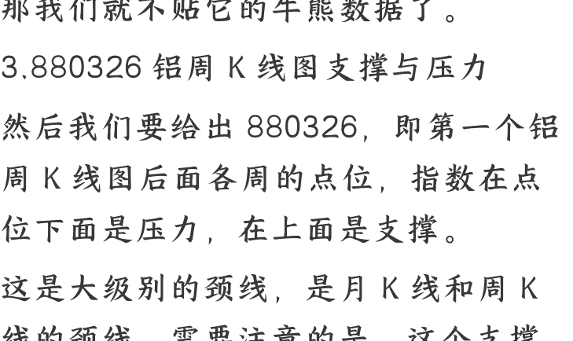

# 用大趋势的眼光，回归主流，选择做投资投机两相宜的事

# 251019 安民深度分析

整理：公众号懒人搜索，懒人专属群独享
懒人微信：lazyhelper

## 一、用大趋势的眼光

一说人生，选择大于努力。而在牛市，更是如此。因为有的指数涨了两三倍，有的指数只涨了百分之二三十。故而，当时间来到 2025 年 10 月下旬，我们用这篇文章告诉读者，在后面的行情中，依然要特别注意，是否到了可以做短线和中线投资选择的时候。为此，强调三点：第一，要用看大趋势的眼光。什么是用看大趋势的眼光，如果大家不清楚，可以看我们团队以前的文章，特别是 2024 年 1 月 1 日的对话文章和 2 月 1 日的文章。那两篇文章，都非常宏观，第一篇是纯宏观，纯粹的宏观定性分析，第二篇是纯宏观的技术。那两篇文章，我们都讲未来是大牛市。

当然，现在关于大牛市的观点，大家也听得比较多，相信的人也比较多，比如讲 10 年一遇的大牛市，讲 2005 年到 2007 年是大牛市，2013 年到 2015 年是大牛市，现在也是大牛市，这是多少年一遇的牛市云云；现在讲这个观点，并不稀奇，因为人人都会讲。难的是 2024 年 1 月 1 日和 2 月 1 日讲大牛市，而且讲是改变投资者命运的大牛市。所以，本文立论的基础，就是大牛市，然后它的基础在 2024 年 1 月 1 日和 2 月 1 日的文章中，包括后面有几篇讲宏观的文章中，都讲透了。但根基是去年前两个月的文章。那个基础我们打得很牢靠。这也是我们本篇文章立论的基础。

我们的粉丝中，有人会不时把别人的观点转过来，希望我们辨析一下，讲哪个哪个网上的名人讲，后面有多大多大的风险，牛市即将结束等等，希望听听我们的观点。注意，除非有必要，我们团队一般不会回复。原因很清楚，我们的观点在以前的那么多篇讲大势的文章中讲得很清楚了，而且是连贯的。如果您不清楚，或者忘记了，那就去“安民分析”栏目中把以前的文章看一遍。我们的观点在那里讲得很清楚。

至于别人怎么讲，那是别人的自由，但我们不一定有精力做这个辨析工作。我们团队自由地表达自己的观点，我们不可能规定别人只能讲什么样的观点。因此，别人怎么讲我们管不着。我们只是比较连贯地讲自己的观点，您相信谁的观点，都是您的自由。最多讲一句两句，这里有没有大级别的高点，也不是大级别的顶部。当然，小级别有。

然后 3040 点以来，上证指数上行的周期，已经运行了 27 周，本周是第 28 周。它离顶部的周期还有距离，至少暂时还不到顶部。因为如果到顶部附近了，我们不会讲中线投资的观点。那时最多讲短线，到时如果讲中线，只会讲中线顶部，讲要逃跑。就是我们看大势，一定用大趋势的眼光来看。哪怕讲短线，也一定是在大趋势之中讲短线。

第二，周期股，关于成熟经验的再次复制。我们以前多次讲到过，我们不喜欢研究周期股。但是，今年行情有点特殊。我们前面研究过一只锂电材料股，就属于周期股。不复权，它涨了 490.55%，用前复权也是这个涨幅。这个效果不错。然后我们前面选择锂电上游典型的周期资源股做中线和短线，我们的文章是 8 月 2 日贴出来的，那个板块短线的领涨股，就是龙头个股，8 月 7 日到现在已经翻番了。最低到最高，涨了 106.88%。我个人做短线，开始的资金没有杀进去那么多，后来才加的仓，总收益超过 70%。而它那个板块的纯资源股，目前整个板块已经突破底部颈线位，未来估计还有成长空间的。整个板块指数最高涨幅 45.82%。这两个例子表明，周期股如果选择得好，个股也好，板块也好，都会有不错的结果。既然如此，那本轮牛市，我们的投资风格也要有所改变。也就是，我们可以把这个板块成熟的经验，复制到现在的主流子板块中去。

第三点，从八字真言到十字真言。回归到我们过去的投资八字真言，叫做“行业、趋势、顶底、龙头”。然后今年操作周期股，让我们团队悟到了另外两个字，因此，我们的 8 字真言就改变为 10 字真言，叫做“行业、趋势、顶部、龙头、主流”。也即我们的投资，要么做主流，要么围绕主流打转转，这样就一定会有不错的投资收益。今年的主流是什么呢？硬核科技，包括 AI、半导体。还有呢？我们前面讲的行业二和行业四。还有呢？有色是主流，创新药休息一段时间后也会是，包括 CXO。今天我们要讲的是有色的一个分支，也即这个分支，在本轮牛市，后面还有可能挖到金矿。因为它也是主流。我们可以先看看有色金属历史上的月 K 线图。它经历了 4 轮牛市，3 轮熊市。现在是第五轮牛市。见下表：

| 周期 | 时间 | 低点 | 时间 | 高点 | 涨幅（倍） | 跌幅% |
|---|---|---|---|---|---|---|
| 牛一 | 2005年7月 | 91.49 | 2007年10月 | 1864.22 | 20.38 | |
| 熊一 | 2008年11月 | 229.44 | 2007年10月 | 1864.22 | | -87.69 |
| 牛二 | 2008年11月 | 229.44 | 2010年11月 | 1175.95 | 5.13 | |
| 熊二 | 2014年1月 | 394.76 | 2010年11月 | 1175.95 | | -66.43 |
| 牛三 | 2014年1月 | 394.76 | 2015年6月 | 1090.76 | 2.76 | |
| 熊三 | 2018年10月 | 421.54 | 2015年6月 | 1090.76 | | -61.35 |
| 牛四 | 2018年10月 | 421.54 | 2021年9月 | 1316.69 | 3.12 | |
| 熊四 | 2024年2月 | 662.83 | 2021年9月 | 1316.69 | | -49.66 |
| 牛五 | 2024年2月 | 662.83 | 目前 | 1639.63 | 2.47 | |

需要说明一点，牛市从左向右看，由低点到高点，用涨幅表示。熊市由右向左看，由高点到低点，用跌幅即负数表示。强调一下，本轮牛市结束，这个板块的个股一定要抛。因为跌幅很可能不会小。还有，本轮牛市的涨幅是到现在为止的涨幅，不是最大涨幅。因为牛市还没有结束。

也就是，今年有色是大年，这波牛市有色是大牛。

（免责声明：本文只为开拓视野、引导思路，并非择时，亦非荐股，股市有风险，入市需谨慎。本文不构成任何投资建议或意见，我们无力为大家的投资负责，请大家注意投资风险）

## 二、有色中有个子板块还有不错的短线和中线机会

现在我们直接上子板块周 K 线走势图：

### 1. 880326 铝
这个子板块有两个指数，第一个是 880326，如下图：

| 周期 | 时间 | 低点 | 时间 | 高点 | 涨幅（倍） | 跌幅% |
|---|---|---|---|---|---|---|
| 牛一 | 2005年7月 | 132.96 | 2007年10月 | 3174.11 | 23.87 | |
| 熊一 | 2008年10月 | 344.71 | 2007年10月 | 3174.11 | | -89.14 |
| 牛二 | 2008年10月 | 344.71 | 2009年8月 | 1247.58 | 3.62 | |
| 熊二 | 2013年6月 | 342.03 | 2009年8月 | 1247.58 | | -72.58 |
| 牛三 | 2013年6月 | 342.03 | 2015年6月 | 1246.71 | 3.65 | |
| 熊三 | 2020年4月 | 405.6 | 2015年6月 | 1246.71 | | -67.47 |
| 牛四 | 2020年4月 | 405.6 | 2021年9月 | 1242.36 | 3.06 | |
| 熊四 | 2022年4月 | 651.01 | 2021年9月 | 1242.36 | | -47.60 |
| 牛五 | 2022年4月 | 651.01 | 目前 | 1275.51 | 1.96 | |

这个板块有 31 只个股，具体如下：
- 焦作万方
- 银邦股份
- 亚太科技
- 闽发铝业
- 怡球资源
- 顺博合金
- 宁波富邦
- 常铝股份
- 和胜股份
- 新疆众和
- 鼎胜新材
- 鑫铂股份
- 中国铝业
- 万顺新材
- 宏创控股
- 中孚实业
- 海星股份
- 永杰新材
- 创新新材
- 天山铝业
- 云铝股份
- 南山铝业
- 鑫源智造
- 电投能源
- 永茂泰
- 利源股份
- 明泰铝业
- 神火股份
- 华峰铝业
- 丽岛新材
- 豪美新材

### 2. 881073，铝的另一个指数
该指数和上面指数的个股重合，但周 K 线图有些差别。周 K 线图如下：

那我们就不贴它的牛熊数据了。

### 3. 880326 铝周 K 线图支撑与压力
然后我们要给出 880326，即第一个铝周 K 线图后面各周的点位，指数在点位下面是压力，在上面是支撑。这是大级别的颈线，是月 K 线和周 K 线的颈线。需要注意的是，这个支撑和压力并不是特别严格，因为时间太长了，如果用日 K 线更为严格一点，但在这里，可以不那么特别严格。给这个数据，主要是判断是否真的形成了突破。也即指数一旦有效突破压力，有效站稳支撑线，向上的空间就打开了。那时介入投资或投机，可能会有较好的成算。上周有一天有小突破，收在 1252.97 点，但收盘后两天又下来了。

| 时间 | 压力与支撑 |
|---|---|
| 10 月 17 日 | 1248.244 |
| 10 月 24 日 | 1248.241 |
| 10 月 31 日 | 1248.238 |
| 11 月 7 日 | 1248.235 |
| 11 月 14 日 | 1248.233 |
| 11 月 21 日 | 1248.230 |
| 11 月 28 日 | 1248.227 |
| 12 月 5 日 | 1248.224 |
| 12 月 12 日 | 1248.221 |
| 12 月 19 日 | 1248.218 |
| 12 月 26 日 | 1248.215 |
| 1 月 2 日 | 1248.212 |
| 1 月 9 日 | 1248.209 |
| 1 月 16 日 | 1248.206 |
| 1 月 23 日 | 1248.204 |
| 1 月 30 日 | 1248.201 |
| 2 月 6 日 | 1248.198 |
| 2 月 13 日 | 1248.195 |

也即稍放宽点，基本上站稳 1260 点，就突破了。最后补充一个观点，相对于铜，铝属于补涨，因为它涨势落后。为什么，可以看看铜指数的月 K 线图，880325：

结论是，铜早已经跃出了底部，铝还在 2009 年后的几个高点附近折腾。

## 三、为什么看好铝

- 1. 这波牛市，有色金属是大牛
看看黄金 881076、白银 881077、铜 880325、铅锌 880327 的周 K 线图和月 K 线图就知道。还有稀土永磁 880535。不给图了，大家自己去翻。有色是大牛。

- 2. 铝铜可替换
这波牛市的硬逻辑是 AI，而 AI 硬件里，通电的线路就是铜。但在电路中，铜铝可相互替换，只是通电时铝线的性能差点。铜的电阻率为 0.017Ω·mm²/m，铝为 0.028Ω·mm²/m，铝的电阻率约为铜的 1.64 倍，所以铜的导电性能更好。相同截面积下，铜的载流量比铝高 30%—50%，电压损耗更低。导电率数据上，用国际退火铜标准，铜为 58.5×10⁶ S/m，是国际退火铜标准的 97%，铝为 37.7×10⁶ S/m，是国际退火铜标准的 61%。当然，铜线使用的时间比铝线也要长一些，相对不容易老化。所以，要求高时用铜线，要求低时往往就会用铝线。

两种材料成本相差很大，裸铜线的吨价成本大致是裸铝线的 3.8726 倍，且铜的密度高，比重为 8.89，铝为 2.7，相差 3.29 倍，意味着同样的重量，同样的粗细，铜线和铝线相比，铝线的长度可以达到铜线的 3.29 倍。如果考虑价格的差异，那相差就更大了。所以，在需要较低成本时，以铝代铜成为必然；在需要较低重量时，以铝代钢也成为必然。还有以铝代塑和以铝代木，这些在行业中讲得比较多。这里就不多讲了。铝铜可替换，意味着铜价进入牛市，铝价必然进入牛市。这就像猪肉价格进入牛市，必然导致鸡肉价格、牛肉价格和羊肉价格进入牛市一样。

### 3. 在中美相互卡脖子的科技战背景下，铝的战略地位突现出来
这其实是讲铝产业链在中美博弈中的隐性价值。很多人对铝的战略地位看不明白。我们简单讲下其中的内在逻辑：中美相互卡脖子，大打科技战，美国卡中国脖子的是芯片和整个芯片产业链条上的东西，其中大家知道的是光刻机、光刻胶、芯片制造环节（如美国不让台积电代工华为 5 纳米的芯片，我的手机即是台积电最后代工华为 5 纳米芯片的那批，7000 元一部，加价到 8000 元才买到的），所以 2024 年 8 月初的文章中，我们讲了一家两市最具战略价值的公司，然后它最高涨了 360.85%。其实当时公司业绩并不是怎么好。当然，它现在的市盈率也很高。

中国卡美国脖子，除了稀土，还有镓锗锑，还有超硬材料与石墨，还有钨与钛合金，还有些战略小金属。其中镓是重要的一项，因为它是第三代半导体氮化镓、氧化镓的原材料。美国的全球霸权的基础，表面是美元霸权（所以我们在 2018 年 3 月份的系列文章中，就讲中国进出口用人民币结算，来个釜底抽薪，开启人民币对美元的替代）；美元霸权背后是军事霸权（去年 10 月 5 日我们讲的就是中东王爷国的安全，讲要用中国军事装备去解决问题）；军事霸权背后是科技霸权（背后就是产业升级，2018 年 3 月的系列文章中，我们就已经讲了）。半导体，美国卡中国芯片的脖子，用的就是科技霸权。氮化镓、氧化镓是第三代半导体材料，这是科技霸权的一个抓手。但这个抓手它又非常特殊，它背后连接着军事霸权，而且这个抓手现在被中国掌握着，且牢牢地抓在咱们自己的手中，跟稀土一样。因为二者决定着雷达的探测距离和灵敏度。当然，现在的有源相控阵雷达，主要加了氮化镓这种物质，其实氧化镓的价值更大。它更灵敏，探测距离更远。但现在的有源相控阵雷达，用氮化镓就足够了。

所以，没有镓，就没有氮化镓和氧化镓。没有氮化镓、氧化镓，美国的雷达就过不了关，扫得近，隐身飞机就发现不了。欧洲一样，这是巴基斯坦歼—10CE 能击落法国阵风战机的原因之一，因为我们雷达探测的距离远，且能看清楚对方，即使是隐身飞机也没有用，比如 F—22、F—35，都没有用。前些时央视报道，我们的歼—16 就曾经一架锁定美国两架 F—22。要知道，军事上，一旦真的开战，锁定即意味着摧毁。歼—16 是四代半战机，F22 是五代隐身战机，它们之间有代际差别的。即使如此，我们还能锁定它们，因为我们的雷达和预警机厉害。预警机厉害，背后也是雷达厉害。雷达厉害，是因为咱们有源相控阵雷达很先进。它先进，一者是我们一直在向前推进新产品，二者是我们有足够多的镓，能生产足够多的氮化镓氧化镓。所以，美国现在的雷达就比中国落后，这是我们用镓卡美国脖子的原因。

要有镓就必然要生产大量的铝，因为镓是生产氧化铝的副产品，产量极少。每吨铝土矿平均含镓 10 克，0.2 两，每生产一吨氧化铝需要消耗 2.4 吨到 2.7 吨铝土矿，理论上可以生产 24 克到 27 克的镓。但实际上生产的量要少一些，平均每生产 1 吨氧化铝可生产金属镓约为 12—18 克。2024 年，全中国生产镓就只有 711.60 吨，而且占全球产量超过 9 成。而且未来中国电解铝的总产能被限定了，这意味着氧化铝的产量和产能大概率也会被限定（当然，不排除有些出口，但因为环保的因素，未来咱们的氧化铝增长的难度很大），也意味着中国金属镓的总产量也会增长困难。而中国金属镓的产量，占全球的 90% 以上，最高可以占到 95%到 96%。

美国要想拥有足够的镓，必须重建氧化铝生产线，重新进行铝土矿的大规模生产。这是一个高耗能产业，在美国并不挣钱，特别是氧化铝的下一个环节电解铝，太耗电了。美国目前要全力搞 AI，而 AI 数据中心却又是一个高耗能产业。美国自己的研究报告都讲，美国连 AI 的耗电都搞不定，更别说电解铝了。未来两国之间的电价，美国一定会比中国高很多。正因为如此，中国可以用镓卡美国的脖子，背后的原因就在于铝这个产业链的成本，是一个很宽很宽的护城河。

### 4. 铝在通向现在和未来的几个大产业方面，具有重要的价值
它首先的定位变了，会逐步变成能源金属。铜现在先变成能源金属，铝随后就会跟上。因为成了能源金属，它未来的需求就大不一样，定位也不一样。典型的如前十几年中的锂金属，在上两轮大牛市和大熊市中，锂价的大幅波动，正源于它成为能源金属。建议大家好好看看它的历史走势，881079。2012 年 12 月到 2021 年 9 月，锂从 31.13 点涨到了 1212.33 点，涨了 38.94 倍。当然，并不是说铜会跟锂当初一样，也不是说铝跟它们一样。但锂的历史走势，对我们会有启示价值。即它至少会有一轮大牛市，况且本轮牛市就是 A 股的大牛市。所以，本轮牛市，它们适逢其时，换句话说，有色就是主流之一。这就符合了我们的十字真言，主流。

当行业高速发展和供应紧张时，它们会被炒成什么样子，只有到那个时候才知道。当然，除了能源金属，未来它还会涉及到几个大行业，其中既有老旧行业，也有新兴行业。

- （1）光伏，能源金属应用之一
光伏组件的边框、支架、电池铝箔均需大量铝。保守估计，每 GW 光伏装机需铝约 1.5 万吨，其中边框占 60%，支架占 30%，电池铝箔占 10%。

- （2）风电，能源金属应用之二
风电叶片的蒙皮、机舱、塔筒用铝量较大，每兆瓦风电装机需铝约 20 至 30 吨。其中风电叶片的蒙皮，采用铝合金材料，可提高叶片强度；风电机舱要容纳发电机等部件，需要尽量做到轻量化，因此也需要用到铝；还有用于支撑风机的塔筒，特别是海上风电，需要耐腐蚀，要用到铝材或铝合金。这是因为铝材比较耐腐蚀。它的表面形成一层氧化膜，具有良好的抗腐蚀性能，适用于恶劣环境。还有沙漠盐碱度含量高的光伏电站、风电塔筒的地下部分，用铝能抗腐蚀。

- （3）储能，能源金属应用之三
储能电池的外壳、支架需铝，每 GWh 储能电池需铝约 1000 吨。

- （4）新能源汽车，能源金属应用之四
每辆传统燃油车约需要铝 100 至 150 公斤，2024 年新能源车单车用铝 180 公斤，2025 年的铝用量达到 250 公斤，主要用于车身、电池包、底盘等部件。铝的轻量化特性可降低电动汽车重量，提高续航里程，车子每减轻 100 公斤重量，续航里程可增加约 10%。例如特斯拉 Model3 的铝用量占比约为 30.5%，比亚迪汉的铝用量占比约为 25%。

- （5）飞行汽车，能源金属应用之五
飞行器结构件镁铝合金渗透率提升至 70%，2025 年 eVTOL 量产带动高端铝材需求增长 40%。

- （6）固态电池，能源金属应用之六
主要用在两个地方：一是铝箔，有的地方铝箔可替换铜箔；二是铝塑膜，主要用于固态电池的封装。

此外，铝还涉及到两项新技术。一是有的电池还有铝用阳极。铝作为电池阳极材料具有高理论容量，可达 2980mAh/g，还具有体积能量密度优势，可达 8040mAh/cm³，它的电位为负值，同标准电极电位相比，为—1.66，适合大功率放电场景，比如海水电池，还比较适合储能电池应用，在固态电池中有可能有前途。当然，这些还不是成熟的技术，未来存在不确定性。

二是铝空气电池技术未来也会突破，2025年会进入商业化试点阶段，未来潜在需求增量估算为50万吨/年。这种电池的理论比能量达8100Wh/kg，是锂电池的20倍以上，实际应用中，能量密度达800Wh/kg，100kg铝空气电池组可支持电动车行驶2000公里，远超当前锂电池的500-700公里续航。但这方面也有较大的变数。

- (7) 机器人和人形机器人：工业机器人中经常会用到铝材，人形机器人中，要求不是那么高的，估计到时一样会用到。

注意，新能源产业和新兴行业的高增长对有色金属形成“刚性需求”，成为此轮牛市的核心支撑。

- (8) 大飞机和无人机：C919全身材料，全机结构总重的65%为铝材，按空机重量约42.5吨计算，单机铝材用量约为27.6吨。主要为铝锂合金和传统铝合金。

无人机中，消费级无人机铝材占比为30%，大致为1.5到3公斤；工业级无人机占比提高到50%至70%，大致为3到6公斤，主要为航空级铝合金。

- (9) 无人船舶：无人艇、机器狼、机器狗这方面一样会增加铝材的需求。

特别要强调的是，军工产业中，铝材的应用在增加，特别是自动化武器，如机器狼、机器狗，整机重量约35-47公斤，采用航空级铝合金+碳纤维复合结构，铝材占比约40%-60%，每只铝材用量18到28公斤。无人船舶对耐腐蚀性要求更高，通常采用5系或7系铝合金，如5083、7075，船体结构铝材占比可达60%-80%。以10吨级无人艇为例，铝材用量约6-8吨，主要用于船体框架、甲板及动力系统外壳。

- (10) 传统行业：比如房地产，铝型材用于门窗、幕墙，每平方米建筑面积需铝约2公斤。比如基建，铝合金管道用于供水、燃气传输，每公里管道需铝约50吨。再如制造业，铝制品用于家电，比如冰箱和空调等；机械设备如机床中会用到。再如交通行业，除了汽车，很多交通工具都会用到铝材。这些大家都知道，我们不多讲。

我们这一部分讲的前6个部分都是新能源行业的应用，而且是讲逻辑，讲干货，并没有往深处挖。我们只做这波牛市，因此明白内在逻辑就好，不用太过往深处挖，挖得太深了，到后面就容易舍不得抛，看到这里也好，那里也好，到了牛市顶部还捂着不放，那就害了大家。

本部分的后面，铝实际上已经不只是应用在新能源领域了，用到了很多无人化自动化产品系列之中。这些新兴行业对铝的需求，未来一定是高增长。一旦新能源高增长+新兴行业高增长，对铝材的需求就会是高增长。现在有的机构预判铝材在新能源行业的需求复合增速是 18%，这并没有考虑到这些新兴行业的增速。

## 5. 硬约束、降本增效和美国放水至美元走弱

### (1) 俄乌战争去产能
乌克兰是全球重要的铝土矿出口国，占全球出口量的 5%，俄罗斯是全球最大的铝出口国，占全球出口量的 15%。战争导致乌克兰铝土矿供应中断，现在经常会受到影响；俄罗斯铝出口受到西方制裁，全球铝供应减少约 200 万吨/年。2022 年我们分析过欧洲去工业化，当年欧洲电解铝产能减少了 100 万吨，现在大致减少约 50 万吨，俄罗斯减少了 30 万吨。

欧洲主要受到电力紧张和天然气高价格影响，导致高耗能的电解铝产量始终承压。因为每生产 1 吨电解铝需 13000 到 15000 千瓦时电。

### (2) 环保和碳达峰
中国则是受制于环保的因素，主要是要保证好天气，少污染。当然，更受制于碳达峰。为了碳达峰，也为了环保，中国电解铝的年生产目标最大为 4500 万吨。

2024 年中国电解铝建成产能 4462 万吨，运行 4361 万吨，生产 4346 万吨，消费 4518 万吨。消费量已经达标了。目前建成产能只差多少？运行产能只差 139 万吨。

2025 年上半年实际运行产能为 4350 万吨，后面空间很有限。所以，4500 万吨电解铝产能红线政策未来会持续卡在那里。

2024 年全球电解铝供需，需大于供 9 万吨，属于基本平衡。2025 年上半年，全球电解铝生产量 3600 万吨，消费 3630 万吨，需求略大于供。

但未来最大的变化来自于新能源行业和新兴行业，新能源行业年化增速约 18%，新兴行业特别是飞行汽车行业、大飞机、机器人和人形机器人、无人艇无人船机器狼机器狗等等，这些未来会增长多少？而作为电解铝最大的供应方中国，产能受到 4500 万吨的硬约束，这条红线一定会最终扰动电解铝的价格。

此外，中国铝土矿储量下降，产量下降，进口量上升，2024 年进口铝土矿 1.59 亿吨，增长 12.3%。这些都会影响到国内的供给。

至于铝土矿的后段工序，氧化铝，2024 年国内产能 10435 万吨，产量 8581 万吨，消费 8701 万吨，这个产能很难再扩了。全球产能 14157 万吨，消费量 14453 万吨，也是紧平衡。只是未来一旦新能源和新兴行业高增长，这种紧平衡的格局，比较容易被打破。

### (3) 技术革命降本增效
在中国，“AI+有色金属”行动推动电解槽能耗优化，2025年吨铝电耗降至12500千瓦时，而行业平均13000千瓦时，导致年节约成本超200亿元。特别是西部绿电，光伏和风电，用于生产电解铝，具有很大的成本优势。电价非常便宜，推动成本下降比较快。目前国内电解铝绿色能源占比已经超过25%。这跟国外相比，具有很大的优势。

### (4) 美元放水
美国超过 37 万亿的国债，而美国从军队到政府官员各方面都非常腐败，导致国家开支不可能下降。比如马斯克带领效率部工作了几个月，号称节约了 1200 亿美元，然后特朗普跟各国干仗开征进口税，估计 2025 年全年能收到 2000 亿美元的关税，2026 年则有可能达到 2500 亿美元，不排除更高。这就增加了 3000 多亿，然后美国降息了，国债利息支出也会降。

尽管如此，特朗普的预算中，美国财政赤字仍然高达 18000 亿美元。所以，美国财政止不住血的原因，就是从上到下系统性的腐败。简单地说，大家都在通过种种办法种种途径搞美国国家的钱。所以美国的国债数量只会快速增长。这个根本就止不住。

美国国债只会膨胀，然后全球都看清楚了美国的腐败，大家手中的美元，一些清白的国家和清醒的人，只会选择离开美国，这导致美元长期会走弱，最终会走向崩溃。与此同时，美联储选择降息，放水，美联储卖掉国债收回美元的行为，缩表的行为即将终止，这表明美国的货币政策再次转向宽松。货币政策宽松，美元必然走弱，资源必然走牛，有色必是走牛的大趋势。

## 四、操作特别注意事项

第一，前期的 1275 点为 2009 年 8 月以来的历史高位，尽管现在在趋势压力线（或支撑线）附近，根据趋势线原理，它站稳可能不容易。我们的操作，要按照技术要求来，没有站稳趋势线上，即压力线不能转化为支撑线前，不要有大仓位，一两百股可以，多的最好不要有。站稳了再操作比较稳健。这里的位置和锂资源的位置有很大的差别。

第二，即使站稳了，也不要赌性太重，不要用重仓去赌。

第三，大顶一定要走。这一点特别强调。

上轮熊市，铝是 2022 年 4 月见底，原因就在于俄乌战争于 2022 年 2 月份开打，俄乌和欧洲都受重大影响，拯救了铝价。西方制裁俄罗斯，导致全球最大电解铝出口国减少出口约 100 万吨，后来是欧洲电价升上了天，电解铝被迫去产能。不然铝价要拖后到 2024年2月才见大底。所以，有色指数880324是去年2月5日见底的。这表明，一旦行情见顶了，如果不走，一套就会很多年，那很不合算。而且，熊市的调整幅度很大，投资者再多的钱，也填不满熊市的大坑。这点我们要特别提醒各位。

第四，选股。简单地说，三条。一是市盈率尽量低，可以用扣除非经常性损益的股东净利润来算；二是业绩尽量要好；三是形态要好，最好刚站稳颈线，确定突破；或者业绩好但涨幅远远落后。

（免责声明：本文只为开拓视野、引导思路，并非择时，亦非荐股，股市有风险，入市需谨慎。本文不构成任何投资建议或意见，我们无力为大家的投资负责，请大家注意投资风险）

最后，安利小懒的付费群：

### 懒人专属群（介绍）

📚懒人专属群持续更新中，已持续运营6年，整理超3000份各类精选付费文章 & 年费社群干货，全部开放下载。

本资料为付费群内部分享，仅供真实有需要的朋友查阅🙎‍♂️

懒人专属群更新记录：
https://lazy2025.top/blog/record2

懒人专属群更新记录(需梯子，备用):
https://lazybook.fun/blog/record2