# 从0到1做中亚生意，Uzum跨境电商从注册、选品以及合规的全流程分享。

## 251020 生财精华

## 公众号懒人搜索，懒人专属群独享

懒人微信：lazyhelper

## 前言：我与 Uzum 的跨境故事

作为在跨境赛道摸爬滚打多年的“老兵”，“一带一路”倡议下中亚市场的潜力，对我们而言从来不是遥远的政策名词，而是跃跃欲试的新战场——既然深耕跨境，这片正在崛起的土地，我们没理由缺席。干就完了。

于是，没有冗长的筹备会议，团队当即定了飞往乌兹别克斯坦的机票，入驻到了当地的街头巷尾。我们很快摸清，这里的生意场绕不开俄语与乌兹别克语，而中国商品的踪迹，藏在一个个热闹的传统市场（Bazaar）里。那些从国内运来的日用百货、轻工产品，在摊位上堆成小山，也让我们看到了最直接的切入点：不做复杂的链路设计，先把这些已经被当地市场接受的中国货品，直接搬进我们在 Uzum 的店铺。

但这只是开始。为了把链路走通、走稳，团队里没有“指挥岗”，所有人都是“执行者”：白天扎进市场和摊主聊货源、记需求，下午驱车去郊外的工厂谈合作、看产能，傍晚又抱着文件去对接当地官方机构，一点点理顺资质、物流的细节。从第一次踏上中亚的土地，到店铺正式运营、全链路流程跑通，我们只用了两个月——没有捷径，全凭“亲力亲为”四个字，把每个环节的坑都踩了一遍，也把每个节点的路都铺实了。

（下图是我们在当地调研和工作时的实拍：有在 Bazaar 里和摊主交流的场景，考察的画面，和当地 Instagram 网红的对接合作，每一张都记着这段从零开始的跨境经历。）

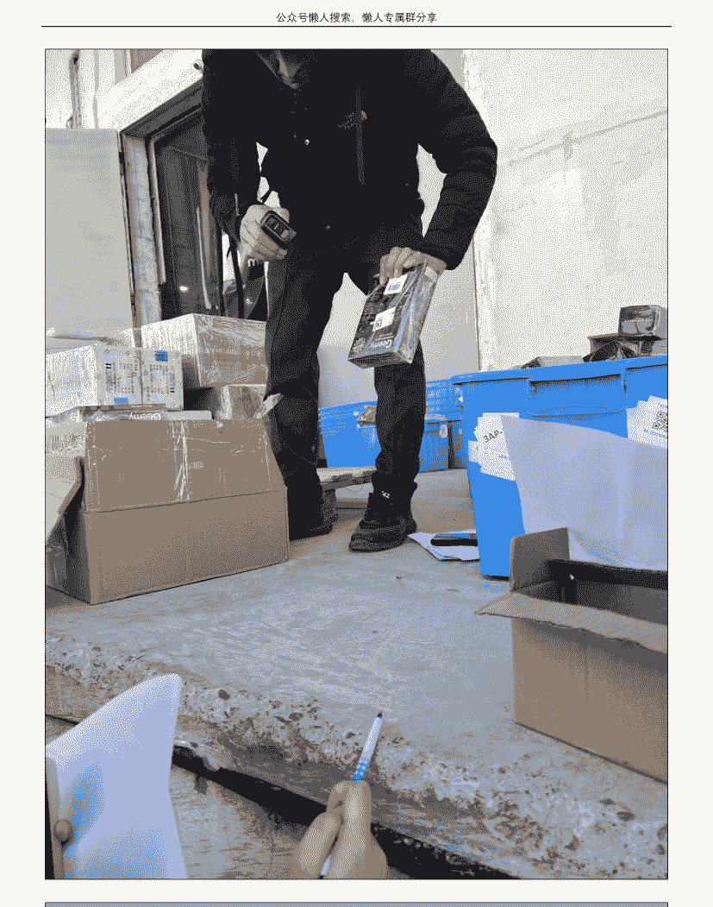

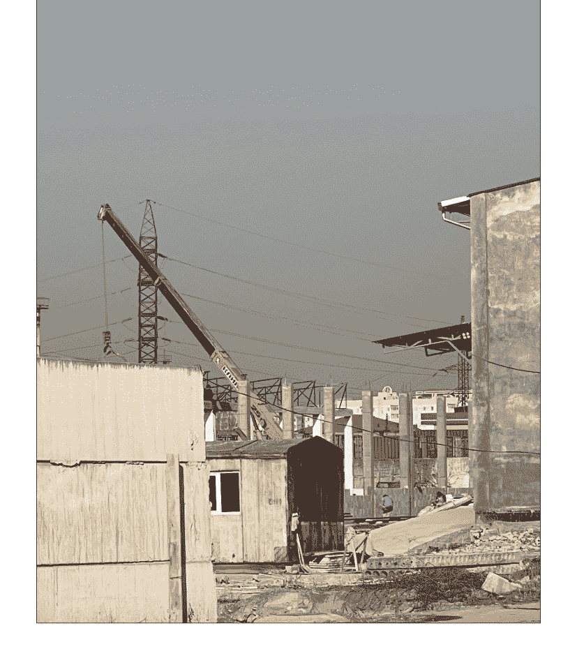

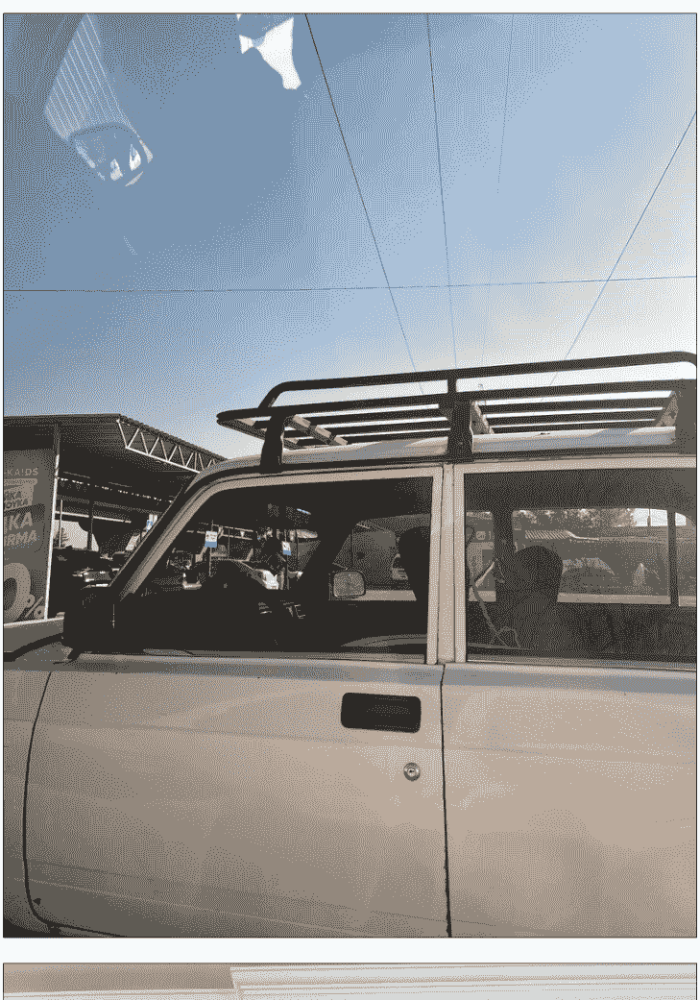

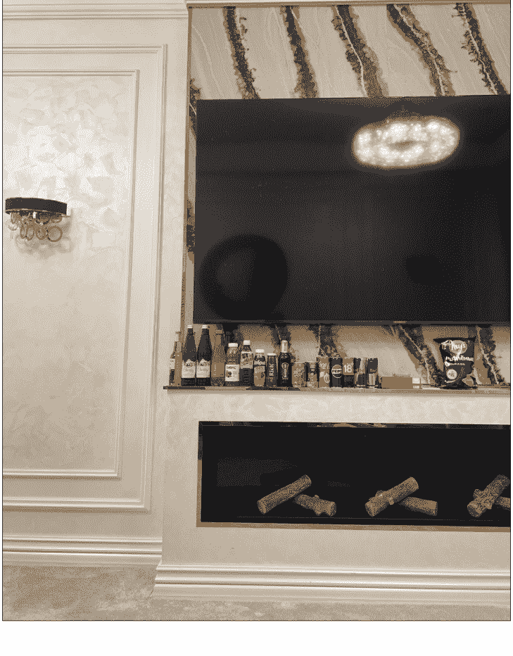

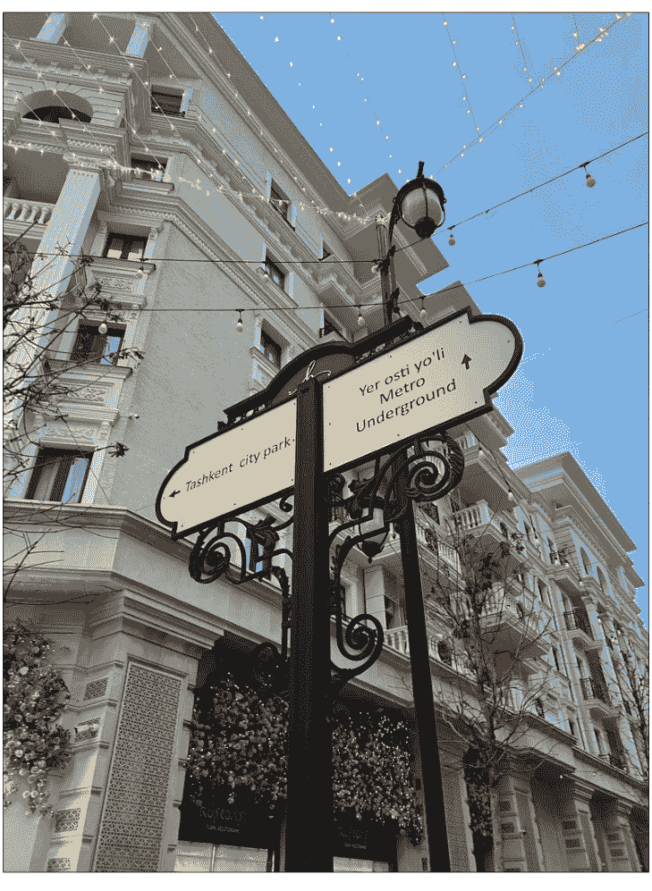

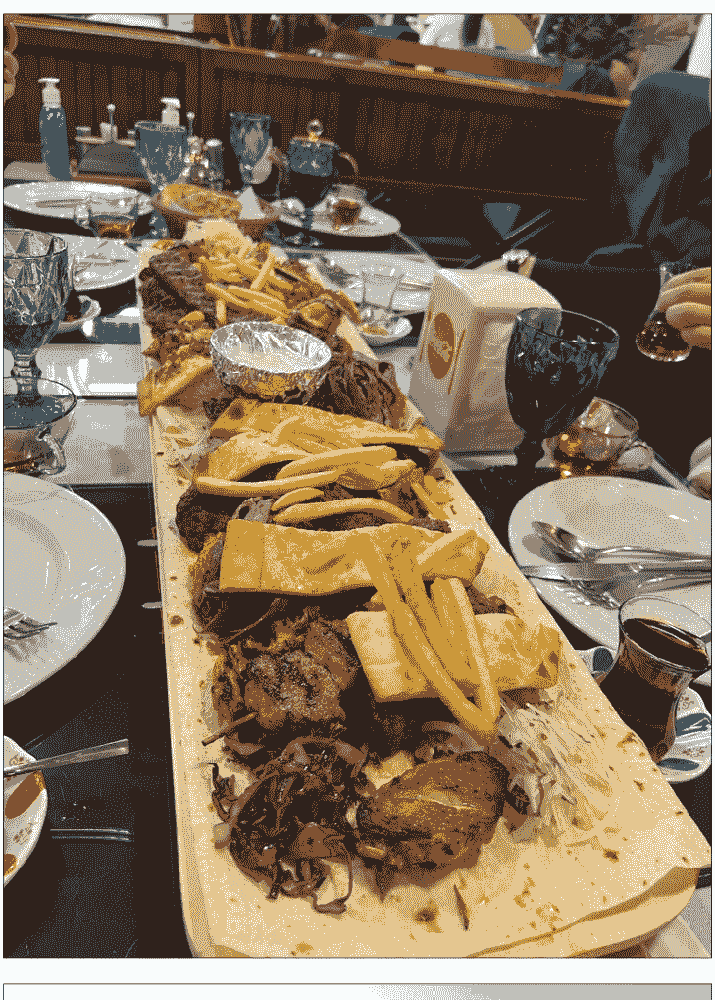

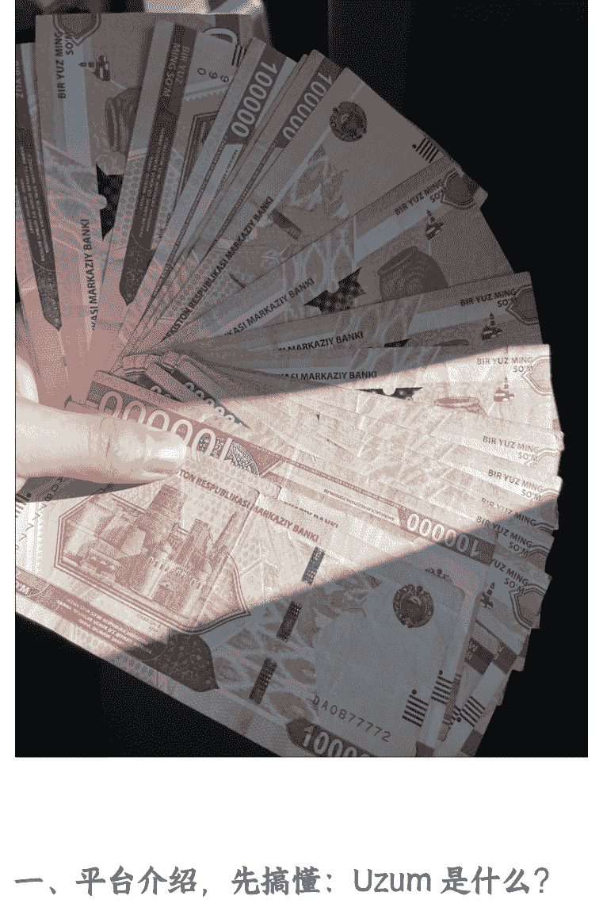

## 公众号懒人搜索，懒人专属群分享

## 一、平台介绍，先搞懂：Uzum 是什么？值得普通人入局吗？

### （一）Uzum 不是普通电商，是中亚"淘宝+美团+京东"复合体

这个平台所有的圈友都没有提到过，我的团队一个部门已经有运营了一年，敲重点。大家可别把 Uzum 当成普通的网上商城，它是乌兹别克斯坦第一个估值超 10 亿美元的"数字生态巨头"，就像把淘宝的商品交易、美团的即时配送、京东的仓储物流和银行的支付信贷揉在了一起。截至 2024 年，乌兹别克斯坦 40% 的人（超 1500 万）都是它的月活用户，2025年3月当地竞争委员会都认定它是"市场主导者"，跟着这样的平台干，相当于踩在了现成的流量风口上。

它的业务板块全得很：Uzum Market 卖百货，Uzum Tezkor 做 3 小时达即时配送，Uzum Bank 能办信用卡、放贷款，2024 年光支付交易额就有 65 亿美元。你卖货时能直接用它的仓库发货、借它的支付工具收款，甚至靠它的信贷服务吸引买家，根本不用自己从零搭体系。

### （二）一带一路风口下，这门生意有多香？

"一带一路"是建设工作座谈会特意强调要"坚定战略自信、全面推动高质量发展"，而中亚正是"一带一路"的核心区域，乌兹别克斯坦更是其中的关键节点。现在中乌免签30天，政策上一路绿灯，中企去当地开厂、做贸易都有红利加持——比如有家中国公司刚在乌兹别克斯坦投1亿美元建了瓷砖厂，不仅雇了700个当地人，产品还能轻松卖到周边国家。

对普通人来说，风口期的机会太明显了：当地正在疯狂建高楼，水泥、玻璃这些建材大多靠进口，环保新材料、智能家居更是基本空白；Uzum上100多万个SKU里，中国优势的小家电、定制家居占比还不到5%，随便补个品类就能赚差价。而且现在Temu、Wildberries刚进去，竞争还没到白热化，早一步布局就能占住坑位。

相当于改革开放时期的国内！

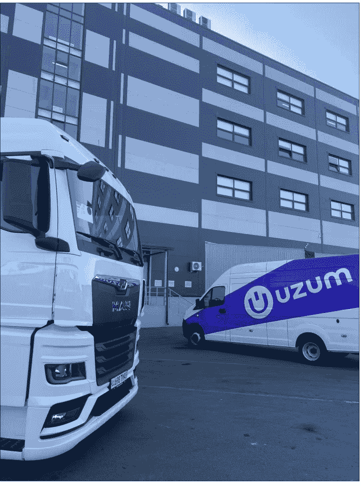

### （三）小白最关心：我没做过跨境生意，能入局吗？

答案是：太能了！放心吧，现在入局Uzum 有三大优势对新手特别友好：

- 平台自带"拐杖"：从开店资质办理到仓库发货，Uzum 都有成熟的流程，甚至能找到代办机构全程帮忙，1-3 天就能搞定关键手续；
- 中国供应链有绝对优势：1688 上的小家电、家居用品，运到乌兹别克斯坦能翻倍卖，而且当地人对中国品牌信任度极高；
- 竞争还没"内卷"：比起国内电商"神仙打架"，Uzum 上很多品类还是"蓝海"，比如适配当地电压的小家电、符合宗教习惯的服饰，基本没多少人做。

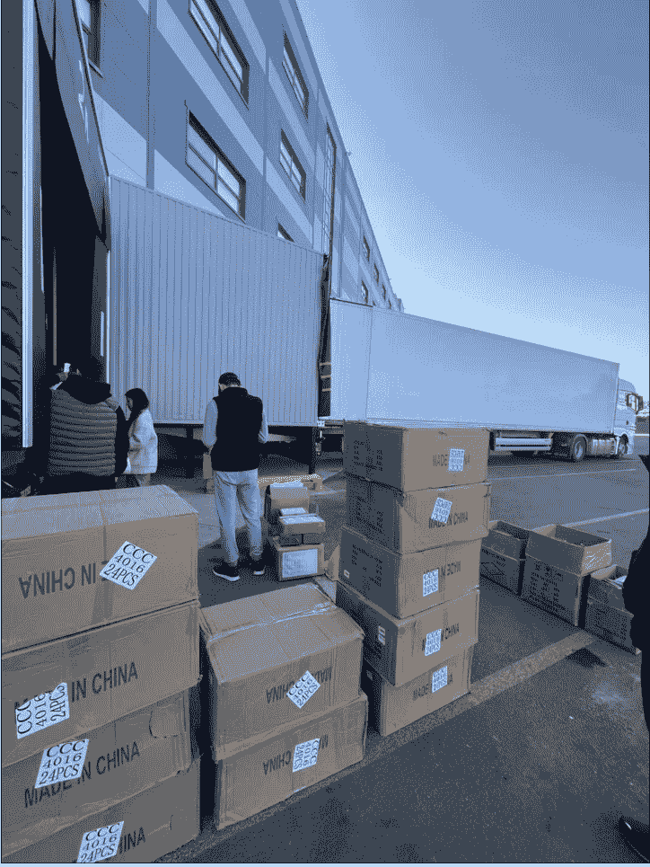

## 二、前期筹备：去 Uzum 总部，这些功课必须做足

### （一）先搞透 3 个核心认知，少走 1 年弯路

别单打独斗，要抱生态大腿：Uzum 的核心优势是"协同"，比如你在 Market 上卖母婴用品，能同步接入 Tezkor 的"3 小时达"，妈妈们下单后很快能收到货，销量能涨一倍。一定要把它的各个板块当成"组合工具"用，而不是只在一个板块卖货。

摸准需求再选品，别瞎跟风：当地人力成本低，但工业基础弱，像小家电、智能家居这些"中国制造"有天然优势；而且当地人喜欢大宗采购，小包装商品没人买，得搞大包装套餐。另外，适配 Uzum"先买后付"服务的 50-200 美元商品，平台会给流量倾斜，2024 年这业务放款就有 4.21 亿美元，跟着流量走准没错。

合规是底线，踩线就血本无归：参考 Temu 的教训，乌兹别克斯坦对税务、资质查得很严，必须先办本地注册和税务登记，不然货可能被扣，钱也拿不出来。

### （二）Uzum 总部对接攻略：3 步搞定关键人脉

2024 年我去塔什干总部对接时，总结出一套"高效破冰法"，普通人照着做也能快速建立合作：

找对人比啥都重要：去总部先联系 Uzum Business 部门（这是专门对接企业的通道），再找市场部、物流部。涉及到合作模式、费用这些关键决策，得对接首席战略官 Nikolay Seleznev 的团队，他们才有拍板权。

说话要戳中痛点：别光说"我想卖货"，要讲你能补啥缺口。比如卖供应链就说"我能搞到你们没有的中国小家电"，做服务就讲"我能帮你们覆盖下沉市场"，毕竟 Uzum 2024 年一直在扩张提货点，正需要这类合作伙伴。这些总部的高层就很喜欢来跟你聊。你是他的大客户！

带齐"通关文件"：必须带经当地公证的企业资质、税务备案文件，还有你选品的市场调研报告。现在注册本地个体企业家只要 100 美元，外资企业也才 500 美元，提前办好这些，总部才会认真跟你谈。（悄悄地说一下，总部，你过去，你的人设你自己说的算，你说你是国内某个大老板，他们巴不得跟你对接！）

## 三、新手必看：从 0 到 1 入驻 Uzum 的实操步骤（附费用明细）

### （一）第一步：办齐资质，1-3 天搞定"合法身份"

现在中乌免签，去当地办手续特别方便，流程和费用都是很透明的：

- 落地先办"住宿白条"：住酒店或租房后，用护照登记拿到临时住宿证明，这是后续所有手续的基础。我们当时找的酒店老板办理的。
- 办本地 SIM 卡和纳税人识别号：带着护照和住宿证明去营业厅办手机卡，再去公共服务中心办纳税人识别号(PNFL)，交完费第二天就能拿到。
- 注册主体资质：新手建议先办"小规模纳税人"，两周就能搞定，费用也就100美元左右；要是想长期做，注册外资企业也才500美元。记得找翻译把商业计划译成俄语或乌兹别克语，千字50-100美元就能搞定。
- 办电子签名和银行卡：在政务网站申请电子签名（50-100美元），再带着护照、纳税人识别号去Uzum合作银行开账户，一定要说清楚要办Visa卡，方便收付款。
- 平台注册：在seller.uzum.uz上填信息，把资料发给平台支持机器人，审核通过后激活账户，整个流程下来花118800苏姆（约合人民币400多）就能搞定。

### （二）第二步：算清启动成本，几万块就能开干

我之前就提到过新手千万别被"跨境生意"吓住，启动成本其实很可控，给你列个明细：

- 固定成本：注册费100-500美元+保证金1000-5000美元+电子签名50-100美元，合计1150-5600美元。
- 运营成本：初期采购日用品5000-10000美元（要是卖电子产品就得2-5万美元）；物流按体积算，每立方米500-2000美元，本地配送每件2-5美元；租仓库每月每平 5-10 美元，雇当地客服、仓管每人月薪 300-500 美元；水电网络每月 500-2000 美元。
- 平台费用：卖货后平台抽 5%-15%的佣金，没有其他隐藏收费。

算下来，做日用品生意 1-2 万美元（约 7-14 万人民币）比在国内开个实体店要便宜很多。

## 四、团队搭建：30 人以内的小团队，这样搭最赚钱

### （一）"3+2"架构：人少也能高效运转

运营一年验证过，小团队千万别搞复杂架构，"3 个核心+2 个部门"就够了：

- 核心决策层（3 个人顶梁柱）：
  - 中方负责人：管整体战略和中国供应链，得懂点跨境生意逻辑；
  - 乌方运营总监：必须找有 Uzum 或 Click.uz 工作经验的，懂本地政策和用户习惯，相当于"本地向导"；
  - 生态对接专员：专门跟 Uzum 各部门打交道，确保资源能拿到手。
- 执行部门（2 大模块不冗余）：
  - 业务运营部（占一半人手）：按品类分经理（比如 3C、家居），再配 2 个商家运营对接平台、2 个客户运营管用户，卖货的核心力量都在这；
  - 支撑保障部：1 个物流协调对接 Uzum 仓库，1 个财务合规管税务和结算，1 个人力行政管招聘。

### （二）中乌配比 3:7：本地人带路，中国人掌舵

千万别全用中方团队，也别全靠本地人，3:7 的配比最靠谱：

- 中方 30%（核心骨干）：优先找有跨境电商经验、懂俄语的，通过"一带一路"企业人才库或行业社群挖人，有中亚工作经历的优先——他们能帮你对接中国工厂，把控供应链风险。
- 乌方 70%（本地根基）：运营总监、物流专员、客服必须是本地人。客服要母语沟通才留得住客户，物流专员得熟悉全国仓储网络，这些都不是外人能替代的。招聘可以找塔什干经济大学合作，或在本地平台 hh.uz 上找，再委托机构办劳动许可就行。

## 五、市场切入：3 个阶段，从冷启动到月入 10 万+

### （一）第一阶段（1-3 个月）：冷启动，靠 Uzum 资源快速起量

目标是 3 个月内实现日均 100 单，核心就是“抱紧平台大腿”：

- 选品盯准 3 个蓝海赛道：
  - 稀缺补充品：卖中国有优势的小家电、智能家居，比如适配当地 220V 电压的电饭煲，Uzum 上这类 SKU 占比不足 5%，基本没竞争；
  - 本地适配品：搞大包装食品、家用纺织品套餐，符合当地人“一次买够”的习惯；
  - 金融联动品：选 50-200 美元的中价商品，比如轻奢家居，能对接 Uzum 的“先买后付”服务，平台会给流量倾斜。
- 物流全用 Uzum 仓库：新手千万别自己搞物流，直接把货送到 Uzum 的中亚最大仓，它能实现“次日达”，覆盖全国所有万人以上的地方，省得你自己找货代踩坑。
- 流量靠“新店扶持+小额广告”：先申请 Uzum 的“新店扶持计划”拿免费曝光，再花点钱投搜索广告，关键词就用“中国家电”“性价比家居”，首月就能起量。

### （二）第二阶段（4-8个月）：增长期，多业务联动扩规模

电商板块稳住后，得联动其他业务搞"增量"；

- 即时配送引流：接入 Uzum Tezkor，在塔什干、撒马尔罕这些大城市搞"3小时达"快消专区，卖母婴用品、日化品，借它2600多家线下商户的流量反哺线上；
- 绑定支付提转化：跟 Uzum Bank 合作，搞"用 Visa 卡支付立减 5%"的活动，这张卡2024年发了70多万张，用户基数大得很；
- 社媒拉新：乌兹别克斯坦84.78%的人用Telegram，建个官方频道发新品、发优惠券，每月至少能引5000人到店铺下单，成本还低。

### （三）第三阶段（9-12个月）：稳定期，建壁垒不被替代

运营一年后要靠"差异化"站稳脚跟，不然很容易被跟风者挤走：

- 供应链做深：直接跟10家以上中国工厂签直供，搞"Uzum定制款"，比如印当地花纹的家居服、带俄语说明书的家电，用FBS模式（自己送到平台仓）降低成本，毛利率能提到35%以上；
- 数据驱动选品：看Uzum后台数据，核心客群是25-40岁城市中产，喜欢高性价比、有品牌感的东西，把动销率低于30%的品类砍掉，库存每月周转2次才不压钱；
- 下沉市场渗透：跟着Uzum的提货点扩张计划走，在布哈拉、纳沃伊这些二线城市搞"线下体验+线上下单"，下沉市场订单占比能从15%提到40%，这都是增量。

## 六、核心运营：选品物流运营核心

### 一、选品：先调研再小批量试

#### 我们怎么调研和测试的：

当时去了找本地官方员工，打了很多的电话，Telegram，等等。去那个市场问了很多次。然后在加了很多Telegram家居群，扒了Instagram时尚博主评论区，看大家想要啥样的产品。当地的Instagram是非常火的，因为他们不能使用TikTok。禁止使用。

看Uzum上头部卖家的差评，比如有人嫌收纳盒小，咱就做个大号的。我们测试的时候：先不上货，把3-5款候选品挂网上，用一样的图和价格引流。3天内点击超500、咨询超20的，再备货，第一次就备50-100件。这个确实屡试不爽。

### 二、推荐4类好做的货（需求高、风险低）

#### （一）家居升级类：民族风纯棉抱枕、折叠晾晒架

- 优点：符合当地城市化，大家想提升家居品质；都是轻货（单箱＜3kg），物流、仓储便宜。抱枕用传统纹样吸引人，折叠架适合小户型。
- 注意：民族纹样问一下本地人，别有宗教或禁忌内容。这个做很多信仰国家一定要注意的。

#### （二）美妆个护类：清真认证保湿面霜、便携化妆刷套装

- 优点：中亚女生美妆消费涨得快（2025年增速 5.21%），清真面霜（无酒精、无动物成分）信任度高，复购率超 30%；化妆刷套装小且轻，运费 8-12 元/件，不用复杂认证。韩国人的产品，他们老喜欢了，其实韩国的产品都是我们生产的。我们去到市场那烂的不行的产品，他们都很喜欢。我随便进了一家店。打开拼多多扫了一下。一个口红才 16.9。竟然卖 120 多。属实不可思议。
- 注意：要供应商给清真认证文件（如马来西亚 TAKIM、阿联酋 HALAL），详情页展示；化妆刷标材质（选合成纤维，别用动物毛），强调无荧光剂、不刺激。

> （再说一遍：当地人很喜欢韩国货，其实很多都是咱国内生产的。）

#### （三）厨房小工具类：多功能切菜器、硅胶烘焙模具

- 优点：日常刚需，售后率低（＜5%）。切菜器能切片切丝切丁，适合本地做饭需求；硅胶模具耐摔好洗，符合年轻人自制甜点的趋势。他们小情侣啊在家里都是自己做这些。很甜美。包括他们喜欢的都是菊花🌼，情人节送礼都是菊花。（这个我自己确实不理解）

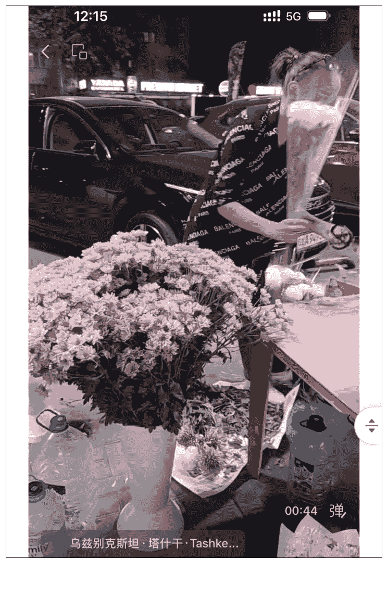

#### （四）节日礼品类：清真认证坚果礼盒、简约装饰灯

- 优点：借本地节日(纳乌鲁斯节、开斋节)涨价20%-30%;坚果礼盒清真,节日聚餐常用;装饰灯(USB小夜灯、串灯)电压低(5V以下),清关容易。
- 注意：提前 2-3 个月备货，避开旺季（节前 1 个月口岸可能慢 3-5 天）；坚果礼盒标保质期（选 6 个月以上的），真空独立包装；装饰灯标适用电压（当地 220V，要么匹配要么赠转换插头）。

### （五）流量：站内站外结合

- 站内流量（核心来源）：
  - 付费广告：重点投搜索广告和首页推荐位，ROI 控制在 1:5 以上，新品期放宽到 1:3 也能接受；
  - 蹭大促流量：诺鲁孜节（3 月）、独立日（9 月）、年终大促（12 月）这三个节点必须参加，提前 30 天备货申报，大促销量能涨 3-5 倍。
- 站外引流（低成本获客）：
  - 社交账号矩阵：Telegram 发优惠券留用户，Instagram 拍产品场景图，YouTube 做使用教程，全免费；
  - 找小网红合作：选 5-10 万粉丝的垂直博主（比如家居、数码类），按"固定费+佣金"付费，单条内容转化成本才 20 美元左右，比投广告划算。当地人 Telegram 使用率非常高，和我们的微信一样。可以做活动拉很多的群。还有达人对接这一块。跨境电商所有的板块都不落时。

## 七、合规与风控：避开这些坑，不然赚的钱全赔光

### （一）政策合规：这 3 件事必须办

- 资质别偷懒：小规模纳税人、税务登记证、进出口许可证（卖跨境货的话）一个都不能少，最好找本地律所审合同，政策变了能及时知道；
- 税务别侥幸：当地电商增值税15%，每笔交易都要留凭证，每月跟Uzum财务对账，别想着逃税——Temu 都栽过跟头，普通人更别碰红线；
- 文件留备份：所有资质、合同、对账记录都存好，不管是纸质还是电子档，万一被查能拿得出证据。

### （二）平台规则：这 3 条红线碰了就封店

- 别搞虚假交易：Uzum 的审核系统很严，刷单刷好评一抓一个准，罚款还是小事，直接清退就血本无归了；
- 不侵权、不夸大：别卖仿牌，也别乱吹"100%有效"这种话，当地对侵权和虚假宣传查得特别严；
- 变更提前说：比如从入仓改自配送，要提前30天给Uzum 交申请，别自己随便改流程。

### （三）风险预案：3 个突发情况怎么应对？

- 政策变了怎么办：加个“中资企业协会”的群，再找个本地律所当顾问。一旦支付、税务规则变了，24 小时内调整方案，比如赶紧切到 Uzum Bank 的支付渠道；
- 物流断了怎么办：跟 Uzum 物流部搞好关系，极端天气前 7 天备货，再备 2 家本地物流公司（比如 SPSR）当替补；
- 竞品压价怎么办：别跟着打价格战，搞定制款、延长售后，用差异化赢——比如别人卖普通电饭煲，你卖带本地菜谱的，再送一年保修。

## 八、一年后复盘与增长：从赚钱到赚大钱的升级路

### （一）核心指标看这 3 类，知道自己赚不赚钱
- 业务指标：GMV 要达标（至少完成目标的 120%），日均订单 300 单以上，客单价稳定在 80 美元，复购率 35%以上才算合格；
- 效率指标：库存每月周转 2 次，广告 ROI 1:5 以上，售后纠纷低于 2%，这些数据比单纯看销售额有用；
- 生态指标：Uzum 合作评分要到 4.9 分，Tezkor 订单占比 20%，“先买后付”支付占 30%，说明你把平台资源用透了。

### （二）下阶段怎么赚更多？3个方向可发力
- 扩品类：新增 Uzum Avto 的汽车周边，比如饰品、保养品，借它 300 家经销商渠道做 B2B 生意；
- 搞技术：接 Uzum 的开放 API，订单、库存实时同步，再建个 CRM 存用户数据，精准推新品；
- 拓区域：借着“一带一路”的东风，用乌兹别克斯坦的经验对接哈萨克斯坦的 Kaspi 平台，把生意做到整个中亚，包括俄罗斯。

## 九、最后总结：风口比努力重要
- 风口比努力重要：“一带一路”加持下，中亚市场正在爆发，Uzum 又是当地龙头，选对赛道就成功了一半；
- 本地化比啥都强：别拿国内经验硬套，找个靠谱的乌方伙伴，按当地人的习惯卖货、管团队，才能长久；
- 合规是保命线：赚钱的前提是不踩坑，政策、平台规则都搞清楚，才能安安稳稳赚美金。

现在的 Uzum，就像 10 年前的淘宝，竞争小、机会多，只要你敢迈出第一步，跟着这份攻略一步步做，新手也能在中亚市场分到一杯羹。干就完了。

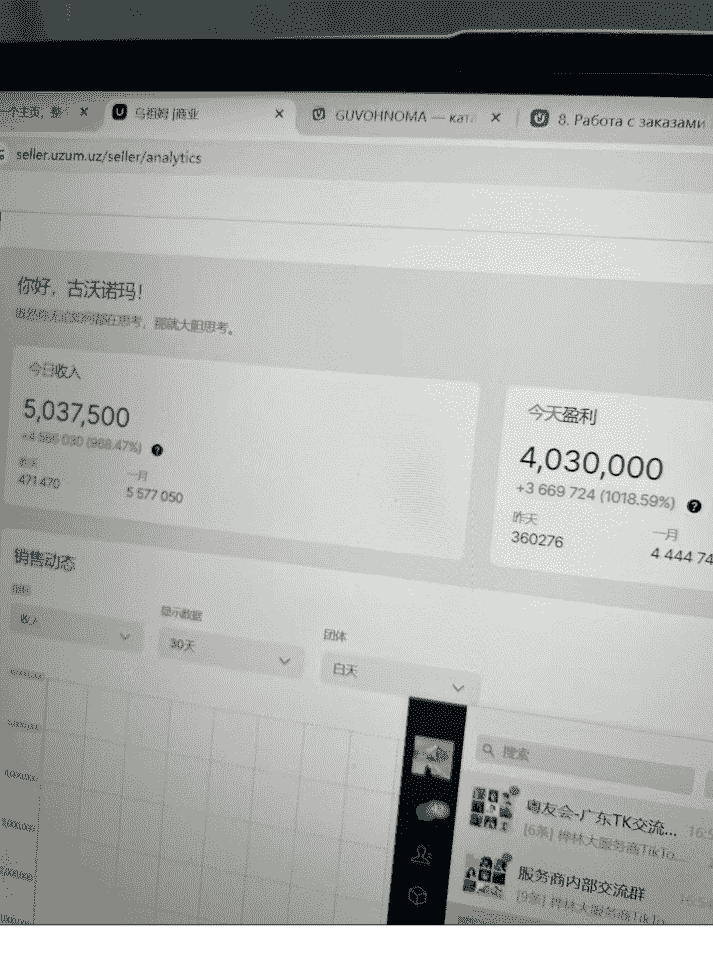

彩蛋：
最后告诉大家一点，这个国家的首都都有沙县小吃，国内的各种工程公司，去做实体行业在中亚，也很不错。很多中国人开的理发店、餐饮等等，利润很高，当地美金可是流通的货币！各行业利润很可观！

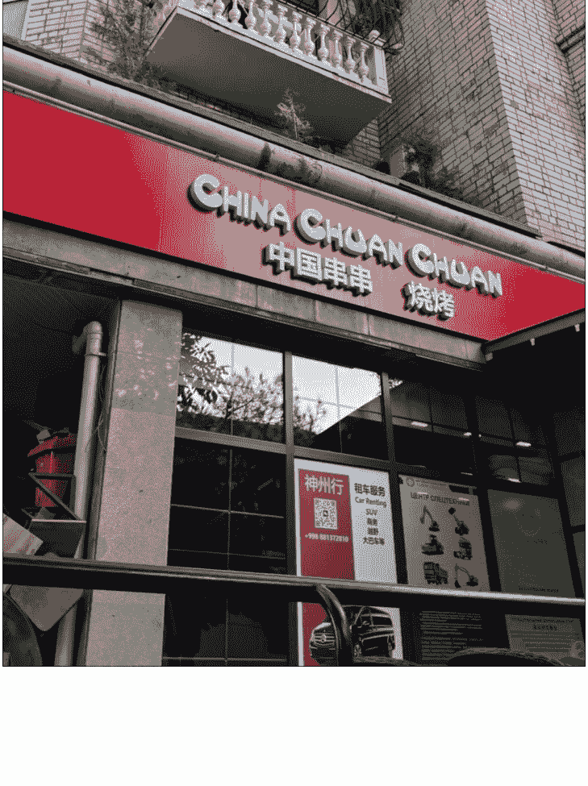

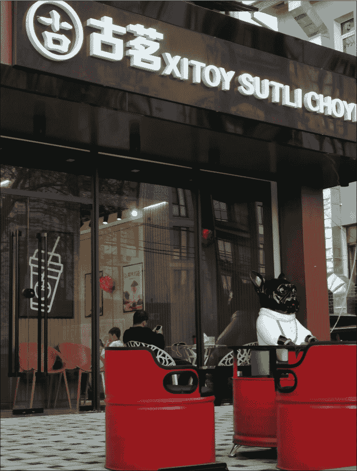

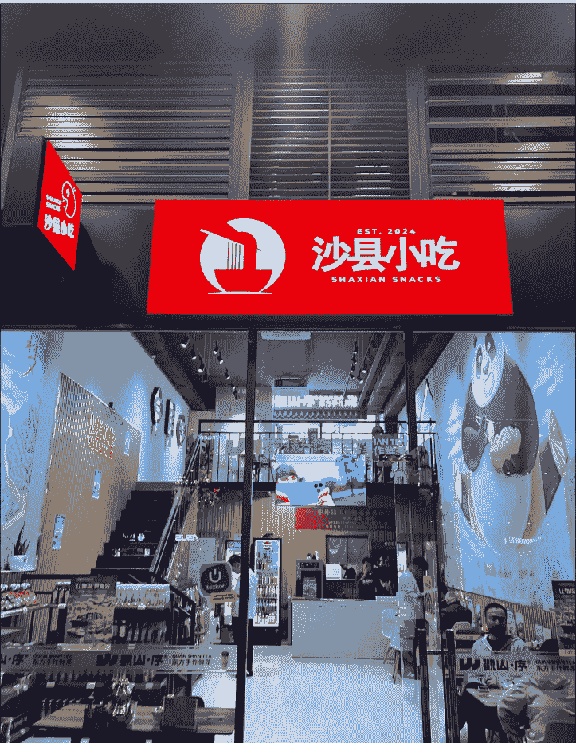

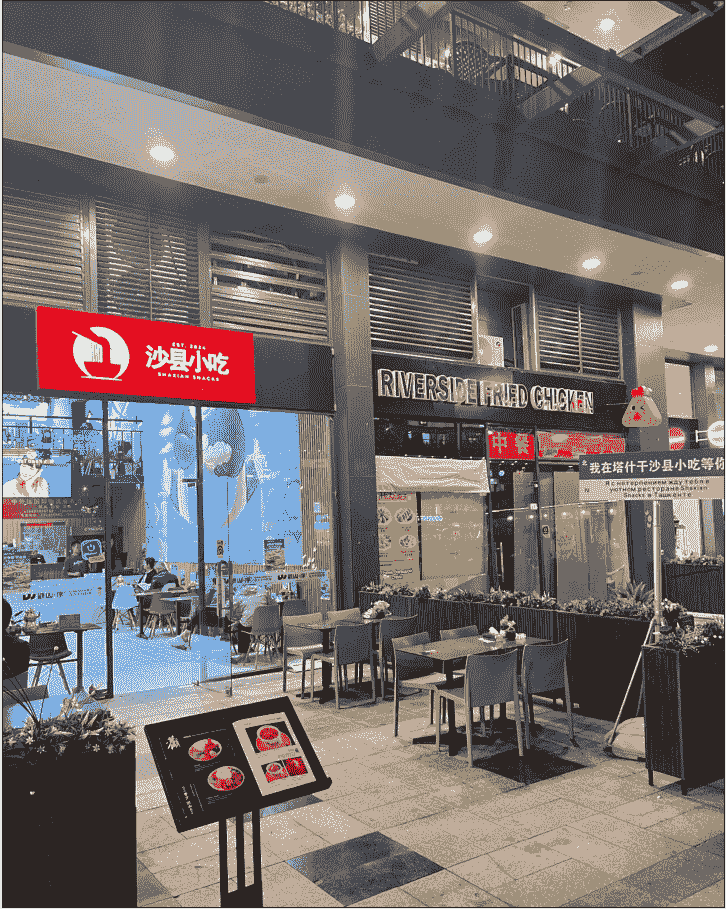

最后，安利小懒的付费群：
懒人专属群（介绍）

微信：lazyhelper

📖 懒人专属群持续更新中，已持续运营 6 年，整理超 3000 份各类精选付费文章 & 年费社群干货，全部开放下载。
本资料为付费群内部分享，仅供真实有需要的朋友查阅 🙇

懒人专属群更新记录：
https://lazy2025.top/blog/record2

懒人专属群更新记录（需梯子，备用）：
https://lazybook.fun/blog/record2