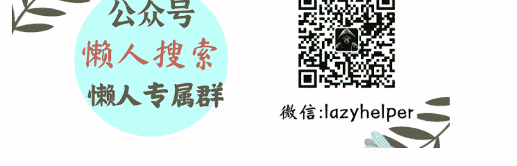

# 社会上的“显学”和“隐学”
# 240805 主任通透的职场人生

整理：公众号懒人搜索，懒人专属群独享

懒人微信：lazyhelper

仅分享，内容代表原作者观点~

这篇文章酝酿了好久，严格来说这是一篇足以改变你命运的文章。

本文专门写给年龄为 18—35 岁的普通家庭年轻人的。

或者说这篇文章，能让你打开天眼，洞悉社会本质，如果你出生在普通家庭的话，文章中的每一条内容，都是超脱你原生层次的隐学。

绝大多数年轻人，实则太过于缺乏“隐学”这项功课的灌输了。其原生家庭所能做到的极限，就是教你踏踏实实做事，老老实实做人。

因为父母和亲戚都在社会最底层，只会卖力气混一口衣食，根本看不懂社会的运行规律，在经验上对子女毫无传授，把儿女养大已经是很不容易，何谈指引人生。

很多农村出身的孩子父母追求的就是没有风险的生活。他们一辈子安安稳稳，没经历过大风大浪，日出而作，日落而息，没有大的人生追求，每天为生计而奔波，大学报志愿一窍不通，找工作一窍不通，对人性和职场上的人情世故一窍不通。

可以说很多家庭甚至就连“家教”都是极度匮乏的。从某种程度上来说，你却又无法责怪他们，你永远不能指望和期待这辈子庸碌无为的父母，给你传授高段位的智慧和技能。

很多错误之所以犯下，很多机遇之所以错过，都是你身边缺乏有心人，帮你点拨那一下下。很多时候你遇到棘手问题，向你的父母求助时，他们也一脸茫然地看着你，爱莫能助，有心无力，你说的他根本就听不懂。

这世界上两种人最聪明，经商和从政的。这个世道上有两种学科，一个叫显学，一个叫隐学。

显学的内容在书本上就能看到，怎么修身、怎么齐家、怎么做学问，可以在公开场合进行授课的，有大量的书籍作为理论指导，也有大量的价值观和主旋律背书的，这些学科统称为显学，是台面上的东西，你也可以学，别人也可以学，并不会拉开人与人的差距。

隐学属于一种高级教育，都是秘而不宣的，父亲教给子女，子女再教给子女，一代又一代，累积出巨大的知识库，家学绝对不是什么书上记载的大路货，而是独特的、秘密的羊肠小道，各行各业都有门道，否则没法活下来。

比如说明演艺圈演员的子女就是演艺圈很多规则他是清楚的，从小耳濡目染，干部家庭的子女也好，商人家庭子女也好，他从小就知道去哪里进货，怎么谈判，怎么送礼，怎么和官员打交道？如何搞定你的领导？怎么沟通协调？如何站队？怎么游走于灰色地带？

其实完全通过读书改变命运的这一类人，他们进入社会后一如既往努力，却很难得到像读书时的正反馈，因为从学校踏入社会，个人能力的比拼已经从单纯的智力升级为智商、情商、逆商，外加关系背景等综合能力的搏杀，普通家庭的孩子除了吃智商的天赋，其他方面是全方位落后。

但是现实博弈中，有很多涉及到认知差和规则差的一些学问，是无法进行公开授课的，因为这些学科不需要大量的人掌握，否则就会导致社会秩序的混乱，这类学科就是隐学，往往是私密授课，只能在小范围里说，以家学或者收徒的形式进行传递。

隐学，你在书本上和公开场合根本就学不到。

人生最大的浪费不是金钱的浪费，而是时间的浪费，认知的迟到。

如果你的父母身价没有超过千万，或者他们没有干到处级干部，那么他们基本是不可能把本文的内容，汇聚成家学传承给你的。

那么你今天读到我的这篇文章，真的是非常非常幸运的一件事。

正所谓登高才能望远，事实就是，这个世界上绝大多数的隐学和心术，真的是有那些到了一定段位级别的人，才能够总结成语句汇聚而出。

所以，慢慢读，越往后越精华。（全文共 6000 余字）

## 一、及早远离父母的认知，尽量跟原生家庭切割

一个几代人穷且老实的家庭，在 30 岁之前人生最大的阻力来自于自己的家人，家人和人脉认知的局限性，会在各种各样的事情上帮倒忙或给出错误的指导。

父母的阶层、平台、阅历、眼界，决定了他们无法成为我们人生的领路人，也无法给我们最与时俱进的建议。

生在这样一种家庭中，没办法，出生在哪里不是我们能决定的，一定要及时逃离，逃离的越早越好，及早远离父母的认知。

家里从政从商的，一定要听父母的；家里务农务工的，一定要远离父母的认知。你是官二代，富二代，你就听父母的话。

比方说你的父母非常厉害，他在某个方面做出了成绩，成为了专家，有了很大的成就，你当然可以继承家学，你可以向他们学习，你可以听取他们的忠告。但是如果你的父母自身脑子就很糊涂，他自己就混得一塌糊涂，没有什么成就，他们还要对你指手画脚，给你提很多的不靠谱的建议。

你就不要事事都听父母的，甚至要和他们反着来。一个人成长成熟的过程其实就是跟自己的父母切割的过程，因为他们一辈子的时间已经证明了他们不行，你就要尽量的跟原生家庭切割。当然这个切割不是说你就不要孝顺他们了，孝敬是应该的，我个人的策略是说你多给钱，然后一年当中你多回去看他们几次，但是最好不要长期的住在一块，也不要听取他们对你人生的任何建议。

他们说什么你就说对对对，好好好，但是具体你该怎么做，你的脑子要有自己的想法，要特别清醒。你的人生当中的重大决定，比如说读什么大学，选什么专业，要不要读研究生，毕业了以后你要选择什么样的工作？怎么规划自己的发展道路，你一定要有自己的想法，你一定要有自己的思考，有自己的主意。

## 二、及早物质独立，精神独立。

很多糟糕的父母不光是在人生经验和智慧上，无法给子女正确的指导，在其他方面也是一塌糊涂。

你工作以后，他们还要求你把赚来的钱给弟弟买房买车，如果不给钱就对你进行道德绑架，说你不孝顺，这种家庭其实非常常见。还是那句话，如果你生长在一个幸福快乐的、和谐的家庭，那么你是非常幸运的。但是有的家庭父母跟孩子就像冤家一样，他要控制你，打着为你好的旗号控制你，你大学读什么专业，他要控制你；你要找什么样的男朋友或者女朋友，他也要控制你。

还有的父母比较喜欢打击你，你做什么他都要说你做的不够好，总是拿你跟其他人去比较，然后打击你。

做父母虽然不是一个职业，也不需要什么合格证书。我们开车需要驾驶证，当个厨师需要厨师证，你开个挖掘机也需要相应的证书，但是当父母他是不需要证书的，并不是每一个人都一个合格的父母，有的人也从来没有反思过，没有学习过应该怎么样去做一个合格的父母。

可以说有少部分人根本就不配做父母。这句话虽然说的有点重，但事实就是这样，有的父母带给孩子的只有深重的痛苦，糟糕的行为习惯，愚蠢的生活思维方式。在这种不健康的家庭当中成长起来的孩子，他们没有办法从家庭当中得到滋养，他们没有办法从父母那里得到言传身教，他们只是被一味的打击，一味的索取，一味的压榨，一味的控制。

比如性格暴躁，情绪不稳定，格局小，时间管理能力差，不自律，唯一的娱乐就是睡懒觉，打牌消磨时间，没有人生目标，浑浑噩噩。

家里缺少沟通，遇事不商量，唯一的沟通方式就是吼和吵架，喜欢互相推诿责任，家里充满抱怨和相互指责。

他们从未见过好的家庭是什么样的，也没有任何反思和学习能力，所以说在这种家庭一定要尽早物质和精神都早日独立。

一定下定决心跟自己的劣质父母决裂，彻底的划清界限了。其实一个人成长的过程就是不断的摆脱父母控制的过程，劣质的父母往往会用各种办法去控制子女。就在你小的时候，他们会用棍棒巴掌、暴力来控制你；等你长大一点需要花钱的时候，他们用经济手段来控制你；等到你自己能够赚钱了，他们又用孝心、孝顺这样的观念来控制你。那如果你的父母真的非常过分，而且你尝试在尝试跟他们和解，尝试去跟他们辩论，尝试去跟他们表达你的愤怒，都没有办法的时候，你没有办法跟这样的父母和解的时候，我觉得你可以选择远离他们。

孩子一定要对父母孝顺吗？我认为也不一定。如果你的父母就是个混蛋是吧？甚至是个禽兽，你也不一定要孝顺他，你也不一定要被道德绑架。遇到糟糕的父母，你只有下定决心，彻底的划清界限，你才能够换来自己宁静的、自由的世界。其实我认为我们融入社会的过程其实就是不断摆脱父母的控制和依赖的过程，我们不断地学会独立思考，独立成长，独立处理各种事情，独立的去面对这个社会。所以我们每一个人都要努力的赚钱，自食其力，我们要有自己独立的思考能力，自己独立做决定的能力，我们要有独立去面对这个世界的勇气，我们要有独自快乐的能力，尽量不要依附于任何人。

有的人因为原生家庭的阴影挥之不去，经常就是处在一种暴躁情绪失控，自我否定当中。那么当我们为人父母的时候，我们就要有一种责任感，我们就要努力给我们的后代创造一个好的原生家庭环境，给自己的孩子做一个榜样。

## 三、向身边优秀的人学习，升级自己的思维方式

职场当中也是这样，有的同事喜欢做了一点事情，就去找领导邀功，去找领导汇报，把自己说的多苦多累，实际上你比他还辛苦，你比他还累，那你如果看不惯他，你就会觉得这个人好恶心。实际上从心理学的角度来讲，你所看不惯的东西反映了你内在的某种缺失。

比如说你性格内向，你不爱说话，那你可能就会对那种交际花一样的，整天喋喋不休的那种长袖善舞的，特别会搞人际关系的人，你就看不惯他，因为你不会，你不擅长。你学历高，你是名牌大学毕业，你可能就会对那种学历比较低，但是会拍马屁的那种人，特别会搞关系的那种人，你就看不惯，因为你不会，你不擅长，所以你天然的就会排斥这个东西。

但实际上要想有所成就不要有单一的思维，你为什么不能够成为一个干了很多工作，但是你又很会邀功，又很会汇报工作的人呢？

你为什么不能够成为一个很踏实，很靠谱，很上进，很认真，很负责任，学历很高，能力很强，但是同时也会给领导，给这个领导提供情绪价值，也很会搞人际关系，如果你有这种技能的加持，你不是会走得更高、更远更快？所有你看不惯的东西，实际上都是你的盲区，所有你看不惯的人的事情都无法为你所用，你没有办法认识他们，你没有办法利用他们，你没有办法从他们身上得到任何利益，因为你有对抗思维，你对这些东西是抗拒的。想要有所成就，就要学其所长，学习他，成为他，打败它。

能力越强的人，越包容、越平和，什么东西都看得惯。而且往往那些你看不惯的东西，就是你的机会，就是你的短板，就是你需要改变的地方。

比如说有的人一谈到升迁提拔，就非常反感了，说我进了体制，我就想混日子，我不想升迁难道不行吗？当领导有什么好处吗？到点下班难道不好吗？每天当舔狗有意思吗？

一谈到知识付费，比如说就是割韭菜，好像自己是全世界最聪明的人了，那些买知识付费产品的都是傻子。其实说到知识付费，说实话，我自己平时也会买一些付费文章，我把知识付费当作是跟聪明人聊天的机会。

因为有互联网，我们才有可能突破地域空间的限制，认识很多非常厉害的人，认识很多价值观跟我们不一样的人，所以我觉得看书也好，看付费文章也好，是跟聪明的人接触的最好的载体。所以我从来不认为买一本书几十块钱、一两百块钱很贵。当然前提是这本书是作者用心写的，这篇付费文章是作者用心去写的，因为你想一想，你花几十块钱、一两百块钱就能够买到作者脑子里面半辈子甚至一辈子积累的智慧，这件事情简直太划算了，简直太值得了。

贫困最可怕的，不是物质的贫乏，而是陷入贫困的思维和认知。物质上穷只是穷一时，思维和认知上穷那就可能穷三代了，你无需给下一代留下巨额财富，只要你留给下一代格局、眼界、思维、认知，这就是财富。

我认为我们一生当中其实要做的最重要的一件事情就是升级我们的思维，通过实践也好，通过反思也好，通过看书，你升级了你的思维，你将无往而不利。

## 四、善于游走于灰色地带

很多人被洗脑，内心只装了两个角色，英雄和坏人，非黑即白，长大才发现，世界并不像武侠电视黑白分明，没有绝对的好人，也没有绝对的坏人。

老子有一句话，叫水至清则无鱼，其实这个世界除了黑白，还存在着个灰色的地带，这个灰色的地带是你成功的关键。

一个眼睛里容不得沙子、脑袋里只有是非黑白对错的人，很多时候是难以诸事顺遂的。

不管是做人，还是处事，不能太过于非黑非白了，因为很多时候灰色才是事物的常态。

这个世界既没有宣传的那么光明，也没有那么黑暗，经常需要游走于灰色地带才是常态，不要被道德绑架，人们可以通过各种手段来获取利益。而那些既得利益者，就是擅长在灰色地带里游走的人。他们懂得如何利用规则漏洞，来实现自己的目的。这就像是在玩一场游戏，他们懂得如何在游戏中找到破绽，然后利用这些破绽来赢得游戏。

事实上，情商高的人往往没有真正的敌人，因为他们懂得在各种场合下应对他人，他们懂得如何讲对方想听的话，如何讲对方听得进的话，然后再讲自己该讲的事。他们懂得运用权力，操控规则，以达到自己的目的。总之把握一个原则，做事情不要被道德束缚，但同时不要触碰法律。

## 五、要懂人情世故、懂人性

举两个例子：为啥原生家庭一般的人遇不到贵人？

- 单位“一把手”提拔了一个干活卖力、农村出身的小伙子，在谈话中客气地对他说：你的进步得益于你的努力。这小子真的以为自己的进步是自己努力的结果，提拔之后在工作上倒是挺卖力，就是从未对领导表示过感谢，逢年过节连门都没上门拜访都没有。
- 某单位分管领导为得力下属小李争取到一个出国培训进修的机会。小李半年学成归国，为感谢主任就带了一个外国的冰箱贴，对，就是一个价值10块人民币的冰箱贴。

从学校踏入社会，个人能力的比拼已经从单纯的智力升级为智商、情商、逆商，外加关系背景等综合能力的搏杀，普通家庭的孩子除了吃智商的天赋，其他方面全面落后，起步就落后二代们数个身位，因为那些二代们司空见惯的人情世故，可能普通人踏入社会五年乃至十年都未必能完全领悟。

行走社会，如同江湖。江湖不是直来直去，而是人情世故。不懂社会潜规则，有时候寸步难行。普通人很无奈，无法改变大环境，只能被动适应、巴结人。喜欢凭自己的直率来为人处事，更不喜欢用潜规则来办事，这样难免会不适应社会。

我们都知道中国是个关系社会、人情社会，只要你生存在这个社会之中，比如说我们上学要找关系，做生意要跟别人搞关系，这个项目给你也行，给别人也行，这个职位提拔你也行，提拔别人也行，并不是说所有的事情都是公事公办的。

举个简单的例子，比如说财政拨款，你们单位的一把手跟财政局关系好，你们就能够多要一点钱，多办一点事情，多掌握花钱的权力。

比如说提拔干部，你们单位的一把手跟组织部关系好，可能在这个培养和提拔干部的时候就有优势。可以多要几个指标，多要几个名额，很多时候都要搞好方方面面的关系，尤其是要打通上层的关系。

关系是需要长期经营的，夫妻之间还要相互经营感情，何况是利益关系打底的社会关系呢？穷人没有贵人，更要创造“贵人”。

混迹社会要研究人性，工作中要懂人情世故，也要学会经营关系。

为什么你会被伤害，为什么你被玩弄，为什么你被利用，为什么你总失败，为什么你被欺辱，为什么你是棋子，为什么你被情困，为什么你会没钱，为什么你遭背叛，都是源于对人性的无知和缺乏对社会规则的洞悉。

人成长就要历劫，有的人悟性高，别人的一句话就可以点醒他，也可能他通过观察别人，他自己也能开悟。悟性没那么高的，大多数都是经历了很多事，经历了很多挫折，很多苦难，吃了很多亏，才开悟，心智才得以成长。

## 对于原生家庭比较一般的人：

- 一是要尽早远离父母的认知，尽量跟原生家庭切割。
- 二是要早点精神独立、物质独立。
- 三是向身边优秀的人学习，升级自己的思维方式。
- 四是善于游走于灰色地带。
- 五是要懂人情世故、懂人性。

希望以上对您有帮助！

## 最后，安利小懒的付费群：

### 懒人专属群（介绍）

懒人专属群持续更新中，已持续运营 6 年，整理超 3000 份各类精选付费文章 & 年费社群干货，全部开放下载。

本资料为付费群内部分享，仅供真实有需要的朋友查阅 🙇

### 懒人专属群更新记录：

https://lazy2025.top/blog/record2

懒人专属群更新记录（需梯子，备用）：

https://lazybook.fun/blog/record2