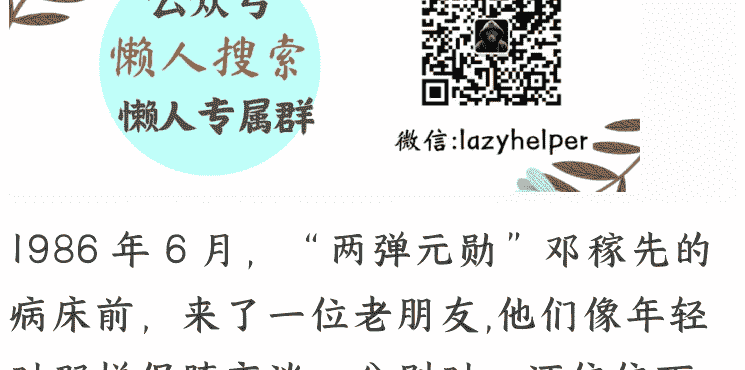
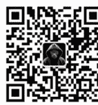

# 别了，杨振宁

20251021 文/卢克文工作室嘉宾 星海舰长

整理：公众号懒人搜索，懒人专属群独享

懒人微信：lazyhelper

1986年6月，“两弹元勋”邓稼先的病床前，来了一位老朋友，他们像年轻时那样促膝交谈，分别时，还依依不舍地留了一张影。

照片中，可以十分清楚地看见邓稼先的嘴角有血迹渗出，说明他的全身已经出现大出血的症状了。

1个月后，邓稼先去世，那位老朋友得知，失声痛哭。

他想起了1971年邓稼先给自己写的那封信：“但愿人长久，千里共同途。”也正因为这句话，激励了这位老朋友多年后放弃美国国籍，回国效力。

这位老朋友，就是世界级物理大师、中国科学院院士——杨振宁。

2025年10月18日，杨振宁去世，享年103岁。

那么，如何评价杨振宁的一生？

## 1

1922年，杨振宁生于一个知识分子家庭。父亲杨武之是清华数学教授，家学渊源，为他埋下了学术的种子，杨振宁很快就展现出了惊人的数学天赋，小学毕业时，就能帮初中生做数学题了。

但好景不长，1937年，七七事变爆发，16岁的杨振宁随家人逃难，一路辗转到达昆明，进入国立西南联合大学学习。也就是在这里，他意外碰上了自己在北平崇德中学的同学——邓稼先。

在那个战火纷飞的时代，他和邓稼先约定，一定要学习最前沿的知识，实现科学救国的理想。

1943年，杨振宁参加留美考试，并顺利远赴芝加哥大学攻读博士学位，师从费米和特勒。1948年获得博士学位后，他进入普林斯顿高等研究院，开启了他的学术黄金时代。

也是在这一年，邓稼先来到了美国，在普渡大学物理系深造。为省下租房的钱，他和杨振宁挤到了一个房子里，住了两年，二人结下了深厚友谊，亲如兄弟。

1950年8月，在取得博士学位的第9天，邓稼先登上威尔逊总统号轮船，回到祖国怀抱。

而杨振宁，继续留在普林斯顿从事研究。

很多中国人从情感上，总觉得邓稼先和杨振宁天壤地别，邓稼先学成就归国为国效力，而杨振宁大半辈子在国外，都给别人去做贡献了。

这种看法客观么？

不客观。

科学和科学也是不一样的。

杨振宁和邓稼先搞的虽然都是物理，但杨振宁搞的是理论物理，而邓稼先搞的是工程物理。

工程物理能拿来搞原子弹，但杨振宁的理论物理能回来干什么？中国人当时连饭都吃不饱，哪有精力和资源搞理论物理？就算杨振宁回国了，有了什么理论上的思路，又怎么做实验去验证？

相反，留在美国，能接触到更先进的研究设备、更前沿的理念和更多学术交流机会，等利用国外条件作出成果了，再提供给祖国，也不迟。

这就是杨振宁选择的和邓稼先完全不同的路。

1954年，杨振宁和搭档米尔斯发表了杨-米尔斯规范场论，成为现代粒子物理学的基石。科学界评价其价值“与麦克斯韦方程和爱因斯坦相对论媲美”。

两年后，杨振宁与李政道合作提出弱相互作用中宇称不守恒理论。这个革命性的理论让二人在1957年共同获得了诺贝尔物理学奖。

在瑞典斯德哥尔摩音乐大厅的颁奖仪式上，杨振宁在致辞中说：“我为自己的中国血统和背景而感到骄傲。”

杨振宁的理论物理成就有多牛，一句两句说不清楚，我们只需要知道，在他之后，有6个数学界最高奖项、7个诺贝尔物理学奖和几十个诺贝尔奖，都和杨振宁的理论有关，就明白杨振宁的牛了。

然而，也正因为杨振宁太牛了，导致他的回国之路困难重重。美国人在钱学森身上吃了大亏，不会再容忍第二个钱学森出现了。

1964年3月23日，杨振宁被迫入籍美国，在奥本海默的推荐下，就任纽约州立大学石溪分校理论物理研究所所长。哪怕如此，杨振宁依然很内疚，他回忆说：“我父亲游历甚广，但是我知道直到临终前，在他心底一角，始终没有原谅我的抛乡弃国之罪。”

一直到1971年，他注意到了一个小新闻，美国规定不能前往的国家中，“中国”被从清单上移除了，这也就意味着，杨振宁终于能回家了。于是，杨振宁以探亲的名义，踏上了回国之路，也成了冷战时期美国第一个访华的科学家。

杨振宁可能没想到，他的这次访华，间接救了很多两弹一星元勋的生命。

1971年，正是特殊历史时期，当时有个口号叫“会英文的就是美国特务，会俄文的就是苏联特务”，很多科学家遭遇了迫害，比如中国第一颗原子弹高能炸药和电火药雷管制造技术的研发者钱晋，就是因为不承认自己是特务，就被活活打死了。

而邓稼先，则被悄悄调到了青海的“221基地”，接受批斗，危在旦夕。杨振宁回国后，向总理提交了一份想见的亲友的名单，其中第一个就是邓稼先，总理问邓稼先在哪里？这才知道被调到青海221基地挨斗去了，于是大怒，马上下令把邓稼先召回北京，连带着于敏、陈能宽、胡思得等等一批两弹元勋也跟着得救了。

邓稼先的夫人许鹿希曾感叹道：“我尽管不信佛，但是对这件事情总觉得冥冥之中上天有个安排，让杨振宁来救邓稼先一命！而且还无意中救了中国的一大批人。我为此非常感激他！”

就这样，杨振宁和邓稼先时隔20年，再次见面了。

老友重聚，杨振宁口若悬河地讲，讲全世界最前沿的研究进展，邓稼先在一边静静地听，一句话也不说。

杨振宁很清楚邓稼先在研究什么，也知道邓稼先需要什么，就这样，很多宝贵的研究成果就通过杨振宁的口，进了邓稼先的脑子里。用许鹿希的话说，“邓稼先收获非常大”。

也许，这是杨振宁在那个特殊的历史时期，不动声色地为祖国作出的最大回报了。

一直到分别时，杨振宁才憋不住问了一个问题，中国的核武器，到底有没有寒春的参与？

寒春原名Joan Hinton，是杨振宁的师姐，早些年跟费米参加过曼哈顿计划，1948年因为不满美国的政策而投奔中国，是中国唯一拥有过的曼哈顿计划科学家。

美国一直宣传，中国的原子弹突破，是通过寒春偷窃了美国的技术，而这个宣传，也让杨振宁耿耿于怀，觉得美国人是在歧视中国人的智商。

这个问题，让邓稼先很为难，没法回答。

如果说寒春参与了，那这就是说假话（寒春的确跟原子弹没关系，她在搞奶牛繁殖），坐实了美国的宣传；如果说寒春没参与，那就证明了邓稼先是在搞核武器，否则他怎么知道寒春没参与的？

最后邓稼先为难地推说：快上飞机吧，我以后告诉你。

事后，邓稼先马上报告总理，总理指示如实答复。于是邓稼先连夜写了封信，交专人坐飞机送到了上海。杨振宁接到信时，正是他的欢送宴上，信中告诉了他中国原子弹没有美国人参与，最后写道：

“希望你在国外时能经常想到我们的祖国。盼望‘但愿人长久，千里共同途’。”

显然，邓稼先在暗示杨振宁，虽然俩人一人在隐姓埋名之中，一人在功成名就之下，但仍希望能和他一起，共同为中国的科技进步与民族复兴而努力。

杨振宁后来回忆：“这封短短的信给了我极大的感情震荡。一时热泪盈眶，不得不起身去了洗手间。”

51年后，杨振宁百年寿诞上，杨振宁再次深情回忆起邓稼先写给他的这封信。

他说：“我可以跟邓稼先说：稼先，我懂你‘共同途’的意思，我可以很自信地跟你说，我这以后五十年是符合你‘共同途’的瞩望，我相信你也会满意的。再见！”

4年后，杨振宁去世。

那句映衬了杨邓二人友谊的“千里共同途”，迎来了最终的结局。

## 2

那么，杨振宁这50年的“共同途”，都为中国做了些什么呢？

做的太多了。

1971年杨振宁告别邓稼先回到美国后，马上穿梭在全美各高校演讲，题目是“我对中华人民共和国的印象”，消除了很多海外华人对新中国的误解。

同年，日本侵占钓鱼岛，保钓运动爆发，杨振宁振臂一挥，号召海外华人学生奋起抗争，保卫钓鱼岛。

1971年10月，在美国参议院的听证会上，杨振宁从历史、地理和现实的角度，全面阐述了钓鱼岛是中国领土的事实，在学术层面为中国领土完整提供了有力的理论支撑。

也正因为如此，杨振宁被称之为海外保钓运动的精神导师。

当然，杨振宁对中国的贡献，更多的是学术上的。

虽然杨振宁的理论物理不能直接对中国的科研事业起作用，但杨振宁可以用他的影响力，为中国科学家的研究和中国人才的成长，提供助力。

比如，1978年3月，在杨振宁的倡导下，中科大创建首期少年班。1981年，杨振宁在美国石溪分校设立了CEEC奖金，专门支持中国各大学、各研究所人员到石溪做访问学者。

更关键的是，杨振宁发现，沿袭苏式工程师教育的中国，学生普遍学习能力强但缺乏科学研究创意，于是又推动成立了亿万青少年发明奖、陈嘉庚青少年发明奖等等奖项。

用杨振宁的话来说就是，“中国未来的发展必须依靠既能思考又能动手的支柱型人才。”

1997年，清华大学为加快理科发展，成立清华大学高等研究中心（高研院）。

但是，这个研究中心不在年度预算里，没钱。为此，杨振宁动用自己的人脉，为清华在香港、美国分别设立了两个基金会，总共为高研院筹集了1500万美元的资金，其中的100万美元，是杨振宁自己把美国房产卖了换来的。

不仅如此，杨振宁还在利用自己的声望，为高研院引进国际顶尖人才，比如首位获得图灵奖的华人科学家、现在的清华大学人工智能学院院长姚期智，就是杨振宁鼓励回来的。

用中国科学院院士、西湖大学校长施一公的话来说就是，杨振宁是定海神针，“帮助清华引进了一批原本不可能回来的大师级的科学家”。

但杨振宁并不满足于此，2003年，杨振宁正式回国定居。

当年，社会上的有一些舆论对杨振宁不友好，说他“在外贡献、回国养老”。

### 那么，杨振宁的“回国养老”，是怎么养的呢？

是拖着82岁的身躯，在清华第六教学楼的讲台，给清华大一新生讲大学物理，而且讲了整整一个学期。

不仅如此，杨振宁还在继续做研究，回国后发表数十篇中英文论文，这些论文，都是以中国人的名义发表的，还选择了放弃美国国籍，恢复中国国籍。

杨振宁恢复中国国籍之后的第一件事，就在一次至关重要的投票中，否决了中国耗资2000亿的大型粒子对撞机的建设计划，哪怕这个对撞机可以验证他理论的正确。

请注意，杨振宁并不是反对建设对撞机，而是认为，这个对撞机并不适合当时的中国。

为啥？因为高能对撞机中国没造过，90%的关键设备需要花钱进口，非常昂贵。另外，中国也缺少高能物理学家，也就是说，就算对撞机建好了，到时候也要请外国科学家来研究，出了成果，拿了诺贝尔奖，也是别人的。

那中国图啥？这不是为别人做嫁衣么？相反，现在满世界搞理论物理的，都是杨振宁的门徒，他们搞出了成果，杨振宁能不知道？何必花那么多钱造对撞机？

更关键的是，这2000亿如果投给了粒子对撞机，芯片，发动机、材料、生物技术等及其它一系列基础材料的研究经费就会被挤占。

现在回过头来看看，杨振宁真是高瞻远瞩，如果把科研投入砸到对撞机这个无底洞，那么今天，恐怕中国就没有那么多技术突破作为和美国人博弈的底气了。

当然，这个举动，也挡住了很多资本和学阀的财路，这也是近年来杨振宁一直被黑的根本原因，因为其他方面杨振宁都太完美了，找不到黑点，所以才总拿他的婚姻说事。

对于这些诋毁和谣言，有学生气不过，要去辩论，却都被杨振宁拦住了，告诉他们：

除了讨论物理，其他的事不要管。

哪怕面对再多诋毁，也无法掩盖杨振宁作为炎黄子孙的一片赤诚。

如今，我们告别这位科学巨匠，见证着他以生命画圆的永恒轨迹：始于中国，归于中国。

就如同2022年，百岁杨振宁当选感动中国年度人物时，颁奖辞说的那样：

你贡献给世界的，如此深奥，懂的人不多。

你奉献给祖国的，如此纯真，我们都明白。

## 最后，安利小懒的付费群：

懒人专属群（介绍）

微信:lazyhelper

📚 懒人专属群持续更新中，已持续运营6年，整理超3000份各类精选付费文章 & 年费社群干货，全部开放下载。

本资料为付费群内部分享，仅供真实有需要的朋友查阅 🤫

懒人专属群更新记录：
https://lazy2025.top/blog/record2

懒人专属群更新记录（需梯子，备用）：
https://lazybook.fun/blog/record2