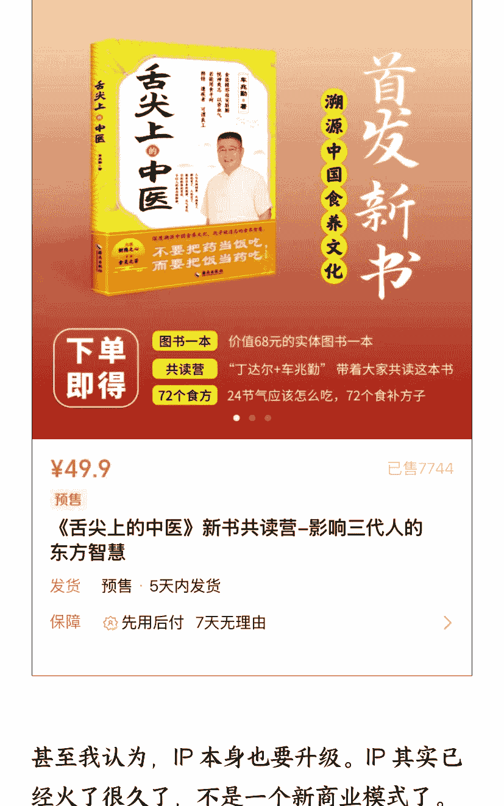
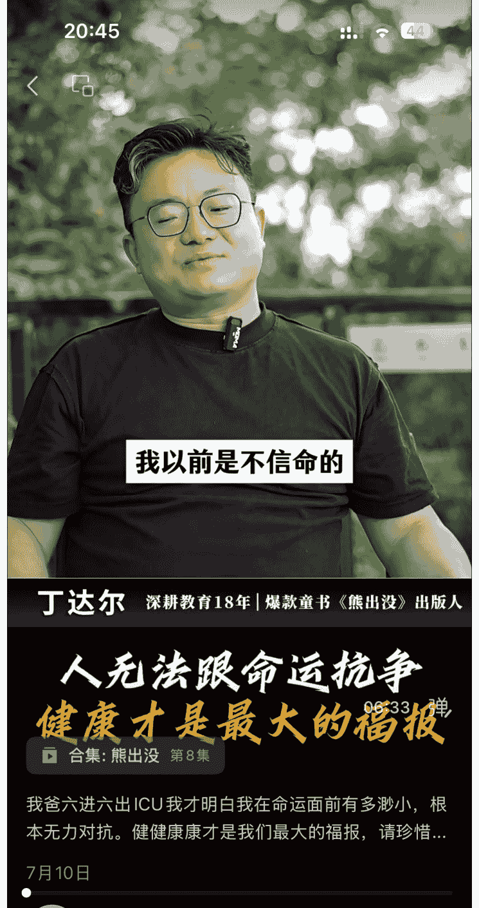
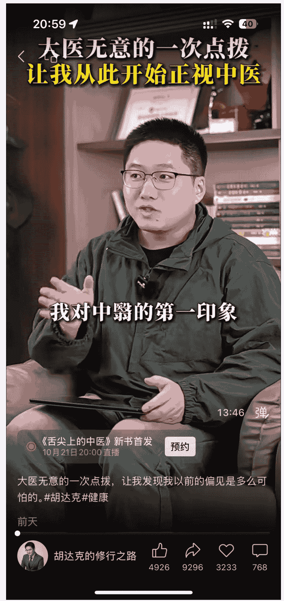
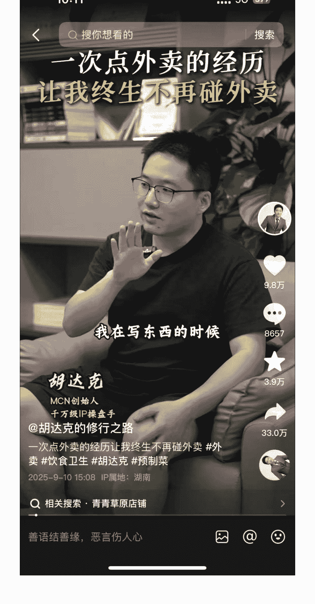
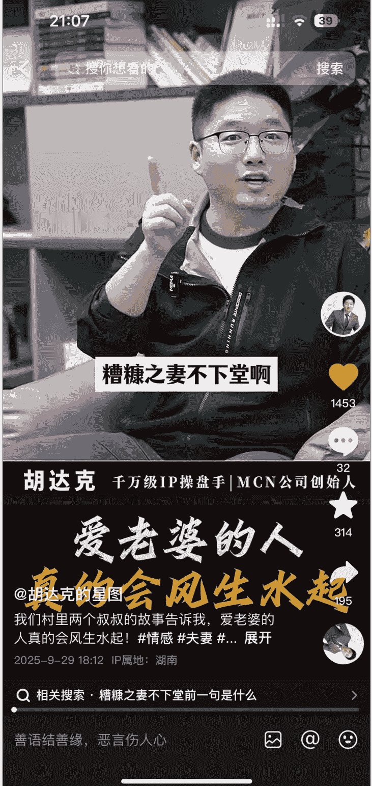

# 实战复盘 | 花了 400W，我总结出来 14 个教训和 4 个 IP 运营方法论

## 251021 生财精华

公众号懒人搜索，懒人专属群独享

懒人微信：lazyhelper

这是篇万字长文，相信我看完你一定会有收获。它既是一篇实战操盘文章，更是一篇复盘我本人不断失败不断折腾项目的文章。文章有关内容的部分，接受过义务教育就能看懂；有关商业的部分，做过生意就能看懂。看完如果觉得好，请帮我点个赞，转发一下。

## 缘起-我遭遇创业以来最大挫折，差点就挂了

2021 年 10 月 13 日我开启这段创业，到写稿日刚好 4 年零 1 天。这 4 年，我一直做流量相关的事，前半段很顺利，后半段很挫折。

2021-2024 年，我在做小红书培训。刚入场时，没人看好小红书，我们吃到了平台红利，奇迹般把业务做起来了。高峰时，团队大几十人，平台有大几百个账号，单日进线 2000 多人，服务过 7000 多个付费学员。

但进入 24 下半年，市场饱和，加之我好大喜功喜欢扩张，公司差点挂了，我甚至开始信佛。业务稳定时，人员是搞业务的；反之，人员就是吃利润的。到 25 年开年，公司已坚持不下去，我痛定思痛砍掉大部分人，决定轻装上阵。显然，之前的人海流、大规模矩阵玩法已不适合我们。

这一次，我们把精力放到了 IP 打造上。

## 偷师-我找行业最顶级的 MCN 公司学习

我确有搞流量的天分，但也常陷入“我执”。佛家讲，这叫五蕴炽盛，几年前我写过《批判一下“人人皆可 IP”》，不主张做 IP，主张做批量小号。但 24 年，我发现错了——不是原来方式搞不到流量，而是转化明显变少，加上平台打击低劣内容，执行效率越来越低。一切问题指向：要做 IP。

过去 4 年，我对做 IP 有过多次反复：
- 第一次（21 年）：找人拍过一阵，但没想法、表达不好，放弃了。
- 第二次（23 年）：业务增长快时，我被人骗了 10 多万做 IP，结果拍剪效果还不如自己团队，中途叫停，钱还没要回来。
- 第三次（25 年）：我彻底想通为什么一定要做 IP。我原来以为 IP 是一阵风，像早年的团购、社区团购打一仗啥都没了。但它不是，IP 是基础设施。就像公司电脑，员工入职你能不给配？像现代生活的电，没电万万不能。社会产能过剩，货不稀缺了，“酒香也怕巷子深”，必须出来卖。纵使我有一万个方式把流量做起来，但转化不了，终究无效。所以 IP 才是最佳解药。

想通后，我开始到处找牛人学习。23年，我去深圳朋友老黄的公司交流，他们做 MCN 和 IP，当时我的小红书培训也算行业头部，交流后我发现收入差距并不大，就没太在意。24年再去时，他们业务收入已是我的好多倍。25年再看，老黄是我朋友圈唯二业务还在增长的人。

老黄也是真心帮忙，直接安排他们最厉害的操盘手给我团队培训了几周，掏家底地教。接下来，就是我们去实战。

1.参考资料整理:
- 培训:
  - 质感、起号、时间管理培训: 百度网盘链接: ... 提取码: ...
  - 质感培训-伊伊老师: 百度网盘链接: ... 提取码: ...
  - 爆款起号逻辑: 百度链接: ... 提取码: ...
- 工具
  - 音效、音乐参考:
    - BGM+音效库
      - 链接: ... 提取码: ...
    - Bgm
      - 链接: ... 提取码: ...
- 老黄团队给我们的文档

## 探索-无数次以为自己行，又无数次以为自己不行

自 24 年 10 月调整重心到 IP 打造，直到 5 月份，我们才算出师，8 月份小成，9 月才大成。期间资金如流水，每个月最愁的就是发工资，眼睁睁看着之前赚的钱从账上流失，团队也从大几十人最后减到八个人。

实战当然不顺利。从知道到做到，千难万难。我们总结下来，一个 IP 项目大概有这 10 个环节：

商业模式、用户需求、产品、定位、IP 本人、采编、剪辑、公域直播、私域销转、线下会销。

这 10 个环节，我们几乎每个都踩了坑，都是真金白银换来的教训。当然，一个企业，并不需要所有环节都优秀，事实上，目前市场上也没企业能做到。虽然我团队也是做内容出身，搞流量也算厉害，但到了 IP 这个领域，我们还是花了 1 年时间，才让自己满意。

### 3.1 商业模式踩坑

在商业模式上，我们踩了 2 个坑。

踩的第一个坑是，没有总结自己的优势，只会有样学样，削足适履，邯郸学步。朋友的公司几乎可以算是全国最优秀的知识付费 MCN 公司，孵化了赵越、李志峰、老福等 IP，他们团队做内容的能力极强，老板最关心的事情是每天有多少 10W+ 产生。我们一开始没想清自身优势就模仿，结果数据差很远。甚至剪他们的 IP，数据也差。直到 5 月我才醒悟：这种模仿会让团队走入穷途。再拼，我们这个新团队也难比他们多年的积累和手感。于是马上调整：回归我们做 IP 的初衷——为项目服务，根据项目做内容，这才跑通。

踩的第二个坑，是上来就干，没搞清楚商业模式。做第一个 IP 时，我们以为最重要的是出爆款。当时我找了个朋友圈里会育儿的达人，急急忙忙弄完采访提纲就开拍开剪。为了提振团队信心，我让大家猜点赞数据，结果最相近的可以得到 200 块红包。我猜 5W，有人猜 1W、5000，还有个同学猜 20。最终猜 20 的同学获得了这个红包。那时候，这个 IP 卖什么？商业模式是啥？我们完全没想过。

### 3.2 用户需求踩坑

在用户需求上，我们踩的最大的坑：是不敬畏用户。不敬畏，公司就会死。
我们上一个项目（小红书培训）目标是小企业主和业务操盘手，做得很顺。后来总结，原因是我就是小企业主，太清楚他们最大痛点——没流量，所以我教他们搞流量就能赚钱。我算不上一个很聪明的人，对人和市场观察都不够敏锐。所以做 IP 项目时，用户人群一变，我就摸不准痛点了。

我举个例子，我是中南大学国学研究中心的独家新媒体合作伙伴，我在中南直接让教授博导来给大家讲国学课，听起来唬人，但卖得并不好。因为我们做的是国学素养课，但我们没分析准确用户学国学的诉求，所以导致小红书投流来的用户，报不报名、这期来还是下期来，用户觉得都行。后来才知道，国学分大国学和小国学，小国学更偏江湖术士，比如给人起符算卦，我们作为高校的学者教授，当然只能做传统大国学。一般这两类人对大国学有付费意愿：

- 有规模的企业老板，学国学一是改命（尤其运势不好时），二是精进管理和修身养性，市面上一般的管理课程已经满足不了他们了。这群人付费几万几十万没问题。
- 是人生迷惘的 35+女性。她们要么人生面临大困局，要么和配偶、孩子之间出现了问题。学国学是为了找寻出路，这种用户更会偏重佛法和道家，因为儒家的理论对他们没用。另一个需求是国学育儿，一种是孩子出现了问题，认为学国学可以帮助他们，二是觉得孩子从小就需要差异化竞争。

当然，如果用户有需求，但 IP 老师讲不了，满足不了，那又另说了。我写文章对自己是绝对诚实的，虽然我今天写到了这个点，但各位可以提醒我，时不时回过头来，看看自己的文章，时刻铭记：“敬畏用户，不敬畏会死”。

### 3.3 产品踩坑

在产品梳理上，我们踩过最大的坑，就是不知道卖啥，不知道什么产品合适IP，不知道用户是谁。比如前面提到的中南大学国学课就是一个典型例子。

我还有个IP丁达尔，从5月一开始拍他的流量就不错。他的目标人群很明确：做中女，这是中国付费能力最强的一群人，但卖啥？不知道。我很擅长“麻烦”朋友，于是又找到深圳老黄帮忙梳理，我们仨开了几小时电话会最后决定卖“阳刚之气”，教妈妈（尤其离异女性）培养阳刚好男儿，我当时很认可。但好景不长，我发现怎么都落不了地——因为说到底，丁达尔并不是育儿专家呀。

后来，经过反复梳理，我们发现丁达尔真正感兴趣的是养生。因为他有一个非常厉害的老师，叫作车兆勤，是一位非常德高望重的老中医，彼时，车教授的新书出版在即，我本身是出版出身，在图书面前，我仍有一定的敏锐度，于是，马上采用了“A种B收”的策略：让丁达尔推车兆勤的书，结果真的一把干火了，一个短视频卖了4000+单，首场直播卖了3000+单。这时，我们的整个产品逻辑已经变了：不是课，也不是单纯的书，而是“书课包”我们推的是一本书，加赠一个共读营，产品的部分，这个在下文我还会讲到。

#### 定位（1.0）：
- 用国学智慧做中国好爸爸
- 用国学智慧做阳刚父母
- 培养有脊梁的孩子
- 如何培养出阳刚好男儿

#### 履历：
- 1983年生人，做市场运营出身，在华图的时候是联创，是华图第一个年薪百万的校长。
- 09年26岁做华图副总，在华图搭建了所有的运营的体系。
- 2012年，因为当时的纸质图书走下坡路，主营是做图书的，我去做图书公司总经理了。其实当时是目的是为了，就是因为亚马逊那个电子书那个kindle出来以后，特别想让我去力挽狂澜。所以当时我们把传统的考试类图书增加两个项目，一个是叫儿童读物，还有一个呢叫儿童出版，我在机缘巧合之下就是把熊出没给签下来了，过了半年开始爆掉了。所以我们当时花了很低的价格把熊出没签了八年，所以我在儿童出版行业就一站

#### 我们给丁达尔的人设梳理

### 3.4 定位踩坑

在定位梳理上，我们也犯错了。我们不知道到底卖给谁，他有什么需求，我们怎么满足。

定位梳理其实是用户需求和产品梳理的进阶。用户需求抓不准，产品搞不定，定位自然难。

我们有个IP叫王诚，他是中南大学国学研究中心的特聘教授，国学大家，养生专家，可以说是长沙富人命理专家。他完全是个学富五车的人，我和团队去他办公室，看到最多的就是书。让他拍视频，黄帝内经、三韬六略、孙子兵法、王阳明、曾国藩、论语中庸大学…他都能讲。那到底讲啥？卖给谁？特别犯难。后来还是他自己最了解自己，先从黄帝内经切，从用户刚需开始切——教企业老板们如何养生。这才破开局面。

### 3.5 找IP踩坑

在IP挖掘上，我们犯的最大的错是，不知道谁能讲，谁合适做。

我在挖掘 IP 上，走过三段路：
- 第一段： 见谁觉得能行，先试试。把长沙身边的朋友拍了一圈，发现不行（当然，现在看来，不行最主要是那时候我们不行，不是他们）。
- 第二段： 一定要找我能接触的最“牛逼”的。 那段时间到处搜罗 IP，拍过一个自己尝过 400 多味中药的，吃附子差点吃死! 最离谱的，有个人告诉我 “淹死一天以内他都能救活” …
- 第三段： 找有项目、会讲、且 ego 低能配合的。 这才找到了中南大学合作，继而挖出了丁达尔，最后才到我自己，折腾了一年 IP，最终才决定，要做自己。

### 3.6 内容采编踩坑

在内容采编上，我们同样失误过。这其实是我们比较擅长的领域。前面 5 个部分，其实都是事前准备，从这个部分开始是事中阶段。我们有这么几个失误：

一开始我们以为，口播合适。但对大部分人而言， 口播不合适。因为看稿子念真的没情感。 普通人哪有专业演员那无实物表演的本事？口播看着简单，其实是表演里最难的形式。更好的路数是采访、访谈：面前坐几个人，带着求知眼神，轮番问。这就解决了互动问题，眼睛有神了，说话有节奏了。到今天，啥问题 AI 都能聊一嘴，为啥我们普通人还是喜欢刷短视频看活人讲，不就是喜欢这个活人感嘛，这是 AI 取代不了的，也是 IP 所必需要具备的。

一开始我们不喜欢写稿。觉得写稿太慢，影响节奏。但真干起来才发现：拍摄一天要是能憋出1条大爆款，那效率就太高了，所以，是有必要写稿的，但不是逐字稿，是梳理逻辑（最好IP自己写）。讲的时候按逻辑走就行，不连贯也没事，分段剪，后期拼起来一样能用。

一开始总会贪多，滥做选题。我们在车兆勤教授的时候，准备了400个选题，结果到最后能用上的没几个。我们在拍王觉仁老师的时候，不仅准备了题目，还畅想了他会怎么回答，团队从早到晚开了三天选题会，结果到最后用上的还是没几个。其实选题真的不用贪多，只要能引发IP大谈特谈的选题就是好选题，一天能和IP深度聊20个问题，已经够剪了，选题只是引子，引发IP有好的状态，讲得嗨或者深情，才是目的。值得注意的是，初学者会准备很多抽象的问题，这也是大错特错，一定要准备普通用户真正关心的，所以最好的方式是，直接刷抖音或者视频号小红书，看他们的选题和评论区，找到能足够延伸的话题，直接问就行了。

| | A | B |
|---|---|---|
| 1 | | 问题 |
| 2 | 1 | 最近两年，您在哪里花的时间最多？ |
| 3 | 2 | 您是怎么看待鸡娃的?您觉得自己在鸡娃吗?（清单式育儿?团队管理） |
| 4 | 3 | 您希望你的孩子能成长成一个什么样的人?（生物家对标人生） |
| 5 | 4 | 您在育儿中遇到过棘手的一件事是什么? |
| 6 | 5 | 您在育儿中觉得最具成就感的一个时刻是什么? |
| 7 | 6 | 在育儿的过程中有没有让你特别后悔的事情? |
| 8 | 7 | 您选择这个行业是因为怎样的契机?（事件+感受+想法） |

#### 我们一开始做的选题

### 3.7 剪辑踩坑

在剪辑上，我们也有过很多弯路。

一开始根本不知道爆款怎么剪——这算是普通人第一关。但一般来说，IP 运营中的剪辑实际上是一个内容运营，所以最重要的环节并不是剪辑，而是剪辑前的功夫。需要剪辑有发现美的眼睛。所谓美，也就是 IP 在讲的时候，是否神采奕奕，是否有表达欲，是否充满感情。拍摄的环节，如果剪辑在的话，马上就能判断出来，可以及时记录下来好的剪辑点；如果后续看视频录制，现场感相对会有折损，但有审美经验的剪辑仍然能分辨更好的内容，所谓“发现美的眼睛”，也就是剪辑师本身的能力，熟练的剪辑，都有这个能力。面试的时候也很好分辨，看看以往的作品，或者问一下，喜欢看哪些账号，为什么喜欢看，就能分辨出来剪辑的审美力。

接着栽在“人设视频”剪辑上。人设视频剪辑是分水岭： 能把人设视频剪火的剪辑，基本具备了操盘手潜力。所谓人设视频，其实就是用户关注我们的原因，我之所以是我而不是别人的原因，我为什么做这个账号的原因。在后面我还会重点讲人设视频。这种人设视频往往超过 3 分钟，我们团队搞的经常奔 10 分钟去，难度较大，干好这活的人需要具备：
- ①对项目有较强的理解能力，清楚 IP 做账号的发心与使命；
- ②对IP人生经历滚瓜烂熟，因为得把他阅历挖出来拼成片；
- ③有较强的逻辑和写作能力，一个人设视频需要有一个非常通顺完整的，如果太拖沓，用户的停留时长会很低。
- 当然，最难的是，剪辑人设+带货视频。这得有一年以上的操盘手功力才能做到。除了剪辑人设之外，他要懂用户需求，他知道用户想要什么，以及IP怎么去满足，要具备一定的销售思维了。

### 3.8 公域直播踩坑

在公域直播上，我们同样伤痕累累。市面上有2种直播，一种是：直接平播，这种对于直播稿的要求很高，要很会塑品，对主播的控场，节奏，要求都不低；当然最主要品得好，要能卖得出去。另外一种，我把他叫做，短视频种草，直播拔草。 直播作为成交场域，主要承接从短视频被种草的用户。我们相对擅长搞定这种。但这个擅长也是摸索出来的：我们早期的尝试是让中南大学刘立夫教授直播，安排他讲了一个半小时的学术讲座，结果场观仅1000多人，互动还多是他的学生。而到后来丁达尔首场直播，我们实现了单场1000多单的销售，对我们而言，书作为前端产品还可转化后端服务。

我们关键调整了这些策略：

- 一出爆款即刻拉大场预约。所谓大预约，是指一旦有爆款视频出来，立即开启直播预约，优先把预约人数做上去。一般预约用户往往是成交转化的重要来源，基本会排到成交用户的第一或第二。
- 直播话题承接爆款。从爆款视频的话题切入直播，有效承接流量，提升直播间场观和用户停留时间。
- 人设视频火速开播。人设视频爆火后，立刻安排直播。用户是因为认可“你这个人”而来，基本上都可以卖货，这是转化信任的最佳时机。
- ROI 打得平的话，疯狂通投人设视频。像我们这种有后端的，不只是靠前端卖货的，只要 ROI 打得平，就可以疯狂投放。特别在视频号，现阶段投放人设视频的效果通常优于直接投放直播间。

| 类型 | 进房人次 | 占比 |
|---|---|---|
| 公域流量 | 4,782 | 60.12% |
| 直播推荐 | 2,514 | 31.61% |
| 短视频引流 | 2,132 | 26.80% |
| 关注开播通知 | 99 | 1.24% |
| 搜索 | 37 | 0.47% |
| 私域流量 | 3,172 | 39.88% |
| 预约开播通知 | 2,755 | 34.64% |
| 分享 | 407 | 5.12% |
| 短视频引流 | 10 | 0.13% |
| 加热流量 | 0 | 0.00% |
| 广告流量 | 0 | 0.00% |

#### 丁达尔某场直播

### 3.9 私域销转和线下会销踩坑

在私域销转和线下会销环节，我们算是有经验了。最开始做私域都靠个微，但现在个微大规模加人很难，维护成本也高。而且加到个微本来还能靠刷朋友圈建立认知，现在朋友圈打开率太低，意义聊胜于无。现在最重要的还是靠公域洗认知，多拍短视频多开直播，企微就用来做复购和升单，再干点公域不太方便讲的事。会销是个传统艺能，自己不行可以和人合作。当然，这事看团队气质，像我们就不擅长会销吹牛逼，不如坦诚点，直接告诉用户我们有什么，爱买不买。

幸亏我还有人带，如果没人带，那我说实话这些环节，我探索的时间会更长。但我总不好天天去麻烦朋友，我那时候就想，假如说有一个人，能时不时提点我一下。在我实操过程中，帮我一下，我可能跑通的时间就会短很多了。

## 淬炼-得挨多少打才能成角？

当然，上面还只是事的维度，还不包括人的维度。如果你业务骤然直下，你发现有无数的奇葩现象出现，对我这种INFP来说，最难的是搞定人，而且要持续不断地搞定人。我在过去1年所经历的事情，浓度高过我人生所有时候。记得早先看《霸王别姬》，小癞子说：他们怎么成的角，得挨多少打才能成角。今年我终于深刻理解了这段话。

### 4.1 发不出工资

首先遭遇的是发不出工资，辞退员工发难。那是我最煎熬的时候，连续1个星期睡不着。我必须要把公司大部分人裁了。这个决策我做得极其艰难，有时候躺在床上似梦似醒，都在想应该怎么办。下定决心后，我一天谈完了所有人。但大规模裁员必然引来集体官司，公司那时已没钱支付工资和赔偿，我被堵在办公室，大家纷纷找我争取自己的利益，虽然最终筹到资金解决了，但这也给了人落井下石的机会。一些我曾善待的人露出了獠牙，恨不得再啃一口。这让我对人性略微感到失望。具体的事就不说了，离奇程度堪比短剧。那时很委屈——我创业从未拖欠或晚发一分工资，但都不重要，你不能拖欠。

### 4.2 合作伙伴背叛

然后遭遇的是合作伙伴，此处不细讲，以后专门拍一系列短视频。第一个遭遇就是我之前的合作伙伴，知道我快完了，我们在他们账上还有钱就不给我结钱了。第二个遭遇我去年投资了一个项目，我也给他们上了很多课，上课路费都是我自己填的，然后合作伙伴看我太实诚，好欺负，到年底该分账的时候，直接把公司做成亏损，我一年付出白费了，人不给你分钱；第三个遭遇是合伙人看你快完了，马上就要把之前投资公司的钱撤掉，然后还想把公司的救命钱分掉。不过，我并不诧异，我似乎也不能怎么办。追究成本太高，只能求责于己，当看错了人信错了人赶紧远离。

### 4.3 IP 心态会崩

重心转向 IP 后，我继续来踩坑。早前写过找 IP 的坑，更难的是稳人和淘汰人。IP 心态极不稳定：账号火则开心，不火则沮丧。起初我学朋友的模式——免费给 IP 拍，做好一起分钱。这是巨坑，之前有人提醒，我不以为然，直到亲身经历才醒悟。最大问题是风险你担，收益共享。朋友能做是因为他们只找行业最顶级的 IP，老师本身已自带付费用户，做的事情是增量。而我还暂时找不到这种量级的人，IP 心态一不稳，前期投入全打水漂。前面拍的 5 个 IP，在这模式下惨败收场。甚至还踩过一个坑：因是朋友信任，合同拖延未签，IP 做起来后直接单飞了。

### 4.4 团队心态会崩

当然，最关键的是稳团队。裁员时，现在的团队亲历了全过程。那时我们签下了中南大学项目，大家觉得有戏，也了解我的为人。尽管被裁员工天天来闹，团队仍义无反顾坚持。但人心也会浮动。我不太在意人，只在意事，情商差，几乎感知不到身边人情绪。到了 5 月，中南项目还没跑通，我还是被团队提醒才知道军心不稳。赶紧稳团队：首先明确，只要我不放弃，项目就不会停；其次给每人分专属 IP，明确发力方向；再次聚焦做项目本身，不求刻意爆款。到了 8 月，之前合作的 IP 做起来后单飞了。团队又不稳了——好不容易做出爆款人设、跑通带货和商业模式，人却跑了。团队看不到尽头，我又得稳。这时光靠讲话术不行了。只能从项目入手：我 IP 的数据已跑出来，我告诉团队“重点做我吧，我不可能抛弃你们”。接着我也跑通了，团队惊喜地发现，似乎我们操盘 IP 的能力已经是行业比较领先的水平了，而且还具备了可复制的能力。越到后面在我们手里的 IP，就越没失败的了。我们跑通中南大学用了 5 个月，跑通别的 IP，用了 3 个月，跑通我只用了 2 个月。

### 4.5 家人会担惊受怕

人的维度，还包括家人和自己。发不出工资要裁员时，我一个星期没睡着，全家人都跟着我着急，睡眠都很差。我自己心态还算好，总觉得我能成事。我是个永远积极向上的人，心力很足。但即便如此，在今年也会怀疑自己行不行。也有过心力不足的时候。怀疑过一次，觉得是否能坚持下去。

## 5.1 做 IP 的前提：裸奔

先讲一个前提，很多人都想做 IP，但连第一关——亲朋好友刷到都受不了，拍摄的时候满身敏感点，这也说不了那也说不了，这是做不好 IP 的。想做 IP 的要有一个共识：你暴露多少，流量就有多少，我想通了这点后，就直接裸奔了，没啥不能聊的。团队让我聊原生家庭，我就直接讲了一个我此前绝对不会讲出来的故事——我从来不叫我父母。这个视频在全网有接近 1100 万的播放。引发了很大的争论，特别是代际冲突。私信和评论区里，有人骂得狠，也有人力挺。可能创业几年大风大浪见多了，我早有心理准备——骂也好，挺也罢，感觉都是别人的事。我们拍这个的目的其实很简单，我之前做了 3 次 IP，都是以没数据告终，我们想确认我这张脸到底行不行。而“我不叫我父母”这个视频，验证了可行性。

作为上个时代中千万留守儿童中的一员，别...
2025-08-22 18:05 发布 | 部分数据次日更新
切换作品
总览 流量分析 观众分析
作品状态正常

# 流量
| 播放量 813.1万 | 平均播放时长 1分24秒 | 封面点击率 10.91% |
| :--- | :--- | :--- |
| 点赞量 6.8万 | 评论量 2.1万 | 分享量 1.6万 |

作为上个时代中千万留守儿童中的一员，别让我的悲剧，发生在你家孩子的身上...
2025年08月22日 18:07

## 播放数据
| 播放量 1841085 | 完播率 15.07% |
| :--- | :--- |
| 平均播放时长 364.00秒 | 3s以上播放率 81.77% |

### 数据概览
流量分析 内容分析 观众分析

#### 基础数据
数据更新至 10-16 00:00

| 指标 | 数值 | 粉丝对比/备注 |
|---|---|---|
| 曝光数 | 140.14万 | 粉丝占 0.2% |
| 观看数 (实时) | 141.98万 | 粉丝占 0.1% |
| 封面点击率 | 7.9% | 粉丝 15.6% |
| 平均观看时长 | 85.6 秒 | 粉丝 340.3 秒 |
| 完播率 | 5.2% | 粉丝 28% |
| 2秒退出率 | 19.1% | 粉丝 28.8% |
| 涨粉数 | 1372 | - |

## 5.2 第一个重点：商业模式升级

接下来直接讲最重点的商业模式升级。我认为，知识付费 IP 的逻辑在未来不会再成立了，范围再扩大的话就是一切只做单次生意的逻辑都不要再成立了。它核心的逻辑，就是小课引流，私域转化，不期待用户有复购或转介绍。21 年我写了篇文章，我如何学习潭州教育搞流量。23 年这家公司挂了。原因是只做单次生意，客诉太多，把所有用户都当成杀猪盘宰割。因此我现在看知识付费行业，我非常笃定知道，这种潭州化的趋势做不长久。这个行业我买了很多直播间卖的小课。和潭州的路数并无区别。中国市场大，过去可以靠流量红利，不追求复购，不认真做产品。但到了 25 年，这套模式的韭菜割尽了，红利彻底枯竭。

我认为知识付费下一步，是我嘴里面的共读营，是行业嘴里面的书课包。它们本质相同：单纯是因为线上课卖不动了，必须“实物+课程”捆绑。这玩法并不新鲜，K12 早就验证了——猿辅导的 49 块书课包卖得风生水起就是证明。

书课包能卖得动，本质是用户能拿到实物对产品有感知。而任何一个中国人，对书都是敬重的，拆包之后肯定会看几眼。这个模式用到了我的 IP 丁达尔身上，果然成立。一本书《舌尖上的中医》+7 天共读营，后续顺畅转化食补会员和其他关联产品，用户信任度高，复购问题迎刃而解。这个模式我有天然优势。我本身就是做出版出身，2019 年我就在做共读打卡营了，已经拿到过结果，如果想沟通这套玩法，欢迎来我线下课细聊~

甚至我认为，IP 本身也要升级。IP 其实已经火了很久了，不是一个新商业模式了。过去几年，大家做 IP，其实就是往身上贴标签，我做流量培训，所以你来找我；我做感统培训，所以你来找我。他的问题是项目有周期，市场越来越红海项目红利周期越来越短。人身上的标签一下子就过时了。我身上的流量培训标签，从 21 年走到 24 年，我就不想背了。但要换其他标签不容易。IP 也是。我认为 IP 的下一步，是网红、博主、个人品牌。IP 本质是个人品牌。下一步，IP 要做的事情，是要让用户记住我们这个人本身，而不是做某某某的那个人。

做人群，才有复购。所以下一个重点也就出来了，IP定位。市场有很多种IP定位的方式都有道理。但正如我上文所说，往身上贴一个标签容易，让人记住IP本身很难。但这是必须要做的事情。我认为IP定位最需要的是瞄准人群，而不是瞄准项目。项目会过时，人群不会，用户需求不会。佛法里有个三身论，讲佛祖有三身，法身报身和应身。所谓法身，就是指终极实在，真理本身。对IP来说，他的法身有且只有一个，用户和他所自带的需求。所以，我给丁达尔的定位，是瞄准中国40-70岁的女性。甚至我的IP“胡达克”，也是这个定位，我们要40-70岁女性，这群人，是中国人的财神爷。也只有这群人目前还有充足现金。也因此，粉丝量就不是边缘指标了，越多人关注越好。当然，更重要的指标是初次购买人群。

## 5.3 第二个重点：做自己

做自己很重要，知道自己擅长什么，很重要。正如我上文所写，我朋友老黄，他们做内容的能力极其牛逼，所以，他们一直围绕自己的优势来做。与其说他们是一个IP公司，不如说是内容公司，他们公司之所以货卖的好，最重要的原因是流量冗余，卖一坨屎说不定也能卖出去。我在一开始邯郸学步，然后走岔劈了。到5月份调整到以项目为中心，才好转一些。到8月份，确认我们的模式，是短视频+共读营，完全做自己舒适区内的事情，才发现做业务如此畅快。除此之外，在短视频创作上我也做自己了。我把短视频当做文章来创作。访谈是有必要的，写稿梳理逻辑也是有必要的。我发现我小时候最喜欢的作文，在此时起很大作用。我完全按照写作文的逻辑在拍短视频，发现数据还不错。因此，若问我司秘诀，2本杂志而已。哪两本。上限是读者下限是知音。这是真的。

## 5.4 第三个重点：人设视频

我们做一个IP之前，都有很长的前采。就是为了梳理IP的人设地图，抓他的精彩瞬间。我第一次去见我的IP老师王觉仁，专门飞去漳州，聊了2天。聊完王老师说：“小胡，你是我家人之外最了解我的人。”回来一整理录音，有十多MB字文稿。

但开头没这么顺。就像前文说的，能把人设视频剪火的人，已经是操盘手级别了。我们是从中医IP小哪吒入门的，她当时是老黄做起来的，老黄当时教我们：把IP带进小房间，不断聊，如果能把IP聊哭，就对了。我们照葫芦画瓢，把IP老师带到酒店小房间，聊她孩子，对方确实哭得不行。但是剪出来一看，眼泪鼻涕有了，数据是一点没有。于是我们又转向别的 IP。当时李志峰数据非常好，我甚至托朋友搞来了他们采访的源文件。看下来他讲得特别顺，好像都没怎么剪。这招也不行。又去学汤汤，当时他拍的谢康校长很有名。我们开始拆解他的模式，还模仿他：让教授先写稿再拍，结果还是不行。后来明白了：不是他们的方法不能复制，而是每个 IP 老师说话方式不同，每个操盘手逻辑不同，流派自然就不同。

到了丁达尔这里，我们突然就成了。因为这时候我们既不期待、也不需要模仿谁了，就尊重 IP 自己的逻辑，尊重剪辑的逻辑，结果反而剪爆了。丁达尔一条人设视频涨 3 万粉，十几个号剪了十几遍，卖了 7000 多单。我的人设视频一条涨 1 万多粉，也卖了 3000 多单。连我的带货视频，也完全不耽误涨粉。

那我是从什么时候
### 丁达尔
深耕教育18年 | 爆款童书《熊出没》出品人
个体有差异 如有不适请前往正规医院就诊
### 大医的三次点化彻底征服了我
从完全不信到拜师，大医的三次点化彻底征服了我 #中医智慧 #养生
8月20日
丁达尔的证悟

### 大医无意的一次点拨 让我从此开始正视中医
我对中医的第一印象
《舌尖上的中医》新书首发 10月21日 20:00 直播
大医无意的一次点拨，让我发现我以前的偏见是多么可怕的。 #胡达克 #健康
胡达克的修行之路

那所谓人设视频到底是什么？简单点就是回答人生终极三问：我是谁，我从哪里来，要到哪里去。比如说我的视频，其实就是在回答这几个问题：

1. **我是谁。** 我几乎每个视频都会刻意强调我是一个创业者，MCN 公司老板，出版人。
2. **我从哪里来。** 我每次都会选一个很小的角度来切入，比如我儿时的某个记忆，它构成了一部分的我，但不是完整的我，比如在上面这个视频里面，我儿时对中医是仇视，是恨的。
3. **要到哪里去。** 我因为见到过大医，见到过牛人，再加上我做过出版，我就把这本书做出来，希望带着我的家人，带着全中国的人都吃好活好，不时不食。

这里再举个 IP 例子：白伟民。这是一个健康 IP，产品是安顿手表，接近 7000 的客单价。一开始我们总觉得他只会讲故事，商业化做得一塌糊涂。后来才发现是我们轻视了。他这么高客单价的东西，同样卖得好极了。

### 我欠下3.7亿时
### 她怀孕借钱交房租
### 帮我逆风翻盘
第一个知道我欠
白伟民
安顿集团董事长
发愿救10w人
我欠下3.7亿时，她怀孕借钱交房租，帮我逆风翻盘 #欠债 #破产 #重生 ...
善行老白-安顿董事长
3.1万 3.4万 3.2万 3404

他在上面这个人设视频，就很好地回答了这个人生终极三问。他是谁：他是欠着3.7亿的老赖；他从哪里来：从一开始房租都交不起，出纳给他交房租，到后面融资受阻到后面终于公司开始提报IPO；要到哪里去：他要通过安顿手表的健康预警，带领中国人走向健康。

当然，“我是谁”有多种呈现方式。国学IP李志峰老师会强调他是曾仕强秘书的身份，冯唐会不断强调他麦肯锡的身份，郎咸平会不断强调郎教授的身份。

“我从哪里来”，一般有这三种方式：
- **从书中学**：一般有很多卖书博主会强调我看了某本书，在书里面学到了某个观点，很值得学习。这就是典型的“从书中学”，包括我自己在视频里面讲我在《舌尖上的中医》这本书学到了什么，也是一样的玩法。
- **和高人聊**：我、丁达尔都用到了，因为我们聊的是同一个高人：车兆勤。当然，其实我聊的不止一个高人，我准备做一个高人系列，把对我人生影响大的人，都讲一遍。“和高人聊”最好的案例是赵越教授。我每次刷他下面这个视频，我就知道：“03年恒河边的高僧”那段要来了。
- **在事上练**：表述会更难，上面我讲的白伟民就是典型的在事上练的类型。我到时候会在线下课把更详细的逻辑全部拆解一遍。

Four words from a stranger brought me to tears and helped me discover my life's purpose.
### 高人4个字让我泪流满面
### 找到了人生使命
### 03年 在印度的恒河边上
In 2003, by the Ganges River in India,
05:06
弹
2003年，在印度恒河边，一位老人用4个字，让我找到了人生使命，改变了我人生轨迹。
赵先生人生
3个朋友关注
+关注
5万
4.6万
3.6万
2591

所谓的“要到哪里去”，其实还不只是我要到哪里去，而是我要带领你去哪里。这里讲的就是发心，使命。把我们为什么要做新媒体讲出来，把我们的企业愿景讲出来，把我们宏大的发心讲出来，这个时候视频就升华了。用户也会被你的梦想使命所召唤。但是需要注意的是，发心也好使命也罢，一定不能端着，不能装，还要有点中二。

## 5.4 第四个重点：讲故事+互动

不要讲道理，要讲故事。人类真的自带听故事基因。我做 IP，这次才成功，是因为这次才懂得这个道理。以前总是想给人讲个道理，发现没人喜欢听，到最后还会觉得是自己不行。在我们的实战中，这 4 种故事最容易吸引人。

- **首先，和自我相关的故事最饱满，最容易真情流露。** 今年夏天，我们在岳麓山顶采访丁达尔。山上下着小雨，我想趁机聊聊他的人设故事。一直没找到他的状态，我们只能从干货开始聊起，把他聊开。过会儿雨停了，我们搬去阳台上聊。我问他，你觉得你们八零后这一代最无奈的是什么？他聊到家庭，最后聊到了他的父亲。于是就出现了这条爆款——父亲六进六出ICU。我认识丁达尔很多年，这也是我唯一一次看他哽咽，最后，这条视频光视频号就涨了 1 万粉，引起了大家的深度共鸣，纷纷在评论区分享自己对命运的看法。

我的 IP 刘立夫教授，围绕“命运”主题讲述的亲身经历，全网播放量同样达到千万级别。 当时我向他提问：“究竟什么是命运？” 刘教授用自己的真实故事回应，由此诞生了爆款视频--何为命运。 刘教授学识极为渊博，但许多内容对普通用户而言存在理解门槛。真正能与大众产生深度共鸣、施加有效影响的，往往是 IP 自身的真实经历和故事。

- **第二，和使命相关的故事最能涨粉和变现。** 以我和丁达尔为例：我们都有出版背景，对中医养生领域抱有深厚兴趣，都从事过教育工作，甚至曾共同创业。因此，在讲述我们自身的使命时，投入的热情具有天然的感染力。这也直接催生了两条爆款视频——关于“大医系列”的推荐。

数据也印证了效果：丁达尔的单条视频直接带动了销售 4000 多单，同时吸引 3 万多新增粉丝。我的单条视频同样实现了 3000 多单的销售转化，并新增 1 万多粉丝。需要说明的是，我这条视频的后续带货效率之所以下降，是因为我们在视频中关联了丁达尔的店铺链接，因为他们没维护好客诉问题，店铺被平台禁售 3 天，导致我们的推广链接被下架。否则根据视频前期的转化趋势，我们预计还能额外产生约 3000 单的销售。

那我是从什么时候
### 丁达尔 深耕教育18年 | 爆款童书《熊出没》出品人
个体有差异，如有不适请前往正规医院就诊
### 大医的三次点化彻底征服了我
合集：熊出没 第19集
Kosan 等2个朋友♡
从完全不信到拜师，大医的三次点化彻底征服了我 #中医智慧 #养生
8月20日
丁达尔的证悟
3万
5.5万
1.8万
1470

### 大医无意的一次点拨
让我从此开始正视中医

我对中翳的第一印象 -> 我对中医的第一印象
《舌尖上的中医》新书首发
10月21日20:00直播
预约
大医无意的一次点拨，让我发现我以前的偏见是多么可怕的。 #胡达克 #健康
前天
胡达克的修行之路

- **第三，讲述与普通人日常生活高度相关的故事，最容易获得高播放量。** 以我的“外卖”系列视频为例，全网播放量累计近 1500 万次，整体转发量达 45 万次（统计数据涵盖矩阵账号总和）。为什么会火，因为大家都吃外卖，而我讲的是一个我发现外卖真相的故事，这种贴近生活的视角自然引发了广泛共鸣，自然而然很多人会转发给自己的伴侣和子女看。

- **第四，重新诠释经典故事或话题，很能获得受众青睐。** 丁达尔有一个“潇洒是要付出代价的”系列，讲的其实是一个很古典的男人背叛家庭的故事，这个故事涨粉 2 万多；我有一个“糟糠之妻不下堂”系列，讲的是两个男人的对比，让自己原配下堂了的最终获得恶果的故事，也涨了几千粉。需要注意的是，这还是我只有一个剪辑剪了这个故事的缘故，其他剪辑还没开动呢。我准备接下来，逐字逐句讲下心经，讲讲《了凡四训》的故事，讲讲禅宗的公案、机锋、话头…

21:08
38
我们不要看有些人过得潇洒
### 丁达尔 深耕教育18年 | 爆款童书《熊出没》出版人
风流半生遗憾离场 潇洒是需要代价的
02:48
合集: 熊出没 第17集
潇洒是需要付出代价的，我认识的一个大哥风流半生
最终遗憾离场。
#情感 #责任 #家庭
7月30日
丁达尔的证悟
1.8万
2万
1.2万
1740
40 / 42

最后，互动做得好，绝对是加分项！我有几个有效的互动小技巧：

- **讲方言：** 因为我那方言比较难懂，评论区总有人猜我是哪儿的，大家在评论区聊得很热闹。

故意留点“小破绽”：比如偶尔写个错别字，或者某个观点没讲透。粉丝看到就忍不住想指出来纠正我。这些“小设计”在我的视频里都能看到，大家可以去发现一下，就不截图了。

最后，安利小懒的付费群：

### 懒人专属群（介绍）

📚 懒人专属群持续更新中，已持续运营6年，整理超3000份各类精选付费文章 & 年费社群干货，全部开放下载。

本资料为付费群内部分享，仅供真实有需要的朋友查阅 🙏

- 懒人专属群更新记录：https://lazy2025.top/blog/record2
- 懒人专属群更新记录（需梯子，备用）：https://lazybook.fun/blog/record2