采访了13个设计师和厂二代，我调研了“设计行业和传统工厂的转型方案”

251021 生财精华

公众号懒人搜索，懒人专属群独享

懒人微信：lazyhelper


## 一、前言

### 1.1 自我介绍

Hello，大家好，我是生财新人清秋，本科期间做同城中介服务一年多的时间里营收6位数，过程中有亏有赚，积累了一些产品和运营思维。

现在在给工厂老板做获客分析，研究厂子往什么方向转能赚蓝海赛道的钱？国内外有哪些细分需求是还没有被满足、适合工厂老板去生产销售的？

### 1.2 谁适合看这篇文章?

- (1)原有销路和销售渠道下滑，想要拓展新市场或想在海外国家打开销路但不了解用户需求和不同地区文化，出海无从下手的工厂老板
- (2)平面、室内、广告设计等行业，审美和市场嗅觉优秀，但订单下滑，想转行却没有头绪的设计公司和设计师

### 1.3 文章主要内容

主要挖掘了国内还未被满足的消费需求、国外不同地区的文化和较为蓝海的、可以把我们的产品嫁接到当地文化上的细分类目。这个过程可以由设计师（平面、室内室外都有）和供应链一起完成。

本文直接cue到了“食品”、“玩具”、“建材”、“印刷”、“开模”、“服饰”、“中药”、“蔬菜种子”等厂子的转型产品思路，如果有相关老板可以ctrl+f搜索关键词查找想看的内容。

如果你的业务没有分析到也欢迎点菜交流。

## 二、国内转型：做非标品，避开低价内卷

最近和群里十几位设计从业者&厂二代深入交流发现，设计行业现在订单下滑，工厂也已经不在那个无脑做货的时代了，销售都得自己来。

国内市场的破局点在哪？答案是：做非标品，特别是自带流量的IP产品，跳出低价内卷。

> **平面设计-深度调研(13)**
> 你们工厂会寻求外面这种渠道去帮你们去宣传嘛
> 肯定是需要的
> 现在工厂都自产自销了
> 星期一 19:48
> 我们以前给品牌代工，只需要生产就行，无脑做货
> 但是现在销售也要靠自己了

> **平面设计-深度调研(13)**
> 现在给品牌代工不好做吗？原因是什么呢
> 星期一 19:55
> 想问 +1

> 汐米: 现在给品牌代工不好做吗？原因是什么呢
> 因为品牌自己也不好了，房地产都这样了，建材行业很难
> 哈哈哈对，上下游都很难了

> **平面设计-深度调研(13)**
> 快来查看我用飞书分享的【设计公司转型调研（2）】 👉 https://...
> 在这里 🌹
> 好的，我看下
> 有觉得可行的设计转型方向也可以提，我去做调研
> 那我把我知道的，也写一下🤔，文档中的...

> 体量的问题，按理说，不可以卖
> > 同赴清秋: 刚云姐提到她的朋友做过小马宝莉的PPT和拆盲盒
> 你发现没，你这个都需要一个资源的，如果有人搭建了这个资源，然后给到广告公司，可能就是一个机会
> > 同赴清秋: 那对设计公司来说，最可落地的是不是还是，发掘海外需求，联合其他制造厂出海？这个不需...
> 有版权风险，需要签约
> 个人体量小，所以不怎么查

### 2.1 产品转型

#### 2.1.1 联合文旅或工厂推出 IP 产品

和有需求的文旅局或者消费品工厂对接，设计公司负责调研用户喜欢的元素，打造IP文创。

#### 【泉州“七彩刺桐蛇”的启示】

以泉州的恒顺玩具厂为例，它深度参与了“七彩刺桐蛇”的策划过程，七彩刺桐蛇上市之后在小红书收获了几十万赞，带动了当地的文创消费。

这个是鲤城区文旅局联合了多个本土设计团队，背后是文旅局牵头，设计师出方案，工厂用“3D打印”、“玻璃钢”这些技术把“刺桐”这条蛇从想法变成了现实。

一个项目，就把设计公司和下游工厂全盘活了。

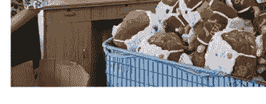

> “我们去...”

#### 【对接政府并非遥不可及】

说到文旅，很多老板觉得没有和政府合作的门路，其实，关键不在人脉，而在你的方案。现在太多传统工厂的审美跟不上消费趋势，老板也没有好的设计策划团队，空有好设备，却不知道做什么能卖爆。而文旅局也缺好内容来吸引游客。

这就给了策划和设计团队一个巨大的机会：你就是那个能把文化、需求和产品串联起来的核心。

#### 2.1.2 各省村超应援

自从村超火了之后，陆续出现了内蒙、山东等其他省的村超，这个是国家出手改变足球体育赛事情况的一个趋势，接下来体育赛事还会持续开展。而且国民热情持续高涨，甚至湖南永州都出现了挂票，在场内座位不够多的情况下，可以坐在足球场旁边的树上，一块观看足球赛。一棵树上可以挂三个人。

我搜了一下拼多多和小红书的周边，可以看到产品类型比较单一，而且视觉上也不够吸引人。（下图）

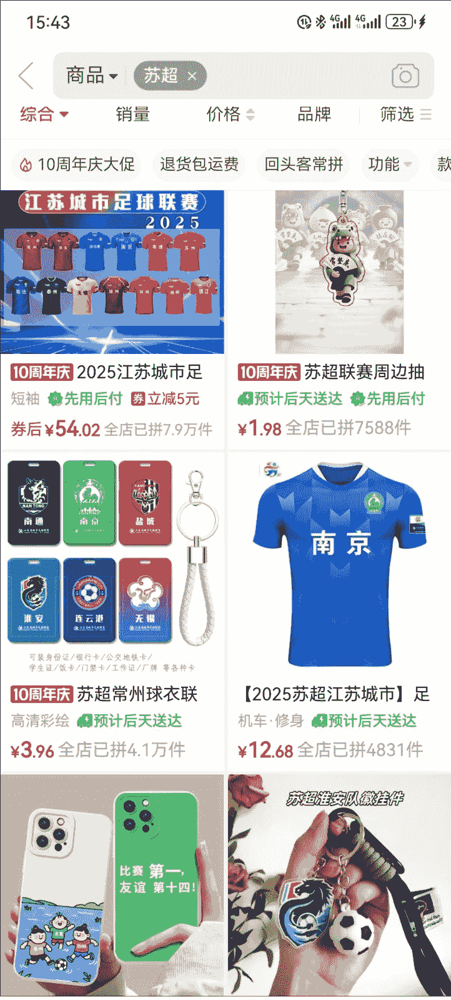

8/48

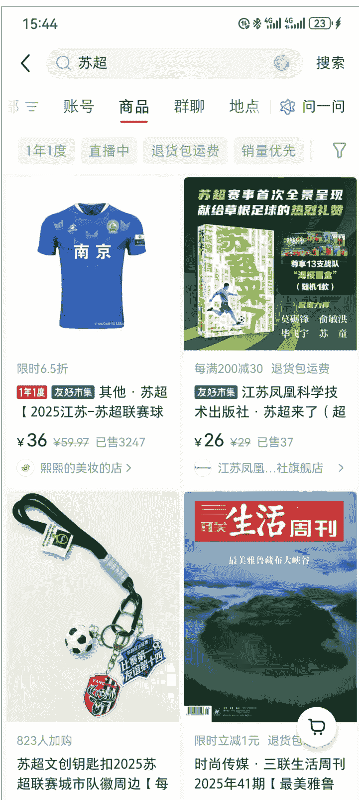

我们可以开发一些徽章、各主队应援色、应援产品。以湖南为例，深圳作为湖南省会，有很多深圳人祖籍都是湖南，他们有的人会回祖籍看球。咱们可以出“深二代返回祖籍应援旗”、现场卖咱们提前设计好的贴在脸上的旗帜。

零食厂甚至可以推出看球套餐，福建的门店就是这么操作的，他们还联合体育彩票，买够一定金额送大乐透彩票，这里给大家做参考。

之前看过生财的珍妮在借助 AR 眼镜，给南京夫子庙做景区策划。（文章链接：https://scys.com/articleDetail/xq_topic/1524884828225452）

省超还可以跟电影里进球的场景结合一下，如果有 AR 眼镜资源，咱还可以复现高票房电影中进球的场景，实现男人逐梦雨夜绿茵场的梦想！低配版就是出一些宣传海报，我看了闲鱼上《F1：狂飙飞车》的海报 388 人想要（如下图），做过闲鱼的都知道，这个数据在闲鱼就算不错了。

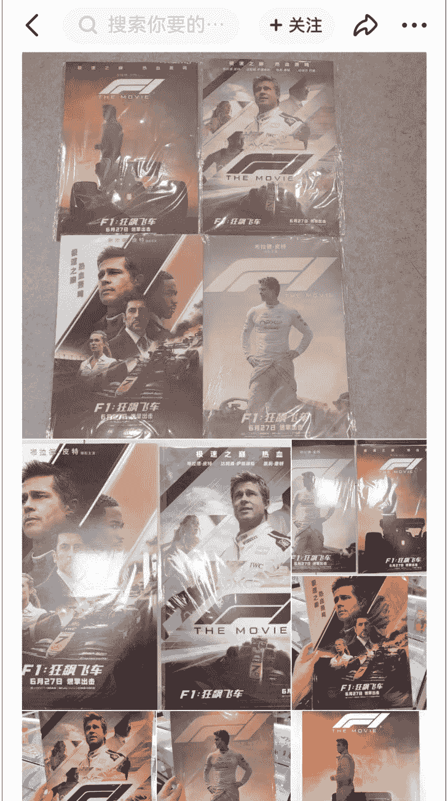

#### 2.1.3 结合 AI+切入细分人群

AI 出用户形象的 3D 手办，联合开模厂做实物打印。之前小红书很火的一个系列帖子叫“定制一个自己的手办”，这个只需要一张自己的照片和几句即梦提示词就可以出图，用这个提示词开模完就可以当生日礼物之类的来卖。

还有顾客想要特定风格的结婚请帖也是同理的。

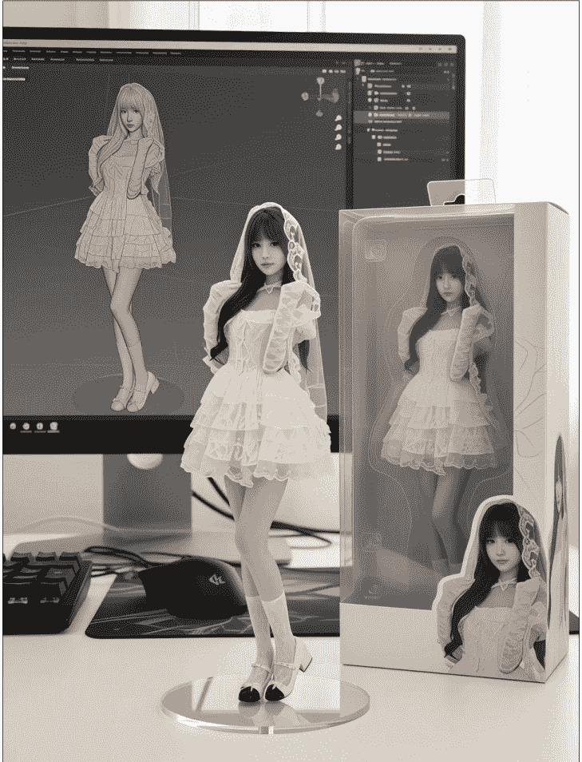

再来看切入细分人群这里，这个 Accept 期刊挂件卖出将近一万件。

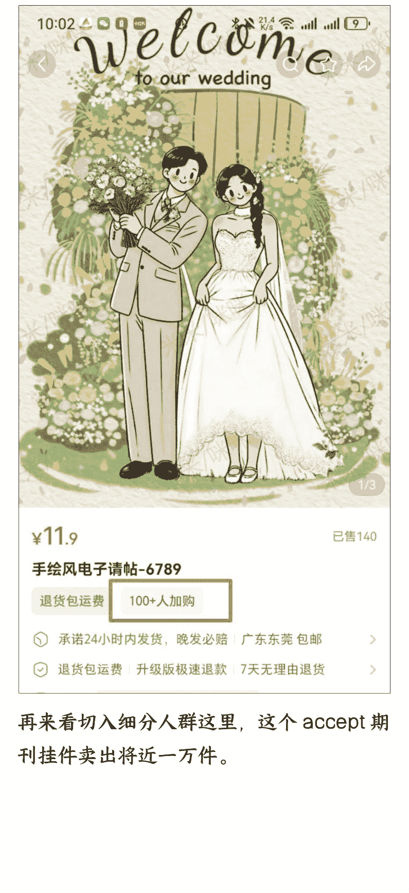

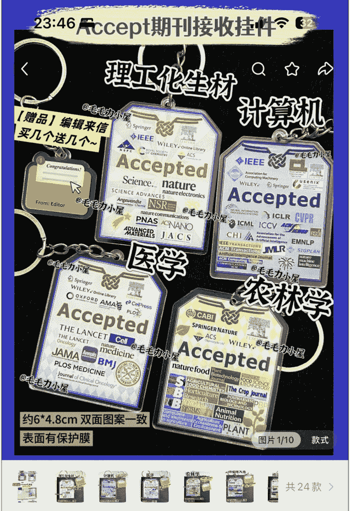

它的切入点足够细，针对研究生渴望发 paper 的心理设计，而且设计非常吸引人很精致，加了一堆国际顶刊的 logo，吸引力拉满。

16 / 48

#### 2.1.4 玄学周边

小红书有卖“恭请钱母”的，这个宣传是说可以钱生钱、有师傅手盖朱砂印、钱母烫金印刷。这个产品非常需要懂相关设计的人员来策划，有比较高的设计门槛。除此之外也可以衍生求贵人的符、事业转运的、职场压小人的、高考祈福、结婚贴的，各种各样。而且现在年轻人也信这些，销量很好。

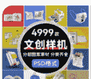

ps文创样机合集海报周边
¥4.2 已售3930
04-07 安徽

#### 【原创 多学科】期刊 Accept 科研人好运御守钥匙扣~ 逢投必中!

它的切入点足够细，针对研究生渴望发 paper 的心理设计，而且设计非常吸引人很精致，加了一堆国际顶刊的 logo，吸引力拉满。

### 2.3 定价与产品转型

做广告行业的，门头设计、展会、logo设计的，不能只是站在自己的视角上做一个视觉产品。需要提供全案的设计支持，不是说我们都要去和品牌策划公司抢饭碗，只是赚钱的大头确实不在一个门头和 logo 上，这也不是老板们需要的。我设计过上海世博会三个场馆的朋友告诉我：“需要把怎么营销，设计怎么抓住顾客的注意力做成全案。视觉设计只是基础，品牌打造需要‘理念-行为-视觉’。设计表现形式根本不重要，重要的是‘传播效果’。”

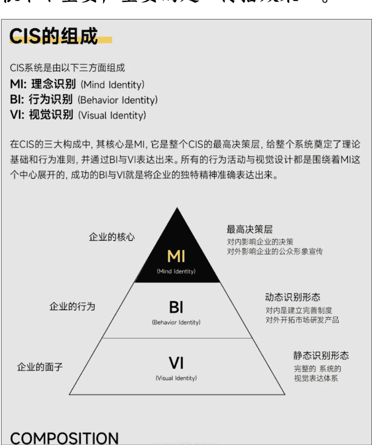

## 三、出海各国家基础画像和可嫁接的消费品

### 3.1 东南亚：结合 IP 出海最适合的地区

东南亚很适合咱们做 IP 出海，当时泡泡玛特被疯抢不是在大家想象的欧美，就是在东南亚，印尼这一带。

因为文化相近，而且东南亚没有自己的 IP。反过来说，如果是出海日本，哪怕是泡泡玛特都会大大受挫。日本的文化实在太繁荣了，全球最赚钱的 IP 都在日本，宝可梦，还有 Hello Kitty、海贼王等等。他们根本不会去追捧其他国家造的 IP。

> 详情
> 关于IP行业的第三个核心结论，就是大部分国家并不具备创造自己IP产品的能力。IP的创作是整个国家软实力的一部分，也是一个国家文化竞争力的一个主要标志。
> 我们放眼整个亚洲，有能力产生属于自己文化产品的国家无非只有四个，第一当然是我们中国，其次就是日本和韩国，第四个是印度——印度宝莱坞的国际影响力也很大。
> 从这个角度看，泡泡玛特出海的时候，他首先能够攻下来的市场，一定是那些没有能力创作出自身文化产品的国家。
> 例如，泡泡玛特现在最受欢迎的就是在东南亚市场。
> 东南亚市场对于IP产品的偏好和审美，更加容易受我们中国的影响。
> 但反过来，泡泡玛特要进入到日本市场，它就会更加困难。我在日本考察的时候，去过东京好几家泡泡玛特的门店，里面人流稀疏，日本消费者热情不高。背后的原因很简单，因为日本的IP产业已经极大繁荣，当地的消费者根本不需要去购买来自国外的IP产品。

同样的道理，在中国大火的《哪吒2》这部电影...

下面是东南亚五国的常用 app，方便各位老板自己去了解调研：
- 马来西亚，新加坡，泰国，越南，菲律宾

常用的社交软件：
- 马来西亚：WhatsApp、Facebook、Instagram
- 新加坡：Instagram、Facebook
- 泰国：Line、WhatsApp、Facebook、Instagram
- 越南：Zalo、FB-Messenger
- 菲律宾：FB-Messenger、Viber、WhatsApp

我就以马来西亚和新加坡为例，具体调研一下。

#### 3.1.1 马来西亚

马来这个国家 70% 是马来人，还有 20% 华人，国教是伊斯兰教，但是没有中东国家那么严格，大部分女性只需要戴头巾不用全身都包起来。马来西亚的华人比较有钱，是当地消费奢侈品的主力。马来西亚人普遍对中国持良好印象，两国也是在 2023 年就开始互相免签。这都便于我们进行文化、产品输出，甚至饮食口味上也是熟悉中略带新奇，比较能接受。

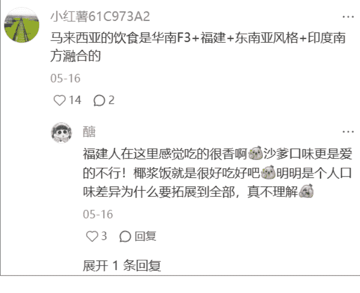

还有圈友提到说朋友家的小孩把中国的调味品翻倍卖给同班同学的。

> 一个朋友的孩子，去马来西亚读高中，班里中国孩子有，但不多，但更多是本地孩子。孩子把他爸寄给他的特产调料，10元人民币左右，50马币（90元人民币左右）卖给同学，接连做了好几单。

我去 Instagram 上用马来语搜了一下中国调料：“bumbu China”，中国菜谱的食品有几十万点赞，带货调料厂的产品是没问题的，设计师可以负责包装设计。

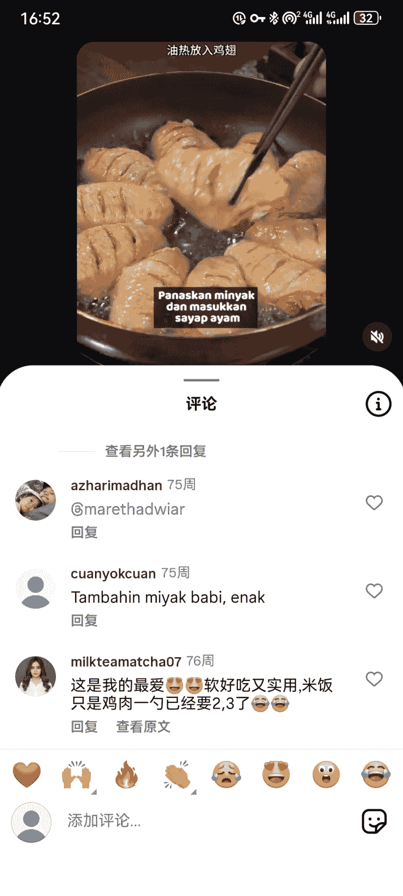

油热放入鸡翅
Panaskan minyak dan masukkan sayap ayam

评论
查看另外1条回复
azharimadhan 75周 @marethadwiar 回复
cuanyokcuan 75周 回复
milkteamatcha07 76周 这是我的最爱 软好吃又实用,米饭只是鸡肉一勺已经要2,3了 回复 查看原文
添加评论...

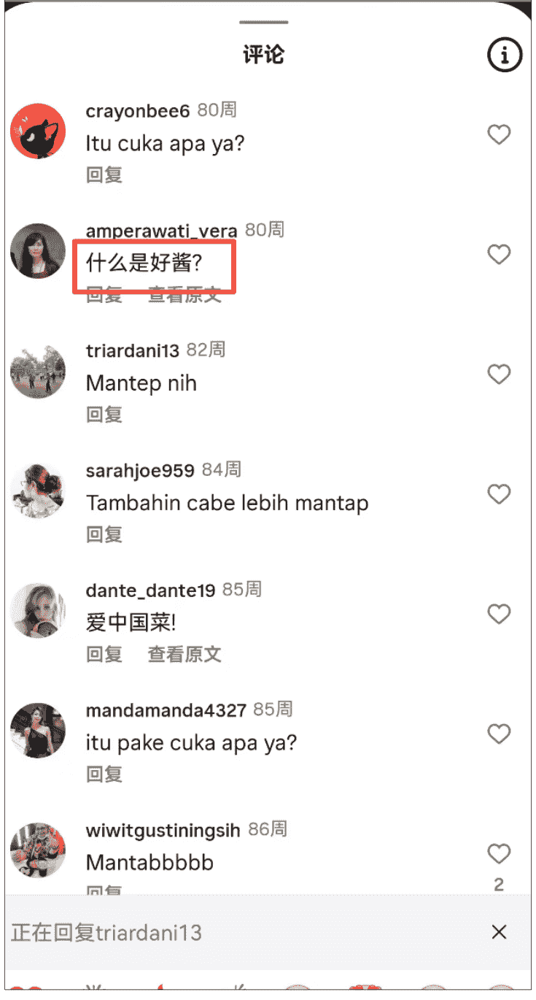

TikTok 上马来地区的达人带货热门视频是第三位是雀巢旗下的 Milo 饼干，第 6 位是黄油霜风味低糖果粉咖啡（如下图）。食品的占比比其他地区榜单高。我们可以买来这些热销食品尝尝风味偏好，然后中国的零食和调味品经包装设计后可以售卖。

| 视频文案 | 达人 | 播放量 | 互动率 | 点赞数 | 评论数 | 分享数 |
| --- | --- | --- | --- | --- | --- | --- |
| My go-to snacks wherever I go | Hasyera... | 980.5万 | 0.45% | 4.25万 | 45 | 1333 |
| Slap sedia untuk #RallyHatiEiya... | MILO® Malaysia... | 966.75万 | 0.19% | 1.58万 | 122 | 2380 |
| earbuds kecil macam ni tapi cengih tau... | Ismail Ansad... | 902.33万 | 0.94% | 7万 | 1360 | 1.31万 |
| Untuk mama yg pencinta coffee ni sumpah... | MAMASEMPOI... | 839.18万 | 2.13% | 16.99万 | 1199 | 7319 |

前 8 位其他分别是马来西亚唱作歌手蔡恩雨代言的 vivo 手机和一个头发免洗喷雾、免入耳多语言翻译耳机、鱼油等符合补剂、木制 - 铝便携桌子、儿童积木桌。


顺着这些产品分析，再次验证了马来西亚的以下特点和衍生出海产品；

- ①户外活动多，流行 mamak 文化：自己国家的开斋节、还有中英的节日都要放假，户外活动、野餐、家庭聚会多，便携式家具受欢迎。咱们国内原来的建材厂很适合来这边卷，原有的桌子产品可以升级轻量级电源解决户外用电问题，配上 USB 彩灯串。然后驱蚊帐篷、野餐包，这也是国内生产的强项。
- ②天气炎热：当地华人本就有“清热”、“祛湿”的传统观念，而且马来全年夏天，炎热潮湿。针对中药厂，可以为华人可以推出药食同源养生饮;针对建材厂，热带地区物品容易发霉，可以主打防霉抗菌的地垫，如果是针对儿童可以印上当地动物和流行元素。

#### 3.1.2 新加坡

新加坡面积小，只有深圳的三分之一。人口复杂、宗教信仰多样。房租、饮食都比国内一线城市贵几倍。人口就有华人，有印度人，马来人，印尼人，欧美人等。人力成本很高，也比较躺平。到点就下班，拒绝加班，周六周日也几乎找不到人。

TikTok 是新加坡最受欢迎的社交平台，有 25%的新加坡人使用，其次是 Instagram（23%）和 Facebook（22%）。

（数据来源于 Airwallex（空中云汇）与 Edgar, Dunn & Company 联合发布的全球电商趋势报告，网址 https://imtiiktoker.com/article/1597 )

> 获悉,据Airwallex与Edgar,Dunn&Company联合发布的全球电商趋势报告,TikTok成为新加坡人最常用的跨境购物社交平台。

> 该报告对澳大利亚、中国、香港、新加坡、英国和美国的3000多名消费者进行了调研。报告发现,超60%的新加坡消费者会从社交平台上购买国外商品,是所有调查市场中比例最高的一个国家。

> 整体来看,TikTok是新加坡最受欢迎的社交平台,有25%的新加坡人使用,其次是Instagram(23%)和Facebook(22%)。商品折扣优惠是消费者选择社媒平台的最大原因,其次是个人推荐和互动式网购。

> 全球范围内,使用Facebook进行跨境购物的用户最多,其次是TikTok和Instagram。

> 在英国、美国和澳大利亚市场,性价比是消费者进行跨境购物的最主要因素。在中国、新加坡以及中国香港,丰富的商品类型和卓越的产品质量则是消费者的决策关键。

### 3.2 澳洲

澳大利亚土地虽大但是人口集中,一共2000多万人,光悉尼墨尔本布里斯班就有1000多万。澳洲人非常热爱户外生活,比如海滩、露营、徒步、水上运动等。生物安全法非常严格。而且澳洲的电商不太发达,现在 TikTok Shop 都没有开通。

虽然澳洲人也有后院,而且后院是他们家庭娱乐的主要场所,但3.3章节的欧美部分卖的蔬菜种子不适合搬到澳洲,因为种子过海关比较严格,而且澳大利亚缺水,需要重新选品耐旱植物。而庭院设计也需要严格遵守当地的建筑规范和环保法规,需要极强的本地化知识才能落地,也不适合一开始就进场。

#### 3.2.1 炭火烧烤炉

澳洲留子多,人工贵,对于想吃烧烤的留子,可以卖便携多功能烤炉搭配烧烤料套装。而且烧烤本身有社交属性,澳洲老外又喜欢,炭火可以烤出锅气,老外体验后就可能被种草,从而留学生不仅作为消费者还可以当分销节点。设计师可以帮忙优化怎么折叠省空间、怎么更稳定,如何收集烧烤的油滴等。

### 3.3 欧美

欧美文化同源、消费能力接近，初期我们可以把欧洲和美国作为一个文化经济板块分析市场、选品和品牌以提升决策效率。

在进入具体的落地执行阶段时，则需要将各国视为独立的市场，进行快速的 MVP 验证。比如说美国客户偏好色彩鲜艳、饱和度高的品，追求视觉冲击，很多在国内看来的丑东西在美国卖的很好。但德国品牌，博朗的小家电和徕卡的相机，就是注重功能、实用主义，产品应该围绕“如何更高效的解决问题”来设计。

后才明白，B2B生意的价值不在单次利润多少，而在能不能留住客户、促成复购。”

也是从这份订单开始，他决定放弃“撒网式”做全球市场，转而聚焦北美市场——一方面，北美客户的高意愿度和需求反馈，让他看到明确的市场机会；另一方面，在与加拿大客户沟通及研究亚马逊美国站拖鞋类目评论时，他敏锐捕捉到关键审美差异：

> “美国人喜欢夸张、亮闪闪的设计，像鞋面镶钻、色彩饱和度高的款式，国内觉得‘丑’，在他们眼里却是‘个性’，能满足日常穿搭的吸睛需求。”

这种对美国市场需求的精准判断，成了后来“丑拖鞋”爆款的起点。

接下来仍然是我在 TikTok、X 等平台上验证过的、评论区有较多问“怎么买”的产品，适合咱们出海销售。

#### 3.3.1 像素风玩具

像素风是出海的一个爆点，有一个叫wplace.live 的网站，只建了几个月就火了，这个网站就是靠卖像素画笔赚钱的。

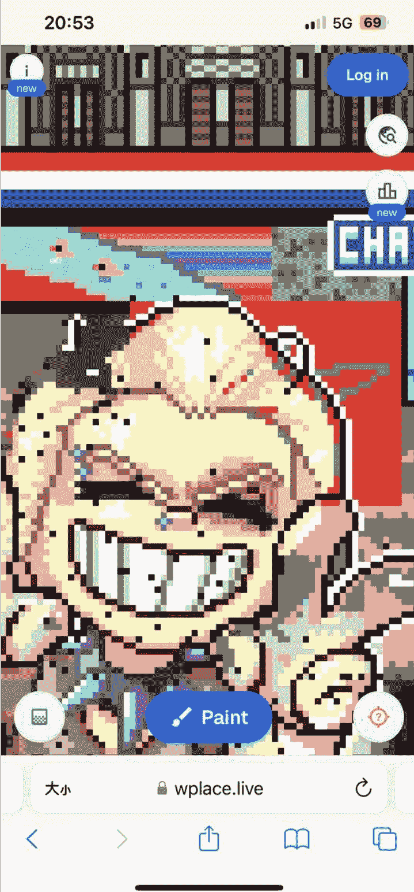

我在 Facebook 调研的时候，就发现下图这个像素风的粉色小动物有 4k 点赞，一条评论提到想买，还配了一个刷卡的表情包，7条评论觉得可爱。这个很适合卖给外国小孩当玩具，结合一下传统文化的瑞凤、年兽、汉朝小孩玩的布老虎等形象，做成像素风可爱版。

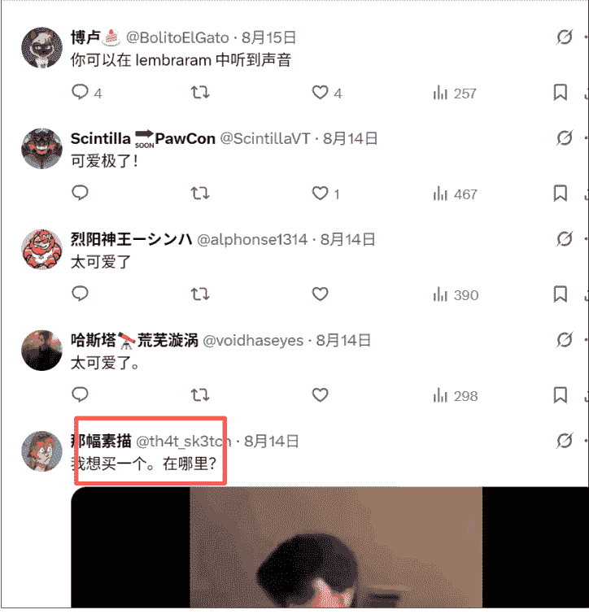

#### 3.3.2 卖老外短剧周边

中国文化的短剧已经破圈出海，我们可以带领设计团队去卖短剧的人物周边、人物闪卡。

以这个登上 ReelShort 首页的短剧来看，它叫“陷入老板的怀抱”，女频文。收藏41万。

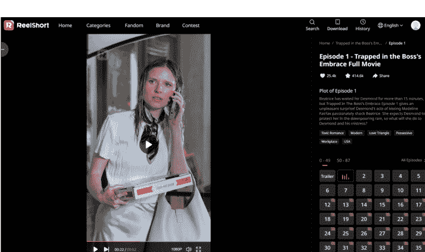

我去亚马逊上搜索短剧名没有相关产品，Facebook 上也没有周边卖，只有短剧原视频。


考虑到短剧生命周期短，角色粘性弱，不会像明星闪卡那样持久，所以需要抓住流量的小火苗，在短剧刚火的时候就开始预售，用最火的片段做广告，延长可售时长。也不考虑收藏之类的，看看怎么给客户提供情绪价值。比如闪卡可以做一包5张随机卡，到货后发到社交平台再送其他电子周边，播放量高的送全套产品。随机卡中的稀有可以是被删减的片段。然后女主的的首饰、穿搭选一些日常化的来卖。贴纸也可以出。

#### 3.3.3 netflix 影片周边


我在亚马逊搜了这部排第三的影片周边：


搜索词前几位是服装、玩具、玩偶、儿童周边、毛毯、毛绒玩具、贴纸。


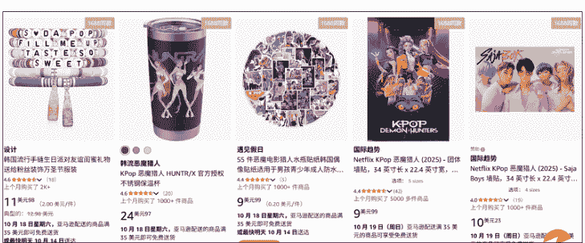

国外的周边还停留在手链、书本、马克杯这种基础的产品，我们可以推出盲盒、闪卡、抽卡、吧唧徽章、扑克牌等各种形式。一般电影电视剧火了之后盲盒就很好卖，《浪浪山小妖怪》的盲盒产品在闲鱼单个链接销量也 200+

#### 3.3.4 蔬菜种子

为什么是卖种子？因为全球的发展趋势都在偏向"没有情绪价值"的东西、“去光环化”，现在是所有人都必须回归实干的时代。具体体现比方说向太陈岚卖社交课、吴彦祖卖英语课、星级酒店推出路边摊、昔日的明星到景区扮演 NPC。

贝克汉姆都开始种菜了，趋势是欧美有院子的人会对种菜感兴趣，设计公司可以参与种子的包装设计。

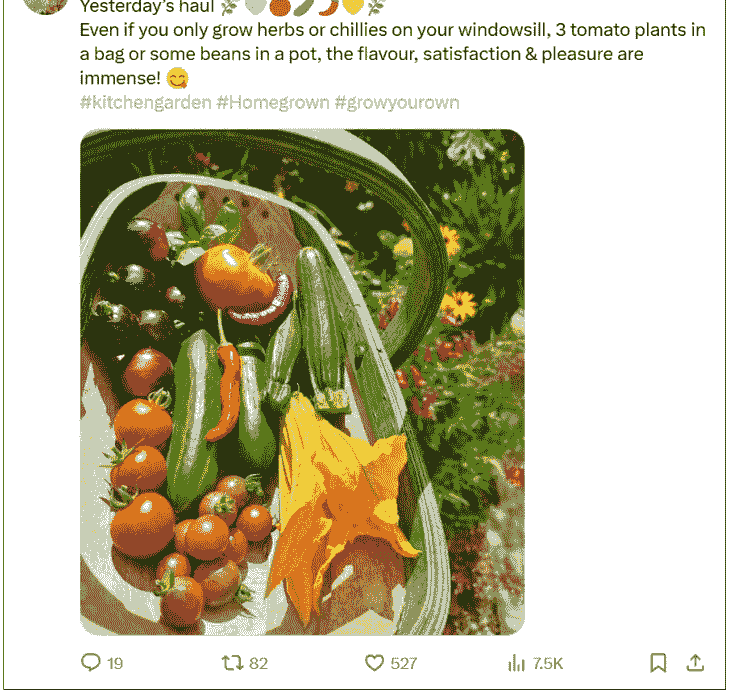
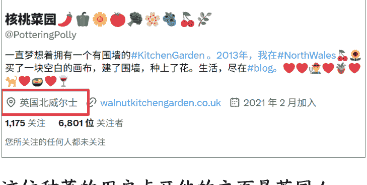

这位种菜的用户点开他的主页是英国人，他提到自己种植了：“香草、辣椒、番茄、豆子”。而且除了种子，英国人还非常热爱园艺，会精心设计自己的花园。英国的气候温和多雨，也适合多种植物生长。

查一下菜种子销量：

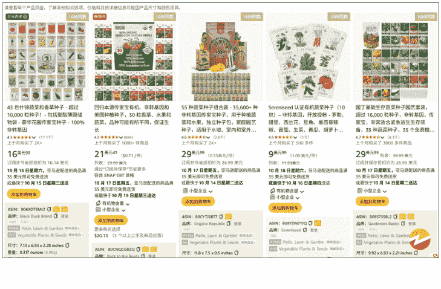


Amazon 和 eBay 上销量都可以，Temu 的销量差很多。设计师可以负责设计菜种包装。

#### 3.3.5 庭院设计

美国人喜欢 DIY，有一个叫 neighborbrite 的网站，可以免费使用一次 AI 设计庭院，AI 设计的包括选风格、改布局、搭配植物（还可以结合前面的卖蔬果种子或者幼苗状态的蔬果）。如果觉得设计的可以，这个网站可以接入人工设计师帮你细化图纸。需要安装的话，最后还能帮你联系本地服务商家，他们抽佣。

这个思路我们可以参考，除了庭院，花园设计、室内设计也可以。后期还可以带货庭院灯、园艺工具、户外艺术装饰等用品。

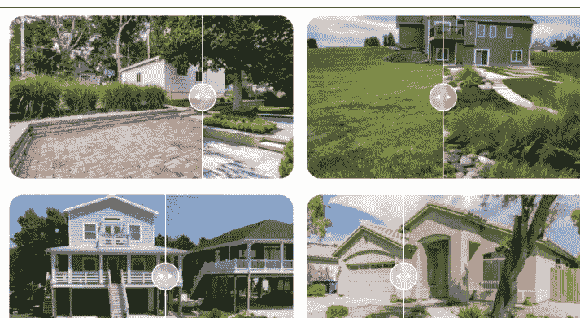
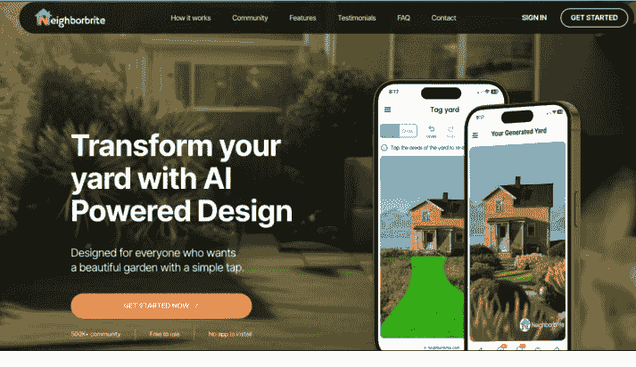
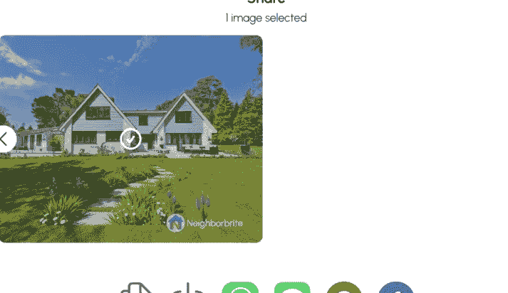

#### 庭院装饰品

还有我在 echotik 找到的一个基督十字架装饰，显示是两个月前上架，卖出 2.3 万的销量，带货视频就是简单的拍一个展示图配个 BGM。这个商品的简介里还写到用于花园农场客厅等装饰。我们做庭院装饰的时候可以一起卖这种产品

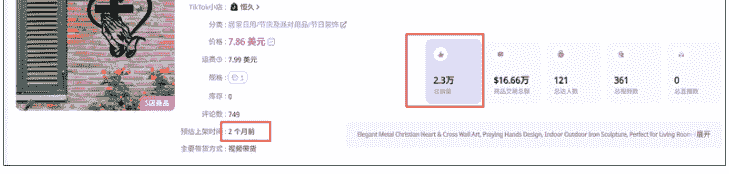


接着美区家居日用带货榜第 9 位就是这个假花。

```
https://echotik.live/videos/7544547158557576479
```

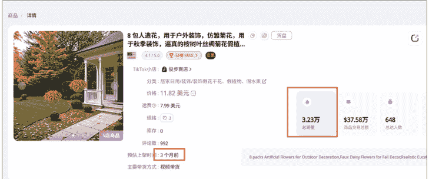

带货视频只有 9 秒，也很简单，纯展示加配 BGM

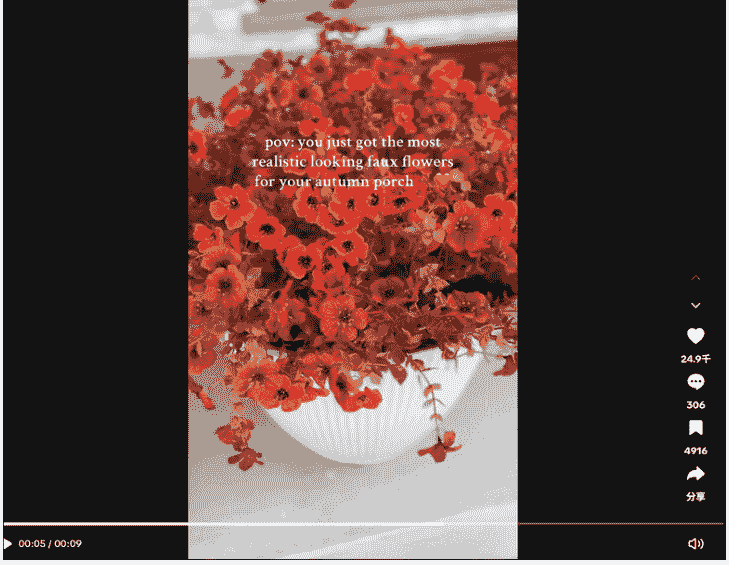

图中提到的“porch”指房屋入口处的门廊区域，是欧美家庭户外装饰（如季节性花卉、摆件）的重点区域之一

#### 3.3.6 兽圈服饰+中国名画

千里江山图近几年比较出圈，符合外国人认知的“禅意”。我搜到了一个灵感来自千里江山图的日本兽装：

```
https://www.tiktok.com/@fufukistudio/video/7204876512766512426?q=A%20Thousand%20Li%20of%20Rivers%20and%20Mountains&t=1759992028647
```

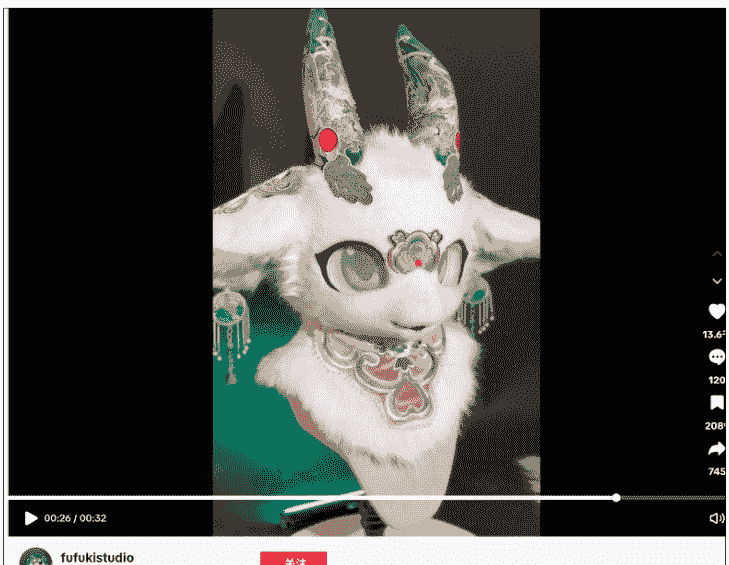

好吧。这是我做过的最喜欢的兽装。没得比，这件赢了。
2023年2月28日 回复
查看2条回复
*:.*.路西法*.:*. 我会花很多钱 2023年3月2日 回复
❤️梅❤️ 太美了 2023年2月28日 回复
阿特拉斯 我通常不喜欢兽装，但这件太漂亮了，如果可以的话我一定会拥有它:) 2023年3月27日 回复
阿兹 啊，太漂亮了，我真的很想买这个，但超出了我的价格范围。当然，它物有所值 2023年2月28日 回复
ChibiChomps 这太棒了！ 2023年3月1日 回复
苏 我可以从什么样的网站订购兽服？ 2023年7月16日 回复
卡斯 这太漂亮了，我太喜欢你的设计了 2023年2月28日 回复
点空白 兄弟，你的西装总是那么惊艳，我梦想有一天能委托你 2023年2月28日 回复
Bukkit 我被震撼了 2023年3月8日 回复
天哪，可爱 2023年5月8日 回复
米米 完美 2023年3月25日 回复
盖皮 我一直对西装上的刺绣感到好奇 2023年3月24日 回复
沃尔法亚 我的天啊 2023年2月28日 回复
凯特 出于某种原因，我从来没有想过在毛皮服装上可以有刺绣 2023年3月28日 回复
柴郡82 2023年2月28日 回复
♾ 我会不惜一切代价得到它 2023年3月4日 回复
☆Xerox☆ 这套衣服可以领养吗？如果可以的话，我会很喜欢^^ 2023年8月6日 回复
查看2条回复
海苔 哦..天哪。这看起来太棒了！ 2023年3月4日 回复

评论区购买意向非常强烈，而且兽装是极其昂贵的爱好，一套全装兽服的价格通常在 2000-6000 美元，利润空间非常大。

如果兽服要出海，首先考虑北美地区，这里兽圈文化的根基最深，社群庞大而且活跃。次选德国、荷兰等国家也有成熟的兽圈社群。日本同样因为自己的文化过于繁荣需要谨慎选择。

## 四、结尾

产品确定好了，国内的内容水平比国外是领先 3-5 年的，我们可以用国内的先进玩法把国外再做一遍，这是个很大的机遇。尤其是澳洲和新加坡，有很多留学生和华人。我们给留学生和华人供货，他们又可以把这些东西带货给澳洲和新加坡的老外。

## 致谢

最后要感谢生财有术让我认识了这么多优秀的卷王，生财的氛围真的特别好，我在生财的进步是飞快的~很感激生财能把我们这批同行的伙伴聚在一起。

感谢珍妮老师和汐米老师给我灵感、修改建议和框架调整，她们是做小红书运营的巨佬！所有运营人都应该看看珍妮老师和汐米老师的文章，可以很轻松带你突破当前的瓶颈！！

感谢彬总帮我链接设计师，能让我有和设计师深度交流的机会；感谢彬总、云总给我转型点子。

感谢浔溪提供工厂转型卡点。

以下是彬哥和琳云姐的个人介绍，有设计需求的友友可以通过鱼丸链接他们！

### 彬个人介绍

姓名:邓伟彬（星球编号：51839）
荣誉头衔：广告公司店长、慧星教育合伙
坐标：惠州市 从业 14 年
擅长服务：广告及宣传物料制作、活动庆典策划、文艺演出、舞美搭建和场地布置、企业宣传片、表情包定制和教学
代表案例：惠州伊利婴幼儿奶粉、成人奶粉广告合作商，上市企业硕贝德 20 周年画册设计、皇婴汇 15 周年年会场地布置、舞美搭建，带领学员上架 30 多套表情包，服务 60+名客户定制表情包

### 云琳个人介绍

姓名：张琳云（星球编号：15861）
荣誉头衔：云联文化创始人 尖荷系设计教育实践运动、全国实战导师 慧星教育创始人
坐标：太原市 从业 12 年。
擅长服务：
业务①品牌全案设计，品牌策划，平面视觉和界面设计、品牌全案、乡村文创，校园文化建设实践品牌
业务②设计师规划和咨询，设计师培养，设计教育培训
代表案例：

业务①海子边酒店品牌升级全案，天津吗莱卡 IP 及 VI 应用设计，民生银行 UI 界面设计，祥得通和企业画册和内刊设计
业务②设计学员月营收突破从 2w-16w，学员知识产品 0-1 当场 1 小时成交率 77.8%收入近 4k，2.5 天跑通产品闭环，0-1 获取线上客户接单，培养学员遍布全国 13+城市

### 浔溪个人介绍

【昵称】:小浔溪（星球编号：14226）
【所在地区】:珠海
【自我介绍】：
主业：95 后家装实体创业者，浔溪木业品牌创始人，自有工厂，生产销售地板和实木踢脚线
小红书矩阵粉丝 3 万+，企业号聚光投流，引导淘宝成交百万，私域累积 8000+优质家装粉，抖音投流获客 2000+实体老板，有一定的投流获客经验
【可提供资源】：家装工厂建材供应链，小红书聚光投流，小红书电商经验

最后，安利小懒的付费群：

## 懒人专属群（介绍）


📚 懒人专属群持续更新中，已持续运营 6 年，整理超 3000 份各类精选付费文章 & 年费社群干货，全部开放下载。

本资料为付费群内部分享，仅供真实有需要的朋友查阅 🙏

### 懒人专属群更新记录：
- https://lazy2025.top/blog/record2
- https://lazybook.fun/blog/record2