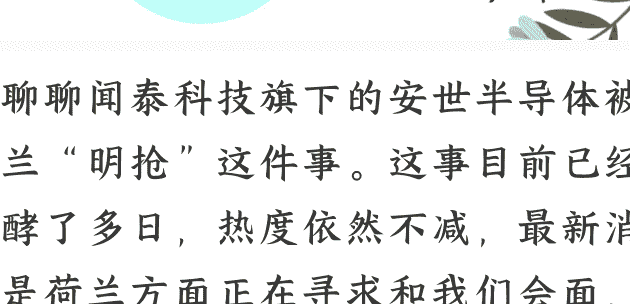

# 荷兰被安世半导体给噎住了

251022 猫哥

整理：公众号懒人搜索，懒人专属群独享

懒人微信：lazyhelper

聊聊闻泰科技旗下的安世半导体被荷兰“明抢”这件事。这事目前已经发酵了多日，热度依然不减，最新消息是荷兰方面正在寻求和我们会面，商讨安世当前陷入的僵局。

这又是一出搬起石头砸自己的脚的戏码，甚至到现在荷兰方面仍然强调不是配合老美，而是涉及欧洲技术和市场供应链安全问题。我认为现在荷兰全身上下，也就只剩嘴硬了。

大致介绍下背景和脉络，让大家能更加清晰了解整件事的全貌：先说安世半导体的情况。

上世纪 50 年代，飞利浦就在荷兰奈梅亨建立了晶圆厂，开始了半导体制造历程。

2006 年，飞利浦出售其半导体业务，独立出来了恩智浦。

2015 年，恩智浦为了收购美国飞思卡尔并通过相关反垄断审查，于是又把其中的标准件业务部给剥离出来，而这个业务部就是安世半导体。

可以说，安世半导体起源于飞利浦，成长于恩智浦。

再说闻泰科技的情况。

闻泰科技最初是从做山寨机起家，后面转型做手机 ODM，也就是按手机大厂要求，设计并生产手机等整机产品，靠的就是规模和成本控制在市场中生存。

在那个年代，能够活下来，而且活的还不错，成了全球智能手机 ODM 头部企业，市占率达到 30%，创始人张学政居功至伟。

但是这块业务在进入 2017 年后渐渐进入了市场饱和期，竞争大、利润薄（毛利 7—8%左右）是不争的事实。于是，闻泰科技就盯上了安世半导体。

作为一家 IDM 厂商，安世半导体能够自己完成芯片设计、晶圆制造和封装测试的全流程，特别是电动车领域，安世的产品在电池管理、电机驱动等系统，几乎得到全球主流汽车供应链的一致认可，客户关系稳定。

当然，大家读了上面这段话，千万不要认为安世半导体就很牛逼，其实对于半导体朋友圈而言，它一点也不先进，控制电车车窗、雨刷、电源、方向盘等都是入门级技术，不然为啥被一个劲的剥离呢？

但是，哪怕技术含量并不高，但好歹也是个半导体公司，有机会从劳动密集型加工装配企业摇身一变，成为技术密集型科技企业，你说闻泰眼馋不，这才有了后面在当时令市场震撼的交易。

从2018年到2020年期间，闻泰科技通过股权融资、债券融资、境外贷款等多种组合方式，完成了对安世半导体的全面收购。

大家知道的是，这笔交易是中国有史以来最大的半导体收购案。

不知道的是，2019年闻泰科技营收400多亿，净利润也就才12亿。彼时能花300多亿搞收购，实际上就是梭哈。

那么，为啥闻泰敢于进行这场豪赌呢？原因主要有3点：
- 其一，在老美卡我们科技脖子和国家半导体发展战略的双重影响下，任谁都清楚，能够快速挤进半导体行业，未来代表着什么。
- 其二，虽然当时国内新能源电动汽车已经成为冉冉上升的明星行业，但国内真正能突破车规级技术壁垒的企业几乎没有。拿下安世半导体，闻泰就可以原地起飞，抓住中国汽车电动智能化带来的巨大机遇。
- 其三，虽然安世自身经营情况算不上好，但也不是破烂货，除了净利润增速放缓外，收购前利润还是能保持在10亿—13亿上下。只是闻泰科技太希望尽快转型了，才发起高溢价收购。

所以，闻泰吞下安世，是政策环境、产业环境、自身转型这3个因素导致。当然，闻泰科技也确实赌对了，背靠中国市场，依托新能源汽车产业风口，短短几年时间，就把收购形成的巨额负债全部还完了。而且在这个过程中，闻泰也逐渐完成了手机ODM业务的剥离，彻底在智能化汽车供应链中站稳脚跟，成为全球龙头企业。

但也是在这个过程中，受地缘政治环境变化、中美科技战持续影响，让安世半导体就一直处于被荷兰觊觎中。2023年，荷兰《投资审查法》生效将半导体等技术列为敏感领域，同时欧盟相关政策也在收紧，将车规功率半导体等纳入关键设施清单，限制技术转移。而且因为这些新规具有法律追溯效力，就导致闻泰收购安世这笔交易也同时进入审查范围内。

也是从那时起，荷兰经济部与安世，就如何运营管理进行了持续多轮谈判商讨，名义上是治理改革协商，但实际上提出很多非分要求。最过分的要求设立监事会，监事会成员须由经济部认可，并给监事会一票否决权，包括招聘中国研发人员等。闻泰科技作为绝对控股方，怎么可能答应这些过分要求，把控制权让渡出去。

于是，安世和荷兰经济部双方就展开多轮拉扯，反正谈嘛，一个个问题解决。在此期间，也经历了2024年12月，美国商务部将闻泰科技列入实体清单这事。不过安世并未涉及其中。事情发生巨大转折是今年国庆前。

一方面，8—9月份，安世已经打算解聘首席法务、首席财务等荷兰高管，为啥要解聘呢？我认为实际上闻泰也许已经嗅到了内鬼风险。

另一方面，9月29日，美国工业和安全局（BIS）发布新规，当非美国实体被列入实体清单后，该外国实体直接或间接持有50%以上的实体公司也将适用各种管制政策，安世半导体因闻泰科技的持股关系自动被覆盖进实体清单。

于是，9月30日，荷兰政府响应老美新规，紧急下令冻结安世半导体的资产以及知识产权。同日，安世半导体荷兰籍高管要求闻泰科技转让安世半导体股权，把持股比例降低至50%以下，并暂停委派中国籍CEO张学政到职。

国庆期间，荷兰法庭认定应采取紧急措施，解除张学政在安世半导体的一切职务，将闻泰科技子公司裕成控股持有的所有安世股权全部“托管”给一家荷兰公司，控股方仅保留1股，并由荷兰法庭指派一名人士前往安世半导体任职，拥有决定性投票权。

后面发生的事就不逐一列举了，都是形式，反正整个过程就是一桩“里应外合”的明抢，不得不说荷兰政府和荷兰法院干这事效率那是真高，审理判决不需要任何证据、不需要企业所有人在场，直接引用已经吃灰的《商品供应法》，以“国家安全”为由，就剥夺了闻泰科技的控制权。

至于什么保留分红权，按荷兰政府和安世现有外籍高管的吃相，大概率想都不要想，控制权都没有了，有N种办法让你一分钱拿不到，甚至可以下毒手，直接宣布安世破产，另外成立个公司。

那么，为啥荷兰政府要这么干呢？
- 第一，就是配合老美对我们科技企业下手，老美29号出台管制新规，30号荷兰就跟进，这能是荷兰方面嘴上说巧合吗？可以说觊觎已久。
- 第二，现在中美博弈加剧，包括我们的稀土反制政策，让ASML、恩智浦等荷兰半导体企业成了人质，它也想手里握张牌，威胁我们。
- 第三，以前欧洲富裕，就推崇自由民主，现在落魄了，海盗本性就开始慢慢显现，它清楚，不靠抢，根本竞争不赢东方大国。

闻泰科技不到4年时间，就还清了收购产生的债务，这估计荷兰方面想都没想到。一个土生土长企业，被中国公司收购后，成了下金蛋的母鸡，完全是就是羡慕嫉妒恨。至于防止技术转移、保障欧洲产业供应链、甚至国家安全，就是扯淡的理由。

当然，我们反制也很快；10月4号宣布禁止安世中国区产品出口。10月9日发布稀土管制新规。

10月17日，当安世总部对中国区停薪、切断系统后，安世中国也果断回怼回去，表示安世中国是独立企业，工资奖金照发，显然就是和荷兰总部进行切割。

这下，荷兰彻底是傻眼了，我甚至认为它拉了一坨大的。

因为这事刚巧发生在我们出台稀土管制新规前几天，如果说制裁韩华海洋是要它为过去行为去买单，同时压制老美的造船业复兴。那么荷兰就类似于1949年参加国民党，正好不偏不倚撞在枪口上，成了杀鸡儆猴的那只鸡。

估计现在荷兰政府，ASML、恩智浦、BE等荷兰半导体巨头，都要哭晕在厕所，脑壳里反复在思考2个问题：怎么这时机就抓得这么准？接下来该如何收场呢？确实不好收场。
- 一来，荷兰ASML光刻机、半导体巨头还在等我们稀土下锅，我们一直不太好对欧洲半导体企业上强度，这不就是瞌睡来了有人递枕头吗？你做初一，我自然做十五。
- 二来，荷兰在华利益也非常大，除了稀土外，壳牌、喜力、联合利华在中国都是混得风生水起，荷兰安世在这些利益面前，估计连根毛都算不上，真敢为了安世掀桌子吗？
- 三来，我们限制安世出口，把欧洲车企也整慌了，因为欧洲40%的车企需要安世中国供货，包括大众、博世等。于是纷纷在给荷兰施加压力。你要纳投名状，不能把我们拉下水。
- 四来，前面说了，安世在半导体领域没有多少技术护城河，要说替代，除了短期对全球产能有影响外，长期影响不大。况且现在中国安世和荷兰安世已经隔离，中国产能占2/3左右，营收占到1半。

等于说荷兰抢去的总部和研发中心以及控制权，大部分都是空壳。

所以，荷兰政府现在绝对是一副吃包子被噎住的状态，又开始上演服软甩锅的戏码了。

除了文章开头说的环球时报消息，实际上英国金融时报17号也发表了类似内容，称荷兰政府对此事并不知情，也没有这个意图，安世半导体事件是外部顾问制定了这个计划。他们没有遵循正常的内部程序。

如果这消息是真的，大家就足见这些欧洲政客睁眼说瞎话的能力有多强，难道荷兰法院也是外包顾问吗？

不过这事也不能过于乐观，我认为有一点需要引起警惕。

现在欧美在中国的产业竞争压力下，正在快速往右翼转向，经济全球化体系正在面临巨大冲击，大家都在搞贸易壁垒和独立建自己的产业链，这对我们产业升级和产能消化都不友好，外部各种风险正在越来越不可控，幺蛾子事情越来越多。

这种情况下，要掌控局势，只有一条路可行，就是我们的军事投射能力、关键要素控制能力、国内经济大循环、国内产业技术链还要再上一个台阶才行。

## 最后，安利小懒的付费群：
懒人专属群（介绍）

🔥 懒人专属群持续更新中，已持续运营 6 年，整理超 3000 份各类精选付费文章 & 年费社群干货，全部开放下载。

本资料为付费群内部分享，仅供真实有需要的朋友查阅 🙅‍♂️

懒人专属群更新记录：
https://lazy2025.top/blog/record2

懒人专属群更新记录（需梯子，备用）：
https://lazybook.fun/blog/record2