# 三年，四段：一文读懂我的邮件营销“增长黑客”之路

251022 生财精华

公众号懒人搜索，懒人专属群独享

懒人微信：lazyhelper


## 一、前言

哈喽，各位圈友好。我叫 Alice，这是我的第二篇帖子，主要以我这三年的个人经历/理解去系统性的介绍海外邮件营销。并帮助感兴趣的圈友能够成功发出自己的第一封邮件。

很多不做海外项目的圈友不理解，邮件营销是什么？普通人能不能做？门槛高不高？这玩意能做什么？能赚钱吗？这篇文章将会以这些年的经历，回答这些问题。文章很长，写的很细致。耐心看完，你一定会有所收获。

### 为什么会写这篇文章？

我翻了很多生财关于邮件营销的帖子，很少有人去讲邮件营销怎么落地。更多的是理论知识，没接触过的人看完往往一头雾水。

笔者有过好几段跟邮件营销相关的经历，跑通过多次结果。对邮件营销有自己的理解，并且曾经为某上市公司的邮件营销方案出谋划策。

Ai 的出现让做这个事情的门槛大大降低，看完这篇文章，你也可以借助 Ai 工具生成自己的邮件模板。并完成发送。

希望帮助正在做或准备做海外项目的圈友扩充一个流量渠道，实现业务增长。

## 二、邮件营销背景与介绍

### 2.1 邮件营销是什么

简单来说，邮件营销（Email Marketing）是一种通过电子邮件与目标受众进行沟通的数字营销方式。

但它绝对不是随意地群发垃圾邮件。其核心是 “许可式营销”（Permission Marketing），意味着你最好只向那些主动订阅并同意接收你信息的用户发送邮件。

邮件营销也并非简单发发邮件就可以了。它主要包括了以下几个部分：

邮箱列表（用户）+ 发件服务商（自建/平台） + 邮件模板 + ABtest/数据分析 = 一个邮件营销周期

我们通过各种方式（后面会讲解）收集用户的邮箱。然后制作对应网站内容的邮件模板，找到一家可以发送的邮件发件商。输入邮件标题和预览，测试没问题后成功发送。最后根据邮件平台数据反馈和到站数据进行优化。

### 2.2 如何理解邮件营销

聪明的你看完了上面的介绍，是不是一下就想到了，这不就是私域吗？是的，这跟在微信朋友圈做营销非常类似。只是这个载体变成了微信，邮件列表变成好友列表，邮件模板变成了朋友圈文案。

反过来理解，很多微信朋友圈的运营大佬。说的最多的一句话就是，把用户当朋友。发内容时设身处地的为用户带来价值。微信朋友圈转化率高的“销售”，无一不是一个有血有肉并持续输出价值内容给朋友的人设。这和邮件营销是一样的。如果上来就发一对堆垃圾内容给用户，被取关/退订的概率是很大的。

做邮件营销是为了给用户带来长期的价值，哪怕是你家的产品（能够解决客户的需求），或者是节日促销提供更便宜的优惠券，用户过生日的祝福。这也是一种价值。

从营销思维转变成用户思维去理解邮件营销。最好的方式是不要把它看作一个广告渠道，而是一个关系建立的渠道。

### 2.3 为什么要做邮件营销

在社交媒体和短视频平台流量爆炸的今天，很多人会疑惑：为什么还要用“老派”的邮件营销？

答案是：因为邮件营销为你提供了一个其他任何渠道都无法替代的核心优势——稳定、可控的私域资产。

#### 2.3.1 邮件营销有什么优势

你真正拥有你的用户资产。这是邮件营销最核心、最无可替代的优势。

试想一下传统的推广方式/流量渠道。（广告投放、SEO、KOL 营销、社媒引流）都是从一个大的公域把用户引到一个落地页，广告投放钱停流量停、SEO 会不定期更改算法规则、KOL 营销不给钱了达人就不挂你产品了、社媒也需要长期的更新平台才会给你流量。而邮件营销，只要用户不主动取消订阅，你就永远可以直接、无干扰地联系到他们。这个资产不会因为任何平台的兴衰而消失，它是你业务中最稳定、最可靠的复购基石。

#### 极高的 ROI

邮件营销常年被评为投资回报率最高的数字营销渠道之一。

低成本： 相比于付费广告（如搜索竞价、信息流广告）需要持续烧钱，维护一个邮件列表和发送邮件的成本非常非常低。

高转化： 因为邮件是发送给已经对你感兴趣的精准用户，他们的购买意愿和信任度远高于普通访客。一封精心设计的推广邮件，可能带来远超广告投放的销售额。

在深圳做仿牌手表时期,邮件营销复购的ROI一度高达450。这还是使用偏贵的营销平台情况下。

#### 与用户建立直接、私密且深入的关系

- 直接触达:你的邮件直接进入用户的个人收件箱。这是一个比社交媒体信息流更加私密、干扰更少的空间。
- 一对一沟通感:你可以称呼用户的名字,根据他们的行为发送定制化内容,营造出一种“这封信是专门写给我”的感觉。这种一对一的沟通感,是建立深度信任的绝佳方式。
- 适合讲故事:相比于社交媒体上快餐式的内容,邮件有足够的空间让你娓娓道来,分享品牌故事、客户案例或深度干货,从而与用户建立情感连接。

#### 高度的自定义与自动化

内容形式完全自己掌控,可以是文字、图片、模板、视频和链接等,并且发送时间与标题预览都可以自定义。

可利用自动化程序实现自动发送,根据用户的特征/行为进行触发。

例如首次订阅的欢迎/介绍邮件、给新用户的优惠券折扣邮件、用户加入购物车没下单的弃购召回邮件、用户生日前一天的专属折扣祝福邮件等都是可以通过自动化的方式触发。

## 三、我与邮件营销的四段经历

### 3.1 初闻不知“曲”中意 （培训邮件招生）

我第一次听到邮件营销这个词是在 16 17年，那会再北京，帮以前的老板做线下培训。当时他提出了用户群体主要面向计算机系的学生招生。于是他让我们去采集各个大学的qq群。通过小号添加，添加后将qq群的用户提取出来。（因为qq邮箱就是qq号。）大概如图所示，太久了没记录了。


我们通过搜索+筛选+添加。最后通过一些qq群采集工具，一共采集了全国数万计算机系大学生的qq号。然后我们找了一个邮件发送平台（已经倒闭了）。又在淘宝花钱找了个会做图的美工，制作了一个看起来还不错的模板。批量发送了上万封。

可结果差强人意，我记得打开率低的可怕，好像只有1-3%这样。0个用户添加微信。我们给自己的邮箱发送了邮件，不仅到垃圾箱，而且腾讯还在垃圾邮箱中弹出个红色的警告。效果可以说是非常拉胯了。

经过这次经历，很长一段时间在我的认知里都是认为邮件营销不靠谱~~ 我相信这也是很多人的想法，特别是做国内项目。压根就不会考虑邮件营销这个引流选项，毕竟每天打开邮件的概率比每天打开微信/抖音的概率低太多了。但是国外不一样，很多国家的人都有每天看邮件的习惯（日韩、欧美、新加坡等）。

### 3.2 再闻已是“曲”中人（互联网公司邮件营销增长方向探索）

再次听到邮件营销的时候，已经是22年了。那会我还在广州某出海互联网公司担任高级工程师。领导看我喜欢折腾，让我去琢磨增长黑客。利用技术手段帮助业务进行增长。邮件营销此时成为了我探索的一环。一开始决定使用阿里云邮件服务。发邮件给用户推广我们的APP。

这时候的我纯属是摸着石头过河，如何养号、清洗邮箱、模板制作、提高发送额度、数据分析、协调各个部门的合作资源等。

经过一段时间的摸索，我发现阿里云当时在乎的指标是邮件的送达率。只要邮件的送达率到 95%以上，就可以提升发送额度。于是我再网上寻找工具进行清洗邮箱，最后找到了这个大牙批量邮箱验证专家工具。只需花 200 块钱购买 key，就可以完成邮箱的清洗。

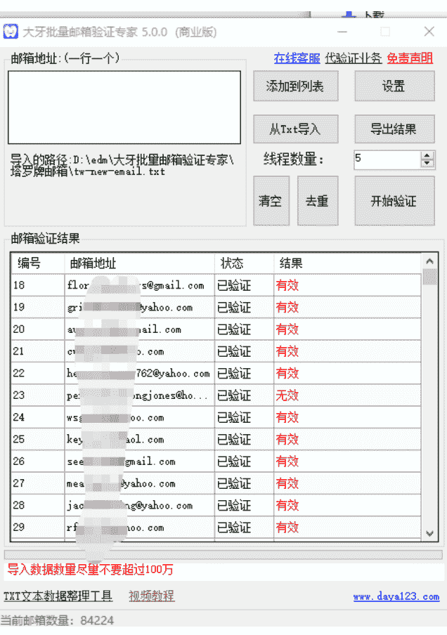

靠着这个工具清洗邮箱，也是成功将日发送额度养了上去。（下图是当时提到的额度，提到 8 级就没继续尝试这个项目了）

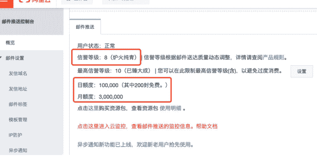

这个项目一共发了上百万的邮箱，但安装用户寥寥无几。虽然按照安装的成本来看，比广告便宜点，但是明显感觉到不是一个特别好的增长方向。于是便放弃了邮件拉新的想法。

#### 3.2.1 日本区域主播挖猎

刚好这时候有区域知道我们在尝试做这个事情，他们就提了个想法。问我们能不能去给竞品的主播发送邀请邮件，让她们来我们的平台直播等。（类似招聘 KOL 的玩法）于是我们就开始了尝试。从推特/竞品进行爬虫。获取竞品的一些主播邮箱。（下面会讲到方法）然后发送招聘邮件。这是当时的一些数据。

| 国家 | app | 官网地址 | 推特地址 | 推特名 | 粉丝数量 |
|---|---|---|---|---|---|
| 日本 | TwinCasting Viewer | https://en.twincasting.tv/ | https://twitter.com/twincastinglive | twincastinglive | 103428 |
| 日本 | ニコニコ生放送 | https://live.nicovideo.jp/ | https://twitter.com/nico_nico_info | nico_nico_info | 390750 |
| 日本 | PocoChat Live（日区本土老牌直播） | https://www.pococha.com/en | https://twitter.com/pococha_ip | pococha_ip | 66786 |
| 日本 | Mildom | https://www.mildom.com/ | https://twitter.com/Mildom_Official | Mildom_Official | 105705 |
| 日本 | Spawn Radio - Live Stream（语音直播） | https://www.spawnent.net/ | https://twitter.com/Spawn_Japan | Spawn_Japan | 50665 |
| 日本 | LINE LIVE | https://live.line.me/ | https://twitter.com/news_line_me | news_line_me | 518137 |
| 日本 | 17Live | https://jp.17.live/ | https://twitter.com/17LiveJP | 17LiveJP | 200118 |
| 日本 | Showroom | https://www.showroom-live.com/ | https://twitter.com/SHOWROOM_app | SHOWROOM_app | 210827 |
| 日本 | MusChannel | https://michan.tv/ | https://twitter.com/michan | michan | 109472 |
| 日本 | WhoWatch | https://schowatch.tv/ | https://twitter.com/schowatch | schowatch | 53260 |
| 日本 | REALITY by Wright Flyer（虚拟直播） | https://reality.tv/products/ | https://twitter.com/REALITY_app | REALITY_app | 86715 |
| 日本 | IRIAM（イリアム）（虚拟直播） | https://www.iram-iriam.com/ | https://twitter.com/iram_official | iriam_official | 52377 |
| 日本 | Hakuna Live | https://hakuna.live/en | https://twitter.com/HakunaJapan | HakunaJapan | 23275 |
| 日本 | Dokidoki Live | https://www.doki.live/ | https://twitter.com/dokidoki_live | dokidoki_live | 27527 |
| 日本 | nogikoi | https://nogikoi.jp/ | https://twitter.com/nogikiofficial | nogikiofficial | 272786 |
| 日本 | everylive | https://everylive.jp/ | https://twitter.com/everylive_jp | everylive_jp | 3122 |
| 日本 | uplive | | https://twitter.com/uplivejp | uplivejp | 12011 |

这时候就不使用阿里云了，改为使用smartpushed。这是当时的部分数据，通过技术手段获取主播邮箱，再配合运营小姐姐制作模板。最后落地到区域的负责人。

| 50<粉丝<500的推特 | 日本-主播-招募-主播-推特第一... | 5,604 | 13.71% 打开760次 | 1.23% 点击68次 |
|---|---|---|---|---|
| 粉丝>500的推特 | 日本-主播-招募-主播-2k3 (9.11) | 2,366 | 20.14% 打开474次 | 1.74% 点击41次 |
| 竞品爬虫+反查 | 日本-主播-招募-主播300 (9.11) | 307 | 20.52% 打开63次 | 1.3% 点击4次 |
| 声优/舞推推特号-all | 日本-主播-招募-声优 2k8 (9.11) | 2,622 | 22.83% 打开572次 | 1.08% 点击27次 |

这是日本区域当时给的数据，我们第一轮尝试测了约 5w 的人群。最终成功招到主播 16 人。算是个不错的小成果，比区域自己手动去联系高效 N 倍。

| 邮件挖猎------竞品Twitter | 8月合计 | 月添加率 | 0901~0910 | 0911~0917 | 月添加率 |
|---|---|---|---|---|---|
| DM发送数 | 28,233 | 0.04% | 10,555 | 16,200 | 0.02% |
| LINE添加数 | 10 | | 1 | 5 | |

最后这个项目因为有主播来问怎么获取到他的邮箱，我们区域给不出合理的解释而暂停。区域评估说可能会有一定的风险。

#### 3.2.2 IOS 用户召回

这是个非常大的项目，涉及了67个部门，数十号人。不是我一个人完成的。

这个项目起因是我们买量团队的发现IOS用户的充值较高，但是也面临着用户流失问题。所以业务想通过一种方式联系用户，让他们回来玩。提高用户留存。一开始他们想给用户发短信，但是海外的短信非常的贵。得知我们有邮件营销拉主播的经验后，找我们商量尝试做个邮件召回系统。

由于时间太久远了，很多截图都没留存。加上过于敏感，这段经历我就口述下我的视角完成的事情。

我们调研了市面上很多的邮件发送平台，觉得用户数据还是要掌控在自己手上。于是我们尝试使用亚马逊的ses服务。（Amazon SES ）我完成了平台注册和跟我们域名的配置，并熟悉平台的规则。打通IOS开发者邮箱转发的配置等。最后联系亚马逊中国商务团队来公司洽谈，协调提额等问题。

协调完后面就交给了前端团队、后端团队去开发系统，调用 API 发送。回调 SES 的各种数据（送达，打开，点击，退订等），编写自动化程序。例如从 ClickHouse(sql)获取数据，半年/7 天未登录的用户召回、用户生日礼物、新活动一键下发等等。

这个项目给我的感触就是，Amazon SES 非常严格，虽然成本巨便宜，大约 300w 封邮件只需要 200 刀。但是不建议个人或小团队去尝试。SES 要求不超过 5%的退订率，对各个数据指标都有不小的要求。提额时还会触发审核，会有专人来联系。很多代开的团队压根就没办法解决这些问题。并且需要第三方的系统来调用 API，而这些开源/付费的系统压根就不好用，经常一堆 bug 找不到人来处理。

### 3.3 既然已是“曲”中人（仿牌出海）

后来，由于各种机缘巧合的关系，到深圳做跨境仿牌。期间经历了很多事情，总结来说就是，跟错人没拿到符合预期的结果。但也学了很多电商流量的玩法。这里分享一个以小博大的思路。

watchfinder，是英国最大的二手手表平台。在 22 年发生过一次数据泄露。当时在这些数据泄露论坛上以 8 积分的价格售卖。（折合人民币不到 50 块钱）

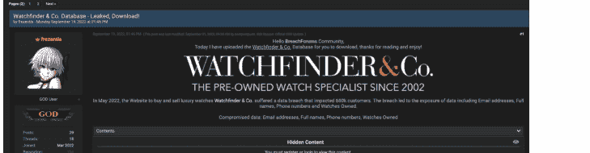

我们当时拿着这份数据，去发仿牌手表。当晚就出单了，第一个月的 GMV 大约在 40 万人民币。一年创造了 300 多万的 GMV。这是个很恐怖的数据，成本 50 块钱，约等于烂大街，再配合一个极其廉价的营销渠道。撬动了非常的一个杠杆。

PS：这个论坛现在已经被 FBI 端了

### 3.4 何须再悟“曲”中意 （Affiliate 灵媒产品推广）

故事回到近期，没做仿牌后开始琢磨一些新的出海项目，发现海外 Affiliate 挺适合自己的。不用管后端的东西，只需要搞好流量就行了。这部分我会写的比较细一点，都是我最近探索出来的。后面的教程也会围绕这个模块展开。

#### 3.4.1 寻找合适的项目

我注册了 cj.com 后，查看上面的项目。发现很多佣金高的，比如金融、证券，一个 CPS 的线索给 75-120 刀。而灵媒跟它一个价格，并且难度比金融小。（劝人开信用卡难度大，还是劝人去算命难度高，结果显而易见）

同样的价格，我选择做这个赛道。调研了几家后注册了 mysticsense.com 这家。虽然他便宜，但是支持 PayPal，也好申请。

| 品牌名称 | 站点地址 | 流量 | 佣金比例 | 付款周期 | 意向人群 |
|---|---|---|---|---|---|
| ... | ... | ... | ... | ... | ... |

然后开始收集推特上的塔罗牌相关的博主，爬取数据。（大概收集了几百个）

| 用户名 | 推特地址 | 粉丝数 |
|---|---|---|
| LunaMoThTarot | https://x.com/LunaMoThTarot | 4329 |
| lwetarot | https://x.com/lwtarot | 97037 |
| librababytarot | https://x.com/librababytarot | 83571 |
| tarotonesiek | https://x.com/tarotonesiek | 228754 |
| LicaFortica | https://x.com/LicaFortica | 2517 |
| _mercurialtarot | https://x.com/_mercurialtarot | 30479 |
| ArielTarot | https://x.com/ArielTarot | 10708 |
| yabanaoktarot | https://x.com/yabanaoktarot | 144548 |
| Tar_Prediction | https://x.com/Tar_Prediction | 6752 |
| vlurseer | https://x.com/vlurseer | 47398 |
| divinecurves | https://x.com/divinecurves | 73758 |
| wicdarot | https://x.com/wicdarot | 85968 |
| intuitivemini | https://x.com/intuitivemini | 39604 |
| sallyhscorp | https://x.com/sallyhscorp | 32497 |
| crystalmnor | https://x.com/crystalmnor | 7045 |
| gracestarot | https://x.com/gracestarot | 4902 |
| frestarot | https://x.com/frestarot | 6926 |
| #Finnessa | https://x.com/finnessa | 1729 |
| cupidkishistarot | https://x.com/cupidkishistarot | 5898 |
| #IlyaBarreraMO | https://x.com/IlyaBarreraMO | 18176 |
| #NdasMagick6 | https://x.com/NdasMagick6 | 6472 |
| highbfttarot | https://x.com/highbfttarot | 33024 |
| GreenGrlFtarot | https://x.com/GreenGrlFtarot | 59879 |
| GlowingGblfire | https://x.com/GlowingGblfire | 60015 |
| SydBliveTarot | https://x.com/SydBliveTarot | 116401 |
| UNTYRSDECHILD | https://x.com/UNTYRSDECHILD | 34118 |
| _cabrielabloomz | https://x.com/_cabrielabloomz | 25645 |
| divineyllii | https://x.com/divineyllii | 25720 |
| arianis | https://x.com/arianis | 57922 |
| lalitarot444 | https://x.com/lalitarot444 | 13951 |
| hotgirltarotsha | https://x.com/hotgirltarotsha | 43506 |
| astraowise | https://x.com/astraowise | 47625 |
| venusgalore_ | https://x.com/venusgalore_ | 10189 |
| luriith002 | https://x.com/luriith002 | 12322 |
| #MICH002 | https://x.com/MICH002 | 23566 |
| spiritualsillyne | https://x.com/spiritualsillyne | 29322 |
| mysticstudioss | https://x.com/mysticstudioss | 27390 |
| tokenlewstarot | https://x.com/tokenlewstarot | 8847 |
| ArielTarotworld | https://x.com/ArielTarotworld | 3869 |
| #ar3hma | https://x.com/ar3hma | 10524 |
| HealingBcegirl | https://x.com/HealingBcegirl | 4910 |
| Spiritutalvcad | https://x.com/Spiritutalvcad | 5183 |
| Spirituatrealmo | https://x.com/Spirituatrealmo | 18157 |
| Childmoo77 | https://x.com/Childmoo77 | 8118 |
| Astroviccaso | https://x.com/Astroviccaso | 5004 |
| WiccanSpirituab | https://x.com/WiccanSpirituab | 1447 |
| Tarotbeing | https://x.com/Tarotbeing | 8256 |
| Spiritulavv222 | https://x.com/Spiritulavv222 | 3474 |

给这家推广并没有赚多少钱（几百刀），有很多的用户注册，但是没有下单。我分析了原因，觉得是这家推广的免费5分钟文案存在误导性，他是要绑定信用卡以后进行使用了才返使用期间的5分钟额度。而不是上来就给予5分钟免费体验。所以用户注册后看到需要花钱才能解锁，与预期不符，就直接走了。

| Sale | User Register |
|---|---|
| $60.00 | 3527563 | 230882 | 07/28/2025 07:48:31 | MysticSense | Sale |
| $0.00 | register | 230882 | 07/28/2025 07:28:43 | MysticSense | User Register |
| $0.00 | register | 230834 | 07/27/2025 23:14:45 | MysticSense | User Register |
| $0.00 | register | 230808 | 07/27/2025 20:52:35 | MysticSense | User Register |
| $0.00 | register | 230733 | 07/27/2025 05:37:25 | MysticSense | User Register |
| $0.00 | register | 230660 | 07/26/2025 18:35:49 | MysticSense | User Register |
| $0.00 | register | 230479 | 07/25/2025 08:17:50 | MysticSense | User Register |
| $0.00 | register | 230471 | 07/25/2025 07:16:01 | MysticSense | User Register |
| $0.00 | register | 230444 | 07/25/2025 01:12:40 | MysticSense | User Register |
| $0.00 | register | 230430 | 07/24/2025 23:33:50 | MysticSense | User Register |
| $0.00 | register | 230377 | 07/24/2025 14:23:13 | MysticSense | User Register |
| $0.00 | register | 230345 | 07/24/2025 07:55:23 | MysticSense | User Register |
| $0.00 | register | 230336 | 07/24/2025 06:23:11 | MysticSense | User Register |
| $0.00 | register | 230322 | 07/24/2025 02:58:23 | MysticSense | User Register |
| $0.00 | register | 230282 | 07/23/2025 20:10:11 | MysticSense | User Register |

后面再寻找类似offer的时候找到了我现在在推广这家 PsychicSamira。它没有那么多花里胡哨的玩法，只需要输入问题就会公众号懒人搜索，懒人专属群分享帮你解答。而且交付的是PDF文件发到邮箱，妥妥的虚拟产品。嘎嘎暴利！我都怀疑他后端就是利用工作流做的Ai解读。然后真人出镜去做品牌/推广。

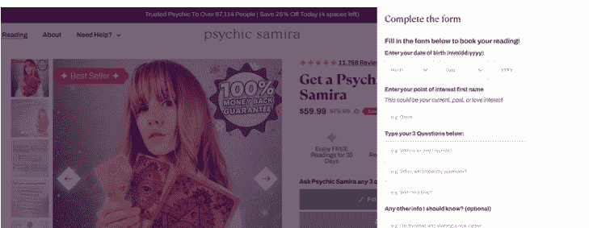

PsychicSamira 推广平台，感兴趣的圈友也可以看下这个 offer，它给 50%的佣金，而且退款率很少。我 300 单里只有两单退款。支持 PayPal 按周/按月打钱。初期我没有花钱去测，纯靠白嫖 smtppusheddm 的免费额度，一个账号有 5k 的免费额度。而且有默认域名，可以直接使用。在第一批数据测出可以出单后，我白嫖了接近两个月，注册了数百个账号去清洗数据。

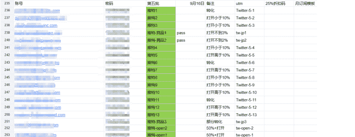

我会把每个账号里的数据提取出来，然后使用脚本进行清洗，把打开点击过的用户提取出来。然后把退订/投诉/无法发送的邮箱删除。

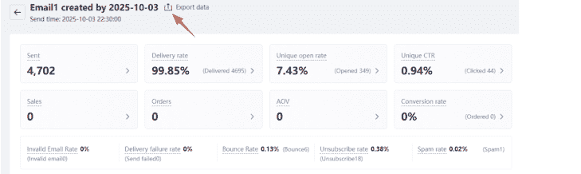

## 清洗脚本如下：

```python
import pandas as pd
import glob
import os
import warnings

# --- 配置区 ---
# 目标工作表名称定义
DELIVERED_SHEET = 'Delivered'
SPAM_SHEETS = ['Sent Failed', 'Invalid Contacts', 'Unsubscribed', 'Bounce', 'Spam']
INTERACTION_SHEETS = ['All Open', 'All Clicks']

# 列名定义（请根据您的 Excel 文件进行确认）
FULL_NAME_COLUMN = 'Full Name'
EMAIL_COLUMN = 'Email'

# 输出文件夹和文件名定义
PROCESSING_FOLDER = '新处理'
RESULTS_FOLDER = '结果'
SPAM_LIST_FILE = 'spam-all-email.txt'
ALL_INTERACTIONS_FILE = 'allopen.csv'

# --- 脚本核心逻辑 ---
def main():
    """主函数，按顺序执行所有处理步骤"""
    print("--- 邮件自动化处理与格式化脚本启动 ---")

    # --- 准备工作：创建输出文件夹 ----
    os.makedirs(PROCESSING_FOLDER, exist_ok=True)
    os.makedirs(RESULTS_FOLDER, exist_ok=True)
    print(f'输出文件夹 {PROCESSING_FOLDER} 和 {RESULTS_FOLDER} 已准备就绪。')

    # 查找当前目录下所有的 xlsx 文件
    excel_files = glob.glob('*.xlsx')
    if not excel_files:
        print("错误：在当前目录下没有找到任何 .xlsx 文件。脚本将退出。")
        return
    print(f'\n 发现 {len(excel_files)} 个 .xlsx 文件，即将开始处理...')

    # --- 执行步骤 1 & 2 ---
    print("\n--- 步骤 1 & 2: 提取 'Delivered'数据并生成垃圾邮件列表 ---")
    all_spam_emails = set()

    for filename in excel_files:
        print(f" 正在扫描文件: {filename}")
        try:
            df_delivered = pd.read_excel(filename, sheet_name=DELIVERED_SHEET)
            if not df_delivered.empty:
                output_path = os.path.join(PROCESSING_FOLDER, os.path.basename(filename))
                df_delivered.to_excel(output_path, index=False)
                print(f"   - 'Delivered'工作表已提取并保存至 '{output_path}'")
        except Exception:
            print(f"   - 未在 {filename} 中找到 '{DELIVERED_SHEET}' 工作表，已跳过。")

            for sheet in SPAM_SHEETS:
                try:
                    df_spam = pd.read_excel(filename, sheet_name=sheet)
                    if EMAIL_COLUMN in df_spam.columns:
                        emails = df_spam[EMAIL_COLUMN].dropna().unique()
                        all_spam_emails.update(emails)
                except Exception:
                    pass

    if all_spam_emails:
        with open(SPAM_LIST_FILE, 'w', encoding='utf-8') as f:
            for email in sorted(list(all_spam_emails)):
                f.write(email + '\n')
        print(f"\n✓ 步骤 2 完成: 共找到 {len(all_spam_emails)} 个唯一的垃圾/退订邮箱，列表已保存至 '{SPAM_LIST_FILE}'")
    else:
        print("\n⚠️ 步骤 2 警告: 未在任何文件中找到垃圾邮件信息。")

    # --- 执行步骤 3 (新增了使用 spam-all-email.txt 进行清洗的逻辑) ---
    print(f"\n--- 步骤 3: 提取、去重并清洗 'All Open' 和 'All Clicks' 数据 ---")
    interaction_data = []
    for filename in excel_files:
        for sheet in INTERACTION_SHEETS:
            try:
                df_interaction = pd.read_excel(filename, sheet_name=sheet)
                if FULL_NAME_COLUMN in df_interaction.columns and EMAIL_COLUMN in df_interaction.columns:
                    interaction_data.append(df_interaction[[FULL_NAME_COLUMN, EMAIL_COLUMN]])
            except Exception:
                pass

    if interaction_data:
        df_all_interactions = pd.concat(interaction_data, ignore_index=True)
        original_count = len(df_all_interactions)

        # 首先基于 Email 去重
        df_all_interactions.drop_duplicates(subset=[EMAIL_COLUMN], inplace=True)
        deduped_count = len(df_all_interactions)

        # 【新增逻辑】使用已生成的垃圾邮件列表清洗互动数据
        print(f" - 正在从互动列表中移除 '{SPAM_LIST_FILE}' 中包含的垃圾邮件...")
        cleaned_interactions_df = df_all_interactions[~df_all_interactions[EMAIL_COLUMN].isin(all_spam_emails)]
        final_count = len(cleaned_interactions_df)
        removed_spam_count = deduped_count - final_count

        # 保存清洗后的结果
        cleaned_interactions_df.to_csv(ALL_INTERACTIONS_FILE, index=False, encoding='utf-8-sig')
        print(f"✅ 步骤 3 完成: '{ALL_INTERACTIONS_FILE}' 已创建并清洗。")
        print(f" - 原始互动记录数: {original_count}")
        print(f" - 去重后数量: {deduped_count}")
        print(f" - 移除垃圾邮件数: {removed_spam_count}")
        print(f" - 最终有效数量: {final_count}")
    else:
        print("⚠️ 步骤 3 警告: 未找到任何'All Open'或'All Clicks'数据。")

    # --- 执行步骤 4 & 5 (包含新增的格式化需求) ---
    print(f"\n--- 步骤 4 & 5: 清洗文件，格式化并输出到 '{RESULTS_FOLDER}' ---")
    if not all_spam_emails:
        print("  - 信息：由于垃圾邮件列表为空，将直接格式化文件，不执行清洗。")

    files_to_clean = glob.glob(os.path.join(PROCESSING_FOLDER, '*.xlsx'))

    if not files_to_clean:
        print("  - 警告：'新处理'文件夹中没有任何文件需要处理。")

    total_deleted_count = 0
    total_final_count = 0

    for filepath in files_to_clean:
        filename = os.path.basename(filepath)
        print(f"  正在处理文件：{filename}")

        df_to_clean = pd.read_excel(filepath)
        original_rows = len(df_to_clean)

        if original_rows == 0:
            print("   - 文件为空，跳过。")
            continue

        if EMAIL_COLUMN not in df_to_clean.columns:
            print(f"  - 错误: 文件中找不到 '{EMAIL_COLUMN}' 列, 无法处理。")
            continue

        # 步骤 4: 清洗
        cleaned_df = df_to_clean[~df_to_clean[EMAIL_COLUMN].isin(all_spam_emails)]

        # 步骤 5: 格式化为新的四列结构
        if FULL_NAME_COLUMN not in cleaned_df.columns:
            print(f"  - 警告: 文件中找不到 '{FULL_NAME_COLUMN}' 列, 'Name'列将为空。")
            # 如果没有 Name 列, 则创建一个空列以保证结构一致
            cleaned_df[FULL_NAME_COLUMN] = ""

        # 创建最终输出的 DataFrame
        final_df = pd.DataFrame({
            'Name': cleaned_df[FULL_NAME_COLUMN],
            'Email': cleaned_df[EMAIL_COLUMN],
            'Accept email marketing': 'yes',
            'Language': 'en'
        })

        final_rows = len(final_df)
        deleted_rows = original_rows - final_rows
        total_deleted_count += deleted_rows
        total_final_count += final_rows

        # 保存到“结果”文件夹，编码设为'utf-8-sig'以正确处理特殊字符
        result_path = os.path.join(RESULTS_FOLDER, filename.replace('.xlsx', '.csv'))
        final_df.to_csv(result_path, index=False, encoding='utf-8-sig')

        print(f"    - 清洗与格式化完成。原始数量: {original_rows}, 删除数量: {deleted_rows}, 最终数量: {final_rows}")
        print(f"    - 结果已保存至: '{result_path}'")

    print(f"\n☑ 步骤 4 & 5 完成：所有文件处理完毕。")
    print(f" - 所有文件累计删除总数: {total_deleted_count}")
    print(f" - 所有文件最终有效总数: {total_final_count}")
    print("\n--- 🎉 全部任务处理完毕 ---")

if __name__ == "__main__":
    warnings.filterwarnings('ignore', category=UserWarning, module='openpyxl')
    main()
```

使用脚本提取后自动输出成能直接导入SMP的格式，方便我继续测试。


Delivered 工作表已提取并保存至 '新处理\twitter8.xlsx'
正在扫描文件: twitter9.xlsx
'Delivered' 工作表已提取并保存至 '新处理\twitter9.xlsx'

步骤2完成: 共找到 5875 个唯一的垃圾/退订邮箱, 列表已保存至 'spam-all-email.txt'

--- 步骤 3: 提取、去重并清洗 'All Open' 和 'All Clicks' 数据 ---
- 正在从互动列表中移除 'spam-all-email.txt' 中包含的垃圾邮件...
步骤3完成: 'allopen.csv' 已创建并清洗。
- 原始互动记录数: 8639
- 去重后数量: 6452
- 移除垃圾邮件数: 399
- 最终有效数量: 6053

--- 步骤 4 & 5: 清洗文件, 格式化并输出到 '结果' ---
正在处理文件: twitter1.xlsx
- 清洗与格式化完成。原始数量: 4435, 删除数量: 29, 最终数量: 4406
- 结果已保存至: '结果\twitter1.csv'
正在处理文件: twitter0.xlsx
- 清洗与格式化完成。原始数量: 4444, 删除数量: 14, 最终数量: 4430
- 结果已保存至: '结果\twitter0.csv'
正在处理文件: twitter11.xlsx
- 清洗与格式化完成。原始数量: 4443, 删除数量: 20, 最终数量: 4423
- 结果已保存至: '结果\twitter11.csv'
正在处理文件: twitter12.xlsx
- 清洗与格式化完成。原始数量: 4436, 删除数量: 19, 最终数量: 4467
- 结果已保存至: '结果\twitter12.csv'
正在处理文件: twitter13.xlsx
- 清洗与格式化完成。原始数量: 4482, 删除数量: 23, 最终数量: 4459
- 结果已保存至: '结果\twitter13.csv'
正在处理文件: twitter2.xlsx
- 清洗与格式化完成。原始数量: 4494, 删除数量: 19, 最终数量: 4475
- 结果已保存至: '结果\twitter2.csv'
正在处理文件: twitter3.xlsx
- 清洗与格式化完成。原始数量: 4434, 删除数量: 35, 最终数量: 4449
- 结果已保存至: '结果\twitter3.csv'

就这样，经过了十几轮的清洗，我提取了大约 7万多有意向的客户。并且在这期间不断优化邮件模板，从而带来了 4000 多刀的收益。所有操作都是接近 0 成本的操作。

| Month | Total clicks | Orders | Total sales | Commission |
| :--- | :--- | :--- | :--- | :--- |
| 08-2025 | 544 | 43 | $1,784.02 | $892.08 |
| 09-2025 | 1432 | 155 | $5,389.39 | $2,695.07 |
| 10-2025 | 565 | 127 | $2,177.76 | $1,089.04 |
| Total | 2541 | 325 | $9,351.17 | $4,676.19 |

算是我目前跑的最顺利的一个 offer 了，而且长尾流量非常明显。用户几乎每个月都有新的需求，我上个月推的邮件，这个月也能看到点击出单。特别是周末闲下来的时候，出单金额能提高 3 倍。

## 四、如何找邮箱

这部分分享如何找到精准的用户邮箱，方法路子有些比较野。可以当做一种思路扩充。

### 4.1 通过制作优质的网站内容引导订阅

这块是长期的事情，初期会很慢，后期流量稳定后就是躺着赚钱。通过 SEO 做内容，引导用户订阅，订阅后进行邮件营销卖产品。可以参考圈友不二的文章，写的非常详细，通过做内容引导订阅再通过邮件营销卖货的思路。

《一起赚美元 年底复盘一个去年做的项目：纪念币，月平均纯利润3w+美金。》

我尝试做过一些内容站吸引订阅，做了一个月只有十几个订阅。感觉非常的慢，暂时没有时间精力投入这么长期的事情上。如果你的网站有很多订阅用户，可以尝试找到合适的联盟并使用邮件营销进行转化。

### 4.2 通过爬虫竞品

这块非常敏感，不讲太多细节。国内项目的圈友不建议尝试。很容易把自己干进去。国外倒是随便爬无所谓了。

我们就爬了很多TikTok博主，他们有的会将自己的联系方式放在主页。

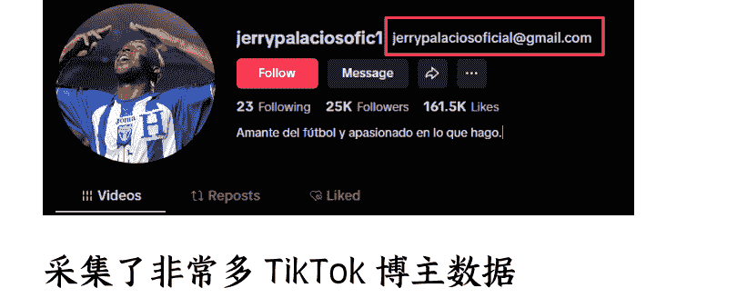

采集了非常多 TikTok 博主数据。

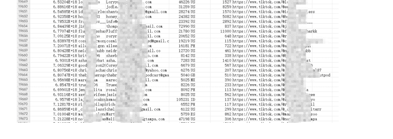

有联系方式就可以轻而易举大规模的进行建联、邀请等。我甚至想过给主播推一些可能要用到的工具。

### 4.3 通过推特反查

#### 4.3.1 背景

这个思路是当时推特数据泄露引发的思考。我收集并清洗泄露的数据，导入数据库后，再通过爬取对应的官号粉丝，然后将粉丝 ID 与数据库泄露的数据进行匹配，得到我想要的精准用户邮箱。

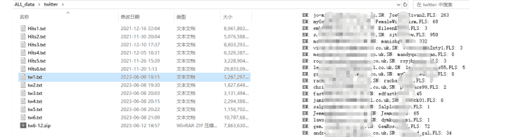

使用脚本爬取粉丝列表，相当于都是精准的竞品用户啊~

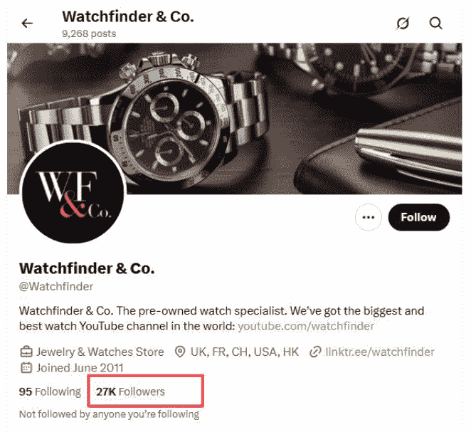

通过爬虫→反查→清洗，最终得到下图所示的汇总结果。这是当时根据二手数据能出单做的推特反查。把各种官号的粉丝进行爬取，得出邮箱。

| 用户 | 链接特征 | 粉丝数 | 官网 | 百度收录 | 友链去重前 | 友链去重后 | 备注 | RedNote |
|---|---|---|---|---|---|---|---|---|
| Watchfinder | https://twitter.com/Watchfinder/ | 22873 | https://www.watchfinder.com/ | | 4630 | 3360 | 二手 | 推特注册的前提太老了，无效 real convert error verify: #valid#网络无法连接验证 报: 18756969 ukraine name 大量小众用户名出来未知状态，这两种状态的判断没有效内，只是概率会比较高，需要调整文件策略 |
| omegaespresso | https://twitter.com/omegaespresso | 266060 | https://www.omegaespresso.com/ | | 53890 | 38075 | 6254 品牌 | |
| chrono24 | https://twitter.com/chrono24 | 6272 | https://www.chr0no24.com/ | | 1441 | 766 | 131 二手 | |
| Chrona2d | https://twitter.com/Chrona2d | 154702 | https://www.chrona2d.com/ | | 28642 | 21753 | 3637 珠宝+手表+奢侈品 | |
| AudemarsWatches | https://twitter.com/AudemarsWig | 235224 | https://www.audemarspiguet.com/ | | 35256 | 29775 | 6145 奢侈品牌腕表 品牌 | |
| Giral-Watch | https://twitter.com/Giral-watch.com/ | 1134 | https://giral-watch.com/ | | 226 | 161 | 21 博客+带货站 | |
| twitter | https://twitter.com/WatchTime | 42774 | https://www.watchtime.com/ | | 6657 | 6422 | 1202 博客+带货站 | |
| rolex | https://twitter.com/rolex | 907637 | https://www.rolex.com | | 190256 | 138321 | 28514 value 和ed.com的域名没注册验证 | |
| BellRossWatches | https://twitter.com/BellRossWatches | | | | 5526 | 2425 | 423 博客+带货站 | |
| BellRossWatches | https://twitter.com/BellRoswWatches | 47101 | https://www.bellross.com/ | | 6587 | 6415 | 1110 品牌 | |
| G.J. Manufacturer | https://twitter.com/G_J_Manufacturer | 11103 | https://www.giujewelry-original.com/ | | 1915 | 1347 | 199 博客+带货站 德国 | |
| Chronext | https://twitter.com/Chronextwatch | 16423 | https://www.chronext.com/ | | 3266 | 1350 | 331 品牌 瑞士 | |
| Longines | https://twitter.com/Longines | 98709 | https://www.longines.com/ | | 18601 | 12989 | 2436 浪琴 品牌 | |
| Oris | https://twitter.com/oris_watches | 13064 | https://www.oris.ch/ | | 2752 | 1571 | 305 豪利时 瑞士 瑞士 | |
| Blancpain735 | https://twitter.com/Blancpain735 | 27736 | https://www.blancpain.com/ | | 4051 | 3107 | 462 宝珀 品牌 | |
| MovadoWatches | https://twitter.com/MovadoWatches | | | | 35831 | 21392 | 3921 机芯 品牌 瑞士 客户美国 | |
| IWC | https://twitter.com/IWC | 208366 | https://www.iwc.com | | 35562 | 24026 | 4211 万国表 品牌 瑞士 | |
| Rolex | https://twitter.com/RolexBlog | 151646 | https://www.breitling.com | | 33648 | 23947 | 3363 百年灵 品牌 瑞士 | |
| TissotWatches | https://twitter.com/TissotswTcwds | 11127 | https://www.tissotwatches.com/ | | 2116 | 1421 | 264 博客+论坛 论坛帖子很多翻译 | |
| time_watches | https://twitter.com/time_watches | 11845 | https://www.timewatches.com/ | | 2144 | 1425 | 287 博客+带货站 | |
| MovadoNewWatch | https://twitter.com/MovadoNewWatches | 28316 | movadowatchs.com/ | | 5190 | 2068 | 666 博客+带货站 | |
| Richard Mille | https://twitter.com/Richard_Mille | 78199 | https://www.richardmille.com/ | | 13067 | 8958 | 1486 品牌 二手 | |
| ChagstheBest | https://twitter.com/Chagsthebest | 11818 | https://chagsthebest.com/ | | 2287 | 1424 | 272 品牌 瑞士 | |
| KarciaKiger | https://twitter.com/karciaKiger | 41012 | https://www.karcia.com | | 6489 | 4526 | 762 宝玑 品牌 | |
| Paul Deinstel | https://twitter.com/Paul_Deinstel | 3850 | | | 142 | 468 | 90 | |
| Social MediaMars | https://twitter.com/socialmediamars | 15085 | https://www.socialmediamars.com/ | | 1681 | 861 | 210 博客+带货站 | |
| David_Millarcom | https://twitter.com/David_Millarcom | 3148 | https://www.daviddelhommec.co.uk/ | | 738 | 410 | 56 经销商 手表 咨询 英国 | |
| Wristwatchshop | https://twitter.com/Wristwatchshop | 4131 | https://www.wristwatchshop.co.uk/ | | 1184 | 716 | 131 经销商 英国 | |
| swc_catalog | https://twitter.com/swc_catalog | 3462 | | | 588 | 239 | 245 | |
| swc_catalogs | https://twitter.com/swcwatchsbooks | 4467 | https://swcwatchsbooks.com/ | | 797 | 464 | 87 二手+咨询 | |
| watchesgold | https://twitter.com/watchesgoldsite | 4396 | https://www.watchesgoldsite.com/ | | 1048 | 586 | 231 手表+咨询 | |
| | https://twitter.com/watchessunwatcher | 1475 | https://www.sunandmoonwatches | | 314 | 165 | 36 经销商 二手 | |

结果如下所示，获得竞品粉丝的邮箱、昵称、粉丝数：

| Email | screen name | followers |
|---|---|---|
| soo l.com | 000... | soo 1622 |
| mnm l.com | 08m | 308 |
| 141 com | 141 | 3371 |
| 19h l.com | 19h 9 2 | |
| mor ail.com | 202 | 1207 |
| sem mail.com | 23_ | 591 |
| cho l.com | 2BI | 871 |
| sos ail.com | 2_ | 18913 |
| we com | 3b 3347 558 | |
| ma .com | 3j | 5057 |
| fu :com | 3n 216 307 | |
| le l.com | 589741 | 5727 |
| ma hotmail.com | 7m | 1017 |
| zi live.fr | 8m | 650 |
| he l.com | 96 | 440 |
| zh com | AF | 6905 |
| al com | AL | 1529 |
| ao | AL | 36559 |
| m, mail.com | A_ | 1537 |
| m, 3@hotmail.cA_ | 77 | |
| al ..com | Ab_ ajrashi | 102 |
| ab ail.com | Al | 336 |
| ku com | Ale | 41092 |
| si ld@hotmail. | Ale | 18414 |
| sa .com | Alh 2013 1817 | |
| jas tmail.com | Ali irl | 145 |
| ddi lail.com | Al: D | 17117 |
| al l.com | Al: Tokar | 3223 |
| al .ail.com | Al: 10 688 | |
| al dam@gmail.com | Al: 12 2168 | |
| aa il.com | Ama | 35001 |
| me l.com | Ame 1 9 | |
| an gmail.com | Ami | 719 253 |
| fe hotmail.com | Ang 005 | 771 |
| ar nail.com | Any g_BC | 733 |
| fr ail.com | Ao | 124 |

再通过邮件平台发送，观察每组的数据的反馈和到站。最终确定哪些用户群体更加精准，再针对性的收集第二批用户。我们最后测出来，小的手表商店/代理商/经销商，出单率更高。（大概率都是关注商店的用户，属于是精准的电商用户）所以后面又采集了一批小的。可以看到粉丝数都是很少的。

| 用户名 | 推特地址 | C | 粉丝数 | 官网 | E |
|---|---|---|---|---|---|
| WierClock | https://twitter.com/WierClock | | 353 | wierclock.etsy.com | |
| WilliamMayUK | https://twitter.com/WilliamMayUK | | 2646 | william-may.co.uk | |
| wingateswatches | https://twitter.com/wingateswatches | | 1859 | tic-tock.com | |
| WoS_OfficialUK | https://twitter.com/WoS_OfficialUK | | 5745 | watches-of-switzerland.co.uk | |
| wpwatches | https://twitter.com/wpwatches | | 275 | WaldorfandParker.com | |
| wristreview | https://twitter.com/wristreview | | 3866 | http://WristReview.com | |
| wristwatchforum | https://twitter.com/wristwatchforum | | 1285 | wristwatchforums.com | |
| ww_review | https://twitter.com/ww_review | | 2459 | wristwatchreview.com | |
| ww_watches | https://twitter.com/ww_watches | | 222 | https://worldwidewatches.es/ | |
| Wyinfo | https://twitter.com/Wyinfo | | 197 | watchyouwant.it | |
| Xupes | https://twitter.com/Xupes | | 3785 | xupes.com | |
| Zeitwinkel | https://twitter.com/Zeitwinkel | | 3524 | https://www.zeitwinkel.ch/ | |
| | | | 838353 | | 191726 |

现在留存的一份数据，记忆深刻的是有一个土豪客户一口气买了3个最贵的手表。当天的gmv快赚到1w刀了。

| 广告活动 | 访问 | 订单数 | 电子商务订单转化率 | 电子商务订单收益 | 电子商务订单每次访问价值 |
|---|---|---|---|---|---|
| ... | 196 | 1 | 0.51% | US$217.55 | US$1.11 |
| ... | 47 | 1 | 2.13% | US$197.60 | US$4.20 |
| ... | 33 | 1 | 3.03% | US$174.40 | US$5.28 |
| ... | 21 | 1 | 4.76% | US$355.31 | US$16.92 |
| ... | 9 | 1 | 11.11% | US$2,697 | US$299.67 |

#### 4.3.2 过程

一开始是使用官方的接口，每个月100美刀就可以爬取约500w用户。自从马斯克接管后，这个套餐就被取消了。想要获取数据就只能花非常高昂的金额。经过寻找，找到有第三方可以提供这样的接口渠道。直接用第三方的接口爬取，根据要爬取的额度充值对应的金额。

通过 python 调用第三方 Api 接口爬取推特官号粉丝：

```
https://rapidapi.com/davethebeast/api/twitter241/playground/apiendpoint_b2eb295f-515a-48f0-a449-9fa574057920
```

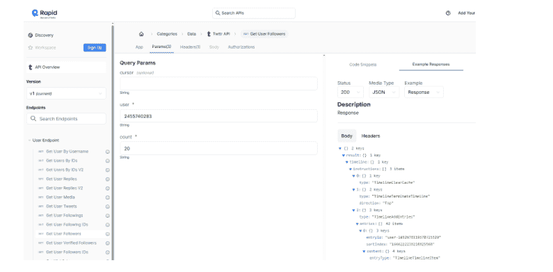

# Python 代码如下

```python
#!/usr/bin/env python
# -*- coding: utf-8 -*-
# @Version : 1.1.0

import math
import tweepy
import traceback
from loguru import logger
from lib.utils import create_api, get_config
from lib.db.mysql import DB
from pprint import pprint as pp

mysql_config = get_config('tweet_feeder')
db = DB(**mysql_config)

consumer_key="xxxxx"
consumer_secret="xxxx"
access_token="xxxx"
access_token_secret="xxxxx"
bearer_token="xxxx"
```

```python
def get_all_followers(screen_name):
    follow_next_token = "0000000"
    followers_next_token = "0000000"

    # 我的粉丝
    table_name_followers = screen_name + "_followers"

    # 我关注的人
    table_name_follow = screen_name + "_follow"

    # 获取连接数据库时不操作的过期时间，默认 120 秒
    mysql_timeout_sql = "show global variables like 'wait_timeout'"
    timeout_dict = db.fetch_one(mysql_timeout_sql)
    # 如果小于 1200 秒，那么就修改为 1200 秒
    if int(timeout_dict["Value"]) < 60*60*24*2:
        set_timeout_sql = "set global wait_timeout=60*60*24*2"
        db.fetch_one(set_timeout_sql)
        print("设置数据库超时时间完成，请重新运行程序")
        exit(1)

    # 判断表是否存在
    table_exist_sql = f'SHOW TABLES LIKE "{table_name_follow}";'
    logger.info(table_exist_sql)
    # 如果不存在则创建表
    if not db.fetch_one(table_exist_sql):
        create_table = f'create table {table_name_follow}(id INT NOT NULL AUTO_INCREMENT,screen_name varchar(255),next_token varchar(255),PRIMARY KEY (id));'
        logger.info(create_table)
        db.fetch_one(create_table)
    else:
        # 如果存在表，则寻找 follow_next_token 值
        find_follow_next_token_sql = f'select next_token from {table_name_follow} order by id desc limit 0,1;'
        if not db.fetch_one(find_follow_next_token_sql):
            follow_next_token = "0000000"
        else:
            follow_next_token = db.fetch_one(find_follow_next_token_sql)['next_token']

    # 判断表是否存在
    table_exist_sql = f'SHOW TABLES LIKE "{table_name_followers}";'
    logger.info(table_exist_sql)
    # 如果不存在则创建表
    if not db.fetch_one(table_exist_sql):
        create_table = f'create table {table_name_followers}(id INT NOT NULL AUTO_INCREMENT,screen_name varchar(255),next_token varchar(255),PRIMARY KEY (id));'
        logger.info(create_table)
        db.fetch_one(create_table)
    else:
        # 如果存在表，则寻找 followers_next_token 值
        find_followers_next_token_sql = f'select next_token from {table_name_followers} order by id desc limit 0,1;'
        if not db.fetch_one(find_followers_next_token_sql):
            followers_next_token = "0000000"
        else:
            followers_next_token = db.fetch_one(find_followers_next_token_sql)['next_token']

    """
    先获取关注我的人
    """
    try:
        client = tweepy.Client(bearer_token=bearer_token, consumer_key=consumer_key, consumer_secret=consumer_secret, access_token=access_token, access_token_secret=access_token_secret, wait_on_rate_limit=True)
        
        tweets = client.get_user(username=screen_name)
        user_id = tweets.data.id
        
        result = ""
        # 判断是否存在 next_token，是的话取下一份数据
        if follow_next_token == "0000000":
            result = client.get_users_following(user_id, max_results=1000)
        else:
            result = client.get_users_following(user_id, max_results=1000, pagination_token=follow_next_token)

        while 'next_token' in result.meta:
            next_token = result.meta['next_token']
            for screen_name1 in result.data:
                insert_sql = f'INSERT INTO {table_name_follow}(screen_name,next_token) VALUES("{screen_name1}","{next_token}")'
                logger.info(insert_sql)
                db.insert_one(insert_sql)
            result = client.get_users_following(user_id, max_results=1000, pagination_token=next_token)
        else:
            for screen_name1 in result.data:
                insert_sql = f'INSERT INTO {table_name_follow}(screen_name,next_token) VALUES("{screen_name1}","0000000")'
                logger.info(insert_sql)
                db.insert_one(insert_sql)
    except:
        logger.error(traceback.format_exc())

    """
    再获取我的粉丝
    """
    try:
        client = tweepy.Client(bearer_token=bearer_token, consumer_key=consumer_key, consumer_secret=consumer_secret, access_token=access_token, access_token_secret=access_token_secret, wait_on_rate_limit=True)

        tweets = client.get_user(username=screen_name)
        user_id = tweets.data.id

        result = ""
        # 判断是否存在 next_token，是的话取下一份数据
        if followers_next_token == "0000000":
            result = client.get_users_followers(user_id, max_results=1000)
        else:
            result = client.get_users_followers(user_id, max_results=1000, pagination_token=followers_next_token)

        while 'next_token' in result.meta:
            next_token = result.meta['next_token']
            for screen_name1 in result.data:
                insert_sql = f'INSERT INTO {table_name_followers}(screen_name,next_token) VALUES("{screen_name1}","{next_token}")'
                logger.info(insert_sql)
                db.insert_one(insert_sql)
            result = client.get_users_followers(user_id, max_results=1000, pagination_token=next_token)
        else:
            for screen_name1 in result.data:
                insert_sql = f'INSERT INTO {table_name_followers}(screen_name,next_token) VALUES("{screen_name1}","0000000")'
                logger.info(insert_sql)
                db.insert_one(insert_sql)
    except:
        logger.error(traceback.format_exc())

if __name__ == '__main__':
    # 从 name.txt 里按行读取目标，爬取目标的粉丝和关注的人
    with open('name.txt', 'r') as file:
        lines = file.readlines()
        lines = [line.rstrip() for line in lines]

    for screen_name in lines:
        get_all_followers(screen_name)
```

# requirements.txt 文件

```
astroid==2.14.2
autopep8==2.0.1
certifi==2022.12.7
charset-normalizer==3.0.1
dill==0.3.6
idna==3.4
isort==5.12.0
lazy-object-proxy==1.9.0
loguru==0.6.0
mccabe==0.7.0
mysqlclient==2.1.1
oauthlib==3.2.2
platformdirs==3.0.0
pprintpp==0.4.0
pycodestyle==2.10.0
pylint==2.16.2
requests==2.28.2
requests-oauthlib==1.3.1
tomli==2.0.1
tomlkit==0.11.6
tweepy==4.12.1
typing_extensions==4.5.0
urllib3==1.26.14
wrapt==1.14.1
```

# config.ini 文件

```ini
[twitter]
api_key = xxx
api_secret = xxx
bearer_token = xxxx

[twee_feeder]
db_host = 127.0.0.1
db_port = 3306
db_user = root
db_pwd = 
db_name = xxx
```

# 安装命令

```bash
apt-get update
apt-get install libmysqlclient-dev
apt-get install mysql-server

pip install -r requirements.txt

mysql -u root
use mysql
ALTER USER 'root'@'localhost'
IDENTIFIED WITH MYSQL_NATIVE_PASSWORD BY "";
```

推荐通过服务器进行部署。

这是我两年前自己想到的思路，并慢慢实现全流程。现在看来精准的流量=精准的用户（邮箱）。在这里分享给大家，帮助大家扩充下思路。推特上能推广的品类，都可以用这个思路进行尝试。

### 4.4 数据泄露

这块主要是一些黑客论坛，telegram机器人等。也是偏灰色的玩法。这里不过多介绍，只列举一些论坛。感兴趣的可以自行翻阅。

- https://dataleak.us/
- https://forum.exploit.in/
- https://xss.is
- https://cracked.io/
- https://www.nulled.to/
- https://cracking.org/
- https://lb.sb/
- https://leakbase.cc/
- https://craxpro.io/
- https://crax.shop/
- https://exposed.vc/
- https://crackingmafia.to/
- https://www.emaildatapro.com/
- https://breached.vc/
- https://cronos.li/
- https://cracking.org/
- https://leakbase.io/
- https://leakbase.org/
- https://www.leakedsource.com/
- https://crax.pro/

分享一个case，当年积分商城泛滥的时候，很多人靠着购买泄露数据对应产品的用户手机号进行短线营销。赚的盆满钵满，这几年国内管控严格了，这种也慢慢做不了了。可以看新华网的报道。

新华视点|经常收到“积分到期兑换”短信？小心其中有“诈”

相信大家前几年都有收到过这种短信，背后其实就是个巨大的数据交易产业链。

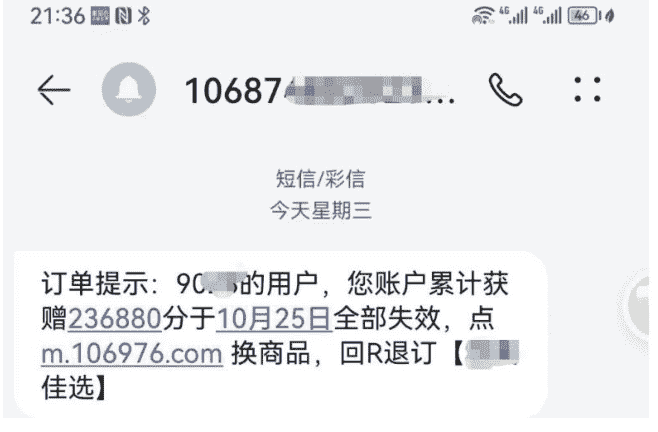

利用数据泄露的思路搬到国外也是一样的，我用8积分（50块钱）的数据撬动了几百万（人民币）GMV的杠杆。就是这个玩法可行的证明。同时，这种数据还有非常合理的转化路径。导入广告平台做人群定位。利用竞品/同行的数据进行人群定位，帮助自己的广告提高 ROI。这部分不在本篇的讨论范围内了。

### 4.5 漏洞利用

参考圈友一箭的文章 一次偶遇+10 分钟代码，让我拿到上万个潜在客户邮箱

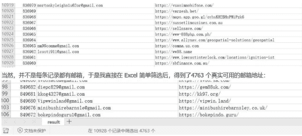

这个时候脚本才跑到 ID=836960，理论上还有83万条记录没抓完——等它完全结束，至少上万个邮箱。

这个过程让我再次体会到：

- 1. 留意日常中的“小漏洞”，可能就是大机会。
- 2. 有了想法，不要等，10 分钟的动手，能带来远超预期的收获。
- 3. 工具（比如 ChatGPT）用得好，很多事情真的是“手到擒来”。

等脚本跑完，我可能就有一个超大的精准客户名单，这对我插件的推广来说，无疑是个巨大的加速器。

顺便安利一下我的工具，如果你也在做 SEO 推广、外链建设，强烈推荐试试我开发的 Chrome 扩展：https://backlinkhelper.com，专业的自动化外链助手，支持自动识别定位网站表单、表单智能填充、外链管理等等功能，让你的推广效率提升数倍。

利用网站的越权漏洞使用脚本遍历出精准用户的邮箱信息，再开发针对性的产品进行推广。

### 4.6 通过广告诱导订阅

流程：广告+落地页+收集邮箱

这块我玩的并不好，我投流就是在败家，没有好的案例展示。只能借助别人的网站说明这个玩法。

https://www.mysticmag.com/

同样拿灵媒举例，使用对比系列文章作为广告的落地页。然后利用折扣码吸引用户订阅。

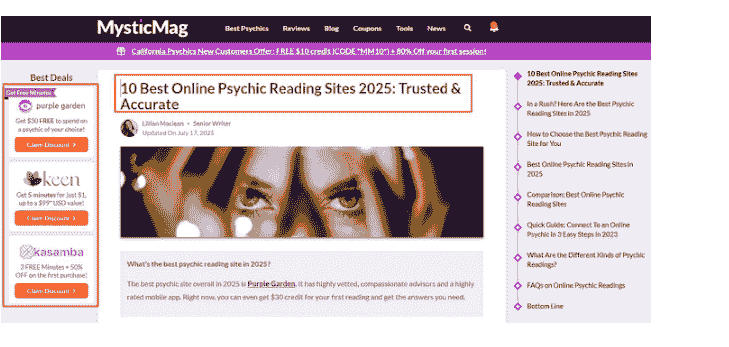

#### 10 Best Online Psychic Reading Sites 2025: Trusted & Accurate

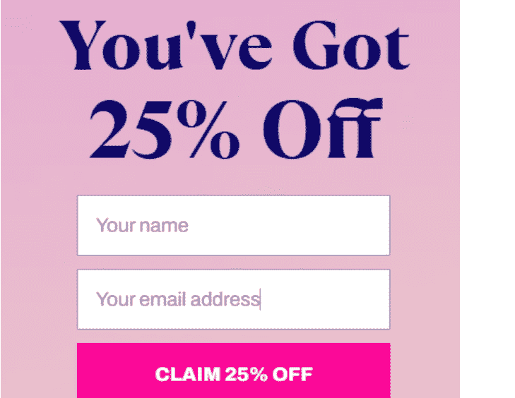

#### You've Got 25% Off

#### Best Online Psychic Reading Sites in 2025

#### 1. Purple Garden - Overall Best Psychic Reading Site in 2025


同时，文章带联盟链接以对冲广告的消耗，实现一鱼两吃。等用户订阅后，通过自动化发送欢迎邮件模板+专属折扣码引导用户下单。后续再持续发送活动和灵媒推荐。只要用户不取消订阅，就可以一直发。

## 五、使用 AI 从抄到超生成模板

### 5.1 一份优秀的邮件模板分析

接上文，我们来看一份优秀的邮件模板。这是 Jomashop 的欢迎模板，当你注册 jomashop.com 时会自动发送。我带大家拆解这个模板做了什么。


公众号懒人搜索，懒人专属群分享


大品类划分


加一个小 banner 方便用户看到这里的时候点击

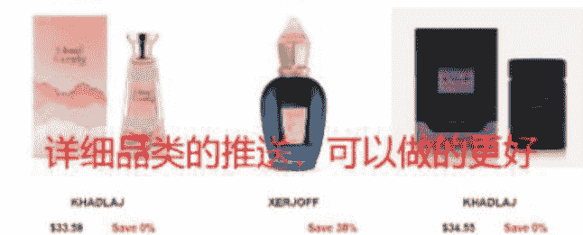

详细品类的推送可以做得更好，例如显示原价格，再划掉给低价

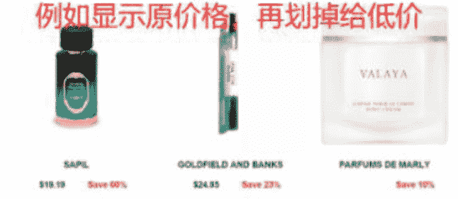

一些小福利增加信任，并且给出社媒

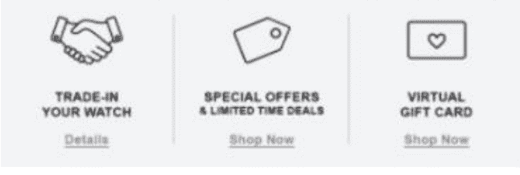


Jomashop 每个月大概制作 100+ 个邮件模板。如果你也做奢侈品行业，完全可以抄作业，用他的 banner 图、产品图。甚至可以直接用他的模板，更换链接，就变成了你的模板。

### 5.2 如何学习行业优秀的邮件模板

我是如何知道 Jomashop 每个月要制作 100+ 模板的呢？答案是 milled 这个网站。

这是个搜集各大品牌邮件内容的资源网站，通过它去搜索一些同行大牌的邮件模板。

早期我是用一个新邮箱，去挨个注册竞品的账号，去学习他们的欢迎、弃单召回、订单通知、营销活动 等邮件模板。

后面找到了这个网站，再也不用挨个注册了，可以直接找到竞品站进行学习 copy。

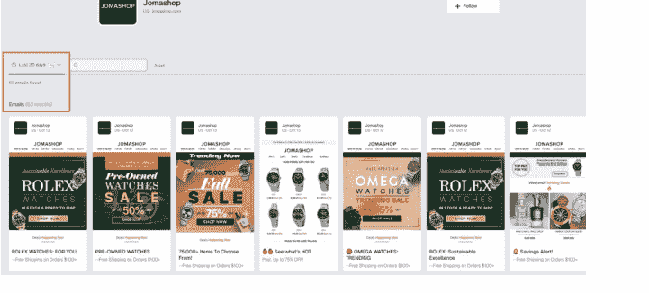

可以看到他的邮件标题、预览、模板。直接复制 banner 图等。


### 5.3 通过提示词模仿生成邮件模板

拿灵媒举例，我不懂灵媒，不懂塔罗牌。

怎么做出打动用户的模板呢？

很简单，抄！1:1 地抄。验证别人已经验证过的事，成功概率是最大的。

https://milled.com/purplegarden/your-free-september-tarot-forecast-inside-TRbkvoEU60ThPdjY

我拿 Purple Garden 的每月塔罗牌解读举例

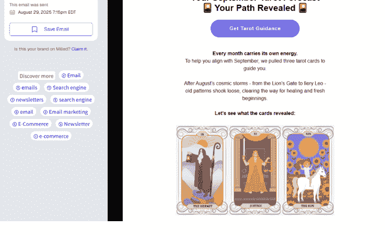

首先，使用即梦 AI 或其他生图 AI。随便生成一张三张塔罗牌拼起来的图。将这张图压缩后上传至 https://imgur.com/，获得一个单独链接，方便 Gemini 调用。


然后使用谷歌 Gemini 进行生成。AI 提示词如下：

你是一位经验丰富的邮件营销专家，擅长制作邮件模板。
并且擅长灵媒、塔罗牌、情感咨询等类目。
能根据我提供的邮件思路进行创作/修改模板。
根据模板内容生成对应的标题和预览。
并且 HTML 内容需要考虑 CSS 与常见邮件客户端和手机端的兼容性。
使用英文作为模板语言输出。

# 模板提示词

- 我这次的主题是每月塔罗牌解读，创建卡片式设计。电子邮件主体应为一个单一容器，背景为浅紫色。卡片外的页面背景应为浅灰色。
- 我需要再邮件最上面新增一个空白的模块，并且带上文字靠右边排列。
  文案：Can't see the email? Please click here
  按钮：将 click here 修改为 `<p><a href="{{WebVersionURL}}">click here</a></p>` 标签，且变成蓝色。
- 将 logo 和 Psychic Samira 品牌名同一行并居中。
  logo 地址：https://psychicsamira.com/cdn/shop/files/psychic-samira-favicon.png?crop=center&height=32&v=1697486004&width=32
- 使用 Home About Reviews 作为 title 部分的按钮和链接，创建三个药丸形状的紫色导航按钮。
  Home 链接：https://psychicsamira.com/?bg_ref=jKzx3f8h2G
  About 链接：https://psychicsamira.com/pages/about-me?bg_ref=jKzx3f8h2G
  Reviews 链接：https://psychicsamira.com/pages/satisfied-customers?bg_ref=jKzx3f8h2G
- title 按钮下面是这期邮件的主题。
  Your October Tarot Forecast 需要大写加粗，颜色为蓝色
  Step Into Transformation 颜色为紫色
- 主题添加 banner 图
  banner 图的链接地址：https://imgur.com/XDlfspN
- banner 图下面新增一个按钮
  按钮名称：Get your Reading!
  按钮颜色：红色
  按钮链接：https://www.psychicsamira.com/products/psychic-reading-by-samira-every-month?bg_ref=jKzx3f8h2G
- 再 banner 图下面生成一个解读模块。文案参考下列所示，并进行些许修改。但是不要违背原来的解读意思。注意格式和长度进行换行。
  Your October Tarot Forecast
  Step Into Transformation
  （上面这两句要求大字体。并且特殊颜色）
  Every month carries its own energy.
  To help you align with October, we
  pulled three tarot cards to guide you.
  While September shook things up with
  the lunar eclipse and Mabon's energy,
  October opens the door to a new
  chapter.
  对于三张卡片解读中的每一张，都将其放置在单独的白色卡片中，并带有浅紫色边框和圆角。在每张卡片内，将表情符号放在左侧的小列中，将文本放在右侧。
  Card 1 – Death
  Card 2 – The Moon
  Card 3 – The Empress
- 新增模块 Get professional tarot reading。模块居中产品卡片。卡片应采用白色背景和浅灰色边框。功能列表请使用表情符号。
  套餐样式/颜色考虑背景色，内容如下：
  套餐1:
  图片地址：https://psychicsamira.com/cdn/shop/files/Full-Psychic-Reading-by-Samira-Psychic-Samira-212523481.jpg?v=1759129946
  套餐名字 Tarot Reading by Samira
  价格 $99.00 横线 $59.99
  优势和特点（附带颜表情）：
  In-Depth Relationship Insights
  Career Path Clarity
  Personalized Life Guidance
  Emotional and Spiritual Healing
  Future Life Events Preview
  Ask a Follow-Up Question After Your Reading
  按钮修改为 Book Now! 按钮链接为 https://psychicsamira.com/products/psychic-reading-by-samira?bg_ref=jKzx3f8h2G
- 创建一个特殊的折扣码部分。将文本放置在带有醒目粉色虚线边框的白色框内，使其脱颖而出，诱导用户使用折扣码 samira25 以获得 25% 的折扣。
  25% OFF! 标红 Samira25 为紫色
  Don't Forget! Use this code for 25% OFF!
  samira25
- 新增 Stay Connected 模块为社媒联系方式，并使用可以成功访问的网站的图标
  # 对应各个社媒
  https://www.facebook.com/PsychicSamira
  https://www.tiktok.com/@psychicsamira
  https://www.instagram.com/psychicsamira/
  https://twitter.com/psychicsamira
  https://www.youtube.com/@PsychicSamira
- 我需要再邮件最下面新增一个空白的模块，并且带上文字，居中排列。需修改下列文案。为用户添加退订按钮
  Please add us to your email contacts
  list to receive exclusive
  recommendations!
  You are receiving this message from
  PsychicSamira because you have
  signed up for subscriptions
  to receive information about
  products,services, and campaigns.
  If you don't want to receive our
  message, just click here to cancel the
  subscription.
  按钮：将 Unsubscribe 修改为 `<p><a href="{{UnsubscribeURL}}">Unsubscribe</a></p>` 标签，且变成蓝色
- 需再底部插入这两段代码，根据模板修改代码。
  `<p>{{SenderInfo}} </p>`
  `<p><a href="{{RewardsURL}}">Powered by EmailOctopus</a></p>`

### 邮件模板源码

```html
<!DOCTYPE html>
<html lang="en" xmlns="http://www.w3.org/1999/xhtml" xmlns:v="urn:schemas-microsoft-com:vml" xmlns:o="urn:schemas-microsoft-com:office:office">
<head>
<meta charset="UTF-8">
<meta http-equiv="X-UA-Compatible" content="IE=edge">
<meta name="viewport" content="width=device-width, initial-scale=1.0">
<meta name="format-detection" content="telephone=no">
<title>Your October Tarot Forecast</title>
<style>
body { Margin: 0; padding: 0; word-spacing: normal; }
table, td, div, h1, p, h2, h3 { font-family: Arial, sans-serif; }
img { border: 0; height: auto; line-height: 100%; outline: none; text-decoration: none; -ms-interpolation-mode: bicubic; }
.email-container { max-width: 600px; margin: 0 auto; }
@media screen and (max-width: 600px) {
    .email-container { width: 100% !important; }
    .column-wrapper { display: block !important; width: 100% !important; max-width: 100% !important; }
}
</style>
</head>
<body style="Margin:0;padding:0;background-color:#f4f4f4;">
<center style="width:100%;background-color:#f4f4f4;">
<table border="0" cellpadding="0" cellspacing="0" width="100%" style="max-width:600px;">
<tr>
<td align="right" style="padding:10px 20px; font-size:12px; color:#666666;">
Can't see the email? Please <a href="{{WebVersionURL}}" style="color:#0000EE;">click here</a>
</td>
</tr>
</table>
<table border="0" cellpadding="0" cellspacing="0" width="100%" class="email-container" style="max-width:600px;background-color:#F3E5F5;border-radius:12px;overflow:hidden;box-shadow:0 8px 30px rgba(0,0,0,0.1);">
<tr>
<td align="center" style="padding: 25px 20px;">
<table border="0" cellpadding="0" cellspacing="0" align="center">
<tr>
<td align="center" valign="middle">

</td>
<td align="center" valign="middle" style="padding-left: 10px;">
<p style="font-family:Arial,sans-serif;font-size:22px;font-weight:bold;color:#000000;margin:0;">Psychic Samira</p>
</td>
</tr>
</table>
</td>
</tr>
<tr>
<td align="center" style="padding:10px 10px 20px 10px;font-size:0;">
<div style="width:33.3%;display:inline-block;vertical-align:middle;max-width:200px;">
<table align="center" border="0" cellpadding="0" cellspacing="0" width="100%">
<tr><td align="center" style="padding:4px;"><a href="https://psychicsamira.com/?bg_ref=jKzx3f8h2G" style="background-color:#8A2BE2;color:#ffffff;text-decoration:none;padding:10px 15px;border-radius:8px;font-size:14px;font-weight:bold;text-align:center;display:block;">Home</a></td></tr>
</table>
</div>
<div style="width:33.3%;display:inline-block;vertical-align:middle;max-width:200px;">
<table align="center" border="0" cellpadding="0" cellspacing="0" width="100%">
<tr><td align="center" style="padding:4px;"><a href="https://psychicsamira.com/pages/about-me?bg_ref=jKzx3f8h2G" style="background-color:#8A2BE2;color:#ffffff;text-decoration:none;padding:10px 15px;border-radius:8px;font-size:14px;font-weight:bold;text-align:center;display:block;">About</a></td></tr>
</table>
</div>
<div style="width:33.3%;display:inline-block;vertical-align:middle;max-width:200px;">
```

Reviews

### Your October Tarot Forecast

#### Step Into Transformation

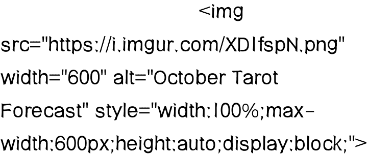

Get your Reading!

Every month carries its own unique energy. To help you align with the cosmic flow of October, we pulled three tarot cards for your guidance. While September may have shaken things up, October opens the door to a profound new chapter.

**Card 1 - Death**
Don’t be afraid – this is the card of transformation. October begins by urging you to let go of what’s done, so you can make space for what’s ready to come.

**Card 2 - The Moon**
Mid-month, your intuition is your greatest guide. Trust your instincts—they'll cut through confusion and show you the true path forward.

**Card 3 - The Empress**
October ends with abundance and creativity. After letting go and trusting your instinct, life blossoms again. Nurture yourself and your ideas—they're ready to grow.

### Get Your Professional Tarot Reading


#### Tarot Reading by Samira
~~$99.00~~ $59.99

- In-Depth Relationship Insights
- Career Path Clarity
- Personalized Life Guidance
- Emotional and Spiritual Healing
- Future Life Events Preview
- Ask a Follow-Up Question

[Book Now!](https://psychicsamira.com/products/psychic-reading-by-samira?bg_ref=jKzx3f8h2G)

Don't Forget! Use this code for **25% OFF**!
`samira25`

### Stay Connected
[Facebook](https://www.facebook.com/PsychicSamira)
[TikTok](https://www.tiktok.com/@psychicsamira)
[Instagram](https://www.instagram.com/psychicsamira/)
[X (Twitter)](https://twitter.com/psychicsamira)
[YouTube](https://www.youtube.com/@PsychicSamira)

```html
</td>
</tr>
</table>
<table border="0"
cellpadding="0" cellspacing="0"
width="100%" style="max-width:600px;">
    <tr>
        <td align="center" style="padding:20px 40px; font-size:12px; line-height:1.5; color:#666666;">
            <p style="margin:0 0 10px 0;">Please add us to your email contacts list to receive exclusive recommendations!</p>
            <p style="margin:0 0 10px 0;">You are receiving this message from PsychicSamira because you have signed up for subscriptions to receive information about products,services, and campaigns.</p>
            <p style="margin:0;">If you don't want to receive our message, just <a href="{{UnsubscribeURL}}" style="color:#0000EE;">Unsubscribe</a>.</p>
            <p style="margin: 20px 0 5px 0;">{{SenderInfo}}</p>
            <p style="margin: 0;"><a href="{{RewardsURL}}"
style="color: #666666; text-decoration: underline;">Powered by EmailOctopus</a></p>
                </td>
                </tr>
            </table>
                </center>
</body>
</html>
```

### 效果截图

### Psychic Samira

### Your October Tarot Forecast

#### Step Into Transformation


Get your Reading!

Every month carries its own unique energy. To help you align with the cosmic flow of October, we pulled three tarot cards for your guidance. While September may have shaken things up, October opens the door to a profound new chapter.

- Card 1 - Death
Don't be afraid - this is the card of transformation. October begins by urging you to let go of what's done, so you can make space for what's ready to come.

- Card 2 - The Moon
Mid-month, your intuition is your greatest guide. Trust your instincts—they'll cut through confusion and show you the true path forward.

- Card 3 - The Empress
October ends with abundance and creativity. After letting go and trusting your instinct, life blossoms again. Nurture yourself and your ideas—they're ready to grow.

### Get Your Professional Tarot Reading


Tarot Reading by Samira

$59.99

- In-Depth Relationship Insights
- Career Path Clarity
- Personalized Life Guidance
- Emotional and Spiritual Healing
- Future Life Events Preview
- Ask a Follow-Up Question

整个提示词主打一个看到啥就写啥，用即梦 Ai 代替美工做 banner。使用 Gemini 1:1 复刻竞品的邮件模板。再根据自己推的产品进行修改。

## 六、邮件服务商对比与 EmailOctopus 平台注册发送

### 6.1 邮件服务商对比

| 产品名称 | 官网地址 | 产品优势 | 产品劣势 | 收费模式 | 100 万封价格 | 推荐星级 | 备注/评价 |
|---|---|---|---|---|---|---|---|
| EmailOctopus | emailoctopus.com | 性价比高：不管是订阅制还是配合 AWS SES 使用，价格极具竞争力。<br>简单易用：界面直观，专注于核心邮件营销功能，适合初学者和中小型企业。<br>IP 干净：测试下来，IP 非常干净，使用新域名都不会进垃圾箱。可能是比较冷门。 | 高级功能有限：与 Klaviyo 或 Mailchimp 相比，在自动化、A/B 测试和深度分析方面功能较少。<br>免费版限制较多：免费版有品牌水印，且功能受限。 | 按订阅用户数或发送量计费。提供免费版、Pro 版（按订阅数）和 Connect 版（按发送量，需关联 AWS SES）。 | 10w 订阅用户 + 100w 封邮件额度：每个月 310 刀 | ☆☆☆☆☆ | 近期测试的小 10 家里性价比和使用体验最好的一家。<br>**# 十分推荐**<br>在绝对的性价比面前，缺点可以忽略~ |
| Mailchimp | mailchimp.com | 功能全面强大：集邮件营销、自动化、CRM、着陆页、社交广告于一体的营销平台。<br>用户体验极佳：界面设计友好，操作流畅，非常适合营销人员。<br>自动化流程强大：提供复杂且可视化的客户旅程构建器。<br>品牌知名度高：拥有庞大的用户基础和丰富的教程资源，全球最出名的服务商之一。 | 价格昂贵：是同类产品中价格最高的之一，特别是当订阅人数增加时。<br>定价模式复杂：按订阅数和发送量双重计费，超出套餐额度后费用很高。<br>免费版限制严格：免费版订阅数和发送量上限低。<br>风控严格：我尝试注册的好几个号都因为各种原因被封了。 | 按订阅用户数和发送量计费（套餐制）。提供免费版、Essentials, Standard, Premium 套餐。 | 10w 订阅用户 + 100w 封邮件额度：基础版 800 刀，标准版 1190 刀，高级版 2190 刀 | ☆☆☆ | 太贵了，风控也严格。很多时候还没发，仅仅是测试，号就没了。<br>不推荐新手<br>推荐有正经订阅渠道的去尝试。 |
| Klaviyo | klaviyo.com | 深度电商集成：与 Shopify, BigCommerce 等主流电商平台无缝集成，数据同步强大。<br>高级自动化和细分：基于用户行为（如浏览、加购、废弃购物车）创建高度个性化的营销流程。<br>数据分析能力强：提供详细的客户生命周期价值和营销活动 ROI 分析。 | 价格昂贵：专注于电商领域，定价高于通用邮件营销工具。<br>学习难度大：功能复杂，需要一定时间来学习和配置才能发挥最大价值。<br>对非电商企业价值有限：其核心优势在于电商数据，对于内容发布、B2B 等场景可能过于复杂。 | 按订阅用户数和发送量计费（套餐制）。提供免费版，付费版按邮件联系人数和短信发送量收费。 | 10w 订阅用户 + 45w 封邮件额度：每月 1440 刀 | ☆☆☆☆ | 推荐电商大佬尝试<br>不推荐新手 |
| AWS SES (Simple Email Service) | aws.amazon.com/ses | 价格最低：是市场上成本最低的邮件发送服务之一，适合大规模发送。很多服务商底层都是调用它。<br>高可靠性和扩展性：基于亚马逊强大的基础设施，稳定可靠，可扩展性极强。<br>发送能力灵活：提供 API、SMTP 等多种集成方式，适合开发者。<br>高送达率：提供多种工具（如专用 IP）来管理和优化发件人声誉。 | 纯粹的技术服务：不提供前端界面、模板编辑器、联系人管理等营销工具。<br>技术门槛高：需要开发者进行集成和管理，不适合非技术人员，也不适合新手。<br>需要严格管理声誉：对发送内容和退信率、投诉率有严格要求，否则容易被封禁账户。<br>维护困难：不是大公司很难联系到商务，只能找代理商，代理商也没办法解决很多问题。 | 按发送量和接收量计费（按用量付费）。从 EC2 服务器发送有大量免费额度。 | 标准付费估算：约 120 刀，专用 IP 另外算 | ☆☆ | 如前文的经历所言，不推荐不懂技术+用户资产较少的公司尝试。<br>更不推荐新手<br>但是他真的很便宜 |
| SmartPushEDM | smartpushedm.com | 支持国内平台：支持 shopline，同时作为国内产品，产品体验符合国人使用习惯。<br>功能好用：有默认域名支持测试、提供自动化预热域名服务。<br>可以发F牌：支持充钱变得更强，前提是联系商务。 | 数据和回调存疑：相比主流服务商，稳定性和送达率可能存在差距。经常抽风，数据与到站对不上等。<br>价格较为昂贵：价格偏贵。 | 按发送量收费，可以无限制导入联系人 | 按发送量价格，100w封邮件额度 1000 刀 | ☆☆☆☆ | 每个新账号有5k的测试额度，适合用来测试数据是否有转化。<br>同时使用体验符合国人。 |
| 阿里云 | [官方未提供] | 做国外项目 PASS | / | / | / | / | / |

### 6.2 注册 EmailOctopus（清洗+发送+成果）

由于白嫖了 SmartPushEDM 两三个月，注册了非常多的号，清洗了大量的有效数据，导致现在他们的风控和机器学习开始拦截白嫖党。一个邮件模板最多发送 2 个账号就会开始拦截。导致我不得不测试新的平台，我的需求就是月发送量是额度的 10 倍。不到垃圾箱，并且足够便宜、便宜、还是 tmd 便宜！因为我是拿来跑联盟的，平台多收一分，我就少赚一分。

目前免费版已经不让使用自定义模板了。

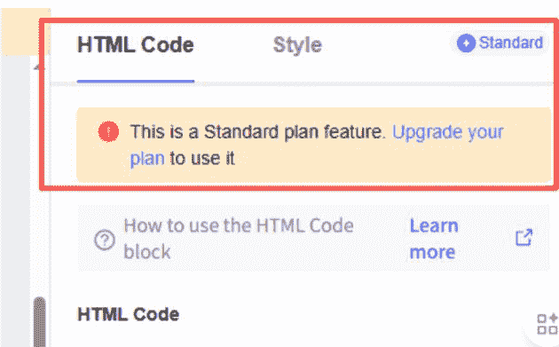

我又测了 78 家邮件发件商之后找到了这家邮件大章鱼。看 logo 图标就知道为啥我这么叫它了。


我这个 offer 的需求在它家价格是每个月 200 多刀，我觉得可以接受。同等数量的价格使用 SMP 最少也需要 800 刀。


#### 点击链接进行注册：EmailOctopus

#### 使用邮箱进行注册，并且使用强密码（数字+字母大小写+特殊字符）

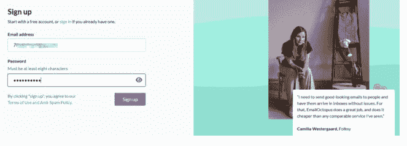

#### 输入你任意名字和购买的域名地址

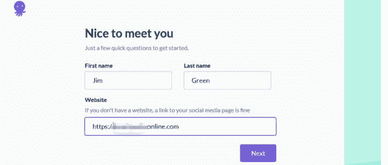

#### 这一步随便选择

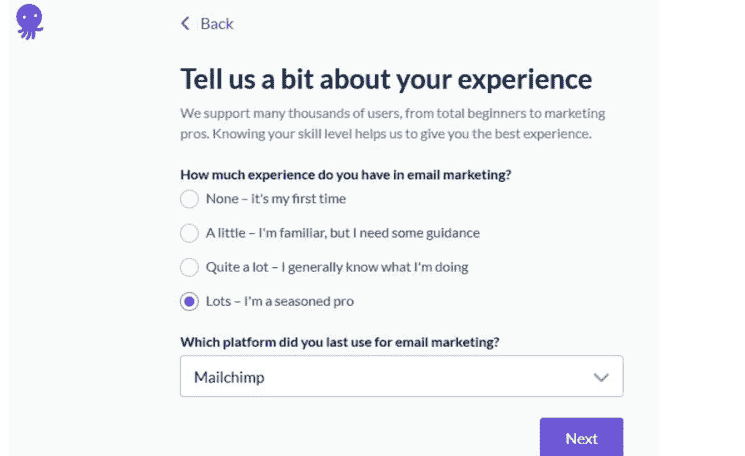

输入公司名和用途/行业，我这里是用来做联盟，选择 affiliate。大家根据目的自行选择。

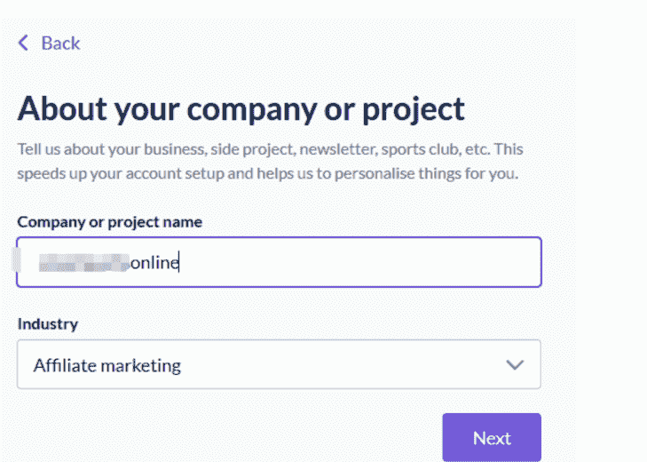

地址这块随便写，记得勾上私密。后面我们根据模板自行调整。

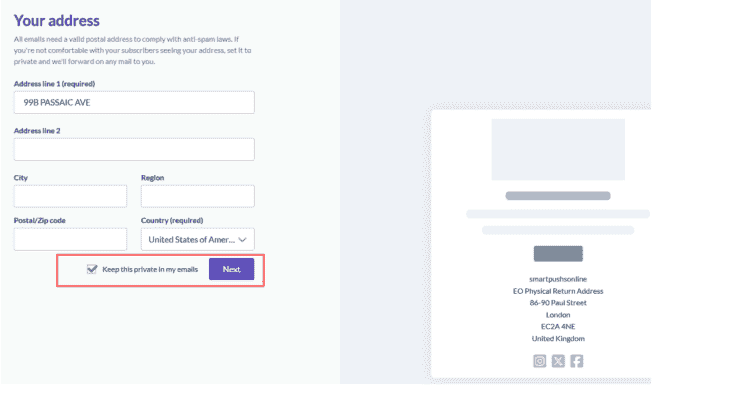

品牌填写自己的品牌，这样使用模板时就可以每个模板都存在，不用重复输入。但是我不使用他的模板，所以我不填写。

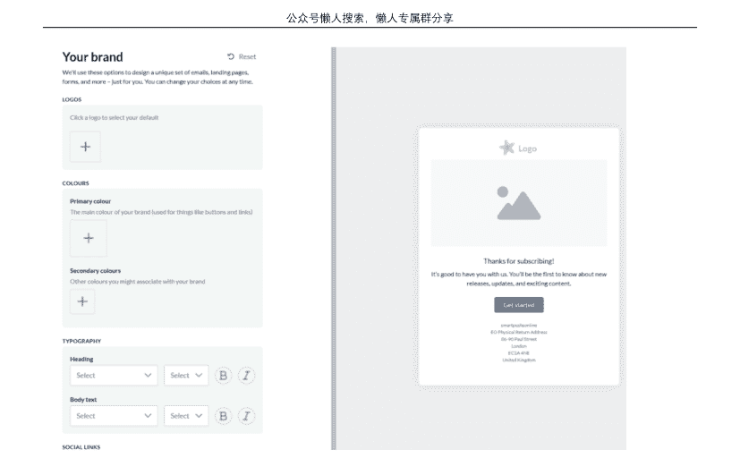

这里先选择免费版，免费版可以导入 2500 个订阅邮箱和发送 1w 封邮件。配置好后再进行付费。付费的话我是使用虚拟卡进行订阅，例如 51vcard，桃子熊等。按月进行扣费，记得提前备好下一个月的扣款余额。

```
https://www.51vcard.com/
```

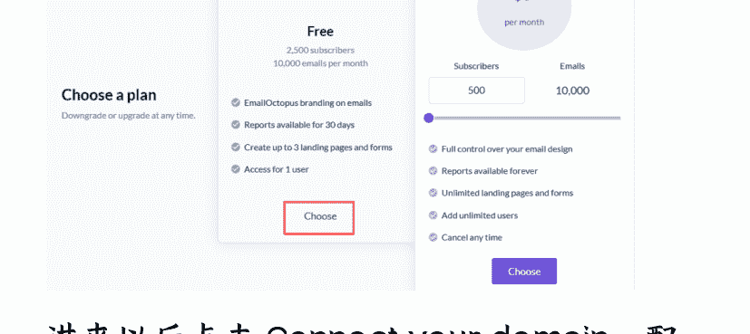

进来以后点击 Connect your domain，配置我们的域名。

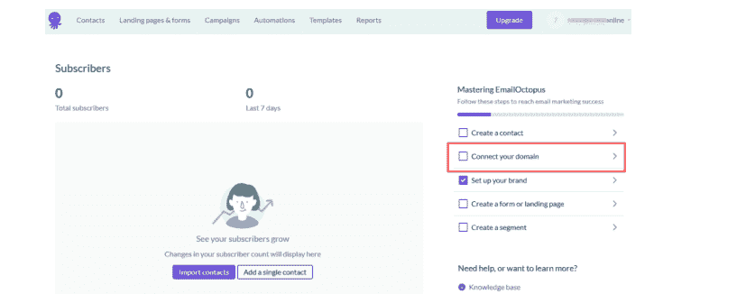

输入我们注册好的域名。

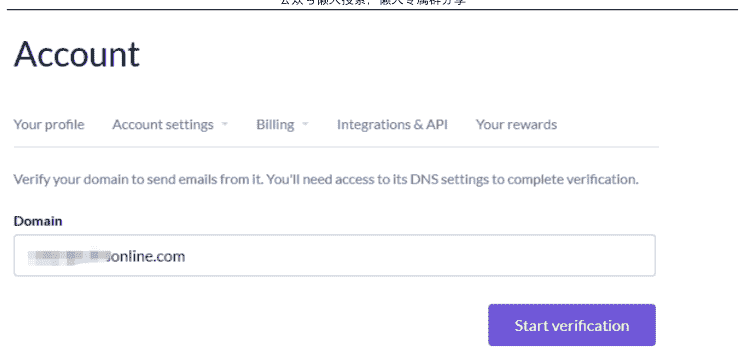

#### 配置平台要求的 DNS 解析

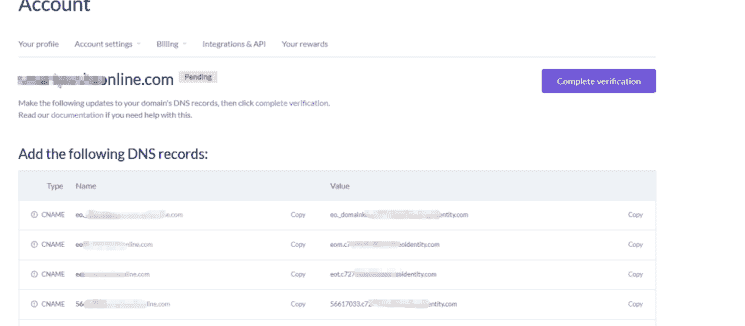

在域名服务商后台配置。我这里使用的是阿里云。

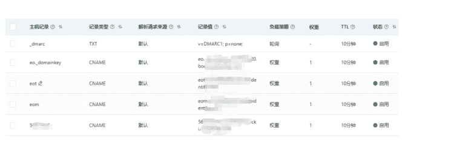

配置好后，进行验证，大概 10 分钟这样，就能看到配置成功了。

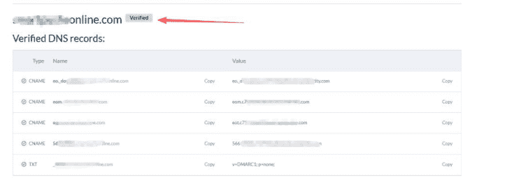

点击 Contacts 下的 Fields 模块添加一个 Name 的字段，这样就不用弄 fn 和 ln 两个字段了。方便后续操作。

也可以根据自己的用户数据进行配置，例如用户生日，地址，购买次数，国家等等。可以进行细分/自动化的操作。

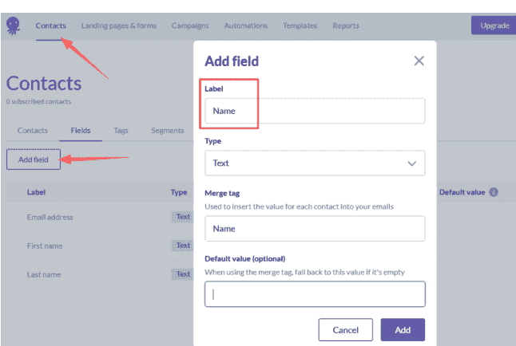

添加预热 Tags，方便区分每组用户。这里是使用脚本提取出历史打开过的用户进行营销。这样打开率点击率都会高很多，更容易养好一个域名。

#### 预热这块我的理解补充：

使用历史打开过的用户进行预热效果会更好，如果没有可以去别家平台花点小钱整理出来。

可以使用注册验证码邮件，找回密码等邮件作为对冲邮件。增加域名的信誉/信任度。

我们尝试过购买数百个邮箱账号，用 python 去调用 smtp 服务。批量打开点击回复，养好一个域名。

新域名一定要预热，专用 IP 也是，循序渐进，养好后就可以一直发了。

官方做域名预热的文章，可参考
https://help.emailoctopus.com/article/389-how-to-warm-up-my-sending-domain

我这边清洗出来后有 1w5 的打开用户。提取出 8 组用户数据进行域名预热。每次叠加一点，也可以让 AI 进行定制预热计划。

#### AI 提示词如下：

### AI 提示词

你是一名出色的邮件营销专家，能帮助我解决新域名邮件预热的问题。我使用新域名联系我的客户，目前打开过的用户有 1w5。全部用户有 10w。我需要制定一个 15 天的预热计划。初期使用打开过的用户以增加域名信誉。后期需要预热到每天 2w 的发送额度。请帮我列举每天发送计划，生成表格。以帮助我预热成功。

AI 就会生成一个预热计划，很多人做邮件营销很心急，上来就发上万封，不做预热。这样肯定是会被各大邮件厂商拉黑域名的。

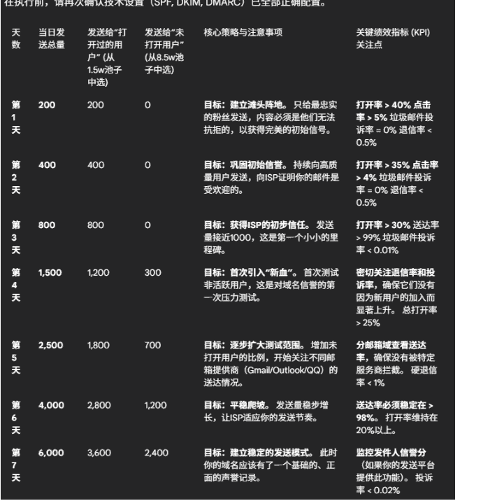

我没有按 AI 的计划,自己挑选了一些用户组进行预热。我想更快一点达成目标,利用前面的脚本提取出来的打开过的用户成新的预热组进行域名预热。

我的数量组: 500 800 1000 1500 2000 2500 3000 4000。每天发送一组。

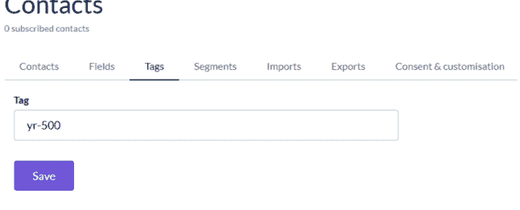

#### 导入处理好的 CSV 文件

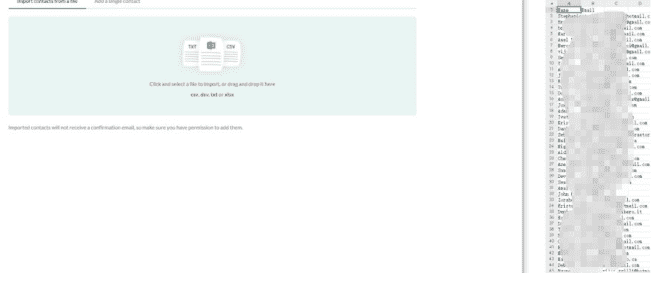

#### 导入时选择数据列为新建的 Name 列

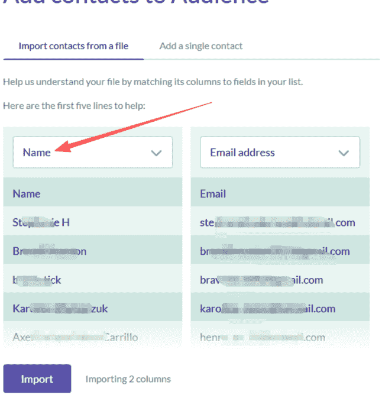

#### 导入成功后可以看见列表

#### 公众号懒人搜索，懒人专属群分享

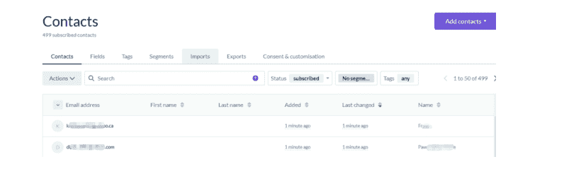

#### 新建活动

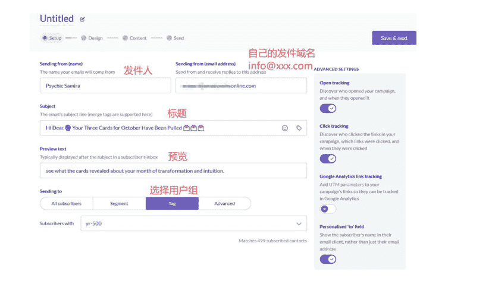

#### 选择使用自己的 HTML 代码

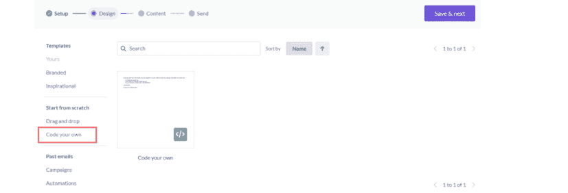

使用该平台生成邮件模板时需要增加几个通用链接，
可以查看官方的帮助文档里有讲解

```
https://help.emailoctopus.com/article/71
-how-to-insert-an-unsubscribe-link
```

第一个链接用于使用 web 查看内容，大部分主流的邮箱进入垃圾箱后是不会展示图片的。所以需要这个按钮去诱导用户点击去查看完整的邮件内容。

```
<p><a href="{{WebVersionURL}}">click here</a></p>
```

#### 第二个是退订按钮，如果不带很容易被判违规。

```
<p><a href="{{UnsubscribeURL}}">Unsubscribe</a></p>
```

#### 第三个是品牌方宣传，免费版需要带。

```
<p><a href="{{RewardsURL}}">Powered by EmailOctopus</a></p>
```

#### 第四个是地址信息

```
<p>{{SenderInfo}} </p>
```

#### 这都是制作模板时需要考虑并解决的。

#### 把 AI 做好的 HTML 代码粘贴进左边。

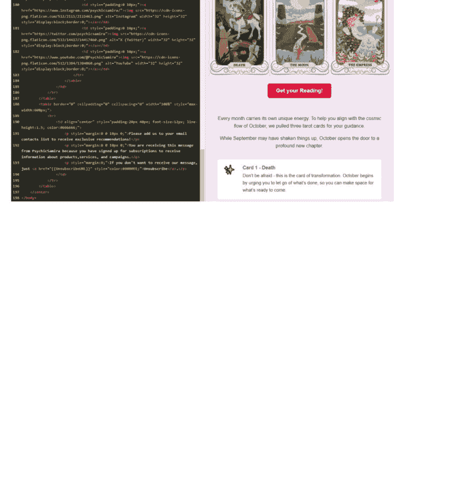
```

Card 1 - Death
Don't be afraid - this is the card of transformation. October begins by urging you to let go of what's done, so you can make space for what's ready to come.

Card 2 - The Moon
Mid-month, your intuition is your greatest guide. Trust your instincts-they'll cut through confusion and show you the true path forward.


#### 测试发送一封试试

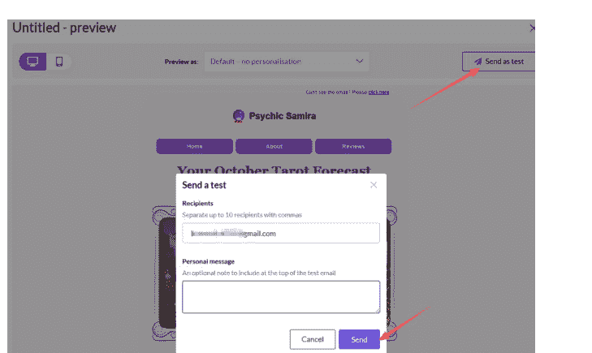

#### 邮件在 gmail 的推广列表中成功收到。

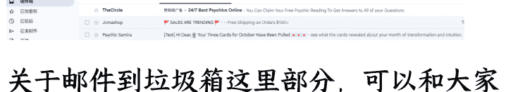

关于邮件到垃圾箱这里部分，可以和大家聊聊我的看法。

邮件到推广并不会太影响用户转换，稍微会降低一点点。但不是每家邮箱都有推广邮件的算法，很多中小的邮件厂商并没有。还是会到收件箱。

到垃圾箱主要还是没有预热（域名/IP 都不好），并且发送的内容/模板等问题，例如关键词，模板 CSS 错位等。现在可以让 Ai 进行检测和调整。大部分情况都不会出现到垃圾箱的情况。

就算到垃圾箱，还是有可能出现转化的。前提是用户数据足够精准。并且添加站外查看的按钮，让用户点击按钮查看完整邮件列表。

测试各个按钮点击没问题后就可以无脑下一步了。选择现在发送和定时都可以。我一般是设置中国时间的晚上11点至2点，对应美国时间的早上，一天都有概率看到你的邮件。

这样就完成了一次发送，是不是很简单。

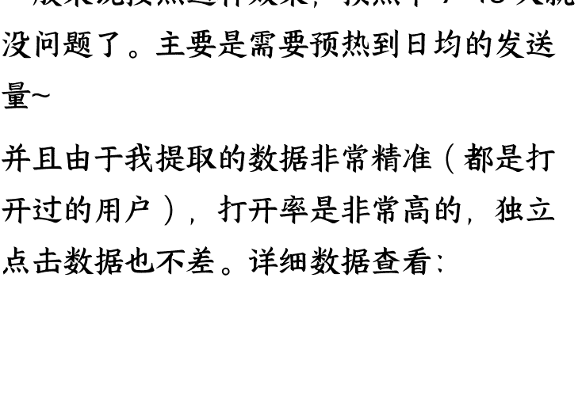

给大家看看我这几天预热的效果：


一般来说按照这种效果，预热个 7-15 天就没问题了。主要是需要预热到日均的发送量~

并且由于我提取的数据非常精准（都是打开过的用户），打开率是非常高的，独立点击数据也不差。详细数据查看：

#### yure-500

Sent Oct 10 at 2:21 AM to yr-500 tag


#### Performance in the first 24 hours

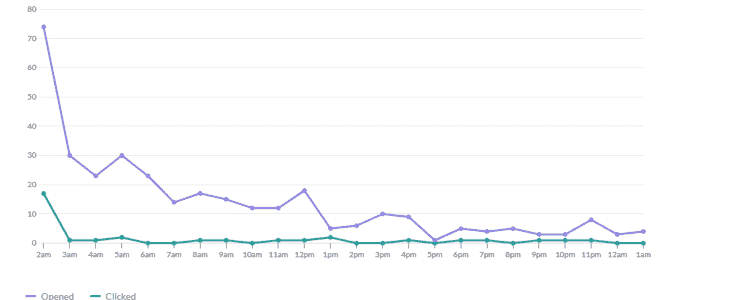

有打开、点击、回复的邮件，谷歌就不会把你拉黑到垃圾箱。

根据用户点的次数调整模板，对比哪个套餐更能吸引用户。以及模板的哪个位置按钮点击用户最多。

#### Top links clicked

| 链接 | 点击次数 |
|---|---|
| https://www.psychicsamira.com/products/psychic-reading-by-samira-every-month?bg_ref=jKzx3f8h2G | 20 |
| https://psychicsamira.com/pages/about-me?bg_ref=jKzx3f8h2G | 15 |
| https://psychicsamira.com/pages/satisfied-customers?bg_ref=jKzx3f8h2G | 15 |
| https://psychicsamira.com/products/psychic-reading-by-samira?bg_ref=jKzx3f8h2G | 12 |
| https://psychicsamira.com/?bg_ref=jKzx3f8h2G | 3 |
| https://www.facebook.com/PsychicSamira | 2 |
| https://www.tiktok.com/@psychicsamira | 2 |

行业的普遍指标如下，大家可以参考。

#### 指标

| 指标 | 行业平均水平 | 良好目标 | 优秀目标 |
|---|---|---|---|
| 送达率 | 90% - 95% | 98% - 99% | > 99% |
| 独立打开率 | 10% - 20% | 25% - 35% | > 50% |
| 独立点击率 | 1% - 3% | 5% - 8% | > 10% |
| 退订率 | 1% - 3% | < 0.5% | < 0.1% |

需要做多组邮件测试出用户感兴趣的模板，像我就已经淘汰了两个根本不会有用户点的套餐。

更多高阶的自动化组合使用技巧等后面我测试有结果了再与各位分享！

## 七、总结

首先，恭喜各位！耐心看完了这篇帖子，相信此时你对邮件营销的理解，已经超过了 80%的人。打破了邮件营销无用的认知！如果文章的思路和过程对你有启发，可以在生财上给我点个赞，并再评论区和我讨论。谢谢各位！

我把我这三年踩过的坑、走过的路都掰开揉碎了放在这里,就是想告诉你一件事:邮件营销这玩意,真没那么难~

它也不是什么过时的老古董,而是一个不管市场怎么变,都能让你直接联系到客户、是闷声发财的秘密武器。你看我的经历,从给培训班拉人的唾弃,到帮公司搞增长的探索,再到做仿牌和联盟营销实战精准变现都共同指向一个结论:邮件营销的真正威力在于其惊人的适应性与深度。它既能服务于最传统的业务需求,也能成为最前沿行业增长的尖端武器,它的上限完全取决于认知和策略。

文章里提到的找邮箱、用 AI 写模板,这些都是“招式”。但一定要记住,所有招式的最终目的,都是为了和你的用户交个朋友,让他们信任你。 信任有了,成交就是水到渠成的事。真诚就是必杀技。给用户发塔罗牌预测就和告诉用户今天天气预报一个需求。

这篇长文,就是我递给你的一张入场券,希望能帮你省下摸索的时间。别再犹豫观望了,邮件营销的起点真的不难——找到你的第一个订阅者,发送你的第一封邮件,故事就开始了。

最后，非常感谢生财。这段时间学习到了很多前辈的宝贵经验。让我站在巨人的肩膀上思考!

### 7.1 哪些人一定要尝试邮件营销

在我看来，以下圈友绝对要尝试下邮件营销，大概率能带来复购。

- 跨境电商从业者
- 具有复购属性的业务
- 海外 AI 产品与 SaaS 服务
- 联盟营销人员
- 内容创作者（Kol）
- 外贸从业者
- 非营利组织
- 隐私物品，如和性类相关的

### 7.2 写在最后

给自己打个广告。如果你也从事海外市场，并且想快速试错邮件营销这块。不管是电商、Affiliate、还是 Ai 产品/saas 服务等。都可以找我聊~

我非常乐意与你产生思路上的碰撞！

## 最后，安利小懒的付费群：

### 懒人专属群（介绍）


懒人专属群持续更新中，已持续运营 6 年，整理超 3000 份各类精选付费文章 & 年费社群干货，全部开放下载。

本资料为付费群内部分享，仅供真实有需要的朋友查阅

### 懒人专属群更新记录：

https://lazy2025.top/blog/record2

### 懒人专属群更新记录（需梯子，备用）：

https://lazybook.fun/blog/record2