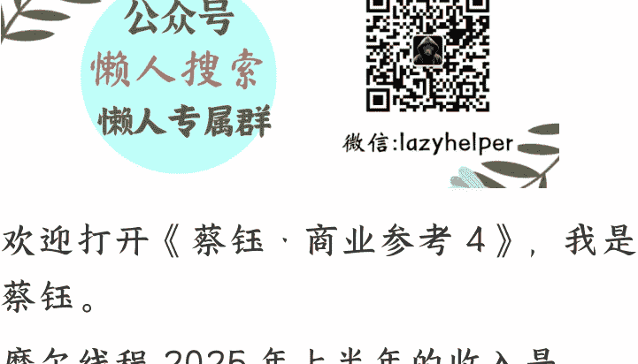

# 145 | GPU 行业格局：五个对手，一场硬仗

251023

整理：公众号懒人搜索，懒人专属群独享
懒人微信：lazyhelper

欢迎打开《蔡钰·商业参考 4》，我是蔡钰。

摩尔线程 2025 年上半年的收入是 7.02 亿元，已经超过了前三年的总和。增速虽然极快，但在整体规模上，不但远远落后于它对标的英伟达，也跟一些本土同行有差距。

毕竟，在中国 GPU 和 AI 芯片赛道上，摩尔线程只是众多选手之一。

所以这一讲，我们来看看这场 GPU 国产化浪潮里，另外 5 个值得注意的选手。它们分别是华为昇腾、寒武纪和“GPU 四小龙”里的其他三家。

## 对手一：华为昇腾

在中国 GPU 和 AI 芯片赛道上，如果要选一个领跑者，那一定是华为。有数据显示，预计 2025 年，华为昇腾在中国 AI 芯片市场的份额会达到 27%。

这跟华为的全栈生态有关系。整个华为有通信，有消费，有智能，有芯片，有服务器，有云平台，给到客户的是“拎包入住”级别的完整解决方案。它还在政企市场有天然的信任和渠道优势，这是创业公司很难复制的。

华为做 AI 芯片，不是临时起意，而是早有布局。

2019 年 5 月，美国把华为列入实体清单。但这没有打乱华为的节奏。你肯定记得，当时华为海思“备胎转正”，走到前台承担起了研发芯片的职能。海思有五大芯片系列，分别叫麒麟、鲲鹏、昇腾、天罡和巴龙。

其中的昇腾，就是 AI 专用芯片品牌。请注意啊，华为一直到 2024 年做的都不是通用 GPU，而是 AI 专用芯片，也就是上一讲提到的 ASIC。

为什么不做通用 GPU 呢？原因各个方面都有，其中两个现实必须考虑：

第一个现实考虑是，华为当时已经受到了美国制裁，没法借台积电的先进制程制造高性能芯片，于是干脆选了一条“以多胜精”的技术路径：用大量中端芯片整合出庞大的计算集群，来对齐高端芯片的极致性能。

华为副董事长徐直军就曾经公开说：“我们单颗芯片的算力，相比英伟达是有差距的。但华为能做到万卡级超节点，从而一直做到世界上算力最强。”

这也是“集中力量办大事”的思路。

第二个现实考虑是，华为自己就是它 AI 芯片的最大客户，它的云服务、大模型训练、智能汽车等诸多业务，对 AI 算力的需求都很确切、很具体。华为设计起芯片来，也就不必考虑通用性，去研究什么图形渲染，而是专注把芯片的计算效能拉满。

在这个思路之下，华为 2019 年发布的昇腾 910B 芯片，几千颗联接成集群，在执行某些大模型训练任务时，综合效率可以达到英伟达 H100 的 80%。

## 对手二：寒武纪

第二个值得留意的玩家，是寒武纪。寒武纪做的也是专用芯片 ASIC。

这家公司的创始人陈天石、陈云霁兄弟，都是中科大少年班出身，都在中科院计算所做过研究员。兄弟俩分别在芯片与 AI 算法领域互补。

因为研究方向互补，兄弟俩从 2010 年前后开始合作研究 AI 芯片。2015 年，他们研发出了世界首款深度学习专用处理器的原型芯片。

2016 年，俩人开始创业。他们给公司取名“寒武纪”，寓意是，希望能开启人工智能的“生命大爆发”新纪元。

2017 年，寒武纪迎来第一次商业高光时刻：华为 Mate 10 手机，采购了它的芯片 IP 授权。这让寒武纪声名鹊起，拿到了大量融资，估值一度达到 25 亿美元。

但好景不长。2019 年之后，华为不再使用寒武纪的芯片，转而自研昇腾。寒武纪失去了最重要的客户。

怎么办？于是，2020 年寒武纪登陆科创板，成为“AI 芯片第一股”，募集了 26 亿元，一边继续研发，一边开拓新的收入来源。寒武纪上市后的几年一直在亏损，2022 年也被美国列入了“实体清单”，导致供应链受限，命运雪上加霜。

直到 2024 年底，寒武纪的盈利能力才好转。

2025 年上半年，寒武纪营收达到了 28.81 亿元，同比增长 4347%。净利润 10.38 亿元，扭亏为盈。

这个增长速度，相当惊人。所以你可能知道，寒武纪今天在 A 股有个外号叫“寒王”。为什么？大家惊叹它股价 2 年涨 10 倍，企业也由亏转盈、逆天改命。

寒武纪为什么能逆天改命呢？

很大原因是，它在遭受美国制裁后做了业务转型，从 IP 授权转向了直接卖实体芯片和智能计算集群方案，变成了老客户华为的竞争对手。

寒武纪以前做什么？给华为卖技术授权，收许可费。

被华为抛弃后呢？它发现，自己也能把芯片和软件整合起来，用算力集群追上高端芯片的性能。而且这个生意模式，项目金额大、客户大、需求稳定，比给手机行业卖 IP 靠谱多了。

寒武纪一想明白这个，2023 年的智能计算集群系统业务，收入就超过了 6 亿元。资本市场从 2023 年开始对它看好，也是这么来的。

到了 2025 年，寒武纪的核心业务又转向了更具有确定性的云端智能芯片及板卡业务。

## 燧原科技

第三个玩家，严格来说是一组，也就是跟摩尔线程并称“GPU 四小龙”的其它三条小龙：燧原科技、沐曦科技和壁仞科技。这三家公司都是 2018 年之后成立的 AI 芯片创业公司。创始人也都有国际芯片巨头的背景：燧原和沐曦的创始人来自 AMD，壁仞的创始人来自商汤科技。

燧原科技也是做专用芯片 ASIC 的，走的是“良禽傍大树”路线。

燧原科技出身不凡。创始团队来自芯片巨头 AMD，跟摩尔线程类似，有很强的技术和行业自信。这种自信让他们一创业就选了个难度最高的赛道：数据中心高端 AI 训练芯片。他们不只卖芯片，还提供全栈解决方案。

这种魄力换来了什么？换来了腾讯。腾讯接连投了燧原六轮，持股 20.49%，是它的第一大股东。不但如此，腾讯还是燧原的关键客户和研发伙伴，为燧原提供了不少宝贵的真实业务场景，比如腾讯会议、语音识别等，来帮燧原做产品迭代和优化。这把不少其他初创公司羡慕坏了。今年腾讯在 AI 领域重焕新生，功劳也有燧原的一份。

当然，腾讯不是燧原唯一的客户。它这些年正在积极参与国家“东数西算”工程，在甘肃庆阳、无锡等地建设大型智算中心，已经落地 7 万张显卡了。2024 年 8 月，燧原启动了 A 股 IPO 辅导，正在冲刺上市。

## 壁仞科技

壁仞科技呢？壁仞的打法是“资本闪电战”，组建全明星技术战队，主攻技术壁垒最高的通用 GPU。

壁仞科技的创始人张文，曾在华尔街工作，回国后担任过商汤科技的总裁，有金融人脉，又有技术背景。壁仞的打法是什么？先融资，再打仗。

壁仞创立后的 1 年多时间就融资 47 亿，创下国内芯片创业公司的纪录。然后呢？用“钞能力”从 AMD、英伟达、高通、海思挖人，快速组建顶级研发团队，确定技术方向。这，就是闪电战。

重金投入之下，壁仞科技的产品推进很快，2022 年就发布了首款通用 GPU 芯片，还创下了当时某项全球算力纪录，还在世界人工智能大会上被选为“镇馆之宝”。

这个突破，让壁仞科技很快声名鹊起，一度被视为国产高端 GPU 的希望之星。

但 2023 年，壁仞科技也上“实体清单”了。怎么办？顶级研发团队很快确定了新战略：去解决不同品牌算力芯片的协同难题，替行业打破“算力孤岛”。这种训练方案一研发出来，中国移动、平安科技、浪潮信息等大客户纷纷下单。

到了 2024 年，壁仞科技也启动了 IPO 上市筹备。

## 沐曦科技

最后是沐曦科技。沐曦科技是在 2025 年 6 月底，跟摩尔线程同一天递交的 IPO 申请，走的也是通用 AI 芯片路线，GPGPU。但它的审核问询过程，比摩尔线程要慢。

沐曦的创始团队，是三位在 AMD 共同合作多年的技术老将。它的打法，拿的是“顶尖职业战队下场创业”的剧本，特别强调“全自研”。

创始团队都是技术高手、彼此配合默契，这让沐曦从成立第一天起，就拥有了堪比国际大厂的成熟研发体系。所以，在外界看来，这家公司虽然比其他几条小龙低调，但看不到明显短板，想象空间巨大。

所以，沐曦的投资方里，也挤满了顶级机构：红杉中国、经纬创投、联想、以及一系列有国家队背景的基金。

## 总结

这一讲，我们来认识了 5 个摩尔线程的强力竞争对手：华为昇腾、寒武纪、燧原科技、壁仞科技、沐曦科技。

现在再回头看 109 讲（《另一场“阅兵”：华为》）提到的，中芯国际高管在二季度业绩会上透露说，找中芯国际代工的中国客户们，芯片产品已经能完美替代外国竞争对手。你大概能猜到，这些客户都有谁了。

这些芯片公司的崛起和谋求上市，其实可以看作一个标志：中国的算力自主化竞争，从“能不能用”进入了“好不好用”的阶段。

上一个阶段，大家卷集群整合、卷性能突破，都答上来了。

下一个阶段呢？就要等芯片公司们完成 IPO 融资，用新的资金和时间来作答了。

那我们就保持关注吧。
再见。

最后，安利小懒的付费群：

懒人专属群（介绍）

懒人专属群持续更新中，已持续运营 6 年，整理超 3000 份各类精选付费文章 & 年费社群干货，全部开放下载。

本资料为付费群内部分享，仅供真实有需要的朋友查阅 🙅‍♂️

懒人专属群更新记录：

https://lazy2025.top/blog/record2

懒人专属群更新记录（需梯子，备用）：

https://lazybook.fun/blog/record2