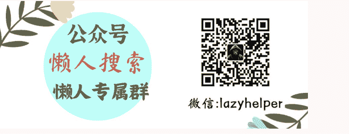
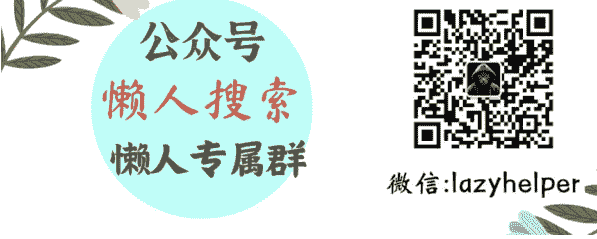

# 抑郁症专家自杀了，他的疗法却救了无数人

251023

整理：公众号懒人搜索，懒人专属群独享

懒人微信：lazyhelper

今天从一个让人意外的消息说起。上上周，斯坦福大学的精神病学专家诺兰·威廉姆斯去世了。死因是自杀，终年 42 岁。

威廉姆斯是谁？他是斯坦福脑刺激实验室主任，介入精神病学临床研究主任。他研究的关键课题之一，就是抑郁症。而且他还是同辈中的佼佼者。美国精神病学协会主席评价他说，诺兰是这一代最杰出的精神病学家之一，他本该成为明日巨星。

但是，就是这么一个抑郁症治疗领域的专家，本人却自杀了。

在这里要特别强调一句，目前被披露的所有信息里，都没有正面提到威廉姆斯自杀的原因，也没有任何官方证明或者医疗记录，能够表明他患有抑郁症或其他精神疾病。

尽管如此，威廉姆斯自杀的消息，在网上还是引起了很多人的讨论。毕竟，这是一个抑郁症治疗领域的顶尖专家本人自杀了。于是就有人说，这是不是说明他的方法不管用呢？或者说抑郁症根本治不好呢？

注意，再强调一遍，威廉姆斯的具体情况我们并不知道。但是，这些外界的疑问倒是可以展开说说。而且要先说一个明确的结论，抑郁症是可以治疗的，而且对大多数患者来说，现有的医学手段已经能够有效控制病情。威廉姆斯的研究，恰恰是在让这个比例变得更高。

我们今天要讲的，不是抑郁症有多可怕，而是抑郁症治疗正在取得哪些突破，以及为什么即使有了这些突破，我们仍然需要继续努力。

首先，人类真正开始用药物治疗抑郁症，到现在也不过半个多世纪。过程虽然曲折，但进展一直没有停止。

人类历史上第一款抗抑郁药，诞生于1952年。但说来有意思，这款药最初并不是为了治疗抑郁症开发的。这款药叫异烟酰异丙肼，是用来治疗肺结核的。

但医生们很快发现了一个奇怪的现象，按理说，结核病人通常都是情绪低落的，但服用这个药的结核病人，情绪状态出现了明显变化。他们变得异乎寻常地兴奋。这引起了精神科医生的注意。1957年，科学家首次在抑郁症患者中测试了这款药物，结果70%的患者都出现了好转。

于是，人类历史上第一个抗抑郁药，就这样误打误撞地进入了临床应用。

那么，异烟酰异丙肼到底是怎么起作用的呢？这个药物能够抑制人脑中的一种酶，叫单胺氧化酶。而单胺氧化酶的正常功能，是分解大脑中的一些重要神经信号分子，特别是血清素、去甲肾上腺素和多巴胺。

简单说，就是单胺氧化酶被抑制了，这些神经信号分子就不会被快速分解掉，它们在大脑中的浓度就升高了。而这些神经信号分子，特别是血清素，确实和人的情绪、快乐感有关。

基于这个发现，科学家们提出了一个解释模型，也就是后来统治了抑郁症研究半个多世纪的血清素假说，人脑中血清素水平降低，会导致抑郁症。提高血清素水平，就能治疗抑郁症。

注意，这个假说其实相当粗糙，漏洞很多。直到 1987 年，新的突破出现了。

1987 年，美国礼来公司开发的氟西汀获批上市，商品名叫百忧解。这是第一个选择性血清素再摄取抑制剂，英文缩写 SSRI。注意这三个字，选择性。

你可以这么理解，上一代抑郁症药物，就像一把万能钥匙，它不光阻断血清素的回收，还会影响去甲肾上腺素、多巴胺等等。正是因为作用太广泛，所以副作用也多。

而 SSRI 类药物就像一把专用钥匙，它几乎只针对血清素的回收通道，对其他系统的影响很小。这样一来，副作用就大大减少了。

百忧解的上市，可以说是抗抑郁药历史上的一个分水岭。在百忧解之后，陆续又有多款 SSRI 类药物上市，比如舍曲林、帕罗西汀、西酞普兰等等。到今天，SSRI 类药物仍然是抗抑郁药的主力，占据全球抗抑郁药市场份额的 60%。

而且要特别强调一点，这些药物对大多数患者是有效的。美国国立卫生研究院曾经追踪了 4000 多名抑郁症患者，让他们依次尝试不同的抗抑郁药物。结果发现，尝试了四种不同的药物后，累计缓解率达到了 67%。换句话说，三分之二的患者，通过现有的药物治疗，是可以获得有效缓解的。

当然，这也意味着，仍然有三分之一的患者无法获得有效治疗，这部分也被称为难治性抑郁症。

那么，抑郁症为什么这么难治呢？主要是因为，我们并没有真正搞清抑郁症的发病机制。

前面说的血清素假说，注意，它只是一个假说。2022 年，《分子精神病学》杂志还发表了一篇综述，结论是：

## 关于抑郁症的血清素假说可能是错的。

那抑郁症到底是怎么回事呢？新的研究发现，抑郁症的发病机制极其复杂。它涉及多个神经递质系统，除了血清素，还有去甲肾上腺素、多巴胺、谷氨酸、GABA 等等。它还涉及神经可塑性的改变、炎症反应、肠道菌群、基因表达调控等等。

换句话说，抑郁症不是某一个系统出了问题，而是整个大脑的多个系统都出现了异常。这些异常相互影响，形成了一个复杂的网络。

而且不同患者的抑郁症，发病机制可能完全不同。还有研究发现，抑郁症相关的基因超过 200 个，这些基因的不同组合，会导致完全不同的治疗反应。

因此，医生给患者开抗抑郁药，需要不断尝试，一个药不行就要马上换另一个。

但是，在这些困境中，也有一些新的突破正在出现。比如，氯胺酮。2000 年，科学家发现氯胺酮能明显缓解抑郁症状。而且氯胺酮不是作用于血清素，而是作用于谷氨酸的。换句话说，这为抑郁症开辟了全新的治疗途径。

在这里也要特别强调一句，氯胺酮是一种严格管制的药品，必须在专业医师的指导下使用。在黑市上它还有另一个名字，叫K粉，是毒品的一类。作为药品的氯胺酮可以讨论，而作为毒品的氯胺酮要严格禁止。

除了药物，还有一些非药物的治疗方法也在取得突破。其中最引人注目的方法之一，就是威廉姆斯研发的SAINT疗法。

SAINT的全称是斯坦福加速智能神经调控疗法。它的基础是一种叫做经颅磁刺激的技术，简称TMS。

TMS是什么？简单说，就是用强磁场刺激大脑。具体来说，是把一个磁线圈放在头皮上，通电后产生强磁场，这个磁场能穿透头皮和颅骨，直接刺激大脑中的神经元。

TMS技术本身不是新东西，早在1980年代就被发明出来了。FDA在2008年就批准TMS用于治疗抑郁症。但传统方式的治疗效果并不理想，缓解率只有30%左右，而且需要每天治疗，持续6周。

威廉姆斯的突破在于，他对TMS做了两个关键改进。

- **精准定位**：传统TMS是根据头皮的解剖位置来确定刺激点，但每个人的大脑结构都不一样。威廉姆斯用功能性核磁共振成像扫描每个患者的大脑，然后精准定位刺激点。

- **加速治疗**：传统 TMS 是每天治疗一次，威廉姆斯把它改成每天治疗 10 次，每次间隔 50 分钟。因为研究发现，大脑对磁刺激的反应在 45 分钟左右达到最低点，这时候再次刺激效果最好。而且传统 TMS 每天的刺激脉冲数是 600 次，威廉姆斯把它提高到 18000 次。

这些改进带来了明显的效果。2022 年发表的临床试验显示，SAINT 疗法对难治性抑郁症的缓解率达到 78.6%，远远超过传统 TMS 的 30%。而且所有参与试验的患者在治疗前都有自杀意念，但治疗后没有一个人报告自杀意念。这是抑郁症治疗领域的一个重大突破。

SAINT 疗法也代表了抑郁症治疗的一个新方向，不是通过药物改变大脑的化学环境，而是通过物理手段直接调节大脑的神经活动。

但是，SAINT 疗法也有它的局限性。首先，它需要昂贵的设备和专业的医疗团队，每次治疗需要在医生监督下开展。这限制了它的普及。其次，关于它的效果，目前的临床试验样本量还不够大，还需要更大规模的研究来确认。

除了氯胺酮和 SAINT 疗法，抑郁症治疗领域还有一些其他值得关注的新方向。比如，炎症理论。越来越多的研究发现，抑郁症患者体内的炎症指标往往偏高。一些抗炎药物，在临床试验中显示出了抗抑郁效果。再比如，肠道菌群。研究发现，肠道菌群可以通过肠-脑轴影响大脑功能。

抑郁症治疗的未来，可能是多种方法的组合，药物治疗、脑刺激治疗、心理治疗、生活方式干预，再加上精准医疗的个体化方案。

说到这，需要特别强调一点。假如有人正在经历抑郁症的困扰，那么，最好的办法依然是去医院，接受专业的诊疗。现有的治疗方法对 67%的患者有效，这不是小概率。而且这个数字还在不断提高。

要知道，抑郁症的治疗，时间很关键。越早诊断，越早治疗，效果往往越好。假如有人感觉到持续的情绪低落、对事物失去兴趣、睡眠障碍、食欲改变，这些症状持续超过两周，就应该考虑去看医生。

从 1952 年第一款抗抑郁药的意外发现，到 2022 年 SAINT 疗法的突破，人类在抑郁症治疗领域走过了 70 多年。这 70 年里，我们遇到了不少困境，这是真的，但我们获得了很多进展，这也是真的。

也许，就像研究者说的，关于抑郁症的治疗，即使我们还没有完美的答案，但每一步探索都在让更多人看到希望，让更多人获得实实在在的帮助。

# 最后，安利小懒的付费群:

## 懒人专属群(介绍)

懒人专属群持续更新中,已持续运营6年,整理超3000份各类精选付费文章&年费社群干货,全部开放下载。

本资料为付费群内部分享,仅供真实有需要的朋友查阅

## 懒人专属群更新记录:

https://lazy2025.top/blog/record2

## 懒人专属群更新记录(需梯子,备用):

https://lazybook.fun/blog/record2