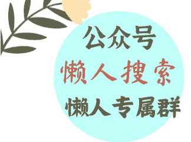

# 为什么学校就是不教赚钱的知识？普通人如何破局？

251023 体制内主任

整理：公众号懒人搜索，懒人专属群独享

懒人微信：lazyhelper

在这个世界上，有一个超级神秘又超级重要的东西，叫做“赚钱”。

我们每天都在为它奔波，为它发愁，为它绞尽脑汁。可奇怪的是，当我们自己的和我们的孩子们坐在明亮的教室里，听老师在黑板前滔滔不绝地讲着各种知识的时候，却几乎听不到关于赚钱的只言片语。

更扎心的是，当孩子询问“怎么赚钱”时，得到的回答往往是：“先把书读好，赚钱的事以后再说。”可等我们真的毕业了，才发现“以后”已经来了，而“赚钱”这门课，在哪里？怎么学？

更残酷的是，真正的赚钱秘诀从来不是公开的。权贵的孩子从小跟着爸妈学公司运作、资本博弈，商人的后代耳濡目染懂资源整合，这些“祖传秘籍”永远不会写进教材，当普通孩子在刷题时，富家子弟已经在学怎么给别人发工资了——这不是努力的差距，是认知的鸿沟。

赚钱就像巴菲特说的那样，拿个洗脸盆，跟那儿接，钱哗啦啦的往下掉，这叫赚钱。

挣钱是说你去工地上，搬一天给300，这叫挣钱。

学校只能给你教后者，无非从300到3000，技能不同，日薪不同而已，实质都一样。

现代教育源于普鲁士，这种教育的目的就是为了生产线培养工人。所以学校啥都教，唯独不教赚钱。

你有没有想过，为啥学校里教的永远是“语数外理化生”，却没人教你怎么开公司、搞投资、做副业？答案很简单：学校根本不是为你“赚钱”设计的，而是为工厂老板“生产螺丝钉”设计的！

现代教育体系的祖师爷是19世纪的德国和英国。当时工业革命爆发，工厂需要大量标准化工人——准时上班、按流程操作、服从管理。

于是，德国人搞出一套“标准化教育系统”：上课不能随便说话？因为工厂流水线不容许工人闲聊。按铃声上下课？为了训练你对工时制度的服从性。追求标准答案？因为机器零件不需要“独立思考”。

铃声一响，乌泱泱的人从 A 教室涌到 B 教室，像不像工厂流水线上，零件从 A 车间运到 B 车间？每节课 40 分钟，课间 10 分钟（和工厂流水线换班一个逻辑）；压根就不是为了培养独立思考的“人”，而是为了批量生产标准化的“工业零件”，或者说，螺丝钉。工业化大生产需要啥？需要的是守时、听话、能执行简单重复指令的劳动力。

我需要你会拧螺丝，你就好好学拧螺丝；我需要你看仪表，你就好好学看仪表。至于螺丝为什么这么设计？仪表厂的利润从哪儿来？这关你螺丝钉什么事？

普鲁士教育的核心任务，是把一群毛坯孩子，打磨成能融入工业化社会的“标准件”。就像汽车厂生产零件，必须符合规格才能装进发动机。

所以，语文、数学、物理、化学....这些学科被分门别类，像中药铺里的小抽屉，你学你的，我学我的，互不串味。

它只教你成为一个领域里“更好用的工具”，绝不教你如何拥有、操纵或创造工具本身。

总之一句话，学校的“目标”，就是培养合格的打工人，而不是培养老板、投资人或财富的创造者。它要是教了你赚钱，那不就等于教会了士兵如何策反？这生产线还不得乱套了！

老师不教，是因为……他们也不会啊！
咱们再瞧瞧站在讲台上的那群人——亲爱的老师们。我必须说，绝大多数老师都是敬业、奉献、负责的好人。但问题是，他们自己，也是这套教育体系下最成功的“产品”之一。

他们的典型人生路径是：学霸—>好学生—>考试—>上大学—>考研/考编—>进入学校体系。

看到了吗？这是一个完美的“系统内循环”。他们精通如何应对考试，如何撰写论文，如何评定职称，他们是“做题家”里的王者。

但你要问他们：王老师，怎么搞定难缠的客户？李老师，怎么设计一个裂变营销方案？张老师，天使轮融资股权怎么分配才不吃亏？

我估计他们能推了推眼镜，诚恳地告诉你：“这位同学，此题超纲，请参考《五年高考三年模拟》。”这真不怪他们。一个一辈子在体制内、领着稳定工资的人，你让他去教你怎么在市场的惊涛骇浪里搏杀？不是他不想教，是他真的不会啊！

接下来的内容就更触及核心了，由于本文内容太过禁忌，不适合大范围传播，特此以付费阅读的模式小规模放出。（深度揭秘+破局之道）

## 细思极恐的“诅咒”：需要的是一个“安稳”的你

好了，让我们往深水区再探一步。这可能有点“阴谋论”的色彩了，但值得玩味。

这套教育体系，在潜移默化中，给我们下了一个巨大的“诅咒”——它把一颗“打工者思维”的种子，深深地埋在了我们心里。它不断地向我们灌输一个看似唯一正确的人生路径：好好学习—>考好大学—>找好工作—>安稳一辈子。

如果每个人都想当老板、想发财、想改变命运，社会就会陷入混乱。于是，上层社会通过教育体系，给大多数人灌输“稳定压倒一切”的价值观：好好学习，考个好大学；找个好工作，当个打工人；买房、结婚、生娃，继续循环。这样，社会就像一台精密的机器，每个人都是螺丝钉，各司其职，不敢越界。而“赚钱”这个技能，如果被广泛传播，螺丝钉们可能会想：“凭什么我只能当螺丝钉？”它害怕你过早地意识到：你的人生不是一份简历，而是一家公司，你本人就是这家公司唯一的CEO和最大资产。一旦你觉醒了这种“所有者意识”，谁还愿意安心地去当那颗听话的、可替换的螺丝钉呢？

所以，不教赚钱，某种程度上，是为了维持一个庞大社会结构稳定运转的“潜规则”。它需要的是大量的、温顺的、依赖系统的“牛马”，而不是少量的、桀骜的、可能颠覆系统的“猎手”。

这些“牛马”进入社会后，会非常“自觉”地陷入那个经典的死循环：工作→赚钱→消费→没钱→继续更加拼命地工作。就像仓鼠滚轮，永远不敢停，也永远停不下来。

看清这一切，不是为了让我们去怨恨这个系统。恰恰相反，它用十几年时间，以一种反向教育的方式，给了我们最宝贵的一课：永远不要指望任何一个外部系统，对你的人生负全责。

## 普通人如何自我拯救，学习“赚钱智慧”？

骂也骂了，底裤也扒了，关键是，咱得解决问题啊！学校不给力，咱不能自暴自弃。别慌，破局的关键在于——跳出“标准化教育”的陷阱，培养真正的“赚钱智慧”。

## 战略转移：从“押宝高考”到“多线投资”

普通家庭最大的悲剧，就是把孩子未来18年的所有精力、人力、物力、财力，像赌圣一样，全部押在了“中考”和“高考”这两张赌桌上。考上了，顶多当个“高级牛马”，继续996；没考上，自信心崩溃，除了会考试，别的啥都不会。

如果家里孩子（或者自己）不是考试天才，早点培养“赚钱能力”比死磕分数更重要！

人生不是单选题，是多选题。普通人的路径：中考→高考→大学→找工作→打工一辈子。

富人家孩子的路径：中考/高考只是选项之一，同时发展天赋、研究投资、创业、人性，社会运行的底层逻辑。他们早就明白这套路，中考高考只占30%的精力（够用就行，别卷成疯子）；剩下70%去搞副业、投资、创业、社交，人性研究，就算考砸了，人家照样有退路。

这在经济学上叫“把所有鸡蛋放在一个篮子里”，是投资大忌！风险和沉没成本高到离谱。

所以，咱们普通人也得学聪明点，别把孩子的成败系于一次考试。鼓励他发展特长，接触商业，了解投资，哪怕从小做个自媒体号，摆个小地摊，都是宝贵的“多线投资”。某一个领域的失败，根本动摇不了他的根基。

## 从“死记硬背”到“解决问题”

忘掉那些该死的学科界限吧！你的大脑不应该被分割成“语文区”、“数学区”，而应该是一个强大的“问题解决中枢”。

学点会计，不是为了当会计，是为了能看懂公司的财报，理解商业的语言；学点心理学，不是为了当医生，是为了洞察用户和客户的心理，更好地销售和沟通；学习写作，不是为了当作家，是为了能清晰、有说服力地表达你的想法和产品。

我们从小被灌输“考上好大学=人生成功”，但现实是：考试是单维度的，人生是多维度的。

考试只需要你会做题，但人生需要你会做人、会做事、会整合资源；考试有标准答案，但人生没有；考试可以靠死记硬背，但人生需要灵活应变。

什么有用学什么，一切以“解决现实问题”为导向。

## 靠近钱源：到“热钱”流动的地方去

钱像水一样，会流向价值洼地。你想学会赚钱就得靠近它，感受它。别宅在家里空想。去实习，去兼职，哪怕是端盘子、发传单，你也能在最前线观察到，真实的交易是如何发生的，人们是如何完成“商品—货币”这惊险一跃的。

想办法跟在那些已经赚到钱的老板、生意人身边，看他们如何做决策，如何解决问题，如何整合资源。实践给你的那种“金钱体感”，是任何课本都给不了的。

## 从小副本开始：完成最小化闭环

别想着一开始就干票大的。摆个摊、做个自媒体号、接个私活、设计个T恤去卖……这些就是你的新手村副本。目标不是赚多少钱，而是完整地跑通一次“创造价值—传递价值—收获回报”的闭环。这个过程中被社会毒打的经验，比一百本商业名著都值钱。

## 培养“买东西”的能力（最值钱的技能）

别一上来就想着搞个阿里巴巴。从最小的“商业副本”开始。比如：设计个文创手机壳在淘宝店上架；用你的专业知识做个付费咨询小视频；接个 PPT 美化、文案撰写的私活；甚至研究一下怎么在闲鱼上“低买高卖”……

赚钱的本质：把东西（产品/服务/时间）卖给需要的人。打工是“卖时间”（时薪固定，上限低）；赚钱是“卖价值”（定价权在自己手里）。先从“卖自己的技能”开始（比如接设计单、写文案、做咨询）；再学“卖别人的东西”（带货、分销、代理）；最后玩“卖自己的品牌”（自媒体、IP、公司）。能把东西卖出去的人，永远不缺钱！

## 你，才是你一生最好的投资

以上四点，都建立在最后这个核心认知上：从现在开始，把你本人，当作你这辈子最重要、最值得投资的资产。

你的每一分钱，每一分钟时间，每一次注意力，都是你的本金。把它们投资到哪里？

- 投资大脑：买书、买课、学习加实践，向高人请教。
- 投资健康：保持精力充沛，这是你干翻一切的本钱。
- 投资人脉：不是滥交，而是结交真正有料、互相赋能的朋友。
- 投资你的小生意：让钱去生钱。

你的技能、认知、格局和健康，才是你这家“人生无限公司”最核心的、永不贬值的资产。

## 学校不教赚钱，但你可以自学！

在学校，你是被投喂的。知识被做成营养膏，按时喂到你嘴里。在社会，你是猎人。没人给你发食物，你得自己嗅探、追踪、捕猎。放弃“等着被教”的幻想，主动去搜寻一切关于金钱、商业、人性的知识。

- 学校是“打工人生产线”，但你不是必须当一辈子牛马；
- 赚钱的核心不是学历，而是思维（跨界、销售、投资、信息差）；
- 尽早跳出“死读书”陷阱，多实践、多试错、多接触真实商业世界；
- 别怕从0开始，大部分富豪都是野路子出身，关键是你愿不愿意学！

因为赚钱本就不是“课堂知识”，而是“生存智慧”。真正的赚钱能力，藏在菜市场的讨价还价里，藏在投资失败的反思里，藏在每一次与合作伙伴举杯换盏的言谈举止间。真正的“赚钱课”，从来不在课堂上。

希望以上对您有帮助！

## 最后，安利小懒的付费群：

懒人专属群（介绍）

微信:lazyhelper

📖懒人专属群持续更新中，已持续运营6年，整理超3000份各类精选付费文章&年费社群干货，全部开放下载。

本资料为付费群内部分享，仅供真实有需要的朋友查阅 🤫

## 懒人专属群更新记录：
https://lazy2025.top/blog/record2

懒人专属群更新记录（需梯子，备用）：
https://lazybook.fun/blog/record2