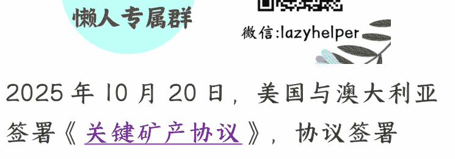

# 澳签署稀土合作协议，剑指中国？

251023 文/卢克文工作室嘉宾 云梦竹

整理：公众号懒人搜索，懒人专属群独享懒人微信：lazyhelper

2025年10月20日，美国与澳大利亚签署《关键矿产协议》，协议签署后，特朗普向记者表示：“再过一年，我们将拥有如此多的关键矿产和稀土，你们都不知道该怎么处理。”完全是一副“稀土滞销，帮帮我们”的神情。

从协议内容来看，本次会谈的美国决策者，确实展现出了惊人的政治智慧，也可以视为美国政府对我国稀土战略的反击。

## 「01 协议目标」

- 目前，该协议集中在四个方面，一是设立双边融资机制，双方各自提供不少于10亿美元的资金池，用于支持稀土全链条项目；二是优先项目清单制度，锁定稀土、锂、镍、钴、镓等战略矿种；三是价格与贸易保障机制，建立价格下限；四是加速审批机制，简化许可证流程、加快项目落地；这四个方面环环相扣，深刻展现了老牌帝国主义的政治底蕴。

首先是融资机制。长期以来，中国掌握全球约 60%—70%的稀土开采量与超过 85%的稀土分离加工能力。从市场经济的角度来看，在澳大利亚建设稀土加工设施是不划算的，所以，稀土产业要解决的核心问题是，客户在哪里。

美国既是澳大利亚稀土的客户，也是澳大利亚稀土产业的投资方，只有美国投了澳大利亚才敢投。所以需要双方都建立资金池，大家一起承担风险。

随后，就是建立优先项目清单，这确实是非常有用的办法。因为稀土类目众多，中国统治该领域已经很多年了。虽然之前我们一直抱怨我国把稀土卖的是白菜价，但恰恰是稀土卖出白菜价，直接干垮了全球大部分稀土加工企业，以至于外企在技术上与我国存在代差。

美国作为赶超者，自然不可能面面俱到，就只能选择锂、镍、钴、镓几种重点矿物作为突破方向。其中锂是电动车、电池储能产业核心矿种；镍是高性能电池、航空材料的关键；钴是能量密度高的储能材料；镓则是半导体与先进军用雷达、光电元件关键元素。

在设立核心目标后，最关键的内容来了，美澳之间的协议，有价格与贸易保障机制，这个机制就是为了应对前文提到的问题，即中国利用产业优势进行市场倾销。这一点的关键在于，澳大利亚本土的稀土生产成本，肯定大大高于中国的产品，甚至价格竞争力不如走私中国稀土，这么一来，美国和澳洲只能提前设定最低下限，确保价格稳定，投资者才敢下注。

目前这批稀土最大的客户就是美国国防部，在过去一段时间，美国国防部依据国防生产法案，为其中一部分稀土生产商提供资金，以实现供应链不出盟国的政策目标。现在关键矿物协议的签署，又使得稀土生意更加有利可图。

而这里面，就充满了权力寻租的空间。毕竟稀土一吨多少钱是有市场价值的，但国家安全一吨多少钱，这个可就难说了。

至于最后一段减少审批，本质上就是减少监督。

首先，前文我们已经提到了，这个项目不能细究，其稀土成本肯定高于中国同类产品，如果真的细究起来，那可就炸裂了。其次，过去一段时间，中国稀土或者说中国走私稀土，是美国工业链条的原料来源，有多少利益团体从中获利谁也说不清，对于美国工业而言，这帮人就是买办。

如果不能留足够的利益空间去收买人心，这种自主项目，很快就会面临买办的威胁。所以，从协议来看，制定该协议的美国官员政治智慧是非常高的，甚至远超这段时间美国的国际斗争水平。

## 「02 协议的影响」

虽然前文提到了，该协议背后缔造者政治水平极高，但我一点也不担心。因为特朗普一句“未来我们将会有用不完的稀土”，直接把美国的政治水平，狠狠地往回拉了一把。

该协议包括稀土和关键矿物，其中锂、镍、钴、镓在内的关键矿物，应该不成问题，毕竟澳大利亚也是矿产大国，只是成本更高罢了。但稀土就不同了，澳大利亚可能真的搞不定。稀土可分为轻稀土与重稀土，前者以钕、镨为代表，后者以镝、铽为核心。本轮美澳关键矿物协议，主要集中在轻稀土领域，但即使协议完全执行，澳大利亚最乐观的估计也是在2030年，占据全球市场份额的20-25%，完全不足以取代中国的市场主导地位。

更重要的是，本轮关键矿物协议所提到的稀土开采与分离只是链条前端，下游的永磁体制造、装备整合才是中国优势最强的部分。

目前稀土生产商莱纳斯公司，是澳大利亚唯一实现商业化稀土分离的企业，其马来西亚关丹（Kuantan）工厂已经能够实现纯度99.5%。虽然距离中国稳定提纯 99.9%还有 5-8 年的差距，但也算是西方领头羊了。该工厂计划于 2025 年中期投入调试和投产，预计年生产能力为 1500 吨混合重稀土化合物 SEGH（钐、铕、钆、铽）。截至今年 6 月，尚未有关于提纯难度更高的镝和铽产能的初步估计。

这说明，澳大利亚自己也清楚，自己确实存在技术差距，也不敢好高骛远。只能说，在比较容易的轻稀土领域，澳大利亚公司也算是举步维艰。

至于澳大利亚在建的 Iluka Eneabba Refinery 项目，目前仍处于试运行阶段，目标是实现分离纯度 ≥99.5%的标准，但截至 2025 年仍未披露稳定运行数据。说明技术问题还未解决。

而在涉及高端产品的重稀土领域，美国和澳大利亚甚至连新手村都没出，在过去一段时间，全球 99%以上的重稀土分离与加工能力，集中在江西、广西、四川等地区。美澳协议虽在文件中提及“重稀土链条建设”，但澳大利亚当前并无成熟的重稀土精炼体系，属于八字还没一撇的阶段。

澳大利亚企业虽具备采选与初级提纯经验，但在分离、冶炼、金属化与磁材制造环节落后是非常明显的，甚至就连初选和初级提纯环节，都极度依赖中国的技术和人力。因为中国在稀土技术的垄断发展，导致澳大利亚稀土生产所需要的设备以及商业萃取剂都需要从中国进口。

然而就算澳大利亚能够从中国进口设备和试剂，双方依旧有着不小的差距，比如目前中国稀土已经可以自主配方，以形成多相溶剂萃取体系，而澳大利亚还需要依赖商用萃取剂。中国企业广泛采用自动滴定、光谱监控与闭环pH控制；而澳洲依旧在采用人工定时采样。

当然，考虑到澳大利亚的技术差距甚至无法对精矿进行提炼，美澳关键协议多次提及，要利用美国技术，对当地稀土产业进行扶持。但尴尬的是，美国唯一稀土生产商MP Materials多年将加州的精矿发往中国合作方进行深加工，2025年4月起因关税与政策博弈宣布停止对华发运，6月出口量降为0。结果7月份，中国海关总署的数据显示，美国方面又发送了4719吨稀土矿来华，证明MP Materials还是没有摆脱对中国的技术依赖。

只能说，很多事情还是要尊重客观规律，中国稀土产业发展到壮大用了几十年，壮大之后，又以白菜价卖了十几年。西方在该产业链的积累几乎已经被斩断，现在从头开始，没有十几年根本搞不成。至于美国说的用美国技术支持澳大利亚？你总不能拿你没有的东西来帮别人吧。

在这种情况下，西方开始采用高薪，甚至十倍薪水招募中国稀土专家，一些不能确定的信源显示，中国稀土集团的一些专家已经拿到了加拿大实验室的投资。为了保证技术资料不外泄，根据《华尔街日报》报道，我国已指示稀土公司提交稀土专家的名单，并要求名单上的专家上交护照，并申报旅行与出国访问计划，以防止技术机密泄露给外国企业。

而设计该协议的幕后之人也很清楚，本轮协议的重点在于让美国具备部分初级精炼和加工能力，以此在与中国的谈判中攫取更多筹码。至于特朗普那种稀土用不完的表态，人家敢都不敢想。而特朗普能说出这种话，说明他确实没有看明白，双方签的协议到底意味着什么。

其实从这里也可以看出美国的现实矛盾，美国政府内部不是没有能人志士，但面对特朗普这种领导，确实蚌埠住了。

## 「03 利益输送」

前文我们提到本轮稀土协议的核心，在于美国政府统购统销，而且价格远高于市场价格。不受到国际市场波动影响，考虑到国际市场也就中国一家，基本上就是说无论中国稀土价格多少，美国政府都得高价收购澳大利亚稀土，这么一来，就给当地生产商留足了利润空间。

目前澳大利亚最主要的稀土生产商，就是莱纳斯稀土集团。在本轮协议中，莱纳斯稀土集团是为数不多直接与美国国防部对接的单位，负责为美国国防工业提供稀土材料。在今年5月份，该公司股价还仅有7.41美元一股，现在已经上涨到21美元了，有趣的是，消息公布后，本来应该大涨的莱纳斯公司反而回调了一波，来到了18美元的位置。

这种利好消息发布前一两个月股价快速上涨，而在利好消息出现后反而回调的诡异走势，让我觉得有点莫名其妙。但以我在A股当这么多年韭菜的经验来看，只有一种解释：那就是有人提前布局，等到利好出尽就选择清仓跑路。

正当我疑惑是哪位大神能够提前预知这种级别的国家政策时，我发现，莱纳斯集团的大股东叫吉娜·莱因哈特，是澳大利亚顶级富豪，这么一来，一切都说得通了。此人是特朗普最忠诚的追随者，是美国特朗普姐妹会的赞助人，也是澳大利亚MAGA运动的创始人，在特朗普面临民主党围攻时，她曾经顶住压力，投资支持了Trump的Truth Social平台。

而在过去一段时间，吉娜·莱因哈特不但增加了对莱纳斯稀土公司的持股，还增加了其在澳大利亚其他稀土公司的持股比例。不出意外，这些公司的股价在美澳协议公布后纷纷上涨，吉娜又赚了一笔。

故事来到这里，算是弄明白了，虽然改稻为桑是国策，但也有沈一石们为国分忧啊。

从政策角度来看，美澳关键矿产协议的设计极为精妙，设计这个协议的人或者团队肯定对美国稀土技术能力、澳大利亚矿产储备，以及整个生产链条极为熟悉。唯一的问题在于，这么精妙的协议或者计划，能否被特朗普团队忠实地执行。

这里我就说一点，澳大利亚稀土是有价格保护的，其出口美国的价格将会远远高于中国的稀土价格，这么一来，就产生了利差。那么，对于澳大利亚生产商而言，最好的办法，就是走私中国稀土，然后高价卖给美国。良心点儿的掺着卖，没良心的直接卖。

久而久之，一旦形成新的买办集团，他们到底该如何是好。特别是：当澳大利亚稀土公司是自己人的时候，他们真的会将国家安全，置于自己的经济利益之上吗？

# 最后，安利小懒的付费群：

懒人专属群（介绍）

懒人专属群更新记录：

https://lazy2025.top/blog/record2

懒人专属群更新记录（需梯子，备用）：

https://lazybook.fun/blog/record2