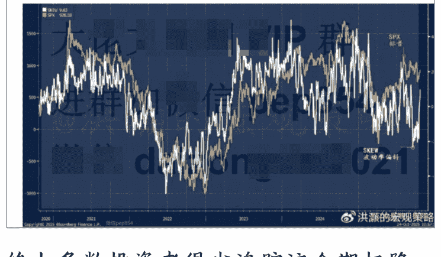
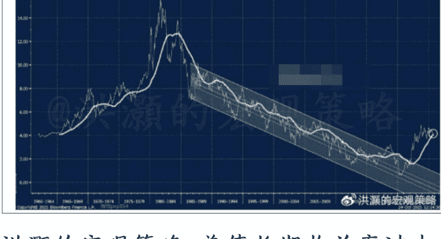

## 决定性的一周

251024 洪灝的宏观策略

整理: 公众号懒人搜索, 懒人专属群独享

懒人微信: lazyhelper


重磅新闻频传，市场准备行动。

本周市场充满了显著影响市场走势的重磅头条。万众瞩目的公告的发布，周末马来西亚的高层会谈，即将到来的超级大国首脑峰会，还有一系列重要的经济数据。昨夜，白宫宣称特朗普希望在 APEC 峰会上见面并协商贸易条件交换事宜，并列举了稀土、美豆和芬太尼等议题作为交换条件。然而，美方试图对于美国关键软件的出口以及任何使用了这些软件进行生产的产品实施贸易约束。

这很可能是美方黔驴技穷的一个表现。如果单方面地对于这些高科技产品针对某一个国家实施禁运，那么这种制裁加码的做法显然是严重背离了马德里谈判的精神的，也无法动员美方的盟国加入这样的制裁。简单地说，这种单方面的霸凌贸易条件对于美方其它盟国其实并没有什么好处。丘吉尔说的好：只有永远的利益，没有永远的盟友。就在我著笔写作之际，特朗普宣布终止所有与加拿大的贸易谈判。其实，美国与一众重要的贸易伙伴，如巴西、印度、墨西哥、瑞士等国家都尚未签订贸易协定。隔夜，美股三大指数上涨，而中概股指数涨幅更大。毕竟，最近贸易摩擦的新闻不绝于耳，而全球市场都被特朗普的情绪所牵制。虽然美股上涨，但是当我们看一下貌似平静的市场表面之下，各种不同投资策略的表现，那么这个平静的水面之下，其实是暗流涌动的。

以下内容仅V+会员可见

可以看到，美股的散户投资者继续其出色的表现。过去一周里，美股的机构投资者净卖出8亿美元的美国股票，这也是过去5周内的第4次周度卖出。同时，对冲基金的资金净流出为4亿美元，为连续第6周的资金流出。然而，美股散户投资者则继续买入，反而增持了4亿美元。这是美股散户投资者连续第2周净买入。总体而言，投资者净卖出8亿美元的美国股票，4周平均净流出达到12亿美元的规模。这也是过去5周内美股市场的第4次周度资金外流。

简言之，机构在美股市场走弱时卖出，美国散户却在逢低买入。公司层面，没有一个高管的通告是增持的。在这个盈利季报里，盈利低于预期的公司反而跑赢了盈利超预期的公司。可能有人会归因为“给公司的盈利提升留下更大的空间”吧。花街和高管再次把股票卖给“美国韭菜”。然而，今年韭菜的投资回报甩了机构远远几条街。

基本上，几天前美股最大的单天暴跌的那一根大阴线，就把前面四周二十一个交易日的屡创新高的涨幅一夜之间完全抹杀。而过去八个个交易日，美股又慢慢地爬回了单天暴跌前的高点。同时，美股还出现了一个更有意思的现象。

我们的数据分析发现，美股的波动率偏斜指数（SKEW）开始从低位上升，但美股似乎也在同时向历史新高迈进（图一）。

图一：美股期权波动率偏斜与美股指数同时走高



绝大多数投资者很少追踪这个期权隐含波动率偏斜指数 SKEW，但这个指数是了解机构持仓状况最清晰的窗口之一。SKEW指数衡量的是市场对于虚值看跌期权的需求。

本质上，买入这种虚值看跌期权的交易就是在买“崩盘保险”。

当机构投资者需要加仓虚值看跌期权的时候，它们往往会在市场隐含波动率较低时悄悄地买入这种对冲风险的工具（虚值看跌期权）。这是聪明钱在为市场即将到来的动荡做准备，而非在追逐市场里最后一分钱的收益。这个时候，市场的隐含波动率往往是被低估的，或者说是市场对于隐含波动率的定价时偏低的。

过去几周，SKEW开始显著的跳升，但是标普依然距离其历史高点仅一个百分点之遥。SKEW已回到了它长期的历史均值区间。这种市场情况表明机构的对冲活动又再次升温，但是似乎还没有回到需要马上发出预警的水平。机构投资者目前尚未大量抛售仓位，但显然在市场隐含波动率VIX相对平静之际，机构投资者在为市场的下行风险买入保险。

市场的风险被低估的时候，总是让人有些辗转反侧。

于此同时，我们追踪的另一个重要指标——美债十年收益率开始下行到了我的850天均线附近（图二，这个均线的重要意义我们在这里不再赘述）。

图二：十年美债收益率运行到了我的850均线附近



### 洪灏的宏观策略

美债长期收益率过去四十多年的下行趋势早已经在 2022 年结束了。如今，长端收益率运行到这个 850 均线的位置，显示的是接下来通胀前景的改变和投资者的资产配置需求都将左右市场的运行。简言之，美债长端收益率在 850 均线附近的位置，是一个决定性的时刻。

尽管美国政府停摆持续的时间长度已经达到了历史第二长，并有望赶超特朗普在第一任期是创下的历史上最长的停摆记录，市场依然预期关键的通胀数据将如期发表，并预期这个数字并不能改变美联储马上要降息的预期。如是，美债收益率应该有下行的空间，帮助支持美股在历史高位附近进一步创新高。当然，如果超级大国谈判再次遇阻（并非我的基准情景，我们的基准情景是 TACO），那么不言而喻，市场将再次大幅波动。

公告总体来说，符合市场预期。这从市场对于公告出台之后的反应可见一斑。字里行间，公告洋溢着一种稳稳的自信和自豪感，并预示着经济建设将是下一个阶段的重心之一，“大力振兴消费”在讨论的排序也非常靠前。用电脑数点各个关键词出现的概率的工作，我们留给研究助理。

> “敢于斗争，善于斗争，勇于面对风高浪急甚至惊涛骇浪的重大考验”

这时，上证 50 开始了它的交易平台突破，大有或跃在渊之势。

洪灝 2025.10.24

最后，安利小懒的付费群：

## 懒人专属群（介绍）


- 懒人专属群持续更新中，已持续运营 6 年，整理超 3000 份各类精选付费文章 & 年费社群干货，全部开放下载。

本资料为付费群内部分享，仅供真实有需要的朋友查阅

## 懒人专属群更新记录：

```
https://lazy2025.top/blog/record2
```

### 懒人专属群更新记录（需梯子，备用）：

```
https://lazybook.fun/blog/record2
```