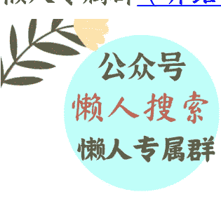

# 147|猎豹、美图如何实践AI组织变革

251027

整理：公众号懒人搜索，懒人专属群独享懒人微信：lazyhelper

欢迎打开《蔡钰·商业参考4》，我是蔡钰。

2025 年，越来越多的科技公司用彻底的组织变革来顺应 AI 时代。最夸张的是 Facebook 的母公司 Meta，6 个月内，对 AI 组织架构进行了 4 轮全面改革，用激进调整来不断试探适应 AI 时代的最优组织形态。

Meta 我们先不聊了。最近，我看到了两个中国公司的 AI 组织变革实践，对本土创业者们更有参考性，跟你分享一下。

## 猎豹的故事

第一家公司是傅盛的猎豹移动。

猎豹移动这两年的 AI 探索，不是先着急去训练 AI 模型、开发 AI 应用，而是借用外部的 AI 产品，来推动公司做彻底的组织变革。

它的 AI 变革分三层：思想变革、组织变革和产品变革。请注意这个顺序，它把大多数公司和创业者最着急做的产品变革，放到了最后一步。

思想变革怎么做呢？

第一件事就是，老板傅盛亲自下场。一个公司在刚刚感受到 AI 趋势时，最反对 AI 的人，往往是技术团队。原因很简单，竞争关系。老板要求技术团队用 AI 来提升代码，工程师、程序员们的第一反馈一定是：“老板，这东西写代码不靠谱、不专业。”

怎么识别工程师们的话语真假、破除在公司内普及 AI 的阻力呢？

傅盛就身体力行，在自己的电脑里装上各种能写代码的 AI 工具，自己学、自己用。

他用完之后在公司内做全员宣讲，告诉大家，自己 20 年没有碰过写程序这件事了，但现在靠着 AI，不用从头学也可以写个软件出来，说明 AI 可用，必须用起来。小 A 说的不靠谱，可以这么解决；小 B 说的不专业，可以那么解决。

老板用亲身经历把自己变成了行家，技术团队们没有阻拦的借口了。

但解决了借口这种积极抵抗，也还是解决不了消极抵抗。

怎么办？

用行动来内化“AI 有用”这个认知。于是，傅盛又在猎豹里搞起了全员编程，要求所有人都得写程序。不光程序员，就连财务、法务、客服和行政都得上手写程序，自己解决自己工作流程里的问题。

这么一要求，开头虽然大家叫苦连天，但很快神奇的事情发生了：客服写出了呼叫中心的一部分软件能力，行政写了一个车辆管理系统，CFO 助理写出来的程序甚至强过公司内很多程序员。

这个要求，让猎豹移动的全员真正接受了，代理式 AI（Agentic AI）能够让任何一个人都拥有代码能力。

完成了思想变革，接下来是组织变革。

以 AI 为信仰去调整组织架构，这既伤害既得利益，也很难推动。傅盛就想了个办法：像当年中国改革开放选深圳当特区那样，也给猎豹设了个特区，在西安从零开始建立了一个“AI 特种兵训练营”，来分担北京总部的研发任务。

做研发，就得招人。这个西安机构招的全部是年轻人，不卡毕业学校、不卡工作经验，只关心对方是不是热爱 AI、用过哪些 AI 产品。等新人们入了职，也不给人家设具体的岗位、职位，打破了传统的前端、后端、安卓、服务端这种团队划分，统统叫作“特种兵”，安排什么活就干什么。

能行吗？有了 AI，必须能。特种兵们接到任何任务，就跟 AI 一通请教、一通商量、一通派活儿。这个西安特区总共二三十人，很快接走了北京总部积压的大量研发任务。结果不仅没有出乱子，效率还大幅度提升了。据说一两个人就能干以前 10 多个人团队的活儿。

这个西安特区做成以后，猎豹再安排其他区域的团队去参观学习，再回去改造各自的团队和部门。整个公司的研发体系，开始往 AI 原生的组织方向发展。

怎么叫 AI 原生的组织？就是以 AI 能力为原点来搭建的组织。

思想和组织变革都做完，产品变革也就自然发生了。猎豹，从传统的移动互联网公司转型成了 AI 驱动的产业互联网公司，核心业务也转向了 AI 与机器人。

## 美图

再来看另一家公司，美图，美图秀秀的出品公司。

美图今年也推动了围绕 AI 的组织变革，调整后的流程与架构，跟猎豹异曲同工。但不同的是，美图是借着一次研发新产品的实践机会，摸出自己的转型之路的。

这个新产品叫 RoboNeo，做的是影像创作领域的智能助手。这两年，生成式 AI 大爆发，影像成了最快能跑通商业化的 AI 战场之一，行业里涌进来的新竞争者不少，美图无论为了防守还是进攻，都必须快速行动。

这个项目时间紧、资源有限。美图一咬牙，尝试了一种“反惯性工作流”，结果发现效果出奇得好：RoboNeo 只用了一个月封闭开发就完成了，没有借助美图任何产品导流，也没花一分钱做推广，就实现了上线首月的全球月活用户数（MAU）突破百万，还在几十个国家的细分榜单进了前十。

美图在这个项目里做对了什么呢？它明确并严格执行了 5 个原则：

- 第一，需求共创。
以往的工作模式是“甲方提需求、乙方做执行”，但这次美图只确定大方向，研发和设计不用等着一版一版的产品需求文档出来才干活了，而是围绕大共识、基于高频协作推进开发、拉动迭代。

怎么高频协作呢？

- 第二点，会议从简，缩短决策链路。
所有不产生决策的周会、汇报会，都被取消了。项目成员有信息需要沟通，要么走线上文档，要么走群消息。遇到问题，相关方小范围快速讨论、当场拍板。

- 第三点，借助 AI，实现单一职能多面手。
翻译、文案、需求梳理、设计知识库这些环节，美图要求员工们全部把 AI 用起来，并在 AI 加持下，突破岗位职能，设计师、PMO、研发都兼任产品经理，互相补位。这又给第一条的“需求共创”提供了基础。

实际运作下来，美图发现，新产品海外运营的所有工作交给一个人就能完成，人效是以前的两三倍。

- 第四，人人都是生产力。
设计师、程序员们多面手还不够，美图还明确要求，项目里的所有 Leader 都得在业务一线承担具体执行任务，杜绝“只派活不干活”。

- 第五，用最短时间构建 MVP，也就是最小可行产品。
学习初创团队的方式，聚焦产品核心功能，做出了最小可行版本就上线，再根据用户反馈快速迭代，做到“在战争中学习作战”。

RoboNeo 的百万 MAU，就是被这么开发出来的。

在 RoboNeo 上尝到甜头以后，美图意识到，这套反惯性工作流是可复用的。再叠加 AI 的代码能力、影像能力和语言能力，团队的任何灵感都可以快速验证，快速实现效果创新。

这让创始人吴欣鸿，开始推动整个美图，尝试孵化更多的 AI 多面手和 AI 原生组织。

在 AI 编程方向上，美图引进了多种 AI 编程工具，把公司的 AI 编码普及率拉到了 86%，希望培养出上百位 AI 全栈工程师，既懂前后端开发、又懂产品设计。

在 AI 设计方向上，美图也要求设计师们借助 AI，把自己变成超级设计师，从激发灵感、做效果预览、生成图片与视频素材，甚至到轻量编码与市场调研，都拿捏住。

在 AI 营销领域，对运营团队的要求是成为“全栈产品代言人”，从种子用户建联、合作用户筛选，到创意生成、效果追踪，也借着 AI 都掌握。

这些都是在组织内部孵化 AI 多面手的工程。那 AI 原生组织呢？

美图推了一个“AI 创新工作室”机制，鼓励员工们用公司资源来组建小规模团队，去实践自己的产品创意。你肯定看懂了，这就是在鼓励内部创业。目前这样的 AI 创新工作室，美图已经成立了 5 个。

为了让这些 AI 多面手、AI 原生组织跑起来的阻力变小，美图还在内部搭建了 AI Agent 平台、MCP 服务平台、AI 翻译平台等等公共基建。

煞费苦心去孵化 AI 多面手、AI 原生组织，对美图有什么好处？

美图的期待当然是，借助变革，卸掉传统互联网公司的规模和流程负担，把自己变成诸多灵活团队的联盟网络，在激烈的 AI 影像竞争中，不被更敏捷的 AI 创业团队挤出时代。

## 总结

好，我们看了猎豹和美图两个案例。虽然路径不同，但它们都指向了同一个方向：AI 时代的组织变革，核心不是技术，而是人和协作方式的重新定义。

从这两个案例中，我们可以提炼出几个共同的经验：

- 第一，制度固化行为，行为塑造思想。
美图的 AI 创新工作室机制，猎豹的全员编程要求，都是在用制度来固化新的工作行为，再通过工作行为强化认知。这跟我们前面聊过的亚马逊管理理念又呼应上了。

- 第二，当前科技公司们似乎更渴求技能多面手，而不是单一技能的高手。
无论是猎豹的“特种兵”，还是美图的“AI 多面手”，都在强调一个人要能干多种活。他们都希望 AI 能让人能够跨越原本的职能限制，承担更多样化的工作。

- 第三，小团队验证，大组织推广。
猎豹的西安特区，美图的 RoboNeo 项目，都是先在小范围内验证新的工作方式，成功后再向整个组织推广。这种“特区模式”降低了变革的风险，也提供了具体的成功样本。

你看，AI 浪潮带来的不光是人的再造，也是组织的再造呢。希望这些经验和思路，对你建构自己的 AI 时代主动性，也有参考。

拜了个拜。

最后，安利小懒的付费群：

懒人专属群（介绍）

微信：lazyhelper

懒人专属群持续更新中，已持续运营 6 年，整理超 3000 份各类精选付费文章 & 年费社群干货，全部开放下载。

本资料为付费群内部分享，仅供真实有需要的朋友查阅

懒人专属群更新记录：
https://lazy2025.top/blog/record2

懒人专属群更新记录（需梯子，备用）：
https://lazybook.fun/blog/record2