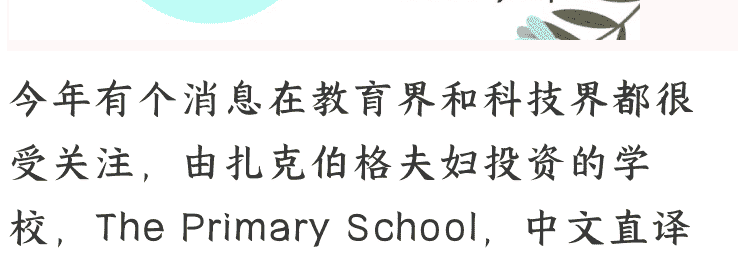

# 扎克伯格的学校关门了，每个学生花了 45 万美元

251027

整理：公众号懒人搜索，懒人专属群独享
懒人微信：lazyhelper

今年有个消息在教育界和科技界都很受关注，由扎克伯格夫妇投资的学校，The Primary School，中文直译过来叫“初级学校”，已经正式确认，将在 2026 年永久关闭。

要知道，这所学校可是不差钱的。扎克伯格夫妇为它投了 2 亿美元，校区一共运营了 10 年，服务了 443 名学生。什么概念？2 亿美元除以 443 个学生，人均投入 45 万美元，折合成人民币大概 320 万。

那么，既然不差钱，是学校的办学理念不够好吗？也未必。这所学校曾经被《时代》杂志评为“年度最佳发明”，学校不只是教书，还配了医生、心理咨询师，甚至给家长开职业培训课。换句话说，它想做的不只是一所学校，而是一个全方位的家庭支持系统。你看，都做到这步了，你能说人家理念不行吗？

而且更奇怪的是，扎克伯格的学校不是个例，国外的富豪办学很多都不太顺利。WeWork 创始人诺伊曼夫妇办的 WeGrow，运营不到两年就关了。前谷歌高管文蒂拉创办的 AltSchool，直译过来叫“另类学校”，号称用技术革新教育，结果最后他们关掉学校转型卖软件去了。还有美国说唱歌手坎耶·韦斯特办的学校，存活了 264 天就关门了，还惹了一堆官司。

你看，这些人在商业上都是高手，钱也不缺，人脉也广，怎么一办学校就不灵了？

为了搞清楚这个问题，我专门请教了教育专家沈祖芸老师。她跟我说了个挺有意思的观点：办学校和办企业，可能用的根本不是一套逻辑。很多失败，不是因为钱不够，也不是因为理念不好，也许是用错了方法。

这些案例背后，有三个关于教育的问题，非常值得聊聊。

## 第一个问题，学校到底是为谁服务的？

看这些失败的案例，会发现一个共同点：这些学校都同时服务于很多个目标，既有教育目标，也有商业目标。而且这些目标之间，有时并不在统一的主线上，它们彼此会相互拉扯。比如，WeGrow 就是个典型。WeGrow 是 WeWork 创始人诺伊曼夫妇在 2018 年创办的。WeWork 就是那个做办公空间的公司。诺伊曼夫妇的想法是，既然 WeWork 能在办公空间上搞创新，为什么不能试着重新定义教育？学校的课程很特别，瑜伽、舞蹈、武术、农场种植，打出的教育理念叫“释放孩子的超能力”。年学费 4.8 万美元，第一所校区开在纽约的切尔西。

但问题是，WeGrow 从一开始就不是一所独立的学校，它是 WeWork 品牌的延伸。诺伊曼夫妇想打造的是一个“We”系列的商业模式集合，包括做办公空间的 WeWork、做共享公寓的 WeLive、做教育空间的 WeGrow 等等，学校只是这个商业版图的一部分。

你看，说到这，就引出一个问题，这所学校的最高使命到底是什么？是为了孩子的成长，还是为了 WeWork 的品牌延伸？

2019 年，WeWork 因为管理混乱和 IPO 失败陷入危机。结果呢？WeGrow 立刻被当成非核心资产剥离了，运营不到两年就关门。对 WeWork 这家公司来说，这是在砍掉不赚钱的业务，是个理性的商业决策。但对那些入学的孩子和家庭来说，他们的教育被突然中断了。

换句话说，当一所学校的生存完全取决于母公司的商业状况时，那么理论上，它就不再仅仅是一所，而是一个可以随时关闭的“商业项目”。

再看扎克伯格的学校。

扎克伯格的妻子普莉希拉·陈本人是儿科医生，她在工作中发现，很多孩子学习不好，根源不在学校，而在健康问题和家庭困境。所以这所学校的理念是“整合教育和医疗”，不只教孩子，还要支持整个家庭。

这个理念本身没问题，甚至可以说很先进。但这所学校从一开始就被定位为一个“示范项目”，目标是创造一个可复制的模式，最终推动公立教育系统的改革。这就意味着，它的最高目标，不是为了成为一所扎根社区的学校，而是为了验证一个理念。

而最近几年，基金会的关注点从教育公平，转向了更“硬核”的科学研究，特别是生物学和人工智能的交叉领域。这时，这所学校作为一个高成本、高人力投入的社会服务项目，显然不再符合新的战略优先级。于是，学校就被关闭了。

你看，在商业世界里，一个项目有明确的生命周期。立项、执行、评估，这是正常流程。假如一个项目不符合预期，终止它是理性的决策。

但学校不是项目，借用沈祖芸老师的话说，一所学校，本质上是一个社会契约。家长把孩子送来，是基于信任，是相信这所学校会陪伴孩子成长，至少在可预见的未来是稳定的。但当学校的存在完全依赖于外部资助者的战略优先级时，这个契约就变成了“有条件的、实验性的”。

当然，据说扎克伯格的学校也制定了后续的补偿方案，想要尽量确保学生的教育不被中断。

## 第二个问题，教育的节奏和商业的节奏一样吗？

在商业世界里，速度就是一切。快速试错、快速迭代、快速调整方向，这是硅谷的信条。一个产品不行，马上换个方向再试。

但教育也遵循着同样的逻辑吗？未必。

AltSchool 就很能说明问题。这所学校是前谷歌高管马克斯·文蒂拉在 2013 年创办的，拿到了 1.75 亿美元的风险投资。注意，是风险投资，不是慈善捐赠。这意味着投资人要看回报，要看增长，要看规模化的可能性。

AltSchool 的理念听起来很酷：用技术实现真正的个性化学习。学生用 iPad 接收算法定制的学习内容，教室里装满摄像头，记录下每个孩子的学习过程，然后用数据分析来优化教学。

文蒂拉从一开始就没打算只做一所学校。他的目标是开发一套可以卖给全美国学校的软件系统。换句话说，那些实体学校，同时也是软件产品的测试场。

但很快他们就发现，运营学校的成本太高了。教师工资、场地租金、日常管理，这些都是实打实的开销。而且，教育的效果不可能在一两年内就显现出来。你怎么证明你的个性化学习系统比传统教学更好？需要时间，需要长期的跟踪研究。

但风险投资等不了。于是，2017 年，AltSchool 做了一个决定，关闭大部分学校，转型成为一家软件公司。

你看，这就是典型的商业逻辑，当一个业务模式被证明不够高效时，就换个方向。在商业世界里，这叫灵活应变。但在教育领域，借用沈祖芸老师的话说，人的成长是缓慢的、复杂的、充满不确定性的。一个孩子从不会读书到爱上阅读，可能需要几年时间。一个教学方法是否有效，可能要等到学生毕业多年后才能看出来。

## 第三个问题，技术应该放在什么位置？

科技公司办学，技术经常被放在一个很核心的位置。比如前面说的 AltSchool，用算法给学生定制个性化学习内容。但你仔细想想，这个模式里，谁是核心？是技术。

学生的学习路径由算法决定，教师的角色变成了执行软件指令的“助教”。有人去过这所学校参观，发现教室里技术人员比教师还多。这些技术人员在干什么？采集数据、分析数据、优化算法。

沈老师跟我说，教育界有个基本共识，一个好老师，不只是传授知识，更重要的是激发学生的好奇心，在学生遇到困难时给予鼓励，在关键时刻给出恰当的引导。

因为学习本质上是一个社会性的、情感性的活动。一个孩子愿不愿意学，很大程度上取决于他是否感受到被理解、被支持。这种感受，来自真实的人际互动，很难用算法替代。

当然，这不是说技术在教育中没有价值。问题在于，技术被放在什么位置。它是服务于教育目标的工具，而不是教育本身。

沈老师说了一句话，我觉得特别贴切，“办好学校的关键，在于让学校这座庞然大物变得像一个具体的人一样，去关心每一个学生的具体发展。”换句话说，学校的核心是人，是关系，是那些无法被量化、无法被规模化、无法被快速迭代的东西。

注意，这并不是说，教育与商业就一定是互斥的。很多商业思维，确实对教育有帮助。比如运营管理，学校也需要高效的管理，需要合理配置资源。再比如资源整合，企业家的商业网络，能为学校带来实习机会、就业渠道、产业资源。

同时，我们今天说的这些尝试，尽管结果各异，但这些过程其实都挺了不起的。你看，愿意投入真金白银去探索教育的可能性，愿意把商业世界里最先进的理念和资源带到教育领域，这本身就值得尊重。

而且目前看，这些尝试的过程也产生了很多有价值的发现。比如，他们让人们看到了技术在教育中的边界。再比如，他们也让很多人意识到，教育和商业，可能运行在两种完全不同的时间尺度上。

有个生态学者，叫马蒂·鲁宾，说过一句话，“一百辈子也看不完一英亩土地上的所有美景。”

这话说的是自然观察，但用在教育上，好像也说得通。教育不是到处去寻找新的增长点，而是在一个地方扎下根来，看见每个孩子的成长。这本身，就需要超强的耐心。

## 最后，安利小懒的付费群：

懒人专属群（介绍）

📖懒人专属群持续更新中，已持续运营6年，整理超3000份各类精选付费文章 & 年费社群干货，全部开放下载。

本资料为付费群内部分享，仅供真实有需要的朋友查阅 🙏

懒人专属群更新记录：
https://lazy2025.top/blog/record2

懒人专属群更新记录（需梯子，备用）：
https://lazybook.fun/blog/record2