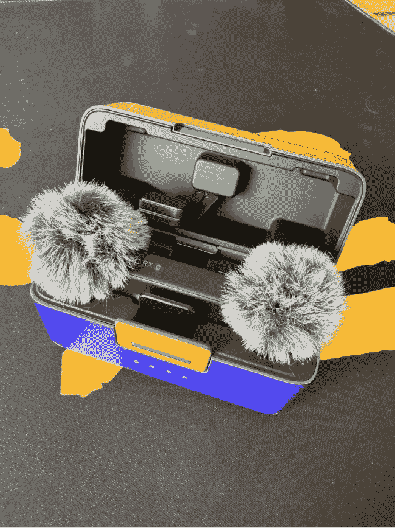
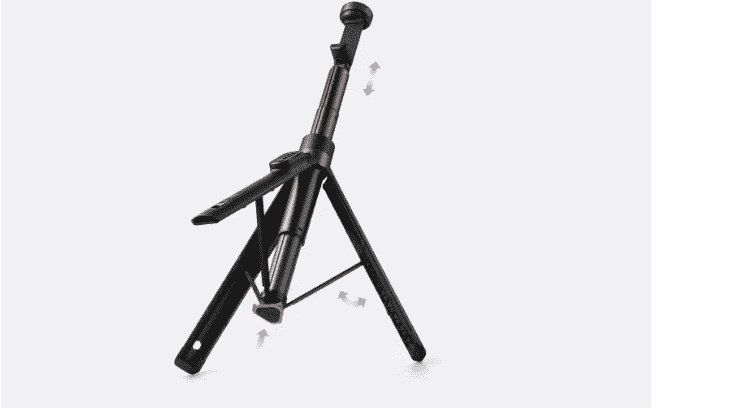
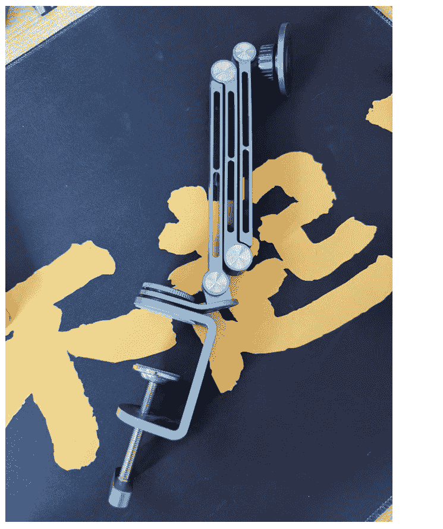
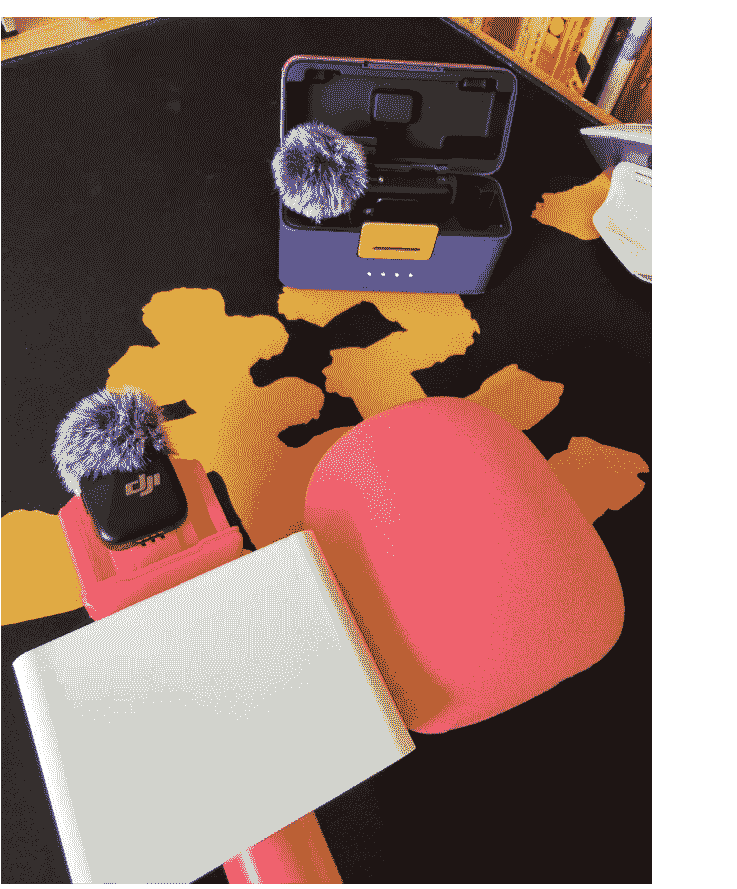
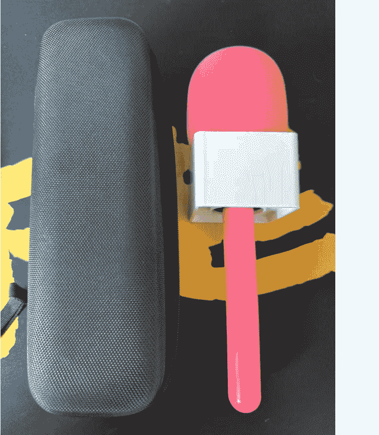

# 小型线下活动怎么组：从主题选择到活动控场、细节的全流程
## 251027 生财精华

公众号懒人搜索，懒人专属群独享

懒人微信：lazyhelper

微信：lazyhelper

圈友们好，我是根源。

这两年，生财也有了专属的组局版块，让圈友线下链接变得更简单、便利，也能让我们能因为这个版块，彼此的感情还有交流都更多元丰富，特别荣幸自己是一位生财圈友，每年都可以在这样的环境中，享受到更新之后的好多好多环境红利。

从2018年到现在，当时为了透过线下认识更多的新朋友，参加了近百场活动，从一两人的小组局、到千人以上的大场；也从参加别人的活动、到自己有能力当主办人。

从今年的8月开始，我也给自己设定了每周的组局目标，一周最少组一场线下活动，到这周已经组了9场，每一场的效果都还不错，报名的人数几乎场场都满。

如果你也想办一场属于自己组局的活动，这篇文章是我对于一场活动的构思、一直到流程到完整的一些分享，希望看完后能对你有些启发。

（这篇主题谈到的活动，是不超过 50 人以上的中小型活动。）

## 1、为什么要组局、为什么要见面？

我会把活动分为两大类：

- 新人局：70%以上的人都是第一次见面
- 熟人局：80%以上的老朋友（线下见过三次以上）

（这篇文章不谈熟人局）

新人局的活动定义特别简单：认识！

不管线上交情再怎么好、认识多久，线下见到面的感觉大概率是不一样的，甚至我都会定义：所有的交情从线下见到的第一面才是真正的开始。

也因为第一次见面，千万不要有太多的『预设立场』，就类似今天一定要完成什么什么目标......，这些都能先放下，第一次见面的目的就是彼此好好认识。

想想一个场景，一场活动 10 个人，时间只有短短的 3 小时，每个人都要说话，怎么有机会能透过这样的场景下快速的熟悉一个人，这难度太高了。

但是活动上聊过天，对彼此印象都不错、当场加了微信，这时候回家继续聊天，过几天在单独相约喝个咖啡，这时候才是真正深入交情的开始。

也就是第一次的活动不要想太多，就是透过一个小聚会『认识彼此』。

### 如何选择最适合自己的组局主题

在办活动之前，一定要先知道活动是以什么样的形式进行的，我总结了一些过去参加过 50 人以下的活动，体验过的不同主题

（后面会加上我认为的难易度★越多代表难度越高）

### 1.1 纯聊天局（或是运动局）★☆☆☆

没有主题、没有想法、没有流程，我就是想出来见见人。

这样的活动，参与者的项目越丰富，聊天讨论的内容就会越杂，还容易出现小群体聊天的状况，就类似十个人结果有三组人交头接耳讲话，很吵杂但也很好玩，主要是没什么压力，大家就是来认识朋友。

优点：简单、便利、无压力、纯认识朋友

缺点：除非个人魅力很强，不然这样的局效益都不会太大。

### 1.2 大方向主题讨论局★★☆☆

这类主题，组局者不一定要很厉害，甚至对这行业完全不熟悉也行，就类似；

聊聊副业、聊聊 AI、或者是聊聊怎么透过小红书变现、聊聊近期的风向标、....类似的大方向确定性内容

参加活动的人，能很明确知道，这个活动的目的是什么，我来这可能会得到什么

优点：能精准的找出自己想接触的项目群体，参与者都是奔着主题来的

缺点：

这种活动很吃群体，如果说我是做闲鱼的，你的局是跟小红书相关，可能我就不会去。

如果你的能力不够强，来的某一位圈友在这个领域很厉害，控场难度会很高，因为能量都会被比你厉害的人带走。

### 1.3 垂直主题讨论局★★★☆

开这样的主题，组局者必须在某个领域有一点成绩、或者是正在参与某个项目，主题特别明确，就类似：

- 大健康小红书赛道如何引流？
- 油管怎么透过 ai 变现？
- 垂直公众号该怎么做？

但是这个主题的组局者，可能会有两种状况：

你的主题项目做得有一定成绩的，可能是引流特别强，可能是内容很强，或者是可能透过平台的变现很强。

这个能力你是不擅长的，但是你想入局这个赛道，所以你想以这个主题，吸引厉害的人来分享给你听，我可以在活动里面学习。★★☆☆

优点：知道自己想要什么、主题特别清晰，不太容易聊偏

缺点：如果来的人经验都比你资浅，可能得不到太多好的建议跟想法

### 1.4 招募局（项目局）★★★☆

我可能有一个自己的课，这个课可能是跟时间管理有关，或者是跟心理咨询有关。

因为我的主题，我知道我能力还可以，我想要让很多人知道我有这样的课，或者是我在这个主题里面很擅长。

我在邀请的时候会有一个明确的方向：可能是如何透过时间管理让我能够一年赚到七位数；类似这种主题吸引进来的人，透过线下见面更好的认识新朋友，在活动结束之后，我能够跟他有更深的链接，进而去跟他聊聊我的产品。

另一种是项目类的，我有明确的项目想招募代理、合夥、或者是找人一起跟我干，

招募局跟项目局有点不同，招募更多的是卖课这一类的知识类虚拟的产品，也就是我单纯给，但是我跟你不会有赚钱上的关系，但是项目局就会牵涉到项目了，可能一起赚钱、可能我带著你赚钱。

类似。我在做大健康，或者我做的是旅游，我让所有人来的目的是，为了告诉他们我在做这个项目，我也会把项目讲得特别好。如果你有兴趣的话，你可以跟我一起干、起合作。

优点：组局者能透过线下筛选到不错的人，主题也不容易跑偏，如果组局者能力特别强，这样的活动效益超级高。

缺点：群体单一，如果实力不够，这样的局容易让参与者感觉太功利、目的性太强。

### 1.5 问答局★★★

这也是我自己比较常组局的一种方式，因为在项目上我觉得自己有些经验，在活动之前我会说，这个局的方法是你提问，我回答，会有一个可能私域或者是变现的主题、或者是爱情、某个项目啥的。

参与者来了之后，我会特别说明，今天想提的问题是没有限制的，所以在问答局的情况，你可以选择没有主题，也可以选择有清晰的主题。

优点：内容丰富，可以透过一个问题激起有类似问题的人共鸣，如果参与者的困惑差不多，效果会特别好

缺点：很吃组局者的实战经验、容易让对这个问题没兴趣的人放空，不太认真。

### 1.6 讲课局★★★★

互动性不高，得有一个很明确的主题，组局者纯说，你们来就是听我讲课、听我说。

如果你的人设很强、经验很丰富，这种局可以吸引到很多对你有兴趣的人，又或者是跟你有链接的人、以及纯粹想学习的人

优点：能开这种局的人，自身能力必定不弱，活动结束后，可以一次性认识超大量的人。

缺点：需要比较高的场地成本，因为这类的局，人数都会超过20人以上，同时要有很强的主导还有讲课能力，一般人不建议开，没有人脉积累也不建议开，特别容易冷场。

小建议：讲师有自己的产品或者项目更好。

## 2、如何组好一个局?

### 2.1 控场控的是时间(最重要)

当你有主题性之后，毕竟你是组局者，不管你的能力是好或者不好，你都得有一个特别重要的能力——控场。

控场控的是时间，因为每一个活动你有固定的时间，可能2个小时，可能3个小时。

像这种小场的活动，我特别建议时间不超过3个小时。

因为活动的目的是『彼此认识』，第一次见面如果聊超过3小时，人的脑子是会疲乏的，同时接收3小时的新知识，反而会让效率大大降低。

第二个是：

人与人的关系是慢慢迭代往上的，当第一次聊超过三个小时，那第二次见面要聊什么、第三次见面又要聊什么，这反而会让下一次的私下邀约有压力，是不是今天又得聊三个小时？

第三个是：

有清晰的时间节点，聊天才能有目的、有总结，当时间无限制拉长，最终就会变成什么都聊，聊的越多，反而无法聚焦。

所以一场活动，控制在3小时以内最刚好，我的活动习惯是2小时，然后抓30分钟的超出预留时间。

所以当有确定时间之后，你得控场。

控场在一个活动里面可能有自我介绍，可能有小活动，可能有正式进入主题。

我们需要做的就是把每一个主题设定时间：

可能自我介绍在30分钟之内，每个人只能说两分钟

我们的活动可能只有60分钟，我们得在每一个人分享的时候做一个时间点

可能一个人只能说10分钟，10分钟到了之后我会做一个提醒

因为我们今天的局是问答，你希望每一个人都可以提到问题，我都可以帮每一个人解决到问题。

这时候的控场控好，很多活动就不会迟到，不会延迟。可能三点结束，但是最后一直聊聊到了五点；感觉聊得比较久，但是效果其实是不好的。

因为时间拉得太长，有些人也不好意思说：我能不能先走，他可能又想听。

但最后会发现时间如果控制不好的效果，其实远比时间精准要来得差很多。

### 2.2 主持人的『引导』

我设计可能 2 个小时，大概在延期半个小时，是一个最好的超额聊天时间段。

可能我设定的是 2 个小时，大概 2 个小时半结束是可以的，或者我设定的是 3 个小时，在 3 个小时半结束是可以的。

因为这时候还有一种情况，对方有下一个行程，但是他又特别想听，然后还没轮到他，结果就得先走了，这个也尴尬。

所以在活动的开始一定要跟对方清晰说，我们的活动是 1 点到 3 点，往常都会在三点半结束。

组局者在结束的前 20 分钟，一定要说：我们的活动在 20 分钟后就结束了。

你跟各位说一下，我准备要进入总结，也要让对方知道结束的时间点是什么。

控时间的场很重要，因为你是组局者，所以在控时间的时候，最怕遇到一个比你厉害的人。

遇到某个大佬，每个人的自我介绍可能都是两分钟，都是三分钟。结果遇到这个厉害的人，他一讲讲十分钟，你也被打乱，有可能你也想听。

但是在是一个可能 5 到 10 人的活动有这种状况就特别尴尬。

因为活动的目的不是为了照顾厉害的人，而是为了照顾到所有的人。

所以在一开始你得把你的规则说清楚，自我介绍会有一个什么样的环节，每个人只有两分钟，或者每个人只有一分钟，自我介绍需要说什么，这时候我去做一个示范。

举个例子，我自己的活动都是这种方法。

在自我介绍我都会说，我们自我介绍有两轮，有一个比较重要的规则，每个人限制一分钟，你必须要讲：

年纪

名字（名字得讲三个）：第一个是本名，第二个是微信名，第三个是别人怎么称呼你的

老家：老家能够说得详细一点，像我来自中国台北或者我来自江西南昌

用3到4句话总结自己做的项目：我是做知识付费的，擅长销售，现在有一个属于自己的个人体系，同时我也是一名心理咨询师

类似这样，快速说完，每个人各一分钟。

当我有一个示范之后，后面的人会知道他应该要怎么说，他的顺序是什么，他要讲多少。

参加一个活动有一个很神奇的场景，当我们做自我介绍的时候，如果说组局者没有清晰的规则，前面的人说什么，你就会说什么。

就像我如果在自我介绍，我主动说：

要不我第一个，我第一个说你们好，我是根源，我是天蝎座。

不管后面讲什么，第二个人一定会讲你好，我是小白，我是双鱼座的。

我们总会想模仿前面的人，因为大多数的人都没有什么清晰的主轴。东方人喜欢从众，大家干嘛我就跟着一起干嘛。

所以组局者得担任好这样的角色，把规则说清楚。规则说得越清楚，同时你还能够有示范，后面的人就知道我要怎么讲。

当然这也是一个很好的控制时间方式，因为当你没有规则，有些人会想一直说，一说就停不了，时间就会再次控制不好。

你在参加活动，肯定碰过一些人是拿到麦克风，他就开始很开心，特别有表达欲；这种情况下其实会让活动的时间，有很大概率会延迟。

所以在规则这一块的目的是为了控场，或者让他们更有方向，以及为了控制时间。

### 2.3 适当的提醒、有礼貌的提醒

#### 如何提醒超时

那这时候遇到这种情况，有些人可能真的想一直说，我就会当那个提醒者。

对方可能已经说了两分钟，但是我的时间限制是一分钟，我会说：

还有 30 秒我们要换下一个，因为我们的活动是有固定流程的，我觉得你说得特别好。

等一下当我们进到第二主题的时候，也可以再让你分享。

所以你大概再说 30 秒，我们就要换下一个。

用这种方式，对方也会知道说，因为你是一个组织者，所以我得尊重你，我得有礼貌，我得遵守整个活动的规则。

所以组局者必须得当一个提醒的角色。

很多时候组局者不敢提醒，这就很尴尬。如果你敢提醒，对方会知道说这场子是你的。

所以一定要当那个控场的角色，有话就直说，但记得有礼貌就好了。

控场只要做得好，这个活动的完成度一定超过 70%。

很多的活动之所以让多数人感觉到怪，或者不会想继续参加，都是因为控场没有做好。

### 2.4 准备活动所需的道具

道具其实不用很复杂，因为如果你想组一个5到10人或者是20人以内的小局，也不需要做到名牌。

但是你可以设计一个小活动，可以帮所有人准备白纸，白纸上可以写上他的名字。

每个人在介绍的时候，可以写名字，让大家看一下我的名字怎么写，同时我叫什么，这时候你对于这个人印象就很深刻。

录制很重要，因为录制如果你能够做，对方会觉得你很贴心。

所以我自己在办活动的时候，我同时都会担任录制的角色，不管是录制语音还有录制视频。

如果录制视频，必须准备mic（我用的是大疆的mini，这部份没有特别推荐，喜欢哪种看个人喜好），有没有mic的视频录制效果是完全不同的。

所以我在办活动，我还会把手机的脚架带出门，这样我们在录制视频的时候，手机有地方可以放。

一种是落地的手机脚架，我原本用的是小米，现在用了其他品牌，找一个适合自己的即可

第二种是夹在椅子上的手机支架，也挺好用，看现场的状况决定我会使用哪一种

一键展开脚架

收放自如的一体式折叠结构

我在活动一开始会说：

这场活动我会录音，如果说你想回放，结束后我会把录音发到群里

这样你们就不用边聊天，还要边担心录制是否有录到，这个事情我会做好，所以你们放心。

如果你同时有录制视频，可以准备一个麦，像我就准备了自己身上别一个麦。因为毕竟我的活动我是主讲者，所以我身上会别一个。

同时，我还会准备一个麦克风，麦克风里面会插着大疆的麦。当一个人要讲话的时候，我会把麦克风递给他。

这个举动会特别有仪式感，因为他会感觉我讲话的时候手上有麦克风。

当一个人手上有拿东西讲话的时候，这画面很有趣，所有的人都会看他。

如果说没有这样的道具，会出现一种你说你的，我说我的，各自说各自的。你的对面两个人想私下聊天，他们就私下在讲话，我旁边的人又在讲话，这多尴尬。

但是如果多了一个麦克风，一个人讲话，我跟他说，麦克风给你，你把麦克风递过去，所有的人就会看他。

> 所以这种小道具也能够增加控场的效果。

活动其实有很多不同的小环节，这部分因人而异。

你可以到小红书去找，如何开场，如何破冰，如何怎么样怎么样。这其实能够找到很多类似的，找一两个喜欢的，放在你的活动多尝试就行了。

重点就是控场，任何活动，你都需要控场的。

最后就是拍照，还有引导每一个来参加的人彼此加上微信，这太重要了。

因为我觉得参加活动的目的并不是为了找项目，也不是为了得到什么，而是为了链接人、认识人。

既然我是个组局者，虽然那场活动是有主题性的，但我的目的是让大家可以彼此认识，不止你可以认识你身边的朋友，你也可以认识我。

所以在活动的最后，我一定会引导所有的人：

我们现在开始我们各自加各自的微信。

你可以先找 2 个到 3 个人，来当你今天这次活动认识的朋友。

在活动结束之后，我会有一个小主题，可能希望大家可以在活动做一个复盘。这是我自己在活动群里面的模板，给你们可以拿来参考一下。

现在这一分钟你可以开始主动去加每一个人，或者是加你觉得很深刻的人。

活动结束之后，我们肯定会开一个小群。这群可能是活动前开，可能是活动之后开，都行。

这大概是一个参加活动几个比较重要的小事项，如果我前面说的那些可以做得好，一场活动，你想要有一个 80%以上的成功率，让大家满意是能做得到的。

## 总结加上附注内容：

最后，希望以上的分享能对也想办活动的你有所帮助跟启发，也欢迎参与我的每周活动（固定周一或者周二，杭州的生财附近！）

### 附注一：我的活动简易的表格，以 13:00~15：00 为一个活动的时间基础，我一般会这么安排整个活动流程

| 时间 | 流程 | 注意事项 |
| :--- | :--- | :--- |
| 活动前三天 | 拉群通知报名的圈友，同时确定以下事项：能否来、活动确定日期时间、地点、交通位置、aa金额 | 提早三天是为了预留，有些人通过好友的时间可能会比较慢。 |
| 12:00-12:20 | 最少提前40分钟到，再差都得30分钟前 | 一定会有人早到，所以提早到特别重要。 |
| 12:20-13:00 | 准备会场，录制、投影、白板、茶水还有可能需要布置的东西，以及服务提早到的朋友。 | 事前需要准备的东西越多，就越要早到，大原则就是让到的人，能看到现场的所有准备是完善的。 |
| 13:05 | 预留五分钟的迟到，跟已经到场的人说开始的确定时间。 | 时间一到就开始，不要照顾迟到的人，要照顾准时到的人，就算迟到的人再进场，也不能跳开主题，让迟到的人自我介绍，一切已准时的人为主。 |
| 13:05-13:30 | 自我介绍时间 | 自我介绍千万别拉太长，主持人一定要控制每一个人说话的时间。 |
| 13:30-14:45 | 进入主题 | 不同主题有不同的主持方式、以及不同的控场方式，但最重要的还是注意时间 |
| 14:45-15:00(15:30) | 结束前的15分钟，我一定会打断所有的对话，让参与者知道还有多少时间结束，以及最久能聊到几点。 | 让参与者知道活动结束时间，因为多数人都会有下个时间点的安排，不要让活动的结束遥遥无期。 |

### 附注二：活动所需物料

- 手机（录制用，最好能有相机）
- 充电宝，录制超过两小时手机会没电，我就犯过这样的错，导致录制不完全
- 收音的 mic
- iPad 平板（可能会有投屏需求）
- 手机支架、夹是跟站立的都能准备，看会场状况
- 自带纸跟笔，活动方可能不会准备，看人数需求准备多少
- 白板笔，多数的活动场地白板笔很难用，还容易没水
- iPad 用来手写投屏、还有飞书录音
- 手机录制视频，提早到调整好角度！
- 给参与者说话的麦克风

附注三：过去活动的每场飞书记录，因为是问答场，多数都是我说话，平均每一场的内容约六万字，放上来跟各位圈友分享，如果你想听的话，特别欢迎！

### 第一场：
https://oee5lr7gsk.feishu.cn/minutes/obcnv6c5jcf27642r63l8luI

### 第二场：
https://oee5lr7gsk.feishu.cn/minutes/obcnv6622od2n8uo4611o5fz

### 第三场：
https://oee5lr7gsk.feishu.cn/minutes/obcnv6s4l5l46jr2my8rx523

### 第四场：
https://oee5lr7gsk.feishu.cn/minutes/obcnv7t33944777qgf67598t

### 第五场：
https://oee5lr7gsk.feishu.cn/minutes/obcnv7ayie8vg1f81753dlhp

### 第六场：（忘记录）

### 第八场：
https://oee5lr7gsk.feishu.cn/minutes/obcngtc71f73h8d5qcn022ue

### 第九场：
https://oee5lr7gsk.feishu.cn/minutes/obcnj996w3546h6j86bb2pwa

最后，安利小懒的付费群：

#### 懒人专属群（介绍）

📚 懒人专属群持续更新中，已持续运营6年，整理超3000份各类精选付费文章&年费社群干货，全部开放下载。

本资料为付费群内部分享，仅供真实有需要的朋友查阅 🙇

#### 懒人专属群更新记录：
https://lazy2025.top/blog/record2

#### 懒人专属群更新记录（需梯子，备用）：
https://lazybook.fun/blog/record2