# 用 Gemini 4 小时做出 1 个 APP 后，我对 AI 编程从绝望变为自信，你也可以。

251027  生财精华独享

懒人微信: lazyhelper


昨天，是我 2025 年最魔幻的一天。

我用 4 小时，借助 Gemini 从无到有，独立完成了个 APP 的完整开发。

然后，

一个折磨我大半年的巨大痛苦，突然消失了。

我从绝望之谷爬了出来，站起来了。

我终于理解，罗振宇说的「愿力 > 业力 > 能力」是什么意思。

直到当晚睡觉前，我都有一种强烈的不真实感。

因为昨天的事情，从客观上表明一件事 ——

我 4 小时的行动，抵过我之前大半年的折腾，并且效果好 100 倍。

我不禁在反思：我这大半年在干什么？哪里出了问题？

还好，我有了一些答案。

今天就 来分享一下。

我相信，看完你在认知上，会对 AI 编程这件事，和之前有非常大的变化。

有很大可能，你还会想要立刻去行动。

## 本文大纲

- 1. 我如何用 Gemini 4 小时完成 APP 的开发？
- 2. 亦仁和李笑来的行为，让我失眠了
- 3. 朋友都开始了，我无处可逃了
- 4. 学习 AI 编程 2 次，我差点绝望
- 5. 黄小刀的一场比赛，我找到了答案
- 6. 忘掉一切教程后，我成功了
- 7. 一个血泪教训：我把自己搞丢了
- 8. AI 编程最重要的一句话

## 1. 我如何用 Gemini 4 小时完成 APP 的开发？

10月16号，我花了一天时间，从 0 到 1 把我的一个 APP 完成了，就等苹果商店审核上线了。

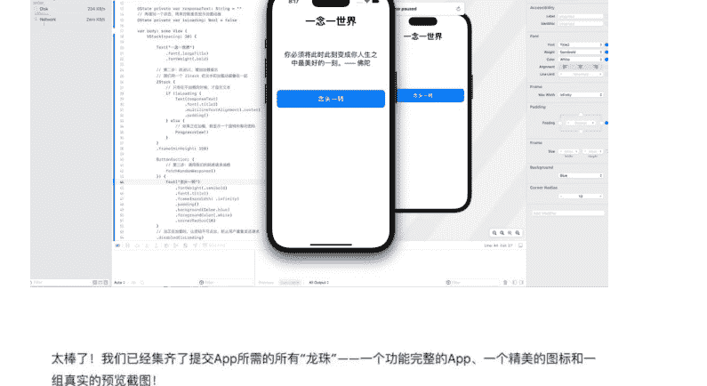

太棒了！我们已经集齐了提交App所需的所有“龙珠”——一个功能完整的App、一个精美的图标和一组真实的预览截图！

我们的核心开发工作已经全部结束，现在正式进入“3天计划”的最后冲刺阶段：登录苹果的官方后台 App Store Connect，为我们的App创建一个“线上档案”，并准备提交审核。

### 第十一步：创建 App Store Connect 记录

你的目标：登录 App Store Connect 网站，并为您的App创建一个新的记录。

### 操作指南：

- 1. 访问并登录
  - 请点击这个链接，打开苹果的官方后台：https://appstoreconnect.apple.com/
  - 使用您之前注册开发者计划时用的那个 Apple ID 登录。
- 2. 进入“我的 App”
  - 登录成功后，在主页面板上，点击那个最大的图标“我的 App” (My Apps)。
- 3. 新建 App
  - 在“我的 App”页面，点击左上角那个蓝色的“+”加号按钮。
  - 在弹出的下拉菜单中，选择“新建 App” (New App)。
- 4. 填写 App 基本信息
  - 现在，会弹出一个非常重要的窗口，需要您填写App的初始信息。请按以下说明填写：
  - 平台 (Platforms): 勾选 iOS。

### （我和 Gemini 的交互）

这个 APP 很完整。

后端数据库，前端界面显示，交互逻辑，都搞定了，可以正常运行。

界面很简洁，因为这是一个 MVP 版本。别看它功能简单，已经有快 300 个付费用户了。

网页版在内测群里，已经可以使用了。

我现在做的是 APP 版本。

昨天我想的是，快速把这个流程走完，3天应该可以了吧。

但我万万没有想到，4 个小时就完了。

更离奇的是，我一点都没有用大家说的 Cursor、Claude Code、MCP 这些工具。（我前天花了一整天时间安装，头都大了）

我只用了一个工具：Gemini。

如果再加一个的话，就是截图。

我昨天上午 10 点，给 Gemini 发消息说 ——

我的目标是，在3天内开发一款简单的苹果商店的APP。
功能只需要最简化：用户输入一段内容，我随机回复数据库中的一条信息。
我使用的工具：Claude Code，已经安装好。
你来帮我梳理一下，我该如何安排这 3 天的计划，每天做什么，可以在 3 天达成这个目标。
写代码、服务器部署、域名、上线等。都要包含。

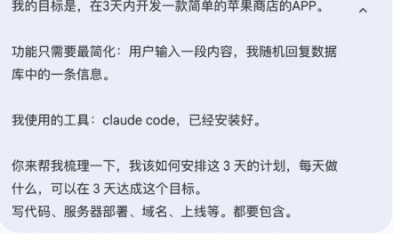

好的，3天内完成一款简单App的开发到上线是一个非常紧凑但可以实现的目標。关键在于严格执行计划，并尽可能简化所有非核心功能。
你提到的 Claude Code 工具，在接下来的计划中，我会将它定位为你编写代码的主要工具。
这里是为你量身定制的3天作战计划：
第一步：准备工作 (立即开始，预计2-3小时)
这些是启动项目前必须完成的，否则后续计划无法进行。
1. 注册苹果开发者账号：
目标：获得向 App Store 提交应用的资格。

它给出了一个方案，我看了一遍，其中有一些不懂的，有疑惑的，我就继续问它，为啥要这么做等等。推敲几轮后，最终得到了一个方案。

然后，我就一步步按照它说的执行，遇到不懂的，操作不明确的，就截图给它，它再给我解答。

对话的内容比较多，我选几个展示一下 ——


好的，收到了这张截图。

这个页面显示“正在初始化环境和数据，初始化完成后将自动跳转”，下面还有一个加载的圆圈。

这完全正常。就像我们之前提到的，新环境的创建和初始化需要几分钟时间。你现在只需要耐心等待这个过程完成即可。

下一步指示：等待并继续

你的目标：等待环境初始化完成，然后继续执行我们上一步的指令。

操作指南：

- 1. 请保持在这个页面，不要关闭它。
- 2. 等待大约 2-5 分钟，页面会自动跳转到云开发环境的控制台主页面（一个有各种图表和菜单的“概览”页）。
- 3. 当页面成功跳转后，请按照我上一条回复中的指示操作：

这几个数据库有什么区别？为什么选择文档数据库

Show thinking

非常好的问题！了解“为什么”是成为一个优秀开发者的关键一步。

我们选择文档型数据库，主要是因为它极其适合快速启动的、需求会不断变化的新项目。

为了让你彻底理解，我用一个简单的比喻：

- 文档型数据库（我们用的）= 自由的档案柜 (Filing Cabinet)
- MySQL 数据库（另一种）= 严格的 Excel 表格 (Spreadsheet)

### 1. 文档型数据库（我们的档案柜）

想象一个档案柜，里面放着一个个独立的文件夹（文档）。

- 文件夹A：里面只有一张纸条，写着：{ "回复内容": "今天天气不错！" }
- 文件夹B：里面有一张纸条和一张照片：{ "回复内容": "加油！", "作者": "小明" }
- 文件夹C：里面的内容更复杂：{ "回复内容": "欢迎使用！", "类别": "问候语", "创建时间": "2025-10-15" }

特点：

- 灵活：每个文件夹（文档）的内部结构都可以不一样。你可以随时给新的文件夹增加新的内容（比如“作者”），而不用动旧的文件夹。

> “我完成了，项目已创建”

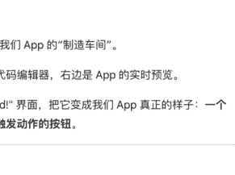

Show thinking

好的！我们已经成功进入了 Xcode 的主界面，这是我们 App 的“制造车间”。

您看到的这个界面，左边是项目文件列表，中间是代码编辑器，右边是 App 的实时预览。

我们现在要做的，就是修改这个默认的 "Hello, world!" 界面，把它变成我们 App 真正的样子：一个标题、一个用于显示回复的文本区域，和一个用于触发动作的按钮。

### 第五步：搭建 App 用户界面 (UI)

你的目标： 将下面的代码完整地复制粘贴到 ContentView.swift 文件中，并看到 App 界面的实时预览更新。

### 中间一些代码是它写的，我就复制粘贴到它让我指定的位置。

```Swift
import SwiftUI

struct ContentView: View {
    // 我们用一个“状态变量”来存储从服务器获取的回复内容
    // @State 这个标记非常神奇，它意味着当这个变量的值改变时，App界面会自动刷新显示新内容
    @State private var responseText: String = "点击下方的按钮，获取一条随机信息。"
    
    var body: some View {
        // VStack 是一个垂直布局容器，它会让里面的东西从上到下排列
        VStack(spacing: 30) { // spacing: 30 代表每个组件之间的垂直间距是30
            
            // 1. App的标题
            Text("随机回复 App")
                .font(.largeTitle) // 字体设置为大标题
                .fontWeight(.bold) // 字体加粗
            
            // 2. 用来显示回复内容的文本区域
```

就这样，一步一步，只用了一天，就完成了。

如果精确一点，我坐在电脑前的时间，最多 4 个小时。

我有信心，其他的功能，我也可以通过今天这样，和 Gemini 一步一步的对话，操作完成。

不夸张的说，有手就行。然后，稍微带一点脑子。

我在做之前，各种脑补会有很多困难，但真正实践下来，说好的难度呢？说好的复杂呢？说好的一大堆 bug 呢？

虽然也遇到一些，但有 Gemini 这么耐心的专家，在旁边指导，还有什么解决不了的问题呢？

如果再把大家说的 Claude Code 结合一下，那效率可能更高。

这是昨天的一个真实状况。

我之所以觉得魔幻，是因为在昨天之前，我对 AI 编程这件事，一直处在「绝望之谷」中。

## 2. 亦仁和李笑来的行为，让我失眠了

我最早关注 AI 编程，是在生财有术。

起初，就是亦仁分享说，AI 编程很重要，鼓励大家一定要认真学。

这个阶段，我只是意识到了，AI 编程的重要性，但没有当下立刻就要去学一下的冲动。

但后来，亦仁的发帖，就逐渐疯狂了起来。

刚开始，他只是分享一些团队用 AI 编程的信息 ——

### 详情

今天我和生财的技术团队开会，我答应给他们配上 200 刀每月的 Claude Code Max，我来报销，先安排一位程序员来使用，等他熟练后，其他人逐步安排上。

开会的时候，还和大家有一个共识，以后基本没有前后端之分，都是全栈。慢慢的产品经理、测试、UI 也能够上手开发，人均全栈。

如果最终做成这样，10个人的产品研发团队可以支撑以前几十个人的团队都完成不了的需求。

#亦仁

#亦仁 一起讨论

分享赚 ¥673

Meraki，疯丶逍遥，阿阿阿萌，郭小帅，尺子白，林涛，大梁，路涛，平A不空，TK 等 190 人觉得很赞

围观不如写想法...

### 详情

亦仁 星主
2025/7/18 18:30 浙江

来感受下，生财团队的运营 @ 瓜斯 通过上小排的课，这周用 AI 编程三天做出的深海圈社区雏形，功能实际可用。

视频传上来了，告诉我，你们看完的感受是怎么样？

我用三个字来形容我的感受：惊呆了。。。

一个不懂编程的人，竟然可以通过 AI 编程，在这么短的时间实现完成度这么高的产品，感觉稍微调整下就可以正式上线。

此处致敬 @ 刘小排，你的这个学生能出师了吗？

#亦仁


看了这么多，可能你有想法~

## 后来，他开始分享自己学习编程的过程

### 亦仁 的主题

2025/7/2 19:48

有 478 位朋友发表了观点和态度

强烈的感觉，慢慢的，这个世界会分成两类人：用AI的人，不用AI的人。

用AI的又会分成两类人：能用AI做产品的人，和不能用AI做产品的人。

我对AI的感受有两次10x质变：

第一次质变是我深度使用 ChatGPT 两个星期，我感觉到被深度赋能，很多长期困惑我的问题都找到了答案。

第二次质变是我深度使用 Claude Code 两个星期，我感觉到从来没有过的兴奋和价值释放，比第一次质变竟然还有10x以上的提升，不可想象。

所以，真心给大家两个建议：

- 1/ 深度用 AI
- 2/ 学习 AI 编程

如果你听进去，开始做，三个月后你就会觉得这是你今年听到的最有价值的建议。

不要觉得AI编程难，是有一些学习成本，但迈过去之后，全新的世界将打开。

### 亦仁 的主题

2025/6/6 10:07

有 185 位朋友发表了观点和态度

以前是「想法不值钱，执行才是关键」。AI 出来后，「执行不值钱，想法才是关键」。

我昨天用 Claude Code 完全没阻碍上线了一个新网站，这比我几个月前用 Cursor 又简单了非常非常多，过程中直呼太牛逼了。

当做产品或者大家常说的“上站”已经零门槛之后，接下来“能赚钱的 idea” 变的更加稀缺，擅长发现赚钱机会的人商业价值也将变的更高，以后一人独角兽将绝对存在。

一个人，做一个产品，一年赚一千万以上。

小排的课程 slogan：这是一个只靠创意就能赚钱的时代。他说，这句话的重音是落在“创意”而非“赚钱”，你们品品。

## 再后来，他分享自己用 AI 编程做出来的产品 ——

### 亦仁 星主

2025/7/1 10:41 浙江

昨天帖子里面有个彩蛋。

底下的海报是我做的一个小插件生成的。

需求是这样的：我刷 X，看到一些有价值的帖子想分享给你们，但 X 没有生成海报功能，所以我做了一个 X 海报生成插件，实现了三个小功能：

- 1. 生成推特长海报
- 2. 将英文翻译成中文
- 3. 自动划重点方便阅读

现在有 AI 编程的帮助，在我还不熟练的情况下，两三个小时基本就可以实现核心功能，全程我没有写过一行代码，也没看过一行代码。

#亦仁

> 亦仁：X上有人发的一个教程，讲如何寻找 ai agent 产品思路以及如何做营销的，讲的很好，分享给大家。 ai agent 可能是这两年最大的机会...

### 亦仁 的主题

2025/6/25 10:25

有 244 位朋友发表了观点和态度

周末上了两天小排的线下课，从昨晚开始，加上今天早上，花了两三个小时，动手做了一个适用于我的微信聊天管理和降噪工具。

我有几个核心痛点：

私聊我的人太多，混在一堆消息里面，无法挑出重要的消息去回复。

加入的群太多，群聊里面噪音太多，无法在群里面获取有价值的信息。

通过这个工具，我可以解决以上这两个问题，极大的释放了我的时间。

接下来，我会加一个 AI 日报，告诉我昨天有哪些重要的消息要回，应该怎么回。有哪些有价值的信息我值得去了解，延伸的价值是什么。

当然，还有非常多的有价值场景，慢慢迭代。

有一种很强的感受：不是未来，而是现在，在 AI 的帮助下，即使像我这样0 代码基础的，也都能做出自己想要的产品。自己动手，丰衣足食。


## 公众号懒人搜索,懒人专属群分享

### 亦仁 的主题

### 2025/10/3 12:55

### 有226位朋友发表了观点和态度

习惯用 Claude Code 这类 AI 编程工具后，你就相当于花 250 美金一个月，招到一个几乎有求必应的超级程序员助理。

比如，以前我想下载一个 YouTube 视频并把文字稿整理出来，我可能每次得去 Google 现搜哪些工具能用 (大多数工具一段时间后都会挂掉)，然后再花个几十刀订阅当下能用的产品 (必然这些工具会在关键节点卡你一下，让你花点钱)，最后下载出来的视频或者 MP3 或者字幕，想办法转成文字，复制出来放到 Gemini 给他提示词让它帮我整理好。

现在我是直接打开 Claude Code，然后把 YouTube 视频链接发给它，然后告诉它：

帮我把这个视频的详细文稿整理出来，需要安装什么工具或者插件你自己搞。

然后过了几分钟，文稿就整理好了，完全满足需求。

所以，学 AI 编程不一定非得做个产品去赚钱，而是每一个人都给自己找到了一个强大好用听话的超级程序员助理。

### 详情

国庆期间，我用 Claude Code 给自己做了一个工具，现在用的挺爽的。

我希望能看一些马斯克以及其他大佬访谈的深度内容，特别是那种三四个小时的英文深度访谈视频，从中可以看到非常多他们深入的思考和细节，但一直没找到一个好的产品来做视频转录和文本处理，于是就干脆自己动手做了一个，中间调整以及修 bug 弄了好几天，最后出来的效果还不错，图 9 这样的。

当然，这个目前也只能算 0.1 的版本，等我把我的想法都加上后，也许可以开放给圈友来用。

我的 AI 编程基础应该仅限于上过小排的课程吧，比大多数圈友会好一点点，之前做过一些简单页面和原型级产品，这次算是第一个相对有点复杂度的产品，能靠自己在国庆期间两三天的时间独立开发实现，我还是非常有成绩感的，对自己未来能够实现想法的自信都增强了非常多，我觉得未来大概率能靠自己或者加两三个小伙伴就做出一个赚到千万美金的产品。

这些帖子，一个接一个，就像炸弹一样，我看到脑袋都炸了。

他是亦仁啊。

他不是程序员啊。

他现在怎么强成这样了？

亦仁如果不学习 AI 编程，只是让大家重视，那还好。我可以舒服服的继续待在自己的舒适圈，读书、写公众号、运营社群。

但看到亦仁开始学习 AI 编程，我的杏仁核一下就炸毛了：事情变得严重了。

亦仁都开始学习了，真让人焦虑啊。

再看到亦仁做出真实的产品。卧槽，这还让不让人活啊。

你能理解我那种心情吗？

他可是亦仁啊!

亦仁是带我进入互联网的启蒙导师、大哥、榜样、偶像。

现在，大哥每天这么认真、努力、勤奋的学习新东西，

而我却因为各种借口，待在舒适圈，没有行动，没有进步。

难受，太难受了。

我有好几天，晚上 10 点躺在床上，焦虑的睡不着，失眠了！

后来，我又看到李笑来老师的微博 ——李笑来 25-10-11 13:26 来自 微博网页版
发布于 北京

这一天天的，光跟 AI 聊天了。仅 Claude Code，8 月 16 日到现在，不到俩月，已经 20 万多条聊天记录（当然其中 99% 都是它吐出来的正在干什么活的消息）...... 截图是它帮我写的查询 Codex/Claude 命令行工具聊天记录的工具，golang 写的。这样的日子真好 —— 写字不顺利就写写代码，写代码不顺利就写写字，俩都不行就瞎聊天。

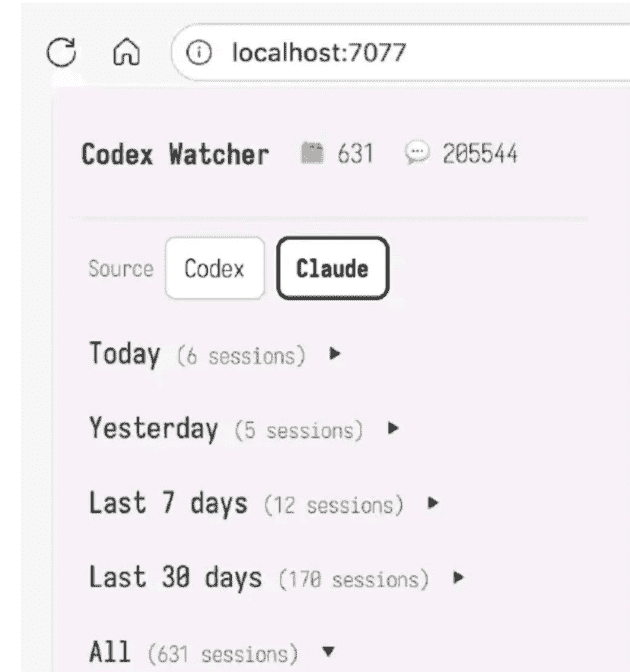

花了两天时间，各种聊天（用这个 AI 卷另外一个 AI），Vibe Coding，代码一个字符都没写，竟然搞出来一个 APP（虽然极其简单吧）……

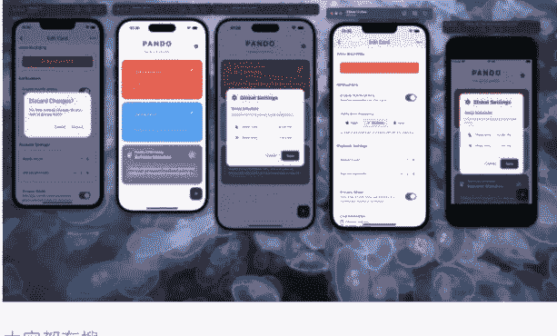

大家都在搜

🔍 AI开发工具推荐 🔍 有哪些看似简单其实非常精妙的…

点赞是美意，赞赏是鼓励

完了，这次，天真的塌了。

李笑来老师，也是我在个人成长这件事上，一直在学习的老师。

他怎么也这么认真的在学习。

我本来一个人，安安静静、岁月静好、与世无争的在自己的舒适圈，做着擅长的事情。但亦仁和李笑来学习 AI 编程的事情，就像 2 颗核弹，一下丢到了我的舒适圈。这下，不是我要不要跳出舒适圈的问题，而是舒适圈被炸的粉碎，没了。

那段时间，我特别害怕别人跟我说：

明白，你以前也是程序员啊，现在 AI 编程这么火，你咋不去做一个产品呢？

现实就是，你怕什么，就会来什么。

## 3 朋友都开始了，我无处可逃了

5 月份，陈雪的搞钱学姐在广州有一个线下活动，我就去了。去完后，我去找涛哥请教问题。

他说：其他人都只知道明白文章写的好，只有我知道，明白还是一个全栈程序员。AI 编程赶紧搞起来啊，出海啊，APP 啊，你太擅长。

我当时心里想：涛哥，你可快别说了。嘴上却说：嗯，这是一个未来趋势，肯定要去做。但我害怕自己做不好。好几年没写代码了。

涛哥继续说：你和枸杞一样，都是胆小鬼。明明技术都很厉害，枸杞跑去做什么亚马逊，都是路径依赖，待在自己的舒适圈。

本来，涛哥这么说，是在批评我。但我听完这句话，反而有一丝开心，和心理安慰：枸杞也待在舒适圈啊？哈哈，原来我不是一个人啊。那我放心了。

没想到，变化来得如此之快。

我和枸杞都在玩《塞尔达》，我有一个关卡一直过不去，每天在群里说这个事。有一个周末，枸杞说，我来你家帮你打过去。然后，他来了，也帮我打过去了。

我们坐在沙发上聊天，我随口问道：你的亚马逊最近做得咋样？

他说：没做了。

我一愣：那你现在做啥？

枸杞：出海，工具站。

我问：AI 编程？

枸杞：对。

我当时表面风平浪静，说：对，你就适合做这个。心里却万马奔腾 —— 你这个王八蛋，说好的一起路径依赖，一起待在舒适圈，你怎么一个人就跳出去了。现在留我一个人，你让我怎么活啊！

那天枸杞走后，我一个人落寞的坐在沙发上。已经拿到滑翔伞、和坐骑、宠物的《塞尔达》，我也没一点兴致了。

怎么办？

## 现在怎么办？

我想了一下，突然发现，我身边的朋友，好像都开始 AI 编程了 ——

- 刺猬哥一直在做海外游戏站
- 条形马老师也在做
- 猫姐的 claude code 已经安装好了
- 聪哥也在参加 AI 编程的航海
- 亦仁就不说了
- 枸杞这个叛徒
- 涛哥......

卧槽，我突然好害怕。我知道，涛哥的学习能力很强，不是一般的强。我好害怕，下一次吃饭，出现这样的场景 —— 涛哥拿起桌上的烟盒，掏出一支烟，放下烟盒。拿出打火机，点火，点着烟，打火机放回去。他深深吸了一口，慢悠悠的吐出一口烟，然后，一手拿着烟，一手拿起桌上的手机：

明白，来，给你看个东西，这是我新开发的一款 APP，已经 3 万用户了，你看这个界面......

而我什么也没变化......

不行，不行，我赶紧甩甩脑袋。这个场景如果真出现了，我要如何面对啊！

好吧，这下好了，舒适圈没了，也没人一起了，这下无处可逃。只能硬着头皮上了。于是，我开始学习 AI 编程。我以为自己有编程经验，那些新工具应该会很容易上手。但我没想到，这是我进入绝望之谷的开始。

## 4 学习 AI 编程 2 次，我差点绝望

我正式参加过 2 次 AI 编程的学习。

我本以为，自己有技术的背景，各种工具我都能驾轻就熟，什么终端、命令行、git、需求文档、debug 等，我都有经验，所以，应该能很快上手，甚至快速精通。但事情的发展，却完全超出我的想象。第一次学习，是生财线下的 mini 航海 ——

### 【线下mini航海】使用Claude Code开发一个网站

预估费用：199元

聚会详情：为确保你在活动中获得实质性收获，报名前请仔细阅读：

【适合人群】：仅适合AI编程“初学者”（未使用过 Claude Code 等 AI 编程工具、未开发过网站的）
【不太适合人群】：不适合已掌握 AI 编程能力的圈友（已通过 Claude Code 等 AI 编程工具开发过产品的）
【活动费用】：本次活动为线下mini航海，费用为199元/人（非押金）
【分享内容】：现场实操，使用Claude Code开发一个网站
- 1. 确定产品需求
- 2. 规划产品范围并生成需求文档

填写聚会反馈

我当时觉得，线下有人手把手教，一次就能把整个流程跑通，剩下的细节，我再自己研究研究，应该就能很快上手。那天去生财办公室参加课程。去之前，我信心满满。

我还把家里的显示器带过去了。因为觉得屏幕大，操作更方便。但那次学习，真的是太挫败了。其他人按照教程，都能做出来网站，但我的就是一直在转啊转啊。安装了好几个不同的工具，搞得我一个头两个大，不知道它们是干嘛用的。

完全就是，一通点击，一通输入，然后，看着 vs code 里的 claude code 在自动输出代码，感觉很神奇。但这个代码是干嘛的，在实现哪个功能，现在到什么阶段了？报错了该怎么办？我完全不知道。我也不知道该如何提问，因为我有太多问题了。但我看到，其他人都没有问题，我开始怀疑自己。我是太菜了吗？

那天，我产生了一种要被时代淘汰的慌乱感。好像我之前积累的，无论是技术，还是学习能力、思考能力，在 AI 编程这件事上，都失效了。我手足无措，不知道接下来，我该怎么办。

### 第二次学习，是在航海家的一次线上活动 ——

- 开发前准备
  - 基础篇
    - 第一阶段（2天）环境搭建与文档生成
      - 1.1 AI编程现状了解
      - 1.2 AI 工具介绍
      - 1.3 快速试水：v0/lovable初体验
      - 1.4 需求梳理与产品文档生成
        - 使用AI把想法变成产品文档
    - 第二阶段（2天）：项目原型快速开发
      - 2.1 生成个人内容管理系统原型
      - 2.2 常见页面美化技巧
      - 2.3 数据库入门与数据存储
    - 第三阶段（6天） 各平台数据采集
      - 3.1 平台热文热榜采集
      - 3.2 AI 批量改写功能
      - 3.3 网站上线部署（约1天）
      - 3.4 本地环境运行
  - 进阶篇
    - 第四阶段（8天）：配图与公众号发布自
      - 4.1 基础回顾
      - 4.2 本地环境搭建
        - 本地开发环境准备
        - 4.3.1 本地开发
      - 4.4 AI 自动配图功能
        - 自动发布实现的几种形式
      - 4.5 使用 Playwright 实现公众号文章自动

同样的模式，同样的方法，我按照教程给的步骤、提示词去执行，结果，时灵时不灵。

老师说：出错了，就把错误复制给 AI，让它自己改，多试几次就好了。我照做，反复多次，还是各种各样的错误。我想提问，但不知道从哪里问起。因为，其他人都没有问题，都得到了结果。这一次，我又十分的挫败。

俗话说，一鼓作气，再而衰，三而竭。我满怀期待的尝试了2次，想要打开一个 AI 新世界，但2次的结果，除了挫败，其他都没有，甚至差点绝望。我感觉，AI 编程的大门，正在缓缓为我关闭。我在这件事上的勇气，已经「衰」了一大半，就快「竭」了。

事情的转机，来自一次机缘巧合的探索。

## 5 黄小刀的一场比赛，我找到了自己

刀姐有一个「AI探索家」的社群，我很早就加入了。

### 9 月底，社群有一个新牛马现金流的比赛：

大家报名，各自找搭子，自己探索需求，用 AI 做一个产品，自己获取流量，获得商业变现。我就报名了。报名之前，我也不知道该做啥，就觉得，多尝试一下总没错。刀姐的思维，也属于特立独行的那种，我觉得对自己，会有一些启发。

在群里，我也找到一个编程很厉害的搭子：东哥。因为经过前 2 次 AI 编程的尝试，我对自己写代码做产品这件事，完全没有信心，而且这个比赛是有时限的，所以我觉得，我肯定做不了。所以，就找到了东哥来做搭子。我负责找需求、设计产品、流量、转化。他来负责代码、数据库这些。我们也讨论了，要做一个什么产品——

10月6日 17:08
> MVP 产品的最后的形态，你有没有啥好的建议哇？

Web：我初步想了下，做成 web 网页的，主要适配 mobile 的？ 微信小程序审核不可控，可以放在后期去做 需要后端存
MVP：一句输入 → 一份反馈，四个维度（身份认同 / 理由 / 情绪锚点 / 行动指令） + 分数 + 改进建议，你看如何？

下午我在外面打球哈哈
没关系，你先开车

10月8日 10:59
我把想到的一些东西发你，你先看看
> 好的呀🤔

产品 流量 转化
一般的思路上，找到一个好的需求点，大家愿意付费 然后去找流量 推广 转化
但获取流量这件事，不容易
所以，我们要在短期（我不清楚，新牛马的期许是多久）获得变现
就一定是，围绕我们能触达的用户（流量），来挖掘需求，这样更容易获得转化

找需求这个事情，也有 2 个方向
1 去各个平台，搜索 下拉词 调研，找用户痛点，更偏向大众
2 围绕自身的经历，自己有哪些痛点，需要解决的问题

2 的话，因为做的产品，是解决自己的问题。所以，自己每天会用，有体会，有感受，就更容易写出好的内容，来去推广，等于是，由己及人
先把自己照顾好，然后去照顾别人
在过程中，有哪些细节卡点，自己首先就是使用者，就有感受
而且这种情况，自己每天都会有正反馈，就会很开心
这和我写公众号，每天日更文章一样，是类似的逻辑

1 的话，就需要很强的，对市场的了解。我感觉属于，专业选手：选痛点，调研，做产品，投放。
作为程序员的，都有改变世界的梦想，都需要尽量多的人，来使用自己的产品。

公众号懒人搜索，懒人专属群分享
所以，很多时候，我们都想做1，我也想做1。但当下我感觉，我做2能更好的掌控，能力圈也好像能把2支撑起来。我更倾向于，2。

如果2的话，该做哪个方向？想到一些，先发上来：
1 selftalk 之前提到的
2 微信聊天机器人，定时发一些句子给我，提醒我一些事情，比如，活在当下，健康最重要，爱自己。偏向于，提供情绪价值。

2 这个，我曾经用 ChatGPT，给我发过一段时间，但整体的流程，不那么丝滑。如果是用微信，有一个机器人，固定时间发一些内容。比如1小时，不同时间发不同的内容。遇到问题，还可以针对性回复（后面增加功能）。就类似一个，鼓励师、情绪疗愈师、能量陪伴朋友的 角色。

这个简化成，web版本就是，输入一些内容，回复一句话，或者一个图片

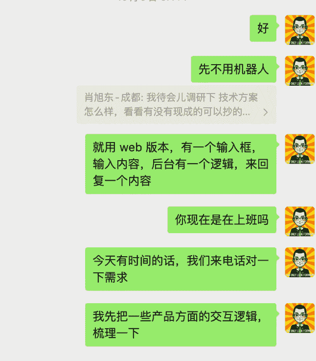

方向确定后，我自己先和 claude 聊了一会，把自己的需求，功能，数据库的格式，界面等，都和它讨论了一遍。最终得出一个 MVP 版本的雏形。


- 确认一下完整的MVP系统
  - 前台网页（用户用）
    - 1.输入框：描述问题
    - 2.提交按钮
    - 3.展示：匹配到的1条青龙原文
  - 后台管理平台（备用）
    - 1.添加青龙（输入原文+标签）
    - 2.查看青龙列表
    - 3.编辑/删除青龙
  - 数据库
    - 1. 1张表：青龙表（青龙ID，原文，关键词标签）

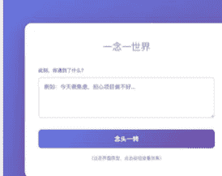
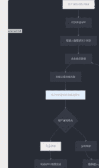

666 666

东哥很强，不到半天就把网页版做了出来。我们也在群里，一边沟通细节，一边改。

alpha版本
明白老师，你试试喃～
前端：https://
后台输
用户名 admin和
8"

嗯好的，多多提意见，晚安

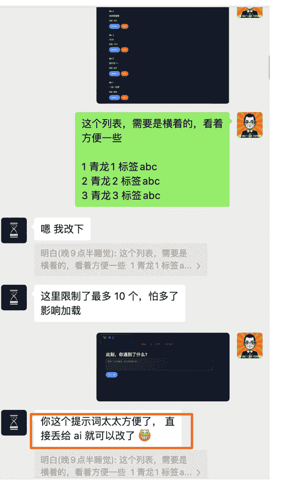

在这个过程中，我突然有一种感觉：我好像又可以了。我不知道这个感觉从哪里来的，但就是非常的强烈。再加上，我发现两个人做一个项目，一个做技术，一个做产品，需要改动的话，一个人在群里说，一个人去改，改完再对一下。这个沟通成本太高了。

有时候，就改一个字体大小，也需要群里讨论一下。所以，我就决定，自己也要开始参与写代码了。因为这个产品，未来肯定是要做 APP 的，现在的网页版是 MVP。我产生了一个大胆的想法：我要不直接做 APP 吧。

之所以说大胆，是因为在这之前，我从来没有做过 APP。我也快 10 年没有写过代码了，之前按照一些课程，尝试了 2 次 AI 编程，也都完全失败。所以，从客观条件上，我一定做不好这件事。但我也知道，AI 编程这件事，势在必行。之前一定是在某些关键的地方，我漏掉了重要环节，所以才导致了失败。我还没搞清楚原因。

这一次，我贼心不死，想要再试一次。此刻，「一鼓作气，再而衰，三而竭」，在我世界里，是不成立的。取而代之的，是另一个故事 ——

一个美国人，经常抽烟。有次体检，检查出了一个病。医生告诉他，你不能再抽烟了，否则会发展成癌症。医生给他推荐了一些方法，让他回去戒烟。过了一周，他去复诊说：哎，医生，我用你的方法，试了几天，但后来失败了。我觉得，我恐怕戒不掉烟了。

医生说：嗯，很好。你现在有 2 个选择 ——
1 戒烟，失败 —— 放弃
2 戒烟，失败 —— 再来一次
你选哪个？

他沉默了一会，说：我再试一次吧。这次，戒掉烟了。对，如果这次还失败了，我会继续再来一次，直到成功。

上天还是眷顾我的。这一次，没想到，万万没想到，我以一种「魔幻」的方式，成功了。

## 6 忘掉一切教程后，我成功了

在决定自己写代码，把这个 APP 做出来后。我知道，一定要定目标，有截止时间，要不然，肯定要拖延到年底了。于是，我就定了 3 天把 APP 做出来：后端数据库，前端界面，前后交互逻辑，功能可以简单，但一定要跑通。

### 为啥是 3 天？

理由也很特别。因为前两天在群里，我和聪哥、大周哥、刺猬哥约好了，周天要去爬山，路线名字是：西湖标毅，听说是杭州难度最大的路线。

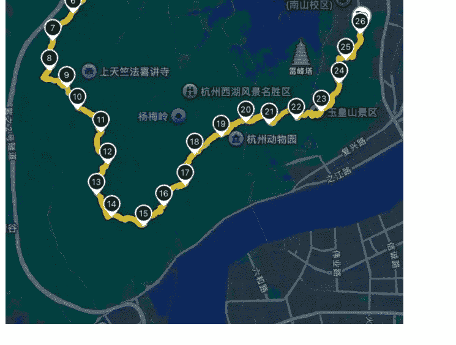

3 天做完 APP，爬山的时候，就能给他们炫耀了。所以，我就定了 3 天。

下一步，就到关键环节：该怎么做？我第一反应，是打开生财有术官网，找到 2 个航海手册 ——

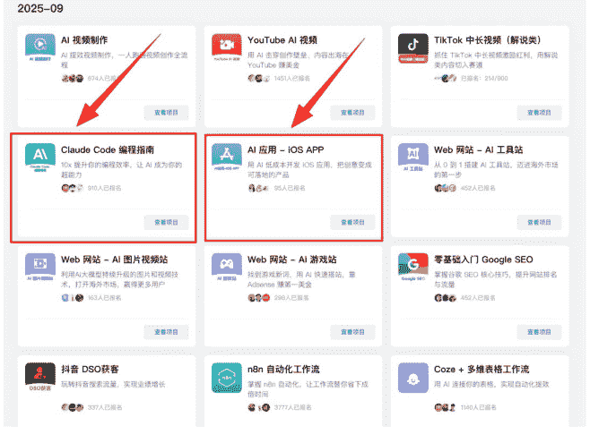

因为在我当时的认知里，学习 AI 编程，一定要用 claude code。我周围的高手，都说 claude code 是最厉害的 AI 编程工具。那我肯定也要学这个。把《claude code 编程指南》学完，我可以把后端数据库搞定。把《AI 应用 - iOS APP》学完，我可以把前端界面搞定。我当时想的是，我这个学习能力，1 天之内看完这 2 个文档，肯定不是问题。再花 2 天时间，按照文档里的方法去行动，把 APP 做出来，应该也不是问题。

就在我信心满满，准备开始的时候。我脑袋里蹦出一个声音 —— 你之前 2 次，也是学习一些课程，还有老师线下指导，还有助教帮忙答疑，你都没有做成。这次，你凭什么觉得自己一个人就能做好？这是不是有点太自大了？

我瞬间打了一个激灵。对啊，我现在的行动方式，和之前 2 次学习 AI 编程的思路，本质上没有区别。之前 2 次都没成功，我很挫败。这一次基本啥都没变，我却觉得自己能成功。就因为我乐观？自信？这些虚头巴脑的东西吗？不对，一定不对。

于是，我坐在电脑前，闭上眼睛，在大脑里仔细回放了一遍，之前 2 次学习 AI 编程的经历，我那个时候，都做了什么，想了什么，

### 心理状态是什么样的，是什么情绪......

约莫 15 分钟后，某一刻，我睁开了眼睛。我知道了。我知道问题出在哪里了。我知道自己漏掉哪个重要环节了。

于是，我关掉了《claude code 编程指南》和《AI 应用 - iOS APP》这两个文档。这一次，我不要看任何教程。这一次，我要靠自己，来独立完成这个 APP。这一次，我选择相信自己的感觉，和思考，以及经验。这一次，我要跟着生命的流动，去体验一场未知的冒险。

虽然，我当时什么都不知道。我不知道，开发 APP 需要用什么工具。我不知道，APP 上架流程是什么样的。我不知道，数据库该用哪一个，有什么利弊，后期如何拓展。我不知道，服务器、域名这些该怎么配置。

我不知道，前端后端的交互逻辑的代码，该怎么写，代码放在哪里，怎么做版本管理。

我不知道，还有哪些我不知道的。

但我知道，「我不知道这些」这件事情不重要。

因为，我确定地知道一件事：

AI 知道上面的一切知识、方法、步骤，并且比世界上一切人写的教程，都准确、详细。

以及，我 120% 的确定，这个《一念一世界》APP 是我想做的。

我清晰地知道，它需要什么功能，该如何使用，需不需要用户输入，返回的内容是什么，该怎么展示等等。它在我的大脑里，已经非常清晰地存在了。

够了，这就够了。

剩下，我只需要选择一个 AI 工具，把我此刻的想法告诉它，然后，一步一步地按照它的建议去行动，中间有任何问题、困惑、顾虑，就和它沟通、讨论，得到双方都认可的答案后，继续行动。

这个方向，我一定能成功。对此，我无比相信。

那接下来，就要选一个 AI 工具。我选了 gemini。为啥选 gemini?

因为，我的 ChatGPT 最近有点卡，刚好这个月到期，我还没续费。claude 的字体，看着没有 gemini 舒服。最近我一直在和 gemini 聊天，觉得它挺好玩的。所以，我选了 gemini。接下来的事情，就是我在文章开头第 1 部分写的内容。

> 我的目标是，在3天内开发一款简单的苹果商店的APP。
> 功能只需要最简化：用户输入一段内容，我随机回复数据库中的一条信息。
> 我使用的工具：claude code，已经安装好。
> 你来帮我梳理一下，我该如何安排这 3 天的计划，每天做什么，可以在 3 天达成这个目标。
> 写代码、服务器部署、域名、上线等。都要包含。

好的，3天内完成一款简单App的开发到上线是一个非常紧凑但可以实现的目标。关键在于严格执行计划，并尽可能简化所有非核心功能。
你提到的 claude-code 工具，在接下来的计划中，我会将它定位为你编写代码的主要工具。
这里是为你量身定制的3天作战计划：
第一步：准备工作（立即开始，预计2-3小时）
这些是启动项目前必须完成的，否则后续计划无法进行。
1. 注册苹果开发者账号：
目标：获得向 App Store 提交应用的资格。

### 我把想法发给 gemini，它给我建议，告诉我该怎么做。

我如果不理解它的做法，就继续追问，直到两个人都认同，然后，我就按照它的建议行动。

### 这个过程就是 ——

- 1. 我提问，它回答。
- 2. 如果 我 100% 认同，我就去行动。
- 3. 如果中间任何一个细节，但凡我有一丢丢不理解，我就回到 1。
- 4. 如果执行遇到问题、错误，我就截图丢给 gemini，它会帮我分析、解答完。然后回到 2。

细节到什么程度？

我连一个箭头找不到，我都会问它。

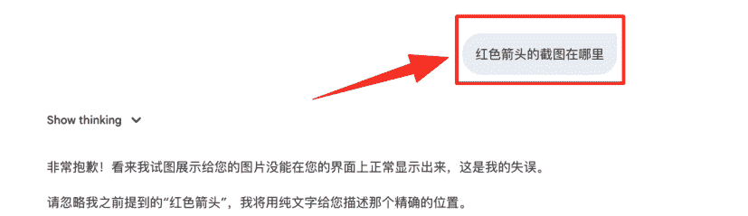

Show thinking ∨

非常抱歉!看来我试图展示给您的图片没能在您的界面上正常显示出来,这是我的失误。

请忽略我之前提到的“红色箭头”,我将用纯文字给您描述那个精确的位置。

### 下一步指示:用文字找到“按量计费”

你的目标:找到并点击写着“按量计费”的那个标签。

操作指南:

- 1. 请回到您第一次发给我的那张截图所在的页面,也就是让您选择“个人版”、“标准版”等套餐的那个页面。
- 2. 请将您的目光移动到“个人版”这个方框的“正上方”。
- 3. 在那里,您会看到两个并排的、可以点击的词,它们看起来像两个标签页:
    - 第一个词是【套餐包年包月】(这个是当前被选中的,可能是蓝色或高亮的)。
    - 紧挨着它的第二个词是【按量计费】(这个是灰色的,没有被选中)。

我们可以用文字模拟一下它的样子:

```
[ 套餐包年包月 ] [ 按量计费 ] ←-- 您要找的就是这里!
```

有一类问题,我觉得大部分可能不会问。
那就是:why,为什么。

gemini 给我一些行动建议后,我经常会问它 ——

为什么要做这件事?
这个结果为什么会出现?
为什么你会给出这个建议?

它就会给我解释原理、或者原因。
我知道,这个很重要。一知半解很可怕。
后面遇到问题,都不知道怎么提问。

公众号懒人搜索，懒人专属群分享

你怎么知道是wx-server-sdk库出问题了

Show thinking

这是一个非常棒的问题，它触及了软件开发中“调试”(Debugging)过程的核心。我很高兴为您解释我的推理过程。

我能判断出问题在于 wx-server-sdk，主要基于以下几点逻辑：

- 1. 错误信息的“质变”
这是最关键的线索。我们遇到的错误发生了根本性的变化：
- 之前的错误：404 Not Found (找不到URL)。
    - 含义：这个问题发生在“云平台”层面。是服务器的路由配置有问题，它根本不认识我们访问的那个网址。代码都还没开始运行。
    - 比喻：你去一个办公大楼，门卫（服务器）查了访客名单，说“名单上没有你要找的这个房间号”，你连大楼都进不去。
- 现在的错误：FUNCTION_INVOCATION_FAILED (函数调用失败)。
    - 含义：这个问题发生在“云函数”的代码层面。服务器已经成功找到了我们的函数，并且尝试去运行它了，但是函数内部的代码在执行时自己崩溃了。
    - 比喻：门卫认识你，把你带到了正确的房间门口。你推门进去，但房间里的人（我们的代码）自己脚滑摔倒了，没能完成工作。

### 链接：

```
https://gemini.google.com/share/e5df39b8ca47（需要魔法），
```

是我花 4 个小时，从 0 到 1 做出一个完整功能的 APP，和 gemini 的所有对话过程。全程没有用其他 AI 工具。

我觉得这个对话很有价值。

我把 gemini 当成，坐在我旁边的一个全知全能的顾问。

碰到问题，就转过头问他。gemini 温柔、耐心、细心、知识量无敌，所以，没有它解决不了的问题。于是，我就这样一步一步，把 APP 做好了。

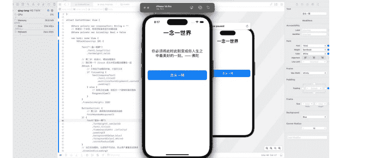

只花 4 个小时，比我预想的 3 天，短了很多。

而且，完全没有用大家说的 claude code，cursor 等。

所以我才说，感觉很魔幻。

至此，

我从 AI 编程长达半年的「绝望之谷」，出来了。

那扇快要对我关上的 AI 编程的大门，又缓缓打开了。

我对 AI 编程这件事，也彻底祛魅了。

我也可以回答那个问题了 ——

明明我有技术背景，有编程经验，为什么前 2 次 AI 编程的实践，非常失败，非常挫败，哪里出了问题，我漏掉了什么重要的东西？

## 7 一个血泪教训：我把自己搞丢了

是的，我漏掉了自己。

当我开始第3次尝试前，在电脑前面安静了15分钟，仔细回忆前2次的经过，猛然想通这点，睁开眼睛后，我在心里苦笑了一声：明白啊，你怎么会掉进这个坑里呢？不应该啊。

我前两次学习AI编程的时候，内心有很大的恐惧。

我害怕自己学不会，
我害怕自己做不到，
我害怕大家会说，你看，明白都是程序员，竟然连这个也不行。

所以，我在学习之前，就有了一个潜意识：我一定要完全按照教程去执行，不要自己瞎发挥，不要想什么灵活变通，不要觉得自己很厉害，忘掉自己，有疑问不重要，不理解也没关系，照着做就好了。万一不按照教程，做错了，遇到问题了，我也不知道怎么解决，就很麻烦。

于是，我在行动的时候，放弃了独立思考，研究原理，深入提问。我觉得，按照教程听会照做一定能成功。不按照教程，不听话照做，我就完蛋了。但是，这很明显不合理啊。

我在公众号写过很多次——
这个世界上，根本不存在这样的教程：有清晰的步骤，能落地实操，让我一字不差照做就能看到效果。因为这个世界上，没有两个完全相同的人。

### 不同人的

- 知识积累不同，
- 能力不同，
- 性格不同，
- 环境不同，
- ……

### 这就导致——

同样一个知识，不同人会有不同的理解；
同样一个问题，不同人会有不同的答案。
同样一个困难，不同人会有不同的心态；
同样一件事情，不同人会有不同的资源；
……

于是会出现：同样一个步骤，不同人操作，会有不同的结果。

更重要的是，这个世界上，任何一件、稍微有点价值的事情，都会包含多个步骤，于是就会有多个影响因素存在。

所以，我想完全按照教程，分毫不差的把一件事情完成，几乎（甚至是绝对）是不可能的。

必须理解原理，才能做到举一反三、灵活变通，真正解决问题。

但我因为心里的恐惧，完全忘记了这件事。

我把自己变成了一个「只想无脑操作，就能获得结果」的人。

无脑……

我放弃了自己的大脑，我放弃了思考。

我竟然把自己搞丢了！？

我竟然把自己搞丢了！?

天哪。我都难以想象。到底发生了什么？
不就是学习一个 AI 编程嘛，我怎么把自己都搞丢了？

公众号懒人搜索，懒人专属群分享

还好还好，我的元认知能力不错，我把自己找回来了。

看到自己回来了，我很开心。虽然走了一些弯路，但也是很好的经验。

并且，第3次尝试，我靠自己一个人，真的完成「AI编程」这件事。

我用自己的血泪教训，告诉你一件，你可能听过无数次的事情——

AI编程真的不难。

但这个不难，不是说，你安装好一个claude code，或者cursor，给它输入一句话「帮我生成XX」，然后，它真的在写代码，然后给你显示了一个界面。或者，你复制别人的提示词，输入给v0(其他vibe coding)，真的出现了一个「结果」。这些没有意义。

### 重点在于，你自己。

### 重点在于，你自己。

你想做什么？

你对自己要做东西，有没有清晰、深入、全面的思考？

你是否愿意付出足够的耐心、和细心，去一遍一遍和 AI（随便一个大模型都可以）沟通，然后行动，再沟通，在行动，直到最终获得结果，否则永远不抛弃，不放弃？

你是否有自己的独立思考能力，而非把自己当一个「无脑操作」的工具？

你是否相信自己，真的可以？

如果上面的问题，你都可以做到，那 AI 编程就真的不难。

对，重点在于，我们自己。

而不是 claude code，也不是 codex, cursor, GPT-4 等等。

这些真的不重要。

你行，没有它们，你也行。

你不行，有它们，你也不行。

是这个道理。

## 8 AI 编程最重要的一句话

我觉得里面你做对了一件至关重要的事：

放弃看一切学习文档，改为和ai对话

这正是使用ai的真谛

人写的教程，远远比不过AI的准确，全面

不是一个维度

而且，每个人面对ai的操作、执行命令也都有自己的方式

不是统一教材

对~

明白老师最后是纯用gemini来生成代码，然后贴到vs code里面吗

没有vs code

粘到gemini让我粘贴的地方

这个地方，每个人可能都不一样

忘掉所有从各个地方，看到的教程里的预设

那应该得有个储存代码的地方叭？

听AI的就行

先清0

万事问AI

忘掉这个”应该“

AI说怎么做，就怎么做

### 用 AI 编程，最重要的一句话：

忘记所有之前看过的「教程」里的「应该怎么做」，一步一步，跟着 AI 去操作，不懂的就即时对话、探讨，直到得到结论。

没有应该，没有确定，没有必须，有的只是 ——

你当下遇到一个问题，这个问题属于你的，全宇宙独一无二的个性化的问题，把这个问题拿去问 AI，然后根据 AI 的回复，继续下一步。

遇到问题，继续问 AI，得到结论，继续下一步。

然后继续 ——

- 问 AI，下一步
- 问 AI，下一步
- 问 AI，下一步
- 问 AI，下一步
- 问 AI，下一步
- 问 AI，下一步
- 问 AI，下一步
- 问 AI，下一步
- 问 AI，下一步
- 问 AI，下一步

- 问 AI，下一步
- 问 AI，下一步
- 问 AI，下一步
- 问 AI，下一步
- 问 AI，下一步
- 问 AI，下一步
- 问 AI，下一步
- 问 AI，下一步
- 问 AI，下一步
- 问 AI，下一步
- 问 AI，下一步
- 问 AI，下一步
- 问 AI，下一步
- 问 AI，下一步
- 问 AI，下一步
- 问 AI，下一步
- 问 AI，下一步
- 问 AI，下一步
- 问 AI，下一步
- 问 AI，下一步

......

### 最后，安利小懒的付费群：

### 懒人专属群(介绍)


📖 懒人专属群持续更新中，已持续运营6年，整理超3000份各类精选付费文章&年费社群干货，全部开放下载。

本资料为付费群内部分享，仅供真实有需要的朋友查阅 🙅‍♂️

https://lazy2025.top/blog/record2

懒人专属群更新记录(需梯子，备用)：
https://lazybook.fun/blog/record2