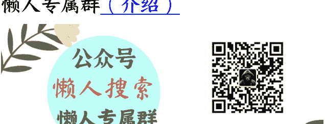

# 古人过重阳节的方式，太值得参考了

251029

整理：公众号懒人搜索，懒人专属群独享

懒人微信：lazyhelper

今天是重阳节。说起重阳节，很多人最先想到的是“敬老节”。1989 年，我国正式把农历九月初九定为“老人节”，提倡全社会尊老、敬老、爱老、助老。这是目前关于重阳节流传最广的说法。

但在历史上，关于重阳节的说法还不止这一个。

比如，重阳节也叫登高节。登高曾经是这个节日最重要的习俗之一。唐代诗人王维的那句“遥知兄弟登高处，遍插茱萸少一人”，说的就是重阳节的登高。

南朝志怪小说《续齐谐记》里有个故事，说有个叫桓景的人，跟着道士费长房学习道法。有一天，费长房对他说：“九月九日，汝家中当有灾，宜急去。令家人登高、持茱萸、饮菊酒，此祸可除。”桓景照做了，回家后发现家里的鸡犬牛羊全死了。他和家人因为登高避灾，逃过一劫。其中的茱萸是种植物，有香味，古人认为它能驱灾辟邪，因此茱萸也被称为“辟邪翁”。

这个故事虽然带有神话色彩，但它是关于重阳节习俗最早的文字记载之一。而其中提到的登高、持茱萸、饮菊酒，也成了后世过重阳节的三个最重要的习俗。

而陶渊明那句“采菊东篱下，悠然见南山”，虽然不是专门写重阳节的，但后来也成了重阳节赏菊的美学母题。

再比如，在明代的地方习俗里，重阳节也是“女儿节”。古代女子出嫁后，平时不能随便回娘家。但重阳节这天，父母必须把女儿接回来吃花糕。

当然，古代关于重阳节的说法还有很多，关键是这些说法都指向同一件事，就是重阳节这一天，是让人停下来，过一天不一样的日子。

那回到咱们现代人，应该怎么过重阳节呢？这个问题，我们可以看看“古人是怎么过的”。很多习俗背后，往往藏着深层的生活智慧。

接下来，咱们就一起穿越到古人的视角。准备好了，咱们正式出发。

## 上午的安排

天刚蒙蒙亮，也就是大概早上六点到八点之间，古人就起床了。他做的第一件事，是从柜子里取出一个缝好的茱萸囊，仔细检查一遍，然后系在腰间。接着，他走进厨房，开始和面、蒸糕。他一边往蒸笼里放糕点，一边盘算着，哪些要带出门，哪些要送给亲友。整个厨房里弥漫着糕点的香气，窗外的天色也渐渐亮了起来。

注意，咱们要强调的不是非要准备茱萸囊和糕点，而是要说这个仪式感。你不一定要持茱萸、蒸糕，但你可以给重阳节，或者任何你想重视的日子，设计一个专属的准备仪式。比如，前一天晚上准备好登山装备，或者早起泡一壶菊花茶，或者给父母准备一份礼物。关键不是做什么，而是这个“准备”的动作，会让这一天变得特别。

完成这些准备活动后，古人接下来要做的就是，出门登高。大概早上八点到十一点之间，准备好之后，古人就出门了。

古人为什么要登高呢？在《续齐谐记》的桓景故事里，登高是为了避灾。这个说法后来被广泛传播。到了后世，人们又从《易经》里找到了理论支撑：九是阳数，九月初九，两九相重，阳气极盛。按照“物极必反”的道理，盛极就要转衰，所以要登高，化解这种转折。同时，取“高”的谐音“糕”，还特意要在这天蒸糕，寓意步步高升。

而且需要特别注意的是，古人通常不是一个人去登高，而是约上家人好友和邻里邻居，一起去登高。

王维那首著名的，“遥知兄弟登高处，遍插茱萸少一人”，你看，这首诗有一个重点是“少一人”。当时王维在长安，他的兄弟在山东。重阳节这天，兄弟们在登高，但少了他一个，因此王维特别伤感。

换句话说，古人的登高不是一个人的事，而是一群人的事。古人的阴阳之说未必能说服现代人，但是，人与人之间的深度联系，是值得我们参考的。

另外，登高还有一个很重要的作用是，视角转换。当你站在高处俯瞰，平时让你焦虑的事情突然变小了。

当然，回到现代，我们不一定要爬山，也可以去高楼的观景台，或者去天桥上走走，停留10分钟，或者去公园的小山坡，找个能俯瞰的位置。换个角度看问题，很多问题也许就没有那么可怕了。

## 下午的安排

通常来说，重阳节的下午，古人，尤其是古代的文人墨客，会安排一个很雅致的活动，赏菊。

为什么要赏菊呢？首先，九月正是菊花盛开的时节。其次，古人相信，菊花有延年益寿的功效。比如，《太清记》里就记载：“九月九日采菊花与茯苓、松脂，久服之令人不老。”但更重要的是，菊花对古人来说，不是一种普通的植物，而是一种情感的寄托。

同样是菊花，在不同的人笔下，也有着完全不同的精神意向。

比如，最早把菊花写进诗里的，是屈原。他在《离骚》里说：“朝饮木兰之坠露兮，夕餐秋菊之落英。”意思是，早上喝木兰花上的露水，晚上吃菊花的花瓣。这不是真的在吃花，而是在表达对洁身自好的追求。虽然屈原那个时代，重阳节的习俗还没有形成，但后来的文人把他咏菊的意象，和重阳赏菊结合在了一起。

再比如，晋代，陶渊明写下了那句最有名的：“采菊东篱下，悠然见南山。”他不是在刻意赏菊，而是在采菊的时候，无意中抬头，看到了南山。关键不在于“采菊”这个行为，而在于“悠然”这个心态。从这句诗以后，菊花也和隐逸联系在了一起。

再比如，唐代诗人元稹说：“不是花中偏爱菊，此花开尽更无花。”意思是，我不是特别偏爱菊花，而是因为菊花开过之后，就再也没有花了。你看，菊花开在深秋，百花凋零，只有它还在盛开。这说的是菊花的坚韧。

再比如，黄巢的那首《不第后赋菊》：“待到秋来九月八，我花开后百花杀。冲天香阵透长安，满城尽带黄金甲。”黄巢是唐末农民起义的领袖，他借菊花表达的，是一种改天换地的雄心。

再比如，南宋诗人郑思肖的《寒菊》：“宁可枝头抱香死，何曾吹落北风中。”郑思肖是南宋遗民，国破家亡之后，他画菊花不画根，因为“土地已被夺去”。他借菊花表达的，是一种忠于祖国、不向外敌屈服的气节。

还有李清照的《醉花阴》：“莫道不销魂，帘卷西风，人比黄花瘦。”她借菊花抒发的，是重阳佳节思念丈夫的愁绪。

你看，同样是菊花，不同的人看到了不同的东西。陶渊明看到的是隐逸，元稹看到的是坚韧，黄巢看到的是豪迈，郑思肖看到的是气节，李清照看到的是愁绪。

要知道，现代人最缺的就是这种“停下来想一想”的时刻。而重阳节赏菊，本质上是给自己一个停下来的理由。在这一天，不想烦心事，不刷手机，就坐在那里，看看花，想想自己的生活本身。

关键不是一定要有答案，而是这个“停下来思考”的过程本身。

## 晚上的安排

对于古人来说，重阳节晚上最重要的活动之一是，会饮。什么叫会饮？简单说，就是聚在一起喝酒。但这个“会”字很有讲究。《说文解字》里说：“会，合也。”所以会饮不是一个人喝闷酒，而是一群人聚在一起，边喝边聊。

你可能会说，这不就是聚餐吗？有什么特别的？特别之处在于，重阳节的会饮有个特定的对象：家人，尤其是父母。九月初九，已经是深秋了，马上就到冬天。古人在这个时候和家人团聚、会饮，有个隐含的意思：和秋天告别，和家人团聚，为即将到来的冬天做准备。

这个习俗也一直延续到了今天。比如，陪父母吃顿饭，或者准备一个小礼物，或者一起登高、一起赏菊、一起随便做点什么，通过具体的行动，把关心传递出去。

到这里，我们已经说完了古人过重阳节的三个最重要的风俗：登高、赏菊、会饮。

在很多人的感受里，秋天是个容易感伤的季节。从科学的角度看，由于秋季日照时间缩短，会导致大脑中的血清素分泌下降。血清素是调节情绪的关键神经递质，它一降，人就容易情绪低落。

但有时候，我们也可以换个角度看秋天。林语堂先生在《论年老——人生自然的节奏》里写过一段话，他说，**秋天是最成熟的季节，也最富有思想。在我们的生活里，有那么一段时光，翠绿与金黄相混，悲伤与喜悦相杂，希望与回忆相间**。

他还说，在这个阶段，我们要面对的问题不是如何发展，而是如何真正生活；不是如何奋斗操劳，而是如何享受自己拥有的那宝贵的刹那；不是如何去虚掷精力，而是如何储存这股精力以备寒冬之用。

你想，春天要生发，夏天要茂盛，秋天要收获，冬天要储藏。每个阶段都有每个阶段的任务，每个时节都有每个时节的智慧。借用林语堂先生的话说，**人生没有什么好坏，只有“在那一季里什么东西是好的”的问题。**

最后，祝你重阳安康。愿你在这个深秋的日子里，找到属于自己的生活节奏。

## 懒人专属群

懒人专属群（介绍）

懒人专属群持续更新中，已持续运营 6 年，整理超 3000 份各类精选付费文章 & 年费社群干货，全部开放下载。

本资料为付费群内部分享，仅供真实有需要的朋友查阅

- 懒人专属群更新记录：
  https://lazy2025.top/blog/record2

- 懒人专属群更新记录（需梯子，备用）：
  https://lazybook.fun/blog/record2