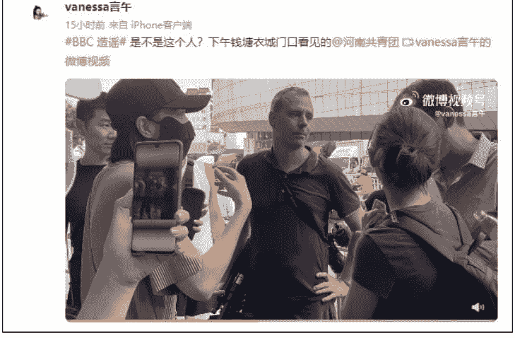
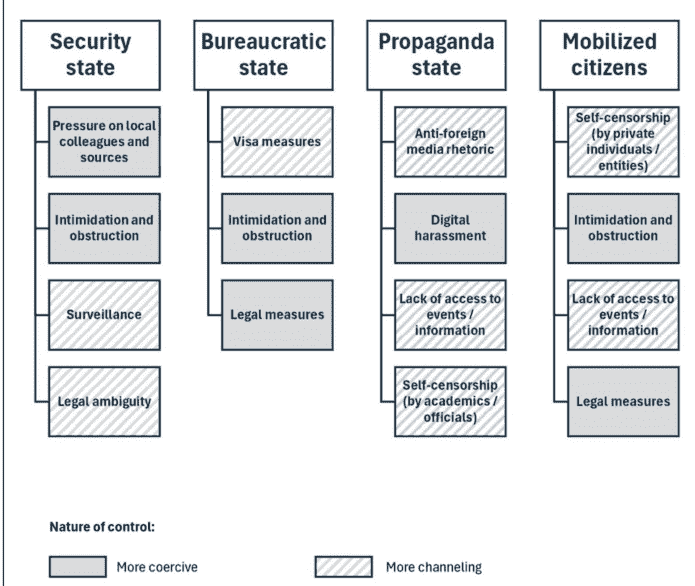
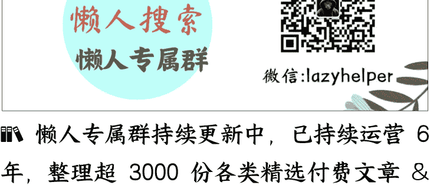

# 中国如何管控外国记者

251029 新闻实验室

整理：公众号懒人搜索，懒人专属群独享
懒人微信：lazyhelper

公众号懒人搜索 懒人专属群
微信:lazyhelper

通过制造一种高度不确定的氛围，间接影响和限制记者的报道行为。

近几年来，驻华外国记者的数量减少，工作环境也颇为艰难。

实际上，除了那些登上新闻头条的记者驱逐事件（详见会员通讯 368 期、414 期、762 期）和众所周知的网络审查外，一种更系统、更微妙的控制机制正在深刻地影响着外国记者在中国的日常工作。

最近，都柏林大学的博士生 Linette Lim 在学术期刊《The International Journal of Press/Politics》发表了一篇论文。她通过对超过五十名现任及前任外媒驻华记者的深度访谈，揭示了这种多面向的媒体管控及其引发的连锁反应。

值得一提的是，Linette Lim 本人就曾是一名驻华记者。她有长达十年的新闻媒体与公共事务从业经历。其中八年，她服务于新加坡的“亚洲新闻台”（Channel NewsAsia）——亚洲最大的英语新闻网络之一。在她记者生涯的最后阶段，她担任该机构的上海分社社长，这段经历让她亲身报道了在北京举行的年度政治会议（“两会”）、2019 年香港的社会运动以及 2020 年的台湾选举。正是这些宝贵的一线经验，为她如今的学术研究提供了深刻的洞察力。

## 「超越驱逐与审查的间接“引导”策略」

这篇研究的核心观点是，中国对外国记者的管控远不止于直接的强制性手段（coercion）。虽然物理攻击、拘留和签证驱逐等强制措施确实存在，但它们只是冰山一角。一种更普遍、更具渗透性的策略被研究者称为“引导”（channeling）。

这种策略并非直接使用暴力或法律武器，而是通过制造一种高度不确定的氛围，间接地影响和限制记者的报道行为，旨在塑造记者的工作环境，影响他们能够接触到的人、能够报道的话题，甚至影响他们前往某地的意愿。

正如一位受访记者所言，这种“引导”的效果是潜移默化的：“唐山这个地方我很有兴趣，因为它是钢铁工业中心。但有趣的是，我从未去过那里。我知道如果我去了，我就会被监视，因为我知道很多去过的人都有此遭遇。这让我望而却步。”这种在行动之前就产生的“望而却步”，正是“引导”策略所要达到的效果——让记者在无形的压力下进行自我审查。

研究者指出，实施这些管控策略的并非一个单一的“国家”实体，而是由多个分工明确但又相互协作的行动者构成。

论文将它们归纳为三类国家行为体和一类非国家行为体。

- 首先是“官僚国家”（bureaucratic state），主要包括外交部和公安部等机构，它们通过记者证、签证和居留许可来控制记者的出入，并管理外媒的中国籍雇员。
- 其次是“安全国家”（security state），包括国家安全部和公安部，负责监控外国人的活动，尤其是在新疆等少数民族地区，常常与记者发生直接对峙。
- 第三是“宣传国家”（propaganda state），由外交部、国新办和中宣部等组成，负责管理媒体关系、发布官方叙事，并塑造对外国媒体的负面形象。

除了这些国家机器，研究还特别强调了一个关键的非国家行动者——“被动员的公民”（mobilized citizens）。这些支持政权的普通民众，在官方反西方媒体言论的影响下，会主动出面阻挠甚至围堵外国记者的采访活动，成为一种难以预测但效果显著的控制力量。他们与国家机器共同构成了一张管控网络。

## 「从模糊的法律到群众的力量」

Linette Lim 的研究详细梳理了十种具体的媒体管控策略，其中六种都属于更具“引导”性质的间接手段。这些手段相互交织，共同营造出一种让记者和受访者都感到不安和困惑的高压环境，其影响力远超直接的暴力或驱逐。

研究发现，“法律模糊”（legal ambiguity）是其中一种极为有效的威慑工具。近年来，随着《反间谍法》等新法规的实施和其解释权的模糊性，记者们发现自己越来越难以评估报道的法律风险。这种不确定性与一些在记者圈中广为流传的“控制寓言”（control parables）相结合，起到了杀鸡儆猴的效果。一个典型的例子是彭博社的中国籍新闻助理范若伊（Haze Fan）因涉嫌危害国家安全而被拘留一年多的事件。这在外围记者社群中成为了一个令人警醒的“警示故事”。一位受访记者坦言：“彭博社那位新闻助理被捕后消失了很长时间……这些都是警示故事。当你再想去深入追查某个故事时，肯定会三思而后行。”

与此同时，官方媒体和社交网络上持续不断的“反外国媒体宣传”（anti-foreign media rhetoric）也起到了关键作用。这些宣传将外国记者描绘成“怀有敌意的境外势力”，使得普通民众、学者甚至官员在面对外媒采访时，都因害怕被贴上“通外”标签而选择自我审查或直接拒绝。一位在中国工作多年的资深记者回忆道：“大约在 2010 年，我还能采访到体制内的智库学者和法官，他们愿意向外媒解释中国的立场。但后来，民族主义情绪高涨，我们想和中国人聊聊都变得非常困难，因为我们被视为了‘境外敌对势力’的一部分，即便是在一些非常无害的话题上，人们也不再与我们接触了。”

这种氛围也让获取官方许可变得几乎不可能，一位记者提到，很多时候潜在的受访者会要求他们先获得当地外办的批准，但外办往往无法或不会给予这种批准，从而形成一个无解的循环。

2021 年，河南郑州发生严重洪灾，多家外媒记者在现场报道时遭到民众的围堵和骚扰。研究指出，在记者抵达前，共青团河南省委就在社交媒体上发布信息，号召其 160 万粉丝“警惕”并“阻止”那些可能“造谣”的外国记者。一位亲历此事的记者描述了当时令人窒息的情景：“当那个中年妇女开始对我大喊，人群聚集过来时，所有人都沉默了。我不认为人群里每个人都支持她，但当她公开谴责我们是‘反华势力’时，没人敢站出来说句公道话，因为手机都在拍摄，谁反对谁就会被指控为‘反华势力’。”在这种情况下，国家无需直接出面，就能通过煽动民间情绪来有效干扰国际报道，并保持“合理否认”的姿态。事实上，研究中有五分之一的受访记者都表示自己曾在工作时被普通民众报警举报。

此外，随着监控技术的发展，以往那种在现场发生的激烈物理冲突有所减少，取而代之的是更为精准和隐蔽的“先发制人”式干预。一位记者分享了他的经历：他在一个招聘会上与几位学生交谈并互换了微信，但事后发现所有学生都拉黑了他。他的助理后来联系上其中一位学生，该学生通过邮件告知，学校已经“教育”了她，告诫她不要与可能“恶意扭曲”事实、让学校和国家难堪的外国记者交谈。这种无处不在的监视让当局能够提前介入，掐断记者的采访线索，从而更“文明”地达到控制目的。

正如另一位记者总结的那样：“现在暴力冲突少多了……他们只是跟着你，但不再像过去那样直接干预你的采访。他们已经不需要那么做了，因为所有人都已经收到了‘通知’。他们（当局）只需要站在那里，你就能从人们的眼神里看到……他们已经领会了。”

## 「连锁反应与恶性循环」

Linette Lim 的研究还探讨了这种复杂管控体系所引发的一系列连锁反应，这些反应不仅深刻地改变了外国记者在中国的工作方式，也最终影响了全球受众对中国的认知。

最直接的后果是日益普遍的“自我审查”（self-censorship）。当记者们不断面临法律风险、信源枯竭和人身骚扰时，他们开始主动回避某些话题或地区，以保护自己、同事以及最重要的——他们的受访者。一位记者无奈地表示：“你必须不断地进行风险评估⋯⋯你是否值得为了这个故事而让你的采访对象陷入麻烦？很多时候，答案是否定的。”

这种自我审查并不仅仅局限于传统上的敏感议题。由于经济下行和青年失业等社会问题也逐渐变得政治敏感，记者们在报道这些看似“正常”的议题时也变得束手束脚。这种预防性的规避行为，正是“引导”策略所要达到的最终目的。

其次，信息获取的极端困难导致了新闻报道模式的改变。由于在中国国内建立信任、培养信源变得异常艰难，一些媒体机构开始更多地依赖“空降式新闻”——记者短暂进入某个地区，进行快速、表面的报道后迅速离开。更普遍的趋势是，许多关于中国的深度报道，如今不得不在中国大陆以外的地方完成，例如在台北、新加坡或首尔。记者们通过电话、加密通讯应用和二手资料来拼凑中国的真实图景。虽然这种方式能够保证记者的安全，但它不可避免地牺牲了报道的深度、细微之处以及来自中国内部的多元声音。

研究还揭示了一个令人担忧的恶性循环。由于采访受限，外国记者难以接触到中国的积极面或进行细致入微的社会报道，他们能采访到的人越来越局限于海外流亡、异议人士。因此，他们的报道内容越来越集中于政治压制、人权问题以及他们自身所遭遇的采访阻碍。而这些在官方看来“负面”的报道，又被中国宣传系统用作证据，来印证“西方媒体亡我之心不死”的叙事，从而进一步煽动公众对外国记者的敌意，并为当局采取更严厉的管控措施提供理由。这个循环不断自我强化，使得外国媒体与中国社会之间的隔阂越来越深。

面对这种困境，记者们也发展出了一套适应策略。加强数字安全措施，如使用加密通讯工具和“阅后即焚”功能，已成为基本操作。一些无法约出来做正式采访的人，只能先约饭私下聊天。为了保护信源，记者们会采取极为谨慎的方式进行接触，有时甚至需要像间谍一样安排会面。而且，文章当中的匿名信源已经成为常态。然而，这些措施大大增加了时间成本和心理压力，并不能从根本上解决问题。

总而言之，Linette Lim 的研究描绘了一幅关于 21 世纪威权主义如何进行媒体管控的复杂图景。它揭示了中国政府已经超越了单纯依靠驱逐、监禁等强制性手段的传统模式，转而建立了一个更加精密、更具渗透性的“引导”体系。

这种从直接“强制”到间接“引导”的转变，标志着一种更具韧性和适应性的威权控制策略。它使得中国在维持对内信息高压的同时，依然能保持与世界的接触，但这种接触是在其严格设定的框架之内。对于全世界而言，这意味着我们所看到的关于中国的报道，是在一个被精心设计和严格限制的环境中产出的。理解这一无形的“引导之手”，对于更准确地看待和解读来自中国的任何信息，都至关重要。

最后，安利小懒的付费群：

懒人专属群（介绍）

懒人专属群持续更新中，已持续运营 6 年，整理超 3000 份各类精选付费文章 & 年费社群干货，全部开放下载。

本资料为付费群内部分享，仅供真实有需要的朋友查阅 🙍‍♂️

懒人专属群更新记录：
https://lazy2025.top/blog/record2

懒人专属群更新记录（需梯子，备用）：
https://lazybook.fun/blog/record2