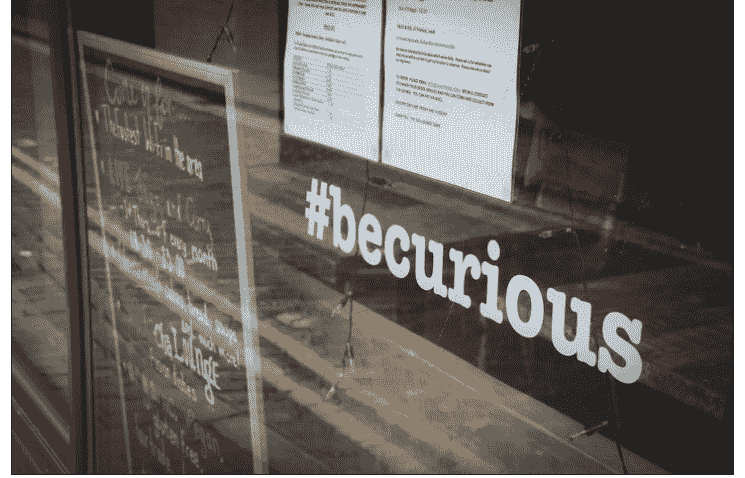
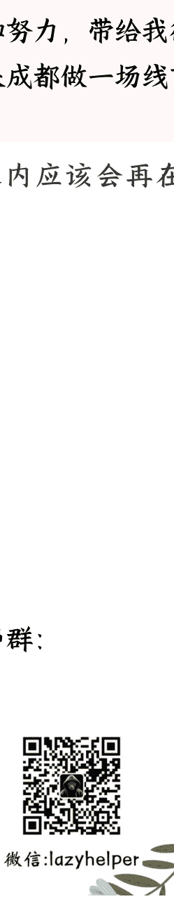

# 你问我答
## 251029 新闻实验室

整理：公众号懒人搜索，懒人专属群独享

懒人微信：lazyhelper

如何判断论文/新闻的真假、始祖鸟和蔡国强的烟花事件、毕业生的作品、什么是好工作、J·K·罗琳和艾玛·沃森的争执……

Anonymous：我是一位刚工作一年多的面板工程师。对新闻、思辨等各方面都感到很好奇。也是有幸能接触到 newsletter。自省发现一个现象，各种级别的论文/新闻，都可能亦真亦假。如何能够有逻辑、有方法地识破。感觉自己容易被带走，潜意识觉得他们说的都对。

答：从认识到「亦真亦假」再进一步，或许你会认同我的这种说法：真相更多是一种过程，而不是一个结果。

我这个学期教研究方法课，为此也又温习了卡尔·波普尔关于科学哲学的论述。他指出，与其说科学是关于证实某种颠扑不破的真理，不如说是关于发现此前理论的问题并证伪它们。他说：“A theory which is not refutable by any conceivable event is non-scientific.”（任何可设想的事件都无法证伪的理论，皆属非科学范畴。）

如刘擎老师总结的，波普尔认为，科学理论都只是暂时的、尚未被证伪的假设，他直接否定了将科学等同于真理的迷信。

所以，重点不在于记住某个结论（它很可能只是暂时未被证伪而已），而在于理解和考察其论证的过程，学习和推断的方法。不必觉得任何人说的是真理，重点应该放在评估他们提出的证据和论证质量上。

当然，如何评估，那需要长时间的积累和练习。买一本《学会思考》学习基本的批判性思维方法，买詹青云的节目听她讲如何“像律师一样思考”，都是不错的积累方式。

Anonymous：有个问题比较困扰，始祖鸟和蔡国强合作在喜马拉雅地区的烟花秀为何引起大众和官方前后近乎一致的讨伐，特别是公众对这件事情好似无法接受，但我相信这场烟火秀背后的准备和批准不是“不管不顾”的，但如何解释都于事无补，这背后到底还是一种情绪对立吗？不知方老师怎么看？

答：我觉得不是对立，而是形成了罕见的一致，因此拥有了一个安全的、可以火力全开的批评对象。环境保护议题是难得的自上而下存在广泛共识的议题，因此一致的批评并不令人意外。项目准备和批准过程，我觉得是脱离民意水温的，无论是始祖鸟和蔡国强，还是地方政府，都离民众很远了。

Anonymous：怎样才能算拿得出手的作品必须受到数据或流量的检验，或者是这个作品必须拿奖？需要什么样的标准去判断一个作品可以被拿得出手呢？对于应届生来说。

答：简单来说，“拿得出手”最依赖的是专业共同体的意见。流量不是必须的，拿奖也不是必须的（哪有应届生那么容易拿奖的）。如果你把作品交给业界的三五个从业者看，他们都觉得不错，那就算是“拿得出手”了。

Anonymous：方老师好，我是内地正在求职的普通大学生。请问您认为，初入职场找工作时，什么最重要？热爱和兴趣真的重要吗？当下就业环境中，大家都强调，能找到一份可以养活自己、勉强可以忍受的工作，就已经很幸运了。我很怀疑，工作后的人生真的还属于我自己吗？（就算我足够幸运找到工作，一年只有五天年休假，35岁失业警钟悬挂头顶，未来真的还有希望吗？

答：我最近两年深刻体会到的一点是：几乎所有的工作都是“狗屁工作”。那是因为，工作一般都是个人加入了某个机构、为其服务。不管你具体做的事情是怎样的，机构都有机构的运作逻辑，它会逐渐“异化”。即便一份工作再理想，再符合你的理念，只要它是为一个机构而工作，那就一定会有“狗屁”的成分。

当然，我上面用了“几乎”两个字。如果一份工作不需要加入任何机构，或许就可以避开这些“狗屁”的部分。然而，那就意味着你基本上是一个自由职业者，你在享受自由的同时，也面临着更大的不确定性和风险。所以，“狗屁”的那部分其实算是给自己买的一份（也不算太有用的）保险。

既然几乎所有工作都是“狗屁工作”，那么工作之外的人生就很重要了。你在工作中丢失的那部分自我，应该在工作之外找回来。

如果你是一个知道自己想要什么的人，那么未来一定是有希望的，因为生活总有各种不同的过法，到村子里“躺平”也是一种，到国外重启人生也是一种，所谓天无绝人之路。最怕的是工作消磨了本来就不多的自我意识和自我认知，让人即便有了空闲时间也不知道该干什么。

Anonymous：方老师如何看待最近哈利波特作者 J·K·罗琳和演员艾玛沃特森的再次争执呢？如何从新闻学角度看待双方这段数年的纠纷呢？

答：她们两个人的恩怨，放到更大的背景之下，是这几年西方（乃至全球）关于“取消文化”和极右翼思潮的争议。

我们暂且放下孰是孰非的判断（我个人的意见和这篇文章以及这篇文章接近），人们对双方的批评分别是因为：

- 认为艾玛·沃森的言论代表的是“取消文化”，是要用一套标准来审查言论、令发言者闭嘴，而这会伤害言论自由和民主社会的根基；

- 认为 J·K·罗琳的言论代表的是极右翼思想的回潮，是对少数群体权利的无视，乃至赤裸裸的歧视。

双方都认为自己的看法非常重要、极为正义，同时觉得对方给社会带来了严重的威胁。因此，两个阵营的分歧不仅是观点上的，更是情感上的——他们互看不爽，乃至反目成仇。

我觉得，无论站在哪个阵营一边，都应该做到自洽。比如说，艾玛·沃森的批评者，如果是以“捍卫言论自由和开放社会”为由，提倡警惕“取消文化”，那么他们自己就不应该成为打压言论的人，他们也应该誓死捍卫艾玛·沃森以及性少数群体说话的自由。极右翼的糟糕之处是，他们一方面批评左翼的“取消文化”，一方面又大举打压自己的对手，令他们噤声，这就是赤裸裸的双重标准。

另一个值得观察的角度是：中国的舆论如何解读她们的争执。我看到有意见领袖说，艾玛·沃森的行为像“文革”时的红小兵——这就是一种带有中国式联想的解读了，它并不一定符合事实，但让中国人非常容易理解和产生共鸣。我在之前的一篇论文里面也讨论过西方的另类右翼思想如何在微博上获得共鸣，其实 J·K·罗琳和艾玛·沃森的争议也是一个很好的研究案例。当中国人在讨论这个事件的时候，大家更多是在投射内心的恐惧。

> Anonymous：我从大学就开始关注新闻实验室，如今已经 30 岁了，有一定经济基础和社会阅历，对现有工作也较满意，然而内心一直有来香港读研究生的愿望。但就读什么专业——继续深造现有领域（投资），或读一个感兴趣但对职业看似没有什么帮助的学科（消费）——依然感到迷茫。混杂着是否要结婚生育等议题，经历着这个年龄段特有的混乱哈哈哈！

答：欢迎来香港读书啊。我有个五十多岁的同事，一边在我们学校教书，一边在港大读佛学的硕士。所以说，其实专业选择的可能性是非常大的！你说读佛学是“消费”吗？其实也不是，那是一种人生观的找寻。

当然，你才30岁，可能还不到想读佛学的年龄。如果说对现有工作也满意，还不想 gap year 的话，那可能还是继续深造现有领域听上去更合理一些，毕竟兴趣等年纪大一点的时候再追寻都可以（我自己也想过50岁的时候去读一个艺术类的硕士）。

还有一个可能性是，如果你能通过高才、优才或其他方式获得香港身份证，到这边来工作，那么你还能以在职的方式（part-time）读硕士，不耽误工作。

> Anonymous：方老师你好，在之前的你问我答环节里，你推荐了梁启智老师的《香港第一课》，令我收益匪浅。在此想问问，是否有类似于《香港第一课》，能够帮助了解内地社会文化生态的作品？作为一个内地人，我常常觉得对自己所生活的社会并不了解。

答：其实不少，但基本都是在香港台湾出版的。比如徐中约的《中国近代史》就是公认的经典。如果你来过滤气泡工作室，我可以给你推荐一些：）

> Edward：方老师你好，第一次给你留言。我是你的老读者，南周时期的稿子几乎每期必读，多年来一直关注你，去年11月你在成都的两场线下活动我都参加了。感谢你这么多年来的坚持和努力，带给我很多启发。期待有机会再来成都做一场线下分享，祝一切顺利！

答：谢谢你！一年之内应该会再在成都做一场分享的～

最后，安利小懒的付费群：

懒人专属群（介绍）

懒人专属群持续更新中，已持续运营 6 年，整理超 3000 份各类精选付费文章 & 年费社群干货，全部开放下载。

本资料为付费群内部分享，仅供真实有需要的朋友查阅 🙅‍♂️

懒人专属群更新记录：

https://lazy2025.top/blog/record2

懒人专属群更新记录（需梯子，备用）：

https://lazybook.fun/blog/record2