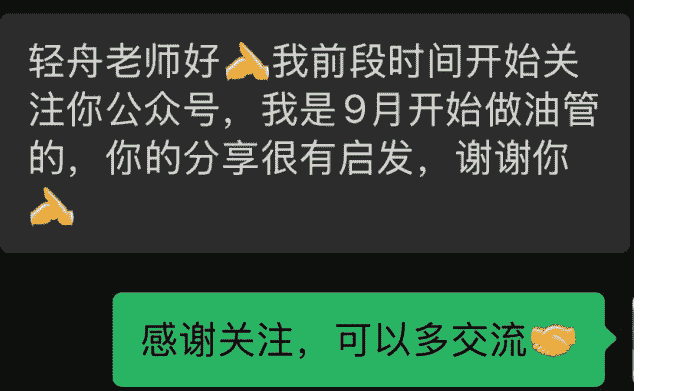
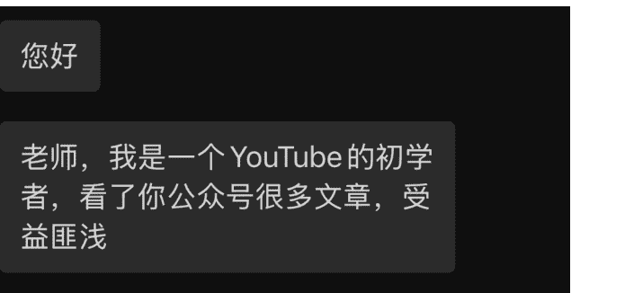
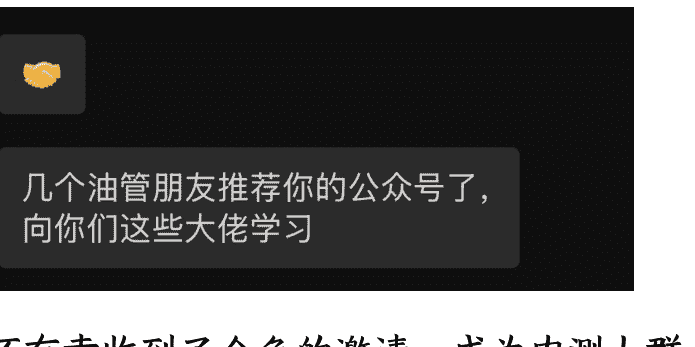
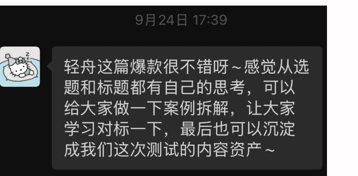
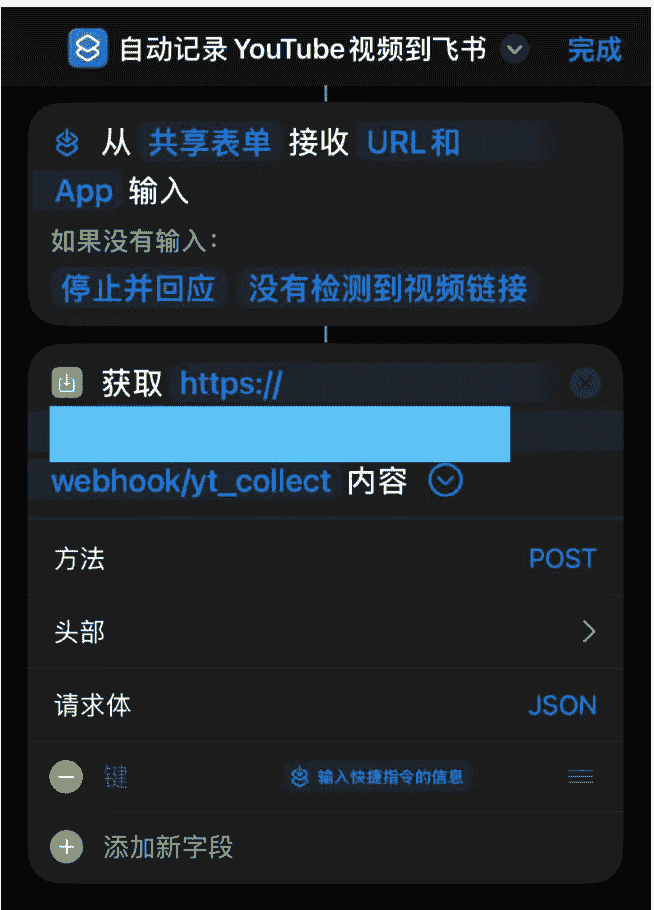
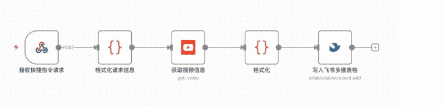

# 真诚比技巧更重要：记录我做 YouTube 垂直小号的 40 天

251029 生财精华

公众号懒人搜索，_懒人专属群_独享

懒人微信：lazyhelper

大家好，我是轻舟，YouTube 深海圈教练，也是本次商业垂直小号内测 3 船的船长。

本次商业垂直小号的内测，我运用"时间折叠"思维，把 YouTube 主线和公众号写作变成一件事，收获了 2100+精准粉丝和 4 位数收入。

更重要的是，我验证了一套可复制的方法论：
定位精准 + 赋能主线 + 真诚输出 = 长期价值

这篇文章，我会非常真诚地分享过程中的所思/所想/所做/所为。

## 成果

在开始分享之前，先总结一下本次内测的成果：
- 1/ 精准粉丝 2100 多
- 2/ 更新 38 篇，总阅读量 40000 左右，阅读量过千的文章有 12 篇
- 3/ 加好友超过百人
- 4/ 生财体验卡邀请了 35 人，领卡 29 人，入营 15 人，推荐成功 1 人，还有一个在等双 11 的优惠
- 5/ 付费咨询若干
- 6/ 帮圈友推广批量文生图工具，收入 4 位数

## 起点

其实，写点东西的想法，时不时就会从我脑子里冒出来，但一直没想好写什么，又担心写几天就没东西了，所以一直没有行动。

真正下定决心要写，是因为看到了小排老师的一篇公众号文章《AI 时代的人生提效秘籍：时间折叠》，时间折叠的概念对我启发非常大。

简单总结下时间折叠：
时间折叠的核心：让同一段时间“多线并行”而非“分心并用”
- 1/ 使用时间折叠，前提是有时间，需要先用 AI 完成基础提效。
- 2/ 把自己不得不做的事，折叠到喜欢做的事里
- 3/ 围绕主线，主动折叠更多的事为之赋能

随后，我就一直在思考应该怎么利用时间折叠，开始分析自己手里的事情，留心每天的时间消耗，也做了很多内容的测试。一直到8月底，我才确定了应该写的内容，YouTube爆款视频拆解。

这里是我学艺不精，小排老师要做的事情，都是很自然地浮现出来的，我是经过大量的挖掘分析，费了好大劲才找到的。

最终选定这个方向，主要原因是正在做YouTube故事号，需要紧跟热点趋势，挖掘最新的爆款视频，分析/改造。对爆款视频的挖掘和分析能力，是故事号成败最关键的点，也是很多人的痛点。

所以我决定针对这一个点，用输出倒逼输入，这也非常符合时间折叠，把做YouTube和写公众号变成一件事。

商业垂直小号内测的消息一出来，我就报名了，因为我已经解决了最难的定位问题。

## 定位

内测期间，我看了很多的案例，也跟很多组员交流过。做垂直小号最重要的就是定位，很多人卡在这里。

我认为，定位有两个非常重要的因素，一个是自己擅长，另一个是赋能主线。

做垂直小号其实是占位，就是在你擅长的垂直领域内，通过输出专业知识占住一个位置，让这个领域的人知道你，一遇到这方面的问题，就会想到你。所以，要写自己擅长的。

再说说赋能主线。我的精力是有限的，需要聚焦聚焦再聚焦。而且，垂直小号需要有持续的内容输出，内容上还需要有成长，随着时间积累，需要更专业，因为读者也是会成长的。所以，需要有一套系统，可以让我更专业，最好的方式就是赋能主线，主线也能为垂直小号提供源源不断的内容。

之前看《生财宝典》的时候，很多大佬都提到系统这个词，一直没有理解到，这是我第一次触碰到系统，这也是我整个的思考过程，希望对大家有启发。

如果在这个系统上再次迭代，我会加上工作流和 AI 工具站，会变成下面这样：

就一个原则，围绕主线，折叠更多事情为之赋能。

## 执行

在开营仪式上，亦仁老大说了三句话：
- 1/ 跟上趋势，抓住微信流量分发大变革的趋势，抓住垂直化趋势，抓住 IP 的趋势
- 2/ 找准定位，战略大于战术，定位大于日更，定位背后是人群，人群决定商业价值。这是一个动态长期的过程，可以一边开车一边修车
- 3/ 坚定执行，不要完美主义，先发出去，充分调研，至少找10个对标，每天看30篇爆款，前期数量大于质量

## 意外的王炸开局

进入生财10个月了，我一直是听话照做，但当我有试着去找对标、找爆款时，意外的发现没有人写这方面的内容。也就是说，针对有一定基础的YouTube创作者，进行爆款拆解，这个事情没有人做（公众号），我的痛点他们解决不了。

我坚持了自己的想法，按照自己的思路来写，就算错了，也可以一边开车一边修车，我这样安慰自己。

开营之后，一切都非常顺利，顺利到完全超出我的想象。
- 1/ 开营第一个星期，就收获了非常多的正反馈

你好， 轻舟老师， 这周你也去了深圳的AI大会了吧
对，请问是什么渠道找到我的 我备注一下
我在微信里面搜 ypp对标分析
你的文章排第一啊
好👌感谢告知
说明这块在公号这块做的人很少
就是拆解
9月23日 09:16
很高兴认识您，看到您 Youtube 的案例分享，很专业！~我是未来电视有限公司，也是做海外 期待能有机会合作一波！~
9月23日 09:27
感谢教练，你的公众号对我帮助非常大，感谢！
有帮助就好，多交流🤝🤝
🤝🤝

## 公众号懒人搜索，懒人专属群分享

9月23日 13:50
刷公众号竟然刷到了轻舟教练👍🏻
大会听了你的分享，非常有收获！
你有一套对视频拆解的理解，还愿意分享出来，超级感谢🥺
哈哈 越分享越幸运
9月23日 13:58
感谢！默默跟着教练学习
9月23日 14:24
你好，看了教练的公众号，很有启发，感谢分享🙏🏻
多交流🤝🏼🤝🏼
好咧
9月23日 17:24
刚刷到了你公众号哈哈，youtube拆解的好厉害👍🏻👍🏻，原来是教练🤦🏻‍♂️，关注了。
9月24日 12:16
我是你公众号的粉丝
以上是打招呼的内容

你好，请问是怎么找到我的，我备注一下，感谢🌹
公众号
好的 感谢
9月24日 14:07
看到公众号，就加了一下，是生财有术好友点了在看，点开看了一下公众号文章，是做YouTube的深海圈教练，后面可能也会做，多一个YouTube好友，哈哈，
哈哈 可以的
教练下午好～
是通过公众号帖子 加上的
也是生财圈的人
也参加了生财组织的 ty 航海
9月24日 07:15
公众号认识，觉得写的有内容
9月25日 08:35
想学一学 AI视频创作，有教程吗？
看过你发的youtube视频拆解，挺好的

还有幸收到了金鱼的邀请，成为内测大群里第一个分享的爆款案例

甚至还得到了涛哥的推荐，把我感动得稀里哗啦

这个时候，内测才开始一周的时间，中间还经历了航海家 AI 大会，我当时还断更了两天。因为我根本没想过日更，这对我来说遥不可及，我都不敢想。

但是收到如此多的正反馈，我有很多次感觉不真实，也有好几次热泪盈眶。当你真的能帮助到很多人时，这种感觉真的很好，好到我忘乎所以，竟然决定日更！

接下来的时间，我每天都更新，更让我感动的事情出现了。开始有人跟我报喜

## 开始有人主动付费

有人每一篇都点赞，有人每天都看，有人在自己的公众号里面给我推广，有人在自己的群里帮我宣传，我不知道该怎么感谢，我只能每天都认真地筛选素材，每天都认真拆解，每天都认真写。

日更挺难的。虽然是王炸开局，但是真正要做到日更，还是很难的。比如有临时有事，没有时间更新，或者身体不舒服，这些情况我都遇到过。

我有跟一些圈友交流过，他们建议我在文章中加一些“人味”。再结合亦仁老大小灯塔里面讲到的，把情绪当成重要的战略资源。

所以，不舒服的时候，我就写我现在身体不舒服，只能尽量写得好一点。临时有事时间特别少，我就写时间少，但我会尽量保证质量。当我缺少心力，不想更新视频时，我就写我断更了几天，因为心力不足，但是我在努力补充心力，并分享了我补充心力的方法。当我压力太大时，我决定每周抽出一天分享精品视频，不做拆解，然后跟大家说：每天高质量拆解压力太大了，偶尔看看精品视频也不错。

当我跟读者讲上面的事情时，我很惊喜的是，没有遇到任何的抵触，他们依然会看，会点赞，会在评论区聊。

把真实状态变成内容的一部分，而不是隐藏起来，不需要打造完美人设

## 内容怎么写

回到内容上，分享下具体怎么写。

现在 AI 这么厉害，我到底用了多少 AI 呢？

很惭愧，我的内容是手写的，我只是用 AI 取标题和检查错别字。

手写的原因，是因为我做这件事，是为了赋能主业，是为了提高自己搜寻爆款，分析和拆解爆款的能力。在这个过程中，我才是最大的受益者，所以我用手写来锻炼自己。

## 我的日更流程

### 选题

我做了一个快捷指令+n8n+飞书多维表格的工作流，当在手机上刷到好视频时，我只需要分享到快捷指令，视频信息会自动收集到飞书表格。我每天都会新增至少一个视频进去，这样能保证我的选题是足够的。这个过程利用的都是碎片时间，比如地铁上，饭前饭后，一些零碎的时间段。

| # | title | # viewCount | # likeCount | # commentCount | # publishedAt |
|---|---|---|---|---|---|
| 1 | 💬😺 Cat Dad Saves City From Tsunami! | 7958843 | 85806 | 36 | 2025-08-29T09:40:45Z |
| 2 | The chick's kindness earned it more h... | 142376 | 1629 | 4 | 2025-10-13T09:33:55Z |
| 3 | #viral #funny #cat #gorilla | 36735 | 603 | 0 | 2025-10-10T00:01:43Z |
| 4 | #hungergamestiktok | 10652287 | 102594 | 258 | 2025-09-03T15:48:47Z |
| 5 | They Got Rich Trading Fake Wigs for R... | 2445779 | 33382 | 47 | 2025-09-11T10:20:08Z |
| 6 | #hungergamestiktok | 25302 | 365 | 8 | 2025-10-04T06:21:03Z |
| 7 | 🐱🐶 Kitten Fights BUNNY MONSTER L... | 21037236 | 145553 | 40 | 2025-09-06T06:00:01Z |
| 8 | The Burning Race | 82774 | 1057 | 4 | 2025-10-08T14:15:54Z |

### 拆解

经过一段时间的刻意练习，我对爆款元素的把握已经比较精准。我只需要按照自己的想法进行输出即可，不需要查阅什么资料。一篇文章的拆解，几分钟就可以完成。

### 写作

写作的过程，只是把一些想法输出，再加上我写的全都是千字以内的小短文，去掉视频介绍之后，真正输出的拆解内容只有几百字。整个写作过程 20 分钟就可以完成。

### 优化

把写好的内容丢给 AI，主要有几个目的：
- 1/ 取标题
- 2/ 检查逻辑问题，语句是否通顺，表达是否有歧义等
- 3/ 检查错别字
整个过程大概 5 分钟。

### 收益

虽然我没有刻意去做收益，但也取得了不错的收益。这一小节，我会完整地分享我对于收益的思考。

最开始我设计的收益模式是下面这样：
- YouTube 新手：我会在解答问题的时候，安利生财，发放生财体验卡，为此我专门写了一篇介绍体验卡的文章
- 有经验的 YouTuber：简单的问题直接回答，复杂的问题引导付费咨询
- 没接触过 YouTube：判断一下是否有执行力，有的就发放生财体验卡，明显没有的直接拒掉

在执行的过程中，圈友大臣找我能否帮忙推广工具，我跟大臣在航海家 AI 大会上有同台，也聊了很多次，彼此的信任基础很好。当时也考虑到这个工具确实很有用，因为我也一直在用，欣然答应。可能是因为文章产生了一定的信任基础，当我开始推广工具时，很快就有好几个人找过来。

我再一次被垂直小号的潜力震撼到。

垂直小号收益的核心：通过专业建立信任做这件事，出发点不是为了收益，而是赋能主线。即使不会产生任何收益，我也会去做。所以我不会去做违背这个原则的事情，比如不相关的广告，我会全部拒绝。

## 总结

目前做的时间非常短，经验还严重不足，我只能基于当前粗浅的认知，说说自己的理解。

- 1/ 做垂直小号，最重要的是能解决特定人群的具体问题，也就是定位精准。这个人群要非常精准，YouTube 创作者不够，应该是有一定基础的 YouTube 创作者。解决的问题也要非常具体，目标人群会遇到很多问题，不可能全部解决，要找到他们最痛的点来解决。
- 2/ 做垂直小号，要赋能自己的主线。垂直小号需要依附具体的业务，这个业务应该是自己的主线，主线日益精进可以为垂直小号提供源源不断的素材，垂直小号又可以反哺主线业务，带来新的思考或者客户等资源。两者要组成互相促进的正循环，这也是长期稳定更新，输出高质量内容的关键。
- 3/ 做垂直小号，要真诚地输出真正有价值的内容。不要有任何顾虑，写真正有价值的东西，你不会因此失去任何东西，反而会收获很多同行者。这个跟生财的价值观是一致的。

如果只用一句话来总结，那就是：
认真写自己最擅长的东西，真诚比技巧更重要!

## 最后，安利小懒的付费群：

懒人专属群（介绍）

📚 懒人专属群持续更新中，已持续运营 6 年，整理超 3000 份各类精选付费文章 & 年费社群干货，全部开放下载。
本资料为付费群内部分享，仅供真实有需要的朋友查阅 🙇

懒人专属群更新记录：
https://lazy2025.top/blog/record2

懒人专属群更新记录（需梯子，备用）：
https://lazybook.fun/blog/record2